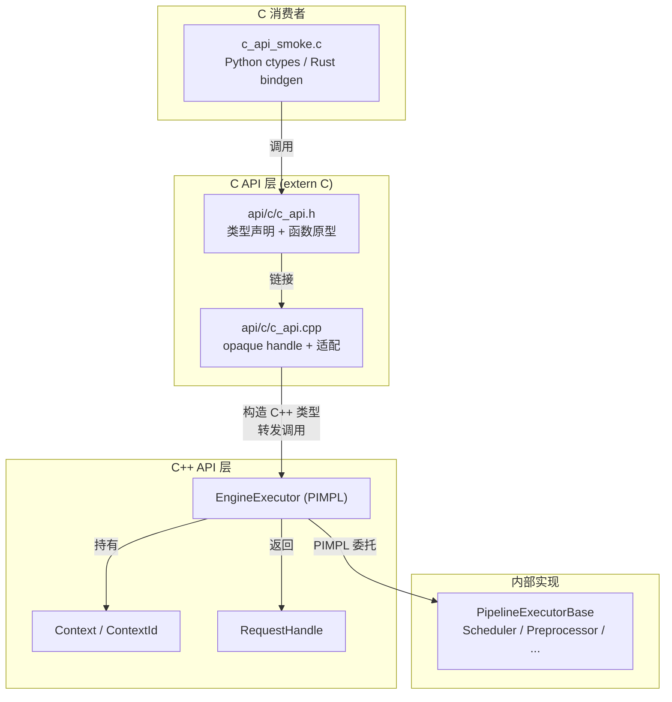

# C API 设计（DESIGN）

> **模块定位**：C API 是 C++ API 之上的薄封装层，以 `extern "C"` 函数 + opaque handle 提供编译器无关的 ABI 稳定边界。本文档描述 How——opaque handle 实现、类型映射、内存生命周期、异常边界。

---

## §1 模块定位

| 属性 | 值 |
|------|-----|
| 代码路径 | `cann_lm/engine/api/c/` |
| 头文件 | `api/c/c_api.h`（纯 C，仅 `<stddef.h>` / `<stdint.h>`） |
| 实现 | `api/c/c_api.cpp`（C++17，include C++ API 头） |
| 编译产物 | 编入 `libcann_lm_engine.a`（同一静态库） |
| 命名空间 | 无（`extern "C"`，全局符号） |
| 上游 | C++ API：`EngineExecutor` / `Context` / `RequestHandle`（见 pipeline+engine_executor DESIGN） |

## §2 架构总览



**关键边界**：
- C → C API：经 `extern "C"` 符号，ABI 稳定
- C API → C++ API：C++ 调用，类型转换 + 异常守卫
- C++ API → 内部：PIMPL，已有架构不变

## §3 模块清单

| 模块 | 代码 | 职责 | 依赖 |
|------|------|------|------|
| M-01 C API Header | `api/c/c_api.h` | 类型声明 + 15 个函数原型；纯 C；不依赖 C++ 头 | C 标准库 (`stddef`, `stdint`) |
| M-02 C API Impl | `api/c/c_api.cpp` | opaque handle 定义 + 类型适配 + 异常守卫 + 内存管理 | C++ API (`engine_executor.h`, `request_handle.h`, `types.h`, `context.h`, `status.h`) |

## §4 契约清单

| 契约 | 定义位置 | 导出给 | 说明 |
|------|----------|--------|------|
| C-API-01 Status | `api/c/c_api.h` `#define` | C 消费者 | `int` 值 0–5，1:1 对应 C++ `Status::SUCCESS..CANCELED` |
| C-API-02 Opaque Handles | `api/c/c_api.h` `typedef struct` | C 消费者 | `Executor` / `Request` 为不透明指针；`ContextId` 为 `uint64_t` 值类型 |
| C-API-03 POD Structs | `api/c/c_api.h` `typedef struct` | C 消费者 | `Buffer` / `ModelArtifact` / `ModelArtifactPath` / `EngineOptions` / `SamplingParams` / `Result` |
| C-API-04 Enums | `api/c/c_api.h` `typedef enum` | C 消费者 | `FinishReason` / `RequestStatus` / `LogLevel`；枚举值与 C++ `enum class` 1:1 |
| C-API-05 StreamCallback | `api/c/c_api.h` `typedef` | C 消费者 | 函数指针 + `user_data`，替代 `std::function` |
| C-API-06 15 Functions | `api/c/c_api.h` 函数原型 | C 消费者 | 见 §6 接口签名 |

## §5 数据流

### 5.1 Executor 生命周期

```
C 侧                           C API (c_api.cpp)                C++ API
──────                         ──────────────                   ────────
ExecutorCreate(path, opts, &out)
                               → new CANN_LMEngine_Executor{}
                               → make_unique<EngineExecutor>(path, opts)
                               → *out = executor
                               ← SUCCESS                        ← 构造成功（stub 存路径）

ExecutorDestroy(exec)
                               → delete executor
                               → ~unique_ptr<EngineExecutor>
                               → ~unordered_map<Context>       ← Context 析构
```

### 5.2 推理（同步 Generate）

```
C 侧                           C API (c_api.cpp)                C++ API
──────                         ──────────────                   ────────
Generate(exec, "hello", ctx_id, params, &result)
                               → contexts.find(ctx_id)
                               → NOT_FOUND if missing
                               → Prompt{.text = "hello"}
                               → to_cpp_params(params)  (指针→vector)
                               → ee->Generate(prompt, ctx, sp, &cpp_result)
                               ← SUCCESS/FAILURE
                               → fill_c_result(cpp_result, &result)
                                 malloc(token_ids) + memcpy
                                 malloc(text) + '\0'
                               ← SUCCESS + result filled
```

### 5.3 流式回调

```
C++ pipeline 线程               C API (c_api.cpp)                C 侧 callback
──────────────                 ──────────────                   ────────────
std::function<void(TokenId, string)> invoked
                               → lambda: cb(token, text.c_str(),
                                              text.size(), user_data)
                               → C 函数指针调用 ──────────────→ user callback(token, text,
                                                                         text_len, user_data)
                               ← (回调返回)
                               ← (std::function 返回)
```

## §6 接口签名

### 6.1 Executor 生命周期

```c
CANN_LMEngine_Status CANN_LMEngine_ExecutorCreate(
    const CANN_LMEngine_ModelArtifactPath*  prefill,
    const CANN_LMEngine_ModelArtifactPath*  decode,
    const CANN_LMEngine_EngineOptions*       options,   // NULL = default
    CANN_LMEngine_Executor**                 out);

CANN_LMEngine_Status CANN_LMEngine_ExecutorCreateFromBuffer(
    const CANN_LMEngine_ModelArtifact*  prefill,
    const CANN_LMEngine_ModelArtifact*  decode,
    const CANN_LMEngine_EngineOptions*   options,
    CANN_LMEngine_Executor**             out);

void CANN_LMEngine_ExecutorDestroy(CANN_LMEngine_Executor* executor);
```

### 6.2 Context 管理

```c
CANN_LMEngine_Status CANN_LMEngine_ContextCreate(
    CANN_LMEngine_Executor*    executor,
    CANN_LMEngine_ContextId*   out);

CANN_LMEngine_Status CANN_LMEngine_ContextDestroy(
    CANN_LMEngine_Executor*   executor,
    CANN_LMEngine_ContextId   context_id);

CANN_LMEngine_Status CANN_LMEngine_ContextCancel(
    CANN_LMEngine_Executor*   executor,
    CANN_LMEngine_ContextId   context_id);
```

### 6.3 推理

```c
CANN_LMEngine_Status CANN_LMEngine_ExecutorGenerate(
    CANN_LMEngine_Executor*               executor,
    const char*                           prompt_text,
    CANN_LMEngine_ContextId              context_id,
    const CANN_LMEngine_SamplingParams*   params,    // NULL = default
    CANN_LMEngine_Result*                 out);

CANN_LMEngine_Status CANN_LMEngine_ExecutorGenerateAsync(
    CANN_LMEngine_Executor*               executor,
    const char*                           prompt_text,
    CANN_LMEngine_ContextId              context_id,
    const CANN_LMEngine_SamplingParams*   params,
    CANN_LMEngine_Request**               out,
    CANN_LMEngine_StreamCallback          callback,   // NULL = non-streaming
    void*                                 user_data);
```

### 6.4 Request 查询与控制

```c
CANN_LMEngine_RequestStatus CANN_LMEngine_RequestGetStatus(
    const CANN_LMEngine_Request* request);

int CANN_LMEngine_RequestIsDone(const CANN_LMEngine_Request* request);

CANN_LMEngine_Status CANN_LMEngine_RequestCancel(
    CANN_LMEngine_Request* request);

CANN_LMEngine_Status CANN_LMEngine_RequestWait(
    CANN_LMEngine_Request*  request,
    CANN_LMEngine_Result*  out);

CANN_LMEngine_Status CANN_LMEngine_RequestTryGetResult(
    const CANN_LMEngine_Request*  request,
    CANN_LMEngine_Result*         out);

void CANN_LMEngine_RequestDestroy(CANN_LMEngine_Request* request);
```

### 6.5 Result 内存管理

```c
void CANN_LMEngine_ResultDestroy(CANN_LMEngine_Result* result);
```

## §7 决策索引

| 决策 | 选项 | 选定 | 理由 | 状态 |
|------|------|------|------|------|
| D-01 | C API 是否独立库 | 同一库 | `api/c/c_api.cpp` 编入 `libcann_lm_engine.a`，用户只链接一个库 | accepted |
| D-02 | Context 表示 | `ContextId` (uint64_t) | Context 是轻量共享句柄，C 侧只需 ContextId 标识；Context C++ 对象由 Executor wrapper 内部表持有 | accepted |
| D-03 | Result 内存管理 | 库分配 + 调用方 `ResultDestroy` | `malloc` / `free` 配对，调用方无需预分配 buffer | accepted |
| D-04 | Prompt 范围 | 首期纯文本 | 多模态需 Tensor C handle 设计，首期范围外 | accepted |
| D-05 | 异常处理 | `try/catch(...)` → `FAILURE` | C ABI 禁止异常跨界 | accepted |
| D-06 | 命名约定 | `CANN_LMEngine_<Type><Verb>` | 库前缀 + 类型分类 + 动词；参考 CUDA 命名风格 | accepted |
| D-07 | 头文件纯净度 | 仅 `<stddef.h>` / `<stdint.h>` | C 消费者不应被迫 include C++ 标准库头 | accepted |
| D-08 | 状态码映射 | C `int` 值 = C++ `Status` 常量值 | 1:1 映射，`static_cast` 安全 | accepted |

## §8 代码计划

| 文件 | 语言 | 内容 | 状态 |
|------|------|------|------|
| `api/c/c_api.h` | C | 15 个函数原型 + 全部类型声明 | ✅ 完成 |
| `api/c/c_api.cpp` | C++17 | opaque handle + 适配 + 异常守卫 + 内存管理 | ✅ 完成 |
| `main/c_api_smoke.c` | C | 纯 C smoke test（10 个 assertion） | ✅ 完成 |
| `CMakeLists.txt` | CMake | `LANGUAGES C CXX`；加 `api/c/c_api.cpp`；加 `c_api_smoke` target | ✅ 完成 |

构建验证：`cmake --build build` → `api_smoke` exit 0 + `c_api_smoke` exit 0（零警告）

## §9 风险登记

| 风险 | 概率 | 影响 | 缓解 |
|------|------|------|------|
| C 消费者忘记 `ResultDestroy` → 内存泄漏 | 中 | 中 | 文档强调；`ResultDestroy` 对已清零 Result 为安全 no-op |
| C 消费者 double-free Result | 低 | 高 | `ResultDestroy` 置 NULL，重复调用安全 |
| C 回调内调用 Engine API → 死锁 | 中 | 高 | 文档约束（同 C++ API 回调约束） |
| C++ 异常逃逸到 C 侧 → UB | 低 | 极高 | 全部 C 函数 `try/catch(...)` 守卫 |
| ContextId 冲突（多个 Executor） | 极低 | 低 | ContextId 由 C++ pipeline 全局分配，每个 Executor 独立 |
| 未来多模态扩展破坏 ABI | 中 | 中 | 新增 `CANN_LMEngine_Prompt` struct + `ExecutorGenerateMultiModal` 函数，不改动现有函数 |

## §10 类型映射表

### 10.1 标量与枚举

| C++ 类型 | C 类型 | 映射方式 |
|----------|--------|----------|
| `TokenId` = `uint32_t` | `CANN_LMEngine_TokenId` = `uint32_t` | typedef |
| `ContextId` (struct, `uint64_t value`) | `CANN_LMEngine_ContextId` = `uint64_t` | 取 `.value` |
| `Status` (struct, `int code`) | `CANN_LMEngine_Status` = `int` | 取 `.code` |
| `FinishReason` (enum class, 0–4) | `CANN_LMEngine_FinishReason` (enum, 0–4) | `static_cast` |
| `RequestStatus` (enum class, 0–5) | `CANN_LMEngine_RequestStatus` (enum, 0–5) | `static_cast` |
| `LogLevel` (enum class, 0–4) | `CANN_LMEngine_LogLevel` (enum, 0–4) | `static_cast` |

### 10.2 POD 结构体

| C++ 类型 | C 类型 | 适配逻辑 |
|----------|--------|----------|
| `Buffer {const void*, size_t}` | `CANN_LMEngine_Buffer` | 字段一一对应，直接拷贝 |
| `ModelArtifact` (3 Buffer) | `CANN_LMEngine_ModelArtifact` | 逐字段拷贝 |
| `ModelArtifactPath` (2 `std::string`) | `CANN_LMEngine_ModelArtifactPath` (2 `const char*`) | `std::string` → `const char*`（`.c_str()` 或构造） |
| `EngineOptions` | `CANN_LMEngine_EngineOptions` | 逐字段拷贝；`LogLevel` enum 转换 |
| `SamplingParams` (含 `vector`) | `CANN_LMEngine_SamplingParams` (含指针+count) | `vector::data()` + `.size()`；或 `assign(ptr, ptr+count)` |
| `Result` (含 `vector` + `string`) | `CANN_LMEngine_Result` (含指针+count + `char*`) | `malloc` + `memcpy`；`ResultDestroy` 释放 |
| `Prompt` (含 `string` + `vector`) | `const char* prompt_text` 参数 | 首期仅 text；`prompt.text = prompt_text` |
| `StreamCallback` (`std::function`) | `CANN_LMEngine_StreamCallback` (函数指针) | lambda 捕获 cb + user_data，包装为 `std::function` |

### 10.3 Opaque Handle 映射

| C++ 类型 | C 类型 | 内部实现 |
|----------|--------|----------|
| `EngineExecutor` (PIMPL class) | `CANN_LMEngine_Executor*` (opaque) | `struct { unique_ptr<EngineExecutor> ee; unordered_map<uint64_t, Context> contexts; }` |
| `RequestHandle` (move-only class) | `CANN_LMEngine_Request*` (opaque) | `struct { RequestHandle handle; }` |
| `Context` (shared 句柄 class) | `CANN_LMEngine_ContextId` (uint64_t) | 存入 Executor wrapper 的 `contexts` map，按 `ContextId` 查找 |

## §11 内存生命周期

### 11.1 Executor Handle

```
ExecutorCreate → new CANN_LMEngine_Executor  (heap)
    ├── unique_ptr<EngineExecutor>           (RAII, 析构自动释放)
    └── unordered_map<ContextId, Context>    (RAII, 析构自动释放所有 Context)
ExecutorDestroy → delete CANN_LMEngine_Executor  (触发上述 RAII 链)
```

### 11.2 Request Handle

```
GenerateAsync → new CANN_LMEngine_Request  (heap)
    └── RequestHandle handle  (move-only, 析构释放请求槽)
RequestDestroy → delete CANN_LMEngine_Request  (触发 RequestHandle 析构)
```

### 11.3 Result 内部指针

```
Generate / RequestWait / RequestTryGetResult
    → malloc(token_ids_count * sizeof(TokenId))  → result.token_ids
    → malloc(text_len + 1)                         → result.text (null-terminated)
    → memcpy from C++ vector / string

ResultDestroy
    → free(result.token_ids)  → set NULL, count=0
    → free(result.text)        → set NULL
```

### 11.4 Context 生命周期

```
ContextCreate → ee->CreateContext(&ctx)  → contexts[id] = move(ctx)
ContextDestroy → ee->DestroyContext(id)  → contexts.erase(id)
ContextCancel → ee->CancelContext(id)    (不 erase，Context 仍可查询)
ExecutorDestroy → ~unordered_map         (自动释放所有存留 Context)
```

## §12 异常边界

### 12.1 守卫模式

所有 C 函数统一用 `try { ... } catch (...) { return CANN_LM_ENGINE_FAILURE; }` 守卫：

```cpp
extern "C" CANN_LMEngine_Status CANN_LMEngine_ExecutorGenerate(...) {
    if (!executor || !prompt_text || !out)
        return CANN_LM_ENGINE_INVALID_ARGUMENT;  // 在 try 之前
    *out = CANN_LMEngine_Result{};
    try {
        // ... C++ API 调用 ...
        return status_to_c(s);
    } catch (...) {
        return CANN_LM_ENGINE_FAILURE;
    }
}
```

### 12.2 不守卫的函数

以下函数不涉及 C++ 异常（纯 C 操作或 NULL 安全处理），无需 try/catch：
- `CANN_LMEngine_ExecutorDestroy(NULL)` — `delete nullptr` 安全
- `CANN_LMEngine_RequestDestroy(NULL)` — 同上
- `CANN_LMEngine_ResultDestroy(&result)` — `free(NULL)` 安全
- `CANN_LMEngine_RequestGetStatus(NULL)` — 返回默认值
- `CANN_LMEngine_RequestIsDone(NULL)` — 返回 0
- `CANN_LMEngine_RequestCancel(NULL)` — 返回 SUCCESS（幂等）

### 12.3 回调异常

C++ `std::function` 回调内的异常会传播到 `GenerateAsync` 的 C++ 调用层，被外层 `try/catch(...)` 捕获。C 侧 callback 本身不应抛异常（C 无异常概念），但如果 C++ 包装 lambda 内的 C 函数调用产生未定义行为（如访问已释放内存），这是调用方 bug，不在守卫范围内。

## §13 头文件组织

### 13.1 api/c/c_api.h 依赖

```
c_api.h
  ├── <stddef.h>  (size_t)
  └── <stdint.h>  (uint32_t, uint64_t)
```

不 include 任何 C++ 标准库头。C 消费者只需标准 C 头。

### 13.2 api/c/c_api.cpp 依赖

```
c_api.cpp
  ├── api/c/c_api.h            (自身)
  ├── api/cpp/engine_executor.h   (EngineExecutor)
  ├── api/cpp/request_handle.h    (RequestHandle)
  ├── api/cpp/types.h             (Prompt, SamplingParams, Result, ...)
  ├── core/context.h          (Context, ContextId)
  ├── infra/status.h          (Status)
  └── <cstdlib> <cstring> <memory> <string> <unordered_map> <utility> <vector>
```

C++ 标准库头只在 `.cpp` 中出现，不泄漏到 `api/c/c_api.h`。

### 13.3 目录结构

```
cann_lm/engine/
  api/
    c/
      c_api.h      ← C 头（对外）
      c_api.cpp    ← C++ 实现（对内）
    cpp/
      engine_executor.h   ← C++ API（c_api.cpp 依赖）
      engine_executor.cpp
      request_handle.h
      request_handle.cpp
      types.h
  core/
    context.h
  infra/
    status.h
  main/
    api_smoke.cpp   ← C++ smoke test
    c_api_smoke.c   ← C smoke test
  CMakeLists.txt
```

---

## 变更记录

| 版本 | 日期 | 变更内容 |
|------|------|----------|
| 0.1.0 | 2026-08-14 | 初版：C API 设计定稿。opaque handle 实现（Executor 持 `unique_ptr<EngineExecutor>` + `unordered_map<ContextId, Context>`；Request 持 `RequestHandle`），18 个函数签名，类型映射表（C++→C），内存生命周期（Result malloc/free + ResultDestroy），异常边界（try/catch→FAILURE，6 个 NULL-safe 函数无需守卫），头文件组织（`api/c/c_api.h` 仅 `<stddef.h>`/`<stdint.h>`）。8 条决策记录，6 条风险登记。联动 c_api SPEC v0.1.0、pipeline+engine_executor DESIGN v0.4.0。 |
| 0.1.1 | 2026-08-14 | 目录重组：`c_api/` → `api/c/`，C++ API `api/` → `api/cpp/`。§1 代码路径、§2 mermaid、§3 模块清单、§8 代码计划、§13 头文件组织（§13.1/§13.2 include 路径 + §13.3 目录树）全量同步。构建零警告通过，`api_smoke` + `c_api_smoke` 双绿。 |
