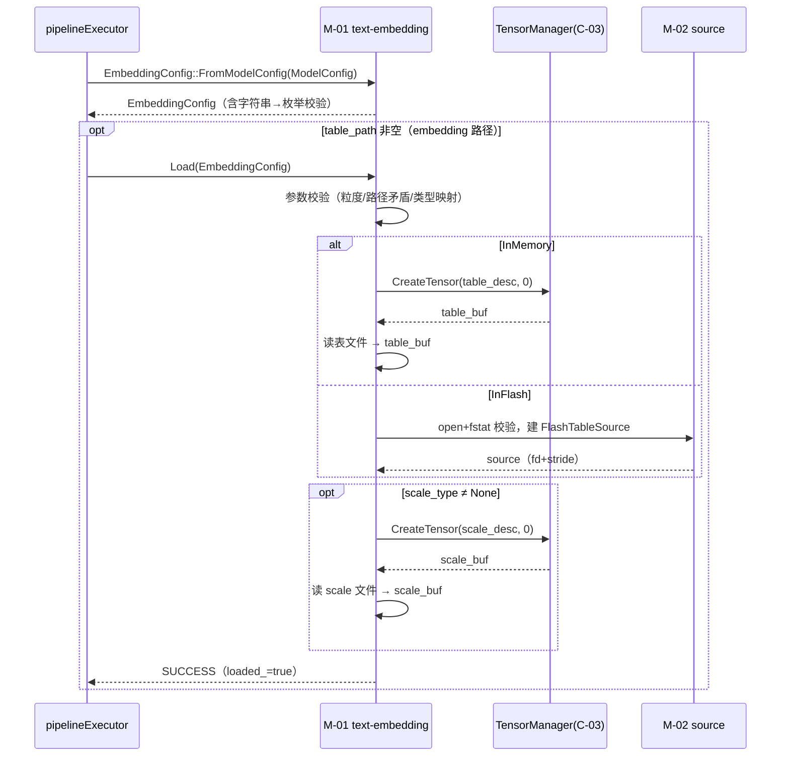
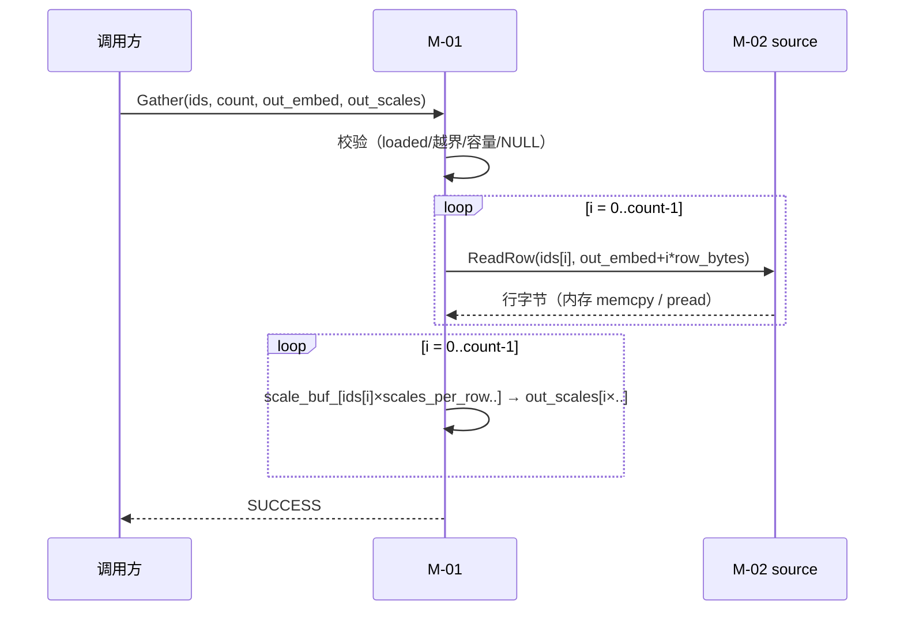
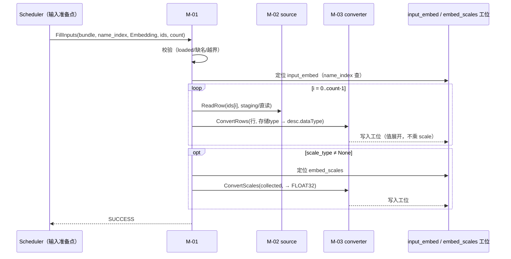
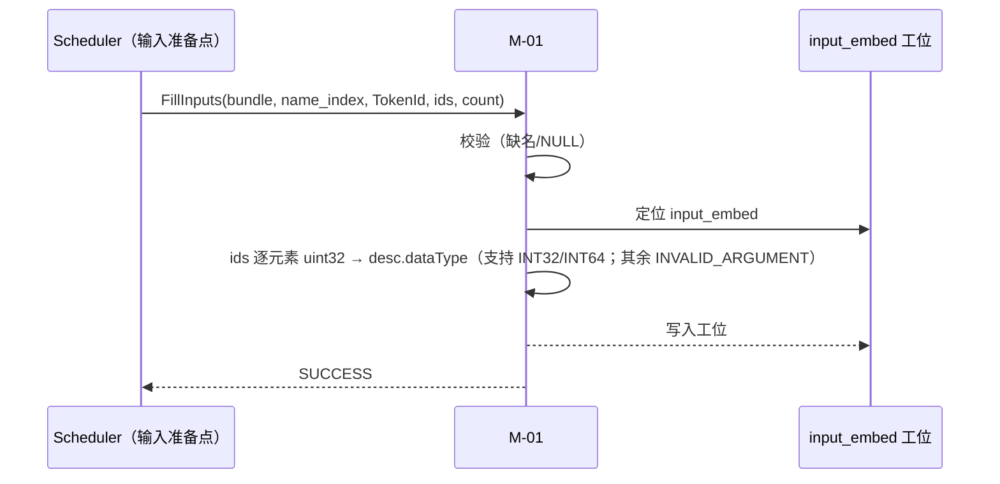

# TextEmbedding 模块 Design

<!--
机器可读的权威设计版本（含完整 ID 交叉引用）。
配套：`./SPEC.md`（行为规格，SR20260828001）、`./DESIGN_HUMAN.md`（叙述式重写，方便通读）。
技术决策与本文档完全一致；本文档为权威版本。
-->

## 目录

- [Spec 摘要](#spec-摘要)
- [§1 范围与目标](#1-范围与目标)
- [§2 架构总览](#2-架构总览)
  - [§2.1 架构风格与哲学](#21-架构风格与哲学)
  - [§2.2 运行时架构](#22-运行时架构)
  - [§2.3 部署与硬件映射](#23-部署与硬件映射)
  - [§2.4 并发与线程安全](#24-并发与线程安全)
- [§3 模块清单](#3-模块清单)
- [§4 契约清单](#4-契约清单)
- [§5 关键流程清单](#5-关键流程清单)
- [§6 质量属性与跨切面策略](#6-质量属性与跨切面策略)
- [§7 决策索引](#7-决策索引)
- [§8 Code Plan Hints](#8-code-plan-hints)
- [§9 风险与未决项](#9-风险与未决项)
- [§10 变更日志](#10-变更日志)
- [模块](#模块)
  - [M-01-text-embedding](#m-01-text-embedding)
  - [M-02-table-source](#m-02-table-source)
  - [M-03-type-converter](#m-03-type-converter)
- [契约](#契约)
  - [C-01-pipeline-loader](#c-01-pipeline-loader)
  - [C-02-executor-input-bundle](#c-02-executor-input-bundle)
  - [C-03-tensormanager-contract](#c-03-tensormanager-contract)
  - [C-04-backend-types-contract](#c-04-backend-types-contract)
- [流程](#流程)
  - [F-01-load](#f-01-load)
  - [F-02-gather](#f-02-gather)
  - [F-03-fill-embedding-path](#f-03-fill-embedding-path)
  - [F-04-fill-tokenid-path](#f-04-fill-tokenid-path)
- [性能与质量](#性能与质量)
  - [concurrency](#concurrency)
  - [performance](#performance)
  - [dfx](#dfx)
  - [security](#security)

---

## Spec 摘要

- Spec ID：`SR20260828001`
- 上游 spec：`./SPEC.md`
- 软件层次：framework（engine core 可复用库）
- 覆盖行为组：Load(§4.1.1) / Gather(§4.1.2) / FillInputs(§4.1.3) / 类型转换(§4.1.4) / 双路径数据流(§4.1.5) / 错误分类(§4.1.6)
- 上游决策来源：brainstorm（2026-08-27）+ 用户三轮确认（2026-08-28：perToken/perGroup 量化粒度、dtype 以 TensorDesc 为准 + host 类型转换、Gather 同时输出 out_scales、TokenId 路径表在权重中、InFlash 加载方式）
- U-1（TokenId 路径表交付通道）已解决：表包含在模型权重中随图加载，本模块只填 token id。

```yaml
spec_source: ./SPEC.md
level: design
spec_id: SR20260828001
delta_summary: 单类 façade + 内部 TableSource 双策略（InMemory/InFlash）+ 纯函数类型转换；host 只搬运/值展开不反量化；FillInputs 主动填工位（依赖 executor input bundle + name→index）；表/scale buffer 经 TensorManager 单例申请。
covers: [Load, Gather, FillInputs, TypeConvert, DualPath, ErrorClassify]
status: draft
```

---

## §1 范围与目标

- **in scope**：`cann_lm/engine/core/component/text_embedding` 下 C++ embedding 模块——embedding 表与 scale 文件的加载（InMemory 整表入内存 / InFlash 留在文件按行读）、host 侧 gather（行拷贝 + per-token scale 收集）、存储类型→工位类型转换、输入工位填充（embedding 路径填 `input_embed`+`embed_scales`；tokenId 路径填 token id）。原地重写现有 `TextEmbedding` 桩；`ModalityEntry` 保留原位不动。内部模块，不对 Python/外部暴露。
- **out of scope**（含理由）：
  - 反量化（乘 scale）——spec §4.1.4/§4.1.5 归 NPU/om 图内；host 永不做。
  - tokenId 路径的表交付——**表已包含在模型权重中随图加载**（U-1 已解决），本模块不经手。
  - attention_mask/position_ids/new_kv_cache_pos 等其他工位填充——归 `InputAssembler`（model_executor M-03）。
  - 多模态占位符替换——归 `Preprocessor`（经 `ModalityEntry`，同头文件另一职责）。
  - 表内存底层申请策略——经 `TensorManager` 单例 / `ITensorBuffer` 抽象（C-03/C-04）。
  - InFlash 表文件热更新——spec U-7 明确不支持；损坏走 FAILURE 路径。
  - INT4/BF16 存储类型的转换/解包——spec U-3 本版本不支持。
- **目标优先级**：行为正确性（gather/转换逐字节对）> 错误码精确（6 粗码）> gather 带宽 > 内存占用（InFlash 可选零常驻）。

## §2 架构总览

### §2.1 架构风格与哲学

```mermaid
graph TD
  PE[pipelineExecutor/AutoregressivePipelineExecutor] -->|init 期 Load(config)| TE[M-01 text-embedding 单类 façade]
  PE -->|输入准备期 FillInputs（经其 Scheduler 成员，§2.2 接线点）| TE
  TE -->|行读取统一接口 ReadRow| SRC[M-02 table-source<br/>InMemory / InFlash 双策略]
  TE -->|逐元素值展开| CVT[M-03 type-converter 纯函数]
  TE -->|表/scale buffer 申请| TM[TensorManager 单例 C-03]
  SRC -->|InMemory: 内存拷贝| BUF[(host ITensorBuffer)]
  SRC -->|InFlash: pread 按行偏移| FLASH[(表文件)]
  TE -->|读写工位| ME[ModelExecutor input_tensors_ + name_index<br/>C-02 只读暴露]
  ME -->|input_embed / embed_scales 工位| OM[(om 图)]
  OM -->|NPU 侧 dequant| NPU[(NPU)]
  note1[host 只搬运 / 值展开<br/>不乘 scale] -.-> TE
```

风格声明（≤100 字）：**单类 façade + 双数据源策略 + 纯函数转换**。对外一个 `TextEmbedding` 具体类（无多态层次，D-03）；内部按 `load_mode` 二态分派行读取（M-02，类型无关策略化钩子的第一落点）；类型转换是纯函数集（M-03）；host 侧只做字节搬运与值展开，反量化永远在 NPU（D-01）。

### §2.2 运行时架构

两类运行形态，均由 pipeline 驱动：

- **init 期（仅 embedding 路径需要）**：`AutoregressivePipelineExecutor` 构造后、首次 Forward 前，以 `EmbeddingConfig` 调 `text_embedding_.Load(config)`（F-01）。config 组装通道（U-8 路线 b，2026-08-29 拍板；**SR20260903001 部分取代，2026-09-04 拍板**）：**meta_json `embedding_config` 段 → pipeline 内联解析步骤直调 `EmbeddingConfig::FromSection(weights, dequant_scale, type, scale_type, quant_mode, load_mode, vocab, hidden, out)`**（D-12 直接参数化，原 `FromModelConfig(ModelConfig)` 移除；ModelConfig 迁至 model_executor.h 且不再承载 embedding 扩展字段；vocab/hidden 跨段取自 model_config 段）——L1 `EngineOptions`/C ABI 不动。字段集与映射见 C-01 §2。表 buffer 经 `TensorManager::Instance().CreateTensor` 申请（C-03）；InFlash 模式不申请表 buffer、只持 fd + stride。`ModelConfig` 的 embedding 字段全空/缺省（如 tokenId 部署形态）→ 不调 Load。
- **每步前向的输入准备期**：实际调用组件是 **`Scheduler`**（不是 RunLoop 本体——RunLoop 只调 `scheduler_.Step()`，输入准备发生在 `Step` 内部，见下方"接线点"）。`Scheduler` 在 prefill / decode 两个输入准备点对目标 executor 调 `text_embedding_->FillInputs(executor.InputTensors(), executor.InputNameIndex(), path, ids, count)`（F-03/F-04），随后 `executor.Forward(opts)`。工位数据由本模块写入 `input_embed`（及 embedding 路径的 `embed_scales`）；其余工位仍由 InputAssembler 填。

与现行 `SetInputData` 的关系：embedding 路径下工位填充职责从"调用方备好 buffer → SetInputData memcpy"转移给本模块（`embed_scales` 从搁置变为本模块填，落地 INPUT_INFO 既定填充者）；`SetInputData` 保留（外部直填通道，C-01 兼容性不变）。

**接线点（外部审查 H-1 修订，2026-08-29）**——`input_embed` 工位在现行代码中的唯一写入方是 `Scheduler`（全仓仅 `scheduler.cpp:127`（prefill）与 `scheduler.cpp:191`（decode）两处 `SetInputData` 调用；RunLoop 不做输入填充）。接线设计：

1. **`Scheduler` 构造签名新增 `TextEmbedding* text_embedding` 非拥有指针**（与既有 `Preprocessor* preprocessor` 同型）：`Scheduler(ModelExecutor*, ModelExecutor*, Preprocessor*, TextEmbedding*, int max_batch_size)`。`pipeline_executor.cpp` 两处构造点（`:42`/`:67`）追加实参 `&text_embedding_`——成员声明序 `text_embedding_` 先于 `scheduler_`，构造期指针有效。
2. **`SetInputData` 让位规则（按调用点 + 路径）**：
   - **prefill 点（`scheduler.cpp:127`）**：embedding 路径 → `SetInputData(chunk)` **被取代**，改为 `FillInputs(executor.InputTensors(), executor.InputNameIndex(), EmbeddingPath::Embedding, ids, count)`，其中 `ids = chunk->GetData() const TokenId*`、`count = chunk_len`；tokenId 路径 → 同样改走 `FillInputs(..., TokenId, ids, count)`（ids 取自 chunk，模块做 INT32/INT64 值转换写入，取代裸 memcpy）。
   - **decode 点（`scheduler.cpp:191`）**：同上，`ids` 取自 `Preprocessor.PrepareDecodeStep` 产出的 `inputs[0]`。
   - 即：接线完成后 `input_embed` 的**唯一运行期写入方是本模块**（两路径皆然）；`SetInputData` 在仓内零调用，仅作为"外部直填通道"API 保留（不删，向后兼容）。
3. **路径选择的供给**：`Scheduler` 不自决路径——按 model_executor D-07 既有逻辑（om 是否内置 embedding）取得 `EmbeddingPath` 后透传给 `FillInputs`（来源与传递细节归 model_executor/pipeline 侧，接线里程碑 ⑥ 落实）。
4. **双写禁止**：同一工位在同一 iteration 内只允许一次写入。`SetInputData` 与 `FillInputs` 不得对同一 `input_embed` 先后都调（接线后 Scheduler 不再调 `SetInputData` 填 `input_embed`；若未来有外部直填需求，须在 FillInputs 之外的整体调度层做互斥，非本模块职责）。

### §2.3 部署与硬件映射

- host 侧纯 CPU（文件读 + memcpy + 值展开转换），无 NPU 算子调用、无 DMA。
- 内存形态：InMemory = 表 + scale 各一份 host buffer 常驻；InFlash = scale 常驻 + 表 fd（零表常驻）。
- 可选部署开关：内存受限（端侧 OHOS）→ InFlash；吞吐优先（服务器 ACL）→ InMemory。同一构建产物两者皆可用（运行期配置，非编译期二选一）。

### §2.4 并发与线程安全

- 契约（非锁保证）：`Load` 不并发、`Load` 与 `Gather`/`FillInputs` 不并发（调用方 pipeline 串行 init）；同一实例 `Gather`（const）可多线程并发——M-02 两策略均满足（内存读天然并发；InFlash 用 `pread` 位置读，不动共享游标）。
- `FillInputs` 不做并发承诺（其写目标工位 buffer 属 Forward 输入准备期，天然单线程）。
- 模块自身**无锁**：所有成员在 Load 后只读（表 buffer / fd / stride / scale buffer / 元数据），无 mutable 状态。

## §3 模块清单

| ID | 名称 | 一句话职责 | 依赖 | 详情 |
|----|------|-----------|------|------|
| M-01 | text-embedding | 单类 façade：Load（配置校验 + 委托 M-02 建源 + scale 加载）/ Gather（行读 + scale 收集）/ FillInputs（gather→转换→写工位）/ 访问器 | M-02, M-03, C-03, C-04 | [→](#m-01-text-embedding) |
| M-02 | table-source | 表数据源内部策略：统一 `ReadRow(id, dst)`；InMemory（内存 buffer 拷贝）/ InFlash（fd + pread 按行偏移）二态；类型无关 | C-04 | [→](#m-02-table-source) |
| M-03 | type-converter | 存储类型→工位 dtype 的逐元素值展开纯函数集（不乘 scale）；含支持矩阵判定 | — | [→](#m-03-type-converter) |

依赖图无环校验：M-03 无依赖；M-02 ← {C-04}；M-01 ← {M-02, M-03, C-03, C-04}。✓

> 三者全部落 `core/component/text_embedding.{h,cpp}` 单文件对；M-02/M-03 为 `.cpp` 内部实现细节（匿名命名空间 / detail 命名空间），**不出现在公开头**——对外仅 M-01 单类（D-03）。

## §4 契约清单

> `AutoregressivePipelineExecutor` 为外部参与者（消费方）。`ModelExecutor`/`TensorManager`/backend 类型为外部同级，本设计只声明依赖契约。

| ID | 生产者 | 消费者 | 一句话契约 | 详情 |
|----|--------|--------|-----------|------|
| C-01 | M-01 | pipelineExecutor | init 期 Load(EmbeddingConfig)；输入准备期 FillInputs；运行期 Gather（UT/调试） | [→](#c-01-pipeline-loader) |
| C-02 | ModelExecutor（外部） | M-01 | 只读暴露 `InputTensors()` / `InputNameIndex()`（新增 accessor，加法变更） | [→](#c-02-executor-input-bundle) |
| C-03 | TensorManager（外部单例） | M-01 | 表/scale host buffer 申请（`CreateTensor(desc, modelId=0哨兵, &out)`） | [→](#c-03-tensormanager-contract) |
| C-04 | backend 类型（外部） | M-01/M-02 | 仅依赖 `ITensorBuffer`/`TensorDesc`/`DataType` 抽象；不引用具体后端类名 | [→](#c-04-backend-types-contract) |

## §5 关键流程清单

| ID | 场景 | 关键路径 | 详情 |
|----|------|---------|------|
| F-01 | Load（InMemory/InFlash） | pipeline→M-01 校验配置→M-02 建源（读文件/stat+fd）→scale 加载→C-03 申请 buffer | [→](#f-01-load) |
| F-02 | Gather | 调用方→M-01 校验→逐 id M-02.ReadRow→out_embed；scale 下标收集→out_scales | [→](#f-02-gather) |
| F-03 | FillInputs（embedding 路径） | pipeline→M-01→gather（F-02 内联）→M-03 转换→写 input_embed→写 embed_scales | [→](#f-03-fill-embedding-path) |
| F-04 | FillInputs（tokenId 路径） | pipeline→M-01→ids 值转换（INT32/INT64）→写 input_embed（无需 Load） | [→](#f-04-fill-tokenid-path) |

## §6 质量属性与跨切面策略

| 维度 | 核心策略 | 详情 |
|------|---------|------|
| 性能 | InMemory gather 贴 memcpy 带宽；InFlash 允许偏移排序优化（不改行序） | [→](#performance) |
| 并发 | 无锁只读设计；Load/查询分离由调用方串行保证 | [→](#concurrency) |
| DFX | 三级日志 + 关键 metric；Forward 热路径默认不记 INFO | [→](#dfx) |
| 安全 | 输入校验（越界/容量/NULL）+ 无外部暴露面 | [→](#security) |
| 错误传播 | 对齐 6 粗码，非静默；加载失败可恢复（保持未加载态） | spec §4.1.6 + F-xx |
| 数据一致性 | gather 逐字节确定性；转换纯值展开语义 | D-01/D-06 |

## §7 决策索引

| ID | 主题 | 状态 |
|----|------|------|
| D-01 | 反量化永远 NPU 侧；host 只搬运/值展开，类型转换不乘 scale | accepted |
| D-02 | 双路径：tokenId 路径表在模型权重中（本模块只填 id，无需 Load）；embedding 路径 host gather 填工位 | accepted |
| D-03 | 对外单类 + 类型标签分派（不做按 (embType,scaleType) 的多态层次）；内部仅 M-02 按 load_mode 二态策略化（预留钩子第一落点） | accepted |
| D-04 | 无 BindToModel：表/scale 不作权重绑定，作为输入工位数据 | accepted |
| D-05 | 模块主动填工位（FillInputs 依赖 executor input bundle + name→index；路径选择归 model_executor D-07） | accepted |
| D-06 | 填充类型以工位 TensorDesc.dataType 为准；存储类型仅描述文件布局；不匹配时 host 值展开转换 | accepted |
| D-07 | 量化粒度 PerToken（scale=[vocab]）/ PerGroup（scale=[vocab×groups]，GroupSize 必填且整除 hidden） | accepted |
| D-08 | 表加载方式 InMemory/InFlash 可选；InFlash 零表常驻、pread 按行读；运行期配置非编译期 | accepted |
| D-09 | scale 恒内存态（体量小 + 每次 gather 随机访问） | accepted |
| D-10 | 表/scale host buffer 经 TensorManager 单例申请（modelId=0 哨兵）；不直调 backend CreateTensorBuffer | accepted |
| D-11 | 错误码对齐 infra/status.h 6 粗码；无异常逃逸；加载失败保持未加载态可重 Load | accepted |

## §8 Code Plan Hints

**给下游 plan/impl agent**：
- 实现顺序（依赖拓扑）：C-04（仅确认 include 面，无代码）→ M-03 type-converter（纯函数，零依赖）→ M-02 table-source（依赖 C-04 类型）→ M-01 text-embedding façade（聚合 + C-03 + `FromModelConfig`）→ C-02 ModelExecutor accessor（两行加法）→ **Scheduler 接线**（§2.2 接线点：构造签名增 `TextEmbedding*`、`pipeline_executor.cpp:42/67` 传 `&text_embedding_`、prefill/decode 两输入准备点以 FillInputs 取代 SetInputData 填 input_embed）→ `AutoregressivePipelineExecutor` init 期 Load 接线（通道已定 U-8 路线 b：`ModelConfig` 扩展 embedding 段 + `FromModelConfig` 组装，`pipeline_executor.cpp:45/70` 组装点）。
- 可并行：M-02/M-03 互不依赖可并行。
- 实现某模块最小读取集：
  - M-01 → 本节 + C-01/C-02/C-03 + F-01/F-02/F-03/F-04
  - M-02 → 本节 + C-04 + F-01/F-02
  - M-03 → 本节 + spec §4.1.4（转换矩阵唯一权威）
- 集成里程碑：①M-03 + 全矩阵单测（含不支持组合拒绝）；②M-02 InMemory + ReadRow 正确性；③M-02 InFlash + pread + 损坏路径；④M-01 Load（两模式）+ Gather（PerToken/PerGroup）；⑤M-01 FillInputs 两路径 + mock bundle（6 名 desc）；⑥C-02 accessor + **Scheduler 接线（§2.2 接线点 1/2/3：构造签名 + 两调用点让位 + 路径透传）** + pipeline init Load 接线 + 现有 UT 全绿（LoadAndBind 桩删除后的调用面清零；接线后 `grep SetInputData` 仓内调用面应为零）。
- 源码落 `cann_lm/engine/core/component/text_embedding.{h,cpp}`（原地重写桩）；UT 落 `tests/cpp/engine/`（target `ut_text_embedding`，GoogleTest）；CMake 挂 engine 现有测试注册链，**并同步在 `cann_lm/engine/ohos/CMakeLists.txt` 注册**（OHOS 侧为显式逐 target 复制、与主链无共享机制，不补则鸿蒙部署跑不到；注意 `ut_sampler`/`ut_request_handle` 已有 OHOS 漂移先例，勿新增）。
- 后端绑定：无。M-01/M-02/M-03 均不引用具体后端类名（grep 断言）；buffer 经 TensorManager 单例。
- 删除清单：`LoadAndBind()` 桩（全仓 grep 确认零调用后删）；头注释 v1.1/v1.2 历史说明更新为指向本 DESIGN。

## §9 风险与未决项

| 风险/未决 | 影响 | 缓解 | 触发条件 |
|-----------|------|------|----------|
| ~~U-8~~ EmbeddingConfig 传递通道 | ~~未决议~~ **已决议（2026-08-29 用户拍板）**：路线 b——meta_json→`ModelConfig` 扩展 embedding 段（plain 字段，C-01 §2）→ `EmbeddingConfig::FromModelConfig` 组装；L1 EngineOptions/C ABI 不动 | 设计已落 C-01 §2 / F-01 / M-01 §2 | 已解决 |
| U-2 vocab/hidden 来源字段未对齐 | Load 入参来源漂移 | **来源已定 = ModelConfig 扩展字段（与 U-8 一并落，C-01 §2）**；仅余字段对齐 | 实现期 |
| U-3 INT4/BF16 不支持 | 部署形态受限 | 枚举占位 + 转换矩阵显式拒绝 | 出现真实需求 → 升级 M-02/M-03 策略化 |
| ~~U-4~~ INPUT_INFO 订正 | ~~待订正~~ **已完成（2026-08-29，INPUT_INFO v0.4）**：embed_scales 维度/输入 dtype/填充者表述均已随实现落地同步 | 已闭环 | 已解决 |
| U-5 gather/InFlash 延迟无基线 | 预算失准 | 实现期微基准 | aarch64 实测 |
| U-6 无 scale 时 embed_scales 处置 | 行为歧义 | 本设计取"跳过不填"（spec 同） | 首个无 scale 模型 |
| U-7 InFlash 文件生命周期 | 运行期损坏 | TC_111 FAILURE 路径；不支持热更新 | 文件被截断/替换 |
| TensorManager modelId 哨兵语义 | 真实后端 CreateTensor 或按 modelId 绑 NPU 上下文 | 表/scale 为 host buffer（CreateTensorBuffer 语义即 host）；modelId=0 传桩路径无副作用；真实后端接入时复核 | backend 实装期 |
| InFlash 随机读放大 | gather 延迟抖动 | 允许偏移排序优化（不改行序）；max_seqLen 量级单批行数有限 | 大 vocab + 高 QPS |
| FillInputs 调用点接线遗漏 | embed_scales 仍无人填 | 里程碑⑥ 显式接线（§2.2 接线点，落 Scheduler 两调用点）+ grep 断言 | 实现期 |
| SetInputData 与 FillInputs 双写 input_embed | 工位数据被覆盖，行为依赖调用顺序 | §2.2 接线点 4：接线后 Scheduler 不再以 SetInputData 填 input_embed（两路径皆改 FillInputs）；里程碑⑥ grep 断言仓内 SetInputData 调用面为零 | 实现期 |
| 工位动态 shape（desc.size==0）时容量判定失真 | stub 后端 GetSize 固定 1024 字节占位，真实容量判定误判 | 既有引擎缺口（INPUT_INFO §6 遗留 #4），非本设计引入；真实后端接入时复核 | backend 实装期 |
| 工位 dtype 为非常规类型（如 FLOAT64） | FillInputs 拒绝 | 转换矩阵显式列出支持集，其余 INVALID_ARGUMENT | om 图异常 |

## §10 变更日志

| 版本 | 日期 | 变更 | 触发 spec 章节 |
|------|------|------|---------------|
| 0.1 | 2026-08-28 | 初稿：10 章 SDD 设计 + 3 模块 + 4 契约 + 4 流程 + 11 决策。落地 SPEC SR20260828001 全部行为（含 U-1 已解决：TokenId 路径表在权重中）。 | SR20260828001 全 |
| 0.2 | 2026-08-29 | 外部审查（+2）放行条件修订：①§2.2/C-01/§8 新增 Scheduler 接线点设计（H-1：input_embed 唯一写入方是 scheduler.cpp:127/191 的 SetInputData，构造签名增 TextEmbedding*，让位规则按调用点+路径）；②§9 登记 U-8 EmbeddingConfig 传递通道（M-1）；③§8 补 OHOS CMakeLists 同步注册（M-2）与动态 shape 风险（M-3）；④L 级修订：M-02 工厂签名补 table_buf/flash_fd 入参（L-1）、F-03 先全量校验再写入（L-2）、空 buffer 入参归 INVALID_ARGUMENT + TC_112（L-3）、InFlash staging 明确栈上局部（L-4）、转换矩阵 Int8/Int4 同型列对齐 SPEC、C-03 错误表可恢复口径、C-02 注释消歧（L-5）。 | 外部审查报告（2026-08-29） |
| 0.3 | 2026-08-29 | U-8 决议落地（用户拍板路线 b）：C-01 §2 新增 EmbeddingConfig 组装通道设计（ModelConfig embedding 段 plain 字段 + `EmbeddingConfig::FromModelConfig` 静态工厂，依赖方向 text_embedding→tensor_manager 合法）；F-01 补组装步骤；§2.2 init 期补通道与空路径不 Load；U-2 来源随之定为 ModelConfig。全部未决项不再阻塞实现。 | SPEC U-8 决议 |

---

## 模块

### M-01-text-embedding

#### §1 职责

单类 façade（spec §4.1.1/4.1.2/4.1.3/4.1.6）。对外是唯一公开类 `TextEmbedding`，聚合三件事：
- **Load(EmbeddingConfig)**：配置校验（路径/类型/量化粒度/尺寸）→ 委托 M-02 建表源（InMemory/InFlash）→ scale 整体加载（恒内存态，D-09）→ 表 buffer 经 C-03 申请。失败保持未加载态。
- **Gather(ids, count, out_embed, out_scales)**：逐 id 行读（M-02）+ per-token scale 收集（内存下标），纯字节搬运。
- **FillInputs(inputs, name_index, path, ids, count)**：embedding 路径 = 内联 gather → M-03 转换 → 写 `input_embed` + `embed_scales`；tokenId 路径 = ids 值转换写 `input_embed`（无需 Load，D-02）。

不做：反量化、表交付（权重内）、其他工位、多模态占位（`ModalityEntry` 仅物理同文件）。

#### §2 对外接口

```cpp
// core/component/text_embedding/text_embedding.h（engine 内部组件，仅 pipeline/model_executor/UT 消费）

enum class EmbeddingType     { Fp32, Fp16, Int8, Int4 };   // 表的文件存储类型（Int4 占位，U-3 不支持）
enum class EmbeddingScaleType{ None, Fp32, Fp16 };         // scale 的文件存储类型
enum class EmbeddingQuantMode{ PerToken, PerGroup };       // scale 粒度（D-07）
enum class EmbeddingPath     { TokenId, Embedding };       // FillInputs 路径选择（选择权归 model_executor）
enum class EmbeddingLoadMode { InMemory, InFlash };        // 表加载方式（D-08）

struct EmbeddingConfig {
    std::string           table_path;   // raw [vocab, hidden] row-major
    std::string           scale_path;   // scale_type=None 时须为空
    EmbeddingType         table_type;
    EmbeddingScaleType    scale_type;
    EmbeddingQuantMode    quant_mode;
    size_t                group_size = 0;   // PerGroup 必填；PerToken 忽略
    size_t                vocab_size = 0;   // 来源 ModelConfig（U-2）
    size_t                hidden_dim = 0;   // 来源 ModelConfig（U-2）
    EmbeddingLoadMode     load_mode = EmbeddingLoadMode::InMemory;

    /// U-8 路线 b 组装入口：ModelConfig（tensor_manager.h，plain 字段）→ EmbeddingConfig。
    /// 字符串→枚举解析与校验在此（未知值 → INVALID_ARGUMENT）；
    /// mc.embedding_table_path 为空 → SUCCESS 且 out->table_path 为空（调用方据此不 Load）。
    static Status FromModelConfig(const ModelConfig& mc, EmbeddingConfig* out);
};

class TextEmbedding {
public:
    TextEmbedding() = default;
    ~TextEmbedding() = default;

    // 语义: 同步；调用方保证不并发、不与 Gather/FillInputs 并发（§2.4）。
    //       失败保持未加载态（可重 Load）。
    // 错误: 文件缺失/尺寸不符/PerGroup 参数非法/scale 配置矛盾 → INVALID_ARGUMENT
    Status Load(const EmbeddingConfig& config);

    // 语义: const 只读、线程安全（可并发）。纯字节搬运 + scale 下标收集，不反量化。
    //       scale_type=None 时跳过 out_scales 写入。
    // 错误: 未 Load → INVALID_STATE；ids 越界 / 容量不足 / NULL（含 ids=nullptr、
    //       out_embed/out_scales 为空 shared_ptr）→ INVALID_ARGUMENT；
    //       InFlash 读失败（I/O/短读）→ FAILURE
    Status Gather(const TokenId* ids, size_t count,
                  std::shared_ptr<ITensorBuffer> out_embed,
                  std::shared_ptr<ITensorBuffer> out_scales) const;

    // 语义: 主动填工位（D-05）。Embedding 路径要求已 Load；TokenId 路径无 Load 前置（D-02）。
    //       写入类型以工位 TensorDesc.dataType 为准（D-06），不匹配经 M-03 值展开。
    // 错误: input_embed 缺名 → NOT_FOUND；(Embedding 路径且 scale_type≠None) embed_scales 缺名 → NOT_FOUND；
    //       Embedding 路径未 Load → INVALID_STATE；转换组合不支持 / 容量不足 / NULL
    //       （含 ids=nullptr 且 count>0、工位 bundle 内 buffer 为空）→ INVALID_ARGUMENT
    Status FillInputs(const std::vector<std::shared_ptr<ITensorBuffer>>& inputs,
                      const std::unordered_map<std::string, size_t>& name_index,
                      EmbeddingPath path,
                      const TokenId* ids, size_t count);

    // 访问器（pipeline / UT 用；均不抛异常）
    std::shared_ptr<ITensorBuffer> Table() const;       // 未加载或 InFlash → nullptr
    std::shared_ptr<ITensorBuffer> Scale() const;       // 未加载或 scale_type=None → nullptr
    EmbeddingType                  TableType() const;   // 未加载 → Fp32（哨兵）+ Loaded() 判别
    EmbeddingLoadMode              LoadMode() const;    // 未加载 → InMemory（哨兵）
    bool                           Loaded() const;
};
```

> `name_index` 值类型为 `size_t`，与 `ModelExecutor::input_name_index_`（`unordered_map<string, size_t>`）1:1（C-02）。

#### §3 内部结构
- 成员（Load 后全部只读，无锁，§2.4）：`std::unique_ptr<TableSource> source_`（M-02，InMemory/InFlash 二态）；`std::shared_ptr<ITensorBuffer> scale_buf_`（恒内存态）；`EmbeddingConfig cfg_`（加载成功的配置快照）；`size_t row_bytes_` / `groups_`（PerGroup 时 = hidden/group_size，PerToken 恒 1）；`bool loaded_`。
- Load 流程（F-01）：参数校验 →（InMemory）C-03 申请表 buffer + 读文件；（InFlash）open + fstat 校验 + 记 stride →（scale_type≠None）C-03 申请 scale buffer + 读文件 → 置 loaded_。
- Gather 内部：`for i: source_->ReadRow(ids[i], out_embed + i*row_bytes_)` + `for i: memcpy out_scales + i*scales_per_token*elem ← scale_buf_ + ids[i]*...`（PerGroup 拷 `groups_` 个连续元素）。
- FillInputs 内部（Embedding 路径）：逐行流式——InFlash 用一行 staging（**栈上局部 buffer，`row_bytes_` 大小，随调用栈帧分配释放，非成员**——维持 §2.4"无 mutable 状态"声明成立）经 M-03 转换写入工位；InMemory 直接从表 buffer 逐行转换写入。scale 收集后经 M-03（Fp16→FLOAT32 时）写 `embed_scales`。
- 不可复制（含 unique_ptr fd 所有权的语义清晰性）；可移动（移动后原对象置未加载态）。

#### §4 关键依赖与硬件契约
- 依赖 M-02（行读取）、M-03（转换）、C-02（工位 bundle 只读访问）、C-03（buffer 申请）、C-04（类型抽象）。
- 无硬件感知：文件 I/O（`<fstream>`/`<fcntl.h>+pread`）+ host 内存。跨平台注意 OHOS musl 的 `pread` 可用性（POSIX 标准，无风险）。

#### §5 性能预算

| 路径 | 预算 | 测量条件 | 来源 |
|------|------|----------|------|
| Gather（InMemory） | 贴 memcpy 带宽（预算，U-5） | aarch64，INT8 表 [65536,4096] | estimated |
| Gather（InFlash） | 单批（≤ max_seqLen 行）读延迟可接受（预算，U-5） | 同上，对比 InMemory | estimated |
| FillInputs 转换开销 | INT8→FP16 展开 ≈ 带宽减半 | 微基准 | estimated |
| Load | 一次性 | 构造期 | estimated 🟢 |

#### §6 失效模式

| 失效 | 触发 | 检测 | 处理 |
|------|------|------|------|
| 表/scale 文件缺失 | open 失败 | Load 期 | INVALID_ARGUMENT（TC_101），保持未加载 |
| 尺寸不符 | 字节数 ≠ 期望 | Load 期（InMemory 实读 / InFlash fstat） | INVALID_ARGUMENT（TC_102） |
| PerGroup 参数非法 | group_size 非正/不整除/缺失 | Load 期 | INVALID_ARGUMENT（TC_103） |
| scale 配置矛盾 | None 且 path 非空 | Load 期 | INVALID_ARGUMENT（TC_104） |
| tokenId 越界 | ids[i] ≥ vocab | Gather/FillInputs 期 | INVALID_ARGUMENT，整批拒绝不部分产出（TC_105） |
| 未加载先查 | loaded_=false | 入口校验 | INVALID_STATE（TC_106）；TokenId 路径 FillInputs 豁免（D-02） |
| 工位缺名 | name_index 无 input_embed / embed_scales | FillInputs 期 | NOT_FOUND（TC_107） |
| 转换不支持 | INT4/BF16 或超矩阵组合 | M-03 判定 | INVALID_ARGUMENT（TC_108） |
| 容量不足 | GetSize() < 期望 | Gather/FillInputs 期 | INVALID_ARGUMENT（TC_109） |
| InFlash 运行期损坏 | pread 短读/I/O 错 | Gather 期 | FAILURE（TC_111） |
| NULL 入参 | ids=nullptr 且 count>0 | 入口校验 | INVALID_ARGUMENT（TC_110） |
| 空 buffer 入参 | out_embed/out_scales 为空 shared_ptr（Gather）；工位 bundle 内 buffer 为空（FillInputs） | 入口校验 | INVALID_ARGUMENT（TC_112） |
| TensorManager 申请失败 | CreateTensor 返回错误 | Load 期（C-03） | 上抛调用方；保持未加载态可重 Load（C-03 §4） |

#### §7 可观测点
- log key: `embedding.load.{ok|err}` / `embedding.gather.{ok|err}` / `embedding.fill.{ok|err}` / `embedding.flash.read.err`
- metric: `embedding_load_total{mode=inmemory|inflash}` / `embedding_gather_rows_total` / `embedding_fill_total{path=tokenid|embedding}` / `embedding_errors_total{kind}` / `embedding_flash_read_errors_total`
- 热路径（Gather/FillInputs）默认不记 INFO，仅 metric。

#### §8 测试钩子
- UT 关注：SPEC 第 8 章 TC_001–TC_302 全集（加载两模式/两粒度、gather 正确性、FillInputs 两路径、转换矩阵、错误码、边界、并发）。
- mock 需求：mock input bundle（`vector<ITensorBuffer>` + name_index，desc 按需构造 FLOAT16/FLOAT32/INT32）——直接用 `CreateTensorBuffer`（经 C-04）构造，无需 mock TensorManager（UT 亦走真实单例，桩后端无副作用）。
- grep 断言：`text_embedding.{h,cpp}` 不得出现具体后端类名（`Acl`/`Ndk`/`Hiai` 等）。

### M-02-table-source

#### §1 职责

表数据源内部策略（spec §4.1.1 InFlash/InMemory 语义 + §4.1.2 行读取）。统一契约：给定 tokenId，把该行 `row_bytes` 字节写入调用方 buffer。**类型无关**（纯字节搬运，与 EmbeddingType 无关——elem_size 在建源时已折算进 row_bytes）。二态：
- **MemoryTableSource**：持 `shared_ptr<ITensorBuffer>`（Load 时读入），ReadRow = memcpy。
- **FlashTableSource**：持 fd + `row_bytes`，ReadRow = `pread(fd, dst, row_bytes, id × row_bytes)`；短读/I/O 错误返回 FAILURE。不做行缓存、不做预读（优化空间见 §5）。

#### §2 对外接口

```cpp
// text_embedding.cpp 内部（detail 命名空间，不出公开头）
class TableSource {
public:
    virtual ~TableSource() = default;
    virtual Status ReadRow(TokenId id, void* dst) const = 0;
    virtual size_t RowBytes() const = 0;
};
```

工厂：`detail::CreateTableSource(const EmbeddingConfig& cfg, size_t row_bytes, std::shared_ptr<ITensorBuffer> table_buf, int flash_fd, std::unique_ptr<TableSource>* out)`——按 `cfg.load_mode` 二态分发：InMemory 取 `table_buf`（调用方 M-01 经 C-03 申请并已读入表数据的 buffer，F-01 时序）；InFlash 取 `flash_fd`（调用方 open+fstat 校验后的 fd），此时 `table_buf` 传 nullptr。

#### §3 内部结构
- MemoryTableSource：`shared_ptr<ITensorBuffer> buf_` + `row_bytes_`。ReadRow：`memcpy(dst, (char*)buf_->GetData() + id*row_bytes_, row_bytes_)`。
- FlashTableSource：`int fd_`（RAII 关闭）+ `row_bytes_`。ReadRow：`pread` 定长；返回字节 ≠ row_bytes_ → FAILURE。
- 线程安全：两者 ReadRow 均 const + 无共享可变状态 → 并发安全（§2.4）。

#### §4 关键依赖与硬件契约
- 依赖 C-04（ITensorBuffer 仅内存态分支使用）。
- FlashTableSource 依赖 POSIX `open/fstat/pread/close`；fd 生命周期 = 模块生命周期（Load 打开、析构关闭；U-7 无热更新）。

#### §5 性能预算

| 路径 | 预算 | 测量条件 | 来源 |
|------|------|----------|------|
| ReadRow（InMemory） | memcpy 一行（hidden×elem） | 微基准 | estimated 🟢 |
| ReadRow（InFlash） | 一次 pread 系统调用 | 微基准（U-5） | estimated |
| 批量优化空间（可选） | 按 id 排序偏移后顺序 pread，减少寻道 | 仅当 InFlash 延迟超预算时实现；**不得改变 out 行序** | deferred |

#### §6 失效模式

| 失效 | 触发 | 检测 | 处理 |
|------|------|------|------|
| 文件打不开 | open 失败 | 建源期 | INVALID_ARGUMENT（上抛 M-01） |
| 文件尺寸不符 | fstat ≠ vocab×row_bytes | 建源期 | INVALID_ARGUMENT |
| 运行期短读/I/O 错 | pread 返回值异常 | ReadRow | FAILURE（上抛 M-01，TC_111） |
| fd 泄漏 | 异常路径 | RAII 析构关闭 | 无 |

#### §7 可观测点
- log key: `embedding.source.create.{ok|err}` / `embedding.flash.read.err`
- metric: `embedding_flash_read_errors_total` / `embedding_flash_rows_read_total`

#### §8 测试钩子
- UT 关注：ReadRow 逐字节正确（两态各验）、InFlash 与 InMemory 同文件同 id 结果一致（TC_008 基础）、短读路径（截断文件）、fd 关闭（析构后 fstat 失败）。
- 临时文件 fixture：UT 写临时表文件后建源。

### M-03-type-converter

#### §1 职责

存储类型→工位 dtype 的**逐元素值展开**纯函数集（spec §4.1.4，矩阵唯一权威在 SPEC）。语义铁律：**只改数据表示，不乘 scale**（D-01）——INT8 值 5 → FLOAT16 值 5.0；反量化（乘 scale）在 NPU。

#### §2 对外接口

```cpp
// text_embedding.cpp 内部（detail 命名空间）或独立内联，纯函数无状态
namespace detail {

/// 行数据转换：src 的 elem_count 个元素，从 src_type（存储类型）值展开为 dst_type（工位 dtype）。
/// 同型 → memcpy。支持矩阵见 SPEC §4.1.4；不支持组合返回 INVALID_ARGUMENT。
Status ConvertRows(const void* src, EmbeddingType src_type,
                   void* dst, DataType dst_type, size_t elem_count);

/// scale 转换：目标恒 FLOAT32（embed_scales 工位 desc）。Fp32 同型拷贝；Fp16 值展开。
Status ConvertScales(const void* src, EmbeddingScaleType src_type,
                     void* dst, size_t elem_count);

/// 判定支持矩阵（UT/前置校验用）
bool ConversionSupported(EmbeddingType src_type, DataType dst_type);

}  // namespace detail
```

支持矩阵（与 SPEC §4.1.4 1:1）：

| 存储 ↓ / 工位 → | 同型 | FLOAT16 | FLOAT32 |
|----------------|------|---------|---------|
| Fp32 | ✓（memcpy） | ✗ | ✓（memcpy） |
| Fp16 | ✓（memcpy） | ✓（memcpy） | ✓ 展开 |
| Int8 | ✓（memcpy，工位 desc 为 INT8 时直拷；与 SPEC §4.1.4"同型直接字节拷贝"口径一致） | ✓ 展开 | ✓ 展开 |
| Int4 | ✗（U-3） | ✗ | ✗（U-3） |

（scale：Fp32→FLOAT32 拷贝；Fp16→FLOAT32 展开。）

#### §3 内部结构
- 模板辅助 `Expand<Src, Dst>(const void*, void*, size_t)`（`*static_cast<const Src*>(p)` → `static_cast<Dst>`）；同型走 memcpy 特化。
- 无状态、无成员、无分配（调用方给 buffer）。

#### §4 关键依赖与硬件契约
- 零依赖（仅标准 C++ 数值转换）。Fp16 展开：无硬件 Fp16 转换指令依赖——用软件半精度转换（`__fp16`/手写位转换，aarch64 与 musl 均可）。

#### §5 性能预算

| 路径 | 预算 | 测量条件 | 来源 |
|------|------|----------|------|
| 同型 memcpy | 带宽 | 微基准 | estimated 🟢 |
| INT8→FP16 展开 | ≈ 带宽/2 | 微基准 | estimated |

#### §6 失效模式

| 失效 | 触发 | 检测 | 处理 |
|------|------|------|------|
| 不支持组合 | INT4/BF16/Fp32→FP16 等 | ConversionSupported 前置判定 | INVALID_ARGUMENT（TC_108） |

#### §7 可观测点
- 无独立 log/metric（纯函数，归 M-01 的 fill.err 计数）。

#### §8 测试钩子
- UT 关注：矩阵每个 ✓ 组合的逐元素值正确（含负数 INT8、Fp16 非规约值）；每个 ✗ 组合拒绝；scale 两型转换。
- 确定性：同输入同输出（无状态纯函数，天然满足）。

---

## 契约

### C-01-pipeline-loader

#### §1 契约一句话
"`AutoregressivePipelineExecutor` 于 init 期以 EmbeddingConfig 调 `Load`（仅 embedding 路径需要，经其持有的 `text_embedding_` 成员；config 由 `ModelConfig` 经 `EmbeddingConfig::FromModelConfig` 组装——U-8 已决议路线 b）；于每步前向的输入准备期由 **`Scheduler`**（其持有的非拥有 `TextEmbedding*`，构造注入）在 prefill/decode 两个输入准备点调 `FillInputs`（目标 executor 的 bundle + name_index）；运行期可调 `Gather`（UT/调试直查）。"

#### §2 数据 schema
见 M-01 §2：`EmbeddingConfig`（含 load_mode）、`EmbeddingPath`、`TokenId*`、`Status`。工位 bundle 与 name_index 见 C-02。`Scheduler` 构造签名追加 `TextEmbedding*`（非拥有，与 `Preprocessor*` 同型；§2.2 接线点）。

**EmbeddingConfig 组装通道（U-8 路线 b 落点）**：
- `ModelConfig`（`core/tensor_manager.h`，属主 model_executor/tensor_manager 侧）新增 embedding 段——**plain 序列化友好类型**（meta_json 来源，无 C++ 枚举依赖）：

```cpp
struct ModelConfig {
    int max_batch_size = 0;
    int max_seq_len    = 0;
    // ── embedding 扩展（U-8 路线 b；meta_json 反序列化由 ModelConfig 属主落地）──
    size_t      vocab_size            = 0;          // U-2 一并落
    size_t      hidden_dim            = 0;
    std::string embedding_table_path;               // 空 = tokenId 路径（不 Load）
    std::string embedding_scale_path;               // scale_type=None 时须为空
    std::string embedding_table_type;               // "fp32"|"fp16"|"int8"|"int4"
    std::string embedding_scale_type;               // "none"|"fp32"|"fp16"
    std::string embedding_quant_mode;               // "per_token"|"per_group"
    size_t      embedding_group_size  = 0;          // per_group 必填
    std::string embedding_load_mode;                // "in_memory"|"in_flash"（缺省 in_memory）
};
```

- 字符串→枚举的解析与校验归 **M-01 侧静态工厂** `EmbeddingConfig::FromModelConfig(const ModelConfig&, EmbeddingConfig* out)`（落 `text_embedding.h`；依赖方向 text_embedding → tensor_manager 合法，C-04）。未知字符串 → `INVALID_ARGUMENT`；`embedding_table_path` 为空 → 返回"不加载"信号（调用方不调 Load，tokenId 部署形态）。
- pipeline init 组装点：现行 `pipeline_executor.cpp:45/70` 构造 `ModelConfig` 处（meta_json 反序列化落地前字段缺省 = 空 = 不 Load，行为与现状兼容）。
- **边界**：ModelConfig 字段集是其属主的演进面（§5 同规则）；本模块只消费上述字段、不做 json 解析。

#### §3 时序与同步语义
- 同步函数调用。
- Load 一次于 init（M-02 pipeline init 期；与 ModelExecutor Load 的相对顺序无约束——两加载互不依赖；vocab/hidden 来源 ModelConfig，U-2；config 到 pipeline 的通道见 U-8）。
- FillInputs 于 Forward 前、InputAssembler 填其余工位之前或并行（写工位不相交：本模块只写 input_embed/embed_scales，assembler 只写 position_ids/new_kv_cache_pos/attention_mask）。**实际调用方为 `Scheduler::Step` 内的 prefill/decode 两个输入准备点（§2.2 接线点），非 RunLoop 本体。**
- 路径选择：由 pipeline/model_executor 按 om 是否内置 embedding 决定（model_executor D-07），非本模块自决；Scheduler 透传。
- 并发契约见 §2.4：Load 不并发；Gather 可并发；FillInputs 单线程（Scheduler::Step 在 worker 线程内串行执行，天然满足）。

#### §4 错误契约

| 错误 | 谁抛 | 谁处理 | 可恢复 |
|------|------|--------|--------|
| INVALID_ARGUMENT（文件/尺寸/粒度/越界/容量/NULL/不支持转换） | M-01 | 调用方 | 是（修正配置/输入后重试） |
| INVALID_STATE（Embedding 路径未 Load） | M-01 | 调用方 | 是（先 Load） |
| NOT_FOUND（工位缺名） | M-01 | 调用方 | 是（om 图工位核对） |
| FAILURE（InFlash 运行期 I/O） | M-02→M-01 | 调用方 | 否（文件损坏，需重新 Load） |

#### §5 版本演进规则
- EmbeddingConfig 字段可增（带缺省，前向兼容）。
- Load/Gather/FillInputs 签名变更必须 bump major。
- 新增存储类型 = 扩展枚举 + 扩展 M-03 矩阵；若需差异化 host 逻辑（INT4 解包）→ 升级 M-02/M-03 为策略化/多态，M-01 接口不变（D-03 预留）。

### C-02-executor-input-bundle

#### §1 契约一句话
"`ModelExecutor`（外部，model_executor 模块）只读暴露 `InputTensors()`（`const vector<shared_ptr<ITensorBuffer>>&`）与 `InputNameIndex()`（`const unordered_map<string, size_t>&`）两个 accessor，供本模块 FillInputs 定位并写入 `input_embed`/`embed_scales` 工位。"

#### §2 数据 schema
```cpp
// model_executor.h 新增（加法变更，不破坏 ModelExecutor 既有公开接口；
// 注：此"既有接口"指 model_executor 模块现状，非本 DESIGN 的契约编号 C-01）
class ModelExecutor {
public:
    /// 输入工位 bundle 只读暴露（TextEmbedding::FillInputs 消费；Load 后有效）。
    const std::vector<std::shared_ptr<ITensorBuffer>>& InputTensors() const;
    /// name→index 映射只读暴露（Load 后有效；Unload 后为空）。
    const std::unordered_map<std::string, size_t>& InputNameIndex() const;
};
```

#### §3 时序与同步语义
- accessor 为 Load 后有效（`operator bool` 语义同 ModelExecutor 现行契约）；本模块在输入准备期读，与 Forward 同属调用方串行域。
- 写入工位的内存可见性由 Forward 的 single-flight 串行保证（写后即 Forward，无跨线程交接）。
- **不变式**：本模块只写名为 `input_embed`/`embed_scales` 的工位；越此集合的写入为缺陷。

#### §4 错误契约
| 错误 | 谁抛 | 谁处理 | 可恢复 |
|------|------|--------|--------|
| 工位缺名（NOT_FOUND） | M-01 | 调用方 | 是（核对 om descs） |
| 未 Load 的 executor 上 FillInputs | name_index 为空 → NOT_FOUND/INVALID_STATE | 调用方 | 是（先 Load executor） |

#### §5 版本演进规则
- accessor 签名稳定；ModelExecutor input_tensors_/name_index_ 内部演进（如动态 shape）不影响本契约的只读语义。

### C-03-tensormanager-contract

#### §1 契约一句话
"表/scale host buffer 经 `TensorManager::Instance().CreateTensor(desc, modelId=0, &out)` 申请（单一 tensor 申请入口，与全仓一致）；desc 如实标注 dtype/dims/size；modelId=0 为哨兵（host buffer 无 NPU 上下文绑定语义）。"

#### §2 数据 schema
```cpp
// 表 buffer desc（InMemory 模式）
TensorDesc table_desc{.name="embedding_table", .dataType=MapToBackendType(cfg.table_type),
                      .format=Format::ND, .dims={vocab, hidden}, .size=byte_size};
// scale buffer desc（scale_type≠None）
TensorDesc scale_desc{.name="embedding_scale", .dataType=MapToBackendType(cfg.scale_type),
                      .format=Format::ND, .dims={vocab} 或 {vocab, groups}, .size=byte_size};
```
`MapToBackendType`：Fp32→FLOAT32 / Fp16→FLOAT16 / Int8→INT8（Int4 无映射，Load 期拒绝）。

#### §3 时序与同步语义
- Load 期一次性申请；buffer 所有权 = M-01（shared_ptr 成员）；UT/调试经 `Table()`/`Scale()` 访问。
- 申请后 buffer 由本模块独占写（Load 期）/ 独占读（运行期），无共享写。

#### §4 错误契约
| 错误 | 谁抛 | 谁处理 | 可恢复 |
|------|------|--------|--------|
| CreateTensor 失败 | C-03→M-01 | 调用方 | 是（内存不足类；已申请资源 RAII 释放、保持未加载态，环境恢复后可重 Load） |

#### §5 版本演进规则
- TensorManager 接口演进由其属主定；本契约仅依赖 CreateTensor(desc, modelId, out) 形态。modelId 哨兵语义在真实后端实装时复核（§9 风险表）。

### C-04-backend-types-contract

#### §1 契约一句话
"本模块仅依赖 `backend/api` + `core/tensor_manager.h` 暴露的类型别名（ITensorBuffer/TensorDesc/DataType/Format）与 `GetData()/GetSize()/GetDesc()` 三个只读入口；**不引用、不感知任何具体后端类名**（与 model_executor D-12 同一原则的 module-level 版本）。"

#### §2 数据 schema
`ITensorBuffer`（`backend/api/tensor_buffer.h`）：`GetData()`（host 可写指针）/ `GetSize()` / `GetDesc()`（TensorDesc 快照）。

#### §3 时序与同步语义
- 无后端调用时序（纯 host buffer 使用）；不持 modelId、不绑 NPU 上下文。

#### §4 错误契约
- 容量判定 `GetSize()` 不足 → INVALID_ARGUMENT（M-01 层抛）。

#### §5 版本演进规则
- backend 类型演进由 backend spec 定；本模块 grep 断言不出现具体后端类名（M-01 §8）。

---

## 流程

### F-01-load

#### §1 触发与前置条件
- 触发：pipeline init（M-02，仅 embedding 路径部署形态）调 `Load(config)`；config 先经 `EmbeddingConfig::FromModelConfig(ModelConfig, &config)` 组装（U-8 路线 b；`ModelConfig.embedding_table_path` 为空则跳过 Load）。
- 前置：config 完整（vocab/hidden 来自 ModelConfig，U-2 已定来源）；表文件存在（InFlash 下后续仍须存在，U-7）。

#### §2 时序图


#### §3 关键路径预算
一次性（构造期）；InFlash Load 本身仅 open+fstat（O(1)）。

#### §4 异常分支
见 M-01 §6 前 4 行（TC_101–TC_104）；任一失败点：已申请 buffer 释放（RAII）、fd 关闭、loaded_ 保持 false。

#### §5 与其他流程的交互
- 成功后 F-02/F-03（Embedding 路径）可用；TokenId 路径（F-04）不依赖本流程。

### F-02-gather

#### §1 触发与前置条件
- 触发：UT/调试直查 `Gather`；或 F-03 内部逐行等价执行。
- 前置：已 Load；ids/输出 buffer 齐。

#### §2 时序图


#### §3 关键路径预算
行读主导；InMemory = count×memcpy(行)；InFlash = count×pread（批量偏移排序优化 deferred，M-02 §5）。

#### §4 异常分支
越界 → INVALID_ARGUMENT 整批拒绝（先全量校验 ids 再拷贝）；InFlash 短读 → FAILURE；容量不足 → INVALID_ARGUMENT。

#### §5 与其他流程的交互
F-03 Embedding 路径复用本流程语义（流式逐行，非两段式）。

### F-03-fill-embedding-path

#### §1 触发与前置条件
- 触发：`Scheduler` 输入准备点（prefill chunk / decode 输入；§2.2 接线点）调 `FillInputs(inputs, name_index, Embedding, ids, count)`。
- 前置：已 Load；目标 executor 已 Load（name_index 非空）；om 图无内置 embedding（路径选择，model_executor D-07）。

#### §2 时序图


#### §3 关键路径预算
行读 + 转换展开；无整块 staging（逐行流式，仅 InFlash 需一行 staging）。

#### §4 异常分支
未 Load → INVALID_STATE；缺名 → NOT_FOUND；越界/容量/转换不支持 → INVALID_ARGUMENT；InFlash I/O → FAILURE。**先全量校验（loaded/缺名/ids 越界/容量/NULL）再写入首行**——与 F-02 同一铁律，保证工位不被部分污染（M-01 §6 TC_105 行）。

#### §5 与其他流程的交互
完成后 ModelExecutor::Forward（本模块写 input_embed/embed_scales，assembler 写其余三个工位，kvCache 池绑定——工位集不相交）。

### F-04-fill-tokenid-path

#### §1 触发与前置条件
- 触发：`Scheduler` 输入准备点（§2.2 接线点）调 `FillInputs(..., TokenId, ids, count)`。
- 前置：目标 executor 已 Load；om 图内置 embedding（表在权重中，D-02）。**本模块无需 Load**。

#### §2 时序图


#### §3 关键路径预算
count 次整数转换 + 一次写入；可忽略。

#### §4 异常分支
缺名 → NOT_FOUND；desc dtype ∉ {INT32, INT64} → INVALID_ARGUMENT；NULL → INVALID_ARGUMENT。

#### §5 与其他流程的交互
完成后 Forward；om 图内 NPU gather + dequant（表已在权重中）。

---

## 性能与质量

### concurrency

#### §1 线程模型

| 线程名 | 职责 | 处理器亲和性 | 事件循环 |
|--------|------|-------------|----------|
| pipeline init 调用线程 | Load（一次） | aarch64 CPU | 无（同步调用） |
| pipeline RunLoop / 输入准备线程 | FillInputs（每步前向） | aarch64 CPU | 随 RunLoop |
| UT/调试线程 | Gather（可并发） | 任意 | 无 |

#### §2 锁策略
无锁。全部共享成员 Load 后只读；InFlash 的 fd 并发 `pread` 是 POSIX 安全操作（位置读不动游标）。

#### §3 死锁预防
无锁即无死锁面。

#### §4 并发场景清单

| 场景 | 竞争资源 | 保护方式 | 已知瓶颈 |
|------|----------|----------|----------|
| 并发 Gather（同实例） | 表 buffer（读）/ fd（pread） | 只读 + 位置读 | 无（TC_301/TC_302） |
| 并发 Gather + FillInputs | 同上（FillInputs 单线程由调用域保证） | 契约 | 无 |
| Load 与查询并发 | 违契约 | 调用方串行 init | —（禁用） |

### performance

#### §1 性能目标
抄录自 spec §5（SR20260828001），均为预算目标 estimated（U-5 待实测校准）。

| 指标 | 目标 | 测量条件 | 来源 |
|------|------|----------|------|
| gather 吞吐（InMemory） | 贴 memcpy 带宽 | aarch64，INT8 表 [65536,4096] | estimated |
| InFlash gather 延迟 | 单批可接受 | 同上对比 | estimated |
| 表加载内存 | InMemory ≈ 表+scale 字节；InFlash ≈ scale+fd | RSS | 设计约束 |
| 可移植 | g++13/C++17，aarch64 + OHOS musl | CI 矩阵 | measured |
| 线程安全 | 并发 Gather 一致 | TC_301/302 | 设计约束 |

#### §2 预算分解
InMemory gather = count × memcpy(row) + scale 收集 memcpy；FillInputs（Embedding）= gather + 转换展开（同型免转换直拷，TC_007 路径）。

### dfx

#### §1 异常分类

| 等级 | 定义 | 示例 | 默认处理 |
|------|------|------|---------|
| L2 严重 | 可重试 | 文件/尺寸/粒度/越界/容量/转换不支持 | 返回对应粗码 |
| L2 严重 | 需重 Load | InFlash 运行期 I/O 损坏 | FAILURE |
| L3 可观测 | 不阻断 | metric 缺失、日志降级 | WARN |

（无 L1 致命路径：本模块失败均可经调用方恢复或重 Load。）

#### §2 监控
- 关键 metric：见 M-01 §7。
- 告警阈值：`embedding_errors_total` 突增；`embedding_flash_read_errors_total` > 0（文件损坏早发现）。

#### §3 日志
- 级别：INFO（load ok）、WARN（—）、ERROR（fill/gather 失败、flash 读错）。
- 热路径默认不记 INFO（仅 metric）。

#### §4 可调试性
- Load 失败现场：config 全字段（路径截断脱敏无必要，内部部署）+ 失败原因码。
- FillInputs 失败现场：path、count、缺名工位名、desc dtype vs 存储类型。

### security

#### §1 输入校验
- 全部入参先校验后使用：NULL / 越界（ids ≥ vocab）/ 容量 / 支持矩阵。
- 文件尺寸强校验（期望值公式化），拒绝截断/超长文件。

#### §2 暴露面
- engine 内部组件，无跨语言/外部符号导出；无不可信输入来源（文件路径与 ids 均来自引擎内部上游）。

#### §3 资源
- fd（InFlash 一枚，RAII）；host buffer（shared_ptr RAII 经 C-03）；无泄漏路径（异常分支全返回码）。
