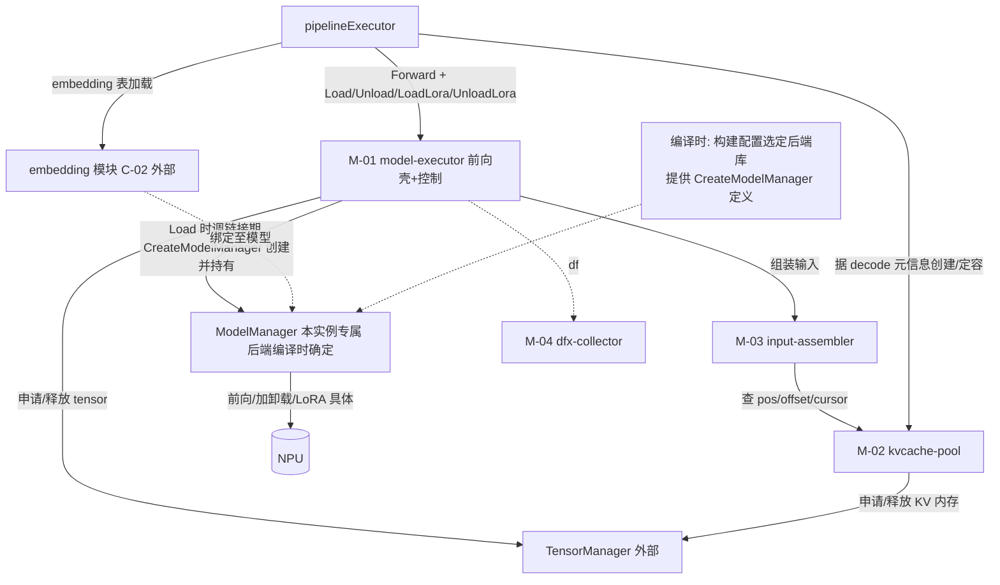
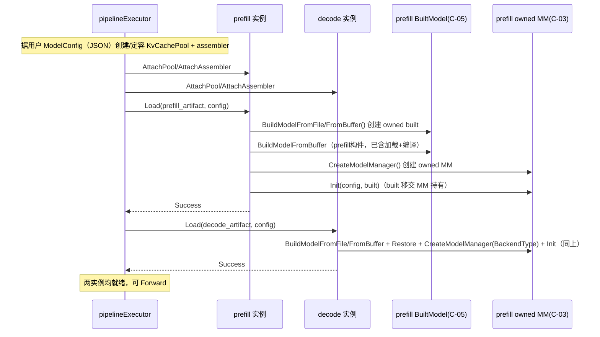
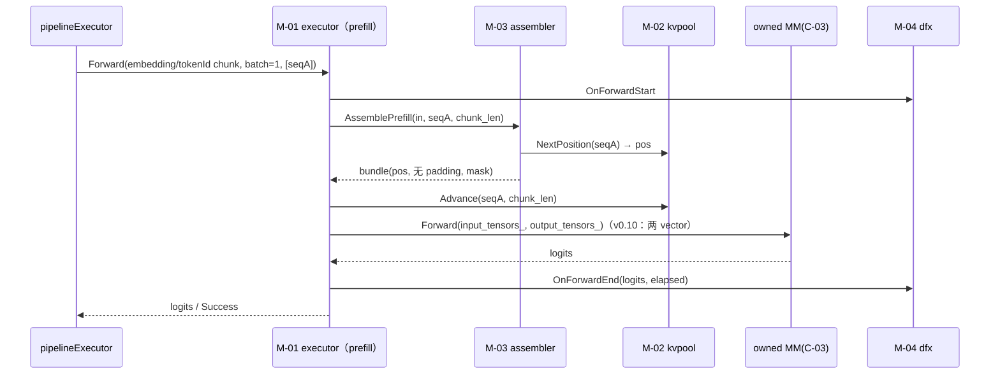
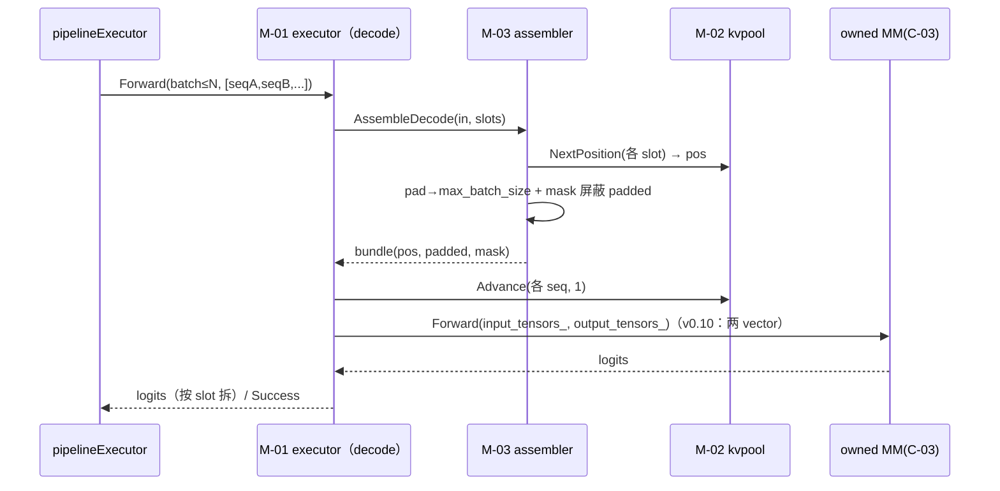
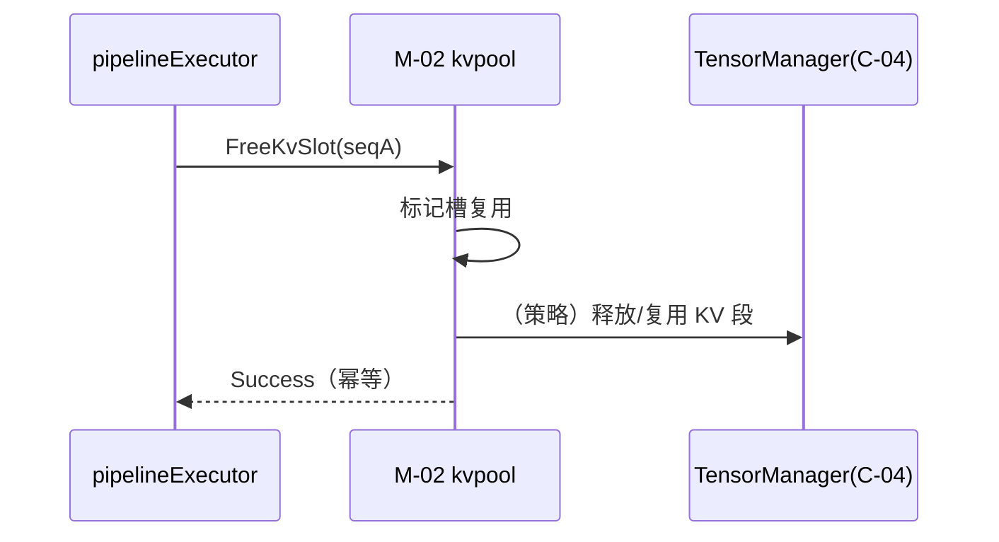
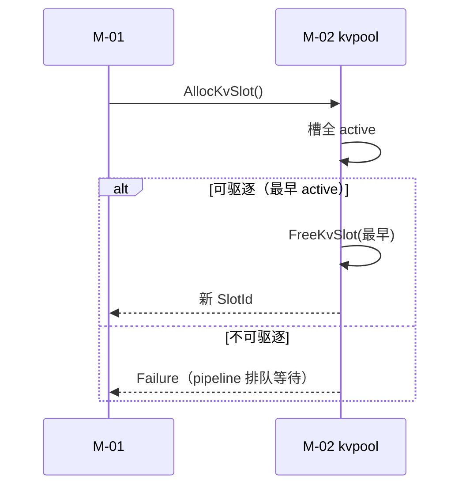
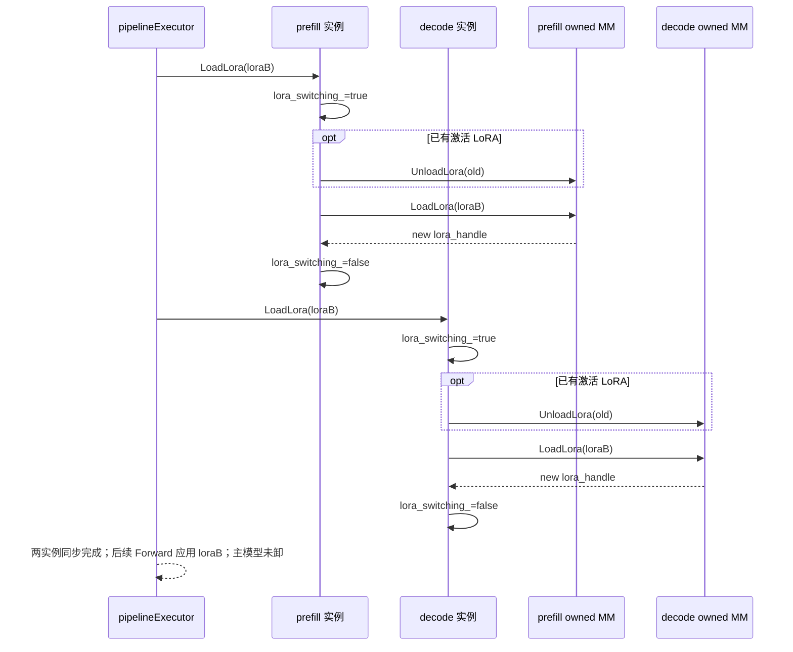

<!--
Hand-authored DESIGN (no render script). Source of truth: ./SPEC.md (SR20260807001).
与 docs/tokenizer/DESIGN.md 同一 SDD 结构。修改后请同步 SPEC.md 行为契约。
v0.2: 取消独立 lifecycle-controller，控制面直接并入 ModelExecutor。
v0.3: ModelManager 由各 ModelExecutor 实例在 Load 时创建并持有（每实例一个）。
v0.4: 取消 ModelManagerFactory 运行时注入；后端编译时确定，model_executor 经链接期自由函数
       CreateModelManager() 创建 owned MM，不感知具体后端类型。
v0.5: 补充 KV 排布规则：池底层 tensor layer-major，同一层内多个 batch（槽）的 KV 连续排布；
       槽 = batch lane；per-seq 光标只推进 position 维且跨层同步。
-->

# ModelExecutor 模块 Design

## 目录

- [Spec 摘要](#spec-摘要)
- [§1 范围与目标](#1-范围与目标)
- [§2 架构总览](#2-架构总览)
  - [§2.1 架构风格与哲学](#21-架构风格与哲学)
  - [§2.2 运行时架构](#22-运行时架构)
  - [§2.3 部署与硬件映射](#23-部署与硬件映射)
  - [§2.4 并发与线程安全](#24-并发与线程安全)
- [§3 模块清单](#3-模块清单)
- [§4 契约清单](#4-契约清单)
- [§5 关键流程清单](#5-关键流程清单)
- [§6 质量属性与跨切面策略](#6-质量属性与跨切面策略)
- [§7 决策索引](#7-决策索引)
- [§8 Code Plan Hints](#8-code-plan-hints)
- [§9 风险与未决项](#9-风险与未决项)
- [§10 变更日志](#10-变更日志)
- [模块](#模块)
  - [M-01-model-executor](#m-01-model-executor)
  - [M-02-kvcache-pool](#m-02-kvcache-pool)
  - [M-03-input-assembler](#m-03-input-assembler)
  - [M-04-dfx-collector](#m-04-dfx-collector)
- [契约](#契约)
  - [C-01-executor-caller](#c-01-executor-caller)
  - [C-02-kvpool-internal](#c-02-kvpool-internal)
  - [C-03-modelmanager-contract](#c-03-modelmanager-contract)
  - [C-04-tensormanager-contract](#c-04-tensormanager-contract)
- [流程](#流程)
  - [F-01-load](#f-01-load)
  - [F-02-prefill-forward](#f-02-prefill-forward)
  - [F-03-decode-forward](#f-03-decode-forward)
  - [F-04-seq-finish-free](#f-04-seq-finish-free)
  - [F-05-pool-full-evict](#f-05-pool-full-evict)
  - [F-06-lora-load-unload](#f-06-lora-load-unload)
- [性能与质量](#性能与质量)
  - [concurrency](#concurrency)
  - [dfx](#dfx)
  - [performance](#performance)
  - [security](#security)
- [新增决策](#新增决策)

---

## Spec 摘要

- Spec ID：`SR20260807001`
- 上游 spec：`./SPEC.md`
- 软件层次：framework（engine core 可复用库）
- 覆盖行为组：Forward(§4.1.1) / KV ringBuffer(§4.1.2) / 输入填充(§4.1.3) / load-unload(§4.1.4) / LoRA(§4.1.5) / DFX(§4.1.6) / 模块边界(§4.1.7) / 错误分类(§4.1.8)
- 对 pipeline DESIGN §11.4 M-04 的三处澄清已纳入（KV 光标归本模块、ModelExecutor 含 load/unload/LoRA 控制、decode batch padding）
- **v0.2**：取消独立 lifecycle-controller；`Load/Unload/LoadLora/UnloadLora/Forward/GetMeta` 直接由 `ModelExecutor` 暴露。
- **v0.3**：`ModelManager` 由各 `ModelExecutor` 实例在 `Load` 时自创建自持有（每实例一个）；`Load` 改为按实例 `Load(artifact)`；公共 `Bind` 取消；跨实例权重去重不再由 MM 负责；LoRA 成对同步。
- **v0.4**：取消 v0.3 的 `ModelManagerFactory` 运行时注入。后端在**编译时**确定：model_executor 调链接期自由函数 `CreateModelManager()`（声明在 `IModelManager` 头，定义由编译时选定链接的后端库提供）创建 owned MM，仅持有 `unique_ptr<IModelManager>` 抽象，**不感知**具体后端类型。
- **v0.5**：补充 KV 排布规则（D-13）。池底层 tensor 按 **layer-major** 组织 `[layer][batch_slot][position][K/V][head][dim]`；**同一层内多个 batch（槽）的 KV 连续排布**（满足 om 按层绑定整层 KV 的要求）；槽 = batch lane 索引；per-seq 光标只推进 position 维、跨层同步。U-3 由"布局一致"具象为"均 layer-major 且子序一致"。

```yaml
spec_source: ./SPEC.md
level: design
spec_id: SR20260807001
delta_summary: 前向壳 + KV 光标管理 + 加卸载/LoRA 控制直接暴露；每实例自创建自持有 ModelManager；后端编译时确定、经链接期 CreateModelManager() 创建，本模块不感知具体后端。
covers: [Forward, KvRingBuffer, InputPadding, LoadUnload, LoRA, DFX, Boundary, ErrorClassify]
status: draft
```

---

## §1 范围与目标

- **in scope**：`cann_lm/engine/core/model_executor` 下 C++ 前向壳——单步 Forward（embedding/tokenId 两路径→logits）+ KV ringBuffer 光标管理（内存归 TensorManager）+ 输入填充（attentionMask + decode batch padding）+ load/unload/LoRA 控制接口（直接暴露；**ModelManager 由本实例在 Load 时创建并持有**，具体实现仍委托 ModelManager）+ DFX。prefill/decode 为本类两个实例（各绑一个 om），共享 KV 池零拷贝。内部模块，不对 Python 暴露。
- **out of scope**（含理由）：
  - KV tensor 内存申请/释放——spec §4.1.2 归 `TensorManager`，本模块只管 pos/offset/光标。
  - 加卸载/前向/LoRA **具体实现**——spec §4.1.4/4.1.5 归 `ModelManager`；本模块在 Load 时**创建并持有** ModelManager 实例，但具体算子/图执行仍在其内。
  - **后端 ModelManager 的具体类型选择**——编译时确定（构建配置选定链接的后端库）；本模块经链接期 `CreateModelManager()` 取得 owned 实例，仅依赖 `IModelManager` 抽象，**不感知、不引用**具体后端类，也不做运行时工厂注入。
  - embedding 表加载——spec §4.1.1 归 `pipelineExecutor` 调 embedding 模块（C-02）；本模块不加载/拥有 embedding 表。
  - tokenizer / 采样——归 C-01 / C-03。
  - 图编译——离线期完成，不在本模块。
- **目标优先级**：行为对齐（om+权重 oracle）> KV 光标正确性（越界/泄漏零容忍）> 前向壳低开销 > 内存占用。

## §2 架构总览

### §2.1 架构风格与哲学



风格声明（≤100 字）：**前向壳 + 共享 KV 池 + 自持控制 + 编译时后端**。`ModelExecutor` 既是前向壳（组装并转发前向、不碰底层算子），又直接承载 load/unload/LoRA 控制方法；**每个实例在 Load 时调链接期 `CreateModelManager()` 创建并持有自己的 ModelManager**（后端编译时确定，本模块仅依赖 `IModelManager` 抽象、不感知具体后端类型）。KV 光标集中到 M-02；内存经 TensorManager；DFX 横切可开关。

### §2.2 运行时架构

- 进程/线程模型：engine 进程内，ModelExecutor 实例为调用线程持有的同步对象；无独立线程、无事件循环。前向执行串行（single-flight），由调用方（pipelineExecutor/Scheduler）保证不重入。load/unload/LoRA 控制方法同样同步、由 lifecycle mutex 串行。
- 通信机制表：

| 调用方 | 被调方 | 通信方式 | 同步/异步 | 备注 |
|--------|--------|----------|-----------|------|
| pipelineExecutor | M-01 | 函数调用 | sync | Forward；Load/Unload/LoadLora/UnloadLora/GetMeta（每实例各调 Load 一次） |
| M-01（Load 时） | 后端 ModelManager | 链接期 `CreateModelManager()` + 接口调用 | sync | 实例自创建并持有 owned MM；后端编译时确定；本模块不感知具体类型 |
| M-01 | M-03 | 组合持有 | sync | 组装输入 |
| M-03 | M-02 | 组合持有 | sync | 查 pos/光标 |
| M-01/M-02 | TensorManager | 经抽象接口 | sync | tensor 申请/释放 |
| pipelineExecutor | embedding 模块(C-02) | — | sync | embedding 表加载并绑定（非本模块） |

- 同步点：CPU↔NPU 同步在 ModelManager 内（om Forward 同步返回）；本模块无独立跨域同步。
- **实例构造与加载顺序约束**（v0.3+）：decode 实例须先 `Load` 取得 `max_batch_size/max_seq_len` → 据此创建/定容共享 `KvCachePool`（及 decode 用 `InputAssembler`）→ 注入两实例 → prefill 实例 `Load`。两实例均就绪后方可 `Forward`。pool/asm 在 decode Load 前可暂未注入（见 F-01）。

### §2.3 部署与硬件映射

| 模块 | 处理器 | 备注 |
|------|--------|------|
| M-01..M-04 | CPU（aarch64 Ascend 宿主） | 光标/组装/控制逻辑；ModelManager 经 NPU 跑图 |
| KV 池内存 | NPU/DDR（由 TensorManager 决定） | 定长池，prefill/decode 共享 |
| 权重/om | NPU（由各实例自持的 ModelManager 持有） | 本模块只持 handle + owned MM |
| 功耗域 | 无独立休眠 | 同步调用 |

### §2.4 并发与线程安全

- 锁策略：同一 executor 实例 Forward **single-flight**——`std::mutex` 串行化（spec §4.1.1/§5）；KV 池操作（alloc/free/advance cursor）经 `std::mutex` 互斥保护光标与槽位表；load/unload/loadLora/unloadLora 经 `lifecycle_mutex_` 串行（含 ModelManager 的创建/释放），且与 Forward 经 `lora_switching_` 原子标志协调。
- 共享资源：KV 池槽位表 + 光标（M-02 内，prefill/decode 两实例共享）；executor `forward_mutex_`（实例内）；`lifecycle_mutex_`（实例内，含 owned MM 生命周期）；`lora_switching_` 原子标志。
- 死锁预防：锁层级 `lifecycle_mutex_ > forward_mutex_ > pool_mutex_`；不反向嵌套；Forward 不持 lifecycle 锁（靠 atomic 标志协调 LoRA 切换）。
- **线程契约（v0.13 文档化，review V0.13-M3）**：`Load`/`Unload`（持 `lifecycle_mutex_`）与 `Forward`（持 `forward_mutex_`）两锁互不嵌套，但共享 `input_tensors_`/`output_tensors_`/`input_name_index_` 容器。**运行期禁止并发 Load/Unload 与 Forward**——调用方（pipelineExecutor）须保证：模型已 Load 并就绪后才发起 Forward，且运行期不重载（重载须先停止全部 Forward、串行 Unload→Load）。本模块不为此加跨锁（Forward 热路径零额外锁开销）；违反该契约的并发重载导致容器 data race（UB），责任在调用方。`Forward`/`GetConfig` 读 `mm_`/`config_` 的一致性亦由该契约保证（同源旧 M1/M2-v0.12）。
- 多实例隔离：无全局单例（spec §5 C7），资源池归各 executor 对（prefill+decode+pool 一组）；每实例 own 的 ModelManager 互不共享。

## §3 模块清单

| ID | 名称 | 一句话职责 | 依赖 | 详情 |
|----|------|-----------|------|------|
| M-01 | model-executor | 前向壳 + 控制面：Forward（embedding/tokenId→logits，single-flight）；Load（调 CreateModelManager 创建并持有本实例 ModelManager，委托其加载 om、取元信息）；Unload/LoadLora/UnloadLora/GetMeta（委托 owned MM）；组装输入并委托底层前向 | M-02,M-03,M-04,C-03,C-04 | [→](#m-01-model-executor) |
| M-02 | kvcache-pool | KV ringBuffer：槽位+光标+pos/offset 管理，alloc/free/advance/evict/snapshot；内存经 TensorManager | C-04 | [→](#m-02-kvcache-pool) |
| M-03 | input-assembler | 输入组装：pos 推导 + attentionMask + decode batch padding，产出 Forward 输入 bundle | M-02 | [→](#m-03-input-assembler) |
| M-04 | dfx-collector | 逐 Forward IO dump + 耗时统计 + KV 池快照，可开关 | M-02 | [→](#m-04-dfx-collector) |

依赖图无环校验：C-03/C-04（外部）← {M-02, M-01}；M-02 ← {M-03, M-04}；M-03/M-02/M-04 ← M-01。✓

> v0.2 变更：原 M-04 lifecycle-controller 已并入 M-01。控制方法直接作为 ModelExecutor 的成员暴露给 pipelineExecutor，不再经独立子模块中转。
> v0.3 变更：ModelManager 不再外部注入；各 M-01 实例在 Load 时自创建、自持有（每实例一个）。公共 Bind 取消，并入 Load。
> v0.4 变更：取消 v0.3 的 ModelManagerFactory 运行时注入；改为调链接期自由函数 `CreateModelManager()` 创建 owned MM，后端编译时确定，本模块仅依赖 `IModelManager` 抽象、不感知具体后端类型。
> v0.5 变更：补充 KV 排布规则（D-13）——layer-major、同层多 batch 连续；槽 = batch lane；per-seq 光标推进 position 维且跨层同步。

## §4 契约清单

> `pipelineExecutor` 为外部参与者（消费方）。`ModelManager`/`TensorManager`/embedding 模块(C-02) 为外部下层，本设计只声明依赖契约。

| ID | 生产者 | 消费者 | 一句话契约 | 详情 |
|----|--------|--------|-----------|------|
| C-01 | M-01 | pipelineExecutor | Forward + Load/Unload/LoadLora/UnloadLora/GetMeta（直接暴露；Load 时自创建 MM） | [→](#c-01-executor-caller) |
| C-02 | M-02 | M-01/M-03 | KV 槽 alloc/free/NextPosition/advance/snapshot | [→](#c-02-kvpool-internal) |
| C-03 | ModelManager（外部） | M-01 | 模型加载/前向/释放/元信息/LoRA 具体实现；由 M-01 在 Load 时调链接期 `CreateModelManager()` 创建并持有 | [→](#c-03-modelmanager-contract) |
| C-04 | TensorManager（外部） | M-02 | tensor 申请/释放 | [→](#c-04-tensormanager-contract) |

> v0.2 变更：原 C-01（Forward）与 C-02（Lifecycle）合并为单一 C-01；原 C-03/C-04/C-05 顺移为 C-02/C-03/C-04。
> v0.3 变更：C-03 生产者关系调整——ModelManager 由 M-01 在 Load 时创建并持有（每实例一个），而非外部注入。
> v0.4 变更：取消运行时 ModelManagerFactory；C-03 改为链接期 `CreateModelManager()`，后端编译时确定。

## §5 关键流程清单

| ID | 场景 | 关键路径 | 详情 |
|----|------|---------|------|
| F-01 | Load（每实例自创建 MM） | pipeline→M-01 Load→CreateModelManager()→MM::Load(artifact)→GetMeta→（decode 先）→据 meta 创建/定容 pool→注入两实例→prefill Load | [→](#f-01-load) |
| F-02 | prefill Forward | pipeline→M-01→M-03 组装(pos,无 pad)→M-02 追加 chunk KV→MM::Forward→logits | [→](#f-02-prefill-forward) |
| F-03 | decode Forward | pipeline→M-01→M-03 组装(pos,pad→N,mask)→M-02 各 seq 追加单 token→MM::Forward→logits | [→](#f-03-decode-forward) |
| F-04 | 序列结束/取消 free | pipeline→M-02 FreeKvSlot | [→](#f-04-seq-finish-free) |
| F-05 | 池满驱逐 | M-02 AllocKvSlot 池满→驱逐最早 | [→](#f-05-pool-full-evict) |
| F-06 | LoRA 加载/卸载（每实例委托 owned MM；成对同步） | pipeline→M-01 LoadLora/UnloadLora（prefill+decode 两实例都调）→各自 owned MM | [→](#f-06-lora-load-unload) |

## §6 质量属性与跨切面策略

| 维度 | 核心策略 | 详情 |
|------|---------|------|
| 性能 | 前向壳转发 <0.1% 端到端；KV 光标操作可忽略 | [→](#performance) |
| 安全 | 输入校验 + 无外部暴露面 + 不可信 om 拒绝 | [→](#security) |
| DFX | L1/L2/L3 分级 + dump 可开关零开销 | [→](#dfx) |
| 并发 | single-flight 串行 + 池操作互斥 + lifecycle 串行（含 owned MM 生命周期） | [→](#concurrency) |
| 错误传播 | 对齐 pipeline 6 粗码，非静默 | spec §4.1.8 + F-xx |
| 数据一致性 | KV 光标与槽位强一致；零拷贝布局对齐 | §2.1 / D-02 |

## §7 决策索引

| ID | 主题 | 状态 |
|----|------|------|
| D-01 | KV 光标归本模块（纠正 pipeline "沉底层"） | accepted |
| D-02 | prefill/decode 共享 KV 池零拷贝 | accepted |
| D-03 | 连续槽位 + per-seq 光标（非分页） | accepted |
| D-04 | decode batch padding 到 max_batch_size（纠正 pipeline "无 padding"） | accepted |
| D-05 | single-flight 串行 per executor | accepted |
| D-06 | 单 LoRA 激活 + 切换重载（切换=UnloadLora+LoadLora，无独立 SwitchLora 方法） | accepted |
| D-07 | tokenId 走模型内部 embedding（表由 embedding 模块经 pipeline 加载） | accepted |
| D-08 | DFX 可开关 + dump 不阻断推理 | accepted |
| D-09 | 每引擎实例单活跃对、无热切换 | accepted |
| D-10 | 取消独立 lifecycle-controller，控制面直接并入 ModelExecutor | accepted |
| D-11 | 每实例在 Load 时自创建自持有 ModelManager | accepted |
| D-12 | 后端编译时确定；经链接期 CreateModelManager() 创建，无运行时工厂注入，本模块不感知具体后端 | accepted |
| D-13 | KV 池排布：槽 = batch lane；per-seq 光标只推进 position 维且跨层同步（v0.5 单 buffer layer-major 布局已由 v0.14 per-layer K/V tensor 取代——"om 按层绑定"动机由每层独立 tensor 直接满足） | superseded（排布部分）v0.14 |

## §8 Code Plan Hints

**给下游 plan/impl agent**：
- 实现顺序（依赖拓扑）：C-03/C-04 外部接口声明 → M-02 kvcache-pool → M-03 input-assembler → M-04 dfx-collector → M-01 model-executor（最后，因它聚合前四者 + 控制面 + 自持 MM）。
- 可并行：M-02/M-04 互不依赖可并行；M-03 依赖 M-02 接口先行。
- 实现某模块最小读取集：
  - M-01 → 本节 + C-01 + C-03 + F-01/F-02/F-03/F-06
  - M-02 → 本节 + C-02 + C-04 + F-04/F-05
  - M-03 → 本节 + M-02 + F-02/F-03
  - M-04 → 本节 + M-02
- 集成里程碑：①M-02+mock C-04 跑通 alloc/free/evict/snapshot；②M-03+mock M-02 跑通 pos 推导 + padding + mask；③M-04+mock 文件 sink 跑通 dump 开关 + 落盘失败降级；④M-01+stub `CreateModelManager()` 返 mock IModelManager 跑通 Load 自创建 MM + Forward 两路径返 fake logits + single-flight + Load/Unload/LoadLora/UnloadLora 控制；⑤prefill+decode 两实例 + 共享池跑通零拷贝（decode 先 Load→定容 pool→prefill Load）。
- 源码落 `cann_lm/engine/core/model_executor/`，UT 落 `tests/cpp/engine/model_executor/`，CMake target 在根 CMakeLists（待建）。
- 后端绑定：`CreateModelManager()` 的定义由编译时选定链接的后端库提供（构建配置 `CANN_LM_BACKEND` 之类选 backend lib）；UT 用 stub 定义（返 mock MM）链接。M-01 代码不引用任何具体后端类名。

## §9 风险与未决项

| 风险/未决 | 影响 | 缓解 | 触发条件 |
|-----------|------|------|----------|
| U-1 前向壳开销预算无基线 | <0.1% 失准 | 实现期微基准 | aarch64 实测 |
| U-2 KV 池容量值未绑定模型规模 | 内存预算失准 | DESIGN 给实测值；池容量参数化于 ModelMetaInfo（由 decode Load 取得） | 模型规模确定 |
| U-3 两 om KV 排布一致性前提（layer-major、同层多 batch 连续，D-13） | 零拷贝失败 | 编译/加载期校验两 om 均为 layer-major 且 head/dim/K-V 子序一致；不一致拒绝加载 | 加载期 |
| U-4 驱逐策略细节 | 驱逐语义争议 | 默认驱逐最早；策略可调 | 池满实测 |
| U-5 LoRA 跨 prefill/decode 成对同步 | 两 MM 各自加载 LoRA，可能不同步 | 由调用方（或薄协调层）对 prefill+decode 两实例成对调用 LoadLora/UnloadLora | 实现 M-01 控制面 |
| U-6 dummy 槽/padded 位置 KV 处理 | 越界/污染 | 零填充 + mask 屏蔽 + 不推进光标 | 实现 M-03 |
| U-7 跨实例权重去重不再由 MM 负责 | 权重重复驻留 NPU | 由 TensorManager 权重 blob 级去重承接，或不强制 | 模型规模/内存压力 |
| U-8 后端编译时单选，不支持运行时切换后端 | 多后端共存受限 | 后端编译时确定（构建配置）；需多后端则多构建产物 | 多硬件共存场景 |
| 🔴 KV 光标越界 | 推理崩溃 | 光标 ≤ max_seq_len 强校验 + TC 覆盖 | 多轮长对话 |
| 🔴 零拷贝布局漂移 | decode 读到错 KV | 加载期断言两 om KV 布局一致 | 模型版本升级 |
| single-flight 死锁 | Forward 挂起 | 锁层级 + 不持 lifecycle 锁进 Forward | 并发压力 |
| 控制面与前向并发竞争 | 状态不一致 | lifecycle_mutex（含 owned MM 生命周期） + lora_switching 原子标志 | 并发 load/forward |
| CreateModelManager() 失败/链接缺失 | Load 失败 | 返空→Failure；构建期保证链接后端定义 | 后端未链接 |
| decode/prefill Load 顺序违例 | pool 未定容即 Forward | 排序前置校验（operator bool 须 pool+handle 齐） | 误用 |

## §10 变更日志

| 版本 | 日期 | 变更 | 触发 spec 章节 |
|------|------|------|---------------|
| 0.1 | 2026-08-07 | 初稿：8 章 SDD 设计 + 5 模块 + 5 契约 + 6 流程 + 4 质量属性 + 9 决策。对 pipeline DESIGN §11.4 三处澄清落地。 | SR20260807001 全 |
| 0.2 | 2026-08-17 | 取消独立 lifecycle-controller 模块（原 M-04）。Load/Unload/LoadLora/UnloadLora/GetMeta 直接并入 M-01 model-executor 对 pipelineExecutor 暴露。模块 5→4、契约 5→4（原 C-01+C-02 合并）、流程 F-06 由"切换"改为"加载/卸载"（切换=卸载+加载，无独立 SwitchLora 方法）。新增 D-10。同步更新 SPEC §4.2。 | SR20260807001 §4.1.4/4.1.5/4.2 |
| 0.3 | 2026-08-17 | ModelManager 改为由各 ModelExecutor 实例在 Load 时自创建自持有（每实例一个）。Load 改为按实例 Load(artifact)。取消公共 Bind（并入 Load），构造期注入跨实例依赖 + ModelManagerFactory。跨实例权重去重不再由 MM 负责（U-7）。LoRA 成对同步具象化（U-5）。新增 D-11。同步更新 SPEC §4.1.4/§6。 | SR20260807001 §4.1.4/4.1.5/§6 |
| 0.4 | 2026-08-17 | 取消 v0.3 的 ModelManagerFactory 运行时注入。后端编译时确定：M-01 调链接期自由函数 `CreateModelManager()`（声明在 IModelManager 头，定义由编译时选定链接的后端库提供）创建 owned MM，仅持有 `unique_ptr<IModelManager>` 抽象、不感知具体后端类型。构造期不再注入工厂。新增 D-12；D-11 同步修正。同步更新 SPEC §4.1.4/§6。 | SR20260807001 §4.1.4/§6 |
| 0.5 | 2026-08-17 | 补充 KV 排布规则（D-13）：池底层 tensor layer-major `[layer][batch_slot][position][K/V][head][dim]`，**同一层内多个 batch（槽）的 KV 连续排布**；槽 = batch lane 索引；per-seq 光标只推进 position 维、跨层同步。M-02 §1/§3/§4/§5、C-02、U-3 同步具象化；D-03 细化槽语义。同步更新 SPEC §4.1.2/§5。 | SR20260807001 §4.1.2/§5 |
| 0.7 | 2026-08-20 | 新增 `IBuiltModel`（与 IModelManager 同级 L3，C-05）替代 `ModelHandle`；`ModelMetaInfo`→`ModelConfig`（用户 JSON 配置，Load 入参）；`IModelManager::Load`→`Init(ModelConfig, IBuiltModel)`，MM 不直接经 artifact 加载（构件加载归 BuildModelFromFile/FromBuffer）；`GetMeta`→`GetConfig`；Load 签名 `Load(artifact, ModelConfig)`；F-01 重写（config 入参消除 decode-先 chicken-egg）；C-03 重写（无 handle）。同步更新 SPEC §4.1.4/4.2/4.1.8/§6。 | SR20260807001 §4.1.4/4.2/§6 |
| 0.8 | 2026-08-20 | `TensorManager` 改为具体单例（C-04 重写：`Instance()`+`CreateTensor(TensorDesc, modelId)`，替代抽象 ITensorManager）；`IModelManager` 新增 `GetModelID()→int`（C-03）；M-01 Load 在 Init 后据 built descs + modelId 向 TensorManager 单例申请输入/输出 tensor（`input_tensors_`/`output_tensors_` + `AllocateTensors`）；新增 `test_tensor_manager.cpp`。同步更新 SPEC §4.1.4/4.2/§6。 | SR20260807001 §4.1.4/4.2/§6 |
| 0.9 | 2026-08-20 | `Forward` 入参去除 `inputs/count/out_logits`（M-01 §2）；输入/输出改用私有 `input_tensors_`/`output_tensors_`；新增 `SetInputData`/`Logits()`；`InputAssembler` 去 `AssembleResult`、直接填 `input_tensors_[1]/[2]`（M-03，stub pos/mask no-op）；scheduler.cpp 两处 Forward 调用适配。同步更新 SPEC §4.1.1/4.2。 | SR20260807001 §4.1.1/4.2 |
| 0.10 | 2026-08-22 | `IModelManager::Forward` 改为 `Forward(input_tensors, output_tensors)`（两个 vector，MM 读 input 填 output buffer，不替换 shared_ptr）；`input_tensors` 新增一算子推理配置参数工位（输入准备时填入，具体如何设置待定）；M-01 Forward 调用改传 `mm_->Run(input_tensors_, output_tensors_)`；mock BuiltModel 返 4 入 desc。同步更新 SPEC §4.1.1/4.2。 | SR20260807001 §4.1.1/4.2 |
| 0.12 | 2026-08-26 | 全链路改 backend 类型：删旧三头（tensor.h/i_built_model.h/i_model_manager.h），tensor_manager.h 重写为 backend 代理枢纽；所有 shared_ptr Tensor 转 ITensorBuffer、NDTensorDesc 转 TensorDesc、data() 转 GetData()、Forward() 转 Run()、Release() 转 DeInit()、CreateBuiltModel/CreateModelManager 转 BuildModelFromFile/FromBuffer + CreateModelManager(BackendType)、unique_ptr 转 shared_ptr、GetModelID int 转 uint32_t；engine Status 不改（map_backend_status 边界映射）。 | SR20260807001 §4.1.1/4.1.4/4.2/§6 |
| 0.12.1 | 2026-08-26 | Load 移除 `built->RestoreFrom*`——`BuildModelFrom*` 已含加载+编译。修复 code-review #1（BuiltModelImpl::Restore 返 UNSUPPORTED 致非测试构建 Load 必失败）。 | §4.1.4 |
| 0.12.2 | 2026-08-26 | Load 加 `mm->InitWeights(weight)` 调用（图与权重分离模型）：路径模式传 `artifact.weight` 给 `InitWeights`；buffer 模式待 backend API 扩展。`ReleaseLocked` 加 `DeinitWeights`。修复 code-review #3（weight 从不传给 backend）。 | §4.1.4 |
| 0.12.3 | 2026-08-26 | `ModelArtifact.weight` 类型 Buffer→std::string（路径）；C API 同步 Buffer→const char*。buffer 模式 Load 统一经路径调 InitWeights（不再 TODO）。 | §4.1.4 |
| 0.13 | 2026-08-26 | 输入填充改 name→index 查工位（取消硬编码 `[0]`/`[1]`/`[2]`）。M-01 新增 `input_name_index_` 成员（Load 后据 `in_descs[i].name→i` 建，Unload/move 同步）；`SetInputData` 按 `input_embed` 名查工位；`Forward` 传 `input_name_index_` 给 assembler。M-03 `AssemblePrefill/Decode` 签名改 `(tensors, name_index)`，废弃 `ForwardBundle`/`ForwardInput`，按名查 `position_ids`/`new_kv_cache_pos`/`attention_mask` 工位；实填 causal mask（4 维 `batch×1×seqLen×kvCacheLen`，第 2 维=1，`0`/`-FLT_MAX`）、`position_ids`（`batch×seqLen`）、`new_kv_cache_pos`（`[batch, seqLen]` per-slot，与 position_ids 不可合并）；光标 Advance 前读取。新增 `INPUT_INFO.md` 为 6 工位事实来源。mock BuiltModel 返 6 名 desc。 | §4.1.1/4.1.3/4.2 |
| 0.13.1 | 2026-08-26 | review v0.13 修复：(a) M2 — `SetInputData` 改按 `input_name_index_["input_embed"]` 查工位（原硬编码 `[0]`）；补 src null 检查（旧 #6）。(b) M1 — `new_kv_cache_pos` 维度确认为 `[batch, seqLen]` per-slot，decode 改写各 slot cursor（原只写 cursors[0]）；INPUT_INFO/SPEC 同步。(c) M3 — 文档化线程契约：运行期禁止并发 Load/Unload+Forward（§2.4）。(d) M4/M5 — 补 5 测试（cursor>0 mask、缺名 ×2、index 越界、slot<0）。 | §2.4/4.1.1/4.1.3 |
| 0.14 | 2026-09-08 | KV 池真实显存申请（C-04 落地）：KvCachePool 构造签名改 `(max_batch_size, kv_cache_max_len, num_hidden_layers, num_attention_kv_heads, num_attention_head_dims, DataType)`，构造即经 TensorManager **单次批量** `CreateKvCacheTensor` 申请全部 `2×num_hidden_layers` 个 per-layer K/V tensor（dims `[kv_cache_max_len][kv_heads][batch][head_dims]`，命名 `kv_cache_k_/v_<layer>`，序 [k0,v0,k1,v1,...]）；删 `AttachBuffer`/`PoolHandle`/`SlotOffset`（v0.5 单 buffer 布局废弃，D-13 演进），新增 `KTensor`/`VTensor`/`TensorCount`。容量/形状参数自 meta_json model_config 段 4 新字段（`num_attention_kv_heads`/`num_attention_head_dims`/`batch_num`/`kv_cache_type`）解析驱动（缺省 kv_heads/head_dims=4/8，dtype 缺省/未知回退 FLOAT16；decode_batch_size 链 batch_num > override > 4）。同步更新 SPEC §4.1.2/§5。 | §4.1.2 |

---

## 模块

### M-01-model-executor

#### §1 职责

前向壳 + 控制面（spec §4.1.1/4.1.4/4.1.5/4.1.7）。本模块**直接**对 pipelineExecutor 暴露：
- **前向**：单步 Forward，输入 `(embedding|tokenId)+pos`，输出 `logits`。组装 Forward 输入 bundle（委托 M-03）、推进 KV 光标（经 M-02）、委托**本实例自持的** `ModelManager::Forward` 做实际计算。single-flight 串行。不做采样、不碰底层算子、不加载 embedding 表。
- **控制面**：Load/Unload/LoadLora/UnloadLora/GetMeta。**Load 时调链接期自由函数 `CreateModelManager()` 创建并持有本实例专属的 ModelManager**（每实例一个；后端编译时确定，本模块仅依赖 `IModelManager` 抽象、不感知/不引用具体后端类）；具体加卸载/LoRA/前向实现委托该 owned ModelManager，本模块管 om handle 生命周期、单活跃。Load 取单个 om 构件（prefill 实例 Load prefill om、decode 实例 Load decode om）。

prefill/decode 为本类两个实例（差异仅绑定的 om 构件与 batch 维），各持一个 ModelManager。

#### §2 对外接口

```cpp
// 状态码对齐 pipeline 6 粗码（spec §4.1.8）
enum class Status {
  Success = 0, Failure, InvalidArgument, InvalidState, NotFound, Canceled
};

// 不透明句柄（来自 ModelManager::Load）
using ModelHandle = void*;

// Forward 输入路径二选一（spec §4.1.1）
struct ForwardOptions {
  int batch = 1;                    // prefill=1；decode ≤ max_batch_size
  std::size_t chunk_len = 1;        // 本步 token 数（prefill=chunk；decode=1）
  std::vector<SlotId> slots;        // 本次 batch 对应的 KV 槽
  bool dump = false;                // dfx 开关
};
// ModelArtifact / ModelArtifactPath / ModelConfig / TensorDesc 见 api/cpp/types.h、core/tensor_manager.h、core/tensor_manager.h。

class ModelExecutor {
 public:
  // 构造：注入跨实例/外部依赖。无后端工厂注入（后端编译时确定）。
  ModelExecutor(std::shared_ptr<KvCachePool> pool,
                std::shared_ptr<InputAssembler> asm_,
                std::shared_ptr<DfxCollector> dfx);

  Status AttachPool(std::shared_ptr<KvCachePool> pool);
  Status AttachAssembler(std::shared_ptr<InputAssembler> asm_);

  // ---- 控制面（spec §4.1.4，v0.7）----
  // Load(artifact, ModelConfig)：BuildModelFromFile/FromBuffer（已含加载+编译） → CreateModelManager
  //   + mm->Init(opts, built) → GetModelID → 据 descs 向 TensorManager 单例申请 input_tensors_/output_tensors_
  //   + 据 in_descs[i].name→i 建立 input_name_index_（v0.13，供 InputAssembler/SetInputData 按名查工位）→ InitWeights(weight)。
  // 语义: 同步、lifecycle_mutex 串行。单活跃：已加载则先 Unload。
  // 错误: config.max_batch_size/max_seq_len<=0→InvalidArgument；BuildModelFromFile/FromBuffer + CreateModelManager(BackendType) 返空→Failure；
  //       Init 失败→Failure；InitWeights 失败→Failure
  Status Load(const ModelArtifact& artifact, const ModelConfig& config);
  Status Load(const ModelArtifactPath& artifact, const ModelConfig& config);
  Status Unload();                                       // 委托 mm->DeInit + DeinitWeights + 释放 owned MM；幂等
  Status GetConfig(ModelConfig* out) const;              // 返回 Load 时传入的配置

  // ---- 前向面（spec §4.1.1，v0.9/v0.13）----
  // SetInputData：把 data 填入名为 input_embed 的工位（按 input_name_index_ 查；Forward 前调）。
  Status SetInputData(const std::shared_ptr<ITensorBuffer>& data);
  // Forward(opts)：assembler 按 name_index 查 position_ids/new_kv_cache_pos/attention_mask 工位
  //   填 input_tensors_（光标 Advance 前从 KV 池取）+ 推进光标 → mm->Run(input_tensors_, output_tensors_)。
  // 语义: 同步、single-flight 串行（forward_mutex_）。输入/输出用私有 input_tensors_/output_tensors_。
  // 错误: 未 Load / output_tensors_ 空 → InvalidState；opts.slots 空 → InvalidArgument；
  //       name_index 缺 position_ids/new_kv_cache_pos/attention_mask → InvalidArgument；底层失败→Failure
  Status Forward(const ForwardOptions& opts);
  std::shared_ptr<ITensorBuffer> Logits() const;                // 返 output_tensors_[0]（Forward 后读）

  std::size_t InputTensorCount() const noexcept;         // dfx/测试
  std::size_t OutputTensorCount() const noexcept;
  explicit operator bool() const noexcept;               // 已 Load 且 pool/asm 齐备
};
```

> 注：`IModelManager`/`IBuiltModel`/`TensorManager`/`Tensor` 为外部/同级类型（C-03/C-05/C-04），公开头 fwd-decl 持有；具体签名见对应契约。`ModelHandle`（v0.7 移除）被 `IBuiltModel` 替代。**无运行时后端工厂注入**：后端编译时确定，`BuildModelFromFile/FromBuffer()`/`CreateModelManager()` 由链接的后端库提供定义。

#### §3 内部结构
- 子组件：`std::shared_ptr<IModelManager> mm_`（Load 时调 `CreateModelManager()` 创建、Unload/析构释放）+ `ModelHandle handle_` + `ModelHandle lora_handle_` + `shared_ptr<TensorManager> tm_` + `shared_ptr<KvCachePool> pool_` + `shared_ptr<InputAssembler> asm_` + `shared_ptr<DfxCollector> dfx_` + `std::vector<std::shared_ptr<ITensorBuffer>> input_tensors_`/`output_tensors_`（Load 时据 descs 经 TensorManager 申请）+ `std::unordered_map<std::string, std::size_t> input_name_index_`（v0.13：name→index 映射，Load 后建、Unload/move 同步清理/移动）+ `std::mutex forward_mutex_`（single-flight）+ `std::mutex lifecycle_mutex_`（load/unload/lora 串行，含 owned MM 生命周期）+ `std::atomic<bool> lora_switching_` + `ModelMetaInfo meta_`。
- RAII：析构若仍 loaded 则 Unload（经 owned MM::Release）。
- 单活跃对（D-09）：Load 前若有活跃 handle 先 Unload；不支持运行时热切换模型。
- **权重去重（v0.3 调整）**：每实例 owned MM 只加载自己的 om；prefill/decode 跨实例权重去重不再由 ModelManager 负责，下放 TensorManager（权重 blob 级）或不强制（U-7）。
- 不可复制、可移动；移动后原对象置空。

#### §4 关键依赖与硬件契约
- 依赖 C-03（`IModelManager` 抽象 + 链接期 `CreateModelManager()`；`ModelManager::Load/Forward/Release/GetMeta/LoadLora/UnloadLora`，**由 M-01 在 Load 时调链接期函数创建并持有**）、C-04（TensorManager）、M-02（光标）、M-03（组装）、M-04（dfx）。
- 无直接硬件感知；CPU↔NPU 同步在 owned ModelManager 内。无 DMA 归本模块。
- 内部模块边界（spec §4.1.7）：仅头文件对 pipelineExecutor 暴露，不导出跨语言绑定符号；不引用具体后端 ModelManager 类名。

#### §5 性能预算

| 路径 | 预算 | 测量条件 | 来源 |
|------|------|----------|------|
| Forward 转发（不含底层算子） | <0.1% 端到端 | 单次前向微基准 | estimated（U-1） |
| single-flight mutex | 可忽略 | — | estimated 🟢 |
| Load（含 MM 创建，不含底层加载） | 一次性 | 构造期 | estimated 🟢 |
| 输入组装（委托 M-03） | sub | 见 M-03 §5 | estimated |

#### §6 失效模式

| 失效 | 触发 | 检测 | 处理 |
|------|------|------|------|
| CreateModelManager() 失败/链接缺失 | 链接期函数返空或未链接 | Load 期校验 | Failure（构建期保证链接后端定义，见 D-12） |
| 未 Load 即 Forward | Load 未完成 | operator bool 校验 | InvalidState |
| pool/asm 未注入即 Forward | AttachPool 未调 | operator bool 校验 | InvalidState |
| 底层前向失败 | owned MM 返回失败 | Forward 返回 | Failure（映射） |
| shape/pos 不一致 | embedding/tokenId 维与 pos 不一致 | M-03 组装期校验 | InvalidArgument |
| 并发 Forward 违规 | forward_mutex_ 已占 | 串行化（非报错） | 串行执行（TC_301） |
| LoRA 切换期 Forward | lora_switching_=true | Forward 期校验 | InvalidState（TC_105） |
| om 缺失/损坏 | owned MM::Load 失败 | Load 返回 | Failure，不泄漏部分资源（TC_101） |
| 元信息缺 max_batch_size | GetMeta 字段校验 | GetMeta | Failure（TC_106） |
| 路径/buffer 混用 | artifact 来源不一致 | Load 期校验 | InvalidArgument |
| 热切换尝试 | 已活跃再 Load | 单活跃校验 | 先 Unload 或拒绝 |
| LoRA 成对失同步 | 只对 prefill 调 LoadLora | 调用方职责（U-5） | 调用方保证成对 |

#### §7 可观测点
- log key: `executor.forward.{ok|err}` / `executor.load.{ok|err}` / `executor.mm.create.{ok|err}` / `executor.singleflight.wait` / `lifecycle.unload` / `lifecycle.lora.{load|unload}` / `lifecycle.meta`
- metric: `executor_forward_total{kind=prefill|decode}` / `executor_forward_duration` / `executor_forward_errors_total{kind}` / `executor_load_total` / `executor_mm_create_failures_total` / `lifecycle_lora_loads_total`

#### §8 测试钩子
- UT 关注：Forward 两路径（embedding/tokenId）返 logits 一致（TC_003）、single-flight 串行（TC_301）、未 Load 拒绝（TC_102）、底层失败映射（TC_103）、shape 不一致（TC_104）、LoRA 切换期拒绝（TC_105）、Load 路径/buffer 两来源 + GetMeta（TC_005）、om 缺失（TC_101）、元信息缺失（TC_106）、LoRA 切换重载主模型不卸（TC_006）、单活跃对、`CreateModelManager()` 返空→Load Failure、Load 时确实调 `CreateModelManager()` 创建并持有 owned MM、pool/asm 未注入拒绝 Forward。
- UT 后端绑定：UT 链接 stub 定义 `CreateModelManager()`（返 mock IModelManager）；验证 Load 调用 + 单 om 加载 + 不跨实例去重。M-01 代码不引用任何具体后端类名（grep 断言）。

### M-02-kvcache-pool

#### §1 职责

KV ringBuffer 管理（spec §4.1.2）：定长池，槽位数 = `max_batch_size`；**pos/offset/光标管理在本模块**，tensor 内存申请/释放在 TensorManager（C-04）。**槽 = batch lane 索引**（0..max_batch_size-1，每槽一条 batch 通道）；per-seq 光标只推进 position 维、对所有层同步（各层同 token 同步推进）；prefill 按 chunk 追加、decode 每 seq 追加单 token；next-position 由光标推导；池满驱逐最早；sequence 结束/取消释放槽；池状态可查询（供 M-04 snapshot）。prefill/decode 两实例共享同一池零拷贝。**池容量由 decode 实例 Load 取得的元信息（max_batch_size/max_seq_len）定容**（v0.3，见 F-01）。

**KV 排布规则（v0.14，D-13 演进）**：池底层为**每层独立的 K/V tensor**（共 `2×num_hidden_layers` 个，构造时经 `TensorManager::CreateKvCacheTensor` **单次批量**申请，C-04 落地）。单 tensor 维度 `[kv_cache_max_len][num_attention_kv_heads][batch][num_attention_head_dims]`（batch 维 = 池槽位数，与 decode_batch_size 同源；dtype 由 meta_json `kv_cache_type` 解析，缺省/未知回退 FLOAT16），序 `[k0,v0,k1,v1,...]`，经 `KTensor(layer)/VTensor(layer)` 按层暴露——om 按层绑定整层 K/V tensor。per-seq 光标作用于 position 维、跨层同步（槽 = batch lane 索引，不变）。
> v0.5 的 layer-major 单 buffer 排布（`[layer][batch_slot][position][K/V][head][dim]` 及 SlotOffset 偏移数学）随 v0.14 per-layer tensor 化废弃；"om 按层绑定整层 KV"的动机由每层独立 K/V tensor 直接满足。

#### §2 对外接口

```cpp
using SlotId = int;   // -1 表无槽

struct SlotInfo {
  SlotId id;
  size_t cursor;          // 下一个可写位置（已写 = cursor）
  bool active;
};

class KvCachePool {
 public:
  // 池容量参数化于 ModelConfig（meta_json model_config 段权威，U-2）；
  // 构造即经 TensorManager::CreateKvCacheTensor 单次申请全部 2×num_hidden_layers 个
  // per-layer K/V tensor（dims [kv_cache_max_len][kv_heads][batch][head_dims]，C-04）；
  // 申请失败（维度非法/溢出/底层分配失败）→ tensor 无产出 + ERROR，槽位记账不受影响
  KvCachePool(int max_batch_size, int kv_cache_max_len, int num_hidden_layers,
              int num_attention_kv_heads, int num_attention_head_dims,
              DataType dtype);
  // 语义: 同步、互斥；为一个新 sequence 分配空槽；池满则驱逐最早（U-4）
  // 错误: 池满且无可驱逐→Failure；否则返回 SlotId
  Status AllocKvSlot(SlotId* out);
  // 语义: 释放槽（标记复用）；幂等
  Status FreeKvSlot(SlotId id);
  // 推进光标写入 n 个 token；越界（cursor+n > kv_cache_max_len）→Failure
  Status Advance(SlotId id, size_t n);
  size_t NextPosition(SlotId id) const;   // = cursor
  // dfx 快照（供 M-04）
  Status Snapshot(std::vector<SlotInfo>* out) const;
  // KV tensor 只读暴露（零拷贝共享；供 om 按层绑定；层号越界/未申请 → 空 shared_ptr）
  std::size_t TensorCount() const noexcept;                 // = 2×num_hidden_layers（申请失败为 0）
  std::shared_ptr<ITensorBuffer> KTensor(int layer) const noexcept;
  std::shared_ptr<ITensorBuffer> VTensor(int layer) const noexcept;
};
```

#### §3 内部结构
- `std::vector<SlotInfo> slots_`（大小 = max_batch_size，下标即 batch lane / 槽 id）+ `std::mutex mtx_` + `std::vector<std::shared_ptr<ITensorBuffer>> tensors_`（`[k0,v0,k1,v1,...]`，TensorManager 批量申请、RAII 释放；U-2 定容 = `2×num_hidden_layers` 个 `[kv_cache_max_len][kv_heads][max_batch_size][head_dims]` tensor）。
- **排布（v0.14）**：每层独立 K/V tensor，`tensors_[2*layer+{0=K,1=V}]` 索引；无跨层单 buffer 偏移数学（v0.5 的 SlotOffset 已删除）。
- 驱逐策略：FIFO 最早 active 槽（U-4 可调）；驱逐时先 Free 再 Alloc（复用 batch lane，不搬移其他槽）。
- 光标强一致：Advance 原子推进（position 维，跨层同步）；NextPosition 只读。

#### §4 关键依赖与硬件契约
- 依赖 C-04（TensorManager 申请/释放池内存——构造时单次批量 `CreateKvCacheTensor`）。池内存可能驻 NPU/DDR，由 TensorManager 决定。
- 零拷贝前提：prefill om 与 decode om 的 KV 排布一致——**per-layer K/V tensor 维度/dtype/K-V 子序一致**（v0.14；v0.5 的 layer-major 连续性前提由每层独立 tensor 天然满足）；加载期对两 om 断言，不一致拒绝加载（U-3 具象化）。
- 无独立 CPU↔NPU 同步（Forward 内由 ModelManager 同步）。

#### §5 性能预算

| 路径 | 预算 | 测量条件 | 来源 |
|------|------|----------|------|
| Alloc/Free/Advance/NextPosition | 可忽略（O(1)） | 池操作微基准 | estimated 🟢 |
| 池内存常驻 | num_layers × max_batch_size × max_seq_len × 2 × num_heads × head_dim × dtype（layer-major，D-13） | RSS/NPU 内存 | estimated 🔴（U-2） |
| Snapshot | O(max_batch_size) | dfx 查询 | estimated 🟢 |

#### §6 失效模式

| 失效 | 触发 | 检测 | 处理 |
|------|------|------|------|
| 池满且无可驱逐 | 所有槽 active 且不可驱逐 | Alloc 查表 | Failure（或 pipeline 排队，见 spec §4.1.2） |
| 光标越界 | cursor+n > max_seq_len | Advance 校验 | Failure（KV 越界，🔴） |
| 零拷贝布局不一致 | 两 om KV 布局漂移 | 加载期校验 | 加载期 Failure（U-3） |
| 重复 Free | 已释放槽 | 幂等 | Success |

#### §7 可观测点
- log key: `kvpool.alloc` / `kvpool.free` / `kvpool.evict` / `kvpool.cursor.overrun`
- metric: `kvpool_active_slots` / `kvpool_evictions_total` / `kvpool_cursor_max`

#### §8 测试钩子
- UT 关注：alloc/free/advance、池满驱逐最早（TC_202）、光标越界拒绝、重复 Free 幂等、并发 alloc/free TSan 干净（TC_302）、snapshot 正确。
- mock：mock TensorManager 验证申请/释放调用；零拷贝池句柄传递。

### M-03-input-assembler

#### §1 职责

输入组装（spec §4.1.3，v0.13：按 name→index 查工位）：从 M-02 光标推导 `position_ids`（`batch×seqLen`）与 `new_kv_cache_pos`（`[batch, seqLen]`，per-slot，指导 KV 写入位置、可能绕回，与 position_ids **分别填不同工位、不可合并**）；构造 `attention_mask`（4 维 `batch×1×seqLen×kvCacheLen`，第 2 维固定为 1，causal：当前位置及之前可见=0，之后遮蔽=`-FLT_MAX`；decode padding 时短 slot 尾部遮蔽，`max_kv_len=max(cursor_i+1)`）。**按 `TensorDesc.name → index` 映射查找工位**（不硬编码下标——工位排序由 om 图决定，每个 omc 可能不同）；光标在 `Advance` **前**读取（先从 KV 池取位置填入 tensor，再推进光标）。decode executor 做 batch padding 补齐到 `max_batch_size`（dummy 槽/零填充）；prefill executor 无 padding。不承担 tokenizer/embedding 查表。**decode 实例的 assembler 在 decode Load 取得 max_batch_size 后构造/注入**（v0.3）。

6 工位组成见 `INPUT_INFO.md`：`input_embed`（调用方经 `SetInputData` 填）、`embed_scales`（embedding 模块填，当前搁置）、`attention_mask`/`position_ids`/`new_kv_cache_pos`（本模块填）、`kvCache`（KV 池 buffer，Load 时据 descs 申请）。

#### §2 对外接口

```cpp
class InputAssembler {
 public:
  InputAssembler(std::shared_ptr<KvCachePool> pool, int max_batch_size);
  // 语义: 同步；组装 prefill 输入（batch=1，无 padding）
  //   按 name_index 查 position_ids/new_kv_cache_pos/attention_mask 工位，
  //   从 KV 池取 cursor_before → 填 pos=[cursor_before..+chunk_len-1] + new_kv_cache_pos([1,chunk_len]同值)
  //     + mask[1][1][chunk_len][kvCacheLen=cursor_before+chunk_len] causal → Advance(slot, chunk_len)
  // 错误: name_index 缺 position_ids/new_kv_cache_pos/attention_mask → InvalidArgument；
  //       slot<0 → InvalidArgument；光标越界 → Failure
  Status AssemblePrefill(SlotId slot, std::size_t chunk_len,
                         std::vector<std::shared_ptr<ITensorBuffer>>& tensors,
                         const std::unordered_map<std::string, std::size_t>& name_index);
  // 语义: 同步；组装 decode 输入（seqLen=1）
  //   各 slot 取 cursor_i → max_kv_len=max(cursor_i+1) →
  //   pos[b][0]=cursor_i + new_kv_cache_pos[b][0]=cursor_i(per-slot [batch,1]) +
  //   mask[batch][1][1][max_kv_len] causal per slot → Advance(各 slot, 1)
  // 错误: name_index 缺名 → InvalidArgument；slots 空 → InvalidArgument；光标越界 → Failure
  Status AssembleDecode(const std::vector<SlotId>& slots,
                        std::vector<std::shared_ptr<ITensorBuffer>>& tensors,
                        const std::unordered_map<std::string, std::size_t>& name_index);
  int max_batch_size() const noexcept;
};
```

> 注：`name_index` 由 `ModelExecutor::Load` 据 `IBuiltModel::GetInputDescs()` 的 `TensorDesc.name → i` 建立，Forward 时传入。`tensors` 为 `ModelExecutor::input_tensors_`（6 工位，Load 时经 TensorManager 申请）。`ForwardBundle`/`ForwardInput` 已废弃——直接填 `input_tensors_` 各工位。

#### §3 内部结构
- `shared_ptr<KvCachePool> pool_` + `int max_batch_size_`。
- 按 name 查 index（缺名 → `INVALID_ARGUMENT`）；index 越界检查。
- position_ids 构造：prefill `pos[i] = cursor_before + i`（i=0..chunk_len-1）；decode `pos[b] = cursor_b`。写入前检查 `GetData()` 非空，memcpy 长度 `min(数据, GetSize())` 截断。
- new_kv_cache_pos：prefill 与 position_ids 相同值（`[1, chunk_len]`，batch=1）；decode per-slot `[batch, 1]` = 各 slot cursor。
- attention_mask：causal，`-FLT_MAX` 不可见 / `0.0` 可见；decode padding 用 `max_kv_len` 取 max，短 slot 尾部 `-FLT_MAX`。
- 光标在 Advance **前**读取；Advance 由本模块调（prefill 推进 chunk_len，decode 各 slot 推进 1）。

#### §4 关键依赖与硬件契约
- 依赖 M-02（光标）。无 SDK；C++17。
- 输入 tensor 经 shared_ptr 引用底层拥有的张量（避免深拷贝，spec §6 / pipeline C3）。

#### §5 性能预算

| 路径 | 预算 | 测量条件 | 来源 |
|------|------|----------|------|
| AssemblePrefill | < 该 chunk 前向耗时 5% | 每 chunk | estimated 🟡 |
| AssembleDecode（含 padding） | <0.1% 端到端 | 每 step | estimated 🟢 |
| pos/mask 构造 | sub | — | estimated 🟢 |

#### §6 失效模式

| 失效 | 触发 | 检测 | 处理 |
|------|------|------|------|
| shape/pos 不一致 | embedding batch/seq 与 slots 数不符 | 组装期校验 | InvalidArgument |
| 光标推导失败 | slot 不存在/未 active | pool 查询 | Failure |
| dummy 槽污染 | padded 位置推进光标 | 明确不推进 | 设计约束（TC 验证） |

#### §7 可观测点
- log key: `assembler.prefill` / `assembler.decode` / `assembler.padding`
- metric: `assembler_padding_ratio`（padded/total）

#### §8 测试钩子
- UT 关注：pos 推导正确、prefill 无 padding、decode pad 到 max_batch_size + mask 屏蔽（TC_008）、全满无 padding（TC_203）、shape 不一致拒绝（TC_104）、dummy 槽不推进光标。
- mock：mock KvCachePool 返受控光标。

### M-04-dfx-collector

#### §1 职责

维测（spec §4.1.6）：逐 Forward 的 IO dump（输入 embedding/tokenId、positionIds、attentionMask、输出 logits），可开关；单次及汇总推理耗时（可按 prefill/decode 拆分）；KV 池状态快照（各槽占用、光标、驱逐事件）。dump 落盘失败不中断推理。

#### §2 对外接口

```cpp
struct DfxConfig {
  bool io_dump = false;
  bool timing = true;
  std::filesystem::path dump_dir;
};

class DfxCollector {
 public:
  DfxCollector(DfxConfig cfg, std::shared_ptr<KvCachePool> pool);
  // 语义: Forward 前后由 M-01 调用；dump 关闭时零开销早退
  Status OnForwardStart(const ForwardBundle& in, const ForwardOptions& opts);
  Status OnForwardEnd(const std::shared_ptr<ITensorBuffer>& logits, double elapsed_us);
  Status PoolSnapshot(std::vector<SlotInfo>* out) const;   // 委托 M-02
  // 汇总耗时
  Status FlushTimings(/*sink*/ void* out) const;
};
```

#### §3 内部结构
- `DfxConfig cfg_` + `shared_ptr<KvCachePool> pool_` + 累计耗时计数器（prefill/decode 分桶）+ dump 文件句柄。
- 关闭 io_dump 时 OnForwardStart/End 立即返回（零开销，TC_205）。
- dump 落盘失败：记 WARN，不抛、不阻断 Forward。

#### §4 关键依赖与硬件契约
- 依赖 M-02（snapshot）。无 SDK；C++17 + 轻量日志。
- dump 数据量大时落盘 IO 不在 Forward 关键路径（异步缓冲，实现期定）。

#### §5 性能预算

| 路径 | 预算 | 测量条件 | 来源 |
|------|------|----------|------|
| OnForward*（dump 关闭） | 零开销 | 关闭 vs 开启基线 | 行为契约（TC_205） |
| OnForward*（dump 开启） | 不计入 Forward 关键预算 | — | estimated 🟡 |
| PoolSnapshot | O(max_batch_size) | 查询 | estimated 🟢 |

#### §6 失效模式

| 失效 | 触发 | 检测 | 处理 |
|------|------|------|------|
| dump 落盘失败 | 磁盘满/权限 | 写返回 | WARN，不阻断推理 |
| 池快照失败 | pool 查询失败 | 委托返回 | 降级空快照 |

#### §7 可观测点
- log key: `dfx.dump.{ok|err}` / `dfx.timing.flush`
- metric: `dfx_io_dumps_total` / `dfx_forward_duration_us{kind}` / `dfx_kvpool_snapshot`

#### §8 测试钩子
- UT 关注：dump 关闭零开销（TC_205）、dump 开启落盘正确、timing 汇总、pool snapshot 一致、落盘失败不阻断。
- mock：mock 文件 sink 验证落盘调用与失败降级。

---

## 契约

### C-01-executor-caller

#### §1 契约一句话
"M-01 向 pipelineExecutor 直接暴露 Forward + Load/Unload/LoadLora/UnloadLora/GetMeta；Load 时调链接期 `CreateModelManager()` 自创建并持有本实例 ModelManager；前向 single-flight 串行，控制面 lifecycle 串行。"

#### §2 数据 schema
见 M-01 §2：`ForwardInput`（data + is_token_id）、`ForwardOptions`（batch/slots/dump）、`ModelArtifact`（graph/weights 路径或 buffer + meta_json）、`ModelMetaInfo`、`Status`、`ModelHandle`。`Tensor` 为底层类型（公开头 fwd-decl）。**无 `ModelManagerFactory` 运行时参数**（后端编译时确定，见 C-03）。

#### §3 时序与同步语义
- 同步函数调用。
- 前向：调用方（pipelineExecutor/Scheduler）保证不重入（single-flight 由本模块 mutex 兜底）。prefill 实例 batch=1、decode 实例 batch≤max_batch_size；pos 由 M-03 推导，非调用方传入。
- 控制：`Load(artifact)` 调链接期 `CreateModelManager()` 创建 owned ModelManager → `MM::Load(artifact)` → `GetMeta` → 存储 handle/meta（公共 Bind 已取消）。单活跃（D-09）；不支持热切换。LoRA：`LoadLora` 时若已有激活则先 `UnloadLora`（切换=卸载+加载，D-06），切换期 Forward 返 InvalidState。
- **排序约束（v0.3）**：decode 实例须先 Load 取得 max_batch_size/max_seq_len → 创建/定容共享 pool（及 decode assembler）→ 注入两实例 → prefill 实例 Load。两实例均就绪后方可 Forward。
- **LoRA 成对同步（U-5）**：prefill+decode 各有 owned MM；调用方须对两实例成对调用 LoadLora/UnloadLora。

#### §4 错误契约

| 错误 | 谁抛 | 谁处理 | 可恢复 |
|------|------|--------|--------|
| InvalidState（未 Load / pool/asm 未齐 / LoRA 切换中） | M-01 | 调用方 | 是（先 Load/Attach / 等切换完成） |
| Failure（`CreateModelManager()` 失败/链接缺失） | M-01 | 调用方 | 否（构建期保证链接后端定义） |
| Failure（底层前向失败） | C-03→M-01 | 调用方 | 否（映射 pipeline Failure） |
| Failure（加载失败/元信息缺 max_batch_size） | C-03→M-01 | 调用方 | 否（不泄漏部分资源） |
| InvalidArgument（shape/pos、路径/buffer 混用） | M-03/M-01 | 调用方 | 是（修正输入/来源） |

#### §5 版本演进规则
- ForwardInput/ForwardOptions/ModelArtifact/ModelMetaInfo 字段可增（带缺省，前向兼容）。
- Forward/Load/Unload/LoadLora/UnloadLora 签名变更必须 bump major。
- 后端具体 ModelManager 实现演进由 C-03 定；`CreateModelManager()` 链接符号签名稳定。
- 不再单独提供 SwitchLora（v0.2 起切换由 UnloadLora+LoadLora 组合实现）。

### C-02-kvpool-internal

#### §1 契约一句话
"M-02 向 M-01/M-03 提供 KV 槽 alloc/free/NextPosition/advance/snapshot，光标与槽位强一致。"

#### §2 数据 schema
见 M-02 §2：`SlotId`、`SlotInfo`、`KvCachePool` 接口。

#### §3 时序与同步语义
- 同步、互斥（pool_mutex_）；prefill/decode 两实例共享同一池。
- 光标推进（Advance）原子；NextPosition 只读。Alloc 池满则驱逐最早。
- 排布：layer-major、同层多 batch 连续（D-13）；槽 = batch lane；零拷贝前提为两 om 均此排布（U-3）。

#### §4 错误契约

| 错误 | 谁抛 | 谁处理 | 可恢复 |
|------|------|--------|--------|
| Failure（池满无可驱逐） | M-02 | M-01→调用方 | 否（或 pipeline 排队） |
| Failure（光标越界） | M-02 | M-01→调用方 | 否（🔴） |
| Failure（零拷贝布局不一致） | 加载期 | M-01 | 否 |

#### §5 版本演进规则
- SlotInfo 字段可增。驱逐策略（U-4）可替换实现，接口稳定。

### C-03-modelmanager-contract

#### §1 契约一句话
"外部 ModelManager 向 M-01 提供运行时初始化/前向/释放（L3）；**不直接经 artifact 加载**——构件加载归 `IBuiltModel`（C-05）。由 M-01 在 Load 时调链接期 `CreateModelManager()` 创建 owned MM（每实例一个，后端编译时确定，本模块不感知具体后端类型），再调 `MM::Init(ModelConfig, built)` 把已构建模型移交其持有。"

#### §2 数据 schema（外部接口，本设计声明依赖）
```cpp
class IModelManager {  // 外部抽象，定义在 backend 头；M-01 仅依赖此抽象
 public:
  virtual ~IModelManager() = default;
  // 运行时初始化：接收用户 ModelConfig + 已构建模型（built 移交归 MM 持有）。
  virtual Status Init(const ModelConfig& config, std::shared_ptr<IBuiltModel> built) = 0;
  // 前向（v0.10）：接收 input_tensors / output_tensors 两个 vector（预分配 buffer）。
  // MM 读 input_tensors、写 output_tensors（填 buffer 内容，不替换 shared_ptr）。
  // input_tensors: [data, position_ids, attention_mask, 算子推理配置参数(工位,输入准备时填入,具体待定)]
  // output_tensors: [logits]（MM 填充）；不接收 ModelHandle——MM 经 Init 绑定唯一 built。
  virtual Status Forward(std::vector<std::shared_ptr<ITensorBuffer>> input_tensors,
                         std::vector<std::shared_ptr<ITensorBuffer>> output_tensors) = 0;
  // 释放运行时资源（built/权重/图）。
  virtual Status Release() = 0;
};

// 链接期自由函数：声明在 IModelManager 头；定义由编译时选定链接的后端库提供。
std::unique_ptr<IModelManager> CreateModelManager();
```

#### §3 时序与同步语义
- M-01 在 `Load` 时：先 `BuildModelFromFile/FromBuffer()`+`（已含加载+编译）`（C-05），再 `CreateModelManager()`+`mm->Init(config, std::move(built))`（built 移交 MM 持有）。后续 Forward 委托该 owned MM（无 handle）。
- 同步调用；CPU↔NPU 同步在实现内。**不经其加载/拥有 embedding 表**（D-07）。**不经其做跨实例权重去重**（v0.3，每实例 MM 只 Init 自己的 built；去重下放 TensorManager 或不强制，U-7）。
- **后端编译时确定（D-12）**：构建配置选定链接的后端库，由其提供 `CreateModelManager()`/`BuildModelFromFile/FromBuffer()` 的定义。M-01 代码不引用具体后端类名；运行时无后端选择/切换。

#### §4 错误契约
底层失败统一映射为 `Failure`（详情靠日志）。`CreateModelManager()` 返空 → M-01 `Load` 返回 `Failure`；`Init` 失败 → `Failure`（先 Release 再 reset，不泄漏）。构建期须保证链接了后端定义（否则链接期 unresolved symbol）。

#### §5 版本演进规则
- `IModelManager` 由 backend 拥有；本模块经 fwd-decl/`unique_ptr` 持有实例，接口演进由 backend spec 定。`CreateModelManager()` 链接符号签名稳定；后端替换 = 换链接库（重新构建），无运行时切换。

### C-05-ibuiltmodel-contract

#### §1 契约一句话
"外部 BuiltModel 向 M-01 提供构件→已构建模型的加载与 om 图 I/O 张量描述（L3，与 IModelManager 同级）。由 M-01 在 Load 时调链接期 `BuildModelFromFile/FromBuffer()` 创建 owned 实例，（BuildModelFromFile/FromBuffer 已含加载+编译），随后经 `MM::Init` 移交 ModelManager 持有。替代旧 `ModelHandle`。"

#### §2 数据 schema（外部接口，本设计声明依赖）
```cpp
class IBuiltModel {  // 外部抽象，定义在 core/tensor_manager.h
 public:
  virtual ~IBuiltModel() = default;
  // RestoreFromFile/RestoreFromBuffer 移除——BuildModelFromFile/FromBuffer 已含加载+编译
  // （backend IBuiltModel 仍有这些方法，但 ModelExecutor::Load 不再调）
  virtual std::vector<TensorDesc> GetInputDescs() const = 0;
  virtual std::vector<TensorDesc> GetOutputDescs() const = 0;
};
std::shared_ptr<IBuiltModel> BuildModelFromFile/FromBuffer();   // 链接期，后端编译时确定
```

#### §3 时序与同步语义
- M-01 `Load`：`BuildModelFromFile/FromBuffer()` → `（已含加载+编译）`（构件→built）→ 移交 `MM::Init`。built 经 Init 后归 MM 独占持有，M-01 不再持有。
- 同步调用。**不经其加载/拥有 embedding 表**（D-07）。

#### §4 错误契约
`BuildModelFromFile/FromBuffer()` 返空 → `Failure`；`BuildModelFromFile/FromBuffer` 返空 → `Failure`。om 路径空 → `Failure`。

#### §5 版本演进规则
- `IBuiltModel` 由 backend 拥有；`BuildModelFromFile/FromBuffer()` 链接符号签名稳定；后端替换 = 换链接库。`TensorDesc` 定义在 `core/tensor_manager.h`（待 backend 真实头替换）。

### C-04-tensormanager-contract

#### §1 契约一句话
"`TensorManager`（具体单例，v0.8，定义在 `core/tensor_manager.h`）按 `TensorDesc + modelId` 申请 tensor。M-01 在 Load（Init + GetModelID）后据 built descs 向其申请输入/输出 tensor；M-02 的 KV 池内存亦经其分配/释放。"

#### §2 数据 schema（具体单例）
```cpp
class TensorManager {  // 具体单例（非抽象）
public:
  static TensorManager& Instance();
  // 按 desc + modelId 申请 tensor（modelId 关联已加载模型/NPU 上下文）。
  // RAII：shared_ptr 引用计数归零自动释放底层 buffer。
  Status CreateTensor(const TensorDesc& desc, int modelId, std::shared_ptr<ITensorBuffer>* out);
  Status Release(const std::shared_ptr<ITensorBuffer>& t);   // 可选显式释放
private:
  TensorManager() = default;
  TensorManager(const TensorManager&) = delete;
  TensorManager& operator=(const TensorManager&) = delete;
};
```

#### §3 时序与同步语义
- 同步。M-01 `Load`：`Init(config, built)` → `GetModelID()` → 据 built descs `CreateTensor(desc, modelId)` 申请 `input_tensors_`/`output_tensors_`。M-02 KV 池内存由 TensorManager 分配（pipeline 构造 KvCachePool 时单次批量调 `CreateKvCacheTensor` 申请全部 2×层数 per-layer K/V tensor，M-02 只管槽位/光标）。
- 单例：全进程唯一 `TensorManager::Instance()`；多引擎实例共享（KV 池/权重按 modelId 区分）。
- v0.3：跨实例权重去重（prefill/decode 同权重）若需要，由 TensorManager 在权重 blob 级承接（U-7），不经 ModelManager。

#### §4 错误契约
`CreateTensor` 失败（OOM/无效 desc）→ `Failure`（M-01 Load 返回，先 Release MM 再 reset，不泄漏）；M-02 `AllocKvSlot` 申请失败亦 `Failure`。

#### §5 版本演进规则
- v0.8 前为抽象 `ITensorManager`（C-04 旧版）；v0.8 改具体单例。当前为 malloc 桩实现（按 ∏dims×dtype 字节分配，RAII 释放）；真实后端落地后由后端提供 NPU 设备内存分配（modelId 绑定设备上下文），单例签名稳定。

---

## 流程

### F-01-load

#### §1 触发与前置条件
- 触发：pipelineExecutor 对 **每个** ModelExecutor 实例调 `Load(artifact)`（prefill 实例 Load prefill 构件、decode 实例 Load decode 构件）。构造期一次性。
- 前置：TensorManager 就绪；后端已链接（构建期保证 `CreateModelManager()` 定义）；embedding 表由 pipelineExecutor 经 embedding 模块（C-02）加载并绑定（非本流程）。
- 排序约束（v0.7 解除）：`ModelConfig` 为用户侧入参，pool 可在 Load **前**据 config 定容并 Attach 两实例，再 Load——无 decode-先 chicken-egg。

#### §2 时序图


#### §3 关键路径预算

| 步骤 | 模块 | 预算 | 累计 |
|------|------|------|------|
| BuildModelFromFile/FromBuffer（构件加载+编译） | C-05 | 一次性 | 主导 |
| CreateModelManager() 创建 owned MM | M-01 | 一次性 | 可忽略 |
| MM::Init(config, built)（运行时初始化） | C-03 | 一次性 | 主导 |
| pool 定容 + 注入 | M-02/M-01 | 一次性 | 可忽略 |

#### §4 异常分支

| 分支 | 触发 | 行为 |
|------|------|------|
| BuildModelFromFile/FromBuffer + CreateModelManager(BackendType) 失败/链接缺失 | 函数返空或未链接 | Failure（构建期保证链接，见 D-12） |
| BuildModelFromFile/FromBuffer 返空（om 缺失/损坏） | C-05 失败 | Failure（TC_101） |
| MM::Init 失败 | C-03 失败 | Failure（先 Release 再 reset） |
| ModelConfig.max_batch_size/max_seq_len<=0 | config 校验 | InvalidArgument（TC_106） |
| 路径/buffer 混用 | artifact 校验 | InvalidArgument |
| 已有活跃 | 单活跃校验 | 先 Unload 再 Load，或拒绝 |

#### §5 与其他流程的交互
- 成功后衔接 F-02 prefill / F-03 decode。

### F-02-prefill-forward

#### §1 触发与前置条件
- 触发：pipelineExecutor `ModelExecutor::Forward(ForwardInput, opts{batch=1, slots=[seqA], dump})`（prefill 实例）。
- 前置：prefill 实例已 Load（owned MM 就绪）；pool/asm 已注入；seqA 已 AllocKvSlot。

#### §2 时序图


#### §3 关键路径预算

| 步骤 | 模块 | 预算 | 累计 |
|------|------|------|------|
| AssemblePrefill | M-03 | <chunk 前向 5% | — |
| Advance | M-02 | 可忽略 | — |
| Forward（底层算子） | C-03 | 主导 | — |
| 转发开销 | M-01 | <0.1% | — |

#### §4 异常分支

| 分支 | 触发 | 行为 |
|------|------|------|
| 光标越界 | Advance cursor+n>max_seq_len | Failure（🔴） |
| shape 不一致 | embedding 维与 pos 不符 | InvalidArgument（TC_104） |
| 底层失败 | C-03 失败 | Failure（TC_103） |
| LoRA 切换中 | lora_switching_=true | InvalidState（TC_105） |
| pool/asm 未注入 | Attach 未调 | InvalidState |

#### §5 与其他流程的交互
- chunked prefill 多次调用 F-02（TC_007）；prefill 完成后切到 F-03 decode。

### F-03-decode-forward

#### §1 触发与前置条件
- 触发：pipelineExecutor `ModelExecutor::Forward(ForwardInput, opts{batch≤N, slots=[...], dump})`（decode 实例）。
- 前置：decode 实例已 Load（owned MM 就绪）；pool/asm 已注入；各 seq 已 AllocKvSlot；active ≤ max_batch_size。

#### §2 时序图


#### §3 关键路径预算

| 步骤 | 模块 | 预算 | 累计 |
|------|------|------|------|
| AssembleDecode（含 padding） | M-03 | <0.1% | — |
| Advance ×N | M-02 | 可忽略 | — |
| Forward（底层算子，batch=N） | C-03 | 主导 | — |

#### §4 异常分支

| 分支 | 触发 | 行为 |
|------|------|------|
| batch 维 != max_batch_size 且未 pad | 组装校验 | InvalidArgument |
| dummy 槽推进光标 | 设计禁止 | 不推进（TC 验证） |
| 底层失败 | C-03 失败 | Failure |

#### §5 与其他流程的交互
- 循环至序列终止（TC_002）；终止/取消走 F-04。

### F-04-seq-finish-free

#### §1 触发与前置条件
- 触发：序列结束（EOS/MaxTokens/StopString）或取消；pipelineExecutor `KvCachePool::FreeKvSlot(seqId)`（经 M-01 或直接 M-02）。
- 前置：seq 槽 active。

#### §2 时序图


#### §3 关键路径预算
| 步骤 | 模块 | 预算 | 累计 |
|------|------|------|------|
| Free | M-02 | O(1) | 可忽略 |
| 释放/复用 | C-04 | 一次性 | 可忽略 |

#### §4 异常分支

| 分支 | 触发 | 行为 |
|------|------|------|
| 重复 Free | 已释放 | 幂等 Success |
| 取消与自然终止竞争 | 同时到达 | 先到者为准，幂等 |

#### §5 与其他流程的交互
- 释放空位后新请求可入池（F-01 prefill→F-03 decode）。

### F-05-pool-full-evict

#### §1 触发与前置条件
- 触发：`KvCachePool::AllocKvSlot` 且池满（所有槽 active）。
- 前置：需接纳新 sequence。

#### §2 时序图


#### §3 关键路径预算
| 步骤 | 模块 | 预算 | 累计 |
|------|------|------|------|
| 驱逐最早 | M-02 | O(N) | 可忽略 |

#### §4 异常分支

| 分支 | 触发 | 行为 |
|------|------|------|
| 全部不可驱逐 | 无可驱逐槽 | Failure 或 pipeline 排队（TC_201） |
| 驱逐策略争议 | U-4 未定 | 默认 FIFO 最早，可调 |

#### §5 与其他流程的交互
- 驱逐后新 sequence 入池衔接 F-02/F-03。

### F-06-lora-load-unload

#### §1 触发与前置条件
- 触发：pipelineExecutor 对**每个** ModelExecutor 实例调 `LoadLora(lora_artifact)` 或 `UnloadLora()`。切换语义=先 UnloadLora 再 LoadLora（由调用方组合，或 LoadLora 内部检测到已有激活时自动先卸）。
- 前置：主模型已加载；当前 LoRA（可选）激活。
- **成对同步（U-5）**：prefill+decode 两实例各有 owned MM；调用方须对两实例成对调用，使两 MM 同步加载/卸载同一 LoRA。

#### §2 时序图


#### §3 关键路径预算
| 步骤 | 模块 | 预算 | 累计 |
|------|------|------|------|
| Unload+Load LoRA ×2 实例 | C-03 | 一次性 | 主导 |
| 切换标记 | M-01 | 可忽略 | — |

#### §4 异常分支

| 分支 | 触发 | 行为 |
|------|------|------|
| LoRA 构件缺失/损坏 | C-03 失败 | Failure |
| 切换期 Forward | lora_switching_=true | InvalidState（TC_105） |
| 成对失同步 | 只对一实例调 | 调用方职责（U-5）；两 MM 状态分叉，行为未定义 |

#### §5 与其他流程的交互
- LoRA 跨 prefill/decode 协调（U-5）现具象为成对同步；若需更强一致可引入薄协调层封装两实例的 LoadLora/UnloadLora。

---

## 性能与质量

### concurrency

#### §1 线程模型

| 线程名 | 职责 | 处理器亲和性 | 事件循环 |
|--------|------|-------------|----------|
| pipelineExecutor/Scheduler 调用线程 | Forward / Load / LoRA 控制 | aarch64 CPU | 无（同步调用） |

无独立 executor 线程；实例为调用线程持有的同步对象；single-flight 由 mutex 串行化。

#### §2 锁策略

| 共享资源 | 保护方式 | 持锁路径 | 锁层级 |
|----------|---------|----------|--------|
| executor forward（实例） | std::mutex single-flight | Forward | L2 |
| KV 池槽位/光标（共享） | std::mutex pool_mutex_ | Alloc/Free/Advance/NextPosition | L3 |
| lifecycle + owned MM 生命周期（实例） | std::mutex lifecycle_mutex_ | Load/Unload/LoadLora/UnloadLora（含 MM 创建/释放） | L1 |
| lora_switching 标志 | `std::atomic<bool>` | Forward 期读 / LoadLora 期写 | — |

#### §3 死锁预防
- 锁层级 lifecycle > forward > pool；不反向嵌套。
- Forward 不持 lifecycle 锁（避免 Forward 阻塞 Load/LoRA 反之亦然——lora_switching 用 atomic 标志协调）。
- 无超时需求（同步调用）。

#### §4 并发场景清单

| 场景 | 竞争资源 | 保护方式 | 已知瓶颈 |
|------|----------|----------|----------|
| 同实例并发 Forward | forward_mutex_ | single-flight 串行 | 无（TC_301） |
| 并发 alloc/free 槽 | pool_mutex_ | 互斥 | 无（TC_302） |
| 多实例隔离 | 各对资源池 + 各自 owned MM | 无全局单例 | 无（TC_303） |
| 切换期 Forward | lora_switching_ | atomic 标志 | 无（TC_105） |
| Load（含 MM 创建）与 Forward 并发 | lifecycle_mutex_ vs forward_mutex_ + atomic | 串行 + 标志协调 | 无 |

### dfx

#### §1 异常分类

| 等级 | 定义 | 示例 | 默认处理 |
|------|------|------|---------|
| L1 致命 | 不可恢复 | 光标越界、零拷贝布局漂移 | FATAL log，请求 Failed |
| L2 严重 | 可重试 | 加载失败、shape 不一致、`CreateModelManager()` 失败 | 返回 Failure/InvalidArgument |
| L3 可降级 | 影响质量/可观测 | dump 落盘失败、池快照失败 | WARN，不阻断推理 |

#### §2 熔断
- KV 越界熔断：光标越界累计 >0 → 阻断该 executor gate，要求修正光标逻辑。
- 加载熔断：连续 LoadFailed（含 `CreateModelManager()` 失败）超阈值 → 拒绝同 artifact 重试。

#### §3 监控
- 关键 metric：`executor_forward_total{kind}` / `executor_forward_duration` / `executor_forward_errors_total{kind}` / `kvpool_active_slots` / `kvpool_evictions_total` / `kvpool_cursor_max` / `dfx_io_dumps_total` / `executor_load_total` / `executor_mm_create_failures_total` / `lifecycle_lora_loads_total`。
- 告警阈值：kvpool_cursor_max 接近 max_seq_len（长对话将越界）；forward_errors_total 突增；mm_create_failures_total 突增。

#### §4 日志
- 级别：INFO（load ok）、WARN（dump 落盘失败、驱逐）、ERROR（forward 失败、光标越界、MM 创建失败）、FATAL（布局漂移）。
- 关键 log key：`executor.forward.{ok|err}` / `executor.load.{ok|err}` / `executor.mm.create.{ok|err}` / `lifecycle.lora.{load|unload}` / `kvpool.{alloc|evict|cursor.overrun}` / `dfx.dump.{ok|err}`。
- Forward 关键路径默认不记 INFO（热点），仅记 metric。

#### §5 可调试性
- trace span：`executor.forward` / `executor.load` / `executor.mm.create` / `lifecycle.lora.load` / `kvpool.alloc`。
- 关键现场抓取：forward 失败时导出 bundle（data shape/pos/mask/slots）+ logits（若产出）供回归。

### performance

#### §1 性能目标

抄录自 spec §5（SR20260807001），均为预算目标 estimated（U-1/U-2 待实测校准）。

| 指标 | 目标 | 测量条件 | 来源 |
|------|------|----------|------|
| 前向壳转发开销 | <0.1% 端到端（不含底层算子） | 单次前向微基准 | estimated（U-1） |
| KV 池内存 | 定长 = num_layers × max_batch_size × max_seq_len × 2(K&V) × num_heads × head_dim × dtype（layer-major，D-13） | RSS/NPU 内存 | estimated（U-2） |
| 可移植 | g++13/C++17，aarch64 通过 | CI 矩阵 | measured |
| 线程安全 | single-flight 串行 + 池互斥 + lifecycle 串行（含 owned MM 生命周期） | TSan + 并发用例 | 设计约束 |
| 错误可观测 | 全部失败映射 6 粗码 | 异常 TC | 行为契约 |
| DFX 可开关 | dump 关闭零开销 | TC_205 | 行为契约 |

#### §2 预算分解（canonical，与各模块 §5 一致）

| 模块 | 路径 | 预算 | 测量条件 | 来源 | 风险 |
|------|------|------|----------|------|------|
| M-01 | Forward 转发 | <0.1% 端到端 | 单次前向 | estimated（U-1） | 🟢 |
| M-01 | Load（含 MM 创建，不含底层加载） | 一次性 | 构造期 | estimated | 🟢 |
| M-02 | 池操作 | 可忽略 O(1) | 池操作微基准 | estimated | 🟢 |
| M-02 | 池内存常驻 | num_layers×max_batch_size×max_seq_len×2×num_heads×head_dim×dtype（layer-major，D-13） | RSS | estimated（U-2） | 🔴 模型规模绑定 |
| M-03 | AssemblePrefill | <chunk 前向 5% | 每 chunk | estimated | 🟡 |
| M-03 | AssembleDecode | <0.1% 端到端 | 每 step | estimated | 🟢 |
| M-04 | OnForward*（关闭） | 零开销 | 基线对比 | 行为契约 | 🟢 |

🔴 高风险预算项：
1. **M-02 KV 池内存（U-2）**：容量随模型规模（层数/hidden/seq_len/max_batch_size）线性放大，绝对值未绑定；需模型规模确定后实测。
2. **KV 光标越界（质量红线，非 perf）**：多轮长对话光标逼近 max_seq_len，越界即崩溃——需 TC 覆盖 + 光标强校验。

🟡 供人决策点：
- **A. 池驱逐策略（U-4）**：FIFO 最早 vs 优先级 vs LRU。影响多轮长对话驱逐语义，需人定方向。

#### §3 优化策略清单
- 待 U-1 预算合理性确认后，针对 M-03 组装热点（如需）给手段/收益/风险。

#### §4 实测计划
- aarch64 真机微基准：Forward 转发开销（mock C-03 返 fake logits 隔离底层）→ 校准 U-1。
- KV 池 RSS/NPU 内存测量（模型规模确定后）→ 校准 U-2。
- 并发用例 TSan → 校准 single-flight + 池互斥 + lifecycle 串行（含 owned MM 生命周期）。

#### §5 退化路径
- 若池内存超预算：允许逐层 KV 量化/压缩（需 ModelManager 支持，超本模块边界）或减小 max_batch_size。
- 若 Forward 转发超 0.1%：组装逻辑内联化、减少 bundle 拷贝。

### security

#### §1 威胁模型
- 本模块为 engine 内部 C++ 组件，无外部暴露面（spec §4.1.7）。威胁来自上游不可信 om 构件、不可信输入 embedding/tokenId、越界光标。
- 资产：KV 池内存、om handle、owned ModelManager、logits。

#### §2 认证与授权
- 无认证需求（内部组件）。调用方即 pipelineExecutor 可信代码。
- 来源校验：加载期校验 om 元信息（max_batch_size 存在）、KV 布局一致性（U-3，两 om 由两独立 owned MM 加载但仍须断言一致），防畸形构件致未定义行为。

#### §3 数据保护
- 静态：权重/KV 为模型产物，常驻 NPU/DDR，无加密需求。
- 运行时：输入 embedding/tokenId 为调用方所有，本模块不持久化；Forward 完成即释放 bundle 中间缓冲。
- 敏感数据清理：无密钥/凭证，无需特殊清理。

#### §4 已知未覆盖项
- om 构件真实性不在本模块验证（上游加载链负责）。
- DoS（超长 prompt/超多 batch）由光标越界校验 + max_batch_size 约束承接，非安全边界。
- dump 落盘内容可能含 logits/embedding——dump_dir 权限由部署方控制。
- 后端库的链接可信性由构建期保证（构建配置选定后端库提供 `CreateModelManager()` 定义）；运行时无后端注入面。

---

## 新增决策

### D-01-kv-cursor-in-executor

#### §1 背景
pipeline DESIGN §11.4 将 KV 维护标注"沉底层 C5（C-04 IModelManager）"。但光标/槽位与 batch 维调度、padding、dfx 紧耦合，沉底层丢失可见性。

#### §2 选项
| 选项 | 优 | 劣 |
|------|----|----|
| A 光标归本模块（M-02），内存归 TensorManager | batch 可见、dfx 可达、与 padding 协同 | 本模块多一职责 |
| B 光标沉底层 C-03 | 边界纪律纯 | 丢失 batch 维可见性、padding/dfx 协同难 |

#### §3 决策
选 A（用户定）。KV 光标归 M-02；tensor 内存申请/释放归 TensorManager（C-04）；底层算子（拼接/KV 写入）仍在 ModelManager::Forward 内。

#### §4 后果
- 正面：光标/槽位可观测、与 padding 协同；纠正 pipeline §11.4 错误。
- 负面：本模块承担光标一致性责任（越界强校验）。

#### §5 复审触发
若光标与底层 KV 写入出现一致性裂缝（底层写位置与光标不同步）→ 重新评估光标归属。

### D-02-shared-pool-zero-copy

#### §1 背景
prefill/decode 两实例需衔接 KV（prefill 写、decode 读）。

#### §2 选项
| 选项 | 优 | 劣 |
|------|----|----|
| A 共享同一池零拷贝 | 无拷贝开销、光标连续 | 两 om KV 布局须一致 |
| B 拷贝移交 | 布局解耦 | 拷贝开销 |

#### §3 决策
选 A（用户定）。共享 M-02 池，prefill/decode 零拷贝；两 om KV 布局一致为前提（U-3 加载期校验，注意两 om 现由两独立 owned MM 加载）。

#### §4 后果
- 正面：衔接零开销。
- 负面：两 om 布局耦合，升级需校验（U-3）。

#### §5 复审触发
两 om 布局无法保持一致 → 回退 B 拷贝移交。

### D-03-contiguous-slot-cursor

#### §1 背景
多 batch decode 共享池，需选布局。

#### §2 选项
| 选项 | 优 | 劣 |
|------|----|----|
| A 连续槽位 + per-seq 光标 | 简单、碎片可控 | 短序列浪费（max_len 预分配） |
| B 分页 block 表 | 空间利用率高 | block 表+簿记复杂 |

#### §3 决策
选 A（用户定，MVP）。每 seq 占一条 batch lane（槽 = batch 索引，0..max_batch_size-1）；槽内已写 position 连续、per-seq 光标推进 position 维且跨层同步。具体排布（layer-major、同层多 batch 连续）见 D-13。

#### §4 后果
- 正面：实现简、光标 O(1)。
- 负面：max_len 预分配，短序列空间浪费（U-2 容量随 max_seq_len 放大）。

#### §5 复审触发
短序列占主导且内存浪费严重 → 改 B 分页。

### D-04-decode-batch-padding

#### §1 背景
pipeline SPEC/DESIGN 主张 Continuous Batching"无 padding"。但 om 图 batch 维固定，decode active<N 时须补齐。

#### §2 选项
| 选项 | 优 | 劣 |
|------|----|----|
| A decode pad 到 max_batch_size + mask | 与 om 固定 batch 维一致 | padded 位置算力浪费 |
| B 变长 batch（无 padding） | 无浪费 | om batch 维须可变，与离线编译图矛盾 |

#### §3 决策
选 A（用户定，纠正 pipeline"无 padding"）。decode executor om 固定 batch 维 = max_batch_size，未满补齐，padded 位置 mask 屏蔽 + dummy 槽；prefill executor om batch=1 无 padding。

#### §4 后果
- 正面：与 om 固定形状一致、实现直接。
- 负面：padded 位置算力浪费（batch 越满越优）。

#### §5 复审触发
若 om 支持动态 batch 且算力浪费显著 → 改 B 变长。

### D-05-single-flight-serial

#### §1 背景
共享 KV 池光标，并发 Forward 会竞争。

#### §2 选项
| 选项 | 优 | 劣 |
|------|----|----|
| A single-flight 串行（mutex） | 光标无竞争、简单 | 并发 Forward 排队 |
| B 细粒度并发 | 理论并发 | 光标/底层串行本质无收益 |

#### §3 决策
选 A（用户定）。同 executor 实例 Forward single-flight 串行；多 sequence 靠单次 batch 内数据并行，不靠并发 Forward。

#### §4 后果
- 正面：光标安全、无竞争。
- 负面：并发 Forward 排队（与设备串行本质一致，无损失）。

#### §5 复审触发
出现真并发收益场景（多 NPU 流） → 重评。

### D-06-single-lora-reload-on-switch

#### §1 背景
LoRA 加载范围与切换语义未定。

#### §2 选项
| 选项 | 优 | 劣 |
|------|----|----|
| A 单激活+切换重载（LoadLora 内部先卸后加，无独立 SwitchLora 方法） | 简单、接口面小 | 切换有重载开销 |
| B 多 LoRA 并存按请求路由 | 多租户 | 资源/管理复杂 |

#### §3 决策
选 A（用户定，v0.2 强化）。单 LoRA 激活；`LoadLora` 检测到已有激活时先 `UnloadLora` 再加载（切换=卸载+加载），主模型不卸；**不**单独提供 `SwitchLora` 方法。具体加卸载在 owned ModelManager，M-01 委托。切换期 `lora_switching_=true`，Forward 返 InvalidState。v0.3：每实例 owned MM 各自加载；prefill+decode 成对同步由调用方保证（U-5）。

#### §4 后果
- 正面：实现简、主模型常驻、控制面接口最小（load/unload/loadLora/unloadLora/forward）。
- 负面：切换期 Forward 暂不可用（InvalidState，TC_105）；两实例成对失同步时行为未定义（U-5）。

#### §5 复审触发
多租户多 LoRA 场景 → 升级 B；若调用方频繁需要便捷切换 → 可在未来以缺省语义重引入 SwitchLora（不影响契约）；若成对同步易错 → 引入薄协调层封装两实例。

### D-07-tokenid-model-internal-embedding

#### §1 背景
Forward 输入是否支持 tokenId 路径，及 embedding 表归属。

#### §2 选项
| 选项 | 优 | 劣 |
|------|----|----|
| A 仅 embedding 输入（上游查表） | 边界纯 | 不支持模型内部 embedding |
| B 双路径（embedding|tokenId），tokenId 走模型内部 | 灵活、支持 om 内置 embedding | 需明确表归属 |

#### §3 决策
选 B（用户定）。Forward 支持 embedding|tokenId 二选一；tokenId 走模型内部 embedding（om 图承担）；**embedding 表由 pipelineExecutor 调 embedding 模块（C-02）加载并绑定至模型，不经 ModelManager**；本模块不加载/拥有 embedding 表、不重新实现查表。

#### §4 后果
- 正面：支持 om 内置 embedding；表归属清晰。
- 负面：tokenId 路径前置依赖 embedding 模块已绑定表（spec §6 自检）。

#### §5 复审触发
若 embedding 模块与 om 内置 embedding 语义分叉 → 重评表归属。

### D-08-dfx-switchable-nonblocking

#### §1 背景
DFX dump 在 Forward 路径，须不拖累推理。

#### §2 选项
| 选项 | 优 | 劣 |
|------|----|----|
| A 可开关 + 关闭零开销 + 落盘失败不阻断 | 生产可控 | 实现需早退路径 |
| B 常开同步落盘 | 简单 | 拖累 Forward |

#### §3 决策
选 A（用户定）。dump 可开关；关闭时 OnForward* 立即早退（零开销，TC_205）；落盘失败 WARN 不阻断。

#### §4 后果
- 正面：生产零开销、可观测可降级。
- 负面：开启 dump 时落盘 IO 需异步缓冲（实现期定）。

#### §5 复审触发
开启 dump 时 IO 阻塞 Forward → 改异步落盘队列。

### D-09-single-active-pair-no-hotswap

#### §1 背景
多模型变体共存范围。

#### §2 选项
| 选项 | 优 | 劣 |
|------|----|----|
| A 每引擎实例单活跃对、无热切换 | 简单、先落地 | 不支持多模型并发 |
| B 多对共存按请求路由 | 多租户 | 资源/调度复杂 |

#### §3 决策
选 A（用户定，MVP）。每引擎实例内一对活跃 executor（prefill+decode）；不支持运行时热切换模型；多引擎实例可共存隔离（C7）。v0.3：每实例单活跃 om（Load 前先 Unload），各持 own MM。

#### §4 后果
- 正面：资源管理简、与 pipeline F-LOAD 一致。
- 负面：单实例不支持多模型并发。

#### §5 复审触发
多模型并发需求 → 升级 B（预留接口扩展）。

### D-10-no-separate-lifecycle-controller

#### §1 背景
v0.1 设计设独立 lifecycle-controller 子模块（原 M-04）中转 load/unload/LoRA 控制。但 SPEC §4.2 本就把这些契约列在 `ModelExecutor` 上；独立子模块多一层中转、增加阅读与调用成本。

#### §2 选项
| 选项 | 优 | 劣 |
|------|----|----|
| A 取消独立子模块，控制方法直接并入 ModelExecutor | 与 SPEC §4.2 一致、调用面扁平、少一个模块 | ModelExecutor 职责变重（前向+控制） |
| B 保留独立 lifecycle-controller | 职责分离纯 | 多一层中转、偏离 SPEC、阅读成本高 |

#### §3 决策
选 A（用户定，v0.2）。`Load/Unload/LoadLora/UnloadLora/GetMeta/Forward` 直接作为 `ModelExecutor` 成员暴露给 pipelineExecutor；加卸载/LoRA 具体实现仍委托 ModelManager。原 M-04 并入 M-01；模块 5→4、契约 5→4。

#### §4 后果
- 正面：与 SPEC §4.2 对齐、调用面扁平、减少一个模块与一组中转接口。
- 负面：ModelExecutor 兼具前向与控制，职责略重——但二者共享 handle/状态，合并反而减少状态散落与同步成本。

#### §5 复审触发
若 ModelExecutor 控制面膨胀（多模型/多 LoRA 并存等）致类过大 → 再拆出独立 lifecycle controller。

### D-11-per-instance-owned-modelmanager

#### §1 背景
v0.2 设计中 `ModelManager` 由外部创建、经 `Bind` 注入 `ModelExecutor`（prefill/decode 共用一个外部 MM，权重去重由该 MM 负责）。但实际 prefill/decode 是两个独立实例、各绑一个 om，共用一个外部 MM 的所有权归属与生命周期不清晰。

#### §2 选项
| 选项 | 优 | 劣 |
|------|----|----|
| A 每实例在 Load 时自创建自持有 ModelManager | 所有权清晰（实例拥有 own MM，随实例生灭）、每 MM 只管自己 om | 跨实例权重去重不再由 MM 负责；LoRA 需成对同步 |
| B 外部注入一个共享 MM（v0.2） | 跨实例权重去重天然由 MM 管 | 所有权归属不清、两 om 挤一个 MM |

#### §3 决策
选 A（用户定，v0.3）。每个 `ModelExecutor` 实例在 `Load(artifact)` 时创建并持有自己的 `ModelManager`（`unique_ptr<IModelManager>`，随实例生灭）。`Load` 改为按实例取单个 om 构件；公共 `Bind` 取消，跨实例依赖在构造期/AttachPool 注入。**MM 的具体创建方式见 D-12**（v0.4 起为链接期 `CreateModelManager()`，非运行时工厂注入）。

#### §4 后果
- 正面：MM 所有权与生命周期归实例自身，无悬挂/共享歧义；每 MM 职责单一（只加载自己 om）。
- 负面：
  1. 跨实例权重去重（prefill/decode 同权重）不再由 ModelManager 负责 → 下放 TensorManager（权重 blob 级）或不强制（U-7）。
  2. LoRA 需对 prefill+decode 两实例成对调用 LoadLora/UnloadLora（U-5）。
  3. decode 须先于 prefill Load（pool 定容依赖 decode 元信息）——引入排序前置约束。

#### §5 复审触发
- 若权重重复驻留 NPU 成为内存压力且 TensorManager 不承接去重 → 重评是否回退单一共享 MM 或引入权重共享层。
- 若 LoRA 成对同步频繁出错 → 引入薄协调层封装两实例的 LoadLora/UnloadLora。

### D-12-compile-time-backend-no-runtime-factory

#### §1 背景
v0.3 用运行时注入的 `ModelManagerFactory`（`std::function<unique_ptr<IModelManager>()>`）创建 owned MM，意在依赖反转、不耦合后端具体类。但运行时工厂注入对"后端在编译时即确定"的场景是多余的间接层：后端不随请求变化，无需运行时多态选择；且工厂对象本身又是构造期要注入的依赖，增加调用方负担。

#### §2 选项
| 选项 | 优 | 劣 |
|------|----|----|
| A 链接期自由函数 `CreateModelManager()`，后端编译时确定 | 无运行时工厂注入、调用方零负担、core 仍不引用具体后端类名（只依赖 IModelManager 抽象 + 函数声明） | 后端单选、不支持运行时切换（需多后端则多构建产物） |
| B 运行时注入 `ModelManagerFactory`（v0.3） | 运行时可换后端 | 多一层间接、调用方需传工厂、与"编译时确定"场景不匹配 |

#### §3 决策
选 A（用户定，v0.4）。声明链接期自由函数 `std::unique_ptr<IModelManager> CreateModelManager();`（声明在 `IModelManager` 头），**定义由编译时选定链接的后端库提供**（构建配置 `CANN_LM_BACKEND` 之类选 backend lib）。M-01 在 `Load` 时调此函数取得 owned MM，仅持有 `unique_ptr<IModelManager>` 抽象，**不引用、不感知**任何具体后端类名。取消构造期的 `ModelManagerFactory` 参数。UT 链接 stub 定义（返 mock MM）。

#### §4 后果
- 正面：调用面更简（构造期少一个参数）；core 不耦合后端具体类；后端选择是构建期决策，无运行时注入面、无运行时后端切换的安全/状态风险。
- 负面：
  1. 后端单选编译，同一构建产物不支持运行时多后端共存（U-8）；需多后端则多构建产物。
  2. `CreateModelManager()` 未链接（后端库缺失）→ 链接期 unresolved symbol，须构建期保证。
  3. 函数返空（后端初始化失败）须作为 Load Failure 处理。

#### §5 复审触发
- 若需运行时多后端共存/切换 → 回退 B 运行时工厂，或引入注册表按 key 选后端（重新引入运行时注入面）。
- 若 `CreateModelManager()` 需运行时参数（非无参） → 升级为带配置参数的 creator 签名（仍是链接期符号）。
- 若后端实现需要不同构造参数而单一无参函数受限 → 引入轻量 builder 接口（链接期），但 M-01 仍不感知具体类。

### D-13-kv-pool-layer-major-layout

#### §1 背景
KV 池底层 tensor 的维度排布未定。om 图按层计算 attention、按层读写 KV——它需要为每一层绑定一块"该层所有 batch 的 KV"的连续内存。若排布为 sequence-major（某序列跨所有层连续、再下一条序列），则同一层的各 batch KV 分散，om 无法以单一连续块绑定单层 KV。

#### §2 选项
| 选项 | 优 | 劣 |
|------|----|----|
| A layer-major：`[layer][batch_slot][position][K/V][head][dim]`，同层多 batch 连续 | om 可按层绑定整层 KV 连续块；与 per-seq 光标（position 维、跨层同步）兼容 | 单条 sequence 跨层不连续（各层段分散），但每层内该序列已写 position 连续，光标仍 O(1) |
| B sequence-major：`[batch_slot][layer][position]...` | 单 sequence 跨层连续 | 同层各 batch KV 分散，om 无法按层绑定单块；零拷贝/绑定期复杂 |

#### §3 决策
选 A（用户定，v0.5）。池底层 tensor 维度顺序 `[layer][batch_slot][position][K/V][head][dim]`（head/dim 及 K-V 子序由 om 定义，U-3 约定两 om 一致）。**同一层内多个 batch（槽）的 KV 连续排布**：layer 最外、batch 次之，layer L 下所有 batch 构成一个连续块。槽 = batch lane 索引（0..max_batch_size-1）；per-seq 光标只推进 position 维、跨层同步（各层同 token 同步推进）。细化 D-03 的"连续槽"语义为"槽内已写 position 连续（每层）"。

#### §4 后果
- 正面：om 按层绑定整层 KV 连续块，绑定期直接；零拷贝前提清晰（两 om 均 layer-major）；光标 O(1)、驱逐复用 batch lane 不搬移其他槽。
- 负面：单 sequence 跨层段分散（不影响正确性，因 om 按层访问）；偏移计算须按 layer-major 公式（M-02 §3 已给）。

#### §5 复审触发
- 若 om 改为按 sequence-major 绑定 KV（跨层连续） → 改 B 并重评光标语义。
- 若需分页 block 表（D-03 复审触发） → layer-major 公式与分页表需重新协调偏移。

---

## 评审 Checklist

未提供 `review-checklist.md`，默认引用 skill 的自检清单，按 `status: draft` 块执行：
- 接口契约覆盖：4.2/C-01..C-04 每个契约可追溯至模块。✓
- 测试覆盖：模块 §8 测试钩子关联 spec TC。✓
- 依赖图无环：§3 已校验。✓
- 决策有后果+复审触发：D-01..D-13 均含。✓
- 性能预算数值化：§performance §2 全 estimated + 风险标记。✓
- 未决项登记：§9 + spec 未决项 U-1..U-8。✓
- v0.5 一致性：KV layer-major 排布、同层多 batch 连续已贯穿 M-02 §1/§3/§4/§5、C-02、D-03/D-13、U-3；SPEC §4.1.2/§5 待同步（已在本版 changelog 标注）。✓
