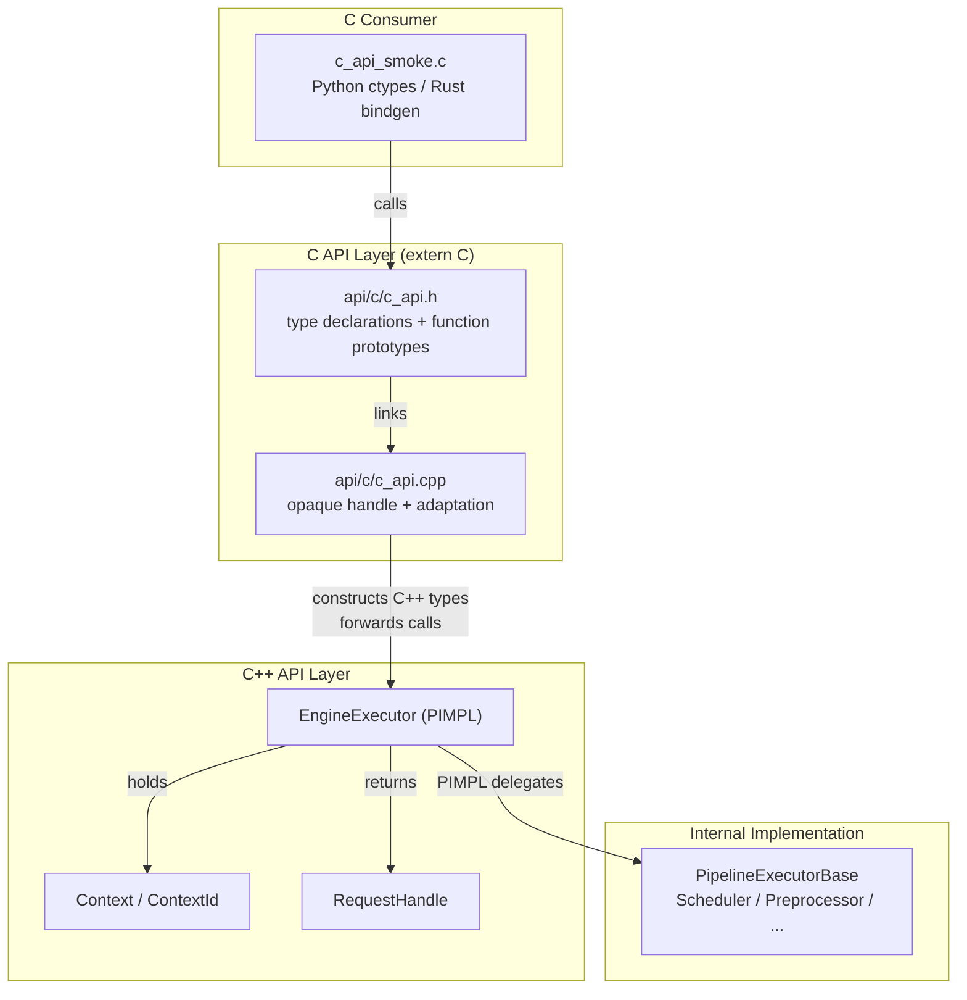

# C API Design (DESIGN)

English | [简体中文](../../../zh/cann_lm_engine/c_api/DESIGN.md)

> **Module positioning**: C API is a thin wrapper layer above the C++ API, providing a compiler-agnostic ABI-stable boundary via `extern "C"` functions + opaque handles. This document describes the How — opaque handle implementation, type mapping, memory lifecycle, and exception boundaries.

---

## §1 Module Positioning

| Attribute | Value |
|------|-----|
| Code path | `cann_local_lm/engine/api/c/` |
| Header file | `api/c/c_api.h` (pure C, only `<stddef.h>` / `<stdint.h>`) |
| Implementation | `api/c/c_api.cpp` (C++17, includes C++ API headers) |
| Build artifact | Compiled into `libcann_lm_engine.a` (same static library) |
| Namespace | None (`extern "C"`, global symbols) |
| Upstream | C++ API: `EngineExecutor` / `Context` / `RequestHandle` (see pipeline+engine_executor DESIGN) |

## §2 Architecture Overview



**Key boundaries**:
- C → C API: via `extern "C"` symbols, ABI stable
- C API → C++ API: C++ calls, type conversion + exception guard
- C++ API → Internal: PIMPL, existing architecture unchanged

## §3 Module List

| Module | Code | Responsibility | Dependencies |
|------|------|------|------|
| M-01 C API Header | `api/c/c_api.h` | Type declarations + 15 function prototypes; pure C; no C++ header dependencies | C standard library (`stddef`, `stdint`) |
| M-02 C API Impl | `api/c/c_api.cpp` | Opaque handle definition + type adaptation + exception guard + memory management | C++ API (`engine_executor.h`, `request_handle.h`, `types.h`, `context.h`, `status.h`) |

## §4 Contract List

| Contract | Definition location | Exported to | Description |
|------|----------|--------|------|
| C-API-01 Status | `api/c/c_api.h` `#define` | C consumer | `int` values 0–5, 1:1 mapped to C++ `Status::SUCCESS..CANCELED` |
| C-API-02 Opaque Handles | `api/c/c_api.h` `typedef struct` | C consumer | `Executor` / `Request` are opaque pointers; `ContextId` is a `uint64_t` value type |
| C-API-03 POD Structs | `api/c/c_api.h` `typedef struct` | C consumer | `Buffer` / `ModelArtifact` / `ModelArtifactPath` / `EngineOptions` / `SamplingParams` / `Result` |
| C-API-04 Enums | `api/c/c_api.h` `typedef enum` | C consumer | `FinishReason` / `RequestStatus` / `LogLevel`; enum values 1:1 with C++ `enum class` |
| C-API-05 StreamCallback | `api/c/c_api.h` `typedef` | C consumer | Function pointer + `user_data`, replaces `std::function` |
| C-API-06 15 Functions | `api/c/c_api.h` function prototypes | C consumer | See §6 interface signatures |

## §5 Data Flow

### 5.1 Executor Lifecycle

```
C side                           C API (c_api.cpp)                C++ API
──────                         ──────────────                   ────────
ExecutorCreate(path, opts, &out)
                                → new CANN_LMEngine_Executor{}
                                → make_unique<EngineExecutor>(path, opts)
                                → *out = executor
                                ← SUCCESS                        ← construction success (stub stores path)

ExecutorDestroy(exec)
                                → delete executor
                                → ~unique_ptr<EngineExecutor>
                                → ~unordered_map<Context>       ← Context destructor
```

### 5.2 Inference (Synchronous Generate)

```
C side                           C API (c_api.cpp)                C++ API
──────                         ──────────────                   ────────
Generate(exec, "hello", ctx_id, params, &result)
                                → contexts.find(ctx_id)
                                → NOT_FOUND if missing
                                → Prompt{.text = "hello"}
                                → to_cpp_params(params)  (pointer→vector)
                                → ee->Generate(prompt, ctx, sp, &cpp_result)
                                ← SUCCESS/FAILURE
                                → fill_c_result(cpp_result, &result)
                                  malloc(token_ids) + memcpy
                                  malloc(text) + '\0'
                                ← SUCCESS + result filled
```

### 5.3 Streaming Callback

```
C++ pipeline thread               C API (c_api.cpp)                C side callback
──────────────                 ──────────────                   ────────────
std::function<void(TokenId, string)> invoked
                                → lambda: cb(token, text.c_str(),
                                               text.size(), user_data)
                                → C function pointer call ──────────────→ user callback(token, text,
                                                                          text_len, user_data)
                                ← (callback returns)
                                ← (std::function returns)
```

## §6 Interface Signatures

### 6.1 Executor Lifecycle

```c
CANN_LMEngine_Status CANN_LMEngine_ExecutorCreate(
    const CANN_LMEngine_ModelArtifactPath*  prefill,
    const CANN_LMEngine_ModelArtifactPath*  decode,
    const CANN_LMEngine_EngineOptions*       options,   // NULL = default
    CANN_LMEngine_Executor**                 out);

CANN_LMEngine_Status CANN_LMEngine_ExecutorCreateFromBuffer(
    const CANN_LMEngine_ModelArtifact*  prefill,
    const CANN_LMEngine_ModelArtifact*  decode,
    const CANN_LMEngine_EngineOptions*   options,
    CANN_LMEngine_Executor**             out);

void CANN_LMEngine_ExecutorDestroy(CANN_LMEngine_Executor* executor);
```

### 6.2 Context Management

```c
CANN_LMEngine_Status CANN_LMEngine_ContextCreate(
    CANN_LMEngine_Executor*    executor,
    CANN_LMEngine_ContextId*   out);

CANN_LMEngine_Status CANN_LMEngine_ContextDestroy(
    CANN_LMEngine_Executor*   executor,
    CANN_LMEngine_ContextId   context_id);

CANN_LMEngine_Status CANN_LMEngine_ContextCancel(
    CANN_LMEngine_Executor*   executor,
    CANN_LMEngine_ContextId   context_id);
```

### 6.3 Inference

```c
CANN_LMEngine_Status CANN_LMEngine_ExecutorGenerate(
    CANN_LMEngine_Executor*               executor,
    const char*                           prompt_text,
    CANN_LMEngine_ContextId              context_id,
    const CANN_LMEngine_SamplingParams*   params,    // NULL = default
    CANN_LMEngine_Result*                 out);

CANN_LMEngine_Status CANN_LMEngine_ExecutorGenerateAsync(
    CANN_LMEngine_Executor*               executor,
    const char*                           prompt_text,
    CANN_LMEngine_ContextId              context_id,
    const CANN_LMEngine_SamplingParams*   params,
    CANN_LMEngine_Request**               out,
    CANN_LMEngine_StreamCallback          callback,   // NULL = non-streaming
    void*                                 user_data);
```

### 6.4 Request Query and Control

```c
CANN_LMEngine_RequestStatus CANN_LMEngine_RequestGetStatus(
    const CANN_LMEngine_Request* request);

int CANN_LMEngine_RequestIsDone(const CANN_LMEngine_Request* request);

CANN_LMEngine_Status CANN_LMEngine_RequestCancel(
    CANN_LMEngine_Request* request);

CANN_LMEngine_Status CANN_LMEngine_RequestWait(
    CANN_LMEngine_Request*  request,
    CANN_LMEngine_Result*  out);

CANN_LMEngine_Status CANN_LMEngine_RequestTryGetResult(
    const CANN_LMEngine_Request*  request,
    CANN_LMEngine_Result*         out);

void CANN_LMEngine_RequestDestroy(CANN_LMEngine_Request* request);
```

### 6.5 Result Memory Management

```c
void CANN_LMEngine_ResultDestroy(CANN_LMEngine_Result* result);
```

## §7 Decision Index

| Decision | Options | Selected | Rationale | Status |
|------|------|------|------|------|
| D-01 | Whether C API is a separate library | Same library | `api/c/c_api.cpp` is compiled into `libcann_lm_engine.a`, users link only one library | accepted |
| D-02 | Context representation | `ContextId` (uint64_t) | Context is a lightweight shared handle; C side only needs ContextId to identify it; Context C++ object is held by Executor wrapper's internal table | accepted |
| D-03 | Result memory management | Library allocates + caller `ResultDestroy` | `malloc` / `free` paired, caller does not need to pre-allocate buffer | accepted |
| D-04 | Prompt scope | First phase pure text | Multimodal requires Tensor C handle design, outside first phase scope | accepted |
| D-05 | Exception handling | `try/catch(...)` → `FAILURE` | C ABI forbids exceptions crossing boundaries | accepted |
| D-06 | Naming convention | `CANN_LMEngine_<Type><Verb>` | Library prefix + type classification + verb; referencing CUDA naming style | accepted |
| D-07 | Header purity | Only `<stddef.h>` / `<stdint.h>` | C consumers should not be forced to include C++ standard library headers | accepted |
| D-08 | Status code mapping | C `int` value = C++ `Status` constant value | 1:1 mapping, `static_cast` safe | accepted |

## §8 Code Plan

| File | Language | Content | Status |
|------|------|------|------|
| `api/c/c_api.h` | C | 15 function prototypes + all type declarations | ✅ complete |
| `api/c/c_api.cpp` | C++17 | opaque handle + adaptation + exception guard + memory management | ✅ complete |
| `main/c_api_smoke.c` | C | Pure C smoke test (10 assertions) | ✅ complete |
| `CMakeLists.txt` | CMake | `LANGUAGES C CXX`; add `api/c/c_api.cpp`; add `c_api_smoke` target | ✅ complete |

Build verification: `cmake --build build` → `api_smoke` exit 0 + `c_api_smoke` exit 0 (zero warnings)

## §9 Risk Register

| Risk | Probability | Impact | Mitigation |
|------|------|------|------|
| C consumer forgets `ResultDestroy` → memory leak | Medium | Medium | Documentation emphasis; `ResultDestroy` is safe no-op on zeroed Result |
| C consumer double-free Result | Low | High | `ResultDestroy` sets NULL, repeated calls safe |
| C callback invokes Engine API → deadlock | Medium | High | Documentation constraint (same as C++ API callback constraint) |
| C++ exception escapes to C side → UB | Low | Very High | All C functions guarded by `try/catch(...)` |
| ContextId collision (multiple Executors) | Very Low | Low | ContextId globally allocated by C++ pipeline, each Executor independent |
| Future multimodal extension breaks ABI | Medium | Medium | Add new `CANN_LMEngine_Prompt` struct + `ExecutorGenerateMultiModal` function, do not modify existing functions |

## §10 Type Mapping Table

### 10.1 Scalars and Enums

| C++ Type | C Type | Mapping Method |
|----------|--------|----------|
| `TokenId` = `uint32_t` | `CANN_LMEngine_TokenId` = `uint32_t` | typedef |
| `ContextId` (struct, `uint64_t value`) | `CANN_LMEngine_ContextId` = `uint64_t` | take `.value` |
| `Status` (struct, `int code`) | `CANN_LMEngine_Status` = `int` | take `.code` |
| `FinishReason` (enum class, 0–4) | `CANN_LMEngine_FinishReason` (enum, 0–4) | `static_cast` |
| `RequestStatus` (enum class, 0–5) | `CANN_LMEngine_RequestStatus` (enum, 0–5) | `static_cast` |
| `LogLevel` (enum class, 0–4) | `CANN_LMEngine_LogLevel` (enum, 0–4) | `static_cast` |

### 10.2 POD Structs

| C++ Type | C Type | Adaptation Logic |
|----------|--------|----------|
| `Buffer {const void*, size_t}` | `CANN_LMEngine_Buffer` | Fields correspond one-to-one, direct copy |
| `ModelArtifact` (3 Buffer) | `CANN_LMEngine_ModelArtifact` | Field-by-field copy |
| `ModelArtifactPath` (2 `std::string`) | `CANN_LMEngine_ModelArtifactPath` (2 `const char*`) | `std::string` → `const char*` (`.c_str()` or construct) |
| `EngineOptions` | `CANN_LMEngine_EngineOptions` | Field-by-field copy; `LogLevel` enum conversion |
| `SamplingParams` (contains `vector`) | `CANN_LMEngine_SamplingParams` (contains pointer+count) | `vector::data()` + `.size()`; or `assign(ptr, ptr+count)` |
| `Result` (contains `vector` + `string`) | `CANN_LMEngine_Result` (contains pointer+count + `char*`) | `malloc` + `memcpy`; `ResultDestroy` frees |
| `Prompt` (contains `string` + `vector`) | `const char* prompt_text` parameter | First phase text only; `prompt.text = prompt_text` |
| `StreamCallback` (`std::function`) | `CANN_LMEngine_StreamCallback` (function pointer) | Lambda captures cb + user_data, wraps as `std::function` |

### 10.3 Opaque Handle Mapping

| C++ Type | C Type | Internal Implementation |
|----------|--------|----------|
| `EngineExecutor` (PIMPL class) | `CANN_LMEngine_Executor*` (opaque) | `struct { unique_ptr<EngineExecutor> ee; unordered_map<uint64_t, Context> contexts; }` |
| `RequestHandle` (move-only class) | `CANN_LMEngine_Request*` (opaque) | `struct { RequestHandle handle; }` |
| `Context` (shared handle class) | `CANN_LMEngine_ContextId` (uint64_t) | Stored in Executor wrapper's `contexts` map, looked up by `ContextId` |

## §11 Memory Lifecycle

### 11.1 Executor Handle

```
ExecutorCreate → new CANN_LMEngine_Executor  (heap)
    ├── unique_ptr<EngineExecutor>           (RAII, destructor auto-releases)
    └── unordered_map<ContextId, Context>    (RAII, destructor auto-releases all Contexts)
ExecutorDestroy → delete CANN_LMEngine_Executor  (triggers above RAII chain)
```

### 11.2 Request Handle

```
GenerateAsync → new CANN_LMEngine_Request  (heap)
    └── RequestHandle handle  (move-only, destructor releases request slot)
RequestDestroy → delete CANN_LMEngine_Request  (triggers RequestHandle destructor)
```

### 11.3 Result Internal Pointers

```
Generate / RequestWait / RequestTryGetResult
    → malloc(token_ids_count * sizeof(TokenId))  → result.token_ids
    → malloc(text_len + 1)                         → result.text (null-terminated)
    → memcpy from C++ vector / string

ResultDestroy
    → free(result.token_ids)  → set NULL, count=0
    → free(result.text)        → set NULL
```

### 11.4 Context Lifecycle

```
ContextCreate → ee->CreateContext(&ctx)  → contexts[id] = move(ctx)
ContextDestroy → ee->DestroyContext(id)  → contexts.erase(id)
ContextCancel → ee->CancelContext(id)    (does not erase, Context still queryable)
ExecutorDestroy → ~unordered_map         (auto-releases all remaining Contexts)
```

## §12 Exception Boundaries

### 12.1 Guard Pattern

All C functions uniformly use `try { ... } catch (...) { return CANN_LM_ENGINE_FAILURE; }` guard:

```cpp
extern "C" CANN_LMEngine_Status CANN_LMEngine_ExecutorGenerate(...) {
    if (!executor || !prompt_text || !out)
        return CANN_LM_ENGINE_INVALID_ARGUMENT;  // before try
    *out = CANN_LMEngine_Result{};
    try {
        // ... C++ API call ...
        return status_to_c(s);
    } catch (...) {
        return CANN_LM_ENGINE_FAILURE;
    }
}
```

### 12.2 Unguarded Functions

The following functions do not involve C++ exceptions (pure C operations or NULL-safe handling), no try/catch needed:
- `CANN_LMEngine_ExecutorDestroy(NULL)` — `delete nullptr` safe
- `CANN_LMEngine_RequestDestroy(NULL)` — same as above
- `CANN_LMEngine_ResultDestroy(&result)` — `free(NULL)` safe
- `CANN_LMEngine_RequestGetStatus(NULL)` — returns default value
- `CANN_LMEngine_RequestIsDone(NULL)` — returns 0
- `CANN_LMEngine_RequestCancel(NULL)` — returns SUCCESS (idempotent)

### 12.3 Callback Exceptions

Exceptions within C++ `std::function` callbacks propagate to the C++ call layer of `GenerateAsync`, caught by the outer `try/catch(...)`. The C-side callback itself should not throw exceptions (C has no exception concept), but if undefined behavior occurs from C function calls within the C++ wrapper lambda (such as accessing freed memory), that is a caller bug and not within the guard scope.

## §13 Header File Organization

### 13.1 api/c/c_api.h Dependencies

```
c_api.h
  ├── <stddef.h>  (size_t)
  └── <stdint.h>  (uint32_t, uint64_t)
```

Does not include any C++ standard library headers. C consumers only need standard C headers.

### 13.2 api/c/c_api.cpp Dependencies

```
c_api.cpp
  ├── api/c/c_api.h            (self)
  ├── api/cpp/engine_executor.h   (EngineExecutor)
  ├── api/cpp/request_handle.h    (RequestHandle)
  ├── api/cpp/types.h             (Prompt, SamplingParams, Result, ...)
  ├── core/context.h          (Context, ContextId)
  ├── infra/status.h          (Status)
  └── <cstdlib> <cstring> <memory> <string> <unordered_map> <utility> <vector>
```

C++ standard library headers only appear in `.cpp`, do not leak into `api/c/c_api.h`.

### 13.3 Directory Structure

```
cann_local_lm/engine/
  api/
    c/
      c_api.h      ← C header (external)
      c_api.cpp    ← C++ implementation (internal)
    cpp/
      engine_executor.h   ← C++ API (c_api.cpp depends on)
      engine_executor.cpp
      request_handle.h
      request_handle.cpp
      types.h
  core/
    context.h
  infra/
    status.h
  main/
    api_smoke.cpp   ← C++ smoke test
    c_api_smoke.c   ← C smoke test
  CMakeLists.txt
```

---

## Change Log

| Version | Date | Changes |
|------|------|----------|
| 0.1.0 | 2026-08-14 | Initial version: C API design finalized. Opaque handle implementation (Executor holds `unique_ptr<EngineExecutor>` + `unordered_map<ContextId, Context>`; Request holds `RequestHandle`), 18 function signatures, type mapping table (C++→C), memory lifecycle (Result malloc/free + ResultDestroy), exception boundaries (try/catch→FAILURE, 6 NULL-safe functions need no guard), header file organization (`api/c/c_api.h` only `<stddef.h>`/`<stdint.h>`). 8 decision records, 6 risk register entries. Links c_api SPEC v0.1.0, pipeline+engine_executor DESIGN v0.4.0. |
| 0.1.1 | 2026-08-14 | Directory restructure: `c_api/` → `api/c/`, C++ API `api/` → `api/cpp/`. §1 code path, §2 mermaid, §3 module list, §8 code plan, §13 header file organization (§13.1/§13.2 include paths + §13.3 directory tree) fully synchronized. Build passes with zero warnings, `api_smoke` + `c_api_smoke` both green. |
