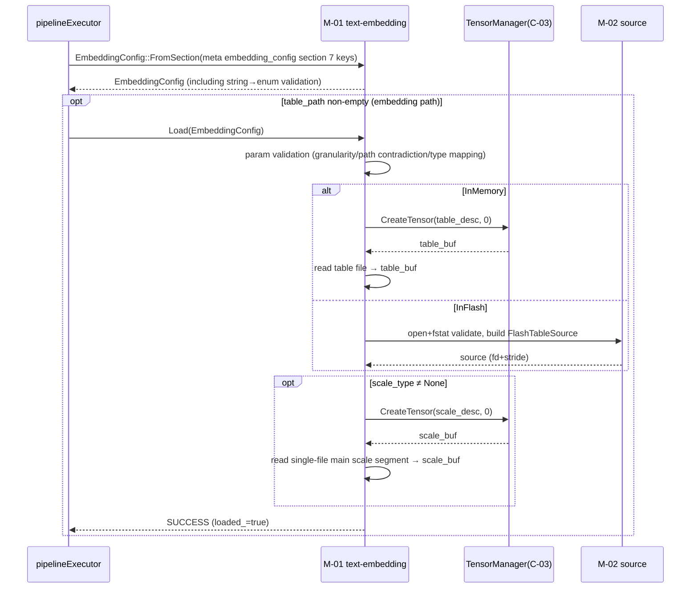
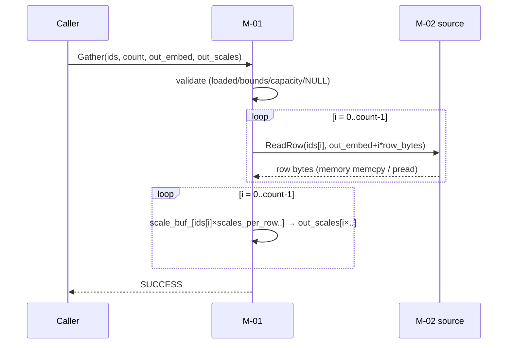
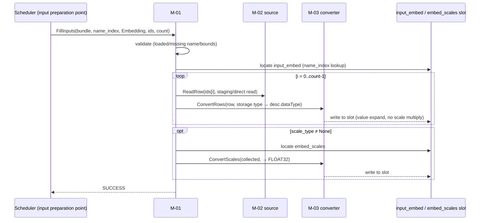

# TextEmbedding Module Design

English | [简体中文](../../../zh/cann_lm_engine/embedding/DESIGN.md)

<!--
Machine-readable authoritative design version (with complete ID cross-references).
Companion: `./SPEC.md` (behavior specification, SR20260828001), `./DESIGN_HUMAN.md` (narrative rewrite, for easy reading).
Technical decisions are completely consistent with this document; this document is the authoritative version.
-->

## Table of Contents

- [Spec Summary](#spec-summary)
- [§1 Scope and Objectives](#1-scope-and-objectives)
- [§2 Architecture Overview](#2-architecture-overview)
  - [§2.1 Architecture Style and Philosophy](#21-architecture-style-and-philosophy)
  - [§2.2 Runtime Architecture](#22-runtime-architecture)
  - [§2.3 Deployment and Hardware Mapping](#23-deployment-and-hardware-mapping)
  - [§2.4 Concurrency and Thread Safety](#24-concurrency-and-thread-safety)
- [§3 Module List](#3-module-list)
- [§4 Contract List](#4-contract-list)
- [§5 Key Process List](#5-key-process-list)
- [§6 Quality Attributes and Cross-Cutting Strategies](#6-quality-attributes-and-cross-cutting-strategies)
- [§7 Decision Index](#7-decision-index)
- [§8 Code Plan Hints](#8-code-plan-hints)
- [§9 Risks and Open Items](#9-risks-and-open-items)
- [§10 Change Log](#10-change-log)
- [Modules](#modules)
  - [M-01-text-embedding](#m-01-text-embedding)
  - [M-02-table-source](#m-02-table-source)
  - [M-03-type-converter](#m-03-type-converter)
- [Contracts](#contracts)
  - [C-01-pipeline-loader](#c-01-pipeline-loader)
  - [C-02-executor-input-bundle](#c-02-executor-input-bundle)
  - [C-03-tensormanager-contract](#c-03-tensormanager-contract)
  - [C-04-backend-types-contract](#c-04-backend-types-contract)
- [Processes](#processes)
  - [F-01-load](#f-01-load)
  - [F-02-gather](#f-02-gather)
  - [F-03-fill-embedding-path](#f-03-fill-embedding-path)
  - [F-04-fill-tokenid-path](#f-04-fill-tokenid-path)
- [Performance and Quality](#performance-and-quality)
  - [concurrency](#concurrency)
  - [performance](#performance)
  - [dfx](#dfx)
  - [security](#security)

---

<a id="spec-summary"></a>
## Spec Summary

- Spec ID: `SR20260828001`
- Upstream spec: `./SPEC.md`
- Software layer: framework (engine core reusable library)
- Covered behavior groups: Load(§4.1.1) / Gather(§4.1.2) / FillInputs(§4.1.3) / TypeConvert(§4.1.4) / DualPath(§4.1.5) / ErrorClassify(§4.1.6)
- Upstream decision source: brainstorm (2026-08-27) + user three-round confirmation (2026-08-28: perToken/perGroup quantization granularity, dtype per TensorDesc + host type conversion, Gather simultaneously outputs out_scales, TokenId path table in weights, InFlash loading method)
- U-1 (TokenId path table delivery channel) resolved: table included in model weights loaded with graph, this module only fills token id.

```yaml
spec_source: ./SPEC.md
level: design
spec_id: SR20260828001
delta_summary: Single-class façade + internal TableSource dual strategy (InMemory/InFlash) + pure function type conversion; host only moves/expands values, no dequantization; FillInputs proactively fills slots (depends on executor input bundle + name→index); table/scale buffer allocated via TensorManager singleton.
covers: [Load, Gather, FillInputs, TypeConvert, DualPath, ErrorClassify]
status: draft
```

---

<a id="1-scope-and-objectives"></a>
## §1 Scope and Objectives

- **in scope**: C++ embedding module under `cann_lm/engine/core/component/text_embedding` — embedding_weights single-file loading (four-segment layout: main table → per_layer table → main scale → per_layer scale; InMemory entire table into memory / InFlash keep in file read by row), host-side gather (row copy + per-token scale collection), storage type→slot type conversion, input slot filling (embedding path fills `input_embed`+`embed_scales`; tokenId path fills token id). In-place rewrite of existing `TextEmbedding` stub; `ModalityEntry` kept in place unchanged. Internal module, no Python/external exposure.
- **out of scope** (with rationale):
  - Dequantization (multiply scale) — spec §4.1.4/§4.1.5 belongs to NPU/in om graph; host never does.
  - TokenId path table delivery — **table already included in model weights loaded with graph** (U-1 resolved), this module does not handle.
  - Other slot filling like attention_mask/position_ids/new_kv_cache_pos — belongs to `InputAssembler` (model_executor M-03).
  - Multimodal placeholder replacement — belongs to `Preprocessor` (via `ModalityEntry`, another responsibility in same header file).
  - Table memory underlying allocation strategy — via `TensorManager` singleton / `ITensorBuffer` abstraction (C-03/C-04).
  - InFlash table file hot update — spec U-7 explicitly not supported; corruption goes to FAILURE path.
  - INT4/BF16 storage type conversion/unpacking — spec U-3 not supported in this version.
- **Objective priority**: behavioral correctness (gather/conversion byte-for-byte correct) > error code precision (6 coarse codes) > gather bandwidth > memory footprint (InFlash optional zero-resident).

<a id="2-architecture-overview"></a>
## §2 Architecture Overview

<a id="21-architecture-style-and-philosophy"></a>
### §2.1 Architecture Style and Philosophy

```mermaid
graph TD
  PE[pipelineExecutor/AutoregressivePipelineExecutor] -->|init phase Load(config)| TE[M-01 text-embedding single-class façade]
  PE -->|input preparation phase FillInputs (via its Scheduler member, §2.2 wiring point)| TE
  TE -->|unified row read interface ReadRow| SRC[M-02 table-source<br/>InMemory / InFlash dual strategy]
  TE -->|element-wise value expansion| CVT[M-03 type-converter pure function]
  TE -->|table/scale buffer allocation| TM[TensorManager singleton C-03]
  SRC -->|InMemory: memory copy| BUF[(host ITensorBuffer)]
  SRC -->|InFlash: pread by row offset| FLASH[(embedding_weights single file)]
  TE -->|read/write slots| ME[ModelExecutor input_tensors_ + name_index<br/>C-02 read-only exposure]
  ME -->|input_embed / embed_scales slots| OM[(om graph)]
  OM -->|NPU-side dequant| NPU[(NPU)]
  note1[host only moves / expands values<br/>does not multiply scale] -.-> TE
```

Style declaration (≤100 chars): **Single-class façade + dual data source strategy + pure function conversion**. Externally one `TextEmbedding` concrete class (no polymorphic hierarchy, D-03); internally dispatches row reading by `load_mode` two-state (M-02, first landing point for type-agnostic strategy hook); type conversion is a pure function set (M-03); host side only does byte moving and value expansion, dequantization always on NPU (D-01).

<a id="22-runtime-architecture"></a>
### §2.2 Runtime Architecture

Two runtime forms, both driven by pipeline:

- **init phase (only embedding path needs it)**: After `AutoregressivePipelineExecutor` construction, before first Forward, call `text_embedding_.Load(config)` with `EmbeddingConfig` (F-01); when the graph carries per_layer slots, additionally call `text_embedding_.LoadTokenIdentity(config)` (same single file, identity table/scale segments, total length exact-equality). config assembly channel (**SR20260903001 D-12**): **meta_json `embedding_config` section → pipeline inline parsing step directly calls `EmbeddingConfig::FromSection(weights, type, scale_type, quant_mode, load_mode, identity_type, identity_scale_type, vocab, hidden, out)`** (7 strings direct parameterization; vocab/hidden taken from model_config section across sections) — L1 `EngineOptions`/C ABI untouched. Field set and mapping see C-01 §2. Table buffer allocated via `TensorManager::Instance().CreateTensor` (C-03); InFlash mode does not allocate table buffer, only holds fd + stride. `embedding_config` section default/`weights` empty (e.g. tokenId deployment form) → don't call Load.
- **input preparation phase per forward step**: Actual calling component is **`Scheduler`** (not RunLoop itself — RunLoop only calls `scheduler_.Step()`, input preparation happens inside `Step`, see "wiring point" below). `Scheduler` calls `text_embedding_->FillInputs(executor.InputTensors(), executor.InputNameIndex(), path, ids, count)` (F-03/F-04) on target executor at prefill / decode two input preparation points, then `executor.Forward(opts)`. Slot data written by this module into `input_embed` (and embedding path's `embed_scales`); other slots still filled by InputAssembler.

Relationship with current `SetInputData`: under embedding path, slot filling responsibility shifts from "caller prepares buffer → SetInputData memcpy" to this module (`embed_scales` goes from pending to filled by this module, landing INPUT_INFO's designated filler); `SetInputData` retained (external direct-fill channel, C-01 compatibility unchanged).

**Wiring point (external review H-1 revision, 2026-08-29)** — `input_embed` slot's sole writer in current code is `Scheduler` (repo-wide only `scheduler.cpp:127` (prefill) and `scheduler.cpp:191` (decode) two `SetInputData` calls; RunLoop does not fill inputs). Wiring design:

1. **`Scheduler` constructor signature adds `TextEmbedding* text_embedding` non-owning pointer** (same type as existing `Preprocessor* preprocessor`): `Scheduler(ModelExecutor*, ModelExecutor*, Preprocessor*, TextEmbedding*, int max_batch_size)`. `pipeline_executor.cpp` two construction points (`:42`/`:67`) append argument `&text_embedding_` — member declaration order `text_embedding_` before `scheduler_`, pointer valid during construction.
2. **`SetInputData` yield rule (by call site + path)**:
   - **prefill point (`scheduler.cpp:127`)**: embedding path → `SetInputData(chunk)` **replaced**, changed to `FillInputs(executor.InputTensors(), executor.InputNameIndex(), EmbeddingPath::Embedding, ids, count)`, where `ids = chunk->GetData() const TokenId*`, `count = chunk_len`; tokenId path → also changed to `FillInputs(..., TokenId, ids, count)` (ids from chunk, module does INT32/INT64 value conversion write, replacing bare memcpy).
   - **decode point (`scheduler.cpp:191`)**: same, `ids` from `Preprocessor.PrepareDecodeStep` output `inputs[0]`.
   - i.e.: after wiring, `input_embed`'s **sole runtime writer is this module** (both paths); `SetInputData` has zero calls in repo, retained only as "external direct-fill channel" API (not deleted, backward compatible).
3. **Path selection supply**: `Scheduler` does not self-decide path — per model_executor D-07 existing logic (whether om has built-in embedding) obtains `EmbeddingPath` then passes to `FillInputs` (source and transfer details belong to model_executor/pipeline side, wiring milestone ⑥ implements).
4. **Double-write prohibition**: Same slot only allows one write per iteration. `SetInputData` and `FillInputs` must not both call for same `input_embed` in sequence (after wiring Scheduler no longer calls `SetInputData` to fill `input_embed`; if future external direct-fill demand arises, mutual exclusion must be at overall scheduling layer outside FillInputs, not this module's responsibility).

<a id="23-deployment-and-hardware-mapping"></a>
### §2.3 Deployment and Hardware Mapping

- Host side pure CPU (file read + memcpy + value expansion conversion), no NPU operator calls, no DMA.
- Memory form: InMemory = table + scale each one host buffer resident; InFlash = scale resident + table fd (zero table resident).
- Optional deployment switch: memory-constrained (device-side OHOS) → InFlash; throughput-first (server ACL) → InMemory. Same build artifact supports both (runtime config, not compile-time either-or).

<a id="24-concurrency-and-thread-safety"></a>
<a id="concurrency"></a>
### §2.4 Concurrency and Thread Safety

- Contract (non-lock guarantee): `Load` not concurrent, `Load` not concurrent with `Gather`/`FillInputs` (caller pipeline serial init); same instance `Gather` (const) can be multi-threaded concurrent — M-02 both strategies satisfy (memory read naturally concurrent; InFlash uses `pread` positional read, doesn't move shared cursor).
- `FillInputs` makes no concurrency promise (its write target slot buffer belongs to Forward input preparation phase, naturally single-threaded).
- Module itself **lock-free**: all members read-only after Load (table buffer / fd / stride / scale buffer / metadata), no mutable state.

<a id="3-module-list"></a>
## §3 Module List

| ID | Name | One-line Responsibility | Dependencies | Details |
|----|------|-----------|------|------|
| M-01 | text-embedding | Single-class façade: Load (config validation + delegate M-02 source build + scale loading) / Gather (row read + scale collection) / FillInputs (gather→convert→write slot) / accessors | M-02, M-03, C-03, C-04 | [→](#m-01-text-embedding) |
| M-02 | table-source | Table data source internal strategy: unified `ReadRow(id, dst)`; InMemory (memory buffer copy) / InFlash (fd + pread by row offset) two-state; type-agnostic | C-04 | [→](#m-02-table-source) |
| M-03 | type-converter | Storage type→slot dtype element-wise value expansion pure function set (no scale multiplication); includes support matrix determination | — | [→](#m-03-type-converter) |

Dependency graph acyclic check: M-03 no dependencies; M-02 ← {C-04}; M-01 ← {M-02, M-03, C-03, C-04}. ✓

> All three land in `core/component/text_embedding.{h,cpp}` single file pair; M-02/M-03 are `.cpp` internal implementation details (anonymous namespace / detail namespace), **do not appear in public header** — externally only M-01 single class (D-03).

<a id="4-contract-list"></a>
## §4 Contract List

> `AutoregressivePipelineExecutor` is an external actor (consumer). `ModelExecutor`/`TensorManager`/backend types are external peers, this design only declares dependency contracts.

| ID | Producer | Consumer | One-line Contract | Details |
|----|--------|--------|-----------|------|
| C-01 | M-01 | pipelineExecutor | init phase Load(EmbeddingConfig); input preparation phase FillInputs; runtime Gather (UT/debug direct query) | [→](#c-01-pipeline-loader) |
| C-02 | ModelExecutor (external) | M-01 | Read-only expose `InputTensors()` / `InputNameIndex()` (new accessors, additive change) | [→](#c-02-executor-input-bundle) |
| C-03 | TensorManager (external singleton) | M-01 | Table/scale host buffer allocation (`CreateTensor(desc, modelId=0 sentinel, &out)`) | [→](#c-03-tensormanager-contract) |
| C-04 | backend types (external) | M-01/M-02 | Only depends on `ITensorBuffer`/`TensorDesc`/`DataType` abstraction; does not reference concrete backend class names | [→](#c-04-backend-types-contract) |

<a id="5-key-process-list"></a>
## §5 Key Process List

| ID | Scenario | Key Path | Details |
|----|------|---------|------|
| F-01 | Load (InMemory/InFlash) | pipeline→M-01 validate config→M-02 build source (read file/stat+fd)→scale load→C-03 allocate buffer | [→](#f-01-load) |
| F-02 | Gather | caller→M-01 validate→per-id M-02.ReadRow→out_embed; scale index collection→out_scales | [→](#f-02-gather) |
| F-03 | FillInputs (embedding path) | pipeline→M-01→gather (F-02 inline)→M-03 convert→write input_embed→write embed_scales | [→](#f-03-fill-embedding-path) |
| F-04 | FillInputs (tokenId path) | pipeline→M-01→ids value convert (INT32/INT64)→write input_embed (no Load needed) | [→](#f-04-fill-tokenid-path) |

<a id="6-quality-attributes-and-cross-cutting-strategies"></a>
## §6 Quality Attributes and Cross-Cutting Strategies

| Dimension | Core Strategy | Details |
|------|---------|------|
| Performance | InMemory gather approaches memcpy bandwidth; InFlash allows offset sorting optimization (without changing row order) | [→](#performance) |
| Concurrency | Lock-free read-only design; Load/query separation guaranteed by caller serialization | [→](#concurrency) |
| DFX | Three-level logging + key metrics; Forward hot path defaults to no INFO logging | [→](#dfx) |
| Security | Input validation (bounds/capacity/NULL) + no external exposure surface | [→](#security) |
| Error propagation | Align with 6 coarse codes, non-silent; load failure recoverable (stays unloaded) | spec §4.1.6 + F-xx |
| Data consistency | gather byte-for-byte deterministic; conversion pure value expansion semantics | D-01/D-06 |

<a id="7-decision-index"></a>
## §7 Decision Index

| ID | Topic | Status |
|----|------|------|
| D-01 | Dequantization always NPU-side; host only moves/expands values, type conversion does not multiply scale | accepted |
| D-02 | Dual path: tokenId path table in model weights (this module only fills id, no Load needed); embedding path host gather fills slots | accepted |
| D-03 | Externally single class + type tag dispatch (no polymorphic hierarchy by (embType,scaleType)); internally only M-02 two-state strategy by load_mode (reserved hook first landing point) | accepted |
| D-04 | No BindToModel: table/scale not weight-bound, used as input slot data | accepted |
| D-05 | Module proactively fills slots (FillInputs depends on executor input bundle + name→index; path selection belongs to model_executor D-07) | accepted |
| D-06 | Fill type per slot TensorDesc.dataType; storage type only describes file layout; mismatch triggers host value expansion conversion | accepted |
| D-07 | Quantization granularity PerToken (scale=[vocab]) / PerGroup (scale=[vocab×groups], GroupSize required and must evenly divide hidden) | accepted |
| D-08 | Table loading method InMemory/InFlash optional; InFlash zero table resident, pread by row; runtime config not compile-time | accepted |
| D-09 | Scale always in-memory (small size + random access every gather) | accepted |
| D-10 | Table/scale host buffer allocated via TensorManager singleton (modelId=0 sentinel); no direct backend CreateTensorBuffer call | accepted |
| D-11 | Error codes align with infra/status.h 6 coarse codes; no exception escape; load failure stays unloaded, can re-Load | accepted |

<a id="8-code-plan-hints"></a>
## §8 Code Plan Hints

**For downstream plan/impl agent**:
- Implementation order (dependency topology): C-04 (only confirm include surface, no code) → M-03 type-converter (pure function, zero dependencies) → M-02 table-source (depends on C-04 types) → M-01 text-embedding façade (aggregate + C-03 + `FromSection`) → C-02 ModelExecutor accessor (two-line addition) → **Scheduler wiring** (§2.2 wiring point: constructor signature add `TextEmbedding*`, `pipeline_executor.cpp:42/67` pass `&text_embedding_`, prefill/decode two input preparation points replace SetInputData with FillInputs for input_embed) → `AutoregressivePipelineExecutor` init phase Load wiring (channel already decided SR20260903001 D-12: meta `embedding_config` section 7 keys + `FromSection` assemble, ParseConfigs assembly point).
- Parallelizable: M-02/M-03 mutually independent, can be parallel.
- Minimum reading set for implementing a module:
  - M-01 → this section + C-01/C-02/C-03 + F-01/F-02/F-03/F-04
  - M-02 → this section + C-04 + F-01/F-02
  - M-03 → this section + spec §4.1.4 (conversion matrix sole authority)
- Integration milestones: ①M-03 + full matrix unit tests (including unsupported combination rejection); ②M-02 InMemory + ReadRow correctness; ③M-02 InFlash + pread + corruption path; ④M-01 Load (two modes) + Gather (PerToken/PerGroup); ⑤M-01 FillInputs two paths + mock bundle (6 named descs); ⑥C-02 accessor + **Scheduler wiring (§2.2 wiring point 1/2/3: constructor signature + two call sites yield + path passthrough)** + pipeline init Load wiring + existing UT all green (LoadAndBind stub deletion call surface cleared; after wiring `grep SetInputData` repo call surface should be zero).
- Source lands in `cann_local_lm/engine/core/component/text_embedding.{h,cpp}` (in-place rewrite of stub); UT lands in `tests/cpp/engine/` (target `ut_text_embedding`, GoogleTest); CMake hooks into engine existing test registration chain, **and synchronously register in `cann_local_lm/engine/ohos/CMakeLists.txt`** (OHOS side uses explicit per-target copy, no sharing mechanism with main chain, without this HarmonyOS deployment can't reach this test; note `ut_sampler`/`ut_request_handle` already have OHOS drift precedent, don't add new ones).
- Backend binding: none. M-01/M-02/M-03 all do not reference concrete backend class names (grep assertion); buffer via TensorManager singleton.
- Deletion list: `LoadAndBind()` stub (delete after repo-wide grep confirms zero calls); header comment v1.1/v1.2 history notes updated to point to this DESIGN.

<a id="9-risks-and-open-items"></a>
## §9 Risks and Open Items

| Risk/Open Item | Impact | Mitigation | Trigger Condition |
|-----------|------|------|----------|
| ~~U-8~~ EmbeddingConfig transfer channel | ~~unresolved~~ **resolved (2026-08-29 user decision)**: route b — meta_json→`ModelConfig` extend embedding section (plain fields, C-01 §2) → `EmbeddingConfig::FromModelConfig` assemble; L1 EngineOptions/C ABI untouched | design landed in C-01 §2 / F-01 / M-01 §2 | resolved |
| U-2 vocab/hidden source field not aligned | Load input source drifts | **source decided = ModelConfig extension field (landed together with U-8, C-01 §2)**; only field alignment remains | implementation phase |
| U-3 INT4/BF16 not supported | deployment form limited | enum placeholder + conversion matrix explicit rejection | real demand → upgrade M-02/M-03 strategy |
| ~~U-4~~ INPUT_INFO correction | ~~pending correction~~ **completed (2026-08-29, INPUT_INFO v0.4)**: embed_scales dimensions/input dtype/filler description all synchronized with implementation landing | closed | resolved |
| U-5 gather/InFlash latency no baseline | budget inaccurate | implementation phase micro-benchmark | aarch64 measurement |
| U-6 no scale embed_scales handling | behavior ambiguous | this design takes "skip, don't fill" (spec same) | first no-scale model |
| U-7 InFlash file lifecycle | runtime corruption | TC_111 FAILURE path; hot update not supported | file truncated/replaced |
| TensorManager modelId sentinel semantics | real backend CreateTensor may bind NPU context by modelId | table/scale are host buffers (CreateTensorBuffer semantics = host); modelId=0 through stub path no side effects; verify at real backend integration | backend implementation phase |
| InFlash random read amplification | gather latency jitter | allow offset sorting optimization (without changing row order); max_seqLen magnitude single-batch row count limited | large vocab + high QPS |
| FillInputs call site wiring omission | embed_scales still unfilled | milestone ⑥ explicit wiring (§2.2 wiring point, lands at Scheduler two call sites) + grep assertion | implementation phase |
| SetInputData and FillInputs double-write input_embed | slot data overwritten, behavior depends on call order | §2.2 wiring point 4: after wiring Scheduler no longer fills input_embed via SetInputData (both paths changed to FillInputs); milestone ⑥ grep assertion repo SetInputData call surface zero | implementation phase |
| Slot dynamic shape (desc.size==0) capacity misjudgment | stub backend GetSize fixed 1024 bytes placeholder, real capacity misjudged | existing engine gap (INPUT_INFO §6 legacy #4), not introduced by this design; verify at real backend integration | backend implementation phase |
| Slot dtype unconventional type (e.g. FLOAT64) | FillInputs rejects | conversion matrix explicitly lists supported set, rest INVALID_ARGUMENT | om graph anomaly |

<a id="10-change-log"></a>
## §10 Change Log

| Version | Date | Change | Triggering spec section |
|------|------|------|---------------|
| 0.1 | 2026-08-28 | Initial draft: 10-chapter SDD design + 3 modules + 4 contracts + 4 processes + 11 decisions. Lands all behaviors of SPEC SR20260828001 (including U-1 resolved: TokenId path table in weights). | SR20260828001 all |
| 0.2 | 2026-08-29 | External review (+2) release condition revisions: ①§2.2/C-01/§8 add Scheduler wiring point design (H-1: input_embed sole writer is scheduler.cpp:127/191's SetInputData, constructor signature add TextEmbedding*, yield rule by call site+path); ②§9 register U-8 EmbeddingConfig transfer channel (M-1); ③§8 add OHOS CMakeLists sync registration (M-2) and dynamic shape risk (M-3); ④L-level revisions: M-02 factory signature add table_buf/flash_fd params (L-1), F-03 validate all before writing (L-2), empty buffer input to INVALID_ARGUMENT + TC_112 (L-3), InFlash staging explicitly stack-local (L-4), conversion matrix Int8/Int4 same-type column align with SPEC, C-03 error table recoverable scope, C-02 comment disambiguation (L-5). | external review report (2026-08-29) |
| 0.3 | 2026-08-29 | U-8 decision landing (user decided route b): C-01 §2 add EmbeddingConfig assembly channel design (ModelConfig embedding section plain fields + `EmbeddingConfig::FromModelConfig` static factory, dependency direction text_embedding→tensor_manager legal); F-01 add assembly step; §2.2 init phase add channel and empty path no Load; U-2 source thus decided as ModelConfig. All open items no longer block implementation. | SPEC U-8 decision |
| 0.4 | 2026-11-02 | embedding_weights single-file four-segment merge (main table → per_layer table → main scale → per_layer scale, replacing table+scale dual files): M-01 §2 struct drops scale_path, adds token_identity three keys and FromSection 7 strings; C-01 §2/F-01 synchronized to single-file wording; `embedding_dequant_scale` key deprecated (leftover only WARN); with identity enabled whole-file total length exact-equality (M-01 §6). | single-file layout change |

---

<a id="modules"></a>
## Modules

<a id="m-01-text-embedding"></a>
### M-01-text-embedding

#### §1 Responsibility

Single-class façade (spec §4.1.1/4.1.2/4.1.3/4.1.6). Externally the sole public class `TextEmbedding`, aggregating three things:
- **Load(EmbeddingConfig)**: config validation (path/type/quantization granularity/size) → delegate M-02 to build table source (InMemory/InFlash) → main scale segment read from the single file's third segment (always in-memory, D-09) → table buffer allocated via C-03. Failure stays unloaded.
- **Gather(ids, count, out_embed, out_scales)**: per-id row read (M-02) + per-token scale collection (memory index), pure byte moving.
- **FillInputs(inputs, name_index, path, ids, count)**: embedding path = inline gather → M-03 convert → write `input_embed` + `embed_scales`; tokenId path = ids value convert write `input_embed` (no Load needed, D-02).

Does not do: dequantization, table delivery (in weights), other slots, multimodal placeholder (`ModalityEntry` only physically same file).

#### §2 External Interface

```cpp
// core/component/text_embedding/text_embedding.h (engine internal component, only pipeline/model_executor/UT consume)

enum class EmbeddingType     { Fp32, Fp16, Int8, Int4 };   // main table segment storage type (Int4 placeholder, U-3 not supported)
enum class EmbeddingScaleType{ None, Fp32, Fp16 };         // main scale segment storage type
enum class EmbeddingQuantMode{ PerToken, PerGroup };       // scale granularity (D-07)
enum class EmbeddingPath     { TokenId, Embedding };       // FillInputs path selection (selection right belongs to model_executor)
enum class EmbeddingLoadMode { InMemory, InFlash };        // table loading method (D-08)

struct EmbeddingConfig {
    std::string           table_path;   // embedding_weights single file (four segments: main table → identity table → main scale → identity scale)
    EmbeddingType         table_type;
    EmbeddingScaleType    scale_type;
    EmbeddingQuantMode    quant_mode;
    size_t                group_size = 0;   // PerGroup required; PerToken ignored
    size_t                vocab_size = 0;   // source meta model_config section (U-2)
    size_t                hidden_dim = 0;   // source meta model_config section (U-2)
    EmbeddingLoadMode     load_mode = EmbeddingLoadMode::InMemory;

    // per_layer_token_identity (gemma4): read types come from meta keys; row width W
    // backfilled by pipeline from graph slot dims
    EmbeddingType         token_identity_type = EmbeddingType::Fp16;
    EmbeddingScaleType    token_identity_scale_type = EmbeddingScaleType::Fp16;
    size_t                token_identity_row_width = 0;

    /// Assembly entry (SR20260903001 D-12): embedding_config section 7 strings + cross-section
    /// vocab/hidden → EmbeddingConfig. string→enum parsing and validation here (unknown value →
    /// INVALID_ARGUMENT); weights empty → SUCCESS and out->table_path empty (caller doesn't Load based on this).
    static Status FromSection(const std::string& weights,
                              const std::string& type, const std::string& scale_type,
                              const std::string& quant_mode, const std::string& load_mode,
                              const std::string& identity_type, const std::string& identity_scale_type,
                              size_t vocab_size, size_t hidden_dim, EmbeddingConfig* out);
};

class TextEmbedding {
public:
    TextEmbedding() = default;
    ~TextEmbedding() = default;

    // Semantics: synchronous; caller guarantees not concurrent, not concurrent with Gather/FillInputs (§2.4).
    //       Failure stays unloaded (can re-Load).
    // Errors: file missing/size mismatch/PerGroup params illegal → INVALID_ARGUMENT
    Status Load(const EmbeddingConfig& config);

    // Semantics: synchronous; reads identity table segment + identity scale segment from the same
    //       single file (when graph carries per_layer slots). Whole-file total length must exactly
    //       equal the four-segment sum (W mismatch / file-graph mismatch defense), else INVALID_ARGUMENT.
    Status LoadTokenIdentity(const EmbeddingConfig& config);

    // Semantics: const read-only, thread-safe (can be concurrent). Pure byte moving + scale index collection, no dequantization.
    //       scale_type=None skips out_scales write.
    // Errors: not Loaded → INVALID_STATE; ids out of bounds / capacity insufficient / NULL (including ids=nullptr,
    //       out_embed/out_scales empty shared_ptr) → INVALID_ARGUMENT;
    //       InFlash read failure (I/O/short-read) → FAILURE
    Status Gather(const TokenId* ids, size_t count,
                  std::shared_ptr<ITensorBuffer> out_embed,
                  std::shared_ptr<ITensorBuffer> out_scales) const;

    // Semantics: proactively fill slots (D-05). Embedding path requires already Loaded; TokenId path no Load prerequisite (D-02).
    //       Write type per slot TensorDesc.dataType (D-06), mismatch via M-03 value expansion.
    // Errors: input_embed missing name → NOT_FOUND; (Embedding path and scale_type≠None) embed_scales missing name → NOT_FOUND;
    //       Embedding path not Loaded → INVALID_STATE; conversion combination unsupported / capacity insufficient / NULL
    //       (including ids=nullptr and count>0, slot bundle buffer empty) → INVALID_ARGUMENT
    Status FillInputs(const std::vector<std::shared_ptr<ITensorBuffer>>& inputs,
                      const std::unordered_map<std::string, size_t>& name_index,
                      EmbeddingPath path,
                      const TokenId* ids, size_t count);

    // Accessors (pipeline / UT use; none throw)
    std::shared_ptr<ITensorBuffer> Table() const;       // unloaded or InFlash → nullptr
    std::shared_ptr<ITensorBuffer> Scale() const;       // unloaded or scale_type=None → nullptr
    EmbeddingType                  TableType() const;   // unloaded → Fp32 (sentinel) + Loaded() to distinguish
    EmbeddingLoadMode              LoadMode() const;    // unloaded → InMemory (sentinel)
    bool                           Loaded() const;
};
```

> `name_index` value type is `size_t`, 1:1 with `ModelExecutor::input_name_index_` (`unordered_map<string, size_t>`) (C-02).

#### §3 Internal Structure
- Members (all read-only after Load, lock-free, §2.4): `std::unique_ptr<TableSource> source_` (M-02, InMemory/InFlash two-state); `std::shared_ptr<ITensorBuffer> scale_buf_` (always in-memory); `EmbeddingConfig cfg_` (loaded config snapshot); `size_t row_bytes_` / `groups_` (PerGroup = hidden/group_size, PerToken always 1); `bool loaded_`.
- Load flow (F-01): param validation → (InMemory) C-03 allocate table buffer + read file; (InFlash) open + fstat validate + record stride → (scale_type≠None) C-03 allocate scale buffer + read from single file's third segment → set loaded_.
- LoadTokenIdentity flow: second table source isomorphic to Load (identity table segment + identity scale segment, same single file; whole-file total length exact-equality).
- Gather internal: `for i: source_->ReadRow(ids[i], out_embed + i*row_bytes_)` + `for i: memcpy out_scales + i*scales_per_token*elem ← scale_buf_ + ids[i]*...` (PerGroup copies `groups_` consecutive elements).
- FillInputs internal (Embedding path): per-row streaming — InFlash uses one-row staging (**stack-local buffer, `row_bytes_` size, allocated/freed with call stack frame, not a member** — maintains §2.4 "no mutable state" declaration) via M-03 conversion write to slot; InMemory directly from table buffer per-row conversion write. scale collected then via M-03 (Fp16→FLOAT32) write `embed_scales`.
- Non-copyable (includes unique_ptr fd ownership semantic clarity); movable (moved-from object set to unloaded).

<a id="contracts"></a>
#### §4 Key Dependencies and Hardware Contracts
- Depends on M-02 (row read), M-03 (conversion), C-02 (slot bundle read-only access), C-03 (buffer allocation), C-04 (type abstraction).
- No hardware awareness: file I/O (`<fstream>`/`<fcntl.h>+pread`) + host memory. Cross-platform note OHOS musl `pread` availability (POSIX standard, no risk).

<a id="performance"></a>
#### §5 Performance Budget

| Path | Budget | Measurement Condition | Source |
|------|------|----------|------|
| Gather (InMemory) | approach memcpy bandwidth (budget, U-5) | aarch64, INT8 table [65536,4096] | estimated |
| Gather (InFlash) | single batch (≤ max_seqLen rows) read latency acceptable (budget, U-5) | same as above, vs InMemory | estimated |
| FillInputs conversion overhead | INT8→FP16 expansion ≈ bandwidth halved | micro-benchmark | estimated |
| Load | one-time | construction phase | estimated 🟢 |

#### §6 Failure Modes

| Failure | Trigger | Detection | Handling |
|------|------|------|------|
| Single file missing | open fails | Load phase | INVALID_ARGUMENT (TC_101), stays unloaded |
| Size mismatch | main table segment < expected / main scale segment short read; with identity enabled total ≠ four-segment sum | Load phase (InMemory actual mapping / InFlash fstat / LoadTokenIdentity total exact-equality) | INVALID_ARGUMENT (TC_102/TC_401) |
| PerGroup params illegal | group_size non-positive/not divisible/missing | Load phase | INVALID_ARGUMENT (TC_103) |
| tokenId out of bounds | ids[i] ≥ vocab | Gather/FillInputs phase | INVALID_ARGUMENT, reject entire batch no partial output (TC_105) |
| Query before load | loaded_=false | entry validation | INVALID_STATE (TC_106); TokenId path FillInputs exempt (D-02) |
| Slot missing name | name_index no input_embed / embed_scales | FillInputs phase | NOT_FOUND (TC_107) |
| Conversion unsupported | INT4/BF16 or beyond matrix combination | M-03 determination | INVALID_ARGUMENT (TC_108) |
| Capacity insufficient | GetSize() < expected | Gather/FillInputs phase | INVALID_ARGUMENT (TC_109) |
| InFlash runtime corruption | pread short-read/I/O error | Gather phase | FAILURE (TC_111) |
| NULL input | ids=nullptr and count>0 | entry validation | INVALID_ARGUMENT (TC_110) |
| Empty buffer input | out_embed/out_scales empty shared_ptr (Gather); slot bundle buffer empty (FillInputs) | entry validation | INVALID_ARGUMENT (TC_112) |
| TensorManager allocation failure | CreateTensor returns error | Load phase (C-03) | propagate to caller; stay unloaded can re-Load (C-03 §4) |

#### §7 Observability Points
- log key: `embedding.load.{ok|err}` / `embedding.gather.{ok|err}` / `embedding.fill.{ok|err}` / `embedding.flash.read.err`
- metric: `embedding_load_total{mode=inmemory|inflash}` / `embedding_gather_rows_total` / `embedding_fill_total{path=tokenid|embedding}` / `embedding_errors_total{kind}` / `embedding_flash_read_errors_total`
- Hot path (Gather/FillInputs) defaults to no INFO, only metric.

#### §8 Test Hooks
- UT focus: SPEC Chapter 8 TC_001–TC_302 full set (load two modes/two granularities, gather correctness, FillInputs two paths, conversion matrix, error codes, boundaries, concurrency).
- mock needs: mock input bundle (`vector<ITensorBuffer>` + name_index, desc as needed FLOAT16/FLOAT32/INT32) — directly use `CreateTensorBuffer` (via C-04) to construct, no need to mock TensorManager (UT also goes through real singleton, stub backend no side effects).
- grep assertion: `text_embedding.{h,cpp}` must not contain concrete backend class names (`Acl`/`Ndk`/`Hiai`, etc.).

<a id="m-02-table-source"></a>
### M-02-table-source

#### §1 Responsibility

Table data source internal strategy (spec §4.1.1 InFlash/InMemory semantics + §4.1.2 row read). Unified contract: given tokenId, write that row's `row_bytes` bytes into caller buffer. **Type-agnostic** (pure byte moving, unrelated to EmbeddingType — elem_size folded into row_bytes at source build). Two states:
- **MemoryTableSource**: holds `shared_ptr<ITensorBuffer>` (read in at Load), ReadRow = memcpy.
- **FlashTableSource**: holds fd + `row_bytes`, ReadRow = `pread(fd, dst, row_bytes, id × row_bytes)`; short-read/I/O error returns FAILURE. No row caching, no prefetch (optimization space see §5).

#### §2 External Interface

```cpp
// text_embedding.cpp internal (detail namespace, not in public header)
class TableSource {
public:
    virtual ~TableSource() = default;
    virtual Status ReadRow(TokenId id, void* dst) const = 0;
    virtual size_t RowBytes() const = 0;
};
```

Factory: `detail::CreateTableSource(const EmbeddingConfig& cfg, size_t row_bytes, std::shared_ptr<ITensorBuffer> table_buf, int flash_fd, std::unique_ptr<TableSource>* out)` — dispatch by `cfg.load_mode` two-state: InMemory takes `table_buf` (caller M-01 via C-03 allocated and table data already read in buffer, F-01 timing); InFlash takes `flash_fd` (caller's fd after open+fstat validation), at this point `table_buf` pass nullptr.

#### §3 Internal Structure
- MemoryTableSource: `shared_ptr<ITensorBuffer> buf_` + `row_bytes_`. ReadRow: `memcpy(dst, (char*)buf_->GetData() + id*row_bytes_, row_bytes_)`.
- FlashTableSource: `int fd_` (RAII close) + `row_bytes_`. ReadRow: `pread` fixed length; return bytes ≠ row_bytes_ → FAILURE.
- Thread safety: both ReadRow const + no shared mutable state → concurrent safe (§2.4).

#### §4 Key Dependencies and Hardware Contracts
- Depends on C-04 (ITensorBuffer only used by in-memory branch).
- FlashTableSource depends on POSIX `open/fstat/pread/close`; fd lifecycle = module lifecycle (Load opens, destructor closes; U-7 no hot update).

#### §5 Performance Budget

| Path | Budget | Measurement Condition | Source |
|------|------|----------|------|
| ReadRow (InMemory) | memcpy one row (hidden×elem) | micro-benchmark | estimated 🟢 |
| ReadRow (InFlash) | one pread syscall | micro-benchmark (U-5) | estimated |
| Batch optimization space (optional) | sort by id offset then sequential pread, reduce seek | only implement when InFlash latency exceeds budget; **must not change out row order** | deferred |

#### §6 Failure Modes

| Failure | Trigger | Detection | Handling |
|------|------|------|------|
| File can't open | open fails | source build phase | INVALID_ARGUMENT (propagate to M-01) |
| File size mismatch | fstat ≠ vocab×row_bytes | source build phase | INVALID_ARGUMENT |
| Runtime short-read/I/O error | pread return value abnormal | ReadRow | FAILURE (propagate to M-01, TC_111) |
| fd leak | exception path | RAII destructor close | none |

#### §7 Observability Points
- log key: `embedding.source.create.{ok|err}` / `embedding.flash.read.err`
- metric: `embedding_flash_read_errors_total` / `embedding_flash_rows_read_total`

#### §8 Test Hooks
- UT focus: ReadRow byte-for-byte correctness (both states verified), InFlash vs InMemory same file same id result consistent (TC_008 basis), short-read path (truncated file), fd close (fstat fails after destruction).
- Temp file fixture: UT writes temp table file then builds source.

<a id="m-03-type-converter"></a>
### M-03-type-converter

#### §1 Responsibility

Storage type→slot dtype **element-wise value expansion** pure function set (spec §4.1.4, matrix sole authority in SPEC). Semantic iron rule: **only changes data representation, does not multiply scale** (D-01) — INT8 value 5 → FLOAT16 value 5.0; dequantization (multiply scale) on NPU.

#### §2 External Interface

```cpp
// text_embedding.cpp internal (detail namespace) or standalone inline, pure function stateless
namespace detail {

/// Row data conversion: elem_count elements of src, from src_type (storage type) value expand to dst_type (slot dtype).
/// Same type → memcpy. Support matrix see SPEC §4.1.4; unsupported combination returns INVALID_ARGUMENT.
Status ConvertRows(const void* src, EmbeddingType src_type,
                   void* dst, DataType dst_type, size_t elem_count);

/// scale conversion: target always FLOAT32 (embed_scales slot desc). Fp32 same-type copy; Fp16 value expand.
Status ConvertScales(const void* src, EmbeddingScaleType src_type,
                     void* dst, size_t elem_count);

/// Determine support matrix (UT/pre-validation use)
bool ConversionSupported(EmbeddingType src_type, DataType dst_type);

}  // namespace detail
```

Support matrix (1:1 with SPEC §4.1.4):

| Storage ↓ / Slot → | Same type | FLOAT16 | FLOAT32 |
|----------------|------|---------|---------|
| Fp32 | ✓ (memcpy) | ✗ | ✓ (memcpy) |
| Fp16 | ✓ (memcpy) | ✓ (memcpy) | ✓ expand |
| Int8 | ✓ (memcpy, when slot desc is INT8 direct copy; consistent with SPEC §4.1.4 "same-type direct byte copy") | ✓ expand | ✓ expand |
| Int4 | ✗ (U-3) | ✗ | ✗ (U-3) |

(scale: Fp32→FLOAT32 copy; Fp16→FLOAT32 expand.)

#### §3 Internal Structure
- Template helper `Expand<Src, Dst>(const void*, void*, size_t)` (`*static_cast<const Src*>(p)` → `static_cast<Dst>`); same type via memcpy specialization.
- Stateless, no members, no allocation (caller provides buffer).

#### §4 Key Dependencies and Hardware Contracts
- Zero dependencies (only standard C++ numeric conversion). Fp16 expansion: no hardware Fp16 conversion instruction dependency — uses software half-precision conversion (`__fp16`/hand-written bit conversion, both aarch64 and musl OK).

#### §5 Performance Budget

| Path | Budget | Measurement Condition | Source |
|------|------|----------|------|
| Same-type memcpy | bandwidth | micro-benchmark | estimated 🟢 |
| INT8→FP16 expand | ≈ bandwidth/2 | micro-benchmark | estimated |

#### §6 Failure Modes

| Failure | Trigger | Detection | Handling |
|------|------|------|------|
| Unsupported combination | INT4/BF16/Fp32→FP16 etc. | ConversionSupported pre-check | INVALID_ARGUMENT (TC_108) |

#### §7 Observability Points
- No independent log/metric (pure function, attributed to M-01's fill.err count).

#### §8 Test Hooks
- UT focus: each ✓ combination's element-wise value correctness (including negative INT8, Fp16 denormalized values); each ✗ combination rejection; scale two-type conversion.
- Determinism: same input same output (stateless pure function, naturally satisfied).

---

## Contracts

<a id="c-01-pipeline-loader"></a>
### C-01-pipeline-loader

#### §1 Contract One-liner

"`AutoregressivePipelineExecutor` calls `Load` with EmbeddingConfig at init phase (only embedding path needs it, via its held `text_embedding_` member; with per_layer graph slots, additionally `LoadTokenIdentity`; config assembled from meta `embedding_config` section via `EmbeddingConfig::FromSection` — SR20260903001 D-12); at each forward step's input preparation phase, **`Scheduler`** (its held non-owning `TextEmbedding*`, constructor-injected) calls `FillInputs` at prefill/decode two input preparation points (target executor's bundle + name_index); runtime can call `Gather` (UT/debug direct query)."

#### §2 Data Schema
See M-01 §2: `EmbeddingConfig` (including load_mode), `EmbeddingPath`, `TokenId*`, `Status`. Slot bundle and name_index see C-02. `Scheduler` constructor signature appends `TextEmbedding*` (non-owning, same type as `Preprocessor*`; §2.2 wiring point).

**EmbeddingConfig assembly channel (SR20260903001 D-12 landing point)**:
- meta_json `embedding_config` section 7 keys (plain strings, serialization-friendly): `embedding_weights` (single-file path, empty = tokenId path, no Load), `embedding_type`, `embedding_scale_type` ("none"|"fp32"|"fp16"), `embedding_quant_mode` ("per_token"|"per_group"), `embedding_load_mode` ("in_memory"|"in_flash", default in_memory), `token_identity_type`, `token_identity_scale_type`; vocab/hidden taken from model_config section across sections (U-2). A leftover non-empty `embedding_dequant_scale` key only produces WARN, no section downgrade. Key set detailed in embedding_config.md.
- string→enum parsing and validation belongs to **M-01 side static factory** `EmbeddingConfig::FromSection(7 strings, vocab, hidden, out)` (in `text_embedding.h`). Unknown string → `INVALID_ARGUMENT`; `weights` empty → return "don't load" signal (caller doesn't call Load, tokenId deployment form).
- pipeline init assembly point: `pipeline_executor.cpp` ParseConfigs inline parsing step directly calls FromSection.
- **Boundary**: this module does not do json parsing, only consumes already-parsed plain strings.

#### §3 Timing and Synchronization Semantics
- Synchronous function call.
- Load once at init (M-02 pipeline init phase; no constraint on relative order with ModelExecutor Load — two loads independent; vocab/hidden source ModelConfig, U-2; config to pipeline channel see U-8).
- FillInputs before Forward, before or parallel with InputAssembler filling other slots (write slots non-intersecting: this module only writes input_embed/embed_scales, assembler only writes position_ids/new_kv_cache_pos/attention_mask). **Actual caller is `Scheduler::Step`'s prefill/decode two input preparation points (§2.2 wiring point), not RunLoop itself.**
- Path selection: by pipeline/model_executor based on whether om has built-in embedding (model_executor D-07), not this module's self-decision; Scheduler passthrough.
- Concurrency contract see §2.4: Load not concurrent; Gather concurrent; FillInputs single-threaded (Scheduler::Step executes serially within worker thread, naturally satisfied).

#### §4 Error Contract

| Error | Who throws | Who handles | Recoverable |
|------|------|--------|--------|
| INVALID_ARGUMENT (file/size/granularity/bounds/capacity/NULL/unsupported conversion) | M-01 | caller | yes (retry after fixing config/input) |
| INVALID_STATE (Embedding path not Loaded) | M-01 | caller | yes (Load first) |
| NOT_FOUND (slot missing name) | M-01 | caller | yes (om graph slot check) |
| FAILURE (InFlash runtime I/O) | M-02→M-01 | caller | no (file corruption, need re-Load) |

#### §5 Version Evolution Rules
- EmbeddingConfig fields can be added (with default, forward compatible).
- Load/Gather/FillInputs signature changes must bump major.
- New storage type = extend enum + extend M-03 matrix; if differentiated host logic needed (INT4 unpack) → upgrade M-02/M-03 to strategy/polymorphic, M-01 interface unchanged (D-03 reserved).

<a id="c-02-executor-input-bundle"></a>
### C-02-executor-input-bundle

#### §1 Contract One-liner

"`ModelExecutor` (external, model_executor module) read-only exposes `InputTensors()` (`const vector<shared_ptr<ITensorBuffer>>&`) and `InputNameIndex()` (`const unordered_map<string, size_t>&`) two accessors, for this module's FillInputs to locate and write `input_embed`/`embed_scales` slots."

#### §2 Data Schema
```cpp
// model_executor.h new (additive change, does not break ModelExecutor existing public interface;
// note: this "existing interface" refers to model_executor module current state, not this DESIGN's contract number C-01)
class ModelExecutor {
public:
    /// Input slot bundle read-only exposure (TextEmbedding::FillInputs consumes; valid after Load).
    const std::vector<std::shared_ptr<ITensorBuffer>>& InputTensors() const;
    /// name→index mapping read-only exposure (valid after Load; empty after Unload).
    const std::unordered_map<std::string, size_t>& InputNameIndex() const;
};
```

#### §3 Timing and Synchronization Semantics
- accessor valid after Load (`operator bool` semantics same as ModelExecutor current contract); this module reads during input preparation phase, same caller serial domain as Forward.
- Memory visibility of written slots guaranteed by Forward's single-flight serialization (write then Forward, no cross-thread handoff).
- **Invariant**: this module only writes slots named `input_embed`/`embed_scales`; writes beyond this set are defects.

#### §4 Error Contract
| Error | Who throws | Who handles | Recoverable |
|------|------|--------|--------|
| Slot missing name (NOT_FOUND) | M-01 | caller | yes (check om descs) |
| FillInputs on unloaded executor | name_index empty → NOT_FOUND/INVALID_STATE | caller | yes (Load executor first) |

#### §5 Version Evolution Rules
- accessor signature stable; ModelExecutor input_tensors_/name_index_ internal evolution (e.g. dynamic shape) does not affect this contract's read-only semantics.

<a id="c-03-tensormanager-contract"></a>
### C-03-tensormanager-contract

#### §1 Contract One-liner

"Table/scale host buffer allocated via `TensorManager::Instance().CreateTensor(desc, modelId=0, &out)` (single tensor allocation entry, consistent repo-wide); desc truthfully annotates dtype/dims/size; modelId=0 is sentinel (host buffer has no NPU context binding semantics)."

#### §2 Data Schema
```cpp
// table buffer desc (InMemory mode)
TensorDesc table_desc{.name="embedding_table", .dataType=MapToBackendType(cfg.table_type),
                      .format=Format::ND, .dims={vocab, hidden}, .size=byte_size};
// scale buffer desc (scale_type≠None)
TensorDesc scale_desc{.name="embedding_scale", .dataType=MapToBackendType(cfg.scale_type),
                      .format=Format::ND, .dims={vocab} or {vocab, groups}, .size=byte_size};
```
`MapToBackendType`: Fp32→FLOAT32 / Fp16→FLOAT16 / Int8→INT8 (Int4 no mapping, Load rejects).

#### §3 Timing and Synchronization Semantics
- One-time allocation at Load; buffer ownership = M-01 (shared_ptr member); UT/debug access via `Table()`/`Scale()`.
- After allocation buffer exclusively written by this module (Load phase) / exclusively read (runtime), no shared write.

#### §4 Error Contract
| Error | Who throws | Who handles | Recoverable |
|------|------|--------|--------|
| CreateTensor failure | C-03→M-01 | caller | yes (OOM-like; already-allocated resources RAII released, stays unloaded, can re-Load after environment recovery) |

#### §5 Version Evolution Rules
- TensorManager interface evolution decided by its owner; this contract only depends on CreateTensor(desc, modelId, out) form. modelId sentinel semantics verified at real backend implementation (§9 risk table).

<a id="c-04-backend-types-contract"></a>
### C-04-backend-types-contract

#### §1 Contract One-liner

"This module only depends on type aliases exposed by `backend/api` + `core/tensor_manager.h` (ITensorBuffer/TensorDesc/DataType/Format) and `GetData()/GetSize()/GetDesc()` three read-only entries; **does not reference, does not感知 any concrete backend class name** (module-level version of same principle as model_executor D-12)."

#### §2 Data Schema
`ITensorBuffer` (`backend/api/tensor_buffer.h`): `GetData()` (host writable pointer) / `GetSize()` / `GetDesc()` (TensorDesc snapshot).

#### §3 Timing and Synchronization Semantics
- No backend call timing (pure host buffer usage); does not hold modelId, does not bind NPU context.

#### §4 Error Contract
- Capacity check `GetSize()` insufficient → INVALID_ARGUMENT (thrown at M-01 layer).

#### §5 Version Evolution Rules
- backend type evolution defined by backend spec; this module grep assertion does not contain concrete backend class names (M-01 §8).

---

<a id="processes"></a>
## Processes

<a id="f-01-load"></a>
### F-01-load

#### §1 Trigger and Preconditions
- Trigger: pipeline init (M-02, only embedding path deployment form) calls `Load(config)`; config first assembled via `EmbeddingConfig::FromSection(embedding_config section 7 keys, …, &config)` (SR20260903001 D-12; `weights` empty then skip Load); with per_layer graph slots, additionally `LoadTokenIdentity`.
- Preconditions: config complete (vocab/hidden from ModelConfig, U-2 source decided); table file exists (InFlash must continue to exist after, U-7).

#### §2 Sequence Diagram


#### §3 Key Path Budget
One-time (construction phase); InFlash Load itself only open+fstat (O(1)).

#### §4 Exception Branches
See M-01 §6 load-phase failure rows (TC_101–TC_103); any failure point: already-allocated buffer released (RAII), fd closed, loaded_ stays false.

#### §5 Interaction with Other Processes
- After success F-02/F-03 (Embedding path) available; TokenId path (F-04) does not depend on this process.

<a id="f-02-gather"></a>
### F-02-gather

#### §1 Trigger and Preconditions
- Trigger: UT/debug direct query `Gather`; or F-03 internal per-row equivalent execution.
- Preconditions: already Loaded; ids/output buffers ready.

#### §2 Sequence Diagram


#### §3 Key Path Budget
Row read dominated; InMemory = count×memcpy(row); InFlash = count×pread (batch offset sorting optimization deferred, M-02 §5).

#### §4 Exception Branches
Out of bounds → INVALID_ARGUMENT reject entire batch (validate all ids first then copy); InFlash short-read → FAILURE; capacity insufficient → INVALID_ARGUMENT.

#### §5 Interaction with Other Processes
F-03 Embedding path reuses this process semantics (streaming per-row, not two-phase).

<a id="f-03-fill-embedding-path"></a>
### F-03-fill-embedding-path

#### §1 Trigger and Preconditions
- Trigger: `Scheduler` input preparation point (prefill chunk / decode input; §2.2 wiring point) calls `FillInputs(inputs, name_index, Embedding, ids, count)`.
- Preconditions: already Loaded; target executor already Loaded (name_index non-empty); om graph has no built-in embedding (path selection, model_executor D-07).

#### §2 Sequence Diagram


#### §3 Key Path Budget
Row read + conversion expansion; no bulk staging (per-row streaming, only InFlash needs one-row staging).

#### §4 Exception Branches
Not Loaded → INVALID_STATE; missing name → NOT_FOUND; out of bounds/capacity/conversion unsupported → INVALID_ARGUMENT; InFlash I/O → FAILURE. **Validate all first (loaded/missing name/ids bounds/capacity/NULL) then write first row** — same iron rule as F-02, guarantees slots not partially polluted (M-01 §6 TC_105 row).

#### §5 Interaction with Other Processes
After completion ModelExecutor::Forward (this module writes input_embed/embed_scales, assembler writes other three slots, kvCache pool bound — slot sets non-intersecting).

<a id="f-04-fill-tokenid-path"></a>
### F-04-fill-tokenid-path

#### §1 Trigger and Preconditions
- Trigger: `Scheduler` input preparation point (§2.2 wiring point) calls `FillInputs(..., TokenId, ids, count)`.
- Preconditions: target executor already Loaded; om graph has built-in embedding (table in weights, D-02). **This module needs no Load**.

#### §2 Sequence Diagram
```mermaid
sequenceDiagram
  participant SC as Scheduler (input preparation point)
  participant TE as M-01
  participant SLOT as input_embed slot
  SC->>TE: FillInputs(bundle, name_index, TokenId, ids, count)
  TE->>TE: validate (missing name/NULL)
  TE->>SLOT: locate input_embed
  TE->>TE: ids per-element uint32 → desc.dataType (supports INT32/INT64; rest INVALID_ARGUMENT)
  TE-->>SLOT: write to slot
  TE-->>SC: SUCCESS
```

#### §3 Key Path Budget
count integer conversions + one write; negligible.

#### §4 Exception Branches
Missing name → NOT_FOUND; desc dtype ∉ {INT32, INT64} → INVALID_ARGUMENT; NULL → INVALID_ARGUMENT.

#### §5 Interaction with Other Processes
After completion Forward; om graph internal NPU gather + dequant (table already in weights).

---

<a id="performance-and-quality"></a>
## Performance and Quality

### concurrency

#### §1 Thread Model

| Thread Name | Responsibility | Processor Affinity | Event Loop |
|--------|------|-------------|----------|
| pipeline init calling thread | Load (once) | aarch64 CPU | none (synchronous call) |
| pipeline RunLoop / input prep thread | FillInputs (each forward step) | aarch64 CPU | follows RunLoop |
| UT/debug thread | Gather (can be concurrent) | any | none |

#### §2 Lock Strategy
Lock-free. All shared members read-only after Load; InFlash's fd concurrent `pread` is POSIX safe operation (positional read doesn't move cursor).

#### §3 Deadlock Prevention
No locks means no deadlock surface.

#### §4 Concurrency Scenario List

| Scenario | Contended Resource | Protection | Known Bottleneck |
|------|----------|----------|----------|
| Concurrent Gather (same instance) | table buffer (read) / fd (pread) | read-only + positional read | none (TC_301/TC_302) |
| Concurrent Gather + FillInputs | same (FillInputs single-threaded by caller domain) | contract | none |
| Load concurrent with query | contract violation | caller serial init | — (disabled) |

### performance

#### §1 Performance Targets
Transcribed from spec §5 (SR20260828001), all budget targets estimated (U-5 pending measurement calibration).

| Metric | Target | Measurement Condition | Source |
|------|------|----------|------|
| gather throughput (InMemory) | approach memcpy bandwidth | aarch64, INT8 table [65536,4096] | estimated |
| InFlash gather latency | single batch acceptable | same comparison | estimated |
| table load memory | InMemory ≈ table+scale bytes; InFlash ≈ scale+fd | RSS | design constraint |
| portability | g++13/C++17, aarch64 + OHOS musl | CI matrix | measured |
| thread safety | concurrent Gather consistent | TC_301/302 | design constraint |

#### §2 Budget Breakdown
InMemory gather = count × memcpy(row) + scale collection memcpy; FillInputs (Embedding) = gather + conversion expansion (same-type免conversion direct copy, TC_007 path).

<a id="dfx"></a>
### dfx

#### §1 Exception Classification

| Level | Definition | Example | Default Handling |
|------|------|------|---------|
| L2 severe | retryable | file/size/granularity/bounds/capacity/conversion unsupported | return corresponding coarse code |
| L2 severe | needs re-Load | InFlash runtime I/O corruption | FAILURE |
| L3 observable | non-blocking | metric missing, log degradation | WARN |

(no L1 fatal path: this module's failures all recoverable by caller or re-Load.)

#### §2 Monitoring
- key metrics: see M-01 §7.
- alert thresholds: `embedding_errors_total` spike; `embedding_flash_read_errors_total` > 0 (file corruption early detection).

#### §3 Logging
- level: INFO (load ok), WARN (—), ERROR (fill/gather failure, flash read error).
- hot path defaults to no INFO (only metric).

#### §4 Debuggability
- Load failure scene: config all fields (path truncation/redaction unnecessary, internal deployment) + failure reason code.
- FillInputs failure scene: path, count, missing slot name, desc dtype vs storage type.

<a id="security"></a>
### security

#### §1 Input Validation
- All input params validated before use: NULL / out of bounds (ids ≥ vocab) / capacity / support matrix.
- File size strong validation (expected value formulaic), reject truncated/overlong files.

#### §2 Exposure Surface
- engine internal component, no cross-language/external symbol export; no untrusted input source (file paths and ids both from engine internal upstream).

#### §3 Resources
- fd (InFlash one, RAII); host buffer (shared_ptr RAII via C-03); no leak path (exception branches all return codes).
