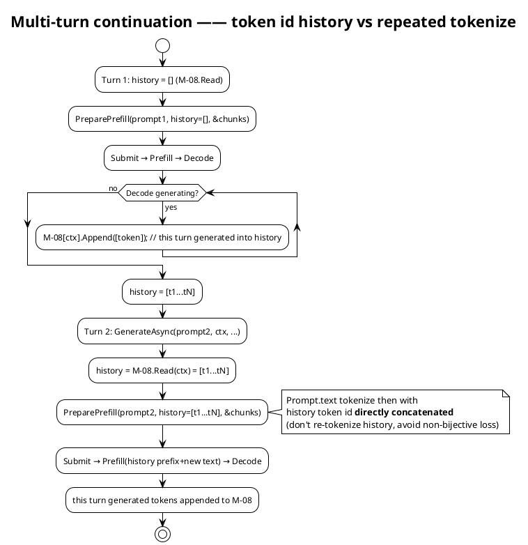

# LM Engine Inference Flow Diagram

English | [简体中文](../../zh/cann_lm_engine/lm_engine_inference_flow.md)

> This document uses PlantUML activity diagrams to describe the autoregressive inference flow of `lm_engine` (L1 `EngineExecutor` + L2 `PipelineExecutor`).
> References:
> - `docs/pipeline+engine_executor/DESIGN.md` (§11 modules, §12 contracts, §13 key processes F-01~F-05)
> - `docs/pipeline+engine_executor/SPEC.md` (behavior specification SR20260806001)
> - `docs/model_executor/DESIGN_HUMAN.md` (forward shell / KV pool / input assembler details, including 3 clarifications to pipeline docs)
>
> PlantUML source given in ```` ```plantuml ```` code blocks, renderable with PlantUML / VS Code plugin.

## 0. Modules and Contracts Involved (Quick Reference)

| ID | Name | Responsibility |
|----|------|------|
| M-01 | EngineExecutor | L1 PIMPL shell, forwards public API |
| M-02 | PipelineExecutor | L2 orchestration skeleton, worker drive + post-processing + registry |
| M-03 | Scheduler | Queueing + decode pool + iteration batching/interleaving/cancel |
| M-04 | ModelExecutor | Forward produces logits (prefill/decode dual instances) + KV cursor accounting |
| M-05 | ModelLoader | Load thin wrapper, derives json |
| M-06 | Preprocessor | tokenize/concatenate history/placeholder/table lookup/chunking |
| M-07 | Post-processing stream | sample → write history → detokenize → callback → stop |
| M-08 | HistoryPromptManager | Per-Context isolated token id history |
| C-01 | ITokenizer | text↔token id |
| C-02 | ITextEmbedding | token id→embedding tensor table lookup |
| C-03 | ISampler | logits+params→token id |
| C-04 | IModelManager | model load/forward/release/metadata |

## 1. Overall Inference Activity Diagram

The diagram below covers construction-loading (F-01) → submit (user thread) → worker RunLoop (F-02/F-04) → terminal state/cancel (F-05).

```plantuml
@startuml lm_engine_inference
!theme plain
skinparam ActorStyle awesome
skinparam responseMessageBelowArrow true

title lm_engine inference flow (construction → submit → worker RunLoop → terminal state)

|User thread|
|Worker thread|
|L3 low-level runtime|

|User thread|
start
:EngineExecutor(prefill_artifact, decode_artifact, opts,\n  4×shared_ptr<ITokenizer/ITextEmbedding/ISampler/IModelManager>);
note right
  One-time load at construction
  Hot reload not supported
end note
:M-05 ModelLoader.Load(prefill) / Load(decode);
|L3 low-level runtime|
:C-04 Load two om graphs (weight deduplication);
:C-04 GetMeta → max_batch_size, max_seq_len;
|User thread|
if (Load failed or metadata missing?) then (yes)
  :construction failed (no partial resources leaked);
  stop
else (no)
endif
:M-04 prefill_executor.Bind(handle_prefill);
:M-04 decode_executor.Bind(handle_decode);
:M-03 Scheduler(max_batch_size);
:start worker thread RunLoop;
|Worker thread|
:enter RunLoop;
repeat
  :M-03.Step(&out);
  if (Step returns INVALID_STATE?) then (yes·no active tasks)
    :condvar.wait();
    repeat while (woken by Submit? woken) is (no) not (yes)
  else (no·has output)
    partition "per-slot post-processing (M-07)" {
      while (slot ∈ out.slot_to_request?) is (yes)
        :req = registry[out.slot_to_request[slot]];
        if (req.canceled?) then (yes)
          :req.status = Canceled;\ndiscard partial output;
        else (no)
          :C-03 Sample(out.batch_logits, slot, params) → token;
          :req.token_ids.append(token);
          :M-08[req.ctx].Append([token]);
          :C-01 DecodeToken(token) → text_piece;
          :req.text_buffer += text_piece;
          if (hit stop_token?) then (yes)
            :finish=StopToken; status=Completed\n(lean towards no callback);
          elseif (hit stop_string?) then (yes)
            :finish=StopString; status=Completed\nremove stop portion;
          else (no)
            :StreamCallback(token, text_piece);
          endif
          if (token_ids.size() == max_tokens?) then (yes)
            :finish=MaxTokens; status=Completed;
          endif
        endif
        if (req enters terminal state?) then (Completed/Failed/Canceled)
          :release KV slot (idempotent);\nhistory retains generated tokens;
        endif
      endwhile (no more slots)
    }
  endif
repeat while (stop_ == false?) is (yes) not (no·destruction)
|Worker thread|
:destruction: stop_=true → wake → join → Release;
stop

|User thread|
fork
  :CreateContext(&ctx) → ContextImpl;
end fork

|User thread|
:GenerateAsync(prompt, ctx, params, &handle, cb);
:M-08 Read(ctx) → history token ids;
:M-06 PreparePrefill(prompt, history, &chunks);
note right
  tokenize Prompt.text → concat history
  → placeholder replacement → C-02 Embed/EmbedMixed
  → chunking (token level, lean towards C5)
end note
:M-03 Submit(chunks, req_impl, &req_id);
note right
  enqueue prefill queue (FIFO)
  + wake worker
end note
:return RequestHandle (non-blocking);

fork again
  :RequestHandle.Cancel();
  note right
    req_impl->canceled.store(true)  // atomic
    does not immediately interrupt current forward
    takes effect at next decision point / post-processing
    history not rolled back
  end note
end fork

@enduml
```

## 2. Scheduler.Step Decision Details (Continuous Batching)

Each iteration the worker calls `Step` once, doing batching/interleaving decisions and one forward. The diagram below marks the differences between prefill and decode two forward paths (padding, cursor advance, KV slot).

```plantuml
@startuml scheduler_step
!theme plain
title M-03 Scheduler.Step —— iteration-level batching / interleaving decision

start

:1. clean terminal state / cancel;
note right
  iterate decode pool:
  req.status ∈ {Completed, Canceled, Failed}
  → slot=empty
end note
:backfill from pending_decode to empty slots;

if (prefill queue empty and decode pool all empty and pending empty?) then (yes)
  :return INVALID_STATE  // worker sleeps;
  stop
else (no)
endif

if (has free slot and prefill queue non-empty?) then (yes·prioritize Prefill)
  :take prefill queue head task's next chunk;
  :M-06 PreparePrefillChunk(chunk) → input;
  |M-04 prefill instance|
  :InputAssembler.AssemblePrefill\n  (position derived from cursor, batch=1, no padding);
  :advance that seq cursor += chunk_len;
  |L3 low-level runtime|
  :C-04 Forward(prefill handle, input bundle) → logits;
  |M-04 prefill instance|
  if (that task chunk exhausted?) then (yes)
    :task dequeued from prefill queue;\nreq enters pending_decode;
  else (no)
  endif
  :out = {Phase::Prefill, logits, [req_id]};
else (no·Decode)
  :collect all active decode pool's last_token;
  :M-06 PrepareDecodeStep(last_token) → input (per seq);
  |M-04 decode instance|
  :InputAssembler.AssembleDecode\n  (position derived from cursor, padded to max_batch_size,\n  mask padded positions, padded positions don't advance cursor);
  :each active seq cursor += 1;
  |L3 low-level runtime|
  :C-04 Forward(decode handle, padded input bundle) → batched logits;
  |M-04 decode instance|
  :split logits by slot;
  :out = {Phase::Decode, logits, slot_to_request};
endif

:return OK + out;
stop
@enduml
```

## 3. Multi-turn Continuation (F-03) History Flow



## 4. Key Clarifications (model_executor doc corrections to pipeline)

The following 3 points take `docs/model_executor/DESIGN_HUMAN.md` as authoritative, flow diagrams have adopted:

1. **KV cursor not sunk to low level**: KV slot/cursor management in M-04 (`KvCachePool`), tightly coupled with batch-dim scheduling, padding, observability; only tensor memory allocation/release belongs to `TensorManager`, low-level operators (KV concat/write) inside C-04 forward.
2. **M-04 is more than "forward only"**: also exposes load/unload/LoRA control interfaces upward (specific implementation delegated to C-04). Corresponds to `LifecycleController`, same engine instance simultaneously only one pair of active forward shells (prefill+decode), runtime hot switch not supported.
3. **decode must pad to `max_batch_size`**: because om graph batch dim fixed; padded positions zero-filled + attention mask masked, and **cursor not advanced** (avoid polluting KV). Only prefill instance batch=1 not padded.
   > Note: pipeline doc original text says Continuous Batching "no padding", clarified here as "decode pad + mask".

## 5. Concurrency and Terminal State Key Points (corresponding to branches in diagrams)

- **Submit layer concurrent / execution layer serial**: user multi-thread can concurrently `GenerateAsync` (thread-safe); worker single-thread serial runs `Step` + post-processing; multi-request parallelism via single batch internal data parallelism (D-02/D-03).
- **Cancel atomic flag**: `RequestImpl::canceled` is atomic, user thread writes, worker reads; doesn't immediately interrupt current forward, takes effect at next decision point/post-processing; history retains generated tokens (not rolled back).
- **Terminal state enum**: `Completed` (StopToken / StopString / MaxTokens), `Canceled`, `Failed` (forward/sample/detokenize failure, retains partial output).
- **Same Context concurrent**: returns `INVALID_STATE`.
- **Callback safety**: `StreamCallback` triggered on worker, must be non-blocking; user callback exceptions caught by guard, doesn't affect engine stability.
- **Performance budget**: engine layer overhead <10% end-to-end; scheduling decision <1%; single chunk preprocessing <5% of that chunk's forward time; forward shell forwarding <0.1% (all budget, absolute values pending real device benchmark).
