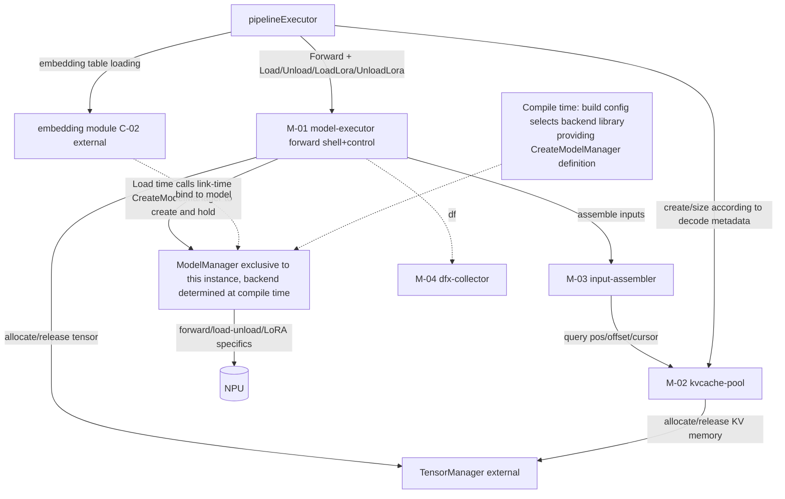
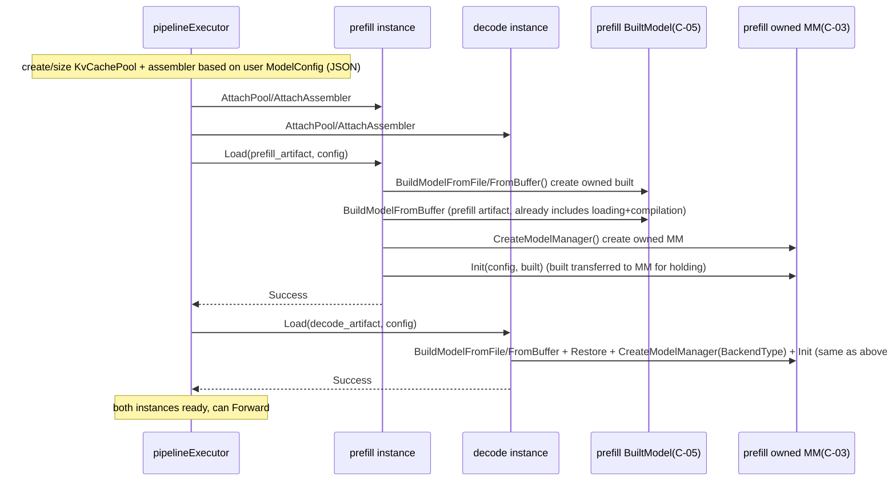
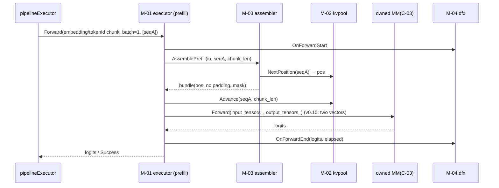
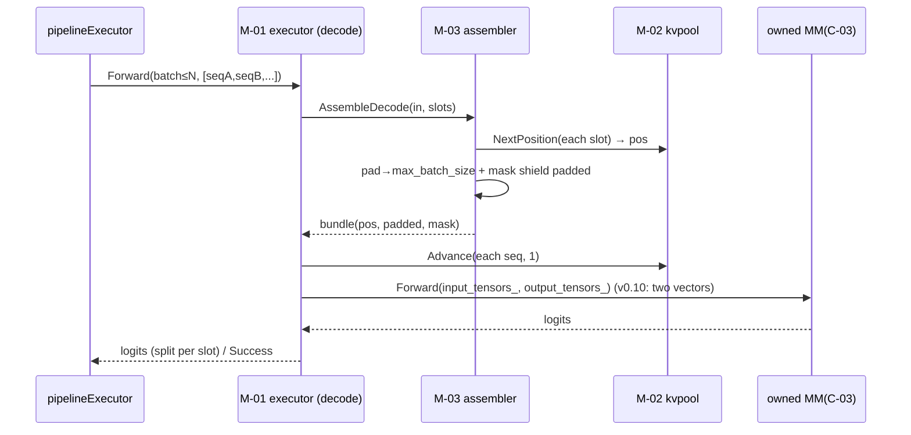
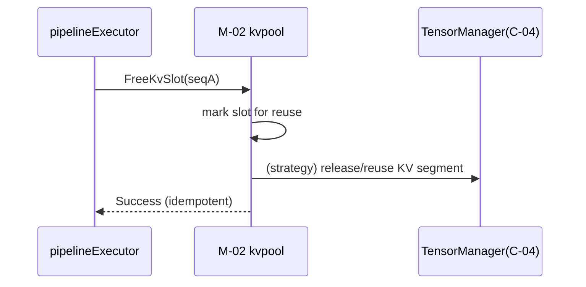
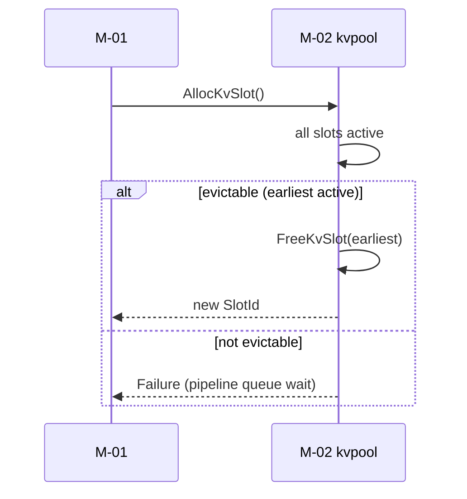

<!--
Hand-authored DESIGN (no render script). Source of truth: ./SPEC.md (SR20260807001).
Same SDD structure as docs/tokenizer/DESIGN.md. After modification, please synchronize the SPEC.md behavioral contract.
v0.2: Removed standalone lifecycle-controller; control plane directly merged into ModelExecutor.
v0.3: ModelManager is created and held by each ModelExecutor instance at Load time (one per instance).
v0.4: Removed ModelManagerFactory runtime injection; backend determined at compile time, model_executor creates owned MM
      via link-time free function CreateModelManager(), unaware of specific backend type.
v0.5: Added KV layout rules: pool underlying tensor is layer-major, multiple batches (slots) within the same layer have KV laid out contiguously;
      slot = batch lane; per-seq cursor only advances the position dimension and is synchronized across layers.
-->

# ModelExecutor Module Design

English | [简体中文](../../../zh/cann_lm_engine/model_executor/DESIGN.md)

## Table of Contents

- [Spec Summary](#spec-summary)
- [§1 Scope and Goals](#1-scope-and-goals)
- [§2 Architecture Overview](#2-architecture-overview)
  - [§2.1 Architectural Style and Philosophy](#21-architectural-style-and-philosophy)
  - [§2.2 Runtime Architecture](#22-runtime-architecture)
  - [§2.3 Deployment and Hardware Mapping](#23-deployment-and-hardware-mapping)
  - [§2.4 Concurrency and Thread Safety](#24-concurrency-and-thread-safety)
- [§3 Module List](#3-module-list)
- [§4 Contract List](#4-contract-list)
- [§5 Key Flow List](#5-key-flow-list)
- [§6 Quality Attributes and Cross-Cutting Strategies](#6-quality-attributes-and-cross-cutting-strategies)
- [§7 Decision Index](#7-decision-index)
- [§8 Code Plan Hints](#8-code-plan-hints)
- [§9 Risks and Open Issues](#9-risks-and-open-issues)
- [§10 Change Log](#10-change-log)
- [Modules](#modules)
  - [M-01-model-executor](#m-01-model-executor)
  - [M-02-kvcache-pool](#m-02-kvcache-pool)
  - [M-03-input-assembler](#m-03-input-assembler)
  - [M-04-dfx-collector](#m-04-dfx-collector)
- [Contracts](#contracts)
  - [C-01-executor-caller](#c-01-executor-caller)
  - [C-02-kvpool-internal](#c-02-kvpool-internal)
  - [C-03-modelmanager-contract](#c-03-modelmanager-contract)
  - [C-04-tensormanager-contract](#c-04-tensormanager-contract)
- [Flows](#flows)
  - [F-01-load](#f-01-load)
  - [F-02-prefill-forward](#f-02-prefill-forward)
  - [F-03-decode-forward](#f-03-decode-forward)
  - [F-04-seq-finish-free](#f-04-seq-finish-free)
  - [F-05-pool-full-evict](#f-05-pool-full-evict)
  - [F-06-lora-load-unload](#f-06-lora-load-unload)
- [Performance and Quality](#performance-and-quality)
  - [concurrency](#concurrency)
  - [dfx](#dfx)
  - [performance](#performance)
  - [security](#security)
- [New Decisions](#new-decisions)

---

<a id="spec-summary"></a>
## Spec Summary

- Spec ID: `SR20260807001`
- Upstream spec: `./SPEC.md`
- Software layer: framework (engine core reusable library)
- Covered behavior groups: Forward(§4.1.1) / KV ringBuffer(§4.1.2) / input filling(§4.1.3) / load-unload(§4.1.4) / LoRA(§4.1.5) / DFX(§4.1.6) / module boundary(§4.1.7) / error classification(§4.1.8)
- The three clarifications to pipeline DESIGN §11.4 M-04 have been incorporated (KV cursor belongs to this module, ModelExecutor includes load/unload/LoRA control, decode batch padding)
- **v0.2**: Removed standalone lifecycle-controller; `Load/Unload/LoadLora/UnloadLora/Forward/GetMeta` are directly exposed by `ModelExecutor`.
- **v0.3**: `ModelManager` is self-created and self-held by each `ModelExecutor` instance at `Load` time (one per instance); `Load` changed to per-instance `Load(artifact)`; common `Bind` removed; cross-instance weight deduplication is no longer the responsibility of MM; LoRA paired synchronization.
- **v0.4**: Removed v0.3's `ModelManagerFactory` runtime injection. Backend is determined at **compile time**: model_executor calls link-time free function `CreateModelManager()` (declared in `IModelManager` header, defined by the backend library selected at compile time for linking) to create owned MM, only holds `unique_ptr<IModelManager>` abstraction, **unaware of** the specific backend type.
- **v0.5**: Added KV layout rules (D-13). Pool underlying tensor is organized **layer-major** `[layer][batch_slot][position][K/V][head][dim]`; **multiple batches (slots) within the same layer have KV laid out contiguously** (satisfies the requirement that om binds the entire layer's KV as a whole); slot = batch lane index; per-seq cursor only advances the position dimension, synchronized across layers. U-3 is concretized from "consistent layout" to "all layer-major with consistent sub-order".

```yaml
spec_source: ./SPEC.md
level: design
spec_id: SR20260807001
delta_summary: Forward shell + KV cursor management + load-unload/LoRA control directly exposed; each instance self-creates and self-holds ModelManager; backend determined at compile time, created via link-time CreateModelManager(), this module is unaware of specific backend.
covers: [Forward, KvRingBuffer, InputPadding, LoadUnload, LoRA, DFX, Boundary, ErrorClassify]
status: draft
```

---

<a id="1-scope-and-goals"></a>
## §1 Scope and Goals

- **in scope**: C++ forward shell under `cann_local_lm/engine/core/model_executor` — single-step Forward (embedding/tokenId two paths → logits) + KV ringBuffer cursor management (memory owned by TensorManager) + input filling (attentionMask + decode batch padding) + load/unload/LoRA control interface (directly exposed; **ModelManager is created and held by this instance at Load time**, specific implementation still delegated to ModelManager) + DFX. prefill/decode are two instances of this class (each bound to one om), sharing the KV pool with zero-copy. Internal module, not exposed to Python.
- **out of scope** (with reasons):
  - KV tensor memory allocation/release — spec §4.1.2 belongs to `TensorManager`, this module only manages pos/offset/cursor.
  - load-unload/forward/LoRA **specific implementation** — spec §4.1.4/4.1.5 belongs to `ModelManager`; this module **creates and holds** the ModelManager instance at Load time, but specific operator/graph execution remains within it.
  - **Specific type selection of backend ModelManager** — determined at compile time (build configuration selects the backend library to link); this module obtains the owned instance via link-time `CreateModelManager()`, only depends on `IModelManager` abstraction, **unaware of and does not reference** specific backend classes, and does not do runtime factory injection.
  - embedding table loading — spec §4.1.1 belongs to `pipelineExecutor` calling the embedding module (C-02); this module does not load/own the embedding table.
  - tokenizer / sampling — belong to C-01 / C-03.
  - Graph compilation — done offline, not in this module.
- **Goal priority**: behavior alignment (om+weight oracle) > KV cursor correctness (zero tolerance for out-of-bounds/leak) > forward shell low overhead > memory footprint.

<a id="2-architecture-overview"></a>
## §2 Architecture Overview

<a id="21-architectural-style-and-philosophy"></a>
### §2.1 Architectural Style and Philosophy



Style declaration (≤100 words): **forward shell + shared KV pool + self-held control + compile-time backend**. `ModelExecutor` is both a forward shell (assembles and forwards forward, does not touch underlying operators) and directly carries load/unload/LoRA control methods; **each instance calls link-time `CreateModelManager()` at Load time to create and hold its own ModelManager** (backend determined at compile time, this module only depends on `IModelManager` abstraction, unaware of specific backend type). KV cursor is centralized in M-02; memory via TensorManager; DFX is cross-cutting and switchable.

<a id="22-runtime-architecture"></a>
### §2.2 Runtime Architecture

- Process/thread model: within the engine process, the ModelExecutor instance is a synchronous object held by the calling thread; no independent thread, no event loop. Forward execution is serial (single-flight), guaranteed non-reentrant by the caller (pipelineExecutor/Scheduler). load/unload/LoRA control methods are likewise synchronous, serialized by lifecycle mutex.
- Communication mechanism table:

| Caller | Callee | Communication method | Sync/Async | Notes |
|--------|--------|----------|-----------|------|
| pipelineExecutor | M-01 | function call | sync | Forward; Load/Unload/LoadLora/UnloadLora/GetMeta (each instance calls Load once) |
| M-01 (at Load time) | backend ModelManager | link-time `CreateModelManager()` + interface call | sync | instance self-creates and holds owned MM; backend determined at compile time; this module is unaware of specific type |
| M-01 | M-03 | composition held | sync | assemble inputs |
| M-03 | M-02 | composition held | sync | query pos/cursor |
| M-01/M-02 | TensorManager | via abstract interface | sync | tensor allocation/release |
| pipelineExecutor | embedding module (C-02) | — | sync | embedding table loading and binding (not this module) |

- Synchronization point: CPU↔NPU synchronization is inside ModelManager (om Forward returns synchronously); this module has no independent cross-domain synchronization.
- **Instance construction and loading order constraint** (v0.3+): decode instance must first `Load` to obtain `max_batch_size/max_seq_len` → create/size the shared `KvCachePool` (and the decode `InputAssembler`) based on this → inject into both instances → prefill instance `Load`. Forward can only be called after both instances are ready. pool/asm may not be injected yet before decode Load (see F-01).

<a id="23-deployment-and-hardware-mapping"></a>
### §2.3 Deployment and Hardware Mapping

| Module | Processor | Notes |
|------|--------|------|
| M-01..M-04 | CPU (aarch64 Ascend host) | cursor/assembly/control logic; ModelManager runs the graph via NPU |
| KV pool memory | NPU/DDR (decided by TensorManager) | fixed-length pool, shared by prefill/decode |
| Weights/om | NPU (held by each instance's self-held ModelManager) | this module only holds handle + owned MM |
| Power domain | no independent sleep | synchronous call |

<a id="24-concurrency-and-thread-safety"></a>
<a id="concurrency"></a>
### §2.4 Concurrency and Thread Safety

- Lock strategy: same executor instance Forward **single-flight** — serialized by `std::mutex` (spec §4.1.1/§5); KV pool operations (alloc/free/advance cursor) are mutually protected by `std::mutex` for cursor and slot table; load/unload/loadLora/unloadLora are serialized by `lifecycle_mutex_` (including ModelManager creation/release), and coordinated with Forward via `lora_switching_` atomic flag.
- Shared resources: KV pool slot table + cursor (inside M-02, shared by prefill/decode two instances); executor `forward_mutex_` (within instance); `lifecycle_mutex_` (within instance, including owned MM lifecycle); `lora_switching_` atomic flag.
- Deadlock prevention: lock hierarchy `lifecycle_mutex_ > forward_mutex_ > pool_mutex_`; no reverse nesting; Forward does not hold lifecycle lock (coordinates LoRA switching via atomic flag).
- **Thread contract (documented in v0.13, review V0.13-M3)**: `Load`/`Unload` (holds `lifecycle_mutex_`) and `Forward` (holds `forward_mutex_`) — the two locks do not nest, but share `input_tensors_`/`output_tensors_`/`input_name_index_` containers. **Concurrent Load/Unload and Forward are prohibited during runtime** — the caller (pipelineExecutor) must guarantee: Forward is only initiated after the model has been Loaded and is ready, and no reload during runtime (reload requires first stopping all Forward, then serial Unload→Load). This module does not add cross-locks for this (Forward hot path has zero extra lock overhead); concurrent reload violating this contract causes container data race (UB), responsibility lies with the caller. The consistency of `Forward`/`GetConfig` reading `mm_`/`config_` is also guaranteed by this contract (same source old M1/M2-v0.12).
- Multi-instance isolation: no global singleton (spec §5 C7), resource pool belongs to each executor pair (prefill+decode+pool as one group); each instance's own ModelManager is not shared.

<a id="3-module-list"></a>
## §3 Module List

| ID | Name | One-line responsibility | Dependencies | Details |
|----|------|-----------|------|------|
| M-01 | model-executor | Forward shell + control plane: Forward (embedding/tokenId→logits, single-flight); Load (calls CreateModelManager to create and hold this instance's ModelManager, delegates to it to load om, get metadata); Unload/LoadLora/UnloadLora/GetMeta (delegated to owned MM); assembles inputs and delegates to underlying forward | M-02,M-03,M-04,C-03,C-04 | [→](#m-01-model-executor) |
| M-02 | kvcache-pool | KV ringBuffer: slots+cursor+pos/offset management, alloc/free/advance/evict/snapshot; memory via TensorManager | C-04 | [→](#m-02-kvcache-pool) |
| M-03 | input-assembler | Input assembly: pos derivation + attentionMask + decode batch padding, produces Forward input bundle | M-02 | [→](#m-03-input-assembler) |
| M-04 | dfx-collector | per-Forward IO dump + timing stats + KV pool snapshot, switchable | M-02 | [→](#m-04-dfx-collector) |

Dependency graph acyclic check: C-03/C-04 (external) ← {M-02, M-01}; M-02 ← {M-03, M-04}; M-03/M-02/M-04 ← M-01. ✓

> v0.2 change: original M-04 lifecycle-controller merged into M-01. Control methods are directly exposed as ModelExecutor members to pipelineExecutor, no longer transited through an independent sub-module.
> v0.3 change: ModelManager no longer externally injected; each M-01 instance self-creates and self-holds at Load time (one per instance). Common Bind removed, merged into Load.
> v0.4 change: removed v0.3's ModelManagerFactory runtime injection; changed to calling link-time free function `CreateModelManager()` to create owned MM, backend determined at compile time, this module only depends on `IModelManager` abstraction, unaware of specific backend type.
> v0.5 change: added KV layout rules (D-13) — layer-major, multiple batches within same layer contiguous; slot = batch lane; per-seq cursor advances position dimension and synchronizes across layers.

<a id="4-contract-list"></a>
## §4 Contract List

> `pipelineExecutor` is an external participant (consumer). `ModelManager`/`TensorManager`/embedding module (C-02) are external lower layers, this design only declares dependency contracts.

| ID | Producer | Consumer | One-line contract | Details |
|----|--------|--------|-----------|------|
| C-01 | M-01 | pipelineExecutor | Forward + Load/Unload/LoadLora/UnloadLora/GetMeta (directly exposed; Load time self-creates MM) | [→](#c-01-executor-caller) |
| C-02 | M-02 | M-01/M-03 | KV slot alloc/free/NextPosition/advance/snapshot | [→](#c-02-kvpool-internal) |
| C-03 | ModelManager (external) | M-01 | model loading/forward/release/metadata/LoRA specific implementation; created and held by M-01 at Load time via link-time `CreateModelManager()` | [→](#c-03-modelmanager-contract) |
| C-04 | TensorManager (external) | M-02 | tensor allocation/release | [→](#c-04-tensormanager-contract) |

> v0.2 change: original C-01 (Forward) and C-02 (Lifecycle) merged into single C-01; original C-03/C-04/C-05 shifted to C-02/C-03/C-04.
> v0.3 change: C-03 producer relationship adjusted — ModelManager is created and held by M-01 at Load time (one per instance), not externally injected.
> v0.4 change: removed runtime ModelManagerFactory; C-03 changed to link-time `CreateModelManager()`, backend determined at compile time.

<a id="5-key-flow-list"></a>
## §5 Key Flow List

| ID | Scenario | Key path | Details |
|----|------|---------|------|
| F-01 | Load (each instance self-creates MM) | pipeline→M-01 Load→CreateModelManager()→MM::Load(artifact)→GetMeta→(decode first)→create/size pool based on meta→inject into both instances→prefill Load | [→](#f-01-load) |
| F-02 | prefill Forward | pipeline→M-01→M-03 assemble(pos, no pad)→M-02 append chunk KV→MM::Forward→logits | [→](#f-02-prefill-forward) |
| F-03 | decode Forward | pipeline→M-01→M-03 assemble(pos, pad→N, mask)→M-02 each seq append single token→MM::Forward→logits | [→](#f-03-decode-forward) |
| F-04 | sequence end/cancel free | pipeline→M-02 FreeKvSlot | [→](#f-04-seq-finish-free) |
| F-05 | pool full eviction | M-02 AllocKvSlot pool full→evict earliest | [→](#f-05-pool-full-evict) |
| F-06 | LoRA load/unload (each instance delegates to owned MM; paired sync) | pipeline→M-01 LoadLora/UnloadLora (both prefill+decode instances call)→各自的 owned MM | [→](#f-06-lora-load-unload) |

<a id="6-quality-attributes-and-cross-cutting-strategies"></a>
## §6 Quality Attributes and Cross-Cutting Strategies

| Dimension | Core strategy | Details |
|------|---------|------|
| Performance | forward shell forwarding <0.1% end-to-end; KV cursor operations negligible | [→](#performance) |
| Security | input validation + no external exposure surface + untrusted om rejected | [→](#security) |
| DFX | L1/L2/L3 tiered + switchable dump with zero overhead | [→](#dfx) |
| Concurrency | single-flight serial + pool operation mutual exclusion + lifecycle serial (including owned MM lifecycle) | [→](#concurrency) |
| Error propagation | aligns with pipeline 6 coarse codes, non-silent | spec §4.1.8 + F-xx |
| Data consistency | KV cursor and slot strongly consistent; zero-copy layout aligned | §2.1 / D-02 |

<a id="7-decision-index"></a>
## §7 Decision Index

| ID | Topic | Status |
|----|------|------|
| D-01 | KV cursor belongs to this module (corrects pipeline "sink to lower layer") | accepted |
| D-02 | prefill/decode share KV pool zero-copy | accepted |
| D-03 | contiguous slots + per-seq cursor (not paged) | accepted |
| D-04 | decode batch padding to max_batch_size (corrects pipeline "no padding") | accepted |
| D-05 | single-flight serial per executor | accepted |
| D-06 | single LoRA active + reload on switch (switch=UnloadLora+LoadLora, no standalone SwitchLora method) | accepted |
| D-07 | tokenId goes through model internal embedding (table loaded by embedding module via pipeline) | accepted |
| D-08 | DFX switchable + dump does not block inference | accepted |
| D-09 | single active pair per engine instance, no hot-swap | accepted |
| D-10 | removed standalone lifecycle-controller, control plane directly merged into ModelExecutor | accepted |
| D-11 | each instance self-creates and self-holds ModelManager at Load time | accepted |
| D-12 | backend determined at compile time; created via link-time CreateModelManager(), no runtime factory injection, this module unaware of specific backend | accepted |
| D-13 | KV pool layout: slot = batch lane; per-seq cursor only advances position dimension and synchronizes across layers (v0.5 single buffer layer-major layout has been replaced by v0.14 per-layer K/V tensor — "om binds per-layer" motivation is directly satisfied by independent per-layer tensors) | superseded (layout part) v0.14 |

<a id="8-code-plan-hints"></a>
## §8 Code Plan Hints

**For downstream plan/impl agent**:
- Implementation order (dependency topology): C-03/C-04 external interface declaration → M-02 kvcache-pool → M-03 input-assembler → M-04 dfx-collector → M-01 model-executor (last, because it aggregates the previous four + control plane + self-held MM).
- Parallelizable: M-02/M-04 are independent of each other and can be parallelized; M-03 depends on M-02 interface first.
- Minimum reading set for implementing each module:
  - M-01 → this section + C-01 + C-03 + F-01/F-02/F-03/F-06
  - M-02 → this section + C-02 + C-04 + F-04/F-05
  - M-03 → this section + M-02 + F-02/F-03
  - M-04 → this section + M-02
- Integration milestones: ①M-02+mock C-04 runs through alloc/free/evict/snapshot; ②M-03+mock M-02 runs through pos derivation + padding + mask; ③M-04+mock file sink runs through dump switch + landing failure degradation; ④M-01+stub `CreateModelManager()` returns mock IModelManager runs through Load self-creating MM + Forward two paths returning fake logits + single-flight + Load/Unload/LoadLora/UnloadLora control; ⑤prefill+decode two instances + shared pool runs through zero-copy (decode first Load→size pool→prefill Load).
- Source code lands in `cann_local_lm/engine/core/model_executor/`, UT lands in `tests/cpp/engine/model_executor/`, CMake target in root CMakeLists (to be created).
- Backend binding: the definition of `CreateModelManager()` is provided by the backend library selected at compile time for linking (build config `CANN_LM_BACKEND` or similar selects backend lib); UT links with stub definition (returns mock MM). M-01 code does not reference any specific backend class name.

<a id="9-risks-and-open-issues"></a>
## §9 Risks and Open Issues

| Risk/Open issue | Impact | Mitigation | Trigger condition |
|-----------|------|------|----------|
| U-1 forward shell overhead budget has no baseline | <0.1% may be inaccurate | micro-benchmark during implementation | aarch64 measurement |
| U-2 KV pool capacity value not bound to model scale | memory budget inaccurate | DESIGN gives measured value; pool capacity parameterized on ModelMetaInfo (obtained from decode Load) | model scale determined |
| U-3 two om KV layout consistency prerequisite (layer-major, multiple batches within same layer contiguous, D-13) | zero-copy failure | compile/load time validate both om are layer-major and head/dim/K-V sub-order consistent; reject loading if inconsistent | load time |
| U-4 eviction strategy details | eviction semantics dispute | default evict earliest; strategy adjustable | pool full measurement |
| U-5 LoRA cross prefill/decode paired sync | two MMs each load LoRA, may be out of sync | caller (or thin coordination layer) calls LoadLora/UnloadLora in pairs for prefill+decode two instances | implement M-01 control plane |
| U-6 dummy slot/padded position KV handling | out-of-bounds/pollution | zero fill + mask shielding + no cursor advance | implement M-03 |
| U-7 cross-instance weight deduplication no longer MM's responsibility | weights redundantly resident on NPU | taken over by TensorManager weight blob level deduplication, or not enforced | model scale/memory pressure |
| U-8 backend compile-time single select, no runtime backend switching | multi-backend coexistence limited | backend determined at compile time (build config); multi-backend requires multiple build artifacts | multi-hardware coexistence scenario |
| 🔴 KV cursor out-of-bounds | inference crash | cursor ≤ max_seq_len strong validation + TC coverage | multi-turn long conversation |
| 🔴 zero-copy layout drift | decode reads wrong KV | load-time assert both om KV layout consistent | model version upgrade |
| single-flight deadlock | Forward hangs | lock hierarchy + no lifecycle lock entering Forward | concurrency pressure |
| control plane and forward concurrency race | state inconsistency | lifecycle_mutex (including owned MM lifecycle) + lora_switching atomic flag | concurrent load/forward |
| CreateModelManager() failure/missing link | Load failure | return empty→Failure; build-time guarantee backend definition linked | backend not linked |
| decode/prefill Load order violation | pool not sized before Forward | ordering pre-check (operator bool requires pool+handle ready) | misuse |

<a id="10-change-log"></a>
## §10 Change Log

| Version | Date | Change | Triggering spec section |
|------|------|------|---------------|
| 0.1 | 2026-08-07 | Initial draft: 8-chapter SDD design + 5 modules + 5 contracts + 6 flows + 4 quality attributes + 9 decisions. Landed the three clarifications to pipeline DESIGN §11.4. | SR20260807001 all |
| 0.2 | 2026-08-17 | Removed standalone lifecycle-controller module (original M-04). Load/Unload/LoadLora/UnloadLora/GetMeta directly merged into M-01 model-executor exposed to pipelineExecutor. Modules 5→4, contracts 5→4 (original C-01+C-02 merged), flow F-06 changed from "switch" to "load/unload" (switch=unload+load, no standalone SwitchLora method). Added D-10. Synchronized SPEC §4.2 update. | SR20260807001 §4.1.4/4.1.5/4.2 |
| 0.3 | 2026-08-17 | ModelManager changed to be self-created and self-held by each ModelExecutor instance at Load time (one per instance). Load changed to per-instance Load(artifact). Removed common Bind (merged into Load), construction-time injects cross-instance dependencies + ModelManagerFactory. Cross-instance weight deduplication no longer MM's responsibility (U-7). LoRA paired sync concretized (U-5). Added D-11. Synchronized SPEC §4.1.4/§6 update. | SR20260807001 §4.1.4/4.1.5/§6 |
| 0.4 | 2026-08-17 | Removed v0.3's ModelManagerFactory runtime injection. Backend determined at compile time: M-01 calls link-time free function `CreateModelManager()` (declared in IModelManager header, defined by backend library selected at compile time for linking) to create owned MM, only holds `unique_ptr<IModelManager>` abstraction, unaware of specific backend type. Construction-time no longer injects factory. Added D-12; D-11 synchronized correction. Synchronized SPEC §4.1.4/§6 update. | SR20260807001 §4.1.4/§6 |
| 0.5 | 2026-08-17 | Added KV layout rules (D-13): pool underlying tensor layer-major `[layer][batch_slot][position][K/V][head][dim]`, **multiple batches (slots) within the same layer have KV laid out contiguously**; slot = batch lane index; per-seq cursor only advances position dimension, synchronized across layers. M-02 §1/§3/§4/§5, C-02, U-3 synchronized concretization; D-03 refines slot semantics. Synchronized SPEC §4.1.2/§5 update. | SR20260807001 §4.1.2/§5 |
| 0.7 | 2026-08-20 | Added `IBuiltModel` (same level as IModelManager L3, C-05) replacing `ModelHandle`; `ModelMetaInfo`→`ModelConfig` (user JSON config, Load parameter); `IModelManager::Load`→`Init(ModelConfig, IBuiltModel)`, MM does not directly load via artifact (component loading goes to BuildModelFromFile/FromBuffer); `GetMeta`→`GetConfig`; Load signature `Load(artifact, ModelConfig)`; F-01 rewritten (config parameter eliminates decode-first chicken-egg); C-03 rewritten (no handle). Synchronized SPEC §4.1.4/4.2/4.1.8/§6 update. | SR20260807001 §4.1.4/4.2/§6 |
| 0.8 | 2026-08-20 | `TensorManager` changed to concrete singleton (C-04 rewritten: `Instance()`+`CreateTensor(TensorDesc, modelId)`, replacing abstract ITensorManager); `IModelManager` added `GetModelID()→int` (C-03); M-01 Load after Init applies to TensorManager singleton for input/output tensors based on built descs + modelId (`input_tensors_`/`output_tensors_` + `AllocateTensors`); added `test_tensor_manager.cpp`. Synchronized SPEC §4.1.4/4.2/§6 update. | SR20260807001 §4.1.4/4.2/§6 |
| 0.9 | 2026-08-20 | `Forward` parameter removed `inputs/count/out_logits` (M-01 §2); input/output changed to private `input_tensors_`/`output_tensors_`; added `SetInputData`/`Logits()`; `InputAssembler` removed `AssembleResult`, directly fills `input_tensors_[1]/[2]` (M-03, stub pos/mask no-op); scheduler.cpp two Forward call sites adapted. Synchronized SPEC §4.1.1/4.2 update. | SR20260807001 §4.1.1/4.2 |
| 0.10 | 2026-08-22 | `IModelManager::Forward` changed to `Forward(input_tensors, output_tensors)` (two vectors, MM reads input fills output buffer, does not replace shared_ptr); `input_tensors` added an operator inference config parameter slot (filled at input preparation, specifics TBD); M-01 Forward call changed to pass `mm_->Run(input_tensors_, output_tensors_)`; mock BuiltModel returns 4 input desc. Synchronized SPEC §4.1.1/4.2 update. | SR20260807001 §4.1.1/4.2 |
| 0.12 | 2026-08-26 | Full link changed to backend types: deleted old three headers (tensor.h/i_built_model.h/i_model_manager.h), tensor_manager.h rewritten as backend proxy hub; all shared_ptr Tensor → ITensorBuffer, NDTensorDesc → TensorDesc, data() → GetData(), Forward() → Run(), Release() → DeInit(), CreateBuiltModel/CreateModelManager → BuildModelFromFile/FromBuffer + CreateModelManager(BackendType), unique_ptr → shared_ptr, GetModelID int → uint32_t; engine Status unchanged (map_backend_status boundary mapping). | SR20260807001 §4.1.1/4.1.4/4.2/§6 |
| 0.12.1 | 2026-08-26 | Load removed `built->RestoreFrom*` — `BuildModelFrom*` already includes loading+compilation. Fixed code-review #1 (BuiltModelImpl::Restore returns UNSUPPORTED causing non-test build Load to always fail). | §4.1.4 |
| 0.12.2 | 2026-08-26 | Load added `mm->InitWeights(weight)` call (graph and weight separated model): path mode passes `artifact.weight` to `InitWeights`; buffer mode pending backend API extension. `ReleaseLocked` added `DeinitWeights`. Fixed code-review #3 (weight never passed to backend). | §4.1.4 |
| 0.12.3 | 2026-08-26 | `ModelArtifact.weight` type Buffer→std::string (path); C API synchronized Buffer→const char*. Buffer mode Load uniformly goes through path to call InitWeights (no longer TODO). | §4.1.4 |
| 0.13 | 2026-08-26 | Input filling changed to name→index slot lookup (removed hardcoded `[0]`/`[1]`/`[2]`). M-01 added `input_name_index_` member (built after Load based on `in_descs[i].name→i`, Unload/move synchronized); `SetInputData` looks up slot by `input_embed` name; `Forward` passes `input_name_index_` to assembler. M-03 `AssemblePrefill/Decode` signature changed to `(tensors, name_index)`, deprecated `ForwardBundle`/`ForwardInput`, looks up `position_ids`/`new_kv_cache_pos`/`attention_mask` slots by name; actually fills causal mask (4D `batch×1×seqLen×kvCacheLen`, 2nd dim=1, `0`/`-FLT_MAX`), `position_ids` (`batch×seqLen`), `new_kv_cache_pos` (`[batch, seqLen]` per-slot, cannot be merged with position_ids); cursor read before Advance. Added `INPUT_INFO.md` as the source of truth for 6 slots. mock BuiltModel returns 6 named desc. | §4.1.1/4.1.3/4.2 |
| 0.13.1 | 2026-08-26 | review v0.13 fixes: (a) M2 — `SetInputData` changed to look up slot by `input_name_index_["input_embed"]` (originally hardcoded `[0]`); added src null check (old #6). (b) M1 — `new_kv_cache_pos` dimension confirmed as `[batch, seqLen]` per-slot, decode rewritten to write each slot cursor (originally only wrote cursors[0]); INPUT_INFO/SPEC synchronized. (c) M3 — documented thread contract: concurrent Load/Unload+Forward prohibited during runtime (§2.4). (d) M4/M5 — added 5 tests (cursor>0 mask, missing name ×2, index out-of-bounds, slot<0). | §2.4/4.1.1/4.1.3 |
| 0.14 | 2026-09-08 | KV pool real video memory allocation (C-04 landing): KvCachePool constructor signature changed to `(max_batch_size, kv_cache_max_len, num_hidden_layers, num_attention_kv_heads, num_attention_head_dims, DataType)`, constructor applies via TensorManager **single batch** `CreateKvCacheTensor` for all `2×num_hidden_layers` per-layer K/V tensors (dims `[kv_cache_max_len][kv_heads][batch][head_dims]`, named `kv_cache_k_/v_<layer>`, order [k0,v0,k1,v1,...]); deleted `AttachBuffer`/`PoolHandle`/`SlotOffset` (v0.5 single buffer layout deprecated, D-13 evolution), added `KTensor`/`VTensor`/`TensorCount`. Capacity/shape parameters driven by 4 new fields parsed from meta_json model_config section (`num_attention_kv_heads`/`num_attention_head_dims`/`batch_num`/`kv_cache_type`) (default kv_heads/head_dims=4/8, dtype default/unknown falls back to FLOAT16; decode_batch_size links batch_num > override > 4). Synchronized SPEC §4.1.2/§5 update. | §4.1.2 |

---

<a id="modules"></a>
## Modules

<a id="m-01-model-executor"></a>
### M-01-model-executor

#### §1 Responsibility

Forward shell + control plane (spec §4.1.1/4.1.4/4.1.5/4.1.7). This module **directly** exposes to pipelineExecutor:
- **Forward**: single-step Forward, input `(embedding|tokenId)+pos`, output `logits`. Assembles Forward input bundle (delegates to M-03), advances KV cursor (via M-02), delegates to **this instance's self-held** `ModelManager::Forward` for actual computation. single-flight serial. No sampling, no touching underlying operators, no loading embedding table.
- **Control plane**: Load/Unload/LoadLora/UnloadLora/GetMeta. **Load time calls link-time free function `CreateModelManager()` to create and hold this instance's exclusive ModelManager** (one per instance; backend determined at compile time, this module only depends on `IModelManager` abstraction, unaware of/does not reference specific backend classes); specific load-unload/LoRA/forward implementation delegated to the owned ModelManager, this module manages om handle lifecycle, single active. Load takes a single om artifact (prefill instance Loads prefill om, decode instance Loads decode om).

prefill/decode are two instances of this class (difference only in bound om artifact and batch dimension), each holds one ModelManager.

#### §2 External Interface

```cpp
// Status code aligns with pipeline 6 coarse codes (spec §4.1.8)
enum class Status {
  Success = 0, Failure, InvalidArgument, InvalidState, NotFound, Canceled
};

// Opaque handle (from ModelManager::Load)
using ModelHandle = void*;

// Forward input path is one of two (spec §4.1.1)
struct ForwardOptions {
  int batch = 1;                    // prefill=1; decode ≤ max_batch_size
  std::size_t chunk_len = 1;        // number of tokens in this step (prefill=chunk; decode=1)
  std::vector<SlotId> slots;        // KV slots corresponding to this batch
  bool dump = false;                // dfx switch
};
// ModelArtifact / ModelArtifactPath / ModelConfig / TensorDesc see api/cpp/types.h, core/tensor_manager.h, core/tensor_manager.h.

class ModelExecutor {
 public:
  // Construction: inject cross-instance/external dependencies. No backend factory injection (backend determined at compile time).
  ModelExecutor(std::shared_ptr<KvCachePool> pool,
                std::shared_ptr<InputAssembler> asm_,
                std::shared_ptr<DfxCollector> dfx);

  Status AttachPool(std::shared_ptr<KvCachePool> pool);
  Status AttachAssembler(std::shared_ptr<InputAssembler> asm_);

  // ---- Control plane (spec §4.1.4, v0.7)----
  // Load(artifact, ModelConfig): BuildModelFromFile/FromBuffer (already includes loading+compilation) → CreateModelManager
  //   + mm->Init(opts, built) → GetModelID → apply to TensorManager singleton for input_tensors_/output_tensors_ based on descs
  //   + build input_name_index_ based on in_descs[i].name→i (v0.13, for InputAssembler/SetInputData name-based slot lookup) → InitWeights(weight).
  // Semantics: synchronous, lifecycle_mutex serial. Single active: if already loaded, Unload first.
  // Errors: config.max_batch_size/max_seq_len<=0→InvalidArgument; BuildModelFromFile/FromBuffer + CreateModelManager(BackendType) returns empty→Failure;
  //         Init failure→Failure; InitWeights failure→Failure
  Status Load(const ModelArtifact& artifact, const ModelConfig& config);
  Status Load(const ModelArtifactPath& artifact, const ModelConfig& config);
  Status Unload();                                       // delegates mm->DeInit + DeinitWeights + release owned MM; idempotent
  Status GetConfig(ModelConfig* out) const;              // returns the config passed in at Load time

  // ---- Forward plane (spec §4.1.1, v0.9/v0.13)----
  // SetInputData: fills data into the slot named input_embed (looked up by input_name_index_; called before Forward).
  Status SetInputData(const std::shared_ptr<ITensorBuffer>& data);
  // Forward(opts): assembler looks up position_ids/new_kv_cache_pos/attention_mask slots by name_index
  //   fills input_tensors_ (cursor obtained from KV pool before Advance) + advances cursor → mm->Run(input_tensors_, output_tensors_).
  // Semantics: synchronous, single-flight serial (forward_mutex_). Input/output uses private input_tensors_/output_tensors_.
  // Errors: not Loaded / output_tensors_ empty → InvalidState; opts.slots empty → InvalidArgument;
  //         name_index missing position_ids/new_kv_cache_pos/attention_mask → InvalidArgument; underlying failure→Failure
  Status Forward(const ForwardOptions& opts);
  std::shared_ptr<ITensorBuffer> Logits() const;                // returns output_tensors_[0] (read after Forward)

  std::size_t InputTensorCount() const noexcept;         // dfx/testing
  std::size_t OutputTensorCount() const noexcept;
  explicit operator bool() const noexcept;               // Loaded and pool/asm ready
};
```

> Note: `IModelManager`/`IBuiltModel`/`TensorManager`/`Tensor` are external/same-level types (C-03/C-05/C-04), public header fwd-decl held; specific signatures see corresponding contracts. `ModelHandle` (removed in v0.7) replaced by `IBuiltModel`. **No runtime backend factory injection**: backend determined at compile time, `BuildModelFromFile/FromBuffer()`/`CreateModelManager()` definitions provided by the linked backend library.

#### §3 Internal Structure
- Subcomponents: `std::shared_ptr<IModelManager> mm_` (created by calling `CreateModelManager()` at Load time, released at Unload/destruction) + `ModelHandle handle_` + `ModelHandle lora_handle_` + `shared_ptr<TensorManager> tm_` + `shared_ptr<KvCachePool> pool_` + `shared_ptr<InputAssembler> asm_` + `shared_ptr<DfxCollector> dfx_` + `std::vector<std::shared_ptr<ITensorBuffer>> input_tensors_`/`output_tensors_` (applied via TensorManager at Load time based on descs) + `std::unordered_map<std::string, std::size_t> input_name_index_` (v0.13: name→index mapping, built after Load, Unload/move synchronized cleanup/move) + `std::mutex forward_mutex_` (single-flight) + `std::mutex lifecycle_mutex_` (load/unload/lora serial, including owned MM lifecycle) + `std::atomic<bool> lora_switching_` + `ModelMetaInfo meta_`.
- RAII: destructor if still loaded calls Unload (via owned MM::Release).
- Single active pair (D-09): if there is an active handle before Load, Unload first; runtime hot-swap of model not supported.
- **Weight deduplication (v0.3 adjustment)**: each instance's owned MM only loads its own om; prefill/decode cross-instance weight deduplication is no longer ModelManager's responsibility, delegated to TensorManager (weight blob level) or not enforced (U-7).
- Non-copyable, movable; after move, the original object is set to empty.

<a id="contracts"></a>
#### §4 Key Dependencies and Hardware Contracts
- Depends on C-03 (`IModelManager` abstraction + link-time `CreateModelManager()`; `ModelManager::Load/Forward/Release/GetMeta/LoadLora/UnloadLora`, **created and held by M-01 at Load time via link-time function**), C-04 (TensorManager), M-02 (cursor), M-03 (assembly), M-04 (dfx).
- No direct hardware awareness; CPU↔NPU synchronization is inside owned ModelManager. No DMA belongs to this module.
- Internal module boundary (spec §4.1.7): only header files exposed to pipelineExecutor, no cross-language binding symbols exported; does not reference specific backend ModelManager class names.

<a id="performance"></a>
#### §5 Performance Budget

| Path | Budget | Measurement condition | Source |
|------|------|----------|------|
| Forward forwarding (excluding underlying operators) | <0.1% end-to-end | single forward micro-benchmark | estimated (U-1) |
| single-flight mutex | negligible | — | estimated 🟢 |
| Load (including MM creation, excluding underlying loading) | one-time | construction period | estimated 🟢 |
| Input assembly (delegated to M-03) | sub | see M-03 §5 | estimated |

#### §6 Failure Modes

| Failure | Trigger | Detection | Handling |
|------|------|------|------|
| CreateModelManager() failure/missing link | link-time function returns empty or not linked | Load-time validation | Failure (build-time guarantee backend definition linked, see D-12) |
| Forward without Load | Load not completed | operator bool validation | InvalidState |
| Forward without pool/asm injected | AttachPool not called | operator bool validation | InvalidState |
| Underlying forward failure | owned MM returns failure | Forward return | Failure (mapped) |
| shape/pos inconsistency | embedding/tokenId dimensions inconsistent with pos | M-03 assembly-time validation | InvalidArgument |
| Concurrent Forward violation | forward_mutex_ already held | serialization (not error) | serial execution (TC_301) |
| Forward during LoRA switching | lora_switching_=true | Forward-time validation | InvalidState (TC_105) |
| om missing/corrupted | owned MM::Load failure | Load return | Failure, no partial resource leak (TC_101) |
| Metadata missing max_batch_size | GetMeta field validation | GetMeta | Failure (TC_106) |
| Path/buffer mixed use | artifact source inconsistent | Load-time validation | InvalidArgument |
| Hot-swap attempt | already active then Load | single-active validation | Unload first or reject |
| LoRA paired sync failure | only LoadLora called for prefill | caller responsibility (U-5) | caller guarantees paired |

#### §7 Observability Points
- log key: `executor.forward.{ok|err}` / `executor.load.{ok|err}` / `executor.mm.create.{ok|err}` / `executor.singleflight.wait` / `lifecycle.unload` / `lifecycle.lora.{load|unload}` / `lifecycle.meta`
- metric: `executor_forward_total{kind=prefill|decode}` / `executor_forward_duration` / `executor_forward_errors_total{kind}` / `executor_load_total` / `executor_mm_create_failures_total` / `lifecycle_lora_loads_total`

#### §8 Test Hooks
- UT focus: Forward two paths (embedding/tokenId) returning consistent logits (TC_003), single-flight serial (TC_301), reject without Load (TC_102), underlying failure mapping (TC_103), shape inconsistency (TC_104), reject during LoRA switching (TC_105), Load path/buffer two sources + GetMeta (TC_005), om missing (TC_101), metadata missing (TC_106), LoRA switch reload main model without unload (TC_006), single active pair, `CreateModelManager()` returns empty→Load Failure, Load actually calls `CreateModelManager()` to create and hold owned MM, reject Forward without pool/asm injected.
- UT backend binding: UT links stub definition `CreateModelManager()` (returns mock IModelManager); verifies Load call + single om loading + no cross-instance deduplication. M-01 code does not reference any specific backend class name (grep assertion).

<a id="m-02-kvcache-pool"></a>
### M-02-kvcache-pool

#### §1 Responsibility

KV ringBuffer management (spec §4.1.2): fixed-length pool, number of slots = `max_batch_size`; **pos/offset/cursor management is in this module**, tensor memory allocation/release is in TensorManager (C-04). **Slot = batch lane index** (0..max_batch_size-1, one batch lane per slot); per-seq cursor only advances the position dimension, synchronized for all layers (same token across layers advances synchronously); prefill appends by chunk, decode appends single token per seq; next-position derived from cursor; pool full evicts earliest; sequence end/cancel releases slot; pool state queryable (for M-04 snapshot). prefill/decode two instances share the same pool zero-copy. **Pool capacity is sized by the metadata (max_batch_size/max_seq_len) obtained from decode instance Load** (v0.3, see F-01).

**KV layout rules (v0.14, D-13 evolution)**: pool underlying is **per-layer independent K/V tensor** (total `2×num_hidden_layers`, applied in **single batch** via `TensorManager::CreateKvCacheTensor` at construction time, C-04 landing). Single tensor dimensions `[kv_cache_max_len][num_attention_kv_heads][batch][num_attention_head_dims]` (batch dim = pool slot count, same source as decode_batch_size; dtype parsed from meta_json `kv_cache_type`, default/unknown falls back to FLOAT16), order `[k0,v0,k1,v1,...]`, exposed per-layer via `KTensor(layer)/VTensor(layer)` — om binds per-layer entire K/V tensor. per-seq cursor acts on position dimension, synchronized across layers (slot = batch lane index, unchanged).
> v0.5's layer-major single buffer layout (`[layer][batch_slot][position][K/V][head][dim]` and SlotOffset offset math) is deprecated with v0.14 per-layer tensorization; the "om binds per-layer entire KV" motivation is directly satisfied by independent per-layer K/V tensors.

#### §2 External Interface

```cpp
using SlotId = int;   // -1 means no slot

struct SlotInfo {
  SlotId id;
  size_t cursor;          // next writable position (written = cursor)
  bool active;
};

class KvCachePool {
 public:
  // Pool capacity parameterized on ModelConfig (meta_json model_config section authoritative, U-2);
  // constructor applies via TensorManager::CreateKvCacheTensor in single batch for all 2×num_hidden_layers
  // per-layer K/V tensors (dims [kv_cache_max_len][kv_heads][batch][head_dims], C-04);
  // application failure (invalid dims/overflow/underlying allocation failure) → no tensor output + ERROR, slot bookkeeping unaffected
  KvCachePool(int max_batch_size, int kv_cache_max_len, int num_hidden_layers,
              int num_attention_kv_heads, int num_attention_head_dims,
              DataType dtype);
  // Semantics: synchronous, mutex; allocates an empty slot for a new sequence; pool full evicts earliest (U-4)
  // Errors: pool full and no evictable→Failure; otherwise returns SlotId
  Status AllocKvSlot(SlotId* out);
  // Semantics: release slot (mark for reuse); idempotent
  Status FreeKvSlot(SlotId id);
  // Advance cursor to write n tokens; out-of-bounds (cursor+n > kv_cache_max_len)→Failure
  Status Advance(SlotId id, size_t n);
  size_t NextPosition(SlotId id) const;   // = cursor
  // dfx snapshot (for M-04)
  Status Snapshot(std::vector<SlotInfo>* out) const;
  // KV tensor read-only exposure (zero-copy sharing; for om per-layer binding; layer number out-of-bounds/not applied → empty shared_ptr)
  std::size_t TensorCount() const noexcept;                 // = 2×num_hidden_layers (0 if application failed)
  std::shared_ptr<ITensorBuffer> KTensor(int layer) const noexcept;
  std::shared_ptr<ITensorBuffer> VTensor(int layer) const noexcept;
};
```

#### §3 Internal Structure
- `std::vector<SlotInfo> slots_` (size = max_batch_size, index is batch lane / slot id) + `std::mutex mtx_` + `std::vector<std::shared_ptr<ITensorBuffer>> tensors_` (`[k0,v0,k1,v1,...]`, TensorManager batch apply, RAII release; U-2 sizing = `2×num_hidden_layers` tensors of `[kv_cache_max_len][kv_heads][max_batch_size][head_dims]`).
- **Layout (v0.14)**: each layer independent K/V tensor, `tensors_[2*layer+{0=K,1=V}]` index; no cross-layer single buffer offset math (v0.5's SlotOffset deleted).
- Eviction strategy: FIFO earliest active slot (U-4 adjustable); eviction first Free then Alloc (reuse batch lane, do not move other slots).
- Cursor strong consistency: Advance atomically advances (position dimension, synchronized across layers); NextPosition read-only.

#### §4 Key Dependencies and Hardware Contracts
- Depends on C-04 (TensorManager allocates/releases pool memory — single batch `CreateKvCacheTensor` at construction). Pool memory may reside in NPU/DDR, decided by TensorManager.
- Zero-copy prerequisite: prefill om and decode om KV layout consistent — **per-layer K/V tensor dimensions/dtype/K-V sub-order consistent** (v0.14; v0.5's layer-major contiguity prerequisite is naturally satisfied by per-layer independent tensors); load-time asserts both om, reject loading if inconsistent (U-3 concretized).
- No independent CPU↔NPU synchronization (within Forward by ModelManager).

#### §5 Performance Budget

| Path | Budget | Measurement condition | Source |
|------|------|----------|------|
| Alloc/Free/Advance/NextPosition | negligible (O(1)) | pool operation micro-benchmark | estimated 🟢 |
| Pool memory resident | num_layers × max_batch_size × max_seq_len × 2 × num_heads × head_dim × dtype (layer-major, D-13) | RSS/NPU memory | estimated 🔴 (U-2) |
| Snapshot | O(max_batch_size) | dfx query | estimated 🟢 |

#### §6 Failure Modes

| Failure | Trigger | Detection | Handling |
|------|------|------|------|
| Pool full and no evictable | all slots active and non-evictable | Alloc lookup | Failure (or pipeline queue, see spec §4.1.2) |
| Cursor out-of-bounds | cursor+n > max_seq_len | Advance validation | Failure (KV out-of-bounds, 🔴) |
| Zero-copy layout inconsistent | two om KV layout drift | load-time validation | load-time Failure (U-3) |
| Duplicate Free | already released slot | idempotent | Success |

#### §7 Observability Points
- log key: `kvpool.alloc` / `kvpool.free` / `kvpool.evict` / `kvpool.cursor.overrun`
- metric: `kvpool_active_slots` / `kvpool_evictions_total` / `kvpool_cursor_max`

#### §8 Test Hooks
- UT focus: alloc/free/advance, pool full evict earliest (TC_202), cursor out-of-bounds rejection, duplicate Free idempotent, concurrent alloc/free TSan clean (TC_302), snapshot correct.
- mock: mock TensorManager verifies apply/release calls; zero-copy pool handle passing.

<a id="m-03-input-assembler"></a>
### M-03-input-assembler

#### §1 Responsibility

Input assembly (spec §4.1.3, v0.13: name→index slot lookup): derives `position_ids` (`batch×seqLen`) and `new_kv_cache_pos` (`[batch, seqLen]`, per-slot, guides KV write position, may wrap around, **filled into different slots respectively from position_ids, cannot be merged**) from M-02 cursor; constructs `attention_mask` (4D `batch×1×seqLen×kvCacheLen`, 2nd dimension fixed to 1, causal: visible=0 at current position and before, masked=`-FLT_MAX` after; decode padding masks short slot tails, `max_kv_len=max(cursor_i+1)`). **Looks up slots by `TensorDesc.name → index` mapping** (no hardcoded subscripts — slot ordering is determined by om graph, may differ per omc); cursor is read **before** `Advance` (first obtain position from KV pool to fill into tensor, then advance cursor). decode executor does batch padding to fill up to `max_batch_size` (dummy slots/zero fill); prefill executor no padding. Does not undertake tokenizer/embedding lookup. **decode instance's assembler is constructed/injected after decode Load obtains max_batch_size** (v0.3).

6-slot composition see `INPUT_INFO.md`: `input_embed` (filled by caller via `SetInputData`), `embed_scales` (filled by embedding module, currently shelved), `attention_mask`/`position_ids`/`new_kv_cache_pos` (filled by this module), `kvCache` (KV pool buffer, applied at Load time based on descs).

#### §2 External Interface

```cpp
class InputAssembler {
 public:
  InputAssembler(std::shared_ptr<KvCachePool> pool, int max_batch_size);
  // Semantics: synchronous; assembles prefill input (batch=1, no padding)
  //   looks up position_ids/new_kv_cache_pos/attention_mask slots by name_index,
  //   obtains cursor_before from KV pool → fills pos=[cursor_before..+chunk_len-1] + new_kv_cache_pos([1,chunk_len] same value)
  //     + mask[1][1][chunk_len][kvCacheLen=cursor_before+chunk_len] causal → Advance(slot, chunk_len)
  // Errors: name_index missing position_ids/new_kv_cache_pos/attention_mask → InvalidArgument;
  //         slot<0 → InvalidArgument; cursor out-of-bounds → Failure
  Status AssemblePrefill(SlotId slot, std::size_t chunk_len,
                         std::vector<std::shared_ptr<ITensorBuffer>>& tensors,
                         const std::unordered_map<std::string, std::size_t>& name_index);
  // Semantics: synchronous; assembles decode input (seqLen=1)
  //   each slot obtains cursor_i → max_kv_len=max(cursor_i+1) →
  //   pos[b][0]=cursor_i + new_kv_cache_pos[b][0]=cursor_i (per-slot [batch,1]) +
  //   mask[batch][1][1][max_kv_len] causal per slot → Advance(each slot, 1)
  // Errors: name_index missing name → InvalidArgument; slots empty → InvalidArgument; cursor out-of-bounds → Failure
  Status AssembleDecode(const std::vector<SlotId>& slots,
                        std::vector<std::shared_ptr<ITensorBuffer>>& tensors,
                        const std::unordered_map<std::string, std::size_t>& name_index);
  int max_batch_size() const noexcept;
};
```

> Note: `name_index` is built by `ModelExecutor::Load` based on `TensorDesc.name → i` from `IBuiltModel::GetInputDescs()`, passed in at Forward time. `tensors` is `ModelExecutor::input_tensors_` (6 slots, applied via TensorManager at Load time). `ForwardBundle`/`ForwardInput` deprecated — directly fills each slot of `input_tensors_`.

#### §3 Internal Structure
- `shared_ptr<KvCachePool> pool_` + `int max_batch_size_`.
- Looks up index by name (missing name → `INVALID_ARGUMENT`); index out-of-bounds check.
- position_ids construction: prefill `pos[i] = cursor_before + i` (i=0..chunk_len-1); decode `pos[b] = cursor_b`. Checks `GetData()` non-null before writing, memcpy length `min(data, GetSize())` truncated.
- new_kv_cache_pos: prefill same value as position_ids (`[1, chunk_len]`, batch=1); decode per-slot `[batch, 1]` = each slot cursor.
- attention_mask: causal, `-FLT_MAX` invisible / `0.0` visible; decode padding uses `max_kv_len` to take max, short slot tails `-FLT_MAX`.
- Cursor read **before** Advance; Advance called by this module (prefill advances chunk_len, decode each slot advances 1).

#### §4 Key Dependencies and Hardware Contracts
- Depends on M-02 (cursor). No SDK; C++17.
- Input tensor references underlying owned tensor via shared_ptr (avoids deep copy, spec §6 / pipeline C3).

#### §5 Performance Budget

| Path | Budget | Measurement condition | Source |
|------|------|----------|------|
| AssemblePrefill | <5% of that chunk's forward time | per chunk | estimated 🟡 |
| AssembleDecode (including padding) | <0.1% end-to-end | per step | estimated 🟢 |
| pos/mask construction | sub | — | estimated 🟢 |

#### §6 Failure Modes

| Failure | Trigger | Detection | Handling |
|------|------|------|------|
| shape/pos inconsistency | embedding batch/seq inconsistent with slots count | assembly-time validation | InvalidArgument |
| Cursor derivation failure | slot does not exist/not active | pool query | Failure |
| Dummy slot pollution | padded position advances cursor | explicitly does not advance | design constraint (TC verification) |

#### §7 Observability Points
- log key: `assembler.prefill` / `assembler.decode` / `assembler.padding`
- metric: `assembler_padding_ratio` (padded/total)

#### §8 Test Hooks
- UT focus: pos derivation correct, prefill no padding, decode pad to max_batch_size + mask shielding (TC_008), full no padding (TC_203), shape inconsistency rejection (TC_104), dummy slot does not advance cursor.
- mock: mock KvCachePool returns controlled cursor.

<a id="m-04-dfx-collector"></a>
<a id="dfx"></a>
### M-04-dfx-collector

#### §1 Responsibility

Diagnostics (spec §4.1.6): per-Forward IO dump (input embedding/tokenId, positionIds, attentionMask, output logits), switchable; single and aggregated inference timing (can be split by prefill/decode); KV pool state snapshot (per-slot occupancy, cursor, eviction events). dump landing failure does not interrupt inference.

#### §2 External Interface

```cpp
struct DfxConfig {
  bool io_dump = false;
  bool timing = true;
  std::filesystem::path dump_dir;
};

class DfxCollector {
 public:
  DfxCollector(DfxConfig cfg, std::shared_ptr<KvCachePool> pool);
  // Semantics: called by M-01 before/after Forward; zero overhead early return when dump off
  Status OnForwardStart(const ForwardBundle& in, const ForwardOptions& opts);
  Status OnForwardEnd(const std::shared_ptr<ITensorBuffer>& logits, double elapsed_us);
  Status PoolSnapshot(std::vector<SlotInfo>* out) const;   // delegates to M-02
  // Aggregated timing
  Status FlushTimings(/*sink*/ void* out) const;
};
```

#### §3 Internal Structure
- `DfxConfig cfg_` + `shared_ptr<KvCachePool> pool_` + cumulative timing counters (prefill/decode bucketed) + dump file handle.
- When io_dump off, OnForwardStart/End returns immediately (zero overhead, TC_205).
- dump landing failure: log WARN, no throw, no Forward blocking.

#### §4 Key Dependencies and Hardware Contracts
- Depends on M-02 (snapshot). No SDK; C++17 + lightweight logging.
- When dump data volume is large, landing IO is not on Forward critical path (async buffer, determined at implementation time).

#### §5 Performance Budget

| Path | Budget | Measurement condition | Source |
|------|------|----------|------|
| OnForward* (dump off) | zero overhead | off vs on baseline | behavioral contract (TC_205) |
| OnForward* (dump on) | not counted in Forward critical budget | — | estimated 🟡 |
| PoolSnapshot | O(max_batch_size) | query | estimated 🟢 |

#### §6 Failure Modes

| Failure | Trigger | Detection | Handling |
|------|------|------|------|
| dump landing failure | disk full/permission | write return | WARN, no inference blocking |
| pool snapshot failure | pool query failure | delegated return | degrade to empty snapshot |

#### §7 Observability Points
- log key: `dfx.dump.{ok|err}` / `dfx.timing.flush`
- metric: `dfx_io_dumps_total` / `dfx_forward_duration_us{kind}` / `dfx_kvpool_snapshot`

#### §8 Test Hooks
- UT focus: dump off zero overhead (TC_205), dump on landing correct, timing aggregation, pool snapshot consistent, landing failure no blocking.
- mock: mock file sink verifies landing calls and failure degradation.

---

## Contracts

<a id="c-01-executor-caller"></a>
### C-01-executor-caller

#### §1 One-line contract
"M-01 directly exposes Forward + Load/Unload/LoadLora/UnloadLora/GetMeta to pipelineExecutor; Load time calls link-time `CreateModelManager()` to self-create and hold this instance's ModelManager; forward single-flight serial, control plane lifecycle serial."

#### §2 Data schema
See M-01 §2: `ForwardInput` (data + is_token_id), `ForwardOptions` (batch/slots/dump), `ModelArtifact` (graph/weights path or buffer + meta_json), `ModelMetaInfo`, `Status`, `ModelHandle`. `Tensor` is underlying type (public header fwd-decl). **No `ModelManagerFactory` runtime parameter** (backend determined at compile time, see C-03).

#### §3 Timing and Sync Semantics
- Synchronous function call.
- Forward: caller (pipelineExecutor/Scheduler) guarantees non-reentrancy (single-flight backed by this module's mutex). prefill instance batch=1, decode instance batch≤max_batch_size; pos derived by M-03, not passed by caller.
- Control: `Load(artifact)` calls link-time `CreateModelManager()` to create owned ModelManager → `MM::Load(artifact)` → `GetMeta` → store handle/meta (common Bind removed). Single active (D-09); hot-swap not supported. LoRA: `LoadLora` if already active first `UnloadLora` (switch=unload+load, D-06), Forward returns InvalidState during switch.
- **Ordering constraint (v0.3)**: decode instance must first Load to obtain max_batch_size/max_seq_len → create/size shared pool (and decode assembler) → inject into both instances → prefill instance Load. Forward can only be called after both instances are ready.
- **LoRA paired sync (U-5)**: prefill+decode each have owned MM; caller must call LoadLora/UnloadLora in pairs for both instances.

#### §4 Error Contract

| Error | Who throws | Who handles | Recoverable |
|------|------|--------|--------|
| InvalidState (not Loaded / pool/asm not ready / LoRA switching) | M-01 | caller | yes (Load/Attach first / wait for switch to complete) |
| Failure (`CreateModelManager()` failure/missing link) | M-01 | caller | no (build-time guarantee backend definition linked) |
| Failure (underlying forward failure) | C-03→M-01 | caller | no (mapped to pipeline Failure) |
| Failure (load failure/metadata missing max_batch_size) | C-03→M-01 | caller | no (no partial resource leak) |
| InvalidArgument (shape/pos, path/buffer mixed use) | M-03/M-01 | caller | yes (fix input/source) |

#### §5 Version Evolution Rules
- ForwardInput/ForwardOptions/ModelArtifact/ModelMetaInfo fields can be added (with defaults, forward compatible).
- Forward/Load/Unload/LoadLora/UnloadLora signature changes must bump major.
- Backend specific ModelManager implementation evolution defined by C-03; `CreateModelManager()` link symbol signature stable.
- SwitchLora no longer separately provided (from v0.2 switch is implemented by UnloadLora+LoadLora combination).

<a id="c-02-kvpool-internal"></a>
### C-02-kvpool-internal

#### §1 One-line contract
"M-02 provides KV slot alloc/free/NextPosition/advance/snapshot to M-01/M-03, cursor and slot strongly consistent."

#### §2 Data schema
See M-02 §2: `SlotId`, `SlotInfo`, `KvCachePool` interface.

#### §3 Timing and Sync Semantics
- Synchronous, mutex (pool_mutex_); prefill/decode two instances share the same pool.
- Cursor advance (Advance) atomic; NextPosition read-only. Alloc pool full evicts earliest.
- Layout: layer-major, multiple batches within same layer contiguous (D-13); slot = batch lane; zero-copy prerequisite is both om have this layout (U-3).

#### §4 Error Contract

| Error | Who throws | Who handles | Recoverable |
|------|------|--------|--------|
| Failure (pool full no evictable) | M-02 | M-01→caller | no (or pipeline queue) |
| Failure (cursor out-of-bounds) | M-02 | M-01→caller | no (🔴) |
| Failure (zero-copy layout inconsistent) | load time | M-01 | no |

#### §5 Version Evolution Rules
- SlotInfo fields can be added. Eviction strategy (U-4) can replace implementation, interface stable.

<a id="c-03-modelmanager-contract"></a>
### C-03-modelmanager-contract

#### §1 One-line contract
"External ModelManager provides runtime initialization/forward/release to M-01 (L3); **does not directly load via artifact** — component loading goes to `IBuiltModel` (C-05). Created by M-01 at Load time via link-time `CreateModelManager()` as owned MM (one per instance, backend determined at compile time, this module unaware of specific backend type), then calls `MM::Init(ModelConfig, built)` to hand over the built model to it for holding."

#### §2 Data schema (external interface, this design declares dependency)
```cpp
class IModelManager {  // external abstraction, defined in backend header; M-01 only depends on this abstraction
 public:
  virtual ~IModelManager() = default;
  // Runtime initialization: receives user ModelConfig + built model (built transferred to MM for holding).
  virtual Status Init(const ModelConfig& config, std::shared_ptr<IBuiltModel> built) = 0;
  // Forward (v0.10): receives input_tensors / output_tensors two vectors (pre-allocated buffer).
  // MM reads input_tensors, writes output_tensors (fills buffer content, does not replace shared_ptr).
  // input_tensors: [data, position_ids, attention_mask, operator inference config parameter (slot, filled at input preparation, specifics TBD)]
  // output_tensors: [logits] (MM fills); does not receive ModelHandle — MM binds unique built via Init.
  virtual Status Forward(std::vector<std::shared_ptr<ITensorBuffer>> input_tensors,
                         std::vector<std::shared_ptr<ITensorBuffer>> output_tensors) = 0;
  // Release runtime resources (built/weights/graph).
  virtual Status Release() = 0;
};

// Link-time free function: declared in IModelManager header; defined by backend library selected at compile time for linking.
std::unique_ptr<IModelManager> CreateModelManager();
```

#### §3 Timing and Sync Semantics
- M-01 at `Load` time: first `BuildModelFromFile/FromBuffer()`+`(already includes loading+compilation)` (C-05), then `CreateModelManager()`+`mm->Init(config, std::move(built))` (built transferred to MM for holding). Subsequent Forward delegates to this owned MM (no handle).
- Synchronous call; CPU↔NPU synchronization inside implementation. **Does not load/own embedding table via it** (D-07). **Does not do cross-instance weight deduplication via it** (v0.3, each instance MM only Inits its own built; deduplication delegated to TensorManager or not enforced, U-7).
- **Backend determined at compile time (D-12)**: build config selects the backend library to link, which provides `CreateModelManager()`/`BuildModelFromFile/FromBuffer()` definitions. M-01 code does not reference specific backend class names; no runtime backend selection/switching.

#### §4 Error Contract
Underlying failures uniformly mapped to `Failure` (details via logs). `CreateModelManager()` returns empty → M-01 `Load` returns `Failure`; `Init` failure → `Failure` (Release first then reset, no leak). Build-time must guarantee backend definition linked (otherwise link-time unresolved symbol).

#### §5 Version Evolution Rules
- `IModelManager` owned by backend; this module holds instance via fwd-decl/`unique_ptr`, interface evolution defined by backend spec. `CreateModelManager()` link symbol signature stable; backend replacement = swap link library (rebuild), no runtime switch.

### C-05-ibuiltmodel-contract

#### §1 One-line contract
"External BuiltModel provides component→built model loading and om graph I/O tensor descriptions to M-01 (L3, same level as IModelManager). Created by M-01 at Load time via link-time `BuildModelFromFile/FromBuffer()` as owned instance, (BuildModelFromFile/FromBuffer already includes loading+compilation), then transferred to ModelManager for holding via `MM::Init`. Replaces old `ModelHandle`."

#### §2 Data schema (external interface, this design declares dependency)
```cpp
class IBuiltModel {  // external abstraction, defined in core/tensor_manager.h
 public:
  virtual ~IBuiltModel() = default;
  // RestoreFromFile/RestoreFromBuffer removed — BuildModelFromFile/FromBuffer already includes loading+compilation
  // (backend IBuiltModel still has these methods, but ModelExecutor::Load no longer calls them)
  virtual std::vector<TensorDesc> GetInputDescs() const = 0;
  virtual std::vector<TensorDesc> GetOutputDescs() const = 0;
};
std::shared_ptr<IBuiltModel> BuildModelFromFile/FromBuffer();   // link-time, backend determined at compile time
```

#### §3 Timing and Sync Semantics
- M-01 `Load`: `BuildModelFromFile/FromBuffer()` → `(already includes loading+compilation)` (component→built) → transfer to `MM::Init`. After Init, built is exclusively held by MM, M-01 no longer holds.
- Synchronous call. **Does not load/own embedding table via it** (D-07).

#### §4 Error Contract
`BuildModelFromFile/FromBuffer()` returns empty → `Failure`; `BuildModelFromFile/FromBuffer` returns empty → `Failure`. om path empty → `Failure`.

#### §5 Version Evolution Rules
- `IBuiltModel` owned by backend; `BuildModelFromFile/FromBuffer()` link symbol signature stable; backend replacement = swap link library. `TensorDesc` defined in `core/tensor_manager.h` (to be replaced by real backend header).

<a id="c-04-tensormanager-contract"></a>
### C-04-tensormanager-contract

#### §1 One-line contract
"`TensorManager` (concrete singleton, v0.8, defined in `core/tensor_manager.h`) allocates tensor by `TensorDesc + modelId`. M-01 applies for input/output tensors to it after Load (Init + GetModelID) based on built descs; M-02's KV pool memory is also allocated/released via it."

#### §2 Data schema (concrete singleton)
```cpp
class TensorManager {  // concrete singleton (not abstract)
public:
  static TensorManager& Instance();
  // Allocates tensor by desc + modelId (modelId associates loaded model/NPU context).
  // RAII: shared_ptr reference count drops to zero automatically releases underlying buffer.
  Status CreateTensor(const TensorDesc& desc, int modelId, std::shared_ptr<ITensorBuffer>* out);
  Status Release(const std::shared_ptr<ITensorBuffer>& t);   // optional explicit release
private:
  TensorManager() = default;
  TensorManager(const TensorManager&) = delete;
  TensorManager& operator=(const TensorManager&) = delete;
};
```

#### §3 Timing and Sync Semantics
- Synchronous. M-01 `Load`: `Init(config, built)` → `GetModelID()` → `CreateTensor(desc, modelId)` based on built descs to apply for `input_tensors_`/`output_tensors_`. M-02 KV pool memory allocated by TensorManager (pipeline constructs KvCachePool with single batch `CreateKvCacheTensor` to apply for all 2×num_layers per-layer K/V tensors, M-02 only manages slots/cursor).
- Singleton: process-wide unique `TensorManager::Instance()`; shared by multiple engine instances (KV pool/weights distinguished by modelId).
- v0.3: cross-instance weight deduplication (prefill/decode same weights) if needed, taken over by TensorManager at weight blob level (U-7), not via ModelManager.

#### §4 Error Contract
`CreateTensor` failure (OOM/invalid desc) → `Failure` (M-01 Load returns, Release MM first then reset, no leak); M-02 `AllocKvSlot` application failure also `Failure`.

#### §5 Version Evolution Rules
- Before v0.8 was abstract `ITensorManager` (old C-04); v0.8 changed to concrete singleton. Currently malloc stub implementation (allocates by ∏dims×dtype bytes, RAII release); after real backend landing, backend provides NPU device memory allocation (modelId binds device context), singleton signature stable.

---

<a id="flows"></a>
## Flows

<a id="f-01-load"></a>
### F-01-load

#### §1 Trigger and Preconditions
- Trigger: pipelineExecutor calls `Load(artifact)` for **each** ModelExecutor instance (prefill instance Loads prefill artifact, decode instance Loads decode artifact). One-time at construction.
- Preconditions: TensorManager ready; backend linked (build-time guarantees `CreateModelManager()` definition); embedding table loaded and bound by pipelineExecutor via embedding module (C-02) (not this flow).
- Ordering constraint (v0.7 lifted): `ModelConfig` is user-side parameter, pool can be sized and Attached to both instances **before** Load based on config, then Load — no decode-first chicken-egg.

#### §2 Sequence Diagram


#### §3 Key Path Budget

| Step | Module | Budget | Cumulative |
|------|------|------|------|
| BuildModelFromFile/FromBuffer (component loading+compilation) | C-05 | one-time | dominant |
| CreateModelManager() create owned MM | M-01 | one-time | negligible |
| MM::Init(config, built) (runtime initialization) | C-03 | one-time | dominant |
| pool sizing + injection | M-02/M-01 | one-time | negligible |

#### §4 Exception Branches

| Branch | Trigger | Behavior |
|------|------|------|
| BuildModelFromFile/FromBuffer + CreateModelManager(BackendType) failure/missing link | function returns empty or not linked | Failure (build-time guarantee link, see D-12) |
| BuildModelFromFile/FromBuffer returns empty (om missing/corrupted) | C-05 failure | Failure (TC_101) |
| MM::Init failure | C-03 failure | Failure (Release first then reset) |
| ModelConfig.max_batch_size/max_seq_len<=0 | config validation | InvalidArgument (TC_106) |
| Path/buffer mixed use | artifact validation | InvalidArgument |
| Already active | single-active validation | Unload first then Load, or reject |

#### §5 Interaction with Other Flows
- On success, connects to F-02 prefill / F-03 decode.

<a id="f-02-prefill-forward"></a>
### F-02-prefill-forward

#### §1 Trigger and Preconditions
- Trigger: pipelineExecutor `ModelExecutor::Forward(ForwardInput, opts{batch=1, slots=[seqA], dump})` (prefill instance).
- Preconditions: prefill instance Loaded (owned MM ready); pool/asm injected; seqA AllocKvSlot done.

#### §2 Sequence Diagram


#### §3 Key Path Budget

| Step | Module | Budget | Cumulative |
|------|------|------|------|
| AssemblePrefill | M-03 | <5% of chunk forward | — |
| Advance | M-02 | negligible | — |
| Forward (underlying operators) | C-03 | dominant | — |
| Forwarding overhead | M-01 | <0.1% | — |

#### §4 Exception Branches

| Branch | Trigger | Behavior |
|------|------|------|
| Cursor out-of-bounds | Advance cursor+n>max_seq_len | Failure (🔴) |
| Shape inconsistency | embedding dims inconsistent with pos | InvalidArgument (TC_104) |
| Underlying failure | C-03 failure | Failure (TC_103) |
| During LoRA switching | lora_switching_=true | InvalidState (TC_105) |
| pool/asm not injected | Attach not called | InvalidState |

#### §5 Interaction with Other Flows
- chunked prefill calls F-02 multiple times (TC_007); after prefill completes, switches to F-03 decode.

<a id="f-03-decode-forward"></a>
### F-03-decode-forward

#### §1 Trigger and Preconditions
- Trigger: pipelineExecutor `ModelExecutor::Forward(ForwardInput, opts{batch≤N, slots=[...], dump})` (decode instance).
- Preconditions: decode instance Loaded (owned MM ready); pool/asm injected; each seq AllocKvSlot done; active ≤ max_batch_size.

#### §2 Sequence Diagram


#### §3 Key Path Budget

| Step | Module | Budget | Cumulative |
|------|------|------|------|
| AssembleDecode (including padding) | M-03 | <0.1% | — |
| Advance ×N | M-02 | negligible | — |
| Forward (underlying operators, batch=N) | C-03 | dominant | — |

#### §4 Exception Branches

| Branch | Trigger | Behavior |
|------|------|------|
| batch dim != max_batch_size and not padded | assembly validation | InvalidArgument |
| Dummy slot advances cursor | design prohibits | does not advance (TC verification) |
| Underlying failure | C-03 failure | Failure |

#### §5 Interaction with Other Flows
- Loop until sequence terminates (TC_002); termination/cancel goes to F-04.

<a id="f-04-seq-finish-free"></a>
### F-04-seq-finish-free

#### §1 Trigger and Preconditions
- Trigger: sequence end (EOS/MaxTokens/StopString) or cancel; pipelineExecutor `KvCachePool::FreeKvSlot(seqId)` (via M-01 or directly M-02).
- Preconditions: seq slot active.

#### §2 Sequence Diagram


#### §3 Key Path Budget
| Step | Module | Budget | Cumulative |
|------|------|------|------|
| Free | M-02 | O(1) | negligible |
| Release/reuse | C-04 | one-time | negligible |

#### §4 Exception Branches

| Branch | Trigger | Behavior |
|------|------|------|
| Duplicate Free | already released | idempotent Success |
| Cancel and natural termination race | arrive simultaneously | first arrival wins, idempotent |

#### §5 Interaction with Other Flows
- After releasing slot, new requests can enter pool (F-01 prefill→F-03 decode).

<a id="f-05-pool-full-evict"></a>
### F-05-pool-full-evict

#### §1 Trigger and Preconditions
- Trigger: `KvCachePool::AllocKvSlot` and pool full (all slots active).
- Preconditions: need to admit new sequence.

#### §2 Sequence Diagram


#### §3 Key Path Budget
| Step | Module | Budget | Cumulative |
|------|------|------|------|
| Evict earliest | M-02 | O(N) | negligible |

#### §4 Exception Branches

| Branch | Trigger | Behavior |
|------|------|------|
| All non-evictable | no evictable slot | Failure or pipeline queue (TC_201) |
| Eviction strategy dispute | U-4 undecided | default FIFO earliest, adjustable |

#### §5 Interaction with Other Flows
- After eviction, new sequence enters pool connects to F-02/F-03.

<a id="f-06-lora-load-unload"></a>
### F-06-lora-load-unload

#### §1 Trigger and Preconditions
- Trigger: pipelineExecutor calls `LoadLora(lora_artifact)` or `UnloadLora()` for **each** ModelExecutor instance. Switch semantics=first UnloadLora then LoadLora (composed by caller, or LoadLora internally detects existing active and auto-unloads first).
- Preconditions: main model loaded; current LoRA (optional) active.
- **Paired sync (U-5)**: prefill+decode two instances each have owned MM; caller must call in pairs for both instances, so both MMs synchronously load/unload the same LoRA.

#### §2 Sequence Diagram
```mermaid
sequenceDiagram
  participant PE as pipelineExecutor
  participant PRE as prefill instance
  participant DEC as decode instance
  participant MMp as prefill owned MM
  participant MMd as decode owned MM
  PE->>PRE: LoadLora(loraB)
  PRE->>PRE: lora_switching_=true
  opt has active LoRA
    PRE->>MMp: UnloadLora(old)
  end
  PRE->>MMp: LoadLora(loraB)
  MMp-->>PRE: new lora_handle
  PRE->>PRE: lora_switching_=false
  PE->>DEC: LoadLora(loraB)
  DEC->>DEC: lora_switching_=true
  opt has active LoRA
    DEC->>MMd: UnloadLora(old)
  end
  DEC->>MMd: LoadLora(loraB)
  MMd-->>DEC: new lora_handle
  DEC->>DEC: lora_switching_=false
  PE-->>PE: both instances synchronized; subsequent Forward applies loraB; main model not unloaded
```

#### §3 Key Path Budget
| Step | Module | Budget | Cumulative |
|------|------|------|------|
| Unload+Load LoRA ×2 instances | C-03 | one-time | dominant |
| Switch flag | M-01 | negligible | — |

#### §4 Exception Branches

| Branch | Trigger | Behavior |
|------|------|------|
| LoRA artifact missing/corrupted | C-03 failure | Failure |
| Forward during switch | lora_switching_=true | InvalidState (TC_105) |
| Paired sync failure | only one instance called | caller responsibility (U-5); two MM states diverge, behavior undefined |

#### §5 Interaction with Other Flows
- LoRA cross prefill/decode coordination (U-5) is now concretized as paired sync; if stronger consistency needed, a thin coordination layer can be introduced to wrap both instances' LoadLora/UnloadLora.

---

<a id="performance-and-quality"></a>
## Performance and Quality

### concurrency

#### §1 Thread Model

| Thread name | Responsibility | Processor affinity | Event loop |
|--------|------|-------------|----------|
| pipelineExecutor/Scheduler calling thread | Forward / Load / LoRA control | aarch64 CPU | none (synchronous call) |

No independent executor thread; instance is a synchronous object held by calling thread; single-flight serialized by mutex.

#### §2 Lock Strategy

| Shared resource | Protection method | Lock-holding path | Lock hierarchy |
|----------|---------|----------|--------|
| executor forward (instance) | std::mutex single-flight | Forward | L2 |
| KV pool slots/cursor (shared) | std::mutex pool_mutex_ | Alloc/Free/Advance/NextPosition | L3 |
| lifecycle + owned MM lifecycle (instance) | std::mutex lifecycle_mutex_ | Load/Unload/LoadLora/UnloadLora (including MM creation/release) | L1 |
| lora_switching flag | `std::atomic<bool>` | read during Forward / write during LoadLora | — |

#### §3 Deadlock Prevention
- Lock hierarchy lifecycle > forward > pool; no reverse nesting.
- Forward does not hold lifecycle lock (avoids Forward blocking Load/LoRA and vice versa — lora_switching uses atomic flag to coordinate).
- No timeout requirement (synchronous call).

#### §4 Concurrency Scenario List

| Scenario | Contended resource | Protection method | Known bottleneck |
|------|----------|----------|----------|
| Same instance concurrent Forward | forward_mutex_ | single-flight serial | none (TC_301) |
| Concurrent alloc/free slot | pool_mutex_ | mutual exclusion | none (TC_302) |
| Multi-instance isolation | each pair's resource pool +各自 owned MM | no global singleton | none (TC_303) |
| Forward during switch | lora_switching_ | atomic flag | none (TC_105) |
| Load (including MM creation) and Forward concurrency | lifecycle_mutex_ vs forward_mutex_ + atomic | serial + flag coordination | none |

### dfx

#### §1 Exception Classification

| Level | Definition | Example | Default handling |
|------|------|------|---------|
| L1 fatal | unrecoverable | cursor out-of-bounds, zero-copy layout drift | FATAL log, request Failed |
| L2 severe | retryable | load failure, shape inconsistency, `CreateModelManager()` failure | return Failure/InvalidArgument |
| L3 degradable | affects quality/observability | dump landing failure, pool snapshot failure | WARN, no inference blocking |

#### §2 Circuit Breaker
- KV out-of-bounds circuit breaker: cursor out-of-bounds cumulative >0 → block that executor gate, require fixing cursor logic.
- Load circuit breaker: consecutive LoadFailed (including `CreateModelManager()` failure) exceeds threshold → reject same artifact retry.

#### §3 Monitoring
- Key metrics: `executor_forward_total{kind}` / `executor_forward_duration` / `executor_forward_errors_total{kind}` / `kvpool_active_slots` / `kvpool_evictions_total` / `kvpool_cursor_max` / `dfx_io_dumps_total` / `executor_load_total` / `executor_mm_create_failures_total` / `lifecycle_lora_loads_total`.
- Alert thresholds: kvpool_cursor_max approaching max_seq_len (long conversation about to go out-of-bounds); forward_errors_total spike; mm_create_failures_total spike.

#### §4 Logging
- Levels: INFO (load ok), WARN (dump landing failure, eviction), ERROR (forward failure, cursor out-of-bounds, MM creation failure), FATAL (layout drift).
- Key log keys: `executor.forward.{ok|err}` / `executor.load.{ok|err}` / `executor.mm.create.{ok|err}` / `lifecycle.lora.{load|unload}` / `kvpool.{alloc|evict|cursor.overrun}` / `dfx.dump.{ok|err}`.
- Forward critical path defaults to no INFO (hotspot), only records metric.

#### §5 Debuggability
- trace span: `executor.forward` / `executor.load` / `executor.mm.create` / `lifecycle.lora.load` / `kvpool.alloc`.
- Key scene capture: on forward failure export bundle (data shape/pos/mask/slots) + logits (if produced) for regression.

### performance

#### §1 Performance Targets

Copied from spec §5 (SR20260807001), all are budget targets estimated (U-1/U-2 pending measurement calibration).

| Metric | Target | Measurement condition | Source |
|------|------|----------|------|
| Forward shell forwarding overhead | <0.1% end-to-end (excluding underlying operators) | single forward micro-benchmark | estimated (U-1) |
| KV pool memory | fixed-length = num_layers × max_batch_size × max_seq_len × 2(K&V) × num_heads × head_dim × dtype (layer-major, D-13) | RSS/NPU memory | estimated (U-2) |
| Portability | g++13/C++17, aarch64 passes | CI matrix | measured |
| Thread safety | single-flight serial + pool mutex + lifecycle serial (including owned MM lifecycle) | TSan + concurrent cases | design constraint |
| Error observability | all failures mapped to 6 coarse codes | exception TC | behavioral contract |
| DFX switchable | dump off zero overhead | TC_205 | behavioral contract |

#### §2 Budget Decomposition (canonical, consistent with each module §5)

| Module | Path | Budget | Measurement condition | Source | Risk |
|------|------|------|----------|------|------|
| M-01 | Forward forwarding | <0.1% end-to-end | single forward | estimated (U-1) | 🟢 |
| M-01 | Load (including MM creation, excluding underlying loading) | one-time | construction period | estimated | 🟢 |
| M-02 | Pool operations | negligible O(1) | pool operation micro-benchmark | estimated | 🟢 |
| M-02 | Pool memory resident | num_layers×max_batch_size×max_seq_len×2×num_heads×head_dim×dtype (layer-major, D-13) | RSS | estimated (U-2) | 🔴 model scale bound |
| M-03 | AssemblePrefill | <5% of chunk forward | per chunk | estimated | 🟡 |
| M-03 | AssembleDecode | <0.1% end-to-end | per step | estimated | 🟢 |
| M-04 | OnForward* (off) | zero overhead | baseline comparison | behavioral contract | 🟢 |

🔴 High-risk budget items:
1. **M-02 KV pool memory (U-2)**: capacity scales linearly with model scale (layers/hidden/seq_len/max_batch_size), absolute value unbound; needs measurement after model scale determined.
2. **KV cursor out-of-bounds (quality red line, not perf)**: multi-turn long conversation cursor approaches max_seq_len, out-of-bounds crashes — needs TC coverage + cursor strong validation.

🟡 Human decision points:
- **A. Pool eviction strategy (U-4)**: FIFO earliest vs priority vs LRU. Affects multi-turn long conversation eviction semantics, needs human direction.

#### §3 Optimization Strategy List
- After U-1 budget reasonableness confirmed,针对 M-03 assembly hotspots (if needed) give means/benefit/risk.

#### §4 Measurement Plan
- aarch64 real machine micro-benchmark: Forward forwarding overhead (mock C-03 returns fake logits to isolate underlying) → calibrate U-1.
- KV pool RSS/NPU memory measurement (after model scale determined) → calibrate U-2.
- Concurrent case TSan → calibrate single-flight + pool mutex + lifecycle serial (including owned MM lifecycle).

#### §5 Degradation Paths
- If pool memory exceeds budget: allow per-layer KV quantization/compression (needs ModelManager support, beyond this module boundary) or reduce max_batch_size.
- If Forward forwarding exceeds 0.1%: inline assembly logic, reduce bundle copies.

<a id="security"></a>
### security

#### §1 Threat Model
- This module is an internal C++ component of engine, no external exposure surface (spec §4.1.7). Threats come from upstream untrusted om artifacts, untrusted input embedding/tokenId, out-of-bounds cursor.
- Assets: KV pool memory, om handle, owned ModelManager, logits.

#### §2 Authentication and Authorization
- No authentication requirement (internal component). Caller is pipelineExecutor trusted code.
- Source validation: load-time validates om metadata (max_batch_size exists), KV layout consistency (U-3, both om loaded by two independent owned MMs but still must assert consistency), prevent malformed artifacts causing undefined behavior.

#### §3 Data Protection
- Static: weights/KV are model artifacts, resident in NPU/DDR, no encryption requirement.
- Runtime: input embedding/tokenId owned by caller, this module does not persist; Forward completes then releases bundle intermediate buffers.
- Sensitive data cleanup: no keys/credentials, no special cleanup needed.

#### §4 Known Uncovered Items
- om artifact authenticity not validated in this module (upstream loading chain responsible).
- DoS (overlong prompt/too many batch) handled by cursor out-of-bounds validation + max_batch_size constraint, not a security boundary.
- dump landing content may contain logits/embedding — dump_dir permissions controlled by deployer.
- Backend library link trustworthiness guaranteed at build time (build config selects backend library providing `CreateModelManager()` definition); no runtime backend injection surface.

---

<a id="new-decisions"></a>
## New Decisions

### D-01-kv-cursor-in-executor

#### §1 Background
pipeline DESIGN §11.4 marked KV maintenance as "sink to lower layer C5 (C-04 IModelManager)". But cursor/slots is tightly coupled with batch dimension scheduling, padding, dfx; sinking to lower layer loses visibility.

#### §2 Options
| Option | Pros | Cons |
|------|----|----|
| A cursor in this module (M-02), memory in TensorManager | batch visible, dfx reachable,协同 with padding | this module has one more responsibility |
| B cursor sink to lower layer C-03 | boundary discipline pure | loses batch dimension visibility, padding/dfx coordination hard |

#### §3 Decision
Choose A (user decided). KV cursor belongs to M-02; tensor memory allocation/release belongs to TensorManager (C-04); underlying operators (concat/KV write) still in ModelManager::Forward.

#### §4 Consequences
- Positive: cursor/slots observable,协同 with padding; corrects pipeline §11.4 error.
- Negative: this module bears cursor consistency responsibility (out-of-bounds strong validation).

#### §5 Review Trigger
If cursor and underlying KV write show consistency gap (underlying write position out of sync with cursor) → re-evaluate cursor ownership.

### D-02-shared-pool-zero-copy

#### §1 Background
prefill/decode two instances need to connect KV (prefill writes, decode reads).

#### §2 Options
| Option | Pros | Cons |
|------|----|----|
| A share same pool zero-copy | no copy overhead, cursor continuous | two om KV layout must be consistent |
| B copy handover | layout decoupled | copy overhead |

#### §3 Decision
Choose A (user decided). Share M-02 pool, prefill/decode zero-copy; two om KV layout consistent as prerequisite (U-3 load-time validation, note two om now loaded by two independent owned MMs).

#### §4 Consequences
- Positive: connection zero overhead.
- Negative: two om layout coupled, upgrade needs validation (U-3).

#### §5 Review Trigger
Two om layout cannot stay consistent → fall back to B copy handover.

### D-03-contiguous-slot-cursor

#### §1 Background
Multi-batch decode shares pool, need to choose layout.

#### §2 Options
| Option | Pros | Cons |
|------|----|----|
| A contiguous slots + per-seq cursor | simple, fragmentation controlled | short sequence waste (max_len pre-allocated) |
| B paged block table | high space utilization | block table+bookkeeping complex |

#### §3 Decision
Choose A (user decided, MVP). Each seq occupies one batch lane (slot = batch index, 0..max_batch_size-1); within slot written positions contiguous, per-seq cursor advances position dimension and synchronizes across layers. Specific layout (layer-major, multiple batches within same layer contiguous) see D-13.

#### §4 Consequences
- Positive: simple implementation, cursor O(1).
- Negative: max_len pre-allocated, short sequence space waste (U-2 capacity scales with max_seq_len).

#### §5 Review Trigger
Short sequences dominate and memory waste severe → switch to B paging.

### D-04-decode-batch-padding

#### §1 Background
pipeline SPEC/DESIGN advocates Continuous Batching "no padding". But om graph batch dimension fixed, decode active<N must pad.

#### §2 Options
| Option | Pros | Cons |
|------|----|----|
| A decode pad to max_batch_size + mask | consistent with om fixed batch dimension | padded position compute waste |
| B variable-length batch (no padding) | no waste | om batch dimension must be variable, contradicts offline compiled graph |

#### §3 Decision
Choose A (user decided, corrects pipeline "no padding"). decode executor om fixed batch dimension = max_batch_size, pad when not full, padded positions mask shielded + dummy slots; prefill executor om batch=1 no padding.

#### §4 Consequences
- Positive: consistent with om fixed shape, implementation direct.
- Negative: padded position compute waste (the fuller the batch the better).

#### §5 Review Trigger
If om supports dynamic batch and compute waste significant → switch to B variable-length.

### D-05-single-flight-serial

#### §1 Background
Shared KV pool cursor, concurrent Forward will contend.

#### §2 Options
| Option | Pros | Cons |
|------|----|----|
| A single-flight serial (mutex) | cursor no contention, simple | concurrent Forward queues |
| B fine-grained concurrency | theoretical concurrency | cursor/underlying serial nature no benefit |

#### §3 Decision
Choose A (user decided). Same executor instance Forward single-flight serial; multi-sequence relies on data parallelism within single batch, not concurrent Forward.

#### §4 Consequences
- Positive: cursor safe, no contention.
- Negative: concurrent Forward queues (consistent with device serial nature, no loss).

#### §5 Review Trigger
True concurrency benefit scenario appears (multi NPU streams) → re-evaluate.

### D-06-single-lora-reload-on-switch

#### §1 Background
LoRA loading scope and switch semantics undecided.

#### §2 Options
| Option | Pros | Cons |
|------|----|----|
| A single active+reload on switch (LoadLora internally unload-then-load, no standalone SwitchLora method) | simple, small interface surface | switch has reload overhead |
| B multiple LoRA coexist route by request | multi-tenant | resource/management complex |

#### §3 Decision
Choose A (user decided, v0.2 strengthened). Single LoRA active; `LoadLora` detects existing active and first `UnloadLora` then loads (switch=unload+load), main model not unloaded; **does not** separately provide `SwitchLora` method. Specific load-unload in owned ModelManager, M-01 delegates. During switch `lora_switching_=true`, Forward returns InvalidState. v0.3: each instance's owned MM loads separately; prefill+decode paired sync guaranteed by caller (U-5).

#### §4 Consequences
- Positive: simple implementation, main model resident, control plane interface minimal (load/unload/loadLora/unloadLora/forward).
- Negative: Forward unavailable during switch (InvalidState, TC_105); paired sync failure across two instances behavior undefined (U-5).

#### §5 Review Trigger
Multi-tenant multi-LoRA scenario → upgrade B; if caller frequently needs convenient switch → can re-introduce SwitchLora with default semantics in future (does not affect contract); if paired sync error-prone → introduce thin coordination layer wrapping both instances.

### D-07-tokenid-model-internal-embedding

#### §1 Background
Whether Forward input supports tokenId path, and embedding table ownership.

#### §2 Options
| Option | Pros | Cons |
|------|----|----|
| A only embedding input (upstream lookup) | boundary pure | does not support model internal embedding |
| B dual-path (embedding|tokenId), tokenId goes through model internal | flexible, supports om built-in embedding | need to clarify table ownership |

#### §3 Decision
Choose B (user decided). Forward supports embedding|tokenId one of two; tokenId goes through model internal embedding (om graph handles); **embedding table loaded and bound to model by pipelineExecutor calling embedding module (C-02), not via ModelManager**; this module does not load/own embedding table, does not re-implement lookup.

#### §4 Consequences
- Positive: supports om built-in embedding; table ownership clear.
- Negative: tokenId path prerequisite depends on embedding module having bound table (spec §6 self-check).

#### §5 Review Trigger
If embedding module and om built-in embedding semantics diverge → re-evaluate table ownership.

### D-08-dfx-switchable-nonblocking

#### §1 Background
DFX dump is on Forward path, must not drag inference.

#### §2 Options
| Option | Pros | Cons |
|------|----|----|
| A switchable + off zero overhead + landing failure no blocking | production controllable | implementation needs early return path |
| B always-on sync landing | simple | drags Forward |

#### §3 Decision
Choose A (user decided). dump switchable; when off OnForward* returns immediately early (zero overhead, TC_205); landing failure WARN no blocking.

#### §4 Consequences
- Positive: production zero overhead, observable degradable.
- Negative: when dump on, landing IO needs async buffer (determined at implementation time).

#### §5 Review Trigger
When dump on, IO blocks Forward → switch to async landing queue.

### D-09-single-active-pair-no-hotswap

#### §1 Background
Multi-model variant coexistence scope.

#### §2 Options
| Option | Pros | Cons |
|------|----|----|
| A single active pair per engine instance, no hot-swap | simple, lands first | does not support multi-model concurrency |
| B multiple pairs coexist route by request | multi-tenant | resource/scheduling complex |

#### §3 Decision
Choose A (user decided, MVP). One active executor pair (prefill+decode) per engine instance; runtime hot-swap model not supported; multiple engine instances can coexist isolated (C7). v0.3: each instance single active om (Unload before Load), each holds own MM.

#### §4 Consequences
- Positive: resource management simple, consistent with pipeline F-LOAD.
- Negative: single instance does not support multi-model concurrency.

#### §5 Review Trigger
Multi-model concurrency demand → upgrade B (reserve interface extension).

### D-10-no-separate-lifecycle-controller

#### §1 Background
v0.1 design set standalone lifecycle-controller sub-module (original M-04) to transit load/unload/LoRA control. But SPEC §4.2 already lists these contracts on `ModelExecutor`; standalone sub-module adds one layer of transit, increases reading and calling cost.

#### §2 Options
| Option | Pros | Cons |
|------|----|----|
| A remove standalone sub-module, control methods directly merged into ModelExecutor | consistent with SPEC §4.2, flat call surface, one less module | ModelExecutor responsibility heavier (forward+control) |
| B keep standalone lifecycle-controller | responsibility separation pure | one more transit layer, deviates from SPEC, reading cost high |

#### §3 Decision
Choose A (user decided, v0.2). `Load/Unload/LoadLora/UnloadLora/GetMeta/Forward` directly exposed as `ModelExecutor` members to pipelineExecutor; specific load-unload/LoRA implementation still delegated to ModelManager. Original M-04 merged into M-01; modules 5→4, contracts 5→4.

#### §4 Consequences
- Positive: aligned with SPEC §4.2, flat call surface, reduced one module and one set of transit interfaces.
- Negative: ModelExecutor has both forward and control, responsibility slightly heavier — but the two share handle/state, merging反而 reduces state scatter and sync cost.

#### §5 Review Trigger
If ModelExecutor control plane bloats (multi-model/multi-LoRA coexist etc.) causing class too large → split out standalone lifecycle controller again.

### D-11-per-instance-owned-modelmanager

#### §1 Background
In v0.2 design `ModelManager` was externally created, injected into `ModelExecutor` via `Bind` (prefill/decode share one external MM, weight deduplication by that MM). But actually prefill/decode are two independent instances, each bound to one om, sharing one external MM has unclear ownership and lifecycle.

#### §2 Options
| Option | Pros | Cons |
|------|----|----|
| A each instance self-creates and self-holds ModelManager at Load time | clear ownership (instance owns own MM, lives and dies with instance), each MM only manages own om | cross-instance weight dedup no longer MM's responsibility; LoRA needs paired sync |
| B externally inject one shared MM (v0.2) | cross-instance weight dedup naturally by MM | unclear ownership, two om squeeze one MM |

#### §3 Decision
Choose A (user decided, v0.3). Each `ModelExecutor` instance creates and holds its own `ModelManager` at `Load(artifact)` time (`unique_ptr<IModelManager>`, lives and dies with instance). `Load` changed to per-instance taking single om artifact; common `Bind` removed, cross-instance dependencies injected at construction/AttachPool. **MM specific creation method see D-12** (from v0.4 is link-time `CreateModelManager()`, not runtime factory injection).

#### §4 Consequences
- Positive: MM ownership and lifecycle belong to instance itself, no dangling/shared ambiguity; each MM single responsibility (only loads own om).
- Negative:
  1. Cross-instance weight deduplication (prefill/decode same weights) no longer ModelManager's responsibility → delegated to TensorManager (weight blob level) or not enforced (U-7).
  2. LoRA needs paired LoadLora/UnloadLora calls for prefill+decode two instances (U-5).
  3. decode must Load before prefill (pool sizing depends on decode metadata) — introduces ordering pre-constraint.

#### §5 Review Trigger
- If weights redundantly resident on NPU becomes memory pressure and TensorManager does not take over dedup → re-evaluate whether to fall back to single shared MM or introduce weight sharing layer.
- If LoRA paired sync frequently errors → introduce thin coordination layer wrapping both instances' LoadLora/UnloadLora.

### D-12-compile-time-backend-no-runtime-factory

#### §1 Background
v0.3 used runtime-injected `ModelManagerFactory` (`std::function<unique_ptr<IModelManager>()>`) to create owned MM, aiming at dependency inversion, not coupling specific backend classes. But runtime factory injection is a redundant indirection for "backend determined at compile time" scenario: backend does not change per request, no runtime polymorphic selection needed; and the factory object itself is a dependency to inject at construction time, increasing caller burden.

#### §2 Options
| Option | Pros | Cons |
|------|----|----|
| A link-time free function `CreateModelManager()`, backend determined at compile time | no runtime factory injection, zero caller burden, core still does not reference specific backend class names (only depends on IModelManager abstraction + function declaration) | backend single-select, no runtime switch (multi-backend needs multiple build artifacts) |
| B runtime inject `ModelManagerFactory` (v0.3) | runtime can swap backend | one more indirection, caller needs to pass factory, mismatched with "compile-time determined" scenario |

#### §3 Decision
Choose A (user decided, v0.4). Declare link-time free function `std::unique_ptr<IModelManager> CreateModelManager();` (declared in `IModelManager` header), **definition provided by backend library selected at compile time for linking** (build config `CANN_LM_BACKEND` or similar selects backend lib). M-01 calls this function at `Load` time to obtain owned MM, only holds `unique_ptr<IModelManager>` abstraction, **does not reference, is unaware of** any specific backend class name. Removed construction-time `ModelManagerFactory` parameter. UT links stub definition (returns mock MM).

#### §4 Consequences
- Positive: call surface simpler (one less parameter at construction); core does not couple specific backend classes; backend selection is build-time decision, no runtime injection surface, no runtime backend switch security/state risk.
- Negative:
  1. Backend single-select compile, same build artifact does not support runtime multi-backend coexistence (U-8); multi-backend needs multiple build artifacts.
  2. `CreateModelManager()` not linked (backend library missing) → link-time unresolved symbol, must be guaranteed at build time.
  3. Function returning empty (backend init failure) must be handled as Load Failure.

#### §5 Review Trigger
- If runtime multi-backend coexistence/switch needed → fall back to B runtime factory, or introduce registry to select backend by key (re-introduces runtime injection surface).
- If `CreateModelManager()` needs runtime parameters (not no-arg) → upgrade to creator signature with config parameters (still link-time symbol).
- If backend implementation needs different construction parameters and single no-arg function is limited → introduce lightweight builder interface (link-time), but M-01 still unaware of specific class.

### D-13-kv-pool-layer-major-layout

#### §1 Background
KV pool underlying tensor dimension layout undecided. om graph computes attention per-layer, reads/writes KV per-layer — it needs to bind a contiguous memory block of "all batches' KV for that layer" for each layer. If layout is sequence-major (one sequence contiguous across all layers, then next sequence), then same layer's batch KV is scattered, om cannot bind single-layer KV as a single contiguous block.

#### §2 Options
| Option | Pros | Cons |
|------|----|----|
| A layer-major: `[layer][batch_slot][position][K/V][head][dim]`, same layer multiple batches contiguous | om can bind entire layer KV contiguous block per layer; compatible with per-seq cursor (position dimension, cross-layer sync) | single sequence not contiguous across layers (each layer segment scattered), but within each layer that sequence's written positions contiguous, cursor still O(1) |
| B sequence-major: `[batch_slot][layer][position]...` | single sequence contiguous across layers | same layer batch KV scattered, om cannot bind per-layer single block; zero-copy/binding complex |

#### §3 Decision
Choose A (user decided, v0.5). Pool underlying tensor dimension order `[layer][batch_slot][position][K/V][head][dim]` (head/dim and K-V sub-order defined by om, U-3 agrees both om consistent). **Multiple batches (slots) within same layer have KV laid out contiguously**: layer outermost, batch next, all batches under layer L form a contiguous block. Slot = batch lane index (0..max_batch_size-1); per-seq cursor only advances position dimension, synchronized across layers (same token across layers advances synchronously). Refines D-03's "contiguous slots" semantics to "within slot written positions contiguous (per layer)".

#### §4 Consequences
- Positive: om binds entire layer KV contiguous block, binding direct; zero-copy prerequisite clear (both om layer-major); cursor O(1), eviction reuses batch lane does not move other slots.
- Negative: single sequence cross-layer segments scattered (does not affect correctness, because om accesses per-layer); offset calculation must follow layer-major formula (M-02 §3 already given).

#### §5 Review Trigger
- If om changes to bind KV sequence-major (cross-layer contiguous) → switch to B and re-evaluate cursor semantics.
- If paged block table needed (D-03 review trigger) → layer-major formula and paging table need to re-coordinate offsets.

---

## Review Checklist

No `review-checklist.md` provided, defaults to referencing skill's self-check list, execute per `status: draft` block:
- Interface contract coverage: 4.2/C-01..C-04 each contract traceable to module. ✓
- Test coverage: module §8 test hooks associate spec TC. ✓
- Dependency graph acyclic: §3 verified. ✓
- Decisions have consequences+review trigger: D-01..D-13 all included. ✓
- Performance budget quantified: §performance §2 all estimated + risk marked. ✓
- Open issues registered: §9 + spec open issues U-1..U-8. ✓
- v0.5 consistency: KV layer-major layout, multiple batches within same layer contiguous贯穿 M-02 §1/§3/§4/§5, C-02, D-03/D-13, U-3; SPEC §4.1.2/§5 pending sync (already noted in this version's changelog). ✓
