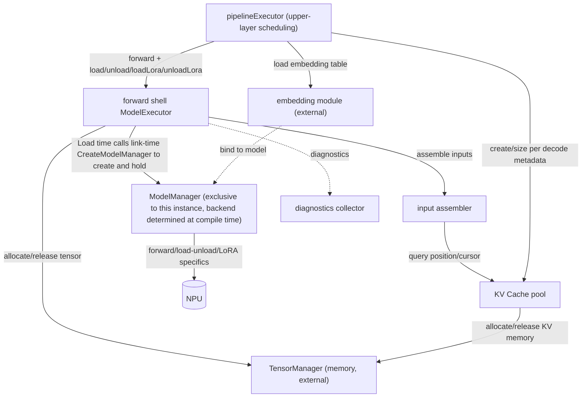
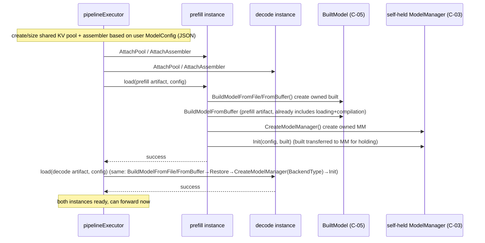
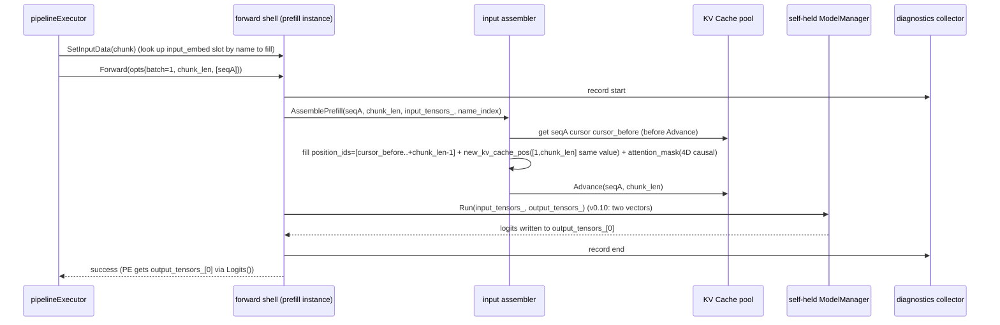
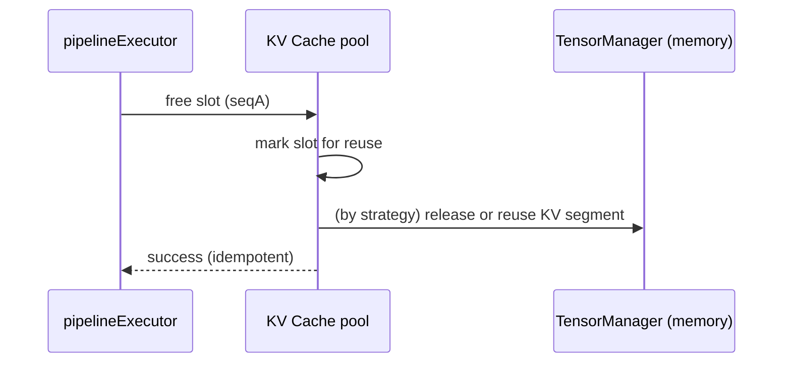
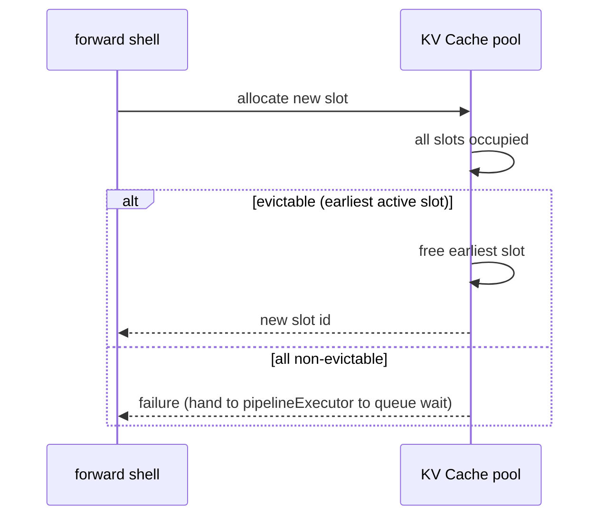

<!--
Human-readable design document. Content equivalent to DESIGN.md, but narrative-first, abbreviations/numbering as secondary.
The machine-readable authoritative version is still ./DESIGN.md (with full ID cross-references).
v0.2: Removed standalone lifecycle controller, control plane directly merged into ModelExecutor.
v0.3: Each instance creates and holds its own ModelManager at Load time (backend decoupled via factory).
-->

# ModelExecutor Module Design (Human-Readable Version)

English | [简体中文](../../../zh/cann_lm_engine/model_executor/DESIGN_HUMAN.md)

> Companion: `SPEC.md` (behavioral spec), `DESIGN.md` (machine-readable authoritative design, with full numbering cross-references).
> This document is a narrative rewrite of DESIGN.md for easy reading; technical decisions are fully consistent.

## What This Module Does

In one sentence: **It is the "forward shell" in the inference engine — hands assembled inputs to the underlying layer to run forward, gets back logits; also manages KV Cache position bookkeeping; and directly provides control entry points for model loading/unloading, LoRA loading/unloading — while the underlying executor (ModelManager) is created and held by it at load time.**

It sits between `pipelineExecutor` (upper-layer scheduling) and `ModelManager` (the one that actually calls NPU to run the graph), doing four things:

1. **Forward**: Assembles inputs into a complete bundle (embedding or tokenId + position + attention mask + KV handle), delegates to **self-held** ModelManager to run out logits and return.
2. **KV Cache bookkeeping**: Manages where each sequence has written to in the KV pool (position/cursor), but the actual memory allocation/release of the pool belongs to `TensorManager`.
3. **Model load-unload / LoRA control**: **Directly** provides `load`, `unload`, `loadLora`, `unloadLora` interfaces to pipelineExecutor; **ModelManager instance is created and held by this module itself at Load time** (one per instance), specific work still delegated to it, this module only manages om handle lifecycle. No longer sets up a separate "lifecycle controller" sub-module.
4. **Diagnostics (DFX)**: per-Forward input/output dump, timing stats, KV pool snapshot, switchable.

It is an internal C++ component of the engine, **only** consumed by pipelineExecutor, no Python bindings exposed externally.

> **Backend determined at compile time (v0.4)**: ModelManager's specific backend type is fixed at **compile time** — model_executor is unaware of and does not reference specific backend class names. At Load time calls a **link-time** free function `CreateModelManager()` (declared in `IModelManager` header, defined by the backend library selected at compile time for linking) to obtain owned ModelManager, then only holds `unique_ptr<IModelManager>` abstraction. No runtime factory injection. Switching backend = swap link library, rebuild.

### prefill / decode Are Two Instances

This is the key to understanding this module. prefill (processes entire prompt) and decode (per-token generation) use **two different offline compiled graphs (om files)**, so this class starts **two instances**, each bound to one graph, **each holding its own ModelManager**:

- **prefill instance**: om graph's batch dimension fixed to 1, runs one prompt segment at a time. At Load time creates and holds its own ModelManager, loads prefill om.
- **decode instance**: om graph's batch dimension fixed to `max_batch_size`, multiple sequences batched together. At Load time creates and holds its own ModelManager, loads decode om.

The two instances **share the same KV Cache pool**, zero-copy — prefill writes KV in, decode reads directly. Prerequisite is the two om graphs' KV layout consistent (validated at load time, reject if inconsistent).

### Three Corrections to Pipeline Design Document

The pipeline design document has three places that don't match actual requirements; this design clarified:

1. **KV cursor should not "sink to lower layer"**: pipeline document says KV maintenance belongs to underlying ModelManager. But cursor/slots is tightly coupled with upper-layer batch dimension scheduling, padding, diagnostics; sinking to lower layer loses visibility. So **cursor management is in this module**, only tensor memory allocation/release belongs to TensorManager.
2. **This module is not just "forward only"**: pipeline document limits this block to "only forward, no load-unload". Actually this module also **directly exposes load/unload/LoRA control interfaces** (implementation still delegated to self-held ModelManager).
3. **batch must be padded, not "no padding"**: pipeline document says Continuous Batching "no padding". But om graph batch dimension is fixed, decode when not full **must pad to `max_batch_size`**, padded positions shielded by attention mask. (Only decode instance; prefill instance batch=1, no padding needed.)

### v0.3 Structural Changes (Important)

From v0.3, **ModelManager is no longer externally injected; each ModelExecutor instance self-creates and self-holds at Load time** (one per instance). Key points:

- **Clear ownership**: each instance owns its own ModelManager (lives and dies with instance), no more ambiguity about "who manages the externally injected shared MM".
- **Load changed to per-instance each call once**: `Load(artifact)` takes a single om artifact. prefill instance Loads prefill om, decode instance Loads decode om. Original `LoadModel(prefill, decode)` (takes two at once) removed.
- **Common `Bind` removed**: MM creation and om handle binding merged into `Load`; cross-instance dependencies (TensorManager, KV pool, assembler, diagnostics) injected at construction or after Load.
- **Weight deduplication**: original "prefill/decode two om share same weights, deduplicated by one ModelManager" no longer holds (now two independent MMs each manage their own om). Cross-instance weight deduplication delegated to TensorManager (weight blob level) or no longer enforced.
- **LoRA paired sync**: each instance's LoRA hangs on its own ModelManager; both prefill+decode MMs must load same LoRA, caller (or thin coordination layer) guarantees paired calls.
- **Load order constraint**: decode instance must Load first (get max_batch_size/max_seq_len to size shared KV pool), then prefill Load. Forward only after both instances ready.

### v0.4 Further Tightening (Important)

v0.3 used a runtime-injected `ModelManagerFactory` (factory object) to create owned MM. v0.4 removes it — backend is determined at **compile time**, no runtime factory needed. Specifically:

- At Load time calls **link-time free function** `CreateModelManager()` (declared in `IModelManager` header, defined by backend library selected at compile time for linking), obtains owned MM.
- model_executor only holds `unique_ptr<IModelManager>` abstraction, **does not reference, is unaware of any specific backend class names** (grep finds no specific backend class names).
- Construction-time no longer injects any factory parameters — zero caller burden.
- Switching backend = swap link library, rebuild (build config selects backend lib); same build artifact does not support runtime multi-backend switch.
- UT links a stub definition (returns mock MM).

> v0.2 change (removing standalone "lifecycle controller" sub-module, control plane directly merged into ModelExecutor) remains in effect.

### v0.5 Layout Supplement

Add a KV pool memory layout rule: pool underlying tensor is organized **layer-major**, dimension order `[layer][batch_slot][position][K/V][head][dim]`, **multiple batches (slots) within same layer have KV laid out contiguously**. This way om can bind "all batches' KV for that layer" as one block per layer. Slot = batch lane index; per-seq cursor only advances position dimension, synchronized across layers. Zero-copy prerequisite thus concretized: both prefill/decode om must use this layout (including head/dim/K-V sub-order consistent), asserted at load time.

### v0.7 Load Flow Restructuring (Important)

v0.7 splits "model loading" into two same-level L3 roles, and changes config source:

- **Added `IBuiltModel`** (same level as `IModelManager`, declared in `cann_local_lm/engine/core/tensor_manager.h`): responsible for "artifact → built model" — `BuildModelFromFile/FromBuffer()` loads om path/buffer into built model (including compilation), `GetInputDescs/GetOutputDescs` exposes om graph I/O tensor descriptions (`TensorDesc` defined in `core/tensor_manager.h`). Created via link-time `BuildModelFromFile/FromBuffer()` (same pattern as CreateModelManager, backend determined at compile time).
- **`ModelHandle` removed** — replaced by `IBuiltModel`. Model reference is owned `IBuiltModel`, transferred to ModelManager via `Init`, ModelExecutor no longer holds handle.
- **`ModelMetaInfo` → `ModelConfig`**: config **is no longer the output parsed from artifact meta_json at load time**, but **a user JSON passed to pipeline, passed in as parameter when pipeline calls `model_executor::Load`**. Load signature becomes `Load(artifact, ModelConfig)`.
- **`IModelManager::Load` removed, changed to `Init(ModelConfig, shared_ptr<IBuiltModel>)`**: ModelManager **does not directly load via artifact** — artifact loading belongs to IBuiltModel, MM only receives built BuiltModel for runtime initialization (weights to NPU, graph ready). `Forward`/`Release` no longer receive handle (MM binds unique built via Init). `GetMeta`→`GetConfig`.

New load flow (per instance): `Load(artifact, config)` → `BuildModelFromFile/FromBuffer()` + `(already includes loading+compilation)` → `CreateModelManager()` + `mm->Init(config, std::move(built))` (built transferred to MM).

**Also eliminates v0.3's load order constraint**: because `ModelConfig` is a user-side parameter (known before Load), pipeline can **first size shared KV pool based on config and Attach both instances, then Load** — no more "decode must Load first to get meta to size pool" chicken-egg.

> Term mapping (old→new): `ModelHandle`→`IBuiltModel`; `ModelMetaInfo`→`ModelConfig` (user JSON parameter); `IModelManager::Load`→`Init(ModelConfig, IBuiltModel)`; `GetMeta`→`GetConfig`; `LoadModel(artifact,&meta)`→`Load(artifact, ModelConfig)`.

### v0.8 Tensor Application Path (Important)

v0.8 gives the model input/output tensor application path:

- **`TensorManager` changed to concrete singleton** (`core/tensor_manager.h`, `Instance()`) — `CreateTensor(TensorDesc, modelId)` applies tensor by desc + modelId, RAII release. Currently malloc stub (allocates by ∏dims×dtype bytes), real backend after landing provides NPU device memory allocation.
- **`IModelManager::GetModelID() → uint32_t`** — returns model id (backend assigned, associates loaded model/NPU context). ModelExecutor calls it after `Init` to get modelId.
- **Apply for input/output tensors at `Load` time**: after `Init(config, built)` → `GetModelID()` → based on `TensorDesc` returned by `built->GetInputDescs/GetOutputDescs` (taken before Init move), apply to `TensorManager::Instance().CreateTensor(desc, modelId)` for input/output tensors, stored as `input_tensors_`/`output_tensors_` for Forward use.

I.e.: artifact loading (BuildModelFromFile/FromBuffer) → runtime initialization (MM::Init) → get model id (GetModelID) → apply to TensorManager singleton for tensors by I/O desc. `modelId` binds "applied tensor" with "loaded model" (real backend for associating NPU context/device).

> From v0.12: full link changed to backend types — TensorManager proxies CreateTensorBuffer; shared_ptr ITensorBuffer replaces Tensor; TensorDesc replaces NDTensorDesc; GetData/GetSize replaces data/size; mm->Run replaces mm->Forward; mm->DeInit replaces mm->Release; BuildModelFromFile/FromBuffer + CreateModelManager(BackendType) replaces CreateBuiltModel/CreateModelManager; engine Status unchanged (map_backend_status boundary mapping).

---

## Overall Structure



Four internal components:

| Component | What it does |
|------|--------|
| **forward shell** ModelExecutor | Both forward plane (assemble inputs, advance KV cursor, delegate to self-held ModelManager to run forward, return logits; prefill/decode one instance each; only one forward in flight at a time), and control plane (load/unload/loadLora/unloadLora/getMeta, self-creates and self-holds ModelManager at Load time, manage single active). |
| **KV Cache pool** KvCachePool | Manage slots and cursors: alloc/free slots, advance cursor, evict earliest when pool full, snapshot query. Memory from TensorManager; capacity sized by decode instance's metadata. |
| **input assembler** InputAssembler | Derive position ids from cursor, construct attention mask, pad batch to max_batch_size during decode. Produces complete input bundle. |
| **diagnostics collector** DfxCollector | Per-Forward IO dump, timing stats, KV pool snapshot. Switchable, zero overhead when off. |

Dependency graph has no cycles: lower-layer external interfaces (ModelManager, TensorManager) ← KV pool, forward shell; KV pool ← input assembler, diagnostics; input assembler/KV pool/diagnostics ← forward shell. ModelManager is created and held by forward shell itself at Load time.

---

## Key Flows (Storytelling Version)

Below tells the six main flows in plain language.

### Flow 1: Load (v0.7: artifact→BuiltModel→MM::Init, config parameter)

pipelineExecutor holds user `ModelConfig` (JSON), calls `load(artifact, config)` once for **each** instance. **No more decode-first constraint**: config is parameter, known before Load, pipeline first sizes shared KV pool based on config and Attaches both instances, then Load.



Key points:
- Each instance Load time: first `BuildModelFromFile/FromBuffer()` + `(already includes loading+compilation)` (artifact→built), then `CreateModelManager()` + `mm->Init(config, built)` (runtime initialization, built transferred to MM). Backend determined at compile time, model_executor unaware of specific backend class names.
- `ModelManager` does not directly load via artifact — artifact loading belongs to `IBuiltModel`, MM only Init.
- `ModelConfig` is user JSON config parameter (max_batch_size/max_seq_len etc.), **not parsed from artifact**. pipeline sizes shared KV pool based on it **before** Load — so no decode-first chicken-egg.
- One engine instance has only one active forward shell pair (prefill+decode) at a time, no runtime hot-swap. If already active pair and load again, must unload first.
- embedding table does not go through this path — loaded by pipelineExecutor calling embedding module and bound to model.

Exceptions: `BuildModelFromFile`/`FromBuffer` + `CreateModelManager(BackendType)` returns empty/backend not linked → load failure (build-time guarantee backend definition linked); `mm->Init` failure → failure; `ModelConfig.max_batch_size/max_seq_len<=0` → invalid argument; path and buffer source mixed → invalid argument.

### Flow 2: prefill Forward (v0.13: name→index slot lookup to fill inputs)

pipelineExecutor first `SetInputData(chunk)` to fill chunk data into slot named `input_embed` (looked up by name→index mapping, not hardcoded subscript), then `Forward(opts{batch=1, chunk_len, slots=[seqA]})`:



Key points:
- prefill **does not pad** — om graph batch dimension is 1.
- data filled by caller via `SetInputData` into slot named `input_embed` (embedding or tokenId path, tokenId goes through model internal embedding). `position_ids`/`new_kv_cache_pos`/`attention_mask` filled by assembler **by name→index mapping slot lookup**, derived from cursor — no hardcoded subscripts (slot ordering determined by om graph).
- `position_ids` (`batch×seqLen`) and `new_kv_cache_pos` (`[batch, seqLen]` per-slot, guides KV write position, may wrap around) are **two different slots**, cannot be merged.
- `attention_mask` is 4D `batch×1×seqLen×kvCacheLen` (2nd dimension fixed 1), causal: visible=0 at current position and before, masked=`-FLT_MAX` after.
- Cursor read **before** `Advance` (first get position to fill tensor, then advance).
- Long prompt chunked, called multiple times, each appends a segment of KV.

Exceptions: cursor out-of-bounds → failure; `opts.slots` empty → invalid argument; name→index missing `position_ids`/`new_kv_cache_pos`/`attention_mask` → invalid argument; underlying forward failure → failure.

### Flow 3: decode Forward (per-token generation)

pipelineExecutor first `SetInputData(batched_data)` (concatenate each active sequence token into `input_embed` slot, real backend fills by batch dimension; stub takes first), then `Forward(opts{batch≤N, chunk_len=1, slots=[seqA,seqB,…]})`:

```mermaid
sequenceDiagram
  participant PE as pipelineExecutor
  participant ME as forward shell (decode instance)
  participant ASM as input assembler
  participant POOL as KV Cache pool
  participant MM as self-held ModelManager
  PE->>ME: SetInputData(batched_data) (look up input_embed slot by name to fill)
  PE->>ME: Forward(opts{batch≤N, chunk_len=1, [seqA,seqB,…]})
  ME->>ASM: AssembleDecode(slots, input_tensors_, name_index)
  ASM->>POOL: each slot get cursor_i (before Advance)
  ASM->>ASM: max_kv_len=max(cursor_i+1); fill position_ids[b]=cursor_i + new_kv_cache_pos[b]=cursor_i (per-slot) + mask[batch][1][1][max_kv_len] causal per slot
  ASM->>POOL: each active seq Advance(+1)
  ME->>MM: Run(input_tensors_, output_tensors_) (v0.10: two vectors)
  MM-->>ME: logits written to output_tensors_[0]
  ME-->>PE: success (PE gets via Logits(), split per slot)
```

Key points:
- decode **must pad** to max_batch_size — om graph batch dimension fixed. Unfilled positions use dummy slots/zero fill, attention mask filled by name slot lookup, shield padded positions, **padded positions do not advance cursor**.
- Batch slots with different cursor use `max_kv_len=max(cursor_i+1)`, short slot tails set to `-FLT_MAX`.
- Each sequence appends only one token's KV per step.
- When full (active = max_batch_size), no padding, mask all valid.

### Flow 4: Sequence end/cancel, free slot

When sequence ends or is canceled, free its KV slot:



Free is idempotent, duplicate free does not error. After free, the freed slot can accept new requests.

### Flow 5: Pool full, evict earliest

New request wants to allocate slot, but pool is full (all slots active):



Default evicts the **earliest** active sequence (FIFO). Eviction strategy details (earliest vs priority vs LRU) left as open, but interface stable.

### Flow 6: LoRA load/unload (each instance delegates to its own ModelManager; paired sync)

pipelineExecutor calls forward shell's `loadLora` or `unloadLora`. **Note: prefill and decode two instances each have their own ModelManager, so must call for both instances**, let both MMs synchronously load same LoRA:

```mermaid
sequenceDiagram
  participant PE as pipelineExecutor
  participant PRE as prefill instance
  participant DEC as decode instance
  participant MMp as prefill self-held MM
  participant MMd as decode self-held MM
  PE->>PRE: loadLora(loraB)
  PRE->>PRE: mark "switching" (forward will be rejected)
  opt has active LoRA
    PRE->>MMp: unload old LoRA
  end
  PRE->>MMp: load loraB
  MMp-->>PRE: new LoRA handle
  PRE->>PRE: clear "switching" mark
  PE->>DEC: loadLora(loraB)
  DEC->>DEC: mark "switching"
  opt has active LoRA
    DEC->>MMd: unload old LoRA
  end
  DEC->>MMd: load loraB
  MMd-->>DEC: new LoRA handle
  DEC->>DEC: clear "switching" mark
  PE-->>PE: both instances synchronized; subsequent forward uses loraB; main model not unloaded
```

Key points: at any time each instance has only one LoRA active; `loadLora` detects existing active and first `unloadLora` then loads (switch=unload+load, main model not unloaded), no separate switch method. **Both instances must be called in pairs**, otherwise two MMs' LoRA state diverges, behavior undefined. Forward rejected during switch (invalid state).

---

## What the Interface Looks Like

Below is the C++ interface skeleton. External types (ModelManager abstraction, TensorManager, Tensor) only forward-declared, defined in lower layer.

### Status Codes

Aligns with pipeline's 6 coarse-grained status codes, no silent error swallowing:

```cpp
enum class Status {
  Success = 0,       // success
  Failure,           // failure (underlying failure, load failure, MM factory creation failure, pool full no evictable, cursor out-of-bounds)
  InvalidArgument,   // invalid argument (shape/pos inconsistent, path/buffer mixed use)
  InvalidState,      // invalid state (forward without load, pool/asm not injected, forward during LoRA switch, concurrency violation)
  NotFound,          // not found (model/LoRA not loaded)
  Canceled           // canceled
};
```

### Forward Shell (with control plane, v0.7: artifact→BuiltModel→MM::Init)

```cpp
// v0.7: ModelHandle removed (replaced by IBuiltModel); ModelMetaInfo→ModelConfig (user JSON parameter).
struct ForwardOptions {
  int batch;                 // prefill=1; decode ≤ max_batch_size
  std::size_t chunk_len;     // number of tokens in this step (prefill=chunk; decode=1)
  std::vector<SlotId> slots;  // KV slots corresponding to this batch
  bool dump;                  // diagnostics switch
};

struct ModelConfig {          // user JSON config (passed in when pipeline calls Load, not parsed from artifact)
  int max_batch_size;
  int max_seq_len;
};

// Backend creation (link-time free functions, backend determined at compile time; definitions provided by backend library selected at compile time for linking):
std::shared_ptr<IBuiltModel>  BuildModelFromFile/FromBuffer();    // artifact→built model
std::unique_ptr<IModelManager> CreateModelManager();  // runtime initialization+forward+release

class ModelExecutor {
 public:
  // Construction: inject cross-instance/external dependencies. No backend factory injection (backend determined at compile time).
  ModelExecutor(std::shared_ptr<KvCachePool> pool,
                std::shared_ptr<InputAssembler> asm_,
                std::shared_ptr<DfxCollector> dfx);

  Status AttachPool(std::shared_ptr<KvCachePool> pool);
  Status AttachAssembler(std::shared_ptr<InputAssembler> asm_);

  // ---- Control plane: directly exposed to pipelineExecutor ----
  // Load (v0.7): BuildModelFromFile/FromBuffer (already includes loading+compilation)(artifact) → CreateModelManager + mm->Init(config, built).
  // config is user JSON parameter. Single active: if already loaded, unload first.
  Status Load(const ModelArtifact& artifact, const ModelConfig& config);
  Status Load(const ModelArtifactPath& artifact, const ModelConfig& config);
  Status Unload();                 // delegate mm->DeInit + release owned MM, idempotent
  Status GetConfig(ModelConfig* out) const;   // return config passed in at Load time

  // LoRA: single active; loadLora detects existing active and first unloadLora then loads (switch=unload+load, main model not unloaded)
  Status LoadLora(const ModelArtifact& lora);
  Status UnloadLora();

  // ---- Forward plane (v0.9/v0.13: does not receive inputs/count/out_logits, uses private input_tensors_/output_tensors_) ----
  // Fill input data into slot named input_embed (looked up by input_name_index_, called before Forward).
  Status SetInputData(const std::shared_ptr<ITensorBuffer>& data);
  // Single-step forward: assembler looks up position_ids/new_kv_cache_pos/attention_mask slots by name_index to fill input_tensors_
  //   (cursor obtained from KV pool before Advance) + advance cursor → mm->Run(input_tensors_, output_tensors_).
  // Synchronous, single-flight serial (mutex fallback).
  Status Forward(const ForwardOptions& opts);
  // Get output logits (output_tensors_[0], read after Forward).
  std::shared_ptr<ITensorBuffer> Logits() const;

  explicit operator bool() const noexcept;   // loaded and pool/asm ready
};
```

Forward failure cases: not loaded / `output_tensors_` empty → invalid state; `opts.slots` empty → invalid argument; name→index missing `position_ids`/`new_kv_cache_pos`/`attention_mask` → invalid argument; underlying failure → failure; called during LoRA switch → invalid state.

Load failure cases: `BuildModelFromFile`/`FromBuffer` + `CreateModelManager(BackendType)` returns empty/backend not linked → failure (build-time guarantee backend definition linked); `mm->Init` failure → failure; `ModelConfig.max_batch_size/max_seq_len<=0` → invalid argument; path/buffer mixed → invalid argument; already active then load → unload first or reject.

### KV Cache Pool

```cpp
using SlotId = int;   // -1 means no slot

struct SlotInfo {
  SlotId id;
  size_t cursor;     // next writable position (written length = cursor)
  bool active;
};

class KvCachePool {
 public:
  // Capacity sized by decode instance's metadata (max_batch_size/max_seq_len)
  // Layout (D-13): layer-major [layer][batch_slot][position][K/V][head][dim],
  //                multiple batches (slots) within same layer contiguous; slot = batch lane index
  KvCachePool(int max_batch_size, int kv_cache_max_len, int num_hidden_layers,
              int num_attention_kv_heads, int num_attention_head_dims,
              DataType dtype);   // constructor applies via TensorManager single batch for 2×num_layers
                                  // per-layer K/V tensors (C-04; v0.14)

  Status AllocKvSlot(SlotId* out);   // allocate one batch lane; pool full evicts earliest; full and no evictable → failure
  Status FreeKvSlot(SlotId id);       // idempotent; reuse batch lane, do not move other slots
  Status Advance(SlotId id, size_t n); // advance this slot's position cursor n (synchronized across layers); out-of-bounds → failure
  size_t NextPosition(SlotId id) const;   // = cursor (position dimension, consistent across layers)
  Status Snapshot(std::vector<SlotInfo>* out) const;   // diagnostics snapshot
  size_t TensorCount() const noexcept;   // number of tensors applied (= 2×num_hidden_layers)
  std::shared_ptr<ITensorBuffer> KTensor(int layer) const noexcept;   // per-layer K tensor
  std::shared_ptr<ITensorBuffer> VTensor(int layer) const noexcept;   // per-layer V tensor
};
```

Number of slots = max_batch_size; each sequence occupies one batch lane (slot = batch index). Cursor out-of-bounds (position exceeds max_seq_len) is a quality red line, strong validation intercepts.

### Input Assembler (v0.13: name→index slot lookup)

Model's input tensor slots are defined by om graph (each omc ordering may differ), after Load builds `input_name_index_` mapping based on `TensorDesc.name → i` from `IBuiltModel::GetInputDescs()`. Assembler looks up slots by name to fill, no hardcoded subscripts. 6 slots see `INPUT_INFO.md`:

| Name | Type | Dimensions | Filler |
|------|------|------|--------|
| `input_embed` | FLOAT16 | `[batch, seqLen, hidden]` | caller (`SetInputData`) |
| `embed_scales` | FLOAT32 | `batch×seqLen×1` | embedding module (currently shelved) |
| `attention_mask` | FLOAT32 | `batch×1×seqLen×kvCacheLen` | InputAssembler (causal) |
| `position_ids` | INT32 | `batch×seqLen` | InputAssembler |
| `new_kv_cache_pos` | INT32 | `[batch, seqLen]` | InputAssembler |
| `kvCache` | — | `[numLayers, max_batch, max_seqLen, 2, heads, dim]` | KV pool buffer (applied at Load) |

```cpp
class InputAssembler {
 public:
  InputAssembler(std::shared_ptr<KvCachePool> pool, int max_batch_size);

  // prefill: batch=1, no padding. Look up position_ids/new_kv_cache_pos/attention_mask by name_index,
  //   get cursor_before → pos=[cursor_before..+chunk_len-1] + new_kv_cache_pos([1,chunk_len] same value)
  //   + mask[1][1][chunk_len][cursor_before+chunk_len] causal → Advance(slot, chunk_len)
  Status AssemblePrefill(SlotId slot, std::size_t chunk_len,
                         std::vector<std::shared_ptr<ITensorBuffer>>& tensors,
                         const std::unordered_map<std::string, std::size_t>& name_index);
  // decode: seqLen=1. Each slot get cursor_i → max_kv_len=max(cursor_i+1) →
  //   pos[b]=cursor_i + new_kv_cache_pos[b]=cursor_i (per-slot [batch,1]) + mask[batch][1][1][max_kv_len] causal per slot
  //   → Advance(each slot, 1)
  Status AssembleDecode(const std::vector<SlotId>& slots,
                        std::vector<std::shared_ptr<ITensorBuffer>>& tensors,
                        const std::unordered_map<std::string, std::size_t>& name_index);
  int max_batch_size() const noexcept;
};
```

Key rules:
- `position_ids` (`batch×seqLen`) and `new_kv_cache_pos` (`[batch, seqLen]` per-slot, guides KV write position, may wrap around) are **two different slots**, cannot be merged.
- `attention_mask` 2nd dimension fixed to 1; causal = `0` at current position and before, `-FLT_MAX` after; decode padding masks short slot tails.
- Cursor read **before** `Advance` (first get position to fill tensor, then advance).
- Before writing check `GetData()` non-null, memcpy length `min(data, GetSize())` truncated.

### Diagnostics Collector

```cpp
struct DfxConfig {
  bool io_dump = false;        // IO dump switch
  bool timing = true;          // timing stats switch
  std::filesystem::path dump_dir;
};

class DfxCollector {
 public:
  DfxCollector(DfxConfig cfg, std::shared_ptr<KvCachePool> pool);

  // Called by forward shell after forward; zero overhead early return when dump off
  Status OnForwardStart(const ForwardBundle& in, const ForwardOptions& opts);
  Status OnForwardEnd(const std::shared_ptr<ITensorBuffer>& logits, double elapsed_us);
  Status PoolSnapshot(std::vector<SlotInfo>* out) const;   // delegate to KV pool
  Status FlushTimings(/*output*/ void* out) const;            // aggregated timing
};
```

Dump landing failure only logs warning, **does not** interrupt inference.

---

## Why Designed This Way (Key Decisions Explained)

### 1. Why KV cursor is in this module, not sunk to lower layer

Pipeline document says KV maintenance belongs to underlying ModelManager. But cursor/slots is tightly bound to upper-layer batch dimension scheduling, padding, diagnostics; sinking to lower layer loses batch dimension visibility, padding and diagnostics can't coordinate. So cursor management is in this module's KV pool, **tensor memory allocation/release still belongs to TensorManager**, underlying operators (KV concat/write) still in ModelManager's forward.

Cost: this module bears cursor consistency responsibility — cursor out-of-bounds is quality red line, strong validation intercepts.

### 2. Why prefill/decode share same pool, zero-copy

prefill writes, decode reads, sharing one pool means no copy. Prerequisite is two om graphs' KV layout consistent — **both layer-major, multiple batches within same layer contiguous** (`[layer][batch_slot][position][K/V][head][dim]`, head/dim/K-V sub-order also consistent). Assert two om layout consistent at load time, reject if inconsistent (note two om now loaded by two independent ModelManagers, but layout consistency check still must be asserted at load time for both om).

### 3. Why use "contiguous slots + per-seq cursor" instead of paging

Simple, fragmentation controlled, cursor operations O(1). Each sequence occupies one batch lane (slot = batch index 0..max_batch_size-1), within slot written positions contiguous, per-seq cursor advances position dimension and synchronizes across layers. Cost is each slot pre-allocated by max_seq_len, short sequences waste space (so pool capacity scales with max_seq_len, is high-risk budget item).

### 3b. Why KV pool is layer-major layout, multiple batches within same layer contiguous

om graph computes attention per layer — it needs to bind a contiguous memory block of "all batches' KV for that layer" for each layer. So pool underlying tensor is organized **layer-major**: dimension order `[layer][batch_slot][position][K/V][head][dim]`, **multiple batches (slots) within same layer have KV laid out contiguously** (layer outermost, batch next, so all batches under one layer form a contiguous block). This way om binds entire layer KV in one go.

Fully compatible with per-seq cursor: cursor only manages position dimension (within slot written positions contiguous), same token across layers advances synchronously — single sequence is not contiguous across layers (each layer segment scattered), but om accesses per-layer, does not affect correctness. Zero-copy prerequisite is clear: prefill om and decode om must both use this layer-major layout (head/dim/K-V sub-order also consistent), asserted at load time, reject if inconsistent.

### 4. Why decode must pad to max_batch_size

Because om graph's batch dimension is fixed (decided at offline compile time), decode when not full must pad to fixed dimension to feed into graph. Padded positions use dummy slots/zero fill, attention mask shields them, and do not advance cursor. prefill's graph batch dimension fixed to 1, so no padding.

### 5. Why single-flight serial

Same instance concurrent forward would contend for cursor. Single-flight serial (mutex) is simplest, safest. Multi-sequence parallelism relies on data parallelism within single batch, not concurrent forward — this is consistent with device's serial nature, no loss.

### 6. Why single LoRA, switch=unload+load (no switch method)

Simple, lands first. At any time each instance has only one LoRA active, `loadLora` detects existing active and first `unloadLora` then loads (main model not unloaded). No separate switch method — switch is unload+load combination, control plane interface minimal. Forward rejected during switch (invalid state).

**v0.3 note**: two instances each have their own ModelManager, so LoRA must be called for **both prefill and decode instances**, let both MMs synchronously load same LoRA. If only called for one instance, two MMs' state diverges, behavior undefined.

### 7. Why support tokenId direct input, and embedding table ownership

Supports two paths: already-looked-up embedding, or tokenId (goes through model internal embedding, lookup by om graph). This way can be compatible with models with om built-in embedding. embedding table **loaded by pipelineExecutor calling embedding module and bound to model**, not ModelManager's responsibility, this module also does not load/own embedding table, does not re-implement lookup.

### 8. Why diagnostics switchable, and does not block inference

Diagnostics dump is on forward path, must be zero overhead when off (early return), when on also cannot interrupt inference due to landing failure. Production environment controls cost via switch.

### 9. Why single active pair per instance, no hot-swap

Simple, lands first. One engine instance has only one active forward shell pair (prefill+decode) at a time, no runtime hot-swap of model. Multiple engine instances can coexist, resource pools isolated. v0.3: each instance single active om (unload before load), each holds own ModelManager.

### 10. Why removed standalone "lifecycle controller" sub-module

v0.1 once set up a sub-module to transit load/unload/LoRA control. But SPEC already lists these contracts on ModelExecutor, standalone sub-module adds one layer of transit, increases reading and calling cost; and forward and control share same om handle and state, merging反而 reduces state scatter and sync cost. So v0.2 merged control methods directly into ModelExecutor.

### 11. Why ModelManager is created and held by each instance itself (v0.3), and backend determined at compile time, no runtime factory (v0.4)

v0.2 externally injected one shared ModelManager for two instances, ownership unclear (who manages this MM, when destroyed). v0.3 changed to: **each instance creates and holds its own ModelManager at Load time** (lives and dies with instance).

v0.3 once used a runtime-injected `ModelManagerFactory` (factory object) to create MM. v0.4 further tightened: backend is determined at **compile time**, no runtime factory needed. At Load time calls a **link-time free function** `CreateModelManager()` (declared in `IModelManager` header, defined by backend library selected at compile time for linking), obtains owned MM. model_executor only holds `unique_ptr<IModelManager>` abstraction, **does not reference, is unaware of any specific backend class names** (grep finds no specific backend classes). Construction-time no longer injects any factory parameters.

Benefits: clear ownership, each MM single responsibility, call surface simpler (one less parameter at construction), core does not couple specific backend classes, backend selection is build-time decision, no runtime backend switch state/security risk.

Costs (points to remember):
1. **Cross-instance weight deduplication gone**: original "prefill/decode two om share same weights, deduplicated by one MM" no longer holds — two independent MMs each manage their own om. Deduplication either delegated to TensorManager (weight blob level), or no longer enforced.
2. **LoRA needs paired sync**: each instance's LoRA hangs on its own MM, must call loadLora/unloadLora for both prefill and decode instances.
3. **Load has order**: decode must Load first (get max_batch_size/max_seq_len to size shared KV pool), then prefill Load.
4. **Backend single-select compile**: same build artifact does not support runtime multi-backend switch; multi-backend needs multiple build artifacts (swap link library rebuild). `CreateModelManager()` not linked to backend definition → link-time unresolved symbol, build-time guarantee; function returns empty → handled as Load failure.

---

## Performance Budget

These are all currently **budget targets** (no measurement baseline), pending real machine micro-benchmark calibration:

| Metric | Target | How to measure | Risk |
|------|------|--------|------|
| Forward shell forwarding overhead | <0.1% end-to-end (excluding underlying operators) | single forward micro-benchmark (mock underlying returns fake logits to isolate) | low |
| KV pool memory | fixed-length = num_layers × max_batch_size × max_seq_len × 2(K&V) × num_heads × head_dim × dtype (layer-major layout) | RSS/NPU memory after load | **high** (scales linearly with model scale, absolute value unbound) |
| Pool operations (alloc/free/advance/get position) | negligible O(1) | pool operation micro-benchmark | low |
| prefill input assembly | <5% of that chunk's forward time | per chunk | medium |
| decode input assembly (including padding) | <0.1% end-to-end | per step | low |
| Load (including MM creation, excluding underlying loading) | one-time | construction period | low |
| Diagnostics off overhead | zero | off vs on baseline comparison | low (behavioral contract guarantee) |

Two high-risk/red-line items:

1. **KV pool memory**: capacity scales linearly with layers/hidden/seq_len/max_batch_size, absolute value can only be measured after model scale determined. If over budget, degradation path is per-layer KV quantization or reduce max_batch_size.
2. **KV cursor out-of-bounds** (quality red line, not performance): in multi-turn long conversation cursor approaches max_seq_len, out-of-bounds crashes. Intercepted by cursor strong validation + test coverage.

---

## Concurrency and Thread Safety

- No independent thread, no event loop. Forward shell instance is synchronous object held by calling thread, forward execution serial.
- **Single-flight**: same instance allows only one forward in flight at a time, serialized by mutex.
- **KV pool operations mutex**: alloc/free/advance cursor all protected by mutex, prefill/decode two instances share same pool.
- **Control plane serial**: load/unload/loadLora/unloadLora (including ModelManager creation/release) serialized by lifecycle mutex, and coordinated with Forward via `lora_switching_` atomic flag — forward does not hold lifecycle lock, avoid forward blocking load/LoRA, and vice versa.
- Lock hierarchy: lifecycle lock (including owned MM lifecycle) > forward lock > pool lock, no reverse nesting.
- Multi-instance isolation: no global singleton, each pair's resource pool independent, each holds own ModelManager.

---

## How Errors Are Tiered

| Level | Definition | Example | Default handling |
|------|------|------|---------|
| L1 fatal | unrecoverable | cursor out-of-bounds, KV layout drift | FATAL log, request judged failed |
| L2 severe | retryable | load failure, shape inconsistency, MM factory creation failure | return failure/invalid argument |
| L3 degradable | affects quality/observability | dump landing failure, pool snapshot failure | warning, no inference blocking |

---

## Undecided Things (Open Issues)

| Open issue | Impact | Fallback |
|------|------|------|
| Forward shell overhead budget has no baseline | <0.1% may be inaccurate | implementation-time micro-benchmark calibration |
| KV pool capacity not bound to model scale | memory budget inaccurate | measure after model scale determined; capacity sized by decode metadata |
| Two om KV layout consistency | zero-copy failure | load-time assert both om are layer-major, multiple batches within same layer contiguous, sub-order consistent, reject if inconsistent |
| Eviction strategy details | eviction semantics dispute | default evict earliest, strategy adjustable |
| LoRA cross prefill/decode paired sync | two MM states may diverge | caller calls both instances in pairs, or introduce thin coordination layer |
| Dummy slot/padded position KV handling | out-of-bounds/pollution | zero fill + mask shield + no cursor advance |
| Cross-instance weight deduplication no longer MM's responsibility | weights may redundantly reside on NPU | delegate to TensorManager weight blob level deduplication, or not enforced |
| Backend compile-time single-select, no runtime switch | multi-backend coexistence limited | backend determined at compile time (build config); multi-backend needs multiple build artifacts |

---

## How to Land Next (For Implementer)

Implementation order (by dependency topology):

1. First declare external interfaces (ModelManager abstraction, TensorManager abstraction).
2. Write KV Cache pool (with mock TensorManager, run through alloc/free/evict/snapshot).
3. Write input assembler (with mock KV pool, run through position derivation + padding + mask).
4. Write diagnostics collector (with mock file sink, run through dump switch + landing failure degradation).
5. Write forward shell (link stub definition `CreateModelManager()` returns mock MM, run through: Load actually calls it to create and hold owned MM, two input paths + single-flight, load/unload/loadLora/unloadLora control plane). grep asserts M-01 code does not reference any specific backend class names.
6. Finally: prefill + decode two instances + shared pool, run through zero-copy connection (decode first Load→size pool→prefill Load).

Parallelizable: KV pool and diagnostics are independent, can work simultaneously.

Source code lands in `cann_local_lm/engine/core/model_executor/`, UT lands in `tests/cpp/engine/model_executor/`. Backend library selected by build config for linking, provides `CreateModelManager()` definition; UT links stub (returns mock MM).

---

## Consistency Note

This document is technically fully equivalent to `DESIGN.md`, just removes the cross-references of numbering abbreviations, uses narrative instead. The machine-readable authoritative version (with full module/contract/flow/decision numbering, for implementation-time precise traceability) is still `DESIGN.md`. If there is any discrepancy, `DESIGN.md` prevails.
