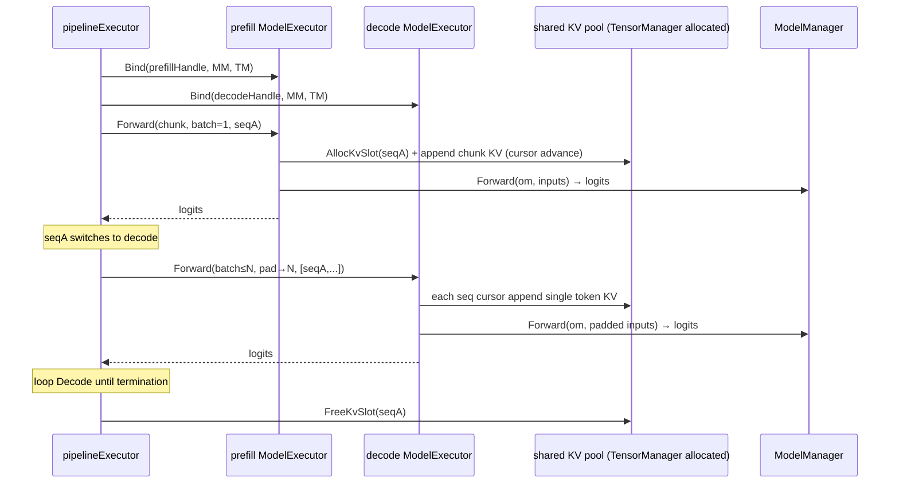

# SR20260807001 — CANN-LM Engine ModelExecutor Module

English | [简体中文](../../../zh/cann_lm_engine/model_executor/SPEC.md)

## Chapter 1 Overview

This spec defines the business behavior of the C++ ModelExecutor module under `cann_lm/engine/core/model_executor`. This module provides CANN-LM inference engine with **single-step forward execution (forward shell)** and **KV Cache ringBuffer cursor management**, **input filling**, **model load-unload/LoRA control** capabilities, located between `pipelineExecutor` (above) and `ModelManager` (below, backend specific implementation), `TensorManager` (tensor memory). prefill and decode are two instances of this module respectively (each bound to one om offline compiled graph), the two share the same KV Cache pool, zero-copy. This module is an internal C++ component of engine, only consumed by `pipelineExecutor`, **does not expose** any cross-language or external interfaces.

Requirement ID: **SR20260807001**. Software layer: **framework** (engine core reusable library, includes backward compatibility chapter).

**Three clarifications/corrections to pipeline DESIGN (`docs/pipeline+engine_executor/DESIGN.md` §11.4 M-04)**:
1. **KV cursor ownership**: pipeline DESIGN marks KV maintenance as "sink to lower layer C5 (C-04 IModelManager)". This spec clarifies — **KV ringBuffer's pos/offset/cursor management belongs to this module**; only tensor memory allocation/release is in `TensorManager`.
2. **M-04 scope**: pipeline DESIGN limits M-04 to "forward only, no load/unload". This spec clarifies — this module is not just forward, also **exposes load/unload/LoRA control interfaces upward to `pipelineExecutor`**, specific load-unload/LoRA implementation is in `ModelManager`, this module delegates calls.
3. **batch padding**: pipeline SPEC/DESIGN says Continuous Batching "no padding". This spec corrects — om graph batch dimension is fixed, **when active batch is not full this module must pad to `max_batch_size`** (only decode executor: its om fixed batch dimension = `max_batch_size`); prefill executor om fixed batch=1, **no padding**. Padded positions shielded by attentionMask.

Reader should understand within 30 seconds: this spec defines the behavior contract of a C++ internal component that is a forward shell + KV cursor management + load-unload/LoRA control delegation, prefill/decode dual instances, consumed by `pipelineExecutor`.

## Chapter 2 Glossary

| Term | Definition |
|------|------|
| ModelExecutor | This module, engine/core internal C++ forward shell component |
| Forward shell | Thin layer that only assembles inputs and delegates to underlying to execute forward, produces logits |
| om / omc | Ascend offline compiled model graph, this module loads by path or already-read buffer |
| prefill executor / decode executor | Two instances of this module, bound to prefill om and decode om respectively |
| ModelManager | Backend specific implementation layer, provides load-unload/forward/LoRA specific implementation, located below this module |
| TensorManager | tensor memory management component, this module applies/releases weights and KV pool memory through it |
| KV ringBuffer | fixed-length KV Cache pool, ring-managed by slots + cursor |
| slot | A contiguous segment in KV pool occupied by one sequence |
| cursor | per-sequence next writable KV position |
| pos / offset | Position offset of sequence in KV pool, derived from cursor |
| next-position | Next step's KV write position, maintained by cursor |
| inputEmbedding | Already-looked-up token embedding tensor, one of Forward inputs |
| tokenId | token id tensor, one of Forward inputs; goes through model internal embedding path |
| embedding module (C-02 ITextEmbedding) | token id→token embedding lookup and embedding table loading capability; called by pipelineExecutor to load embedding table and bind to model, not ModelManager's responsibility |
| positionIds | position id sequence, one of Forward inputs |
| logits | model forward output, pre-softmax values in vocabulary dimension |
| attentionMask | per-sequence valid length/causal mask, also shields padded positions |
| batch padding | pad to max_batch_size when active batch < max_batch_size |
| max_batch_size | decode pool/batch dimension capacity upper limit given by model metadata |
| max_seq_len | single sequence maximum length given by model metadata |
| ModelMetaInfo | model metadata structure queryable after load |
| ModelHandle | opaque model handle, returned by ModelManager::Load |
| LoRA | low-rank adapter, single active, switch requires reload |
| Single-flight | same executor instance allows only one Forward in flight at a time |
| Chunked Prefill | long prompt chunked, multiple prefill calls, append KV per chunk |
| Continuous Batching | decode stage batches multiple requests into one forward, requests can join/exit mid-way |
| DFX | dump IO, timing stats, pool state snapshot and other observability capabilities |
| Eviction | when KV pool full and needs to admit new sequence, reclaim earliest sequence's slot |
| dummy slot | placeholder KV slot occupied by padded positions during batch padding |

## Chapter 3 Background

### 3.1 Current State

Each model inference under `cann_lm/models` depends on external Python implementation. C++ inference path lacks a unified "forward shell + KV management + load-unload control" component. pipeline DESIGN (`docs/pipeline+engine_executor`) defines L2 `M-04 ModelExecutor` as forward shell, L3 `C-04 IModelManager` as underlying runtime contract, but marks KV maintenance as "sink to lower layer C5", limits M-04 to "forward only", and advocates Continuous Batching "no padding".

### 3.2 Problems

- **KV ownership misplacement**: pipeline DESIGN puts KV pos/offset in lower layer C-04, but cursor/slot management is tightly coupled with upper-layer batch dimension scheduling, padding, dfx; sinking to lower layer loses batch dimension visibility and observability.
- **M-04 scope too narrow**: forward only cannot carry the need to expose load/unload/LoRA control upward.
- **Fixed batch dimension**: om graph batch dimension is fixed, pipeline's "no padding" assumption does not match actual om shape constraint, not-full batch must be padded.
- **Single embedding path**: only accepts external post-lookup embedding, cannot support model internal embedding (tokenId direct input) path.

### 3.3 Expectations

ModelExecutor as forward shell uniformly carries: forward assembly and logits production, KV ringBuffer cursor management (memory belongs to `TensorManager`), load/unload/LoRA control (implementation belongs to `ModelManager`), input filling (including batch padding), diagnostics; prefill/decode dual instances share KV pool zero-copy; Forward input supports embedding and tokenId two paths (tokenId goes through model internal embedding); behavior testable. This module's behavior uses om graph + weights as correctness oracle (see TC_003/004).

## Chapter 4 Functional Requirements

### 4.1 Behavior Spec

#### 4.1.1 Forward (shell)

- **Preconditions**: instance Loaded (owned ModelManager + `input_tensors_`/`output_tensors_` applied by descs); KV pool allocated; caller has called `SetInputData` to fill data.
- **Processing logic**:
  - Module **must** provide single-step forward `Forward(ForwardOptions) → status` — **does not** receive inputs/count/out_logits (v0.9); input/output tensors use private `input_tensors_`/`output_tensors_` (applied to `TensorManager` singleton by descs at Load time).
  - Caller **must** first use `SetInputData(data)` to fill data into slot named `input_embed` (looked up by name→index, not hardcoded subscript).
  - Forward **must** use `InputAssembler` to look up `position_ids`/`new_kv_cache_pos`/`attention_mask` slots by name→index mapping and fill (v0.13: cursor read from KV pool before advancing, fill position first then `Advance`), and advance KV cursor; then call `ModelManager::Forward(input_tensors_, output_tensors_)` (v0.10: pass two vectors, MM fills output buffer), logits retrieved via `Logits()` (returns `output_tensors_[0]`).
  - `input_tensors_` has 6 slots total (see `INPUT_INFO.md`): `input_embed` (filled by caller), `embed_scales` (filled by embedding module, currently shelved), `attention_mask`, `position_ids`, `new_kv_cache_pos` (all three filled by InputAssembler), `kvCache` (KV pool buffer, applied by descs at Load time).
  - prefill instance **must** `batch=1`; decode instance **must** `batch ≤ max_batch_size`.
  - Module **must** single executor single-flight, internally serialized (one batch at a time; concurrent calls serialized).
- **Postconditions**: `output_tensors_[0]` contains current step's `logits` (retrieved via `Logits()`); KV slot cursor advanced per prefill/decode semantics.
- **Exception handling**: not Loaded / `output_tensors_` empty → `INVALID_STATE`; `opts.slots` empty → `INVALID_ARGUMENT`; name→index mapping missing `position_ids`/`new_kv_cache_pos`/`attention_mask` → `INVALID_ARGUMENT`; underlying forward failure → `FAILURE`.
- **Boundary cases**: empty batch, single token decode, overlong prompt triggers eviction.

#### 4.1.2 KV ringBuffer Management

- **Preconditions**: shared KV pool allocated by `TensorManager`; slot capacity = `max_batch_size`.
- **Processing logic**:
  - KV pool fixed-length, slot count = `max_batch_size`; **pos/offset/cursor management in this module**; tensor allocation/release in `TensorManager`.
  - Module **must** use per-sequence cursor management (slot = batch lane index, 0..max_batch_size-1; per-seq cursor only advances position dimension, synchronized across layers); `next-position` derived from cursor.
  - Pool underlying **must** be per-layer independent K/V tensors (total `2×num_hidden_layers`, applied in single batch via `TensorManager::CreateKvCacheTensor` at construction, C-04; v0.14). Single tensor dimensions `[kv_cache_max_len][num_attention_kv_heads][batch][num_attention_head_dims]` (batch dim = pool slot count; dtype parsed from meta_json `kv_cache_type`, default/unknown falls back to FLOAT16), order `[k0,v0,k1,v1,...]`, `KTensor/VTensor` exposed per layer — satisfies om's requirement to bind entire layer K/V tensor per layer. See DESIGN D-13 (v0.14 evolution).
  - prefill **must** append by chunk (Chunked Prefill: multiple calls, each appends that chunk length's tokens of KV).
  - decode **must** append single token per sequence per step.
  - prefill/decode two instances **must** zero-copy share same pool (prerequisite: two om graphs KV layout consistent — per-layer K/V tensor dimensions/dtype/K-V sub-order consistent, see U-3).
  - When pool full (all slots occupied) new requests **must** queue wait (**not** error, aligns with pipeline decode pool full semantics).
  - sequence end/cancel → module **must** release its slot (mark for reuse or release via `TensorManager`).
  - When pool full and needs to admit new sequence module **must** evict earliest sequence (specific strategy see open issue U-4).
  - Module **must** support KV pool state query (dfx).
- **Postconditions**: cursor and slot occupancy state consistently updated.
- **Exception handling**: slot allocation failure (pool full and no evictable) → `FAILURE`; two om KV layout inconsistent (per-layer tensor dimensions/dtype/sub-order differ) → load-time `FAILURE`.
- **Boundary cases**: single seq exclusively occupies entire pool; all seq end simultaneously pool cleared; eviction and natural termination race.

#### 4.1.3 Input Filling Preparation

- **Preconditions**: this module has obtained embedding/tokenId and cursor.
- **Processing logic**:
  - Module **must** do batch padding: only decode executor applies — its om fixed batch dimension = `max_batch_size`, when active batch < `max_batch_size` pad to `max_batch_size`; padded positions KV use dummy slots/zero fill. prefill executor om fixed batch=1, **no padding**.
  - Module **must** construct attentionMask (4D `batch×1×seqLen×kvCacheLen`, 2nd dimension fixed to 1): causal mask (visible=0 at current position and before, masked=`-FLT_MAX` after) + tail masking for padded positions. decode batch slots with different cursor use `max_kv_len=max(cursor_i+1)` to take max, short slot tails set to `-FLT_MAX`.
  - Module **must** look up `position_ids`/`new_kv_cache_pos`/`attention_mask` slots by name→index mapping to fill — **not** hardcoded subscripts (slot ordering determined by om graph, may differ per omc). `position_ids` (`batch×seqLen`) and `new_kv_cache_pos` (`[batch, seqLen]` per-slot, guides KV write position, may wrap around) **must be filled into different slots respectively**, cannot be merged.
  - Module **must not** undertake tokenizer and upstream token lookup (embedding path upstream lookup belongs to pipeline M-06/C-02; tokenId path lookup is inside model).
- **Postconditions**: input tensor batch dimension = `max_batch_size`, mask aligned with valid tokens.
- **Exception handling**: mask construction failure → `FAILURE`.
- **Boundary cases**: decode single seq (active batch=1) pad to `max_batch_size`; decode full (active=max_batch_size) no padding; prefill batch=1 no padding.

#### 4.1.4 load/unload Control

- **Preconditions**: caller holds om artifact (path or buffer) and user `ModelConfig` (JSON config); backend determined at compile time.
- **Processing logic**:
  - Module **must** expose `Load(artifact, ModelConfig)`/`Unload` control interfaces upward to `pipelineExecutor`. `ModelConfig` (user JSON config, at least `max_batch_size`, `max_seq_len`) passed in by `pipelineExecutor` when calling `Load`, **not parsed via artifact meta_json** (v0.7: config is user-side input, not parsed from artifact).
  - Load flow (v0.7) **must** be two steps: (1) via link-time `BuildModelFromFile/FromBuffer()` create `IBuiltModel` (same level L3 as `IModelManager`, backend determined at compile time, this module unaware of specific backend type); (2) via link-time `CreateModelManager()` create owned `ModelManager`, call `mm->Init(ModelConfig, shared_ptr<IBuiltModel>)` for runtime initialization, `built` transferred to `ModelManager` for holding.
  - `ModelManager` **must not** directly load via `ModelArtifact` — artifact loading belongs to `BuildModelFromFile/FromBuffer` (already includes loading+compilation), `ModelManager` only receives built `BuiltModel` for Init.
  - Each `ModelExecutor` instance **must** self-create and hold its own `BuiltModel` + `ModelManager` at `Load` time (one each per instance, lives and dies with instance). `ModelHandle` (removed from v0.7) replaced by `IBuiltModel` — model reference is owned `IBuiltModel`, transferred to `ModelManager` via `Init`.
  - v0.8: `Load` after `Init` **must** call `IModelManager::GetModelID + InitWeights(weight) (graph and weight separation: Init only loads graph structure, weights loaded separately via InitWeights; path mode passes weight path, buffer mode pending backend API extension)()` to get int `modelId` (associates loaded model/NPU context), and based on `TensorDesc` returned by `IBuiltModel::GetInputDescs/GetOutputDescs` (taken before `Init` move), apply to **`TensorManager` singleton** `CreateTensor(desc, modelId)` for input/output tensors for Forward use.
  - Module **must** support load sources: (a) path (`ModelArtifactPath`); (b) already-read buffer (`ModelArtifact`).
  - Cross-instance weight deduplication (prefill/decode same weights) **no longer strictly `ModelManager`'s responsibility**; deduplication **can** be delegated to `TensorManager` (weight blob level) or not enforced.
  - Module **must** maintain single active pair: one active executor pair (prefill+decode) per engine instance at any time; **does not** support runtime hot-swap of model. Multiple engine instances can coexist, resource pools isolated (aligns with pipeline C7).
- **Postconditions**: instance self-creates owned `BuiltModel`+`ModelManager`, `Init` completed, config queryable (`GetConfig`), ready for Forward.
- **Exception handling**: `BuildModelFromFile`/`BuildModelFromBuffer` + `CreateModelManager(BackendType)` returns empty → `FAILURE`; `mm->Init` failure → `FAILURE`; `mm->InitWeights` failure (weight missing/corrupted) → `FAILURE`; `ModelConfig.max_batch_size/max_seq_len<=0` → `INVALID_ARGUMENT`.
- **Boundary cases**: path and buffer source mixed → `INVALID_ARGUMENT`.

#### 4.1.5 LoRA Control

- **Preconditions**: main model loaded.
- **Processing logic**:
  - Module **must** expose LoRA control (load/switch/unload) upward.
  - Module **must** maintain single LoRA active; switch **must** reload that LoRA (main model **not** unloaded).
  - Specific LoRA load-unload implementation in `ModelManager`; module **must** delegate call.
  - LoRA cross prefill/decode two instances coordination see open issue U-5.
- **Postconditions**: current LoRA active; subsequent Forward applies that LoRA.
- **Exception handling**: LoRA artifact missing/corrupted → `FAILURE`; Forward during switch → `INVALID_STATE`.
- **Boundary cases**: no LoRA pure main model Forward.

#### 4.1.6 Diagnostics (DFX)

- **Preconditions**: dfx config switchable.
- **Processing logic**:
  - Module **must** support per-Forward IO dump (input embedding/tokenId, positionIds, attentionMask, output logits), switchable, marked per step/sequence.
  - Module **must** record single and aggregated inference timing (**can** split by prefill/decode).
  - Module **must** support KV pool state snapshot (per-slot occupancy, cursor, eviction events).
- **Postconditions**: dump landed/queryable.
- **Exception handling**: dump landing failure **must not** interrupt inference (degrade warning).
- **Boundary cases**: dump off **must** have zero overhead.

#### 4.1.7 Module Boundary/Interaction

- **Preconditions**: ModelExecutor referenced by `pipelineExecutor`.
- **Processing logic**:
  - Module **must** be engine/core internal C++ component, only exposes 4.2 interface contracts to `pipelineExecutor`.
  - Module **must not** expose any cross-language bindings (e.g. Python bindings) or external process interfaces; project-level pybind exposure is outer layer's responsibility.
  - Module **must** allocate/release tensors (weights, KV pool) via `TensorManager`.
  - Module **must** do load-unload/forward/LoRA specific implementation via `ModelManager`.
  - Module **must not** undertake tokenizer/sampling (belongs to C-01/C-03); embedding path upstream lookup belongs to pipeline M-06/C-02, tokenId path lookup is inside model.
- **Postconditions**: `pipelineExecutor` can directly call per 4.2 contract; no external API surface.
- **Exception handling**: not applicable (boundary constraint).
- **Boundary cases**: mistakenly exposed directly by outer layer → considered architectural overreach, constrained by DESIGN layer header file visibility.

#### 4.1.8 Error Classification

Module **must** align all failure paths to pipeline's 6 coarse-grained status codes (SUCCESS/FAILURE/INVALID_ARGUMENT/INVALID_STATE/NOT_FOUND/CANCELED), no silent error swallowing:

| Category | Trigger scenario | Disposition semantics | Related TC |
|------|----------|----------|---------|
| LoadFailed | om missing/corrupted/version mismatch, `BuildModelFromFile`/`BuildModelFromBuffer` + `CreateModelManager(BackendType)` returns empty, `MM::Init` failure | FAILURE, instance unavailable | TC_101/106 |
| ConfigInvalid | `ModelConfig.max_batch_size/max_seq_len<=0` (user JSON config missing fields) | INVALID_ARGUMENT | TC_106 |
| PoolFull | pool full and no evictable slot | FAILURE or queue wait | TC_201/202 |
| NotBound | Forward without Bind | INVALID_STATE | TC_102 |
| InputInvalid | input shape/pos inconsistent, source mixed | INVALID_ARGUMENT | TC_104 |
| NotFound | model/LoRA not loaded | NOT_FOUND | — |
| ConcurrentViolation | concurrent Forward violation (internal serialization) | INVALID_STATE | TC_301 |
| RunFailed | underlying forward failure | FAILURE | TC_103 |
| LoRABusy | Forward during LoRA switch | INVALID_STATE | TC_105 |

Self-check: 4.1.1–4.1.7's exception handling can all be classified into the above table, no unclassified failures.

### 4.2 Interface Contracts (semantic layer, no type details)

> Below are **semantic** contracts; specific C++ type signatures, class names, header file layout are design scope, see DESIGN.
> v0.7 term mapping: `ModelHandle`→`IBuiltModel`; `ModelMetaInfo`→`ModelConfig` (user JSON parameter); `IModelManager::Load`→`Init(ModelConfig, IBuiltModel)`; `GetMeta`→`GetConfig`.

- **ModelExecutor.Load(artifact{path|buffer}, ModelConfig) → status**: **must** satisfy 4.1.4 — artifact→`IBuiltModel` (`BuildModelFromFile/FromBuffer`, already includes loading+compilation)→`ModelManager::Init(config, built)`; `ModelConfig` is user JSON config parameter. After Load **must** build name→index mapping based on `TensorDesc.name → i` from `IBuiltModel::GetInputDescs()` (for InputAssembler/`SetInputData` name-based slot lookup).
- **ModelExecutor.Unload() → status**: **must** satisfy 4.1.4 (delegate `ModelManager::Release`).
- **ModelExecutor.GetConfig() → ModelConfig**: **must** return config passed in at Load time (from cache).
- **ModelExecutor.Forward(ForwardOptions{batch, chunk_len, slots, dump}) → status**: **must** satisfy 4.1.1 — does not receive inputs/count/out_logits (v0.9); input/output uses private `input_tensors_`/`output_tensors_`; caller first `SetInputData`, after Forward retrieves logits via `Logits()`.
- **ModelExecutor.SetInputData(data) → status**: fills data into slot named `input_embed` (looked up by name→index; called before Forward).
- **ModelExecutor.Logits() → Tensor**: returns `output_tensors_[0]` (read after Forward).
- **IBuiltModel (same level L3 as IModelManager)**: `BuildModelFromFile/FromBuffer()` creates (link-time, backend determined at compile time) (BuildModelFromFile/FromBuffer already includes loading+compilation); `GetInputDescs()` / `GetOutputDescs()` exposes om graph I/O tensor descriptions. **Does not load/own embedding table via it**.
- **IModelManager (L3)**: `CreateModelManager()` creates (link-time); `Init(ModelConfig, shared_ptr<IBuiltModel>)` runtime initialization (built transferred for holding); `GetModelID + InitWeights(weight) (graph and weight separation: Init only loads graph structure, weights loaded separately via InitWeights; path mode passes weight path, buffer mode pending backend API extension)() → uint32_t` returns model id (v0.8, for TensorManager to apply tensor); `Forward(input_tensors, output_tensors)` (v0.10: two vectors, MM reads input fills output, **does not** receive ModelHandle — MM binds unique built via Init; input_tensors contains an operator inference config parameter slot); `Release()` releases.
- **TensorManager (concrete singleton, v0.8)**: `TensorManager::Instance()`; `CreateTensor(TensorDesc, int modelId) → Tensor` applies tensor by desc + modelId (input/output buffer, RAII release); `Release(t)` explicit release (optional). ModelExecutor after Load (Init + GetModelID + InitWeights(weight) (graph and weight separation: Init only loads graph structure, weights loaded separately via InitWeights; path mode passes weight path, buffer mode pending backend API extension)) applies to it for input/output tensors by built descs.
- **ModelExecutor.LoadLora / UnloadLora(...) → status**: **must** satisfy 4.1.5 (delegate `ModelManager`). Switch semantics = `UnloadLora` + `LoadLora` (single active, switch reload, main model not unloaded), **does not** separately provide SwitchLora method.
- **KV pool management: AllocKvSlot(seqId) / FreeKvSlot(seqId) / NextPosition(seqId) / PoolSnapshot() → status | snapshot**: **must** satisfy 4.1.2 / 4.1.6.
- Self-check: above contracts cover all behaviors of 4.1.1–4.1.7 (forward→4.1.1, KV→4.1.2, padding→4.1.3, load/unload→4.1.4, lora→4.1.5, dfx→4.1.6, boundary→4.1.7). ✓

### 4.3 Typical Usage Scenario

Self-check: timing consistent with 4.1.1/4.1.2/4.1.3; prefill batch=1, decode pad to N echoes 4.1.3; delegate `ModelManager` echoes 4.1.4/4.1.7.

## Chapter 5 Non-Functional Requirements

> Performance thresholds are currently **budget targets** (agent proposal, no measurement baseline), listed as open issues U-1/U-2, pending DESIGN stage measurement to confirm; do not block spec behavior release.

| Dimension | Metric | Test condition | Evidence source |
|------|------|----------|----------|
| Forward shell overhead | forwarding overhead < 0.1% end-to-end (excluding underlying operators) | single forward micro-benchmark | budget target (open U-1) |
| Memory | KV pool fixed-length = 2×num_hidden_layers tensors, single tensor = kv_cache_max_len × num_attention_kv_heads × batch × num_attention_head_dims × dtype bytes (per-layer K/V tensor, v0.14; see DESIGN D-13 evolution) | RSS measurement after load | budget target (open U-2) |
| Portability | g++ 13 / C++17, aarch64 (Ascend host) passes | CI matrix compile+test | environment detection (verified g++13/cmake3.20/aarch64) |
| Thread safety | single executor single-flight serial; KV pool operations mutex | concurrent cases TC_3xx | design constraint |
| Error observability | all failures mapped to 6 coarse codes, no silent swallowing | exception TC_1xx | behavioral contract |
| No global singleton | resource pool belongs to instance itself | multi-instance isolation TC_303 | pipeline C7 |
| DFX switchable | dump off zero overhead | dump switch TC_205 | behavioral contract |

Self-check: each item measurable/verifiable; open issues registered at end of document.

## Chapter 6 Constraints and Dependencies

- **Hardware dependencies**: target platform aarch64 (Ascend/CANN host); access NPU via `ModelManager`.
- **Software dependencies**: C++17 compiler (g++ 13 verified), CMake ≥ 3.20, GoogleTest 1.14 (UT).
- **Cross-module interactions**:
  - `pipelineExecutor`: this module exposes forward + load/unload/LoRA control interfaces to it (consumer).
  - `TensorManager`: this module applies/releases tensors (weights, KV pool) via it.
  - `ModelManager`: each instance of this module creates owned MM via `CreateModelManager()` at `Load` time (backend determined at compile time), artifact first loaded via `BuildModelFromFile/FromBuffer` (already includes compilation), then `MM::Init(ModelConfig, built)` runtime initialization (built transferred to MM for holding); **does not** load artifact directly via MM (v0.7); **does not** load/own embedding table via it; cross-instance weight deduplication no longer strictly its responsibility.
  - `IBuiltModel`: same level L3 as `IModelManager`; created via `BuildModelFromFile/FromBuffer()` (link-time, backend determined at compile time) (BuildModelFromFile/FromBuffer already includes loading+compilation), `GetInputDescs/GetOutputDescs` exposes om graph I/O descriptions. `ModelHandle` (removed in v0.7) replaced by it.
  - `TensorManager` (v0.8, concrete singleton): `Instance()` singleton access; `CreateTensor(TensorDesc, modelId)` applies input/output tensor by desc + modelId (RAII release). ModelExecutor after Load (Init + `GetModelID + InitWeights(weight) (graph and weight separation: Init only loads graph structure, weights loaded separately via InitWeights; path mode passes weight path, buffer mode pending backend API extension)`) applies to it for tensors by built descs.
  - `embedding module (C-02 ITextEmbedding)`: embedding table loaded by `pipelineExecutor` calling this module and bound to model; this module's tokenId path uses that table for lookup via model internal (om graph).
  - `cann_lm/models/*`: weights and om artifact sources; behavior alignment uses om graph + weights as oracle.
- **Explicitly not dependent on**: tokenizer (belongs to C-01), sampling (belongs to C-03); embedding path upstream lookup belongs to pipeline M-06/C-02, tokenId path lookup is inside model, this module does not re-implement lookup, does not load/own embedding table (embedding table loading is embedding module's responsibility via `pipelineExecutor`, not `ModelManager`).
- Self-check: no implicit dependencies omitted — `CreateModelManager()` link symbol (build-time guarantee link selected backend library) + `TensorManager` must be ready otherwise this module cannot instantiate (`ModelManager` instance itself is created by this module at Load time, not pre-existing); tokenId path prerequisite requires embedding module loaded and bound embedding table; decode must `LoadModel` before prefill to size shared KV pool.

## Chapter 7 Backward Compatibility

- This module is a new engine internal C++ component, no existing C++ ModelExecutor interface needs binary compatibility, also does not expose interfaces externally, so no external API compatibility burden.
- **Clarification to pipeline DESIGN**: this spec's three corrections to `docs/pipeline+engine_executor/DESIGN.md` §11.4 M-04 (KV cursor belongs to this module, M-04 includes load/unload/LoRA control, batch padding) are corrections of existing design errors, not breaking extensions; pipeline DESIGN side should accordingly synchronize revision of M-04/C-04 descriptions.
- **Behavior alignment**: module output **must** be consistent with om graph + weights reference output, uses offline om as correctness oracle (see TC_003/004); tokenId path and embedding path produce consistent logits under same input.
- Self-check: framework layer retains this chapter, clarifies no external interface compatibility burden and behavior alignment caliber.

## Chapter 8 Verification Standards

> Numbering: TC_0xx normal / TC_1xx exception / TC_2xx boundary / TC_3xx concurrency. Each associates §4.1's "must" behavior and declares minimum coverage category.
> Verification environment: aarch64 real machine (g++ 13 / C++17, GoogleTest 1.14); forward underlying injects mock `ModelManager` (returns fake logits), does not depend on real NPU.

### Normal Paths (TC_0xx)

**TC_001 prefill Forward appends KV returns logits** (associates 4.1.1/4.1.2; category: normal path)
- Given Bound prefill instance and allocated KV pool
- When Forward(chunk, batch=1, seqA)
- Then returns logits; seqA slot cursor advances chunk_len; KV write consistent with oracle

**TC_002 decode Forward pad returns logits** (associates 4.1.1/4.1.3; category: normal path)
- Given Bound decode instance, active batch=2, max_batch_size=4
- When Forward(batch=2, pad→4, [seqA,seqB])
- Then input batch dim=4, padded positions mask invalid; returns logits; each seq slot cursor +1

**TC_003 tokenId and embedding two paths logits consistent** (associates 4.1.1; category: normal path)
- Given same Bound instance
- When Forward with (tokenId, pos) and (embedding, pos) respectively through model internal/external lookup
- Then two paths logits element-wise consistent (model internal embedding correct)

**TC_004 shared pool zero-copy consistent** (associates 4.1.2; category: normal path)
- Given prefill writes seqA's KV
- When decode instance reads same slot
- Then reads KV consistent with written (zero-copy, two om layout consistent)

**TC_005 LoadModel path/buffer + GetMeta** (associates 4.1.4; category: normal path)
- Given legal prefill+decode artifacts (path and buffer each one set)
- When LoadModel then GetMeta
- Then returns ModelHandle; max_batch_size / max_seq_len queryable

**TC_006 LoRA switch reload, main model not unloaded** (associates 4.1.5; category: normal path)
- Given main model loaded, LoRA-A active
- When switch to LoRA-B
- Then LoRA-B active, main model still ready; subsequent Forward applies LoRA-B

**TC_007 Chunked Prefill multiple appends** (associates 4.1.2; category: normal path)
- Given long prompt chunked into 3
- When 3 prefill Forward
- Then seqA slot cursor accumulates 3 chunks length, KV continuous consistent

**TC_008 decode batch not full padding** (associates 4.1.3; category: normal path)
- Given decode active batch=1, max_batch_size=8
- When Forward
- Then input batch dim=8, padded 7 positions mask invalid

### Exception Paths (TC_1xx)

**TC_101 om missing load failure** (associates 4.1.4; category: dependency fault)
- Given non-existent om path
- When LoadModel
- Then returns FAILURE, no handle returned, no partial resource leak

**TC_102 Forward without Bind** (associates 4.1.1; category: unauthorized rejection)
- Given instance not Bound
- When Forward
- Then returns INVALID_STATE

**TC_103 underlying forward failure** (associates 4.1.1; category: dependency fault)
- Given mock ModelManager returns failure
- When Forward
- Then returns FAILURE (mapped from underlying)

**TC_104 pos/shape inconsistent** (associates 4.1.1; category: unauthorized rejection)
- Given positionIds and embedding batch/seq dimensions inconsistent
- When Forward
- Then returns INVALID_ARGUMENT

**TC_105 Forward during LoRA switch** (associates 4.1.5; category: abuse robustness)
- Given LoRA switch in progress
- When Forward
- Then returns INVALID_STATE

**TC_106 metadata missing max_batch_size** (associates 4.1.4; category: dependency fault)
- Given om metadata missing max_batch_size
- When LoadModel + GetMeta
- Then returns FAILURE

### Boundary Conditions (TC_2xx)

**TC_201 pool full queue wait** (associates 4.1.2; category: boundary resource)
- Given max_batch_size slots all occupied, no pending prefill
- When new request submitted
- Then enqueued wait for empty slot, no error returned

**TC_202 pool full evict earliest sequence** (associates 4.1.2; category: boundary resource)
- Given pool full and needs to admit new sequence
- When AllocKvSlot
- Then evicts earliest sequence's slot, new sequence enters slot

**TC_203 decode full no padding** (associates 4.1.3; category: boundary resource)
- Given decode active batch=max_batch_size (full)
- When Forward
- Then no padding, batch dim=max_batch_size, mask all valid

**TC_204 single token decode** (associates 4.1.1; category: boundary resource)
- Given decode seq=1
- When Forward
- Then cursor +1, returns logits

**TC_205 dump off zero overhead** (associates 4.1.6; category: boundary resource)
- Given dump off
- When Forward multiple times
- Then no IO landing, timing consistent with off baseline

### Concurrency Scenarios (TC_3xx)

**TC_301 single executor concurrent Forward serialization** (associates 4.1.1/§5; category: abuse robustness)
- Given Bound instance
- When multi-threaded concurrent Forward
- Then internal serialization (TSan clean), results consistent with serial

**TC_302 KV pool alloc/free concurrency safety** (associates 4.1.2; category: abuse robustness)
- Given multiple sequences concurrent alloc/free slots
- When high concurrency
- Then slot state no race corruption (TSan clean)

**TC_303 multi-instance isolation no global singleton** (associates §5; category: abuse robustness)
- Given same process two executor pairs (A, B)
- When A high-frequency Forward, B switching LoRA
- Then states fully isolated, resource pools not shared

### Coverage Dimension Verification

| Category | Covered TC |
|------|---------|
| Normal path | TC_001–008 |
| Unauthorized rejection | TC_102/104/105 |
| Boundary resource | TC_201–205 |
| Dependency fault | TC_101/103/106 |
| Abuse robustness | TC_301–303 |

Self-check: all "must" behaviors in 4.1 have corresponding TC (forward 001/002/003/004/204, KV 001/004/007/201/202, padding 002/008/203, load/unload 005/101/106, lora 006/105, dfx 205, boundary 4.1.7 is constraint clause carried by DESIGN header file visibility). 5 categories minimum coverage dimension each ≥1. ✓

## Open Issues Registry

| ID | Open issue | Category | Blocks spec release | Disposition stage |
|----|--------|------|----------------|----------|
| U-1 | Forward shell forwarding overhead/latency threshold (<0.1%) is budget target, no measurement baseline | Acceptance criteria | No (budget, pending measurement confirmation) | DESIGN performance budget + implementation-time micro-benchmark |
| U-2 | KV pool capacity specific value (max_batch_size/max_seq_len/layers/hidden/dtype bound to model scale) | Resource constraint | No (DESIGN gives measured value) | DESIGN |
| U-3 | Two om graphs KV layout consistency prerequisite (per-layer K/V tensor dimensions/dtype/K-V sub-order consistent; v0.14. v0.5's layer-major contiguity prerequisite is naturally satisfied by per-layer independent tensors) | System boundary | No (spec behavior contract declares shared pool and layout rules, load-time assert two om consistent) | DESIGN load-time validate om layout |
| U-4 | Eviction strategy details (earliest vs priority vs LRU) | Behavior detail | No (spec declares "evict earliest", strategy optional adjustable) | DESIGN |
| U-5 | LoRA cross prefill/decode two instances coordination (single control vs coordinator) | Behavior detail | No (spec declares delegate ModelManager, coordination left to DESIGN) | DESIGN |
| U-6 | Batch padding dummy slot/padded position KV handling details | Behavior detail | No (spec declares dummy/zero fill + mask shield, details left to DESIGN) | DESIGN |

**Blocking-level open issues cleared**: U-1/U-2 are budget/resource items, do not block spec behavior contract; U-3–U-6 do not block at spec layer (behavior contract has declared fallback semantics), refined at DESIGN stage. No trust/authorization boundary, no security red line related open issues.

## Consistency Self-Check (Generation Period)

- Interface contract coverage: each semantic interface in 4.2 traceable to 4.1 behavior (Forward↔4.1.1, KV management↔4.1.2, padding↔4.1.3, Load/Unload↔4.1.4, LoRA↔4.1.5, PoolSnapshot/dfx↔4.1.6, Bind↔4.1.4/4.1.7). ✓
- Test coverage: each "must" in 4.1 has TC in Chapter 8. ✓
- Term consistency: all terms in document defined in Chapter 2. ✓
- Timing consistency: 4.3 timing no contradiction with 4.1. ✓
- Layer adaptation: framework layer includes Chapter 7. ✓
- Diagram consistency: degraded mode, no diagram references. ✓

## Change Record

| Version | Date | Change content |
|------|------|----------|
| 0.1.0 | 2026-08-07 | Initial version: 8-chapter SDD spec. Based on `requirements.md` + interactive confirmation with user + aligned with `docs/pipeline+engine_executor` SPEC/DESIGN. Covers 7 functional behavior groups (Forward/KV ringBuffer/input filling/load-unload/LoRA/DFX/boundary), interface contracts, 4.3 timing scenarios, 7 categories of non-functional metrics, error classification aligned with pipeline 6 coarse codes, backward compatibility (including three clarifications to pipeline DESIGN §11.4), 23 Given-When-Then verification cases (5-dimension coverage). Internal implementation details (classes, data structures, algorithms) left to DESIGN. |
| 0.2.0 | 2026-08-17 | §4.2: removed SwitchLora, switch semantics=UnloadLora+LoadLora. |
| 0.3.0 | 2026-08-17 | §4.1.4/§4.1.8/§6: `ModelManager` changed to be self-created and self-held by each ModelExecutor instance at `LoadModel` time (one per instance); `LoadModel` takes single om artifact per instance; cross-instance weight deduplication no longer strictly by MM; added load order constraint (decode before prefill); error table LoadFailed supplemented with load failure reasons. |
| 0.4.0 | 2026-08-17 | §4.1.4/§4.1.8/§6: removed v0.3's runtime `ModelManagerFactory` injection; backend determined at compile time — this module calls link-time free function `CreateModelManager()` (declared in `IModelManager` header, defined by backend library selected at compile time for linking) to create owned MM, only depends on `IModelManager` abstraction, unaware of specific backend type; error table LoadFailed supplemented with `CreateModelManager()` failure/backend not linked. |
| 0.5.0 | 2026-08-17 | §4.1.2/§5: added KV layout rules — pool underlying tensor layer-major `[layer][batch_slot][position][K/V][head][dim]`, **multiple batches (slots) within same layer have KV laid out contiguously**; slot = batch lane; per-seq cursor only advances position dimension, synchronized across layers. U-3 concretized from "layout consistent" to "all layer-major with consistent sub-order". Memory formula completed with num_layers/num_heads/head_dim. |
| 0.7.0 | 2026-08-20 | §4.1.4/§4.2/§4.1.8/§6: added `IBuiltModel` (same level L3 as IModelManager) replacing `ModelHandle`; `ModelMetaInfo`→`ModelConfig` (user JSON config, Load parameter, not parsed from artifact); `IModelManager::Load`→`Init(ModelConfig, IBuiltModel)`, MM does not directly load via artifact (artifact loading belongs to BuildModelFromFile/FromBuffer); `GetMeta`→`GetConfig`; Load signature `Load(artifact, ModelConfig)`. |
| 0.8.0 | 2026-08-20 | §4.1.4/§4.2/§6: `TensorManager` changed to concrete singleton (`Instance()` + `CreateTensor(TensorDesc, modelId)`, replacing abstract ITensorManager); `IModelManager` added `GetModelID + InitWeights(weight) (graph and weight separation: Init only loads graph structure, weights loaded separately via InitWeights; path mode passes weight path, buffer mode pending backend API extension)()→int`; Load after Init applies to TensorManager singleton for input/output tensors by built descs + modelId (`input_tensors_`/`output_tensors_`). |
| 0.9.0 | 2026-08-20 | §4.1.1/§4.2: `Forward` parameter removed `inputs/count/out_logits`, input/output uses private `input_tensors_`/`output_tensors_`; added `SetInputData(data)` (fills `input_tensors_[0]`) and `Logits()` (returns `output_tensors_[0]`); `InputAssembler` no longer produces `AssembleResult`, directly fills `input_tensors_[1]/[2]` (stub pos/mask fill no-op, cursor advance real). |
| 0.10.0 | 2026-08-22 | §4.1.1/§4.2: `IModelManager::Forward` changed to `Forward(input_tensors, output_tensors)` (two vectors, MM reads input fills output buffer, does not replace shared_ptr); `input_tensors` added an operator inference config parameter slot (filled at input preparation, specifics TBD). |
| 0.11.0 | 2026-08-26 | §4.1.1/§4.1.3/§4.2: input filling changed to name→index lookup (removed hardcoded `[0]`/`[1]`/`[2]` subscripts). After Load builds mapping by `TensorDesc.name → i`; `SetInputData` looks up slot by `input_embed` name; InputAssembler looks up slots by `position_ids`/`new_kv_cache_pos`/`attention_mask` names. Clarified 6-slot composition (see `INPUT_INFO.md`) and attention_mask 4D causal rules, `new_kv_cache_pos` 1D cannot be merged with `position_ids`, cursor read before Advance timing. |
| 0.14.0 | 2026-09-08 | §4.1.2/§5: KV layout rules evolution (v0.14) — pool underlying changed to **per-layer K/V tensors** (total `2×num_hidden_layers`, applied in single batch via `TensorManager::CreateKvCacheTensor` at construction, C-04 landing), single tensor dimensions `[kv_cache_max_len][num_attention_kv_heads][batch][num_attention_head_dims]`, order [k0,v0,k1,v1,...], `KTensor/VTensor` exposed per layer; v0.5's layer-major single buffer layout deprecated ("per-layer binding" motivation directly satisfied by per-layer independent tensors). Capacity/shape parameters driven by 4 new fields parsed from meta_json model_config section (num_attention_kv_heads/num_attention_head_dims/batch_num/kv_cache_type). U-3 synchronized concretization; memory formula changed to 2×layers tensor form. |
