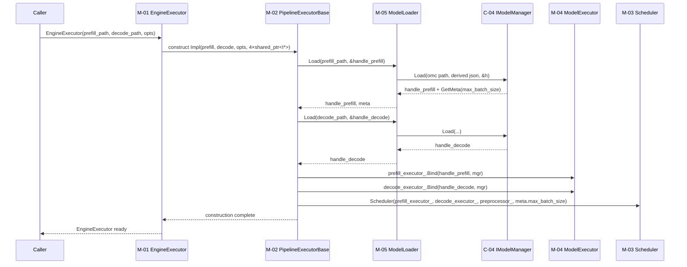
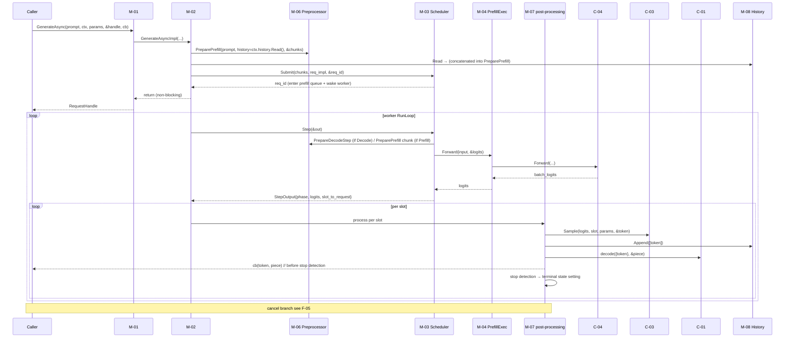
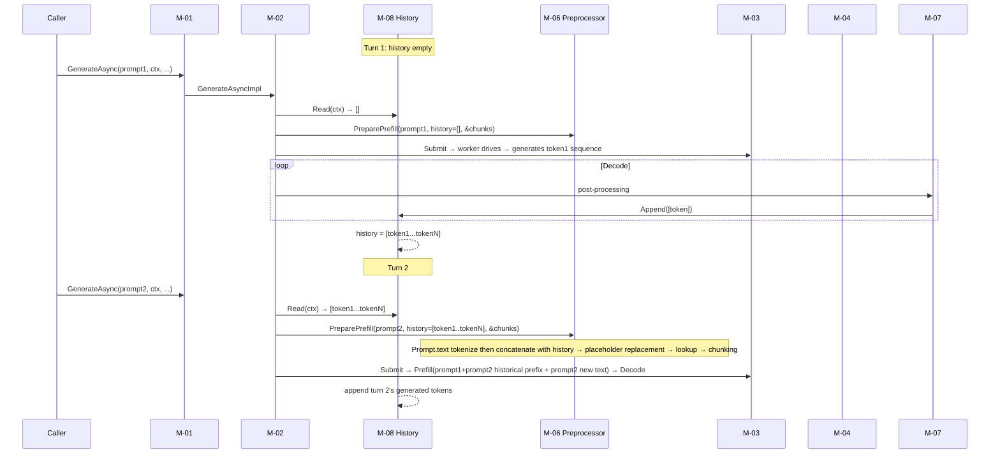

# LLM Autoregressive Inference Engine Design (Rendered View)

English | [简体中文](../../../zh/cann_lm_engine/pipeline+engine_executor/DESIGN.md)

> This file is rendered from `.project/AGENTS/llm_engine/DESIGN/` directory (overview + modules + contracts + flows + nfr + decisions), removing frontmatter, merged into a single reviewable document.
> spec_source: `../SPEC/llm-inference-engine.md` (SR20260806001)
> REQ-* / SCN-* correspond one-to-one with spec `SR20260806001` §4.1 functional groups / §4.3 scenarios. Mapping table:
>
> | Spec functional group (§4.1) | Design REQ ID | | Spec scenario (§4.3) | Design SCN ID |
> |---|---|---|---|---|
> | F-LOAD | REQ-LOAD | | 4.3.1 Single inference | SCN-SINGLE |
> | F-CTX | REQ-CTX | | 4.3.2 Multi-turn continuation | SCN-MULTITURN |
> | F-GEN | REQ-GEN | | 4.3.3 Concurrent requests | SCN-CONCURRENT |
> | F-STAGE | REQ-STAGE | | 4.3.4 Cancel request | SCN-CANCEL |
> | F-STREAM | REQ-STREAM | | | |
> | F-CANCEL | REQ-CANCEL | | | |
> | F-HISTORY | REQ-HISTORY | | | |
> | F-BATCH | REQ-BATCH | | | |
> | F-INPUT | REQ-INPUT | | | |
> | F-API | REQ-API | | | |
> This design synthesizes `llm_engine/docs/01-04` (reviewed and finalized architecture/components/mechanisms/interfaces documents) reorganized into SDD structure.
> 4 Gate human-machine decisions are based on `01-architecture.md §8 architecture trade-off record` (9 decided decisions) and upstream `基础需求和约束 v0.5`, not greenfield open trade-offs.

---

## §1 Scope and Goals

- **In scope**: L1 public API (PIMPL shell), L2 orchestration skeleton (PipelineExecutor), scheduler, Prefill/Decode executors, model loading, preprocessing, post-processing flow, history management, 4 L2→L3 abstract interfaces.
- **Out of scope** (reason C5 boundary discipline): KV Cache management, hardware device abstraction, tensor operator execution, device scheduling — sink to underlying runtime; servitization governance — outer wrapper zero-intrusion implementation.
- **Design goal priority**: low latency (TTFT/TPOT) > high throughput (tokens/sec) > extensible > controllable memory peak.

## §2 Architecture Overview

### §2.1 Architectural Style and Philosophy

```mermaid
graph TB
    L0[L0 Caller] -->|C++ public API| L1[L1 EngineExecutor PIMPL]
    L1 -->|delegate| L2[L2 PipelineExecutorBase orchestration body (autoregressive etc derived + factory)]
    L2 --> M3[Scheduler]
    L2 --> M4[ModelExecutor Prefill/Decode]
    L2 --> M6[Preprocessor]
    L2 --> M7[Post-processing flow]
    L2 --> M8[HistoryPromptManager]
    M5[ModelLoader] --> C4[IModelManager]
    L2 --> C4
    L2 -.factory unique_ptr holds.-> C1[TokenizerBase] & C2[TextEmbedding]
    L2 -.by value.-> C3[Sampler]
    C4 -.shared_ptr injection.-> L3[L3 underlying runtime unaware]
```

Style declaration: **layering + PIMPL interface separation + abstract injection point + serial execution + Continuous Batching data parallel**. Upper layer only calls immediately lower layer; L2 holds only L2→L3 abstract injection point via link-time `CreateModelManager()` factory (backend determined at compile time, D-12); `Tokenizer` (`TokenizerBase` polymorphic base class + factory + BPE/SP derived) / `TextEmbedding` (load+bind) are engine internal modules (M-02 holds TokenizerBase via factory `unique_ptr<TokenizerBase>`, holds TextEmbedding by value, C8 v1.2); `Sampler` is engine internal concrete class (by value); none re-implement underlying, none are underlying injection.

### §2.2 Runtime Architecture

- **Thread model**: user thread (submission-layer concurrent, `GenerateAsync` thread-safe) + worker single thread (execution-layer serial, loops `Scheduler::Step` + post-processing).
- Communication mechanism table:

| Caller | Callee | Communication method | Sync/Async | Notes |
|--------|--------|----------|-----------|------|
| User thread | M-01 | function call | sync | submission-layer concurrent |
| M-01 | M-02 | PIMPL forward | sync | one-way |
| M-02 worker | M-03 | function call `Step` | sync | per iteration |
| M-03 | M-04/M-06 | function call | sync | decision+forward |
| M-02 | M-07/M-08 | function call | sync | per slot post-processing |
| worker | user thread | `StreamCallback` / `RequestHandle` | async | callback triggered in worker |

- Synchronization point: worker and user thread via `RequestImpl` shared state (mutex/atomic), no cross-processor-domain synchronization (pure CPU, unaware of hardware).

### §2.3 Deployment and Hardware Mapping

| Module | Processor | Notes |
|------|--------|------|
| M-01~M-08 | CPU | engine layer unaware of hardware |
| C-04 implementation (IModelManager) | underlying (CPU/accelerator) | provided by underlying runtime, engine accesses via `shared_ptr` injection |
| C-01 (TokenizerBase)/C-02 (TextEmbedding)/C-03 (Sampler) | engine internal | engine self-implements; TokenizerBase via factory unique_ptr, C-02/C-03 by value (C8 v1.2) |

Memory domain: engine layer does not hold device memory; `Tensor` references underlying-owned tensors via `shared_ptr`. No DMA buffer belongs to engine. Power domain N/A (C5).

### §2.4 Concurrency and Thread Safety

- Lock strategy: worker writes `RequestImpl` output fields, user thread reads — via mutex/atomic; `canceled` is atomic; `histories_`/`ContextImpl`/`RequestImpl` registries via mutex.
- Shared resources: `RequestImpl` (worker writes output/user reads status/cancel), `histories_` registry (worker reads/writes/user destroy).
- No NPU/DSP command queue (C5). Lock hierarchy: registry mutex > `RequestImpl` mutex.

## §3 Module List

| ID | Name | One-line responsibility | Dependencies | Details |
|----|------|-----------|------|------|
| M-01 | EngineExecutor | L1 PIMPL shell, forwards public API | M-02 | see §11.1 |
| M-02 | PipelineExecutorBase | L2 orchestration skeleton abstract base class (autoregressive etc derived + factory, constraint #3) | worker drive + post-processing + registries | M-03..M-08, C-01..C-04 | see §11.2 |
| M-03 | Scheduler | Queuing + decode pool + iteration batching + interleaving + cancel | M-04, M-06 | see §11.3 |
| M-04 | ModelExecutor | Forward produces logits (Prefill/Decode two instances) | C-04 | see §11.4 |
| M-05 | ModelLoader | Load thin wrapper, derives json | C-04 | see §11.5 |
| M-06 | Preprocessor | tokenize/concat/placeholder/lookup/chunking | C-01, C-02 | see §11.6 |
| M-07 | Post-processing flow | sample→write history→detokenize→callback→stop | C-03, C-01, M-08 | see §11.7 |
| M-08 | HistoryPromptManager | Token id history isolated per Context | — | see §11.8 |

## §4 Contract List

| ID | Producer | Consumer | One-line contract | Details |
|----|--------|--------|-----------|------|
| C-01 | M-02 (engine internal module) | M-06/M-07 | text↔token id tokenization capability (TokenizerBase polymorphic) | see §12.1 |
| C-02 | M-02 (engine internal module) | M-06 | embedding table loading + binding to model (lookup inside om graph) | see §12.2 |
| C-03 | M-02 (engine internal concrete class) | M-07 | logits+params→token id sampling capability | see §12.3 |
| C-04 | L3 runtime | M-05/M-04 | model loading/forward/release/metadata capability | see §12.4 |
| C-05 | M-03 | M-02 | single iteration forward output (logits+slot mapping) | see §12.5 |

## §5 Key Flow List

| ID | Scenario | Key path | Details |
|----|------|---------|------|
| F-01 | Model loading | M-01→M-05→C-04→M-04 Bind | see §13.1 |
| F-02 | Single async inference | M-02→M-06→M-03→M-04→M-07→callback | see §13.2 |
| F-03 | Multi-turn continuation | M-08 Read→M-06 concat→Prefill→Decode | see §13.3 |
| F-04 | Continuous Batching | M-03 iteration decision→batching/interleaving | see §13.4 |
| F-05 | Cancel | user→RequestImpl.canceled→M-03 exit pool | see §13.5 |

## §6 Quality Attributes and Cross-Cutting Strategies

| Dimension | Core strategy | Details |
|------|---------|------|
| Performance | engine layer overhead <10% end-to-end; scheduling <1%; throughput higher than single-request serial baseline | see §14.1 |
| Security | untrusted Prompt isolation + callback safety constraints | see §14.2 |
| DFX | L1/L2/L3 exception tiering + self-developed logging + runtime counters | see §14.3 |
| Concurrency | submission-layer concurrent/execution-layer serial + registry mutex | see §14.4 |
| Error propagation | `Status` 6 constants coarse-grained + log details | spec §6.1.1 + each module §6 |
| Data consistency | no cross-domain cache (C5), `Tensor` shared pointer reference | §2.3 |

## §7 Decision Index

| ID | Topic | Status |
|----|------|------|
| D-01 | Form: embedded library (not service) | accepted |
| D-02 | Executor serial + batch data parallel | accepted |
| D-03 | Continuous Batching: Prefill independent + Decode multi-batch | accepted |
| D-04 | Prefill/Decode dual independent instances | accepted |
| D-05 | Chunking belongs to Preprocessor | accepted |
| D-06 | Independent HistoryPromptManager | accepted |
| D-07 | `Status` error model (not exception) | accepted |
| D-08 | PIMPL interface separation | accepted |
| D-09 | Tokenizer/TextEmbedding as engine internal modules (polymorphic/load+bind, M-02 holds via factory unique_ptr/by value); Sampler as engine internal concrete class (by value); none are underlying injection (C8 v1.2 corrects v1.1) | accepted (v1.2 revised) |
| D-10 | Pipeline as polymorphic base class + factory (PipelineExecutorBase + AutoregressivePipelineExecutor derived + PipelineExecutorFactory, constraint #3) | accepted |
| D-11 | LifecycleController/ModelLoader already decomposed — M-04 ModelExecutor directly holds Load/Unload/GetMeta control plane (M-05 merged into M-04) | accepted (v0.6) |
| D-12 | Link-time `CreateModelManager()` factory replaces `shared_ptr<IModelManager>` runtime injection (backend determined at compile time) | accepted (v0.6) |

## §8 Code Plan Hints

- **Implementation order** (dependency topology): C-04 interface contract + C-01 TokenizerBase/factory + C-02/C-03 → M-08 (no dependency) → M-04→M-05→C-04 → M-06→C-01/C-02 → M-03→M-04/M-06 → M-07→C-03/M-08 → M-02→all L2 → M-01→M-02.
- **Minimum file set**: implement M-NN → read M-NN.md + its depends_on modules + involved C-* contracts + involved F-* flows.
- **Parallelizable**: C-04 interface + C-01 TokenizerBase/factory + C-02/C-03 definitions; M-08 and M-04/M-05.
- **Must be serial**: M-03 depends on M-04/M-06; M-02 depends on all L2; M-01 depends on M-02.
- **Integration milestones**: ① M-04+C-04 mock runs fake forward; ② M-03+M-06 runs single-request prefill→decode; ③ M-02+M-07 runs streaming+stop; ④ M-02 multi-request Continuous Batching; ⑤ M-01 PIMPL public API links `api_smoke`.

## §9 Risks and Open Issues

| Risk | Impact | Mitigation | Trigger condition |
|------|------|------|----------|
| TTFT/TPOT absolute value not bound | Performance acceptance lacks absolute baseline | supplemented with measured at integration benchmark stage | pending reference hardware + model scale |
| Chunked Prefill chunking mechanism undecided (token-level vs tensor slice) | M-06 implementation path branches | inclination token-level maintains C5; D-05 review | if tensor slice needed then triggers C5 boundary |
| Streaming detokenize buffer/stop string hit buffer retention undecided | M-07 output correctness | inclination not leak stop marker | measure stop string scenario |
| HistoryPromptManager truncation/KV alignment undecided | overlong history correctness | currently not supported, reserve extension point | long dialogue scenario |
| worker wake/sync primitive selection undecided | M-02 implementation details | condvar inclination | implementation period |

## §10 Change Log

| Version | Date | Change | Triggering spec section |
|------|------|------|----------------|
| 0.1.0 | 2026-08-06 | Initial version: synthesizes 01-04 reorganized into SDD design directory. 8 modules + 5 contracts + 5 flows + 4 NFR + 9 decisions. Gate 1-4 auto-confirmed per 01 §8 decided decisions. | spec §4-§8 all |
| 0.1.1 | 2026-08-06 | Audit fixes: 3 dimensionless word quantifications; 22 sub-files added spec_id+level frontmatter; added gate_history; performance §1 added 5% budget row. Audit conclusion CONDITIONAL_PASS (0 critical). | audit feedback |
| 0.1.2 | 2026-08-06 | Fine-tuning wrap-up: F-01 mermaid added M-03 participant declaration; overview added REQ/SCN ↔ spec functional group formal cross-reference table. 0 blocking items remaining. | audit minor |
| 0.2.0 | 2026-08-13 | C8 v1.1 architecture convergence: `IModelManager` retained as only L2→L3 abstract interface (injection point, `shared_ptr`); `Tokenizer`/`TextEmbedding`/`Sampler` demoted to L2 internal concrete classes (remove `I` prefix, no virtual functions, M-02 holds by value, constructible from test data). Synchronized: §2 style+mermaid, §4 contract list producer column, §7/§15 D-09 reversal, §11.2 M-02 holding/constructor signature/test hooks, §11.6 M-06 non-owning pointer, §11.7 M-07, §12.1-12.3 contracts rewritten as concrete classes, §12.4 marks only injection point, §14 holding table. Linked spec §3.3/§5 NFR/§6.1/§6.3. | spec §3.3/§5/§6.1/§6.3 + C8 |
| 0.3.0 | 2026-08-13 | C8 v1.2 reconciliation (fix v1.1 overshoot + write back model_executor C3): Tokenizer re-promoted to engine internal polymorphic module (`ITokenizer` base class + `TokenizerFactory` + BPE/SP derived self-registration, per `docs/tokenizer/`), M-02 holds via factory `unique_ptr`, M-06/M-07 via non-owning `ITokenizer*`; TextEmbedding re-defined as engine internal embedding module (load table + bind model, per `model_executor` §4.1.1; tokenId lookup inside om graph, not lookup-produced tensor); Sampler kept as engine internal concrete class (no polymorphism requirement). Write back C3: §11.4 M-04 changed to forward shell + KV ringBuffer cursor + load/unload/LoRA delegation, decode batch pad to max_batch_size (attentionMask shields), §11.3/§6.1 corrected "no padding". Synchronized: §2 mermaid/style/§2.3, §4 contract list, §7/§15 D-09, §11.2 M-02 ctor/holding/test hooks, §11.6 M-06 ITokenizer*, §11.7 M-07, §12.1-12.4 contracts. Linked spec §3.3/§5 NFR/§6.1/§6.3, 基础 v0.7. | spec §3.3/§5/§6.1/§6.3 + C8 + C3(model_executor) |
| 0.4.0 | 2026-08-13 | Source constraint revision (#1/#2/#3): ① #1 Tokenizer error unified — remove module's own `TokenizerError`, encode/decode/batch_encode/create uniformly return project `Status` (OOV internally maps unk→SUCCESS); ② #2 polymorphic base class `ITokenizer`→`TokenizerBase` (Base suffix replaces I prefix), BPE/SP derived + factory + Registrar synchronized; ③ #3 PipelineExecutor itself polymorphized — add abstract base class `PipelineExecutorBase` + `PipelineExecutorFactory` + `PipelineType` enum, current PipelineExecutor renamed `AutoregressivePipelineExecutor` (autoregressive, currently only derived), reserves extension point for non-autoregressive etc pipelines. Synchronized: §2 mermaid, §3 module list M-02, §7 D-10, §11.2 M-02 base class + factory + derived, §12.1 C-01 contract. Linked spec §3.3/§5 NFR/§6.1, 基础 v0.8. | constraint #1/#2/#3 + linked spec/基础 |
| 0.5.0 | 2026-08-19 | ModelExecutor architecture refactor: M-04 upgraded to forward shell + control plane (Load/Unload/GetMeta directly exposed, calls link-time CreateModelManager() to self-hold owned IModelManager); M-05 ModelLoader responsibility merged into M-04 (decomposed); §11.4 rewritten, §11.5 marked [decomposed v0.5]. Linked model_executor DESIGN v0.5. | model_executor DESIGN + C3 |
| 0.6.0 | 2026-08-19 | Hard cut v0.6: remove shared_ptr<IModelManager> runtime injection — PipelineExecutorFactory::create / AutoregressivePipelineExecutor ctor no longer accepts shared_ptr<IModelManager>; ModelExecutor::Load self-calls link-time CreateModelManager() to create owned MM (D-12). M-05 ModelLoader decomposition confirmed (D-11). §2/§11.2/§11.4/§11.5/§12.4 synchronized update. Linked 基础 v0.11. | D-11/D-12 + 基础 v0.11 |

---

## §11 Module Details

### §11.1 M-01 EngineExecutor

**Responsibility**: L1 public API's PIMPL shell, forwards public API, zero business logic. Construction period validates load sources (path/buffer, prefill+decode each one artifact) and hands to M-02. Non-copyable, movable; after move original object set to empty. public header does not expose any internal types (C6).

**External interface**:
```cpp
EngineExecutor(const ModelArtifactPath& prefill, const ModelArtifactPath& decode, const EngineOptions& = {});
EngineExecutor(const ModelArtifact& prefill, const ModelArtifact& decode, const EngineOptions& = {});
Status CreateContext(Context* out);
Status DestroyContext(ContextId);
Status ConfigureContext(ContextId, /* fields pending */);
Status CancelContext(ContextId);
Status Generate(const Prompt&, const Context&, const SamplingParams&, Result* out);
Status GenerateAsync(const Prompt&, const Context&, const SamplingParams&, RequestHandle* out, StreamCallback = {});
```
Semantics: construction-period loading (one-time, does not support hot-loading); Generate = GenerateAsync(empty callback)+Wait; same Context concurrent returns INVALID_STATE.
Errors: construction load failure → FAILURE; Context not exists → NOT_FOUND; same Context concurrent → INVALID_STATE.

**Internal structure**: `std::unique_ptr<Impl> impl_`, `Impl` is M-02 (04 §17). No other state — runtime state all in M-02. Invariant: residual Context/RequestHandle use after this object destructs → INVALID_STATE.

**Key dependencies and hardware contracts**: only one-way delegates to M-02 (L1→L2). Handle internal `shared_ptr` back-references M-02-held `ContextImpl`/`RequestImpl`. No hardware dependency (C5). No DMA/cross-domain.

**Performance budget**:

| Path | Budget | Measurement condition | Source |
|---|---|---|---|
| PIMPL forwarding overhead | <0.1% end-to-end | single API call | estimated |

**Failure modes**:

| Failure | Trigger | Detection | Handling |
|---|---|---|---|
| Load failure | artifact not exists/corrupted | construction period | throw construction failure (no partial resource leak) |
| Handle dangling use | after EngineExecutor destructs | runtime | return INVALID_STATE |

**Observability points**: log key: `engine.init`, `engine.context.create/destroy`; metric: cumulative CreateContext count.

**Test hooks**: PIMPL forwarding verifiable with M-02 mock; public type list does not expose internal types (compile-time assertion). `api_smoke` executable validates public API surface linkage.

### §11.2 M-02 PipelineExecutorBase (+ AutoregressivePipelineExecutor + PipelineExecutorFactory)

**Responsibility**: M-01's PIMPL impl, L2 only orchestration body (abstract base class PipelineExecutorBase; autoregressive is currently only derived, constructed via PipelineExecutorFactory, constraint #3). Forwards public API impl; owns worker thread loop driving M-03::Step + post-processing (M-07); holds all shared components and L2 modules; owns ContextImpl/RequestImpl/HistoryPromptManager registries; holds engine internal modules TokenizerBase (via factory `unique_ptr`) / TextEmbedding (by value, load+bind) / Sampler (by value, concrete class); L2→L3 injection via link-time `CreateModelManager()` factory (D-12, ModelExecutor::Load self-calls, owned MM).

**External interface**:
```cpp
class PipelineExecutorBase {   // abstract base class (constraint #3): each derived pipeline implements this set of virtual functions
public:
  virtual ~PipelineExecutorBase() = default;
  virtual Status CreateContext(Context* out) = 0;
  virtual Status DestroyContext(ContextId) = 0;
  virtual Status ConfigureContext(ContextId, const ContextOptions&) = 0;
  virtual Status CancelContext(ContextId) = 0;
  virtual Status Generate(const Prompt&, const Context&, const SamplingParams&, Result* out) = 0;
  virtual Status GenerateAsync(const Prompt&, const Context&, const SamplingParams&, RequestHandle* out, StreamCallback) = 0;
};
class PipelineExecutorFactory {   // factory (constraint #3): selects derived construction by PipelineType
public:
  static Status create(PipelineType, const ModelArtifactPath&/const ModelArtifact& prefill, decode,
                       const EngineOptions&, std::unique_ptr<TokenizerBase> tokenizer,
                       TextEmbedding, Sampler,
                       std::unique_ptr<PipelineExecutorBase>* out);
};
class AutoregressivePipelineExecutor final : public PipelineExecutorBase {   // autoregressive derived (currently only)
  AutoregressivePipelineExecutor(const ModelArtifactPath&/const ModelArtifact& prefill, decode, const EngineOptions&,
                 std::unique_ptr<TokenizerBase> tokenizer, TextEmbedding text_embedding, Sampler sampler);
  // ...override all virtual functions; RunLoop(): M-03.Step(&out) → INVALID_STATE sleep; otherwise per slot post-processing (M-07)
};
```
Semantics: worker single thread; GenerateAsync non-blocking (returns after Submit wakes worker). Same Context concurrent → INVALID_STATE.
Errors: each stage failure maps FAILURE; Context not exists → NOT_FOUND.

**Internal structure**:
- Engine internal modules: `tokenizer_` (`unique_ptr<TokenizerBase>`, factory product) / `text_embedding_` (by value, load+bind) / `sampler_` (by value, concrete class); L2→L3 injection via link-time `CreateModelManager()` factory (D-12, ModelExecutor::Load self-calls to create owned MM, backend determined at compile time).
- L2 members: `prefill_executor_/decode_executor_/preprocessor_/scheduler_` (M-05 ModelLoader decomposed v0.5, responsibility merged into M-04, D-11).
- Registries: `histories_`(map<ContextId, shared_ptr<HistoryPromptManager>>) mutex; ContextImpl registry mutex; RequestImpl registry (shared by M-03/M-07/RequestHandle).
- worker: `std::thread worker_` + `std::atomic<bool> stop_` + condvar wake (selection see §9 risk).
- Destruction order: stop_=true→wake→join→M-04 destruct calls C-04::Release→release registries.

**Key dependencies and hardware contracts**: holds C-01 (`unique_ptr<TokenizerBase>`, factory) / C-02 (by value, load+bind) / C-03 (by value, concrete class) + C-04 `shared_ptr` (only L2→L3 injection point, 01 §7.2). C-04::Forward sinks concatenation/KV tensor memory to underlying (C5; KV ringBuffer cursor belongs to M-04, see §11.4). No hardware awareness. fake logits injected via mock C-04; TokenizerBase constructed via factory, C-02/C-03 constructed from test data (NFR-015/TC_NFR_001).

**Performance budget**:

| Path | Budget | Measurement condition | Source |
|---|---|---|---|
| Post-processing per slot (sample+write history+detokenize+callback+stop) | within engine layer <10% proportion | per iteration per slot | estimated |
| worker scheduling loop (Step+post-processing orchestration) | <1% end-to-end | per iteration | estimated |

**Failure modes**:

| Failure | Trigger | Detection | Handling |
|---|---|---|---|
| Same Context concurrent | state conflict | runtime check | INVALID_STATE |
| worker exception | underlying unrecoverable | exception log | request set Failed |
| Destruction race | residual handle after stop_ | destruction order | INVALID_STATE |

**Observability points**: log key: `pipeline.submit`, `pipeline.step`, `pipeline.postprocess`, `phase.switch`; metric: per-stage queue depth, worker idle/sleep count.

**Test hooks**: mock C-04 injection + TokenizerBase constructed via factory (BPE/SP stub injectable) / C-02/C-03 constructed from test data; M-03/M-07 independently instantiable; fake logits tests scheduling+post-processing chain.

### §11.3 M-03 Scheduler

**Responsibility**: L2 core component. FIFO task queuing, decode pool management (capacity=`max_batch_size`), iteration-level batching decision, Prefill/Decode interleaving (Prefill first when empty slot), cancel marking and exit. Does not do preprocessing chaining/chunking/sampling/detokenize/history/stop (belongs to M-06/M-07/M-02). Does not self-drive cross-stage — driven by M-02 worker loop calling `Step`.

**External interface**:
```cpp
Scheduler(ModelExecutor* prefill_executor, ModelExecutor* decode_executor, Preprocessor* preprocessor, int max_batch_size);
Status Submit(vector<shared_ptr<Tensor>> prefill_chunks, shared_ptr<RequestImpl> req, RequestId* out);
Status Step(StepOutput* out);   // decision+forward+slot mapping; no active task returns INVALID_STATE
Status Cancel(RequestId);
Status CancelContext(ContextId);
int ActiveDecodeCount()/PendingPrefillCount()/DecodeCapacity() const noexcept;
```
Semantics: Submit builds PrefillTask enters prefill queue + wakes worker. Step decision per iteration (see Step decision pseudocode). Errors: no active task → INVALID_STATE (worker sleeps); Cancel not exists → NOT_FOUND.

**Internal structure**:

| Data structure | Type | Purpose |
|---|---|---|
| prefill queue | `std::deque<PrefillTask>` | FIFO, chunk sequential consumption |
| decode pool | `vector<optional<RequestId>>` (size=max_batch_size) | active decode per slot occupation |
| pending decode queue | `std::deque<RequestId>` | prefill completed pending pool entry |
| RequestId→RequestImpl | `unordered_map` | shared state O(1) |
| cancel marker | reuse `RequestImpl::canceled` (atomic) | no separate cancel set |

Invariants: active ≤ max_batch_size; **no variable padding** (not padded to longest within batch, each request KV independent, requirement #3); decode om graph batch dimension fixed = `max_batch_size`, when active not full this module pads to `max_batch_size` (attentionMask shields, see §11.4 / model_executor §1), prefill om fixed batch=1 no padding; same request at same time only in one queue (reflected by `RequestImpl::status`).

Step decision pseudocode (from 03 §4):
```
1. Cleanup terminal/cancel (release slot) → backfill from pending
2. No active task → INVALID_STATE
3. Has empty slot + pending prefill non-empty → run one Prefill(batch=1) → task chunks exhausted then migrate to pending
4. Otherwise → Decode batch=N (each active last token via M-06.PrepareDecodeStep) → fill StepOutput
```

**Key dependencies and hardware contracts**: holds M-04*/M-06* pointers (M-02 owns, M-03 orchestrates). Forward delegates to C-04::Forward. No hardware awareness.

**Performance budget**:

| Path | Budget | Measurement condition | Source |
|---|---|---|---|
| Single Step decision (excluding forward) | <1% end-to-end | per iteration | estimated |
| Batching/interleaving decision | <0.1% end-to-end (pure decision, excluding forward) | per iteration | estimated |

**Failure modes**:

| Failure | Trigger | Detection | Handling |
|---|---|---|---|
| Forward failure | C-04 failure | Step return | maps FAILURE, request Failed |
| Pool full | active=N | Step decision | pending queue (not error) |

**Observability points**: metric: ActiveDecodeCount, PendingPrefillCount, DecodeCapacity, cumulative submissions, cumulative cancels, queue depth.

**Test hooks**: M-04 mock returns fake logits tests batching/interleaving/exit logic; decode pool capacity boundary tests (N=1/full/over-limit).

### §11.4 M-04 ModelExecutor

**Responsibility**: Forward shell (assembles inputs + delegates to underlying forward + produces logits) + KV Cache ringBuffer cursor management (pos/offset/cursor, per-sequence) + control plane Load/Unload/GetMeta (v0.5 merges M-05, directly exposed to pipelineExecutor; specific implementation in ModelManager, this module delegates). Does not do sampling (C-03), tensor memory allocation/release (belongs to `TensorManager`), built-in request-level concurrency (C4 serial). Batch dimension data parallel: PrefillExecutor om fixed batch=1 (no padding), DecodeExecutor om fixed batch=`max_batch_size` (when active not full pad to max_batch_size, attentionMask shields). PrefillExecutor and DecodeExecutor are **two instances of same class** (not subclasses), share same KV Cache pool, zero-copy, difference only in bound handle (prefill om / decode om).

**External interface**:
```cpp
ModelExecutor(std::shared_ptr<KvCachePool> pool,
              std::shared_ptr<InputAssembler> asm_,
              std::shared_ptr<DfxCollector> dfx);
Status AttachPool(std::shared_ptr<KvCachePool> pool);
Status AttachAssembler(std::shared_ptr<InputAssembler> asm_);
Status Load(const ModelArtifactPath&/const ModelArtifact& artifact, ModelMetaInfo* out_meta);  // calls CreateModelManager()
Status Unload();
Status GetMeta(ModelMetaInfo* out) const;
Status Forward(const shared_ptr<Tensor>* inputs, size_t count,
              const ForwardOptions& opts, shared_ptr<Tensor>* out_logits);
ModelHandle Handle() const noexcept;
explicit operator bool() const noexcept;  // Loaded and pool/asm ready
```
Semantics: Load calls link-time `CreateModelManager()` to create owned MM (D-12); Forward delegates to owned MM::Forward; serial (forward_mutex_), one batch at a time, caller (M-03) guarantees non-reentrancy. Errors: CreateModelManager() returns empty→FAILURE; C-04 failure → FAILURE; not Loaded → INVALID_STATE.

**Internal structure**: `ModelHandle handle_` + `unique_ptr<IModelManager> mm_` (created and held at Load time via CreateModelManager()) + `shared_ptr<KvCachePool> pool_` + `shared_ptr<InputAssembler> asm_` + `shared_ptr<DfxCollector> dfx_` + `ModelMetaInfo meta_` + KV ringBuffer cursor state. RAII: destructor calls owned MM::Release. Non-copyable, movable. Two instances share same KV Cache pool (zero-copy), difference only handle (prefill om / decode om); weight sharing deduplicated by ModelManager.

**Key dependencies and hardware contracts**: owned MM::Forward sinks tensor concatenation/batch concatenation/KV tensor memory to underlying (C5); **KV ringBuffer cursor management belongs to this module** (not underlying). Engine layer only receives batched logits by slot order. Load/Unload/GetMeta delegates to owned MM (created via link-time CreateModelManager()). No hardware awareness. No DMA/cross-domain.

**Performance budget**:

| Path | Budget | Measurement condition | Source |
|---|---|---|---|
| Forward (excluding underlying operators) | <0.1% end-to-end (non-critical path, only function forwarding) | single forward | estimated |

**Failure modes**:

| Failure | Trigger | Detection | Handling |
|---|---|---|---|
| Forward without Load | state conflict | operator bool validation | INVALID_STATE |
| Underlying forward failure | C-04 returns failure | Forward return | FAILURE (mapped) |

**Observability points**: log key: `executor.forward`, `executor.bind`, `executor.release`.

**Test hooks**: stub CreateModelManager() returns nullptr → Load::FAILURE; two instances isolation test; weight deduplication verified by owned MM; KV cursor advance/reuse independently testable; decode padding (pad to max_batch_size + attentionMask shields) cases.

### §11.5 M-05 ModelLoader `[Decomposed v0.5→v0.6]`

**Responsibility**: **Already decomposed** (D-11). M-05 ModelLoader's responsibility (path mode derives omc same-name json → calls C-04::Load → returns ModelHandle) has been merged into M-04 ModelExecutor::Load (v0.5). This section retained as historical index.

> Historical interface (v0.4 and before): `explicit ModelLoader(shared_ptr<IModelManager> mgr)` + `Load(ModelArtifactPath/ModelArtifact, ModelHandle*)`. From v0.5 replaced by M-04 `ModelExecutor::Load`, no longer injects shared_ptr (D-12).

### §11.6 M-06 Preprocessor

**Responsibility**: Single responsibility coordinates preprocessing chain (requirement #7): tokenize → concatenate history → placeholder positioning → chunking (tokenId→vector lookup inside om graph forward, not Preprocessor calls TextEmbedding lookup, C8 v1.2 per model_executor §4.1.1). Stateless (each call pure function semantics, history passed by caller, convenient for mock injection). Does not do scheduling/cross-stage self-drive; does not exclusively hold C-01/C-02 (receives via non-owning pointers `TokenizerBase*`/`TextEmbedding*`, TokenizerBase held by M-02 via factory unique_ptr, TextEmbedding load+bind by M-02 init, multi-stage reuse, C8 v1.2).

**External interface**:
```cpp
Preprocessor(TokenizerBase* tokenizer, TextEmbedding* text_embedding, int default_chunk_size);
Status PreparePrefill(const Prompt& prompt, const vector<TokenId>& history, vector<shared_ptr<Tensor>>* out_chunks);
Status PrepareDecodeStep(TokenId id, shared_ptr<Tensor>* out_input);
```
Semantics: PreparePrefill full chain (tokenize Prompt.text→concatenate history→placeholder positioning→chunking; tokenId→vector lookup inside om graph forward) produces multi-chunk input; PrepareDecodeStep fast path single token→input tensor. Errors: tokenize/placeholder mismatch → FAILURE.

**Internal structure**: `TokenizerBase* tokenizer_` (non-owning) + `TextEmbedding* text_embedding_` (non-owning) + `int default_chunk_size_`. Placeholder ↔ embedding order mapping: by Prompt.embeddings array order ↔ placeholder appearance order (regardless of ModalityTag, requirement #1).

**Key dependencies and hardware contracts**: C-01::TokenizerBase::encode (preprocessing tokenize + post-processing detokenize reuse, polymorphic dispatch BPE/SP); C-02::LoadAndBind (M-02 init period loads table + binds model; tokenId lookup inside om graph). TokenizerBase held by M-02 via factory unique_ptr, M-06 accesses via non-owning pointer (multi-stage reuse, C8 v1.2). Chunking mechanism TBD (token-level chunk-then-embed vs tensor slice; inclination former maintains C5, see §9 risk).

**Performance budget**:

| Path | Budget | Measurement condition | Source |
|---|---|---|---|
| Single chunk preprocessing | <5% of that chunk's forward time | per chunk | estimated |
| PrepareDecodeStep | <0.1% end-to-end (single token lookup, excluding forward) | per step | estimated |

**Failure modes**:

| Failure | Trigger | Detection | Handling |
|---|---|---|---|
| tokenize failure | C-01 returns failure | PreparePrefill | FAILURE |
| Placeholder/embedding count inconsistent | validation | PreparePrefill | FAILURE |

**Observability points**: log key: `preprocess.prefill`, `preprocess.decode_step`, `preprocess.chunk`; metric: prefill chunk count, average chunk size.

**Test hooks**: stateless → can be independently instantiated, inject factory-constructed TokenizerBase stub + test-data-constructed C-02 tests full chain; placeholder order mapping cases (multimodal + pure text).

### §11.7 M-07 Post-processing Flow (sample+detokenize+stop)

**Responsibility**: Controlled by M-02 (not independent class): logits → sample → write history → detokenize → StreamCallback → stop detection. Reuses C-03 (Sampler, M-02 holds by value concrete class) / C-01 (TokenizerBase, non-owning pointer, polymorphic dispatch BPE/SP), no independent persistent state (C8 v1.2). Streaming detokenize buffer is per-request local state.

**External interface**: (called by M-02 per slot, no independent public interface)
```
Per slot: C-03::Sample(batch_logits, slot, params, *token) → RequestImpl.token_ids += [token] → M-08.Append → C-01->decode({token}, opts, &piece) → streaming callback → stop detection → terminal state setting
```
Errors: sampling failure → FAILURE/INVALID_ARGUMENT; detokenize invalid token → FAILURE.

**Internal structure**: Streaming detokenize buffer: per-request local (lifecycle=single request), multiple tokens compose complete character/word to boundary before output. No cross-request shared state.

Per slot processing (from 03 §6 pseudocode):
```
if req.canceled: req.status=Canceled; continue   # partial discard
token = C-03.Sample(logits, slot, params)         # not history-aware
req.token_ids.append(token); M-08[ctx].Append([token])
text_piece = C-01->decode({token}, opts, &text_piece); req.text_buffer += text_piece   # TokenizerBase polymorphic dispatch (C8 v1.2)
if stop_token hit: finish=StopToken; status=Completed   # inclination not callback
elif stop_string hit: finish=StopString; status=Completed  # inclination not callback, text removes stop part
else: callback(token, text_piece); req.last_token=token
if token_ids.size()==max_tokens: finish=MaxTokens; status=Completed
```

**Key dependencies and hardware contracts**: C-03::Sample only receives current step logits + params (does not read M-08, so penalty-type not supported, requirement #8). C-01::TokenizerBase::decode streaming increment (polymorphic dispatch BPE/SP). StreamCallback trigger point: after detokenize, before stop detection; the step that hits stop string inclination not callback (avoid leaking stop marker, pending see §9).

**Performance budget**:

| Path | Budget | Measurement condition | Source |
|---|---|---|---|
| Sample + write history + detokenize + callback + stop (per slot) | within engine layer <10% proportion | per slot | estimated |

**Failure modes**:

| Failure | Trigger | Detection | Handling |
|---|---|---|---|
| Invalid sampling parameters/shape abnormal | C-03 returns | Sample | FAILURE/INVALID_ARGUMENT |
| detokenize invalid token | C-01 returns | TokenizerBase::decode | FAILURE |

**Observability points**: log key: `postprocess.sample`, `postprocess.stop`; metric: terminal state distribution (MaxTokens/StopToken/StopString/Canceled/Failed), callback trigger count.

**Test hooks**: fake logits (mock C-04) + factory-constructed TokenizerBase stub + test-data-constructed C-03 tests stop detection/streaming buffer/cancel discard/Failed fills partial. Unsupported item validation: Beam search/n>1/logprobs/penalty rejection or empty.

### §11.8 M-08 HistoryPromptManager

**Responsibility**: Independent module (requirement #9), isolated per ContextId (one instance per Context). Manages token id history (not text), for next-turn prefill concatenation; avoids repeated tokenize and tokenizer non-bijective loss. Write subject is M-02 (after each Decode step), user unaware.

**External interface**:
```cpp
Status Append(const std::vector<TokenId>& ids);
Status Read(std::vector<TokenId>* out) const;
Status Clear();
size_t Size() const noexcept;
```
Semantics: Append appends this turn's generated tokens; Read gets history for next-turn prefill concatenation; Clear for DestroyContext. Errors: underlying failure maps FAILURE (actually memory operation, rarely fails).

**Internal structure**: `std::vector<TokenId> history_`, held by value, grows across turns (C3 large objects held by value; move semantics transfer). Non-copyable shared (each Context independent instance).

**Key dependencies and hardware contracts**: No lower-layer dependency (pure memory). M-02 holds `map<ContextId, shared_ptr<HistoryPromptManager>>` registry. Truncation/sliding window/KV length alignment strategy TBD (currently not supported, reserve extension point, see §9 risk).

**Performance budget**:

| Path | Budget | Measurement condition | Source |
|---|---|---|---|
| Append/Read | <0.1% end-to-end (non-critical path, pure memory operation) | per step/per turn | estimated |

**Failure modes**:

| Failure | Trigger | Detection | Handling |
|---|---|---|---|
| Overlong history not truncated | overlong dialogue | Size validation | pending truncation strategy (currently not supported, reserve extension point) |

**Observability points**: metric: each Context history length (Size), cumulative Append count.

**Test hooks**: independently instantiable tests Append/Read/Clear isolation; multi-Context no cross-talk validation.

---

## §12 Contract Details

### §12.1 C-01 Tokenizer (engine internal polymorphic module, C8 v1.2)

**One-line contract**: engine internal tokenizer module (`cann_lm/engine/core/tokenizer`, see `docs/tokenizer/`) provides text↔token id tokenization capability to M-06 (encode)/M-07 (decode). Polymorphic base class `TokenizerBase` + `TokenizerFactory` + BPE/SentencePiece derived (self-registration); engine internal, not underlying injection (C8 v1.2, corrects v1.1's concrete class mechanism; constraint #1/#2: error unified Status + base class name TokenizerBase replaces ITokenizer; IModelManager remains only L2→L3 injection point).

**Data schema**:
```cpp
enum class Algorithm { BPE, SentencePieceUnigram };
// Error unification (constraint #1): does not return module's own error codes, uniformly uses project Status (infra/status.h)
struct EncodeOptions { bool add_special_tokens; std::optional<size_t> max_length;
                       enum class Padding { None, Longest, Fixed } padding; ... };
struct DecodeOptions { bool skip_special_tokens; };
class TokenizerBase {   // polymorphic base class (constraint #2, replaces ITokenizer)
public:
  virtual ~TokenizerBase() = default;
  virtual Status encode(std::string_view, const EncodeOptions&, std::vector<int>* out_ids) = 0;
  virtual Status decode(const std::vector<int>&, const DecodeOptions&, std::string* out_text) = 0;
  virtual size_t vocab_size() const = 0;
  virtual std::optional<int> special_token_id(std::string_view) const = 0;
  virtual Status batch_encode(...) ;  // default implementation
};
class TokenizerFactory {
public:
  static Status create(Algorithm, const LoadParams&, std::unique_ptr<TokenizerBase>* out);
  static std::vector<Algorithm> list_registered();
};
class BpeTokenizer final : public TokenizerBase { ... };            // M-03
class SentencePieceTokenizer final : public TokenizerBase { ... }; // M-04
```
Note: error unification (constraint #1) — tokenizer does not return module's own error codes, uniformly uses project `Status` (infra/status.h); out-of-vocabulary (OOV) not failure, internally maps unk then returns `Status::SUCCESS`. Adaptation with pipeline layer `TokenId` (int↔TokenId) done in Preprocessor.

**Timing and sync semantics**: synchronous call. M-02 holds via `TokenizerFactory::create(Algorithm, LoadParams)` returning `std::unique_ptr<TokenizerBase>`; M-06/M-07 access via non-owning `TokenizerBase*` (multi-stage reuse: preprocessing tokenize + post-processing detokenize). Multi-algorithm polymorphic dispatch (BPE/SentencePiece). Self-registration via `REGISTER_TOKENIZER` macro (static initialization period, SIOF backstopped by create assertion).

**Error contract**:

| Error | Who throws | Who handles | Recoverable |
|---|---|---|---|
| tokenize failure/invalid UTF-8 | TokenizerBase derived | M-06/M-07 | returns `Status::INVALID_ARGUMENT` (details via logs) |
| Out-of-vocabulary | TokenizerBase derived | M-06/M-07 | internally maps unk, returns `Status::SUCCESS` (not failure) |
| Algorithm unregistered/load failure | TokenizerFactory | M-02 | returns `Status::INVALID_ARGUMENT` (unknown algorithm) / `Status::FAILURE` (load failure) |

**Version evolution rules**: new derived algorithms self-register via `REGISTER_TOKENIZER` macro (open-closed, does not modify factory); `Algorithm` enum value addition forward compatible; `EncodeOptions`/`DecodeOptions`/`LoadParams` field additions with defaults forward compatible. Modifying virtual function signatures must bump major.

### §12.2 C-02 TextEmbedding (engine internal embedding module, C8 v1.2)

**One-line contract**: engine internal embedding module, called by M-02 to load embedding table and bind to model (per `model_executor` §4.1.1); **tokenId path lookup is done inside om graph forward** (not this module produces tensor). Engine internal, not underlying injection (C8 v1.2, corrects v1.1's "lookup-produced tensor" mechanism).

**Data schema**:
```cpp
struct ModalityEntry {
  size_t                  position;    // placeholder index in token sequence (Preprocessor placeholder positioning use)
  std::shared_ptr<Tensor> embedding;  // corresponding multimodal embedding (from Prompt, pre-computed)
};
class TextEmbedding {
public:
  TextEmbedding() = default;
  // loads embedding table and binds to model handle (M-02 calls during init; model_executor §4.1.1)
  // real signature (model handle / table data source) deferred, pending embedding module DESIGN (no independent docs/embedding/ yet)
  Status LoadAndBind();
};
```

**Timing and sync semantics**: synchronous call. M-02 holds by value; M-02 calls `LoadAndBind` during init (loads table + binds model). Per-request lookup not in this module (om graph forward internal lookup by tokenId). Multimodal placeholder positioning by Preprocessor using `ModalityEntry` (embedding from Prompt).

**Error contract**:

| Error | Who throws | Who handles | Recoverable |
|---|---|---|---|
| Table loading/binding failure | TextEmbedding | M-02 (init) | LoadFailed maps FAILURE |

**Version evolution rules**: `ModalityEntry` field additions forward compatible. Polymorphism (`ITextEmbedding` base class + derived) pending `docs/embedding/` DESIGN (model_executor mentions `ITextEmbedding`, no independent module document yet; v1.2 temporarily lands as concrete class + load+bind).

### §12.3 C-03 Sampler (engine internal concrete class, C8 v1.2)

**One-line contract**: M-02 provides logits + sampling parameters → token id sampling capability to M-07. Engine internal concrete class (no sibling module document, no polymorphism requirement, C8 v1.2); stateless (not history-aware); constructible from test data.

**Data schema**:
```cpp
struct SamplingParams {
  int max_tokens;
  std::vector<TokenId> stop_token_ids;
  std::vector<std::string> stop_strings;
  // Note: does not support beam search/n>1/logprobs/penalty (requirement #8), fields do not appear
};
class Sampler {
public:
  Sampler() = default;
  Status Sample(const std::shared_ptr<Tensor>& batch_logits, int slot,
               const SamplingParams& params, TokenId* out);
};
```

**Timing and sync semantics**: synchronous call. M-02 holds by value, M-07 accesses via non-owning pointer (C8 v1.2). **Key constraint (requirement #8)**: Sample only receives current step logits + params, **does not read history** — therefore does not support logit bias / frequency penalty / presence penalty and other features requiring history input. Multi-token candidates (n>1)/logprobs not in interface.

**Error contract**:

| Error | Who throws | Who handles | Recoverable |
|---|---|---|---|
| Invalid sampling parameters/shape abnormal | Sampler | M-07 | INVALID_ARGUMENT / FAILURE |

**Version evolution rules**: `SamplingParams` new fields forward compatible; support for unsupported feature types must be via new methods or upper-layer wrapper, must not change Sample semantics.

### §12.4 C-04 IModelManager (only L2→L3 injection point, C8 v1.2)

**One-line contract**: L3 runtime provides model loading/forward/release/metadata capability to M-05 (Load)/M-04 (Forward). C-04 is the **only retained L2→L3 abstract interface after C8 v1.2** (injection point); sinks tensor concatenation/batch concatenation/KV maintenance all to underlying (C5 boundary).

**Data schema**:
```cpp
struct ModelMetaInfo {
  int max_batch_size;              // → passed to M-03 as decode pool capacity
  // other fields defined by underlying, Engine only takes max_batch_size
};
using ModelHandle = void*;         // opaque handle
class IModelManager {
public:
  virtual ~IModelManager() = default;
  virtual Status Load(const std::string& model_path, const std::string& meta_json,
                      ModelHandle* out) = 0;
  virtual Status Load(const void* buffer, size_t size, const std::string& meta_json,
                      ModelHandle* out) = 0;
  virtual Status GetMeta(ModelHandle, ModelMetaInfo* out) = 0;
  virtual Status Forward(ModelHandle, const std::shared_ptr<Tensor>* inputs, size_t count,
                         std::shared_ptr<Tensor>* out_logits) = 0;
  virtual Status Release(ModelHandle) = 0;
};
```

**Timing and sync semantics**: synchronous call. M-04 ModelExecutor::Load calls link-time `CreateModelManager()` to create owned `unique_ptr<IModelManager>` (D-12), M-04 accesses Forward/Release/GetMeta via owned MM. `Forward` guaranteed non-reentrancy by M-03 (execution layer serial, C4). Underlying responsible for batch dimension tensor concatenation and KV Cache maintenance — Engine layer receives batched logits by slot order. Weight sharing: prefill omc / decode omc load deduplication by C-04 implementation (same artifact only one weight).

**Error contract**:

| Error | Who throws | Who handles | Recoverable |
|---|---|---|---|
| Load failure (file/buffer/json/version) | IModelManager | M-05 | FAILURE (details via logs) |
| Forward failure | IModelManager | M-04 | FAILURE |
| Metadata missing max_batch_size | GetMeta | M-05 | FAILURE |

**Version evolution rules**: `ModelMetaInfo` new fields forward compatible. `ModelHandle` opaque, implementation owns. `Tensor` internal structure changes by underlying. Load new source types must add overload, must not change existing signatures.

### §12.5 C-05 StepOutput (M-03→M-02)

**One-line contract**: M-03 `Step` single iteration forward output: phase identifier + batched logits + slot→RequestId mapping. For M-02 to run post-processing flow (M-07) per slot.

**Data schema**:
```cpp
struct StepOutput {
  enum class Phase { Prefill, Decode };
  Phase phase;
  std::shared_ptr<Tensor> batch_logits;   // batch dim = active slot count (Prefill time =1)
  std::vector<RequestId> slot_to_request;  // size == batch dim; slot i corresponds to RequestId
};
```

**Timing and sync semantics**: `M-03::Step(&out)` synchronously returns StepOutput. M-02 after receiving runs post-processing per slot by `slot_to_request`. When no active task M-03 returns INVALID_STATE (does not produce StepOutput), worker sleeps.

**Error contract**:

| Error | Who throws | Who handles | Recoverable |
|---|---|---|---|
| No active task | M-03 (Step returns INVALID_STATE) | M-02 worker sleeps | yes (new Submit wakes) |
| Forward failure | M-03 (Step returns FAILURE) | M-02 marks corresponding RequestImpl::Failed | request-level unrecoverable |

**Version evolution rules**: `Phase` enum new values require M-02 post-processing branch synchronization. `slot_to_request` and `batch_logits` batch dim must be consistent (invariant).

---

## §13 Key Flow Details

### §13.1 F-01 Model Loading Flow

**Coverage**: REQ-LOAD (loading is not spec scenario, but belongs to REQ-LOAD). **Participants**: M-01, M-02, M-05, C-04, M-04.



**Pseudocode**:
```
// M-01 construction → M-02 construction (one-time load, does not support hot-loading)
prefill_handle = M-05.Load(prefill_path)   // derives same-name json
decode_handle  = M-05.Load(decode_path)
meta = C-04.GetMeta(prefill_handle)        // max_batch_size
prefill_executor.Bind(prefill_handle); decode_executor.Bind(decode_handle)
scheduler = Scheduler(&prefill_executor, &decode_executor, &preprocessor, meta.max_batch_size)
worker = thread(RunLoop)
```

**Key decision points**:

| Decision | Options | Selected | Reason |
|---|---|---|---|
| Load timing | construction-period/runtime | construction-period | requirement #3, avoid runtime loading jitter |
| meta source | derived json/inside artifact | derived json (path)/inside artifact (buffer) | 01 §6.3 |

**Exception paths**:

| Branch | Handling |
|---|---|
| prefill or decode Load failure | construction failure, no residual partial resources (already loaded handle rolled back by destructor) |
| GetMeta missing max_batch_size | construction failure |

**Failure modes and observability**: log key: `engine.init`, `loader.load`, `loader.meta`, `executor.bind`; metric: load time, model artifact metadata.

### §13.2 F-02 Single Async Inference Flow (Including Cancel Checkpoints)

**Coverage**: SCN-SINGLE, SCN-CANCEL; REQ-GEN, REQ-CTX, REQ-INPUT, REQ-STAGE, REQ-STREAM, REQ-CANCEL. **Participants**: M-01, M-02, M-06, M-03, M-04, M-07, C-04, C-03, C-01, M-08.



**Pseudocode (worker RunLoop + post-processing, from 03 §4/§6)**:
```
while !stop_:
    if M-03.Step(&out) == INVALID_STATE: condvar.wait(); continue
    for slot, req_id in out.slot_to_request:
        req = registry[req_id]
        if req.canceled: req.status=Canceled; continue
        token = C-03.Sample(out.batch_logits, slot, params)
        req.token_ids.append(token); M-08[req.ctx].Append([token])
        C-01->decode({token}, opts, &text_piece)   # TokenizerBase polymorphic (C8 v1.2)
        req.text_buffer += text_piece
        if stop_token hit: req.finish=StopToken; status=Completed   # inclination not callback
        elif stop_string hit: req.finish=StopString; status=Completed  # remove stop part, inclination not callback
        else: req.cb(token, text_piece)
        if token_ids.size()==max_tokens: finish=MaxTokens; status=Completed
```

**Key decision points**:

| Decision | Options | Selected | Reason |
|---|---|---|---|
| Generate vs GenerateAsync | Generate = GenerateAsync+Wait | GenerateAsync primary | requirement #5 streaming |
| Callback trigger point | after detokenize/before | after detokenize, before stop detection | 03 §6 |
| The step that hits stop string callback | callback/no callback | inclination no callback (avoid leaking stop marker) | see §9 risk |

**Exception paths**:

| Branch | Handling |
|---|---|
| PreparePrefill failure | GenerateAsync returns FAILURE |
| Forward failure (C-04) | Step returns FAILURE → req.status=Failed |
| Sample/detokenize failure | req.status=Failed (preserves partial output, 03 §7) |
| cancel (see F-05) | req.canceled=true → post-processing sets Canceled, partial output discarded |

**Failure modes and observability**: log key: `pipeline.submit`, `pipeline.step`, `postprocess.sample`, `postprocess.stop`; metric: TTFT, TPOT, tokens/sec, terminal state distribution, callback trigger count.

### §13.3 F-03 Multi-turn Continuation Flow

**Coverage**: SCN-MULTITURN; REQ-HISTORY, REQ-CTX, REQ-INPUT, REQ-GEN. **Participants**: M-01, M-02, M-08, M-06, M-03, M-04, M-07.



**Pseudocode**:
```
// Each turn GenerateAsync
history = M-08[ctx].Read()                // previous turns and earlier generated token ids
chunks = M-06.PreparePrefill(prompt, history, &chunks)
// chunks contain [historical token + this turn's prompt token] via lookup chunking
M-03.Submit(chunks, req, &id)
// worker drives Prefill + Decode
// post-processing per token: M-08[ctx].Append([token])  ← this turn's generation enters history
```

**Key decision points**:

| Decision | Options | Selected | Reason |
|---|---|---|---|
| History carrier | text/token id | token id | avoid repeated tokenize + tokenizer non-bijective loss (requirement #9) |
| History management ownership | inside tokenizer/inside Prefill/independent module | independent HistoryPromptManager | requirement #9 |
| History concatenation | inside Prefill | M-06.PreparePrefill receives history parameter | M-06 single responsibility coordination (requirement #7) |

**Exception paths**:

| Branch | Handling |
|---|---|
| History overlong not truncated | currently not supported, reserve extension point (see M-08 §9) |
| Turn N PreparePrefill failure | GenerateAsync returns FAILURE, history retains first N-1 turns |

**Failure modes and observability**: log key: `history.read`, `history.append`, `preprocess.prefill` (including history concatenation); metric: each Context history length, turn count.

### §13.4 F-04 Continuous Batching Flow (Multi-request Batching/Interleaving)

**Coverage**: SCN-CONCURRENT; REQ-BATCH, REQ-STAGE, REQ-GEN, REQ-CANCEL. **Participants**: M-02, M-03, M-04, M-06, C-04.

```mermaid
sequenceDiagram
    participant L0 as multiple caller threads
    participant M2 as M-02 worker
    participant M3 as M-03 Scheduler
    participant M4p as M-04 PrefillExec
    participant M4d as M-04 DecodeExec
    participant C4 as C-04
    par submission-layer concurrent
        L0-->>M3: Submit(req_A chunks) [enters prefill queue when slot idle]
    and
        L0-->>M3: Submit(req_B chunks)
    and
        L0-->>M3: Submit(req_C chunks)
    end
    Note over M3: prefill queue: [A,B,C]; decode pool empty
    loop iteration
        M2->>M3: Step(&out)
        alt has empty slot + prefill non-empty
            M3->>M6: PreparePrefill chunk(A 1st block)
            M3->>M4p: Forward(batch=1, &logits)
            M4p->>C4: Forward
            M3-->>M2: out{phase=Prefill, batch=1, slot→A}
            Note over M3: A's chunks exhausted → A migrates to pending
        else decode pool has active
            M3->>M6: PrepareDecodeStep(each active last token)
            M3->>M4d: Forward(batch=N, &logits)  # N=active count; M-04 pads to max_batch_size (attentionMask shields, no variable padding, see §11.4)
            M4d->>C4: Forward
            M3-->>M2: out{phase=Decode, batch=N, slot→[A,B,...]}
        end
        M2->>M2: per slot post-processing (M-07)
    end
    Note over M3: some req terminal → release slot → pending backfill or next prefill enters pool
```

**Pseudocode (M-03 Step decision, from 03 §4)**:
```
Step(&out):
    # 1. Cleanup terminal/cancel → release slot → pending decode backfill
    for slot in decode_pool:
        if req.status in {Completed,Canceled,Failed}: slot=empty
    while has_empty_slot and pending_decode:
        fill slot with pending_decode.pop()
    # 2. No active task (prefill queue empty + decode pool all empty + pending empty)
    if prefill_queue.empty() and decode_pool_all_empty() and pending_decode.empty():
        return INVALID_STATE   # worker sleep
    # 3. Interleaving: has empty slot + prefill non-empty → run one Prefill(batch=1)
    if has_empty_slot() and not prefill_queue.empty():
        task = prefill_queue.front()
        chunk = task.next_chunk()
        input = M-06.PreparePrefillChunk(chunk)   # or PrepareDecodeStep similar interface
        M-04_prefill.Forward([input], &logits)
        out = {Phase::Prefill, logits, [task.req_id]}
        if task.chunk_exhausted(): prefill_queue.pop(); pending_decode.push(task.req_id)
    # 4. Otherwise Decode batch=N
    else:
        inputs = [M-06.PrepareDecodeStep(req.last_token) for req in active]
        M-04_decode.Forward(inputs, &logits)
        out = {Phase::Decode, logits, slot_to_request}
    return OK
```

**Key decision points**:

| Decision | Options | Selected | Reason |
|---|---|---|---|
| Batching granularity | iteration-level | iteration-level | D-03 Continuous Batching |
| Interleaving strategy | Prefill first when slot available | Prefill first when slot available | D-03, avoid decode starvation while utilizing slots |
| Prefill batch | 1 / multi | 1 (batch=1) | D-03 Prefill independent; avoid long prompt blocking decode |
| Decode batch | N (active count; M-04 pads to max_batch_size, attentionMask shields, no variable padding) | N=active count | requirement #2 + model_executor §1 |
| Cross-stage self-drive | Scheduler self-drive | M-02 worker drives Step | single orchestration body |

**Exception paths**:

| Branch | Handling |
|---|---|
| Some slot forward failure | that req.status=Failed; release slot; other slots unaffected |
| Pool full new prefill | prefill queue queues (not error) |
| cancel (see F-05) | that req.canceled=true → Step decision cleanup |

**Failure modes and observability**: log key: `pipeline.step`, `scheduler.decision`; metric: ActiveDecodeCount, PendingPrefillCount, DecodeCapacity (utilization), Prefill/Decode switch frequency, batch size distribution.

### §13.5 F-05 Cancel Flow (Request-level / Context-level)

**Coverage**: SCN-CANCEL; REQ-CANCEL. **Participants**: L0, M-01, M-02, M-03, M-07, M-08.

```mermaid
sequenceDiagram
    participant L0 as Caller
    participant M1 as M-01
    participant M2 as M-02
    participant M3 as M-03
    participant M7 as M-07 post-processing
    participant M8 as M-08 History
    L0->>M1: RequestHandle.Cancel()  # or CancelContext(ctx)
    M1->>M2: RequestImpl->canceled.store(true)   # atomic
    Note over M3: does not immediately interrupt current forward (atomic flag, takes effect at next decision point)
    loop worker
        M2->>M3: Step(&out)
        alt Step in Prefill
            Note over M3: checks only after current Prefill completes; req migrates to pending then Step decision cleanup
        else Step in Decode
            M3-->>M2: out{slot_to_request}
            M2->>M7: process per slot
            M7->>M7: if req.canceled: req.status=Canceled; continue  # partial output discarded
        end
    end
    M3->>M3: next Step cleanup: decode pool corresponding slot released
    M8-->>M8: history preserves already generated tokens (no rollback)  # see decision
    M2-->>L0: cb receives terminal Canceled (or no callback, see decision)
```

**Pseudocode**:
```
// User side
RequestHandle.Cancel() → req_impl->canceled.store(true)   // thread-safe, user thread callable
CancelContext(ctx) → iterate all active req on that Context → canceled=true

// worker post-processing (M-07)
for slot, req_id in out.slot_to_request:
    req = registry[req_id]
    if req.canceled.load(): req.status = Canceled; continue   # skip sample/write history/callback

// M-03 Step decision cleanup
for slot in decode_pool:
    if req.status in {Completed,Canceled,Failed}: slot=empty   # release, backfill next time
```

**Key decision points**:

| Decision | Options | Selected | Reason |
|---|---|---|---|
| Cancel implementation granularity | coroutine interrupt/atomic flag | atomic flag + next decision point cleanup | 04 §15.1, avoid forward interruption |
| Interrupt timing | immediate/next decision point | next decision point (does not immediately interrupt current forward) | requirement #6 |
| Partial output | retain/discard | discard (Canceled state does not callback streaming token) | 03 §6 |
| History rollback | rollback/retain | retain (already generated tokens enter history, no rollback) | multi-turn continuation semantics clear |
| CancelContext semantics | cascade cancel all active req on that Context | cascade | requirement #6 |

**Exception paths**:

| Branch | Handling |
|---|---|
| Cancel non-existent RequestId | NOT_FOUND |
| Cancel already-terminal request | return OK (idempotent) or NOT_FOUND |
| Forward in progress cancel | does not immediately interrupt; current forward completes, next decision cleanup |

**Failure modes and observability**: log key: `request.cancel`, `context.cancel`; metric: cumulative Cancel count, cancel→effective delay (iteration count).

---

## §14 Quality Attribute Details

### §14.1 Performance (NFR-PERF)

**Performance metric definitions and budget**:

| Metric | Definition | Budget/Target | Source | Measurement method |
|---|---|---|---|---|
| TTFT | first token latency (Submit→first callback) | absolute value TBD (see §3 risk); engine layer contribution <10% | spec §6.2 / 01 §7.3 | benchmark integration stage measured |
| TPOT | per token latency (Decode iteration) | absolute value TBD; engine layer contribution <10% | spec §6.2 | measured |
| Throughput tokens/sec | end-to-end tokens/sec | higher than single-request serial baseline | 01 §7.3 | measured |
| Engine layer overhead proportion | engine layer time / end-to-end time | <10% | spec §6.2 | measured |
| Scheduling overhead proportion | M-03 Step decision / iteration | <1% | spec §6.2 | measured |
| Post-processing overhead proportion | M-07 per slot / iteration | within engine layer <10% | spec §6.2 | measured |
| Single chunk preprocessing | M-06 PreparePrefill per chunk | <5% of that chunk's forward time | spec §6.2 | estimated |

> All absolute value targets undecided (see §3 risk) — depend on reference hardware + model scale, supplemented with measured at integration benchmark stage.

**Performance hotspots and critical path**:

| Hotspot | Location | Mitigation strategy |
|---|---|---|
| Forward computation | C-04 (sunk to underlying) | engine layer does not optimize, depends on underlying |
| Scheduling decision | M-03 Step | iteration-level batching + interleaving, no variable padding (decode fixed max_batch_size pad, see §11.4); budget <1% |
| Sampling | C-03 | sunk to underlying; engine layer only forwards logits |
| detokenize streaming | M-07 + C-01::TokenizerBase::decode | incremental detokenize (polymorphic dispatch BPE/SP), avoid full recompute |
| History concatenation | M-06 | token id history (avoid repeated tokenize) |
| Post-processing | M-02 per slot | serial, but each slot overhead small |

Critical path: Submit→PreparePrefill→Prefill Forward→Sample→Write history→detokenize→callback→stop. Among them Forward and Sample sink to underlying.

**Performance degradation detection strategy**: runtime counters (NFR-DFX): per-stage cumulative time, iteration count, batch size distribution, queue depth. Degradation alarm threshold: scheduling overhead proportion >1% / engine layer proportion >10% → log warn.

### §14.2 Security (NFR-SEC)

**Security requirements and threat model**:

| Threat | Scenario | Mitigation strategy | Source |
|---|---|---|---|
| Untrusted Prompt isolation | caller Prompt may construct malicious content | each Context independent isolation; token id history/resources/state fully isolated by ContextId, no cross-Context mutable state sharing | spec §6.4 / 04 §18 |
| Callback safety constraints | StreamCallback may trigger in worker, user callback exception affects engine | callback exception must not affect engine stability (catch guard); callback triggers in worker, user must ensure non-blocking | spec §6.4 / 04 §10 |
| Cross-Context data leakage | multiple callers share same EngineExecutor | registry isolated by ContextId; DestroyContext cleans resources and history | spec §6.4 |
| History leakage | previous Context history residual | each Context independent HistoryPromptManager; DestroyContext cleanup | M-08 |

**Access control and isolation boundaries**:

| Resource | Access boundary | Isolation mechanism |
|---|---|---|
| ContextImpl registry | M-02 owns | mutex; ContextId isolation |
| RequestImpl state | worker writes / user thread reads+cancel | mutex + atomic canceled |
| HistoryPromptManager | each Context independent instance | registry map<ContextId, shared_ptr> |
| L3 abstract interface C-04 (IModelManager) + engine internal modules C-01 (TokenizerBase)/C-02 (TextEmbedding)/C-03 (Sampler) | M-02 holds shared_ptr<C-04> + factory unique_ptr<TokenizerBase> + by value C-02/C-03 | C-04 cross-Context shared read-only (implementation guarantees thread safety); C-01 via factory unique_ptr belongs to M-02, C-02/C-03 by value belongs to M-02 (C8 v1.2) |

**Key/credential management**: N/A (inference engine does not hold keys; model artifact paths provided by caller, engine does not store credentials).

### §14.3 DFX (NFR-DFX)

**Observability requirements**:

| Dimension | Requirement | Implementation |
|---|---|---|
| Logging | self-developed lightweight logging (does not introduce third-party, C11) | each module §7 log key |
| Runtime counters | per-stage cumulative time, iteration, batch size, queue depth, terminal state distribution | metric key each module §7 |
| Tracing | (not first version required) | reserve extension point |

**Exception tiering and error propagation**:

| Layer | Error model | Error codes | Propagation |
|---|---|---|---|
| L1 public API | Status (not exception) | SUCCESS/FAILURE/INVALID_ARGUMENT/INVALID_STATE/NOT_FOUND/CANCELED (6 constants, C11) | directly returned to user |
| L2/L3 internal | Status + log details | same as above | aggregated via M-02 → mapped to public code |

Details via logs (C11); Status only gives coarse-grained. ReqFailed carries partial output (03 §7). Terminal state enum: Completed/Failed/Canceled (03 §7).

**Key log and counter list (summary)**:
- log: `engine.init`, `engine.context.{create,destroy}`, `pipeline.{submit,step,postprocess}`, `phase.switch`, `preprocess.{prefill,decode_step,chunk}`, `executor.{forward,bind,release}`, `loader.{load,meta}`, `postprocess.{sample,stop}`, `request.cancel`, `context.cancel`, `history.{read,append}`
- metric: per-stage queue depth, worker idle/sleep count, ActiveDecodeCount/PendingPrefillCount/DecodeCapacity, cumulative submissions/Cancels, terminal state distribution, callback trigger count, TTFT/TPOT/tokens/sec, batch size distribution

### §14.4 Concurrency (NFR-CONC)

**Concurrency model**:

| Layer | Concurrency model | Reason |
|---|---|---|
| Submission layer (user thread) | concurrent (`GenerateAsync` thread-safe) | multiple callers submit simultaneously |
| Execution layer (worker) | serial (single worker, loops Step + post-processing) | D-02, avoid internal lock contention; batch data parallel compensates throughput |
| Batch dimension | data parallel (multi-request batching) | D-03 Continuous Batching |

No cross-processor-domain synchronization (pure CPU, unaware of hardware, C5).

**Thread safety matrix**:

| Resource | Concurrent access | Sync primitive | Notes |
|---|---|---|---|
| `RequestImpl` output fields | worker writes / user thread reads | mutex | output token_ids/text_buffer |
| `RequestImpl::canceled` | user thread writes / worker reads | atomic | cancel mechanism |
| `histories_` registry | worker reads/writes / user destroy | mutex | map<ContextId, shared_ptr<M-8>> |
| ContextImpl registry | worker reads/writes / user create/destroy | mutex | |
| RequestImpl registry | worker reads/writes / user cancel | mutex | shared by M-03/M-07/RequestHandle |
| C-04 abstract + C-01 (TokenizerBase polymorphic)/C-02/C-03 | worker serial calls (execution layer serial) | none needed (execution layer serial) | multi-stage reuse same TokenizerBase/TextEmbedding/Sampler instance (C8 v1.2) |

**Deadlock and race analysis**:

| Risk | Scenario | Mitigation |
|---|---|---|
| Lock hierarchy reversal | registry mutex vs RequestImpl mutex | lock hierarchy: registry mutex > RequestImpl mutex (no reverse acquisition) |
| Destruction race | EngineExecutor destruct vs residual handle use | destruction order: stop_→join worker→release resources; residual use returns INVALID_STATE |
| cancel race | user cancel vs worker terminal state setting | atomic canceled + terminal idempotent check |
| Same Context concurrent submission | user repeated GenerateAsync same Context | runtime check → INVALID_STATE |

**Sync points and wake mechanism**: worker wake: condvar (selection see §9 risk, decided at implementation period). New Submit wakes; stop_ wakes exit. No cross-processor-domain synchronization (C5). No NPU/DSP command queue (C5).

---

## §15 Trade-off Decision Records

> Source: `01-architecture.md §8` (9 reviewed and finalized decisions) + upstream `基础需求和约束 v0.5`.
> Spec mode 4 Gate human-machine decisions based on these 9 decided decisions, not greenfield open trade-offs.

### D-01 Form: Embedded Library (Not Service)
- **Trade-off options**: embedded library / standalone service
- **Selected**: embedded library
- **Reason**: `基础需求和约束` specifies embedded C++ library form, outer wrapper implements servitization governance (C5 boundary discipline: engine unaware of servitization).
- **Cost/Impact**: engine does not hold service governance logic; caller responsible for servitization encapsulation.
- **Coverage spec**: §3 form constraint
- **Related modules**: M-01

### D-02 Executor Serial + Batch Data Parallel
- **Trade-off options**: Executor concurrent / serial + batch data parallel
- **Selected**: serial + batch data parallel
- **Reason**: avoid engine layer internal lock contention and complex concurrency; compensate throughput via Continuous Batching's batch dimension parallelism.
- **Cost/Impact**: execution layer single worker; submission-layer concurrency guaranteed by API thread safety.
- **Coverage spec**: §6.2 performance / §6.3 concurrency
- **Related modules**: M-02, M-03, M-04

### D-03 Continuous Batching: Prefill Independent + Decode Multi-batch
- **Trade-off options**: static batching / Continuous Batching
- **Selected**: Continuous Batching (iteration-level batching, Prefill batch=1, Decode batch=N active; M-04 pads to max_batch_size, attentionMask shields, no variable padding, see §11.4 / model_executor §1)
- **Reason**: dynamically utilize empty slots, throughput higher than single-request serial baseline.
- **Cost/Impact**: interleaving strategy — Prefill first when empty slot, avoid decode starvation while utilizing slots.
- **Coverage spec**: §4.1 F-BATCH / §4.3 SCN-CONCURRENT
- **Related modules**: M-03

### D-04 Prefill/Decode Dual Independent Instances
- **Trade-off options**: single Executor dual-mode / dual independent instances
- **Selected**: dual independent instances (two instances of same class, not subclasses; weights deduplicated shared by C-04)
- **Reason**: separate Prefill and Decode forward semantics, convenient for each bind and batch dimension management.
- **Cost/Impact**: M-04 holds two instances; C-04 responsible for weight deduplication.
- **Coverage spec**: §4.1 F-STAGE
- **Related modules**: M-04, C-04

### D-05 Chunking Belongs to Preprocessor
- **Trade-off options**: chunking in underlying / in Preprocessor
- **Selected**: in Preprocessor
- **Reason**: Engine layer coordinates preprocessing chain (requirement #7); chunking is one preprocessing step.
- **Cost/Impact**: chunking mechanism (token-level vs tensor slice) TBD, inclination token-level maintains C5 (see §9 risk).
- **Coverage spec**: §4.1 F-INPUT
- **Related modules**: M-06

### D-06 Independent HistoryPromptManager
- **Trade-off options**: history inside tokenizer / inside Prefill / independent module
- **Selected**: independent module (isolated per Context)
- **Reason**: avoid repeated tokenize and tokenizer non-bijective loss (requirement #9).
- **Cost/Impact**: adds M-08; multi-turn continuation via M-08.Read → M-06 concatenation.
- **Coverage spec**: §4.1 F-HISTORY
- **Related modules**: M-08

### D-07 `Status` Error Model (Not Exception)
- **Trade-off options**: exception / Status return code
- **Selected**: Status (6 constants coarse-grained, details via logs)
- **Reason**: C11 self-developed lightweight; exceptions uncontrollable across boundaries.
- **Cost/Impact**: caller must check Status; details not in return value.
- **Coverage spec**: §6.1.1
- **Related modules**: all

### D-08 PIMPL Interface Separation
- **Trade-off options**: directly expose internal / PIMPL
- **Selected**: PIMPL (L1 public header does not expose internal types)
- **Reason**: ABI stable; C6 (only immediately lower-layer dependency).
- **Cost/Impact**: M-01 as shell, Impl is M-02.
- **Coverage spec**: §3 form constraint / §6.4
- **Related modules**: M-01

### D-09 Tokenizer/TextEmbedding as Engine Internal Modules; Sampler as Engine Internal Concrete Class (C8 v1.2 Corrects v1.1)
- **Trade-off options**: underlying abstract interface (`shared_ptr` injection) / engine internal concrete class (by value, v1.1) / engine internal polymorphic module + factory (v1.2)
- **Selected**: Tokenizer = engine internal polymorphic module (`TokenizerBase` base class + `TokenizerFactory` + BPE/SP derived self-registration, per `docs/tokenizer/`), M-02 holds via factory `unique_ptr<TokenizerBase>`, M-06/M-07 access via non-owning `TokenizerBase*`; TextEmbedding = engine internal embedding module (load table + bind model, per `model_executor` §4.1.1; tokenId lookup inside om graph, not this module produces tensor), M-02 holds by value; Sampler = engine internal concrete class (no sibling module document, no polymorphism requirement), M-02 holds by value. All three are **not underlying injection**; IModelManager remains only L2→L3 injection point.
- **Reason**: tokenizer needs multi-algorithm polymorphism (BPE/SentencePiece) + self-registration open-closed (`docs/tokenizer/` DESIGN explicit), v1.1's "concrete class no virtual" conflicts with this module; embedding role clarified via `model_executor` as load+bind (not lookup-produced tensor), v1.1's "lookup-produced tensor" mechanism error; Sampler no polymorphism requirement, no sibling document, kept as concrete class. Multi-stage reuse still satisfied; constructible from test data/factory stubs (NFR-015/TC_NFR_001).
- **Cost/Impact**: TokenizerBase via factory `unique_ptr` belongs to M-02; TextEmbedding/Sampler by value belongs to M-02; M-06/M-07 via non-owning pointers; L2→L3 injection point only IModelManager.
- **Coverage spec**: §5 interface contracts / §6.1 underlying abstraction (C8 v1.2)
- **Related modules**: M-02, M-06, M-07, C-01, C-02, C-03

### D-11 LifecycleController/ModelLoader Already Decomposed (v0.6)
- **Trade-off options**: independent ModelLoader module (M-05) / ModelExecutor directly holds control plane
- **Selected**: ModelExecutor directly holds Load/Unload/GetMeta control plane (M-05 merged into M-04)
- **Reason**: ModelLoader only thin wrapper (parameter parsing→path-derived json→call C-04::Load), independent module introduces unnecessary indirection layer. After merge M-04 directly calls `CreateModelManager()` at Load time to create owned MM and load, reduces one cross-module call.
- **Cost/Impact**: M-05 marked [decomposed]; §11.5 retained as historical index; M-04 §11.4 extended control plane responsibility.
- **Coverage spec**: model_executor DESIGN v0.5
- **Related modules**: M-04 (originally M-05)

### D-12 Link-time CreateModelManager() Factory Replaces shared_ptr Runtime Injection (v0.6)
- **Trade-off options**: runtime `shared_ptr<IModelManager>` injection / link-time free function factory
- **Selected**: link-time `CreateModelManager()` free function (declared in `i_model_manager.h`, definition provided by backend library selected at compile time for linking)
- **Reason**: `shared_ptr` runtime injection requires caller to know backend type and create MM instance before constructing EngineExecutor, violates "backend determined at compile time" constraint. Link-time factory makes backend determined at compile/link time, no runtime injection needed; ModelExecutor::Load self-calls factory to create owned MM (unique_ptr), pipeline unaware of backend type.
- **Cost/Impact**: PipelineExecutorFactory::create / AutoregressivePipelineExecutor ctor no longer accepts shared_ptr<IModelManager>; stub backend provides CreateModelManager() returning nullptr (test period treated as FAILURE).
- **Coverage spec**: 基础需求和约束 v0.11 C8
- **Related modules**: M-02, M-04, C-04

---

## §16 Risks and Open Issues (Summary)

| Risk | Impact | Mitigation | Trigger condition |
|------|------|------|----------|
| TTFT/TPOT absolute value not bound | Performance acceptance lacks absolute baseline | supplemented with measured at integration benchmark stage | pending reference hardware + model scale |
| Chunked Prefill chunking mechanism undecided (token-level vs tensor slice) | M-06 implementation path branches | inclination token-level maintains C5; D-05 review | if tensor slice needed then triggers C5 boundary |
| Streaming detokenize buffer/stop string hit buffer retention undecided | M-07 output correctness | inclination not leak stop marker | measure stop string scenario |
| HistoryPromptManager truncation/KV alignment undecided | overlong history correctness | currently not supported, reserve extension point | long dialogue scenario |
| worker wake/sync primitive selection undecided | M-02 implementation details | condvar inclination | implementation period |

---

## §17 Change Log

| Version | Date | Change | Triggering spec section |
|------|------|------|----------------|
| 0.1.0 | 2026-08-06 | Initial version: synthesizes 01-04 reorganized into SDD design directory. 8 modules + 5 contracts + 5 flows + 4 NFR + 9 decisions. Gate 1-4 auto-confirmed per 01 §8 decided decisions. | spec §4-§8 all |
| 0.1.1 | 2026-08-06 | Audit fixes: 3 dimensionless word quantifications; 22 sub-files added spec_id+level frontmatter; added gate_history; performance §1 added 5% budget row. Audit conclusion CONDITIONAL_PASS (0 critical). | audit feedback |
| 0.1.2 | 2026-08-06 | Fine-tuning wrap-up: F-01 mermaid added M-03 participant declaration; overview added REQ/SCN ↔ spec functional group formal cross-reference table. 0 blocking items remaining. | audit minor |
| 0.2.0 | 2026-08-13 | C8 v1.1 architecture convergence: `IModelManager` retained as only L2→L3 abstract interface (injection point, `shared_ptr`); `Tokenizer`/`TextEmbedding`/`Sampler` demoted to L2 internal concrete classes (remove `I` prefix, no virtual functions, M-02 holds by value, constructible from test data). Synchronized: §2 style+mermaid, §4 contract list producer column, §7/§15 D-09 reversal, §11.2 M-02 holding/constructor signature/test hooks, §11.6 M-06 non-owning pointer, §11.7 M-07, §12.1-12.3 contracts rewritten as concrete classes, §12.4 marks only injection point, §14 holding table. Linked spec §3.3/§5 NFR/§6.1/§6.3. | spec §3.3/§5/§6.1/§6.3 + C8 |
| 0.3.0 | 2026-08-13 | C8 v1.2 reconciliation (fix v1.1 overshoot + write back model_executor C3): Tokenizer re-promoted to engine internal polymorphic module (`ITokenizer` base class + `TokenizerFactory` + BPE/SP derived self-registration, per `docs/tokenizer/`), M-02 holds via factory `unique_ptr`, M-06/M-07 via non-owning `ITokenizer*`; TextEmbedding re-defined as engine internal embedding module (load table + bind model, per `model_executor` §4.1.1; tokenId lookup inside om graph, not lookup-produced tensor); Sampler kept as engine internal concrete class (no polymorphism requirement). Write back C3: §11.4 M-04 changed to forward shell + KV ringBuffer cursor + load/unload/LoRA delegation, decode batch pad to max_batch_size (attentionMask shields), §11.3/§6.1 corrected "no padding". Synchronized: §2 mermaid/style/§2.3, §4 contract list, §7/§15 D-09, §11.2 M-02 ctor/holding/test hooks, §11.6 M-06 ITokenizer*, §11.7 M-07, §12.1-12.4 contracts. Linked spec §3.3/§5 NFR/§6.1/§6.3, 基础 v0.7. | spec §3.3/§5/§6.1/§6.3 + C8 + C3(model_executor) |
| 0.4.0 | 2026-08-13 | Source constraint revision (#1/#2/#3): ① #1 Tokenizer error unified — remove module's own `TokenizerError`, encode/decode/batch_encode/create uniformly return project `Status` (OOV internally maps unk→SUCCESS); ② #2 polymorphic base class `ITokenizer`→`TokenizerBase` (Base suffix replaces I prefix), BPE/SP derived + factory + Registrar synchronized; ③ #3 PipelineExecutor itself polymorphized — add abstract base class `PipelineExecutorBase` + `PipelineExecutorFactory` + `PipelineType` enum, current PipelineExecutor renamed `AutoregressivePipelineExecutor` (autoregressive, currently only derived), reserves extension point for non-autoregressive etc pipelines. Synchronized: §2 mermaid, §3 module list M-02, §7 D-10, §11.2 M-02 base class + factory + derived, §12.1 C-01 contract. Linked spec §3.3/§5 NFR/§6.1, 基础 v0.8. | constraint #1/#2/#3 + linked spec/基础 |
| 0.5.0 | 2026-08-19 | ModelExecutor architecture refactor: M-04 upgraded to forward shell + control plane (Load/Unload/GetMeta directly exposed, calls link-time CreateModelManager() to self-hold owned IModelManager); M-05 ModelLoader responsibility merged into M-04 (decomposed); §11.4 rewritten, §11.5 marked [decomposed v0.5]. Linked model_executor DESIGN v0.5. | model_executor DESIGN + C3 |
| 0.6.0 | 2026-08-19 | Hard cut v0.6: remove shared_ptr<IModelManager> runtime injection — PipelineExecutorFactory::create / AutoregressivePipelineExecutor ctor no longer accepts shared_ptr<IModelManager>; ModelExecutor::Load self-calls link-time CreateModelManager() to create owned MM (D-12). M-05 ModelLoader decomposition confirmed (D-11). §2/§11.2/§11.4/§11.5/§12.4 synchronized update. Linked 基础 v0.11. | D-11/D-12 + 基础 v0.11 |
