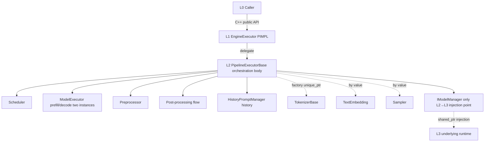
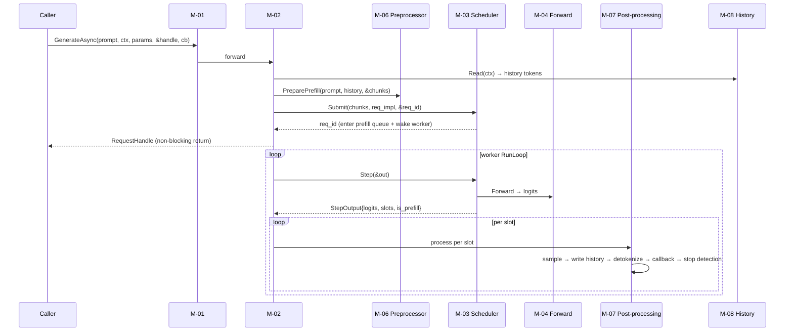

<!--
Human-readable design document. Content equivalent to DESIGN.md, but narrative-first, abbreviations/numbering as secondary,
and emphatically expands "how modules interact" and "what interaction data structures look like".
The machine-readable authoritative version is still ./DESIGN.md (with full ID cross-references).
This document's data structures are taken from actual headers (api/cpp/types.h, infra/status.h, core/tensor.h,
core/context.h, api/cpp/engine_executor.h, api/cpp/request_handle.h,
pipeline/scheduler.h, pipeline/pipeline_executor.h, pipeline/preprocessor.h,
core/i_model_manager.h), aligned with code.
-->

# LLM Autoregressive Inference Engine Design (Human-Readable Version)

English | [简体中文](../../../zh/cann_lm_engine/pipeline+engine_executor/DESIGN_HUMAN.md)

> Companion: `SPEC.md` (behavioral spec), `DESIGN.md` (machine-readable authoritative design, with full numbering cross-references).
> This document is a narrative rewrite of DESIGN.md for easy reading; technical decisions are fully consistent. If there is any discrepancy, `DESIGN.md` prevails.

## What This Engine Does

In one sentence: **It is an embedded C++ library that feeds a Prompt into the model, autoregressively generates plaintext token by token, and supports multi-turn dialogue, streaming output, multi-request batching and cancellation.**

It exposes Python interfaces through pybind11, serving large model deployment in Ascend/CANN ecosystem. Form is **embedded library not standalone service** (D-01) — servitization governance implemented by outer wrapper zero-intrusion, engine itself unaware of servitization.

Design goal priority: **low latency (TTFT/TPOT) > high throughput (tokens/sec) > extensible > controllable memory peak**.

### Boundary: What Engine Layer Does, Does Not Do

Engine layer (L1/L2) only does "orchestration": receives Prompt, tokenizes, concatenates history, chunks, batch scheduling, sampling, detokenization, callback, stop detection, history bookkeeping. It **does not touch** hardware — KV Cache actual memory, tensor operator execution, device scheduling all sink to underlying runtime (L3). Engine layer only references underlying-owned tensors via `shared_ptr`, does not hold device memory itself, does not do DMA (C5 boundary discipline).

Between engine layer and underlying there is **only one abstract injection point**: `IModelManager` (C-04). This is the result after C8 v1.2 convergence — Tokenizer / TextEmbedding / Sampler are all engine **internal** modules, do not re-implement underlying, are not underlying injections.

### Backend Determined at Compile Time (v0.6 Key Change)

`IModelManager`'s specific backend type is fixed at **compile time**. Engine is unaware of and does not reference any specific backend class names. At `ModelExecutor::Load` time calls a **link-time free function** `CreateModelManager()` (declared in `i_model_manager.h`, defined by backend library selected at compile time for linking), obtains owned `unique_ptr<IModelManager>`. No runtime factory injection. Switching backend = swap link library, rebuild; same build artifact does not support runtime multi-backend switch. UT links a stub definition (returns mock MM).

---

## Overall Structure: Three Layers + PIMPL



Style: **layering + PIMPL interface separation + abstract injection point + serial execution + Continuous Batching data parallel**.

- **L1 (EngineExecutor)**: Public API's PIMPL shell, zero business logic, only forwards. public header does not expose any internal types (D-08, ABI stable).
- **L2 (PipelineExecutorBase)**: Only orchestration body. Abstract base class + factory, autoregressive is currently only derived `AutoregressivePipelineExecutor`, reserves extension point for non-autoregressive pipeline (D-10). It owns worker thread, holds all shared components, owns Context/Request/History registries.
- **L3 (underlying runtime)**: Injected through `IModelManager` this one abstract point, engine unaware.

Upper layer only calls immediately lower layer; L2 holds only L2→L3 abstract injection point via link-time `CreateModelManager()` factory.

### Thread Model

- **Submission-layer concurrency**: Multiple user threads can simultaneously call `GenerateAsync` (thread-safe).
- **Execution-layer serial**: Single worker thread loop drives `Scheduler::Step` + post-processing. Avoids engine layer internal lock contention; multi-request parallelism compensates throughput via batch dimension data parallel (D-02).
- **Communication**: worker and user thread communicate via `RequestImpl` shared state (mutex/atomic), no cross-processor-domain synchronization (pure CPU).

---

## Module List (Storytelling Version)

| Module | What it does | Key interactions |
|------|--------|----------|
| **M-01 EngineExecutor** | L1 PIMPL shell, forwards public API. | One-way delegates to M-02. Internal `unique_ptr<Impl>` is M-02. |
| **M-02 PipelineExecutorBase** | L2 only orchestration body. Forwards API impl; owns worker; holds all components and registries. | Owns M-03~M-08, C-01~C-03; holds C-04 via `CreateModelManager()`. |
| **M-03 Scheduler** | Queuing + decode pool + iteration batching + interleaving + cancel. Does not self-drive, driven by worker calling `Step`. | Holds M-04*/M-06* non-owning pointers; produces `StepOutput` for M-02. |
| **M-04 ModelExecutor** | Forward shell (assembles inputs + delegates to underlying + produces logits) + KV cursor + Load/Unload/GetMeta control plane. prefill/decode two instances. | At Load time calls `CreateModelManager()` to self-hold owned MM; delegates MM::Forward. |
| ~~M-05 ModelLoader~~ | **Already decomposed** (v0.5→v0.6). Responsibility merged into M-04::Load. | — |
| **M-06 Preprocessor** | tokenize→concatenate history→placeholder positioning→chunking. Stateless. | Receives `TokenizerBase*`/`TextEmbedding*` via non-owning pointers. |
| **M-07 Post-processing flow** | Sampling→write history→detokenize→callback→stop. Called by M-02 per slot, not independent class. | Uses C-03 (sampling), C-01 (detokenize), M-08 (write history). |
| **M-08 HistoryPromptManager** | Token id history isolated per Context. For next-turn prefill concatenation. | No lower-layer dependency (pure memory); M-02 holds registry. |

### Contracts (Interaction Capabilities) Overview

| Contract | Producer | Consumer | Capability |
|------|--------|--------|------|
| C-01 Tokenizer | M-02 (internal polymorphic module) | M-06/M-07 | Text↔token id tokenization (TokenizerBase + factory + BPE/SP derived self-registration) |
| C-02 TextEmbedding | M-02 (internal module) | M-06 | embedding table loading + binding to model (tokenId lookup inside om graph) |
| C-03 Sampler | M-02 (internal concrete class) | M-07 | logits + params → token id sampling (stateless, does not read history) |
| C-04 IModelManager | L3 runtime | M-04 | model loading/forward/release/metadata (**only L2→L3 injection point**) |
| C-05 StepOutput | M-03 | M-02 | Single iteration forward output (phase + batched logits + slot→req mapping) |

---

## Focus 1: How Modules Interact

Below clarifies interaction relationships by "who holds whom, who calls whom, how data flows".

### Ownership and Holding Relationships

```
EngineExecutor
 └─ unique_ptr<Impl>  →  AutoregressivePipelineExecutor (M-02)

AutoregressivePipelineExecutor owns:
 ├─ unique_ptr<TokenizerBase>   tokenizer_     (factory product, polymorphic; M-06/M-07 access via non-owning pointer)
 ├─ TextEmbedding               text_embedding_ (by value, load+bind)
 ├─ Sampler                     sampler_        (by value, concrete class, stateless)
 ├─ ModelExecutor  prefill_executor_           (Load time self-calls CreateModelManager() to self-hold owned MM)
 ├─ ModelExecutor  decode_executor_
 ├─ shared_ptr<KvCachePool>      kv_pool_        (created after decode Load sizing, shared by two instances)
 ├─ Preprocessor   preprocessor_                (holds tokenizer*/text_embedding* non-owning pointers)
 ├─ Scheduler      scheduler_                   (holds prefill_executor_*/decode_executor_*/preprocessor* non-owning pointers)
 ├─ map<ContextId, Context>                     contexts_       (mutex)
 ├─ map<ContextId, shared_ptr<HistoryPromptManager>> histories_   (mutex)
 ├─ set<ContextId>                              active_generates_ (same Context concurrency check)
 ├─ thread        worker_
 ├─ atomic<bool>  stop_
 └─ condition_variable  worker_cv_
```

Key points:
- **L2 holds everything**: worker thread, all L2 modules, registries, internal components.
- **Non-owning pointers**: M-03 Scheduler and M-06 Preprocessor hold raw pointers to M-02-owned objects, lifecycle guaranteed by M-02 (do they destruct before M-02 members? No — M-02 at destruction first joins worker then releases in declaration reverse order, objects pointed to by raw pointers still alive when M-03/M-06 destruct).
- **C-04 only injection point**: M-02 does not directly hold `IModelManager`; two `ModelExecutor` instances each create and own their own MM via `CreateModelManager()` at Load time.
- **Registries isolated by ContextId**: Safe isolation landing point — one HistoryPromptManager per Context, resources/state not shared across Contexts.

### Call Chain (Who Calls Whom)

| Caller | Callee | Communication method | Sync/Async |
|--------|--------|----------|-----------|
| User thread | M-01 | function call | sync (submission-layer concurrent) |
| M-01 | M-02 | PIMPL forward | sync |
| M-02 worker | M-03 | `Step(&out)` | sync (per iteration) |
| M-03 | M-04 / M-06 | function call | sync (decision+forward) |
| M-02 | M-07 / M-08 | function call | sync (per slot post-processing) |
| worker | user thread | `StreamCallback` / `RequestHandle` | async (callback triggered in worker) |

---

## Focus 2: What Interaction Data Structures Look Like

This is the focus of this document. Each structure below is taken from real headers, annotated with "who produces, who consumes, on which path flows".

### 2.1 External API Layer: User-Visible Data Structures

These are defined in `api/cpp/types.h`, `infra/status.h`, `core/context.h`, `api/cpp/request_handle.h`, the stable surface users directly contact.

**Status codes** (`status.h`, throughout all APIs, not exception, details via logs):

```cpp
struct Status {
    int code;
    static constexpr int SUCCESS          = 0;  // success
    static constexpr int FAILURE          = 1;  // general failure (load/runtime internal error)
    static constexpr int INVALID_ARGUMENT = 2;  // invalid argument
    static constexpr int INVALID_STATE    = 3;  // state conflict (e.g. same Context concurrent call)
    static constexpr int NOT_FOUND        = 4;  // Context/file/request not exists
    static constexpr int CANCELED         = 5;  // canceled
};
```

**Prompt and multimodal** (`types.h`). User input starting point:

```cpp
using TokenId = uint32_t;   // default uint32_t, large vocabulary can compile-time switch uint64_t

enum class ModalityTag { Image, Audio, Video /*, extensible*/ };

struct ModalityEmbedding {
    ModalityTag                  tag;         // modality annotation, only identifier, does not participate in placeholder matching
    std::shared_ptr<Tensor>      embedding;  // pre-computed multimodal embedding, shared ownership avoids copy
};

struct Prompt {
    std::string                       text;        // single text segment, no multi-turn chat
    std::vector<ModalityEmbedding>    embeddings;  // can be empty, empty for pure text
};
```

> Placeholder matching rule (requirement #1): multimodal embedding by `Prompt.embeddings` array order ↔ placeholder appearance order in token sequence, regardless of `ModalityTag`.

**Sampling parameters** (`types.h`, per-request level, independent of Prompt):

```cpp
struct SamplingParams {
    int      max_tokens      = 0;     // 0 = use model default upper limit
    std::vector<TokenId>    stop_token_ids;   // includes EOS
    std::vector<std::string> stop_strings;
    float    temperature      = 1.0f;
    int      top_k            = 0;     // 0 = not enabled
    float    top_p            = 1.0f;  // 1.0 = not enabled
};
// Note: does not support beam search / n>1 / logprobs / penalty (requirement #8).
//      Sampler only receives current step logits + params, does not read history, so penalty-type features not supported.
```

**Result and termination reason** (`types.h`):

```cpp
enum class FinishReason { MaxTokens, StopToken, StopString, Canceled, Error };

struct Result {
    std::vector<TokenId> token_ids;
    std::string          text;
    FinishReason         finish_reason = FinishReason::MaxTokens;
};
```

**Context handle** (`context.h`, lightweight, copyable, internal state shared):

```cpp
struct ContextId {
    uint64_t value = 0;
    bool operator==(const ContextId&) const noexcept;
    bool operator<(const ContextId&) const noexcept;   // ordered containers
    explicit operator bool() const noexcept;            // value != 0 = valid
};

class Context {
    ContextId id() const noexcept;          // get identifier
    explicit operator bool() const noexcept;
private:
    std::shared_ptr<ContextImpl> impl_;     // entity owned by pipeline, user holds handle to read id
    friend class EngineExecutor;
    friend class AutoregressivePipelineExecutor;
};
```

**RequestHandle** (`request_handle.h`, lightweight, move-only, holds request slot ownership):

```cpp
enum class RequestStatus {
    Queued, Prefilling, Decoding, Completed, Canceled, Failed
};

class RequestHandle {
    RequestStatus GetStatus() const noexcept;   // concurrently callable
    bool IsDone() const noexcept;               // terminal?
    Status Cancel();                            // mark canceled, exit pool after current iteration
    Status Wait(Result* out);                   // blocking wait
    Status TryGetResult(Result* out) const;     // non-blocking get
private:
    std::shared_ptr<RequestImpl> impl_;        // points to M-02-managed shared state
};
```

**Stream callback** (`types.h`, triggered in worker thread, after detokenize, before stop detection):

```cpp
using StreamCallback = std::function<void(TokenId, std::string)>;
```

**Model artifacts** (`types.h`, path mode vs buffer mode):

```cpp
struct Buffer {                 // read-only buffer view (C++17 has no span, self-developed lightweight)
    const void* data = nullptr;
    size_t      size = 0;
};
struct ModelArtifact {          // buffer mode: omc graph + weight + metadata json
    Buffer omc;
    Buffer weight;
    Buffer meta_json;
};
struct ModelArtifactPath {      // path mode: meta json derived from omc path same name
    std::string omc;
    std::string weight;
};
```

**EngineOptions / ContextOptions** (`engine_executor.h`):

```cpp
struct EngineOptions {
    int      default_chunk_size      = 1024;  // default chunk size (token count)
    int      max_concurrent_prefill  = 1;      // concurrent prefill upper limit (Continuous Batching default 1)
    int      max_batch_size_override = 0;      // 0 = use model metadata max_batch_size; >0 override
    LogLevel log_level               = LogLevel::Info;
};
struct ContextOptions {};   // placeholder, fields pending
```

### 2.2 Engine Internal Layer: Data Structures Flowing Between Modules

These are invisible to users, defined in `pipeline/scheduler.h`, `pipeline/pipeline_executor.h`, `core/i_model_manager.h`, `pipeline/preprocessor.h`.

**RequestImpl — single request shared state** (`scheduler.h`). This is the core carrier for communication between user thread and worker, `RequestHandle` holds `shared_ptr<RequestImpl>` pointing to it:

```cpp
struct RequestId {
    uint64_t value = 0;
    bool operator==(const RequestId&) const noexcept;
    explicit operator bool() const noexcept;   // value != 0
};

struct RequestImpl {
    // —— State (atomic, user thread reads / worker writes) ——
    std::atomic<RequestStatus> status{RequestStatus::Queued};
    std::atomic<bool>           canceled{false};           // cancel mechanism

    // —— Request parameters (fixed at submission) ——
    SamplingParams   sampling_params;
    ContextId        context_id;
    StreamCallback   callback;          // can be empty = non-streaming

    // —— Output (mutex protected; worker writes / user thread reads) ——
    std::vector<TokenId> token_ids;
    std::string          text;
    FinishReason         finish_reason{FinishReason::MaxTokens};

    // —— Wait/TryGetResult sync primitives ——
    std::mutex              mtx;
    std::condition_variable cv;

    // worker calls: set terminal state and wake Wait
    void SetTerminal(RequestStatus s, FinishReason fr);
};
```

> This is the key structure for understanding concurrency model: `canceled` is atomic (user thread writes, worker reads), output fields are mutex protected, `status` atomic. cancel does not immediately interrupt forward — atomic flag, takes effect at next decision point.

**StepOutput — single iteration output** (`scheduler.h`, contract C-05). M-03 `Step` produces, M-02 post-processing consumes:

```cpp
struct StepOutput {
    std::shared_ptr<Tensor>                       logits;        // batched logits (N slots)
    std::vector<std::shared_ptr<RequestImpl>>     slots;         // slot i → request
    bool                                          is_prefill = false;
};
// Invariant: slots.size() == logits batch dimension.
```

> M-02 after receiving StepOutput runs post-processing flow per slot by `slots` (sample→write history→detokenize→callback→stop). When no active tasks M-03 returns `INVALID_STATE` (does not produce StepOutput), worker sleeps.

**Scheduler internal scheduling state** (`scheduler.h`, mutex protected). These are Continuous Batching's ledger:

```cpp
struct PrefillTask {                          // prefill queue element (FIFO)
    RequestId                                id;
    std::shared_ptr<RequestImpl>             req;
    std::vector<std::shared_ptr<Tensor>>     chunks;      // already chunked prefill blocks
    size_t                                   next_chunk = 0;  // next chunk index to run
    SlotId                                   kv_slot = -1;    // allocated from KV pool at prefill start
};
struct DecodeSlot {                           // decode pool element (capacity = max_batch_size)
    RequestId                  id{};
    std::shared_ptr<RequestImpl> req;
    TokenId                    last_token = 0;
    SlotId                     kv_slot = -1;     // inherited from prefill
    bool                       active = false;
};
struct PendingEntry {                        // prefill completed, pending decode pool entry
    std::shared_ptr<RequestImpl> req;
    SlotId                       kv_slot = -1;
};

// Scheduler members:
std::deque<PrefillTask>     prefill_queue_;    // FIFO
std::vector<DecodeSlot>     decode_pool_;     // capacity = max_batch_size
std::deque<PendingEntry>    pending_decode_;  // prefill completed pending pool entry
```

> Invariants: active ≤ max_batch_size; **no variable padding** (not padded to longest within batch, each request KV independent); decode om fixed batch = max_batch_size, when active not full pad to max_batch_size (attentionMask shields); prefill om fixed batch=1 no padding; same request at same time only in one queue (reflected by `RequestImpl::status`).

**IModelManager — only L2→L3 interface** (`i_model_manager.h`, C-04). Underlying runtime implements, engine obtains owned instance via `CreateModelManager()`:

```cpp
struct ModelHandle {                // opaque handle to underlying model instance
    uint64_t value = 0;
    explicit operator bool() const noexcept;   // value != 0
};
struct ModelMetaInfo {              // subset Engine needs
    int max_batch_size = 0;         // → passed to M-03 as decode pool capacity
    int max_seq_len    = 0;
};

class IModelManager {
public:
    virtual Status Load(const ModelArtifactPath&, ModelHandle* out) = 0;   // path loading
    virtual Status Load(const ModelArtifact&,     ModelHandle* out) = 0;   // buffer loading
    // Forward: inputs array contract——
    //   inputs[0] = data (embedding or tokenId; tokenId goes through model internal embedding)
    //   inputs[1] = position_ids (derived by ModelExecutor from KV cursor)
    //   inputs[2] = attention_mask (padded positions set invalid)
    //   count >= 3; underlying distinguishes prefill/decode semantics by handle, responsible for tensor concatenation and KV update
    virtual Status Forward(ModelHandle, const std::shared_ptr<Tensor>* inputs,
                           size_t count, std::shared_ptr<Tensor>* out_logits) = 0;
    virtual Status GetMeta(ModelHandle, const ModelMetaInfo** out) const = 0;
    virtual Status Release(ModelHandle) = 0;
};

// Link-time free function (D-12): definition provided by backend library selected at compile time for linking.
// Returns nullptr = backend init failure (treated as Status::FAILURE).
std::unique_ptr<IModelManager> CreateModelManager();
```

> Underlying sinks "tensor concatenation/batch concatenation/KV maintenance" all to underlying (C5). Engine layer only receives batched logits by slot order. Weight sharing: prefill omc / decode omc load deduplication is C-04 implementation's responsibility (same artifact only one weight).

**TokenizerBase — engine internal polymorphic tokenization module** (C-01, `tokenizer.h`, per `docs/tokenizer/`). M-02 holds via factory `unique_ptr`, M-06/M-07 access via non-owning pointer:

```cpp
enum class Algorithm { BPE, SentencePieceUnigram };
struct EncodeOptions { bool add_special_tokens; std::optional<size_t> max_length;
                       enum class Padding { None, Longest, Fixed } padding; /*...*/ };
struct DecodeOptions { bool skip_special_tokens; };

class TokenizerBase {   // polymorphic base class (constraint #2, replaces ITokenizer)
public:
    virtual Status encode(std::string_view, const EncodeOptions&, std::vector<int>* out_ids) = 0;
    virtual Status decode(const std::vector<int>&, const DecodeOptions&, std::string* out_text) = 0;
    virtual size_t  vocab_size() const = 0;
    virtual std::optional<int> special_token_id(std::string_view) const = 0;
    virtual Status  batch_encode(/*...*/);   // default implementation
};
class TokenizerFactory {
public:
    static Status create(Algorithm, const LoadParams&, std::unique_ptr<TokenizerBase>* out);
    static std::vector<Algorithm> list_registered();
};
// Error unification (constraint #1): does not return module's own error codes, uniformly uses project Status;
//   OOV not failure, internally maps unk then returns SUCCESS.
//   int ↔ TokenId adaptation done in Preprocessor.
// Self-registration via REGISTER_TOKENIZER macro (static initialization period).
```

**TextEmbedding — embedding module** (C-02, `text_embedding.h`). M-02 holds by value, `LoadAndBind` during init:

```cpp
struct ModalityEntry {
    size_t                   position;    // placeholder index in token sequence
    std::shared_ptr<Tensor>  embedding;   // multimodal embedding from Prompt
};
class TextEmbedding {
public:
    Status LoadAndBind();   // loads embedding table and binds to model handle (M-02 calls during init)
    // real signature deferred, pending embedding module DESIGN
};
// Note: tokenId path lookup done inside om graph forward, not this module produces tensor.
```

**Sampler — sampler** (C-03, `sampler.h`). M-02 holds by value, M-07 accesses via non-owning pointer:

```cpp
class Sampler {
public:
    Status Sample(const std::shared_ptr<Tensor>& batch_logits, int slot,
                  const SamplingParams& params, TokenId* out);
};
// Key constraint (requirement #8): only receives current step logits + params, does not read history.
//   Therefore does not support logit bias / frequency penalty / presence penalty / n>1 / logprobs.
```

**Preprocessor interface** (`preprocessor.h`, M-06, stateless):

```cpp
class Preprocessor {
public:
    Preprocessor(TokenizerBase* tokenizer, TextEmbedding* text_embedding, int default_chunk_size);
    // Prefill path: Prompt + history tokens → multi-chunk input tensors
    //   tokenize Prompt.text → concatenate history → placeholder positioning → chunking
    Status PreparePrefill(const Prompt&, const std::vector<TokenId>& history,
                          std::vector<std::shared_ptr<Tensor>>* out_chunks);
    // Decode fast path: single token id → input tensor
    Status PrepareDecodeStep(TokenId id, std::shared_ptr<Tensor>* out_input);
private:
    TokenizerBase*    tokenizer_;        // non-owning
    TextEmbedding*    text_embedding_;   // non-owning
    int               default_chunk_size_;
};
```

**Tensor** (`tensor.h`, DESIGN-stage placeholder stub, future replaced by underlying runtime). Engine layer only holds `shared_ptr<Tensor>` reference, unaware of internal structure:

```cpp
class Tensor {
public:
    void*  data() const noexcept;
    size_t size() const noexcept;
    explicit operator bool() const noexcept;   // data_ != nullptr
    // non-copyable, movable
};
```

---

## Key Flows (Storytelling Version)

Below tells the five main flows in plain language. All flows are worker single-thread serial driven.

### Flow 1: Model Loading (Each Instance Self-Creates ModelManager)

`EngineExecutor` loads once at construction (does not support hot-loading). M-01 hands prefill + decode two artifacts to M-02, M-02 calls `Load` once for **each** ModelExecutor instance.

```
Caller → EngineExecutor(prefill_path, decode_path, opts)
  → M-02 construction (one-time load)
    → decode_executor_.Load(decode_path)   // decode Loads first, gets max_batch_size/max_seq_len
        → CreateModelManager()              // link-time factory, creates owned MM
        → MM::Load(omc + derived json) → decode handle
        → MM::GetMeta → max_batch_size / max_seq_len
    → creates/sizes shared KV pool + decode assembler per decode metadata
    → AttachPool/AttachAssembler (both instances)
    → prefill_executor_.Load(prefill_path)  // prefill Loads after
        → CreateModelManager() → MM::Load → prefill handle
    → Scheduler(prefill_exec, decode_exec, preprocessor, max_batch_size)
    → worker = thread(RunLoop)
```

Key points:
- Each instance at Load time calls link-time `CreateModelManager()` to create and hold own MM, backend determined at compile time.
- **decode Loads first**, to get max_batch_size/max_seq_len to size shared KV pool.
- Forward only after both instances ready.
- embedding table does not go through this path — loaded by M-02 calling TextEmbedding module and bound to model.

Exceptions: `CreateModelManager()` returns empty → load failure (build-time guarantee backend definition linked); om missing/corrupted/json failure → load failure, no partial resource leak (already loaded handle rolled back by destructor).

### Flow 2: Single Asynchronous Inference (Including Cancel Checkpoints)



worker RunLoop + post-processing pseudocode:

```
while !stop_:
    if M-03.Step(&out) == INVALID_STATE:
        condvar.wait(); continue              # no active tasks, sleep
    for slot, req in out.slots:
        if req.canceled.load(): req.SetTerminal(Canceled, Canceled); continue   # partial discard
        token = C-03.Sample(out.logits, slot, params)           # not history-aware
        req.token_ids.append(token); M-08[req.context_id].Append([token])
        text_piece = C-01->decode({token}, opts)                 # TokenizerBase polymorphic
        req.text += text_piece
        if stop_token hit:     finish=StopToken;    status=Completed  # inclination not callback
        elif stop_string hit:  finish=StopString;    status=Completed  # remove stop part, inclination not callback
        else: req.callback(token, text_piece)                    # callback before stop detection
        if token_ids.size()==max_tokens: finish=MaxTokens; status=Completed
```

Callback trigger point: after detokenize, before stop detection; the step that hits stop string inclination not callback (avoid leaking stop marker, pending see open issues).

Exceptions: PreparePrefill failure → GenerateAsync returns FAILURE; forward failure → Step returns FAILURE → req.status=Failed; sample/detokenize failure → req.status=Failed (preserves partial output); cancel → partial output discarded.

### Flow 3: Multi-turn Continuation

History carrier is **token id** (not text), avoids repeated tokenize and tokenizer non-bijective loss (D-06).

```
Turn 1: history empty
  M-08.Read(ctx) → []
  M-06.PreparePrefill(prompt1, history=[], &chunks)  # tokenize prompt1 → placeholder → chunking
  M-03.Submit → worker drives Prefill + Decode
  post-processing per token: M-08[ctx].Append([token])          # this turn's generation per token enters history
  → history = [token1...tokenN]

Turn 2:
  M-08.Read(ctx) → [token1...tokenN]
  M-06.PreparePrefill(prompt2, history=[token1..tokenN], &chunks)
    # tokenize prompt2 → concatenate with history → placeholder replacement → chunking
  M-03.Submit → Prefill(history prefix + prompt2 new text) → Decode
  → append turn 2's generated tokens to history
```

Exceptions: history overlong not truncated (currently not supported, reserve extension point); turn N PreparePrefill failure → returns FAILURE, history retains first N-1 turns.

### Flow 4: Continuous Batching (Multi-request Batching/Interleaving)

Batching granularity is **iteration level** (D-03). Interleaving strategy: **process Prefill first when there is empty slot**, avoids decode starvation while utilizing empty slots. Prefill batch=1, Decode batch=N (active count).

M-03 Step decision pseudocode:

```
Step(&out):
    # 1. Cleanup terminal/cancel → release slot → pending decode backfill
    for slot in decode_pool:
        if req.status in {Completed,Canceled,Failed}: slot.active=false
    while has_empty_slot and pending_decode:
        fill slot with pending_decode.pop()

    # 2. No active tasks → worker sleep
    if prefill_queue.empty() and decode_pool_all_empty() and pending_decode.empty():
        return INVALID_STATE

    # 3. Interleaving: has empty slot + prefill non-empty → run one Prefill(batch=1)
    if has_empty_slot() and not prefill_queue.empty():
        task = prefill_queue.front()
        chunk = task.chunks[task.next_chunk++]
        M-04_prefill.Forward([chunk], &logits)
        out = {logits, [task.req], is_prefill=true}
        if task.next_chunk == task.chunks.size():     # chunks exhausted
            prefill_queue.pop(); pending_decode.push({req, kv_slot})

    # 4. Otherwise Decode batch=N (M-04 pads to max_batch_size, attentionMask shields)
    else:
        inputs = [M-06.PrepareDecodeStep(req.last_token) for req in active]
        M-04_decode.Forward(inputs, &logits)
        out = {logits, slot_to_request, is_prefill=false}
    return OK
```

Exceptions: some slot forward failure → that req.status=Failed, releases slot, other slots unaffected; pool full new prefill → prefill queue queues (not error).

### Flow 5: Cancel (Request-level / Context-level)

```
User side:
  RequestHandle.Cancel() → req_impl->canceled.store(true)     # thread-safe, user thread callable
  CancelContext(ctx) → iterate all active req on that Context → canceled=true

worker post-processing (M-07):
  for slot, req in out.slots:
      if req.canceled.load(): req.SetTerminal(Canceled, Canceled); continue   # skip sample/write history/callback

M-03 Step decision cleanup:
  for slot in decode_pool:
      if req.status in {Completed,Canceled,Failed}: slot.active=false   # release, backfill next time
```

Key decisions:
- **Atomic flag + cleanup at next decision point**, does not immediately interrupt current forward (avoids forward interruption).
- **Partial output discarded** (Canceled state does not callback streaming token).
- **History not rolled back** — already generated tokens enter history, multi-turn continuation semantics clear.
- CancelContext **cascades cancel** all active req on that Context.
- Idempotent: Cancel already-terminal request returns OK or NOT_FOUND.

---

## What the Interface Looks Like (Public API Skeleton)

```cpp
class EngineExecutor {
public:
    // Construction (path / buffer loading, prefill + decode each one)
    EngineExecutor(const ModelArtifactPath& prefill, const ModelArtifactPath& decode,
                   const EngineOptions& = {});
    EngineExecutor(const ModelArtifact& prefill, const ModelArtifact& decode,
                   const EngineOptions& = {});
    // non-copyable, movable; original object set to empty after move

    // Context management
    Status CreateContext(Context* out);
    Status DestroyContext(ContextId);           // idempotent
    Status ConfigureContext(ContextId, const ContextOptions&);
    Status CancelContext(ContextId);            // cascade cancel all in-flight requests on that Context

    // Inference
    Status Generate(const Prompt&, const Context&, const SamplingParams&, Result* out);
    Status GenerateAsync(const Prompt&, const Context&, const SamplingParams&,
                         RequestHandle* out, StreamCallback = {});
private:
    class Impl;
    std::unique_ptr<Impl> impl_;   // i.e. M-02
};
```

Semantics: one-time load at construction; `Generate` = `GenerateAsync` (empty callback) + `Wait`; same Context concurrent returns `INVALID_STATE`. Handle residue use (after EngineExecutor destruction) → `INVALID_STATE`.

---

## Why Designed This Way (Key Decisions Explained)

### 1. Why Form is Embedded Library

Engine only does inference, does not hold service governance logic (authentication/rate limiting/circuit breaking). Outer wrapper implements servitization, engine zero-intrusion (D-01). Cost: caller responsible for servitization encapsulation.

### 2. Why Execution Layer Serial + Batch Data Parallel

Avoids engine layer internal lock contention and complex concurrency. Multi-request parallelism via single batch internal data parallel (Continuous Batching), not concurrent forward — consistent with device serial nature, no loss (D-02). Submission-layer concurrency guaranteed by API thread safety.

### 3. Why Continuous Batching: Prefill Independent + Decode Multi-batch

Dynamically utilize decode pool empty slots, throughput higher than single-request serial baseline. Prefill batch=1 (avoid long prompt blocking decode), Decode batch=N active (M-04 pads to max_batch_size, attentionMask shields, no variable padding). Interleaving strategy: Prefill first when empty slot (D-03).

### 4. Why prefill/decode Are Dual Independent Instances

Separate two-stage forward semantics, convenient for each to bind om graph and batch dimension management. Two instances are **two instances of same class** (not subclasses), share same KV Cache pool zero-copy, difference only handle (prefill om / decode om); weight deduplication by C-04 implementation (D-04).

### 5. Why Chunking Belongs to Preprocessor

Engine layer coordinates preprocessing chain (requirement #7), chunking is one preprocessing step. Chunking mechanism (token-level vs tensor slice) TBD, inclination token-level maintains C5 (D-05).

### 6. Why Independent HistoryPromptManager

Avoids repeated tokenize and tokenizer non-bijective loss (requirement #9). History carrier is token id, isolated per Context, one instance per Context. Write subject is M-02 (after each Decode step), user unaware (D-06). Truncation/sliding window/KV length alignment strategy TBD (currently not supported, reserve extension point).

### 7. Why Status Error Model (Not Exception)

C11 self-developed lightweight; exceptions uncontrollable across boundaries. 6 constants coarse-grained, details via logs. Caller must check Status (D-07).

### 8. Why PIMPL Interface Separation

ABI stable; public header does not expose any internal types. M-01 as shell, Impl is M-02 (D-08).

### 9. Why Tokenizer/TextEmbedding Are Engine Internal Modules, Sampler Is Concrete Class; IModelManager Is Only Injection Point (C8 v1.2)

Tokenizer needs multi-algorithm polymorphism (BPE/SentencePiece) + self-registration open-closed, v1.1's "concrete class no virtual" conflicts with this module; embedding role clarified via model_executor as load+bind (not lookup-produced tensor), v1.1 error; Sampler no polymorphism requirement, no sibling document, kept as concrete class. All three are **not underlying injection**, IModelManager remains only L2→L3 injection point (D-09).

### 10. Why Pipeline Polymorphic Base Class + Factory

New abstract base class `PipelineExecutorBase` + `PipelineExecutorFactory` + `PipelineType` enum, current `AutoregressivePipelineExecutor` is currently only derived, reserves extension point for non-autoregressive and other pipelines (constraint #3, D-10).

### 11. Why LifecycleController/ModelLoader Already Decomposed

ModelLoader only thin wrapper (parameter parsing→path-derived json→call C-04::Load), independent module introduces unnecessary indirection layer. After merge M-04 directly calls `CreateModelManager()` at Load time to create owned MM and load, reduces one cross-module call (D-11). M-05 marked [decomposed], §11.5 retained as historical index.

### 12. Why Link-time CreateModelManager() Replaces Runtime Injection

`shared_ptr<IModelManager>` runtime injection requires caller to know backend type and create MM before constructing EngineExecutor, violates "backend determined at compile time" constraint. Link-time factory makes backend determined at compile/link time, no runtime injection needed; ModelExecutor::Load self-calls factory to create owned MM (unique_ptr), pipeline unaware of backend type (D-12). stub backend provides `CreateModelManager()` returning nullptr (test period treated as FAILURE).

---

## Performance Budget

Currently all are **budget targets** (no measurement baseline), pending real machine benchmark calibration:

| Metric | Target | How to measure |
|------|------|--------|
| TTFT (first token latency) | Absolute value TBD; engine layer contribution <10% | benchmark integration stage measured |
| TPOT (per token latency) | Absolute value TBD; engine layer contribution <10% | measured |
| Throughput tokens/sec | Higher than single-request serial baseline | measured |
| Engine layer overhead proportion | <10% end-to-end | measured |
| Scheduling overhead (M-03 Step decision) | <1% end-to-end | per iteration |
| Post-processing per slot (sample+write history+detokenize+callback+stop) | Included in engine layer <10% | per slot |
| Single chunk preprocessing | <5% of that chunk's forward time | per chunk |
| Forward shell forwarding (M-04, excluding underlying operators) | <0.1% end-to-end | single forward |

Critical path: Submit → PreparePrefill → Prefill Forward → Sample → Write history → detokenize → callback → stop. Among them Forward and Sample sink to underlying. Degradation alarm: scheduling overhead >1% or engine layer proportion >10% → log warn.

---

## Concurrency and Thread Safety

| Resource | Concurrent access | Sync primitive |
|------|----------|----------|
| `RequestImpl` output fields | worker writes / user thread reads | mutex |
| `RequestImpl::canceled` | user thread writes / worker reads | atomic |
| `histories_` registry | worker reads/writes / user destroy | mutex |
| ContextImpl registry | worker reads/writes / user create/destroy | mutex |
| RequestImpl registry | worker reads/writes / user cancel | mutex |
| C-04 / C-01 / C-02 / C-03 | worker serial calls (execution layer serial) | none needed (serial) |

Deadlock and race protection:
- **Lock hierarchy**: registry mutex > RequestImpl mutex, no reverse acquisition.
- **Destruction race**: stop_ → join worker → release resources; residue handle use returns `INVALID_STATE`.
- **cancel race**: atomic canceled + terminal idempotent check.
- **Same Context concurrent submission**: runtime check → `INVALID_STATE`.
- worker wake: condvar (selection see open issues). New Submit wakes; stop_ wakes exit. No cross-processor-domain synchronization (C5).

---

## How Errors Are Tiered

| Layer | Error model | Propagation |
|----|----------|------|
| L1 public API | Status (6 constants, not exception) | directly returned to user |
| L2/L3 internal | Status + log details | aggregated via M-02 → mapped to public code |

Terminal state enum: Completed / Failed / Canceled. ReqFailed carries partial output (for troubleshooting/continuation); Canceled does not return partial (discarded). Details via logs, Status only gives coarse-grained.

---

## Undecided Things (Open Issues)

| Open issue | Impact | Fallback |
|------|------|------|
| TTFT/TPOT absolute value not bound | Performance acceptance lacks baseline | Supplemented at integration benchmark stage measured (pending reference hardware + model scale) |
| Chunked Prefill chunking mechanism (token-level vs tensor slice) | M-06 implementation path branches | Inclination token-level maintains C5; D-05 review; if tensor slice needed then triggers C5 boundary |
| Streaming detokenize buffer / stop string hit buffer retention | M-07 output correctness | Inclination not leak stop marker; measure stop string scenario |
| HistoryPromptManager truncation / KV alignment | Overlong history correctness | Currently not supported, reserve extension point |
| worker wake/sync primitive selection | M-02 implementation details | condvar inclination |

---

## How to Land Next (For Implementer)

Implementation order (by dependency topology):

1. C-04 interface contract + C-01 TokenizerBase/factory + C-02/C-03 definitions (parallelizable).
2. M-08 (no dependency).
3. M-04 → M-05 (merged) → C-04.
4. M-06 → C-01/C-02.
5. M-03 → M-04/M-06.
6. M-07 → C-03/M-08.
7. M-02 → all L2.
8. M-01 → M-02.

Must be serial: M-03 depends on M-04/M-06; M-02 depends on all L2; M-01 depends on M-02.

Integration milestones:
1. M-04 + C-04 mock runs fake forward;
2. M-03 + M-06 runs single-request prefill → decode;
3. M-02 + M-07 runs streaming + stop;
4. M-02 multi-request Continuous Batching;
5. M-01 PIMPL public API links `api_smoke`.

---

## Consistency Note

This document is technically fully equivalent to `DESIGN.md`, just removes cross-references of numbering abbreviations, uses narrative, and supplements interaction data structures taken from real headers. The machine-readable authoritative version (with full module/contract/flow/decision numbering, for implementation-time precise traceability) is still `DESIGN.md`. If there is any discrepancy, `DESIGN.md` prevails.
