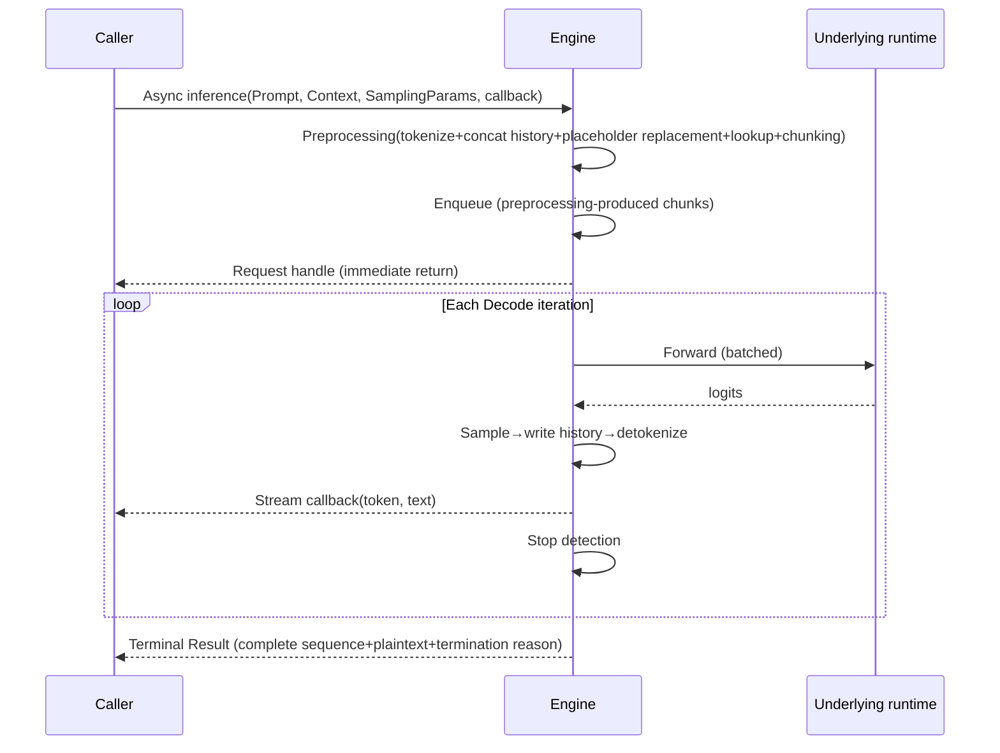
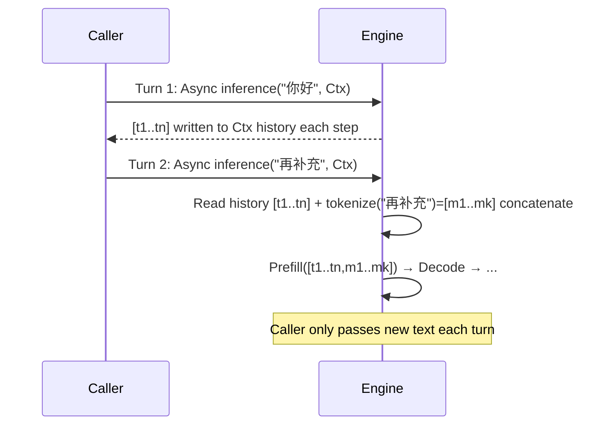
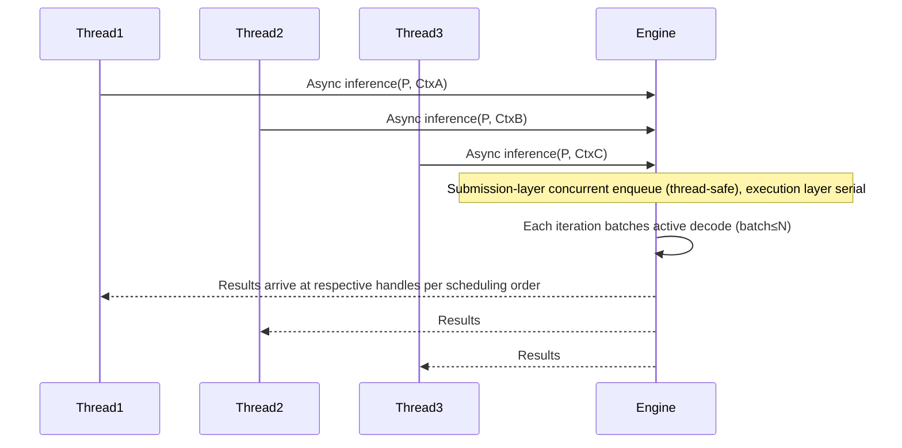
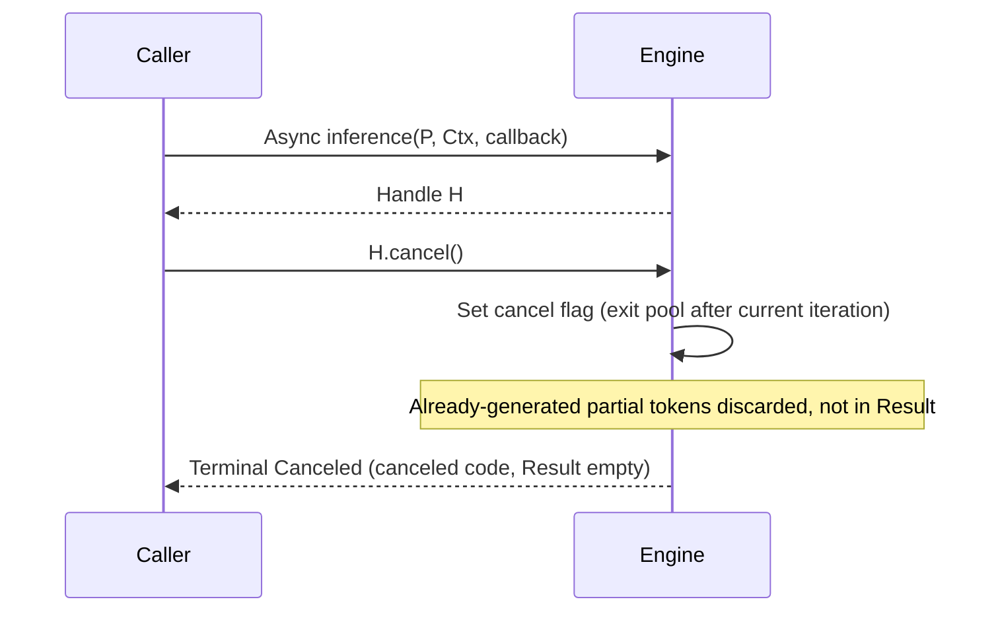

# LLM Autoregressive Inference Engine — Functional Specification

English | [简体中文](../../../zh/cann_lm_engine/pipeline+engine_executor/SPEC.md)

> Requirement ID: SR20260806001
> Software layer: framework (embedded C++ library)
> This document describes "what business behavior the system should exhibit" (What & Why), without implementation details.

---

## Chapter 1 Overview

This spec defines an **LLM inference engine** for autoregressive inference of large language models, in the form of an **embedded C++ library** (not a standalone service). The engine only exposes C++ API boundary externally, undertaking autoregressive inference flow orchestration, Prefill/Decode two-stage execution, queue scheduling and batching, input preprocessing, sampling post-processing, model loading and context management; **does not undertake** KV Cache management, hardware device abstraction and tensor operator execution, servitization governance (RPC/multi-tenant authentication, etc.) — these are provided by underlying runtime and outer wrapper, the engine only calls encapsulation interfaces, zero-intrusion servitization.

The caller holds one engine instance, performs context management and inference calls through "context + prompt"; supports multi-instance, multi-session reusing same engine, multi-turn dialogue continuation, streaming output and cancellation. This spec covers the engine's all externally observable behaviors, non-functional goals, constraint dependencies, backward compatibility and verification standards (SR20260806001).

---

## Chapter 2 Glossary

| Term | Definition |
|------|------|
| Engine | The LLM autoregressive inference library overall defined by this spec. |
| Caller | User application or upper-layer service wrapper that holds engine instance and initiates inference requests. |
| Context | State carrier for one session, held by caller as handle; carries multi-turn history and config, distinguished by identifier. |
| Prompt | Single inference input, contains one text segment and zero or more multimodal embeddings. |
| Multimodal embedding | Pre-computed tensors of image/audio/video modalities, positioned via text placeholders to participate in inference. |
| SamplingParams | Per-request independent sampling config (max generation count, stop conditions, temperature, top-k, top-p), independent of Prompt. |
| Autoregressive inference | Token-by-token generation, loop process feeding previous step's output back as next step's input. |
| Prefill | Stage that processes prompt (including history concatenation), computation-intensive. |
| Decode | Stage that performs token-by-token autoregressive generation, memory-access-intensive. |
| Chunked Prefill | Mechanism of chunking long prompt and executing in multiple times, used to control first-token latency and single-step memory peak. |
| Continuous Batching | Iteration-level dynamic batching: Decode stage batches multiple requests into one forward, requests can join/exit mid-way. |
| decode pool | Set of requests that can be in active decode at the same time, capacity upper limit determined by model metadata. |
| RequestHandle | Lightweight handle returned by asynchronous inference, can query status, cancel, wait for complete result. |
| StreamCallback | Callback triggered after each Decode step produces token, for caller to incrementally obtain. |
| Result | Complete product of one inference, contains token id sequence, plaintext, termination reason. |
| Status | Unified returned coarse-grained status (success/failure/invalid argument/state conflict/not found/canceled), details via logs. |
| omc | Offline compiled model format, engine loads via path or already-read buffer. |
| max_batch_size | decode pool capacity upper limit given by model metadata. |
| KV Cache | Cross-step cached historical key-value state, managed by underlying runtime, engine unaware. |
| Underlying runtime | External implementation providing KV/operator/hardware abstraction, engine accesses via encapsulation interface. |
| TTFT | Time To First Token, first-token latency (end-to-end latency from submission to receiving first token). |
| TPOT | Time Per Output Token, average generation latency per token in Decode stage. |
| EOS | End-Of-Sequence, model's built-in sequence end token, one of stop tokens. |
| DFX | Design for X (collection of design requirements for non-functional attributes such as reliability/testability/observability/configurability). |
| mock | Controllable stand-in implementation replacing real underlying dependencies in tests. |
| Placeholder | Special token in text marking multimodal embedding insertion position, replaced with corresponding embedding during preprocessing. |

---

## Chapter 3 Background

### 3.1 Current State

Autoregressive LLM inference engineering has two stages: Prefill that processes prompt (computation-intensive) and Decode that generates token-by-token (memory-access-intensive). Device is inherently serial — only one forward at a time. Traditional solutions either couple inference logic with service governance (dilutes pipeline design effort), or do batch management at request-level concurrency (contradicts device serial nature), or require caller to retransmit all historical text every turn (repeated tokenize and tokenizer non-bijective loss). Multi-session concurrency and cancel semantics are often masked by implicit queuing, making bugs hard to expose.

### 3.2 Problems

- **Servitization coupling**: Inference pipeline mixed with RPC/authentication/lifecycle, hard to focus on pipeline design itself.
- **Concurrency model misplacement**: Request-level concurrency on serial device has no benefit, real throughput leverage should be iteration-level dynamic batching, not multi-threaded preemption.
- **History retransmission burden**: Caller retransmits full text every turn, repeated tokenize wastes computation and tokenizer non-bijective causes precision loss.
- **Error masking**: Same-session concurrent calls implicitly queued rather than explicitly erroring, masking caller bugs.
- **Insufficient extensibility**: New sampling algorithms, new modalities, more complex scheduling strategies lack extension points.

### 3.3 Expectations

Build an **embedded C++ library**: externally only to C++ API boundary, servitization implemented by outer wrapper zero-intrusion; C API layer (`extern "C"` + opaque handle, see `docs/c_api/`) provides ABI stable boundary for cross-language bindings; adopt Prefill/Decode two-stage separation + Continuous Batching (iteration-level dynamic batching) as real concurrency leverage; use independent history management module to carry token id history, caller only passes new text each turn; use unified status code to explicitly expose state conflicts (same context concurrent call errors); use IModelManager injection point + engine internal modules to reserve extension points (new tokenization algorithms via `TokenizerBase` derived self-registration `TokenizerFactory`; new pipeline types via `PipelineExecutorBase` derived + `PipelineExecutorFactory` construction; new modalities/embeddings via TextEmbedding; sampling via Sampler; model management/forward via IModelManager injection point extension). Engine unaware of KV tensor memory/operators/hardware (KV ringBuffer cursor belongs to ModelExecutor), performance budget expressed as "engine layer own overhead proportion of end-to-end latency".

---

## Chapter 4 Functional Requirements

### 4.1 Behavior Spec

> **Evidence source declaration (BDV_001/002)**: All "must"-level behavior assertions in this section are traceable to upstream `基础需求和约束.md` v0.5 feature points #1–#9 and constraints C1–C12 (see frontmatter upstream), not just user verbal. Below for "numeric/limit/threshold + boundary/permission/trust boundary" type assertions add inline `[source: #N / Cn]` annotation; non-numeric behavior assertions take upstream feature points overall as source, traced per this declaration.

#### 4.1.1 Engine Instantiation and Model Loading (F-LOAD)

**Preconditions**: Caller prepares two model artifacts (Prefill artifact + Decode artifact), source is one of "path" or "already-read buffer".

**Processing logic**:
- Engine **must** load Prefill and Decode two model artifacts once at instantiation, current version **does not** support runtime hot-loading or model switching.
- Engine **must** support two load sources: (a) file path (graph path + weight path + json metadata with same name as graph); (b) already-read buffer (graph + weight + metadata).
- Engine **must** read model metadata after loading (at least contains decode pool capacity upper limit `max_batch_size`, single sequence maximum length). [Source: #4 + 04 §11.4 ModelMetaInfo]
- Engine **should** allow two artifacts to reference same weights (same model different compiled versions), underlying deduplication, engine does no special optimization.
- Engine instance **must** be non-copyable, movable; after move original object **must** be set to empty.
- Engine **must** support instantiating multiple engine instances within same process, does not depend on global singleton, resource pool belongs to each instance itself.

**Postconditions**: Two artifacts loaded, metadata queryable, engine ready to accept inference requests.

**Exception handling**:
- Load failure (file not exists / buffer corrupted / version mismatch / json parse failure) **must** return failure status code, details via logs.
- On instantiation failure engine **must** not leak partial resources (release acquired resources on failure).

**Boundary cases**:
- Metadata `max_batch_size` missing or invalid → load **must** fail.
- Artifact path and buffer source mixed → **must** reject (invalid argument).

---

#### 4.1.2 Context Management (F-CTX)

**Preconditions**: Engine ready.

**Processing logic**:
- Engine **must** provide context creation, returns valid handle and identifier.
- Engine **must** provide context destruction, releases that context's history and underlying resource handles.
- Engine **must** provide context configuration (per-context override such as default chunk size, concurrency upper limit, etc., specific fields listed at design stage).
- Engine **must** provide context-level cancellation, cancels all in-flight requests on that context.
- Context handle **must** be copyable lightweight handle (internal state shared).
- Each context **must** own independent history management instance, isolated per context.
- Engine **must** support switching and reuse between multiple contexts within same engine; **does not** support migrating context across engine instances.
- Engine **may** support context persistence (save/restore); current version **does not** support.

**Postconditions**: Context in inferable state, history accumulates per-context isolated.

**Exception handling**:
- Using context after engine destruction → **must** return state conflict code.
- Context/identifier not exists → **must** return not found code.

**Boundary cases**:
- Destroying already destroyed context → **should** idempotently return success or not found.
- Invalid config field → **must** return invalid argument code, context remains unchanged.

---

#### 4.1.3 Inference Submission — Synchronous and Asynchronous (F-GEN)

**Preconditions**: Valid context exists; caller provides Prompt and SamplingParams.

**Processing logic**:
- Engine **must** provide synchronous inference: blocks until complete, returns complete Result.
- Engine **must** provide asynchronous inference: immediately returns request handle, does not block.
- Asynchronous inference **must** support optional streaming callback (empty means non-streaming).
- Synchronous inference **must** be equivalent to "asynchronous inference (empty callback) + blocking wait for complete result".
- Each inference's Prompt **must** only contain this turn's new text; history carried by history management module (see 4.1.7).
- Request handle **must** be queryable for status (queued / Prefilling / Decoding / completed / canceled / failed), cancelable, can wait for complete result, can non-blocking try-get result.
- Request handle **must** be move-only lightweight handle (holds request slot ownership, non-copyable; movable).

**Postconditions**: Request enters queue; eventually reaches terminal state (completed/canceled/failed) and produces or discards result.

**Exception handling**:
- Same context concurrent inference calls → **must** return state conflict code (explicitly expose, no implicit queuing). [Source: #6 thread model + 04 §7]
- Multi-context concurrent submission → **must** allow (submission-layer concurrency, execution layer serial).
- decode pool full and no empty slot → **must** enqueue wait, **not** exposed as error.
- Invalid parameters → **must** return invalid argument code.

**Boundary cases**:
- Empty text Prompt with no embedding → **should** handle per model behavior (not necessarily error).
- Prompt contains multimodal embedding but no corresponding placeholder (or vice versa) → **must** return failure code.

---

#### 4.1.4 Autoregressive Inference Two Stages and Termination (F-STAGE)

**Preconditions**: Request enqueued.

**Processing logic**:
- Inference **must** split into Prefill and Decode two stages; Prefill processes prompt (including history concatenation), Decode generates token-by-token autoregressive.
- After each Decode step produces token **must** feed back as next step input, until termination.
- Decode **must** terminate when any of the following conditions met: (a) reach `max_tokens`; (b) hit stop token (including EOS) or stop string; (c) user cancels.
- Termination reason **must** be reflected in Result (reached limit / stop token / stop string / canceled / error).
- Prefill **must** support Chunked Prefill: long prompt chunked, executed in multiple times, controls first-token latency and single-step memory peak.
- Chunked Prefill chunk size **must** be configurable, with default value, can be overridden by context-level config.

**Postconditions**: Request reaches terminal state, Result produced per 4.1.6 semantics.

**Exception handling**:
- Underlying forward failure → **must** map to failure status code.
- `max_tokens = 0` → **should** use model default upper limit (not treated as invalid).

**Boundary cases**:
- Extremely long prompt triggers chunking → **must** complete normally, no error due to chunking itself.
- First step hits stop token → **must** normally produce empty or very short result.

---

#### 4.1.5 Streaming Output and Sampling Post-processing (F-STREAM)

**Preconditions**: Asynchronous inference has registered streaming callback; request in Decode stage.

**Processing logic**:
- Engine **must** support basic sampling algorithms: greedy, top-k, top-p, temperature.
- Engine **does not** support: Beam search, multi-sampling (n>1), logprobs return, penalty-type (repetition/frequency/presence) algorithms.
- Sampling **must** only be based on current step logits + that request's SamplingParams, **does not** read history (therefore penalty-type not supported).
- After each step produces token **must**: write to history → detokenize to text increment → trigger streaming callback (after detokenize, before stop detection) → stop detection.
- Stop detection **must** simultaneously support token id level (stop token including EOS) and text level (stop string).
- Result **must** contain both token id sequence and corresponding plaintext.
- The step token that hits stop string **should** not callback (avoid leaking stop marker to caller).

**Postconditions**: Caller incrementally obtains token via callback; at terminal state Result contains complete sequence and plaintext.

**Exception handling**:
- Invalid sampling parameters (e.g. logits shape abnormal) → **must** return failure/invalid argument code.
- detokenize encounters invalid token id → **must** return failure code.

**Boundary cases**:
- Multiple tokens compose one complete character/word → **must** buffer to boundary before output (streaming detokenize buffering).
- Retention strategy for already-generated buffer part when stop string hit decided at design stage (inclination: do not leak stop marker).

---

#### 4.1.6 Cancellation and Terminal State Semantics (F-CANCEL)

**Preconditions**: Request in-flight (not reached terminal state).

**Processing logic**:
- Engine **must** provide single request cancellation; calling cancel on already-terminal **must** return success.
- Engine **must** provide context-level cancellation (cancels all in-flight requests on that context).
- Cancellation **must** take effect after current iteration ends (releases decode pool slot).
- **Canceled terminal state** (user actively cancels): returns canceled status code, Result **does not** contain already-generated partial tokens (discarded, not returned to user); tokens already delivered during streaming phase are held by caller, engine does not reclaim, does not re-aggregate into Result. [Source: #3 Cancel semantics + 04 §6 v0.4]
- **Failed terminal state** (error during inference): returns failure code, Result **contains** already-generated partial tokens (for troubleshooting/continuation). [Source: #3 + 04 §6 v0.4]
- **Completed terminal state**: returns success status code, Result contains complete sequence and plaintext.
- Non-blocking try-get result when not terminal **must** return state conflict code.

**Postconditions**: Request reaches corresponding terminal state; decode pool slot released.

**Exception handling**:
- Cancel non-existent request → **must** return not found code.

**Boundary cases**:
- Cancel and natural termination race → first arrival wins, cancel on already-naturally-terminated request **must** idempotently return success.

---

#### 4.1.7 Multi-turn Dialogue History Continuation (F-HISTORY)

**Preconditions**: Context exists and has at least one turn of inference.

**Processing logic**:
- History **must** be stored as token id sequence (not text), isolated per context.
- After each Decode step engine **must** automatically append produced token to that context's history (caller unaware).
- Next turn Prefill **must** read historical token id + this turn's new text's tokenize result, concatenate into complete input sequence.
- History **must** avoid repeated tokenize and tokenizer non-bijective loss.
- History **may** support truncation/sliding window and underlying KV length alignment strategy; current version this strategy **pending design stage decision**.

**Postconditions**: Multi-turn dialogue semantically continuous, caller only passes new text each turn.

**Exception handling**:
- History read/write underlying failure → **must** map to failure status code.

**Boundary cases**:
- Overlong history triggers truncation → **should** handle per design stage strategy, not necessarily error.

---

#### 4.1.8 Multi-session Concurrency and Continuous Batching (F-BATCH)

**Preconditions**: Engine ready, multiple contexts or multiple requests exist.

**Processing logic**:
- Engine **must** allow asynchronous inference multi-threaded concurrent calls (requests safely enqueued).
- Engine **must** allow multi-context concurrent submission (submission-layer concurrency, execution layer serial).
- Engine **must** implement Continuous Batching: at most N requests in active decode at same time (N = `max_batch_size`), batched into one Decode forward (batch=N). [Source: #3 Continuous Batching + 04 §11.4]
- New request after Prefill completes **must** join decode pool at next Decode iteration with empty slot.
- Terminating request **must** exit decode pool after current iteration ends, releases slot.
- Pending requests exceeding capacity **must** queue wait for empty slot (request lifecycle spans iterations, no need to wait for entire batch to complete).
- Engine **must** adopt interleaving strategy: when decode pool has empty slot and pending prefill exists, prioritize executing one Prefill; otherwise execute one Decode batch. Prefill **does not** fuse with Decode into single forward.
- Engine **must not** pad variable padding to longest within batch: each request's KV within batch is mutually independent (#3). decode om graph batch dimension fixed = `max_batch_size`, when active not full ModelExecutor pads to `max_batch_size` (attentionMask shields); prefill om fixed batch=1 no padding. [Source: #3 no padding + 01 §5.4 + model_executor §1]
- Concurrency source **must** only be multi-instance (horizontal) + single-instance Continuous Batching (vertical).

**Postconditions**: Multiple requests advance per capacity batching; empty slots filled by new requests.

**Exception handling**:
- decode pool full → enqueue wait (not error, see 4.1.3).
- Same context concurrent → state conflict code (see 4.1.3).

**Boundary cases**:
- Single request exclusively occupies pool → normally advances with batch=1.
- All requests terminate simultaneously → pool cleared, new requests directly enter pool.

---

#### 4.1.9 Input Construction and Multimodal Placeholder Mapping (F-INPUT)

**Preconditions**: Caller constructs Prompt.

**Processing logic**:
- Prompt **must** contain single text segment, **does not** introduce multi-turn chat / messages list.
- Prompt **may** carry zero or more multimodal embeddings; **does not** include token embedding path bypassing tokenizer.
- SamplingParams **must** be independent structure, **not** in Prompt; Prompt **does not** carry request_id/priority/callback handle and other scheduling metadata.
- Large tensors **must not** deep-copy (passed by reference/view).
- Multimodal embedding **must** mark position via placeholder token in text, replaced in preprocessing stage.
- Placeholder ↔ embedding mapping **must** be by `Prompt.embeddings` array order ↔ placeholder appearance order in text one-to-one correspondence (regardless of modality tag); modality tag only annotation, does not participate in matching. [Source: #1 placeholder mapping decided]

**Postconditions**: Input sequence contains token id and multimodal embeddings at placeholder positions, pending lookup/concatenation.

**Exception handling**:
- Embedding count inconsistent with placeholder count → **must** return failure code.
- Unrecognized modality tag → **must** reject during load/preprocessing.

**Boundary cases**:
- Pure text Prompt (no embedding) → placeholder mapping skipped, normal processing.

---

#### 4.1.10 Interface Separation and Thread Model (F-API)

**Preconditions**: Caller integrates engine public API.

**Processing logic**:
- Engine **must** isolate by interface separation mechanism: public header **does not** expose any internal types (specific isolation means see DESIGN).
- Public type list **must** be limited to: engine, engine options, context, context identifier, Prompt, multimodal embedding, tensor (only declared in public header, defined in underlying), modality tag, token id, sampling parameters, request handle, result, streaming callback, status code, buffer, model artifact (path/buffer).
- Asynchronous inference **must** be thread-safe (multi-threaded concurrent calls allowed).
- Request handle's status query/try-get result **must** be concurrently queryable; cancel/wait **must** be concurrently callable.
- Context-level cancellation **must** be concurrently callable with requests on that context.
- Engine **does not** commit to ABI stability, source-level compatibility sufficient.

**Postconditions**: Caller only depends on public types, internal implementation can evolve independently.

**Exception handling**:
- Internal types unexpectedly exposed in public header → considered defect (design constraint, not runtime error).

**Boundary cases**:
- Calling engine synchronous API inside streaming callback → **must** explicitly prohibit in documentation (callback triggered in internal thread).

---

### 4.2 Interface Contracts (Semantic Capabilities)

> Below are public API's capability semantics (must/should/may), no signature implementation details. Signature implementation see DESIGN.

| Capability | Level | Semantic contract |
|------|------|----------|
| Instantiation (path loading) | Must | Receives Prefill+Decode two path artifacts and options; engine ready on success; returns failure code on failure without leaking resources. |
| Instantiation (buffer loading) | Must | Receives Prefill+Decode two buffer artifacts and options; semantics same as above. |
| Move semantics | Must | Engine movable, original object set to empty after move; non-copyable. |
| Create context | Must | Returns valid handle and identifier; handle empty on failure. |
| Destroy context | Must | Releases history and underlying resources; idempotent. |
| Configure context | Should | Overrides configurable fields per context; invalid fields return invalid argument code and remain unchanged. |
| Context-level cancel | Must | Cancels all in-flight requests on that context; concurrently callable with requests. |
| Synchronous inference | Must | Blocks until complete, returns complete Result and status code. |
| Asynchronous inference | Must | Immediately returns request handle; supports optional streaming callback. |
| Request status query | Must | Returns one of queued/Prefill/Decode/completed/canceled/failed. |
| Request cancel | Must | Sets cancel flag, exits after current iteration; already-terminal returns success. |
| Wait result | Must | Blocks until terminal state; Completed returns complete Result, Canceled does not contain partial (discarded), Failed contains partial. |
| Try-get result | Must | Non-blocking; returns state conflict code when not terminal; returns per category at terminal. |
| Multi-turn continuation | Must | Each turn only passes new text, history carried by engine. |
| Multi-session concurrency | Must | Multi-context can submit concurrently; same context concurrent returns state conflict code. |

**Self-check**: Each capability in 4.2 has corresponding behavior description in 4.1 (instantiation↔F-LOAD, context↔F-CTX, inference↔F-GEN, status/cancel/wait↔F-CANCEL+F-GEN, multi-turn↔F-HISTORY, concurrency↔F-BATCH). ✓

---

### 4.3 Typical Usage Scenarios

#### 4.3.1 Single Asynchronous Inference End-to-End

#### 4.3.2 Multi-turn Dialogue Continuation

#### 4.3.3 Multi-session Concurrency and Continuous Batching

#### 4.3.4 Cancellation Flow

**Self-check**: 4.3 sequence diagrams consistent with 4.1 behavior descriptions — single inference contains preprocessing→enqueue→iteration→callback→termination (F-GEN/F-STAGE/F-STREAM); multi-turn only passes new text (F-HISTORY); multi-session submission-layer concurrent execution-layer serial (F-BATCH); cancel discards partial tokens (F-CANCEL). ✓

---

## Chapter 5 Non-Functional Requirements

| Category | Metric | Target | Test condition | Evidence source |
|------|------|------|----------|----------|
| Latency | Engine layer overhead proportion of end-to-end latency | **Must < 10%** | Includes engine layer own time such as scheduling, preprocessing, sampling post-processing, history read/write, callback dispatch (excludes underlying forward operators and KV operations); integration benchmark measurement | 01 §3 performance budget |
| Latency | Scheduling single-step overhead proportion of end-to-end | **Should < 1%** | Single task dequeue/enqueue/stage switch | 01 §3 |
| Latency | Preprocessing single chunk overhead | **Should < 5% of that chunk's forward time** (quantified upper limit for negligible threshold) | tokenize/concat/placeholder/lookup vs same chunk forward time comparison measurement | 01 §3 |
| Latency | First token latency (TTFT) | Absolute value pending binding reference hardware + model scale | Supplemented at integration benchmark stage | 01 §3 (pending supplement) |
| Throughput | Single device tokens/sec | **Must**: under multi-session reuse + Continuous Batching, tokens/sec **higher than single-request serial baseline** (relative improvement measurable; absolute value supplemented after hardware binding) | Same hardware same model: N=1 serial baseline vs N=max_batch_size concurrent, measure tokens/sec ratio | C4 + #3 Continuous Batching |
| Resource | Single-step memory peak | **Must**: under Chunked Prefill single-step memory peak **≤ single complete prompt forward peak's 1/chunk count + fixed overhead** (i.e. peak after chunking not higher than without chunking) | Long prompt chunked vs not chunked peak comparison | #2 Chunked Prefill + 01 §1 |
| Power | — | N/A (embedded library, power determined by underlying hardware and outer wrapper, engine layer unaware of hardware, no independent power budget) | — | C5 boundary discipline |
| Extensible | Architecture does not block future capability upgrades | **Must** satisfy | New tokenization algorithms via `TokenizerBase` derived + `TokenizerFactory` self-registration (open-closed); new pipeline types via `PipelineExecutorBase` derived + `PipelineExecutorFactory` construction (open-closed); new modalities/embeddings via TextEmbedding; sampling algorithms via Sampler; more complex interleaving strategies via Scheduler extension; model management/forward via IModelManager injection point extension | #6 interface separation + 01 §1 |
| Testable | Reserve injection points for testing | **Must** satisfy | IModelManager as only L2→L3 injection point (abstract interface, mock injectable); TokenizerBase constructed via `TokenizerFactory` (BPE/SP stub injectable); TextEmbedding/Sampler constructed from test data; scheduling/history independently instantiable; forward injects fake logits via IModelManager mock | C8 v1.2 + 01 §7.2 |
| Observable | Runtime counters queryable | **Should** expose | Processed request count, per-stage queue depth, decode pool occupancy/empty slots, cancel count, etc. | 01 §7.1 |
| Configurable | Three-level config priority | **Must** satisfy | Request-level > context-level > engine-level, falls back to upper level if uncovered | #5 + 01 §7.3 |

> Absolute latency budget (TTFT/TPOT ms values) needs binding reference hardware + model scale, left to integration benchmark stage; current version uses "engine layer overhead proportion" as metric.
> Evidence source annotation follows BDV_001: all "must"-level numeric/limit/threshold assertions traceable to upstream requirements or architecture documents.

---

## Chapter 6 Constraints and Dependencies

### 6.1 Behavioral Constraints (DFX Red Lines)

| Constraint | Requirement | Evidence source |
|------|------|----------|
| Error handling | **Must** unified status code (success/failure/invalid argument/state conflict/not found/canceled), not exception; value returned via output parameter; details via logs. | C2 |
| Avoid copying | Large objects (tensors/buffers/historical token sequences) **must** not deep-copy (passed by reference/view). | C3 |
| Boundary discipline | Engine layer **must** not be aware of KV Cache, hardware devices, tensor operators, device scheduling — access via encapsulation interfaces. | C5 |
| Interface separation | **Must** separate public/internal type lists; public header does not expose internal types (isolation means see DESIGN). | C6 |
| Multi-instance | **Must** not depend on global singleton; resource pool belongs to instance itself. | C7 |
| Serial execution | Single forward **must** be serial, no built-in request-level concurrency; batch dimension is data parallel. | C4 |
| Language standard | **Must** C++17. | C9 |
| Minimal dependency | Only introduce third-party libraries when necessary (e.g. json parsing); logging library and testing framework **must** be self-developed. | C10 |
| Logging | **Must** have self-developed lightweight logging, covers scheduling/loading/error/stage switching, etc. | C11 |
| No variable padding | Continuous Batching **must** not pad to longest within batch (each request KV independent, #3); decode om graph batch dimension fixed = `max_batch_size`, when active not full ModelExecutor pads to `max_batch_size` (attentionMask shields, see model_executor §1); prefill om fixed batch=1 no padding. | #3 + 01 §5.4 + model_executor §1 |
| Module encapsulation | Sufficiently independent and complex modules **must** be separately encapsulated (engine shell, scheduling, Prefill/Decode execution, loading, preprocessing, history). | C1 |
| Underlying abstraction | Model management is only L2→L3 abstract interface (`IModelManager`, injection point, mock injectable); tokenization is engine internal polymorphic module (`TokenizerBase` + factory + BPE/SP derived, constructed via factory); embedding is engine internal module (load table + bind model, tokenId lookup inside om graph); sampling is engine internal concrete class (not injected, constructed from test data, NFR-015/TC_NFR_001). | C8 v1.2 + 01 §7.2 |

### 6.1.1 Error Classification Table (Unified Status Code → Failure Point Mapping)

| Failure scenario | Returned status code | Description |
|----------|------------|------|
| All normal completion | Success | Result contains complete sequence |
| Model load failure (file not exists/buffer corrupted/version mismatch/json parse failure) | Failure | Details via logs |
| Preprocessing failure (tokenize invalid input→invalid argument; lookup/placeholder mismatch→failure) | Failure / Invalid argument | tokenize invalid input returns `Status::INVALID_ARGUMENT` (constraint #1), lookup/placeholder→`FAILURE`; details via logs |
| Underlying forward failure | Failure | Mapped from underlying; Failed terminal state fills partial tokens |
| Invalid sampling parameters / logits shape abnormal | Failure / Invalid argument | Details via logs |
| detokenize encounters invalid token id | Failure | Details via logs |
| Same context concurrent call | State conflict | Explicitly expose, no implicit queuing |
| Context/request/file not exists | Not found | — |
| User actively cancels | Canceled | Canceled terminal state discards partial tokens |
| decode pool full | (Enqueue wait) Success | Not exposed as error |

> Status code set fixed 6 constants, only allows addition not redefinition of existing code values (see §7.2).

### 6.2 Hardware Dependencies

- **Does not** bind specific hardware device; accesses device via underlying runtime abstraction.
- Model-scale-related parameters (chunk default value, concurrency upper limit default value) parameterized in engine options, configured by caller per model scale.

### 6.3 Software Dependencies

- C++17 compiler.
- Introduce json parsing when necessary (read model metadata).
- Underlying runtime **must** implement model management capability contract (`IModelManager`, specific signature see DESIGN §12.4): load/forward/release/metadata. Tokenization is engine internal polymorphic module (`TokenizerBase` + factory + BPE/SP, see `docs/tokenizer/`); embedding is engine internal module (load+bind, see `docs/model_executor/` §4.1.1); sampling is engine internal concrete class (C8 v1.2, see DESIGN §12.1-12.3), implemented by Engine itself, constructible from test data/factory stubs. Underlying failure uniformly mapped to failure code.

### 6.4 Cross-module Interactions

- With underlying runtime: one-way call via encapsulation interface (load/forward/release/metadata query); underlying failure uniformly mapped to failure code.
- With outer wrapper: engine only to C++ API boundary, servitization implemented by wrapper, zero-intrusion.
- With caller: interacts via public API + streaming callback; blocking or calling engine synchronous API inside callback prohibited.

**Self-check**: Implicit dependency — underlying runtime must exist and implement encapsulation interface; otherwise engine cannot instantiate. Listed. ✓

### 6.5 Open Issues Registry and Grading

| Open issue | Owning stage | Level | Description |
|--------|----------|------|------|
| TTFT/TPOT absolute ms value | Integration benchmark | Non-blocking | Supplemented after binding reference hardware + model scale |
| ConfigureContext configurable field set | DESIGN | Non-blocking | Known to include chunk size/concurrency upper limit override, complete set pending |
| ModelMetaInfo complete fields (dtype/layout/vocabulary alignment) | DESIGN | Non-blocking | Currently known max_batch_size/max_seq_len |
| Chunked Prefill chunking mechanism (token-level vs tensor slice) | DESIGN | Non-blocking | Inclination token-level to maintain C5 |
| Streaming detokenize buffer strategy and stop string hit buffer retention | DESIGN | Non-blocking | Inclination not leak stop marker |
| HistoryPromptManager truncation/sliding window/KV length alignment | DESIGN | Non-blocking | Current version does not support but reserve extension point |
| Whether status code supplements readable message string | DESIGN | Non-blocking | Currently only int code |

> Blocking-level open issues (system boundary/trust authorization boundary/hard limit red line/acceptance criteria) = **0**, can release to DESIGN. Acceptance criteria related items (cancel terminal state semantics, placeholder mapping, same context concurrent error) all already marked non-rollbackable in §7.2, not open.

---

## Chapter 7 Backward Compatibility

> This spec's software layer is framework, this chapter retained.

### 7.1 Public API Compatibility

- Current version **does not** commit to ABI stability, source-level compatibility sufficient.
- Public type list (see F-API) once released, subsequent versions **should** maintain source-level compatibility; removing or renaming public types **must** increment major version and provide migration guide.
- Status code set (6 constants) **should** only add not modify: adding new status codes allowed, redefining existing code values **must** be treated as breaking change.

### 7.2 Behavioral Compatibility

- Decided cancel terminal state semantics (Canceled discards partial / Failed fills partial) **must** be maintained in subsequent versions, must not roll back to "broadly fill partial".
- Placeholder ↔ embedding order mapping rule **must** be maintained (by array order ↔ placeholder appearance order).
- Same context concurrent return state conflict code behavior **must** be maintained (must not change to implicit queuing).

### 7.3 Migration Plan

- When breaking change is unavoidable, **must** provide new-old coexistence transition period + migration guide + change record registration.
- Internal types (not appearing in public header) can freely evolve, do not affect compatibility.

---

## Chapter 8 Verification Standards

> Given-When-Then format. TC numbering: TC_0xx normal / TC_1xx exception / TC_2xx boundary / TC_3xx concurrency.
> Minimum coverage dimensions: normal path, unauthorized rejection, boundary resource, dependency fault, abuse robustness (at least 1 each).
> **Verification environment**: host CPU + underlying capability injected mock (tokenization/lookup/sampling/model management); forward injects fake logits, does not depend on real model/hardware. TCs involving underlying failure (TC_102/103) trigger failure return via mock underlying.

### 8.1 Normal Paths (TC_0xx)

**TC_001 Synchronous inference completion** [Normal path]
- **Given** Engine loaded ready, context Ctx valid, SamplingParams legal
- **When** Call synchronous inference(Prompt{text="你好"}, Ctx, SamplingParams{max_tokens=10})
- **Then** Blocks until complete, returns success code, Result contains ≤10 token ids and corresponding plaintext, termination reason is one of reached limit/stop token/stop string
- **Related** F-GEN(4.1.3), F-STAGE(4.1.4) must

**TC_002 Asynchronous inference streaming callback** [Normal path]
- **Given** Engine ready, Ctx valid
- **When** Call asynchronous inference(Prompt, Ctx, SamplingParams, callback) and wait for handle completion
- **Then** Immediately returns handle; callback triggered multiple times during Decode and receives (token id, text) each step; terminal Result contains complete sequence
- **Related** F-GEN(4.1.3), F-STREAM(4.1.5) must

**TC_003 Multi-turn dialogue continuation** [Normal path]
- **Given** Ctx has completed turn 1 generation [t1..tn]
- **When** Turn 2 calls asynchronous inference(Prompt{text="再补充"}, Ctx)
- **Then** Engine reads history [t1..tn] and this turn's tokenize concatenation then Prefill; semantically continuous; caller did not retransmit history
- **Related** F-HISTORY(4.1.7) must

**TC_004 Hit stop string termination** [Normal path]
- **Given** SamplingParams.stop_strings=["END"]
- **When** Generated text appears "END"
- **Then** Termination reason is stop string; Result plaintext does not contain "END"; that step token inclination not callback
- **Related** F-STAGE(4.1.4), F-STREAM(4.1.5) must

**TC_005 Multi-session concurrent submission** [Normal path]
- **Given** Engine ready, CtxA/CtxB/CtxC three contexts
- **When** Three threads concurrently call asynchronous inference
- **Then** Three requests safely enqueued; results arrive at respective handles per scheduling order; no data cross-talk
- **Related** F-BATCH(4.1.8), F-GEN(4.1.3) must

**TC_006 Chunked Prefill long prompt** [Normal path]
- **Given** Extremely long prompt triggers chunking
- **When** Submit inference
- **Then** Multiple Prefill executions; eventually completes normally; no error due to chunking itself
- **Related** F-STAGE(4.1.4) must

### 8.2 Exception Flows (TC_1xx)

**TC_101 Same context concurrent call rejected** [Unauthorized rejection]
- **Given** Ctx already has in-flight request
- **When** Same Ctx concurrently calls inference again
- **Then** Returns state conflict code; no implicit queuing
- **Related** F-GEN(4.1.3), F-API(4.1.10) must

**TC_102 Model load failure** [Dependency fault]
- **Given** Provide non-existent path artifact
- **When** Instantiate engine
- **Then** Returns failure code; no partial resource leak; details via logs
- **Related** F-LOAD(4.1.1) must

**TC_103 Underlying forward failure mapping** [Dependency fault]
- **Given** Request in-flight
- **When** Underlying forward returns failure
- **Then** Request enters Failed terminal state; returns failure code; Result contains already-generated partial tokens; termination reason is error
- **Related** F-CANCEL(4.1.6), F-STAGE(4.1.4) must

**TC_104 Context not exists query** [Unauthorized rejection]
- **Given** Context identifier after destruction
- **When** Use that identifier to configure/cancel context
- **Then** Returns not found code
- **Related** F-CTX(4.1.2) must

**TC_105 Invalid parameter rejection** [Unauthorized rejection]
- **Given** Invalid SamplingParams (e.g. logits shape abnormal triggers)
- **When** Submit inference
- **Then** Returns invalid argument code or failure code; context remains unchanged
- **Related** F-GEN(4.1.3), F-STREAM(4.1.5) must

### 8.3 Boundary Conditions (TC_2xx)

**TC_201 decode pool full enqueue wait** [Boundary resource]
- **Given** decode pool active=N (full), no empty slot
- **When** New request submitted and its Prefill completes
- **Then** New request enters pending queue wait for empty slot; **does not** return error; enters pool when slot available
- **Related** F-BATCH(4.1.8), F-GEN(4.1.3) must

**TC_202 max_tokens=0 use default upper limit** [Boundary resource]
- **Given** SamplingParams.max_tokens=0
- **When** Submit inference
- **Then** Uses model default upper limit; not treated as invalid
- **Related** F-STAGE(4.1.4) should

**TC_203 Cancel discards partial tokens** [Boundary resource]
- **Given** Request has generated partial tokens and not terminal
- **When** Call request cancel
- **Then** Exits pool after current iteration; terminal Canceled; returns canceled code; Result does not contain already-generated partial (discarded)
- **Related** F-CANCEL(4.1.6) must

**TC_204 Failed fills partial tokens** [Boundary resource]
- **Given** Request error during inference and has generated partial tokens
- **When** Error occurs
- **Then** Terminal Failed; returns failure code; Result contains already-generated partial tokens; termination reason is error
- **Related** F-CANCEL(4.1.6) must

**TC_205 Placeholder and embedding count inconsistent** [Boundary resource]
- **Given** Prompt text placeholder count ≠ embeddings array length
- **When** Submit inference
- **Then** Returns failure code
- **Related** F-INPUT(4.1.9) must

### 8.4 Concurrency Scenarios (TC_3xx)

**TC_301 Multi-threaded concurrent asynchronous submission thread-safe** [Abuse robustness]
- **Given** Multi-threaded concurrent calls to asynchronous inference (multi-context)
- **When** High-concurrency submission
- **Then** Requests safely enqueued no data race; no crash; results no cross-talk
- **Related** F-BATCH(4.1.8), F-API(4.1.10) must

**TC_302 Context-level cancel concurrency** [Abuse robustness]
- **Given** Ctx has multiple in-flight requests
- **When** Concurrently call context-level cancel and some request's query/get result
- **Then** All in-flight requests enter Canceled terminal state; query/get result concurrent no crash
- **Related** F-CANCEL(4.1.6), F-API(4.1.10) must

**TC_303 Multi-instance isolation** [Abuse robustness]
- **Given** Same process two engine instances A, B
- **When** A high-frequency inference, B cancel operation
- **Then** A and B states fully isolated; A's inference not affected by B; resource pools not shared
- **Related** F-LOAD(4.1.1), F-BATCH(4.1.8) must

**TC_304 Synchronous API call inside callback prohibited** [Abuse robustness]
- **Given** Request with registered streaming callback in Decode
- **When** Callback calls engine synchronous API
- **Then** Documentation explicitly prohibits; if occurs should not deadlock (implementation needs guarantee or documentation constraint)
- **Related** F-STREAM(4.1.5), F-API(4.1.10) should

### 8.5 Coverage Dimension Verification

| Dimension | Covered TC | Satisfied |
|------|---------|----------|
| Normal path | TC_001–006 | ✓ |
| Unauthorized rejection | TC_101, TC_104, TC_105 | ✓ |
| Boundary resource | TC_201–205 | ✓ |
| Dependency fault | TC_102, TC_103 | ✓ |
| Abuse robustness | TC_301–304 | ✓ |

**Extension trigger verification**:
- New/changed resource budget (decode pool capacity metric) → already supplemented TC_201 (boundary resource). ✓
- New/changed recovery chain (underlying forward failure) → already supplemented TC_103 (dependency fault). ✓
- Compatibility behavior (cancel terminal state semantics) → already supplemented TC_203/204 (compatibility regression). ✓

**Self-check**: All "must"-level behaviors in 4.1 (F-LOAD/F-CTX/F-GEN/F-STAGE/F-STREAM/F-CANCEL/F-HISTORY/F-BATCH/F-INPUT/F-API) all have corresponding TC in Chapter 8. 5 categories minimum coverage dimension each ≥1. ✓

---

## Consistency Check (Phase 3)

| Check item | Rule | Conclusion |
|--------|------|------|
| Interface contract coverage | Each capability in 4.2 has corresponding behavior in 4.1 | ✓ see 4.2 self-check |
| Test coverage | Each "must" behavior in 4.1 has TC in Chapter 8 | ✓ see 8.5 self-check |
| Term consistency | All document terms defined in Chapter 2 | ✓ |
| Timing consistency | 4.3 sequence diagrams no contradiction with 4.1 behaviors | ✓ see 4.3 self-check |
| Layer adaptation | framework layer retains Chapter 7 | ✓ |
| Diagram consistency | No diagram entity referenced (degraded) | N/A |

---

## Change Record

| Version | Date | Change content |
|------|------|----------|
| 0.1.0 | 2026-08-06 | Initial version: 8-chapter SDD spec. Synthesizes llm_engine/docs/01-04 + 基础需求和约束 v0.5 to extract What/Why behavior. Covers 10 functional behavior groups (F-LOAD/F-CTX/F-GEN/F-STAGE/F-STREAM/F-CANCEL/F-HISTORY/F-BATCH/F-INPUT/F-API), 15 interface contracts, 4 Mermaid sequence scenarios, 6 categories of non-functional metrics, 12 DFX red lines, backward compatibility, 22 Given-When-Then verification cases (5-dimension coverage). Internal implementation details (classes, data structures, algorithms) left to DESIGN. |
| 0.1.1 | 2026-08-06 | SPEC-AUDIT fix (critical→0): [BDE_009] throughput target changed from "as high as possible" to measurable relative value (higher than single-request serial baseline); [BDE_010] removed PIMPL/RAII/shared_ptr/StatusOr/forward declaration implementation mechanisms, 4.3.1 diagram removed internal type PrefillTask; [BDV_001/002] §5/§6.1 added evidence source column, §4.1 key numeric/limit/trust boundary assertions added inline source annotation; [BDD_005] glossary supplemented TTFT/TPOT/EOS/DFX/mock/placeholder; [BDE_004] added §6.1.1 error classification table; [BDE_007/008] power marked N/A+reason, resource changed to measurable proxy; [BDT_001] §6.3 dependency changed to specific capability contract; [BDV_003] added §6.5 open issues registry (blocking-level=0); [BDF_005] §8 supplemented verification environment annotation. |
| 0.2.0 | 2026-08-13 | C8 v1.1 architecture convergence: `IModelManager` retained as only L2→L3 abstract interface (injection point); `Tokenizer`/`TextEmbedding`/`Sampler` demoted to L2 internal concrete class (remove `I` prefix, no virtual functions, constructible from test data). Linked §3.3 expectation extension points, §5 NFR testability/extensibility, §6.1 underlying abstraction, §6.3 software dependencies. |
| 0.3.0 | 2026-08-13 | C8 v1.2 reconciliation (fix v1.1 overshoot + write back model_executor C3): `Tokenizer` re-promoted to engine internal polymorphic module (`ITokenizer` + `TokenizerFactory` + BPE/SP derived self-registration, per `docs/tokenizer/`); `TextEmbedding` re-defined as engine internal embedding module (load table + bind model, per `docs/model_executor/` §4.1.1; tokenId lookup inside om graph); `Sampler` kept as engine internal concrete class. Write back C3: decode batch pad to `max_batch_size` (attentionMask shields), §6.1 "no padding" corrected to "no variable padding". Linked §3.3/§5 NFR/§6.1/§6.3, DESIGN v0.3.0, 基础 v0.7. |
| 0.4.0 | 2026-08-13 | Source constraint revision (#1/#2/#3): ① #1 Tokenizer error unified — remove module's own `TokenizerError`, encode/decode/create uniformly return project `Status` (OOV internally maps unk→SUCCESS); ② #2 polymorphic base class `ITokenizer`→`TokenizerBase` (Base suffix replaces I prefix), BPE/SP derived + factory + Registrar synchronized; ③ #3 PipelineExecutor itself polymorphized — add abstract base class `PipelineExecutorBase` + `PipelineExecutorFactory` + `PipelineType` enum, current `PipelineExecutor` renamed `AutoregressivePipelineExecutor` (autoregressive, currently only derived). §3.3/§5 NFR extensibility added pipeline extension point; §6.1.1 error table tokenize failure→invalid argument. Linked §3.3/§5/§6.1/§6.3, DESIGN v0.4.0, 基础 v0.8. | Constraint #1/#2/#3 + linked DESIGN/基础 |
| 0.5.0 | 2026-08-14 | Added C API layer (`docs/c_api/`): 18 `extern "C"` functions (`CANN_LMEngine_` prefix, by Executor/Context/Request/Result classification) + opaque handle + POD struct, encapsulates C++ API's `EngineExecutor`/`Context`/`RequestHandle`. Memory convention: library allocates + caller `ResultDestroy`. Status code 1:1 maps C++ `Status`. Exception boundary `try/catch`→`FAILURE`. §3.3 supplemented C API layer description. Linked §3.3, 基础 v0.9, c_api SPEC v0.1.0/DESIGN v0.1.0. | c_api SPEC/DESIGN v0.1.0 |
