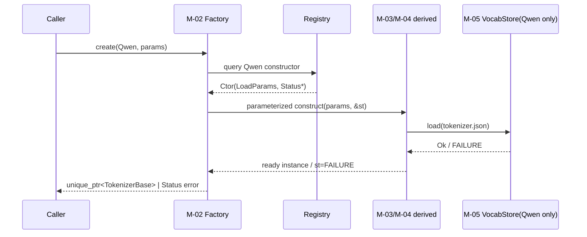
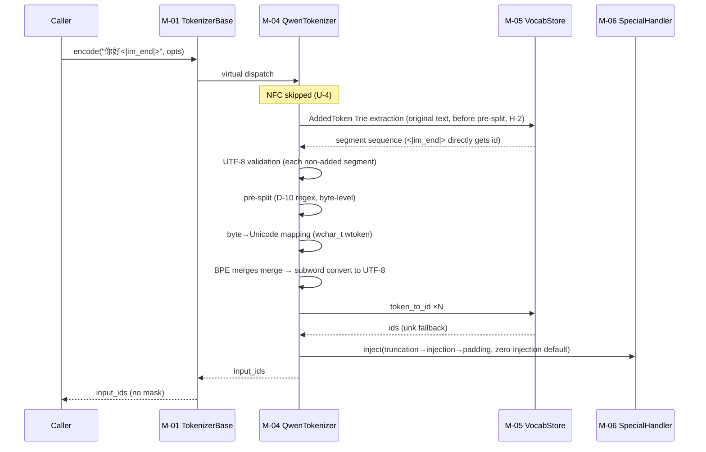
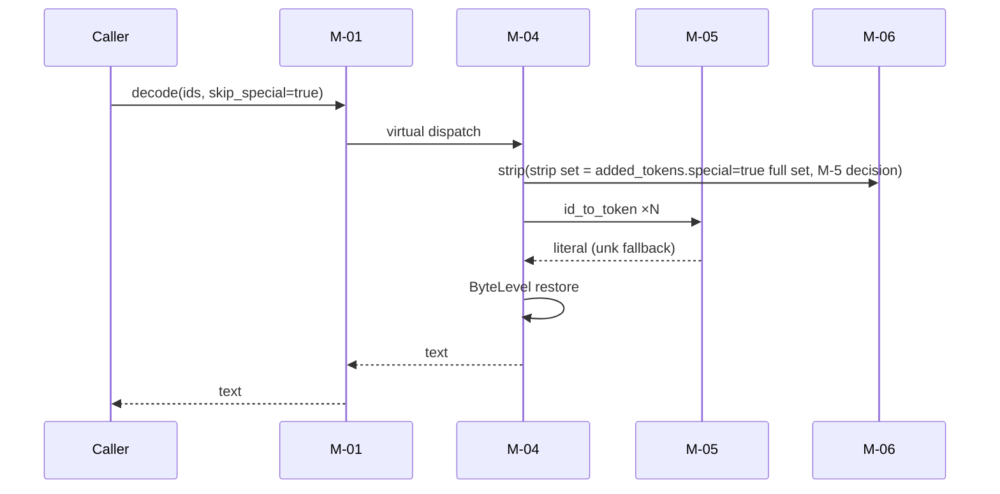
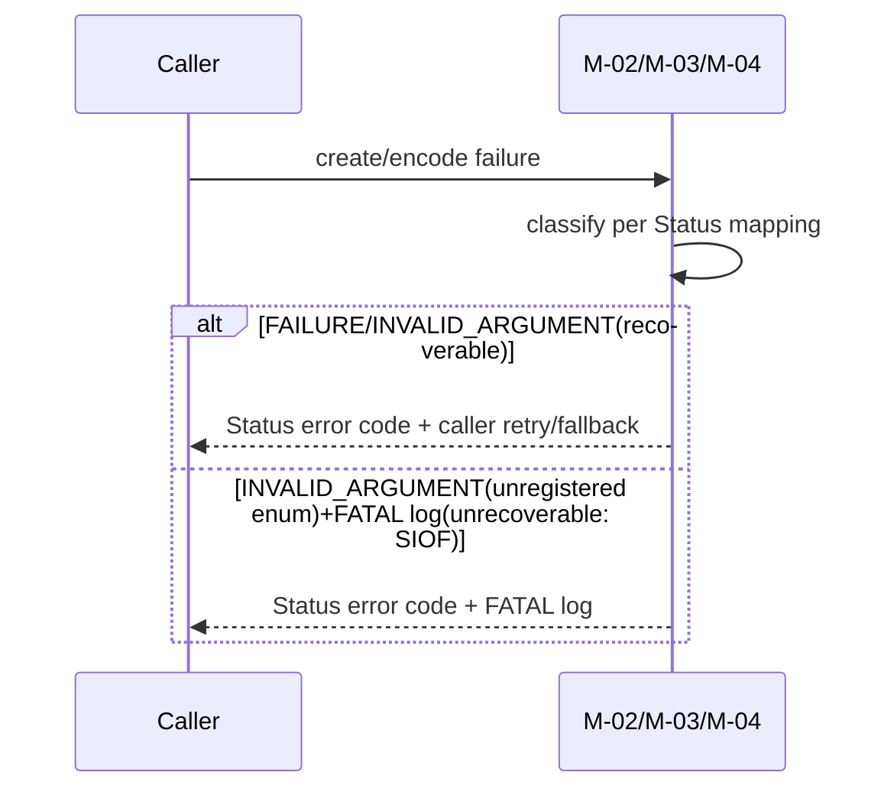
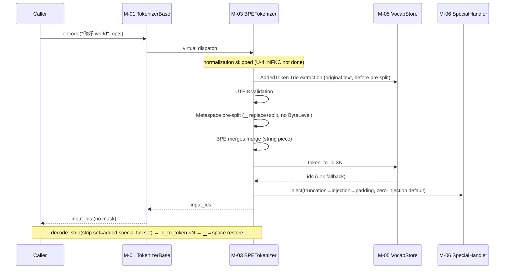

<!--
AUTO-GENERATED by sdd_design/scripts/render_design.py
Source of truth: overview.md + sibling files in this directory.
DO NOT edit this file by hand — re-run the render script.
-->

# Tokenizer Module Design

English | [简体中文](../../../zh/cann_lm_engine/tokenizer/DESIGN.md)

## Table of Contents

- [Spec Summary](#spec-summary)
- [§1 Scope and Goals](#1-scope-and-goals)
- [§2 Architecture Overview](#2-architecture-overview)
  - [§2.1 Architectural Style and Philosophy](#21-architectural-style-and-philosophy)
  - [§2.2 Runtime Architecture](#22-runtime-architecture)
  - [§2.3 Deployment and Hardware Mapping](#23-deployment-and-hardware-mapping)
  - [§2.4 Concurrency and Thread Safety](#24-concurrency-and-thread-safety)
- [§3 Module List](#3-module-list)
- [§4 Contract List](#4-contract-list)
- [§5 Key Flow List](#5-key-flow-list)
- [§6 Quality Attributes and Cross-Cutting Strategies](#6-quality-attributes-and-cross-cutting-strategies)
- [§7 Decision Index](#7-decision-index)
- [§8 Code Plan Hints](#8-code-plan-hints)
- [§9 Risks and Open Issues](#9-risks-and-open-issues)
- [§10 Change Log](#10-change-log)
- [Modules](#modules)
  - [M-01-tokenizer-base](#m-01-tokenizer-base)
  - [M-02-tokenizer-factory](#m-02-tokenizer-factory)
  - [M-03-bpe-tokenizer](#m-03-bpe-tokenizer)
  - [M-04-qwen-tokenizer](#m-04-qwen-tokenizer)
  - [M-05-vocab-store](#m-05-vocab-store)
  - [M-06-special-token-handler](#m-06-special-token-handler)
  - [M-07-spm-tokenizer](#m-07-spm-tokenizer)
- [Contracts](#contracts)
  - [C-01-base-caller](#c-01-base-caller)
  - [C-02-factory-caller](#c-02-factory-caller)
  - [C-03-vocab-qwen](#c-03-vocab-qwen)
  - [C-04-special-derived](#c-04-special-derived)
  - [C-05-registration](#c-05-registration)
- [Flows](#flows)
  - [F-01-factory-create-load](#f-01-factory-create-load)
  - [F-02-qwen-encode](#f-02-qwen-encode)
  - [F-03-qwen-decode](#f-03-qwen-decode)
  - [F-04-error-recovery](#f-04-error-recovery)
  - [F-05-bpe-encode-decode](#f-05-bpe-encode-decode)
- [Performance and Quality](#performance-and-quality)
  - [concurrency](#concurrency)
  - [dfx](#dfx)
  - [performance](#performance)
  - [security](#security)
- [New Decisions](#new-decisions)
  - [D-01-architecture](#d-01-architecture)
  - [D-02-self-registration](#d-02-self-registration)
  - [D-03-impl-strategy](#d-03-impl-strategy)
  - [D-04-unigram-scope](#d-04-unigram-scope)
  - [D-05-query-structure](#d-05-query-structure)
  - [D-06-byte-cache](#d-06-byte-cache)
  - [D-07-nfc-impl](#d-07-nfc-impl)
  - [D-08-cpp17-no-span](#d-08-cpp17-no-span)
  - [D-09-json-parser](#d-09-json-parser)
  - [D-10-pretok-regex](#d-10-pretok-regex)

---

<a id="spec-summary"></a>
## Spec Summary

- Spec ID: `SR20260728001`
- Upstream spec: `../SPEC/tokenizer.md`
- Baseline project-level: `null`
- Covered REQ: [REQ-01, REQ-02, REQ-03, REQ-04, REQ-05, REQ-06, REQ-07, REQ-08, REQ-09]
- Covered SCN: [SCN-01, SCN-02]

---

```yaml
spec_source: ../SPEC/tokenizer.md
level: spec
spec_id: SR20260728001
baseline_project_design: null   # first spec, no project-level baseline
delta_summary: v0.7 requirement change — BPETokenizer changed to hand-written (tokenizer.json, serves gemma4); sentencepiece dependency path renamed SPMTokenizer and made placeholder (registration stub, not implemented this period); QwenTokenizer unchanged; this period runtime zero third-party dependency (except D-09 JSON single header)
covers_req: [REQ-01, REQ-02, REQ-03, REQ-04, REQ-05, REQ-06, REQ-07, REQ-08, REQ-09]
covers_scn: [SCN-01, SCN-02]
status: draft
```

# Tokenizer Module Design

> **REQ mapping** (spec §4.1.x → REQ-NN): REQ-01=vocabulary loading(§4.1.1) · REQ-02=text encoding(§4.1.2) · REQ-03=ID decoding(§4.1.3) · REQ-04=attention mask responsibility boundary(§4.1.4) · REQ-05=batch encoding(§4.1.5) · REQ-06=factory creation(§4.1.6) · REQ-07=derived self-registration(§4.1.7) · REQ-08=internal module boundary(§4.1.8) · REQ-09=error classification(§4.1.9).
> **SCN mapping**: SCN-01=§4.3 factory creation→encode→decode timing · SCN-02=§8 consistency oracle validation scenario set (TC_001..305).

<a id="1-scope-and-goals"></a>
## §1 Scope and Goals

- **in scope**: C++ tokenizer abstraction layer under `cann_lm/engine/core/component/tokenizer` — thin base class TokenizerBase + factory + parameterized self-registration + **BPETokenizer (hand-written BPE, vocabulary HF tokenizer.json, serves gemma4, complete)** + **QwenTokenizer (hand-written ByteLevel BPE, vocabulary tokenizer.json, serves Qwen3.5, complete)** + **SPMTokenizer (sentencepiece dependency, placeholder stub)** + shared VocabStore/SpecialTokenHandler. Internal module, not exposed to Python; does not produce attention mask; this period runtime third-party dependency only D-09 JSON single header (no sentencepiece/ICU).
- **out of scope** (with reasons):
  - pybind11 external exposure — spec §4.1.8 explicitly internal module boundary, outer layer responsibility.
  - attention mask generation — spec §4.1.4 explicitly not in this module, constructed by caller.
  - NFC normalization — user decision v0.5 skip (U-4/D-07), non-NFC input allowed to diverge from oracle, implement if needed.
  - SPMTokenizer implementation (sentencepiece library path) — user decision v0.7 placeholder only (registration stub, create always FAILURE, not implemented this period, D-03/D-04, U-5 deferred).
  - Dynamic library hot-unload support — spec §6 already declared not supported.
- **Goal priority**: behavior consistency (TC_203) > extensibility (open-closed) > encoding throughput > memory footprint. Consistency first guarantees migration validation credibility; extensibility guarantees new algorithms zero-intrusion.

<a id="2-architecture-overview"></a>
## §2 Architecture Overview

<a id="21-architectural-style-and-philosophy"></a>
### §2.1 Architectural Style and Philosophy

```mermaid
graph TD
  CALL[engine internal C++ caller] -->|create| FAC[M-02 tokenizer-factory]
  FAC -->|create(enum,params)| REG[(registry)]
  REG -.construct.-> BPE[M-03 BPETokenizer<br/>hand-written BPE · gemma4]
  REG -.construct.-> QW[M-04 QwenTokenizer<br/>hand-written ByteLevel BPE · Qwen3.5]
  REG -.construct.-> SPM[M-07 SPMTokenizer<br/>placeholder stub · sentencepiece]
  BPE -->|inherit| BASE[M-01 tokenizer-base<br/>TokenizerBase pure virtual]
  QW -->|inherit| BASE
  SPM -->|inherit| BASE
  BPE -.composition.-> VS[M-05 vocab-store<br/>tokenizer.json]
  QW -.composition.-> VS
  BPE -.composition.-> ST[M-06 special-token-handler]
  QW -.composition.-> ST
  CALL -->|encode/decode| BASE
```

Style declaration (≤100 words): **thin base class + three-way derived (BPE/Qwen hand-written tokenizer.json, SPM placeholder stub) + shared infra composition**. Base class only defines stable behavior contract (pure virtual encode/decode + options + project Status error mapping), BPE/Qwen each implement complete pipeline, VocabStore/SpecialTokenHandler independent composable, factory static self-registration dispatches by enum.

<a id="22-runtime-architecture"></a>
### §2.2 Runtime Architecture

- Process/thread model: within engine process, tokenizer instance is same-thread synchronous call object; no independent thread, no event loop.
- Communication mechanism table:

| Caller | Callee | Communication method | Sync/Async | Notes |
|--------|--------|----------|-----------|------|
| engine caller | M-02 factory | function call | sync | create/list_registered |
| M-02 factory | M-03/M-04/M-07 | function call (via registry, parameterized Ctor) | sync | construct derived + load vocabulary inside constructor (M-07 placeholder always fails) |
| engine caller | M-01 base(virtual) | function call | sync | encode/decode polymorphic dispatch |
| M-04 | M-05 vocab-store | composition held | sync | id↔token query, merges, special export |
| M-03/M-04 | M-06 special-token-handler | composition held | sync | special inject/strip |


- Synchronization point: no cross-processor-domain; pure CPU, no CPU↔NPU sync overhead.

<a id="23-deployment-and-hardware-mapping"></a>
### §2.3 Deployment and Hardware Mapping

| Module | Processor | Notes |
|------|--------|------|
| M-01..M-07 + vendored json (no sentencepiece this period) | CPU | aarch64 (Ascend host) + OHOS musl cross target, pure CPU computation |
| Memory domain | DDR shared | vocabulary resident in process heap, no NPU dedicated memory pool |
| Power domain | no independent sleep | synchronous call, stack released when call ends |

<a id="24-concurrency-and-thread-safety"></a>
<a id="concurrency"></a>
### §2.4 Concurrency and Thread Safety

- Lock strategy: registry read-more-write-less (write during static initialization, runtime read-only) → std::call_once protection; instance encode/decode only reads vocab → lock-free concurrent (vocab read-only after load).
- Shared resources: factory registry (static), VocabStore mapping table (within instance, read-only after load).
- Deadlock prevention: no cross-instance locks; registry lock does not nest with instance locks.
- Structural concurrency guarantee (spec §4.1.9): instance published only after load completes, write-read concurrency window structurally eliminated (nfr/concurrency).

<a id="3-module-list"></a>
## §3 Module List

| ID | Name | One-line responsibility | Dependencies | Details |
|----|------|-----------|------|------|
| M-01 | tokenizer-base | TokenizerBase pure virtual interface + Algorithm enum (BPE/Qwen/SPM) + options/SpecialTokenConfig + error mapping table + mask/internal boundary declaration | — | → |
| M-02 | tokenizer-factory | Factory create/list_registered + static self-registration Registrar (parameterized Ctor) + SIOF/link-discard protection | M-01 | → |
| M-03 | bpe-tokenizer | BPETokenizer derived: hand-written BPE (AddedToken extraction→Metaspace pre-split→merges→id), vocabulary tokenizer.json, serves gemma4 | M-01,M-05,M-06 | → |
| M-04 | qwen-tokenizer | QwenTokenizer derived: hand-written pre-split (D-10 regex+ByteLevel)→BPE merges→id mapping→ByteLevel decode (NFC skipped) | M-01,M-05,M-06 | → |
| M-05 | vocab-store | tokenizer.json parsing + id↔token bidirectional mapping + merges table + added_tokens/strip-set export | M-01 | → |
| M-06 | special-token-handler | bos/eos/pad/unk management + encode injection / decode strip (strip set=added special full set) + padding alignment | M-01 | → |
| M-07 | spm-tokenizer | SPMTokenizer placeholder stub: sentencepiece library path reserved, registered but create always FAILURE | M-01 | → |

Dependency graph acyclic check: M-01 ← {M-02, M-05, M-06} ← {M-03, M-04}; M-01 ← M-07 ✓

<a id="4-contract-list"></a>
## §4 Contract List

> `engine-caller` is engine internal C++ caller (external participant, not this design module), consistent with REQ-08 internal boundary.

| ID | Producer | Consumer | One-line contract | Details |
|----|--------|--------|-----------|------|
| C-01 | M-01 | engine-caller | TokenizerBase polymorphic interface, does not return mask | → |
| C-02 | M-02 | engine-caller | create/list_registered | → |
| C-03 | M-05 | M-03, M-04 | tokenizer.json loading and bidirectional query | → |
| C-04 | M-06 | M-03, M-04 | special inject/strip | → |
| C-05 | M-03, M-04, M-07 | M-02 | static self-registration (parameterized Ctor; M-07 placeholder stub also registered) | → |

<a id="5-key-flow-list"></a>
## §5 Key Flow List
| ID | Scenario | Key path | Details |
|----|------|---------|------|
| F-01 | Factory create+load | caller→M-02→M-04→M-05 | → |
| F-02 | Qwen encode | caller→M-01→M-04→M-05/M-06 | → |
| F-03 | Qwen decode | caller→M-01→M-04→M-05/M-06 | → |
| F-04 | Error recovery | caller→M-02/M-03/M-04 classification | → |
| F-05 | BPE encode/decode (gemma4) | caller→M-01→M-03→M-05/M-06 | → |

<a id="6-quality-attributes-and-cross-cutting-strategies"></a>
## §6 Quality Attributes and Cross-Cutting Strategies
| Dimension | Core strategy | Details |
|------|---------|------|
| Performance | encode ≤200μs/1KiB, ≥10⁶ tok/s (U-1 pending measurement) | → |
| Security | input validation + no external exposure surface | → |
| DFX | L1/L2/L3 tiering + consistency circuit breaker | → |
| Concurrency | registry call_once + read-only query lock-free + structural guarantee | → |
| Error propagation | unified project Status + M-01 §2 mapping table, non-silent | §4.1.9 + F-04 |
| Data consistency | read-only after load, no cross-domain | §2.3 |

<a id="7-decision-index"></a>
## §7 Decision Index
| ID | Topic | Status |
|----|------|------|
| D-01 | Architecture choose thin base class + composition | accepted |
| D-02 | Static self-registration + Registrar + SIOF protection | accepted |
| D-03 | BPE/Qwen hand-written (tokenizer.json) + SPM placeholder + test-period oracle | accepted (v0.7 revised) |
| D-04 | SPM placeholder stub (registered but not-ready) replaces Unigram empty slot | accepted (v0.7 revised) |
| D-05 | id↔token query uses unordered_map | accepted |
| D-06 | ByteLevel byte→token cache | accepted (related M-04) |
| D-07 | NFC normalization: skip this period, implement if needed | accepted (v0.5 revised original "borrow ICU subset") |
| D-08 | Under C++17 constraint abandon std::span (use vector instead) | accepted |
| D-09 | tokenizer.json parsing dependency: vendored nlohmann/json single header | accepted (v0.6) |
| D-10 | Pre-split regex: std::regex byte-level + POSIX class + [a-zA-Z]ü branch (including exemption registration) | accepted (user decided, v0.6) |

<a id="8-code-plan-hints"></a>
## §8 Code Plan Hints
**For downstream plan/impl agent**:
- Implementation order (dependency topology): M-01 base → M-05 vocab-store + M-06 special-handler (parallelizable) → M-02 factory → M-04 qwen-tokenizer → M-03 bpe-tokenizer (hand-written Metaspace/BPE) → M-07 spm placeholder stub.
- **Source code landing point (L-1 unified)**: flat `cann_lm/engine/core/component/tokenizer.{h,cpp}` keeps existing include paths unchanged (3 consumers' includes and existing UT unchanged); implementation files can split `bpe_tokenizer.cpp`/`qwen_tokenizer.cpp`/`vocab_store.cpp`/`special_token_handler.cpp`, but **REGISTER_TOKENIZER registration macro calls must be in same tokenizer.cpp as `TokenizerFactory::create`** (link-discard constraint).
- **Link-discard constraint (external review M2)**: registration macro and create same TU (tokenizer.cpp), or use whole-archive for targets containing registration macros — prevents unreferenced registration objects in static library from being discarded by linker.
- **Existing code migration list (external review M3 + M-2)**:
  1. `api/cpp/engine_executor.cpp:63/75`: two `std::make_unique<BpeTokenizer>()` calls — change to `std::make_unique<BPETokenizer>(LoadParams{}, nullptr)` (empty parameter construction, load failure means not-ready, encode returns FAILURE preserving stub-era behavior).
  2. `tests/cpp/engine/test_tokenizer.cpp`: ①`BpeTokenizer tok;` default construction change to `BPETokenizer tok{LoadParams{}, nullptr};`; ②`CreateBPEReturnsInvalidArgumentStubEra` split into "create(BPE, empty params)→FAILURE (load failure)" + "create(unregistered enum)→INVALID_ARGUMENT" two cases; ③`ListRegisteredReturnsBPEAndSP` change assertion to {BPE, Qwen, SPM} (3); ④`ContinueOnFailureNotAbort` retained (not-ready instance encode failure semantics unchanged).
  3. **`tests/cpp/engine/test_scheduler.cpp:16`: `BpeTokenizer tok;` default construction change to `BPETokenizer tok{LoadParams{}, nullptr};`** (parameterized Ctor suppresses implicit default construction, otherwise ut_scheduler compilation breaks — external review M-2).
  4. `core/component/tokenizer/tokenizer.h` stub: LoadParams change to single artifact slot (variant path|bytes) + optional special_tokens (zero-injection default); Algorithm change to {BPE, Qwen, SPM} (delete SentencePieceUnigram); `BpeTokenizer` class renamed **`BPETokenizer`** (hand-written); add `QwenTokenizer`; `SentencePieceTokenizer` stub renamed **`SPMTokenizer`** (placeholder, registered).
- **Testing strategy (M-8, A+B layering, v0.6 user decided)**:
  - **A (default UT)**: script trims to generate small tokenizer.json + pre-generate golden ids JSON in repo; each stage (AddedToken extraction/pre-split regex each branch (D-10 measurement anchor samples)/byte→Unicode mapping/BPE merge/special inject-strip) precise assertion; runtime zero Python dependency.
  - **B (`tokenizer_realdata` target)**: CMake registration, **detect `tmp/qwen/tokenizer.json` and `tmp/gemma/tokenizer.json` (local placement, gitignore) exist before compile/run**; real-scale (Qwen 248044+26 words) consistency + TC_205b memory measurement; golden ids pre-generated by Python oracle (script in `scripts/`); **gemma4 tokenizer.json pending placement** (`tmp/gemma/` currently empty, BPE path B-layer test blocked; after landing must verify model.type==BPE, if Unigram type revisit M-03 route).
- **Build integration (v0.7 simplified)**: this period **no sentencepiece** (SPM is placeholder, U-5 deferred to its implementation period: source build + version pin + OHOS musl cross + protobuf handling closed then); only `third_party/nlohmann/json.hpp` vendor into repo (D-09). CMake target registered in `cann_lm/engine/CMakeLists.txt` + `ohos/CMakeLists.txt` (transition period copy source list synchronized).
- Integration milestones: ①M-01+M-02+M-05+M-06+M-07 placeholder compiles + factory create cases (including SPM placeholder FAILURE) + migration list landed; ②M-04 Qwen full pipeline (including AddedToken extraction) + A-layer TC_203 consistent + B-layer real artifact consistent; ③M-03 BPETokenizer hand-written full pipeline + A-layer fixture consistent (B-layer pending gemma4 real artifact).
- Module minimum reading set: M-01 → M-01.md + C-01; M-02 → M-02.md + C-02 + C-05; M-03 → M-03.md + C-03 + C-04 + F-05 + D-03; M-04 → M-04.md + C-03 + C-04 + F-02 + F-03 + **D-10**; M-05 → M-05.md + C-03 + D-09 + nfr/performance.md §2; M-07 → M-07.md + D-04.

<a id="9-risks-and-open-issues"></a>
## §9 Risks and Open Issues
| Risk/Open issue | Impact | Mitigation | Trigger condition |
|-----------|------|------|----------|
| U-5 sentencepiece build integration (**deferred** to SPM implementation period; not installed on this machine, OHOS musl needs cross, protobuf handling, SHARED library PIC) | then M-07 compile/link breaks | then source sub-build + version pin + pimpl isolation (no such dependency this period) | SPM implementation need arises |
| U-1 performance budget no baseline | encode budget inaccurate | implementation-time micro-benchmark calibration | aarch64 measurement |
| U-3 memory coefficient | **measured baseline (2026-09-01)**: Qwen 91MB/248070 words (≈0.38KB/word), gemma 48MB/262144 words (≈0.19KB/word) | unordered_map already within budget; degrade with arena resident pool | exceeds coef |
| U-4 known exempted divergence (NFC skip + D-10 regex difference) | mixed/ü-initial words/uppercase abbreviations/non-ASCII whitespace/non-NFC input diverges from oracle | golden corpus excludes such input; exemption registration (D-10 §4 list) | product corpus largely falls into exempted category (D-07/D-10 §5 review) |
| Static library registration object link discard | runtime registry empty | registration macro and create same TU / whole-archive (§8 constraint) | module split/linker behavior difference |
| 🔴 M-04 CJK subword many | encode exceeds 200μs | merges prefix tree/double array (degradation path) | CJK corpus measurement |
| D-09 JSON parsing performance | 12.8MB tokenizer.json load latency | nlohmann SAX streaming; fallback rapidjson (D-09 §5) | load measurement |
| gemma4 tokenizer.json artifact missing (tmp/gemma/ empty) and **model.type not validated** (if Unigram type then BPETokenizer route invalid, need revisit) | BPE path B-layer test and TC_001b/205 blocked; M-03 may rework | pending user places artifact and validates model.type==BPE; A-layer small fixture first | implementation-time real artifact lands |
| Consistency divergence | TC_203 failure | A+B dual-layer oracle full comparison (golden pre-generated) | golden corpus |

<a id="10-change-log"></a>
## §10 Change Log
| Version | Date | Change | Triggering spec section |
|------|------|------|---------------|
| 0.1 | 2026-07-28 | Initial draft (Gate1-2 passed, phase 2→3+3→4 fill) | SR20260728001 all |
| 0.2 | 2026-07-28 | U-2 validation (Gemma=SentencePiece, refer to gemma_pytorch); update D-04/M-04/§9 | SR20260728001 §4.1.1 |
| 0.3 | 2026-07-28 | D-08: std::span→C++17 alternative, eliminates C++20 dependency | SR20260728001 §6 |
| 0.4 | 2026-08-19 | Source constraint revision (linked pipeline v0.4): ①error unified to project Status (remove TokenizerError); ②ITokenizer→TokenizerBase; ③LoadParams memory content form; ④path core/tokenizer→core/component/tokenizer. (Note: v0.4 then only modified rendered product did not write back source files, v0.5 writeback completed) | constraint #1/#2 + linked pipeline v0.4 |
| 0.5 | 2026-08-31 | **Requirement change back to design stage** (user decision): ①implementation target changed to BPETokenizer (link Google SentencePiece library + .model, D-03/D-04 revised) and QwenTokenizer (hand-written ByteLevel BPE + tokenizer.json, M-04 rewritten); ②Unigram kept enum empty slot no implementation (D-04); ③NFC skip, U-4 exemption registration (D-07 revised); ④LoadParams restored path/memory dual form and converged to single artifact slot + optional special_tokens (H1/H4 decision); ⑤parameterized Ctor (H4); ⑥M-01 §2 error category→Status unique authoritative mapping table (H2); NotResponsible deleted (H3); ⑦external review M1-M4/L1 written: concurrency clause structural guarantee rewrite, link-discard constraint, migration list, RegistrationConflict no return value correction; ⑧add D-09 (JSON parsing dependency); ⑨v0.4 revision writeback source files (H5) | SR20260728001 §3.3/§4.1.1/§4.1.2/§4.1.6/§4.1.9/§6/§8 |
| 0.6 | 2026-09-01 | **v0.5 delta external review (3H/9M/7L, re-examiner zero false positives) written**: ①D-10 pre-split regex decision (user decided std::regex byte-level + POSIX class + [a-zA-Z]ü branch, aplha typo corrected, measurement anchor archived; mixed/ü-initial/uppercase abbreviation/non-ASCII whitespace into U-4 exemption); ②M-04 add AddedTokenSplitter (H-2: 26 added_tokens extracted before pre-split Trie); ③H-3 zero-injection default + LoadParams explicit override (real artifact post_processor=ByteLevel no injection verified); ④M-1 mapping table two tables aligned (6 rows); ⑤M-2 migration list add test_scheduler.cpp:16; ⑥M-3 truncation budget formula finalized; ⑦M-4 special role not derived from artifact (tokenizer_config belongs to model config domain); ⑧M-5 strip set=added_tokens.special full set; ⑨M-6 TC_205b definition; ⑩M-7 vocab_size real artifact scope 248070 (≠config 248320); ⑪M-8 A+B layered testing (fixture in repo + realdata detect tmp/ exists before run, golden pre-generated); ⑫M-9 SP injection right uniqueness constraint; ⑬L-1 landing point unified flat + same TU split constraint; ⑭L-2/L-3/L-4/L-5/L-6/L-7 cleanup; ⑮D-09 to accepted | SR20260728001 §4.1.2/§4.1.3/§8 + real artifact verification (tmp/qwen) |
| 0.7 | 2026-09-01 | **Requirement change (user decision)**: ①original sentencepiece library path renamed **SPMTokenizer** (M-07 new module, registration placeholder stub — create always FAILURE, encode not-ready, not implemented this period, D-04 revised); ②**BPETokenizer** (M-03) changed to hand-written implementation not depending on sentencepiece — vocabulary HF tokenizer.json (model.type=BPE segment), serves gemma4, Metaspace pre-split/restore, no ByteLevel (D-03 revised); ③Algorithm enum {BPE, Qwen, SPM} (delete SentencePieceUnigram empty slot, D-04); ④sentencepiece/protobuf dependency overall deferred to SPM implementation period (U-5 changed to deferred registration); ⑤add F-05 (BPE encode/decode flow); ⑥C-03 consumers expanded to M-03+M-04, C-05 producers expanded to M-03/M-04/M-07; ⑦gemma4 test artifact changed to tokenizer.json and model.type==BPE pending real artifact validation (U-6) | SR20260728001 §4.1.1/§4.1.2/§4.1.6 |
| 0.8 | 2026-09-01 | **Implementation-period DOC-UPDATE** (implementation complete: ctest 158/158 all green, A-layer 33 + B-layer 3 new): ①M-03 real artifact semantic correction — gemma4 is Replace(" "→"▁")+Split(MergedWithPrevious) type (not Metaspace, no dummy ▁), implemented per file config; ②M-05 supplemented merges dual format ("A B" string / ["A","B"] array), added_tokens inline (gemma) and append (Qwen) dual-form overlay, token_to_id C++17 transparent hash limitation note (U-1 optimization item); ③D-10 exemption list supplement: ü followed by letter (aüb) belongs to exempted category, only ü-final words aligned (oracle measured); ④U-3 measured baseline written (Qwen 91MB/248070 words, gemma 48MB/262144 words, load 1481/3307ms); ⑤migration list all executed (engine_executor×2, ut_scheduler:16, ut_tokenizer rewritten, tokenizer.h stub refactored, class renamed BPETokenizer/SPMTokenizer) | SR20260728001 all (implementation verification) |
| 0.8.1 | 2026-09-01 | **Code external review (+2, reviewer, REWORK→fix) written**: F-01 id upper bound validation (prevent bad_alloc/int truncation); F-02 load local build success only commit (failed instance always not-ready); F-03 added overlay semantics converged to overwrite (M-05 §6 corrected, consistent with HF); F-04 array merges direct output pair; F-05 SAX kSkip event paired counting; F-06 path form streaming parse; F-07 PretokRegex pinned classic locale; F-10 injection config missing WARN; F-11 batch Longest failed row no padding; F-12/F-14 comment correction; F-09 supplement 4 UT (duplicate registration/OOV→unk×2/concurrent read-only) — **ctest 162/162 all green** | SR20260728001 §4.1.1/§4.1.9/§8 |


---

<a id="modules"></a>
## Modules

<a id="m-01-tokenizer-base"></a>
### M-01-tokenizer-base

#### §1 Responsibility

Defines tokenizer abstract base class TokenizerBase's pure virtual interface (encode→input_ids / decode→text / vocab_size / special_token_id / batch_encode default implementation), declares Algorithm enum (BPE/Qwen/SPM), EncodeOptions/DecodeOptions, SpecialTokenConfig. Error unification (constraint #1 / v0.4): does not return module's own error codes, uniformly uses project `Status` (infra/status.h), and in this module gives spec §4.1.9 error category → Status's **unique authoritative mapping table**. Declares attention mask not in responsibility (REQ-04 — implemented as "does not provide mask query interface") and internal module boundary (REQ-08). Does not implement any algorithm pipeline.

#### §2 External Interface

```cpp
// Algorithm enum (REQ-06). v0.7: BPE=hand-written BPE (tokenizer.json, gemma4);
// Qwen=hand-written ByteLevel BPE (tokenizer.json, Qwen3.5); SPM=sentencepiece dependency
// placeholder stub (registered but not-ready, encode/decode returns FAILURE; fill implementation when library connected in future).
enum class Algorithm { BPE, Qwen, SPM };

// Error unification (constraint #1 / v0.4): does not return module's own error codes, uniformly uses project Status
// (infra/status.h: SUCCESS=0, FAILURE=1, INVALID_ARGUMENT=2,
//  INVALID_STATE=3, NOT_FOUND=4, CANCELED=5).
// spec §4.1.9 error category → Status unique authoritative mapping (v0.5 H2/H3 decision, 1:1 with SPEC §4.1.9 table):
// ┌───────────────────────┬─────────────────────┬────────────────────────────┐
// │ spec §4.1.9 category  │ Status              │ Description                │
// ├───────────────────────┼─────────────────────┼────────────────────────────┤
// │ LoadFailed            │ FAILURE             │ artifact missing/unreadable/format invalid/misaligned │
// │ UnsupportedAlgorithm  │ INVALID_ARGUMENT    │ unknown enum/unregistered (consistent with stub)       │
// │ InvalidInput          │ INVALID_ARGUMENT    │ invalid UTF-8/None/empty padding                       │
// │ OutOfVocab            │ SUCCESS             │ not failure — internal map unk                          │
// │ ConcurrentViolation   │ INVALID_STATE       │ structurally eliminated (see nfr/concurrency)         │
// │ RegistrationConflict  │ (no return value)    │ development-time WARN log, non-silent                  │
// └───────────────────────┴─────────────────────┴────────────────────────────┘
// Note 1: NotResponsible category deleted (H3) — this module does not provide mask query interface,
//       i.e. the implementation method for REQ-04 responsibility boundary, no unauthorized path, no error code to return.
// Note 2: If "registered but unimplemented" derived capability appears in future, must sync add category via SPEC §4.1.9
//       before extending mapping row (this period SPM is registration stub — create returns FAILURE due to placeholder load failure,
//       no new error category; unregistered enum still goes INVALID_ARGUMENT).

// Encoding options (REQ-02)
struct EncodeOptions {
  bool add_special_tokens = true;
  std::optional<size_t> max_length;      // truncation
  enum class Padding { None, Longest, Fixed } padding = Padding::None;
  std::optional<size_t> pad_to_length;   // effective when Padding::Fixed
};

// Decoding options (REQ-03)
struct DecodeOptions {
  bool skip_special_tokens = true;
};

// special token config (v0.5 added, passed in with LoadParams).
// v0.6 scope (H-3 decision + tmp/qwen real artifact verification): **zero-injection default** — default add_bos=false,
// add_eos=false (aligned with Qwen real artifact: post_processor=ByteLevel no injection, bos_token=null).
// When engine side needs eos termination semantics, explicitly provide via LoadParams.special_tokens
// (assembled from ModelConfig, same as TextEmbedding EmbeddingConfig::FromModelConfig pattern).
// decode strip set does not go through this structure — see M-06 (takes added_tokens.special=true full set).
struct SpecialTokenConfig {
  std::optional<int> bos_id, eos_id, pad_id, unk_id;
  bool add_bos = false, add_eos = false;  // zero-injection default; inject per config when explicitly configured
};

// Abstract base class (thin interface, REQ-02/03/04/05/08)
class TokenizerBase {
 public:
  virtual ~TokenizerBase() = default;
  // Semantics: synchronous, blocks until return; encode does not return attention mask (REQ-04)
  // Errors: INVALID_ARGUMENT(invalid UTF-8 or out_ids==nullptr) | SUCCESS(OOV internal map unk)
  virtual Status encode(std::string_view text,
                        const EncodeOptions& opts,
                        std::vector<int>* out_ids) = 0;
  // Semantics: synchronous; when skip_special strips control tokens
  // Errors: SUCCESS(OutOfVocab skip/replace unk literal, no interrupt)
  virtual Status decode(const std::vector<int>& ids,
                        const DecodeOptions& opts,
                        std::string* out_text) = 0;
  virtual size_t vocab_size() const = 0;
  // Semantics: returns special id by name, returns nullopt when unconfigured
  virtual std::optional<int> special_token_id(std::string_view name) const = 0;
  // Default implementation: loop single encode + padding alignment (REQ-05); single failure marked, no whole-batch crash
  virtual Status batch_encode(const std::vector<std::string>& texts,
                              const EncodeOptions& opts,
                              std::vector<std::vector<int>>* out);
};
```

#### §3 Internal Structure
- Pure interface, no subcomponents. batch_encode is base class default implementation (can be overridden by derived).
- Derived receives LoadParams via parameterized constructor and completes vocabulary loading inside constructor (H4 decision, see M-02/M-03/M-04), base class does not set load() virtual function.

<a id="contracts"></a>
#### §4 Key Dependencies and Hardware Contracts
- No lower-layer HAL/SDK dependency. Pure C++17 standard library (std::optional/std::variant/std::string_view/std::byte/std::vector). Does not use std::span (C++20, exceeds C++17 constraint, see D-08).
- No cross-processor synchronization point; no DMA.
- Internal module boundary (REQ-08): only header file exposed to engine internal, no cross-language binding symbols exported.
- Source code landing: `cann_lm/engine/core/component/tokenizer.{h,cpp}` (v0.4 path correction, consistent with existing stub).

<a id="performance"></a>
#### §5 Performance Budget
| Path | Budget | Measurement condition | Source |
|------|------|----------|------|
| batch_encode (default)| N × single encode | N texts | estimated |
| virtual dispatch overhead | negligible | — | estimated |
(canonical see nfr/performance.md §2)

#### §6 Failure Modes
| Failure | Trigger | Detection | Handling |
|------|------|------|------|
| mask unauthorized query | (structurally non-existent)| interface has no mask method | no path means REQ-04 implementation; document declaration, no error code (H3) |

#### §7 Observability Points
- log key: `tokenizer.encode.{ok|err}` / `tokenizer.decode.{ok|err}`
- metric: `tokenizer_encode_tokens_total` / `tokenizer_encode_errors_total{kind=...}`

#### §8 Test Hooks
- UT focus: encode/decode virtual dispatch, batch_encode default implementation padding alignment, error code propagation (assert Status value per §2 mapping table), out_ids==nullptr → INVALID_ARGUMENT, zero-injection default semantics (no injection when add_special_tokens=true and unconfigured).
- Need mock: derived stub (verify base class batch_encode default path).

<a id="m-02-tokenizer-factory"></a>
### M-02-tokenizer-factory

#### §1 Responsibility

Provides TokenizerFactory: create(enum, params) constructs derived instance via registry by algorithm enum and returns `unique_ptr<TokenizerBase>`; list_registered() enumerates registered algorithms. Provides static self-registration Registrar mechanism (macro REGISTER_TOKENIZER), derived registers **parameterized constructor** into singleton registry during static initialization (this period registration set = {BPE, Qwen, SPM stub}), first create asserts registry non-empty to prevent SIOF silent failure.

#### §2 External Interface

```cpp
// Load parameters (REQ-01, file path or memory content one of two, v0.5 single artifact slot)
// Artifact kind per algorithm (v0.7): Algorithm::BPE / Algorithm::Qwen → HF tokenizer.json;
// Algorithm::SPM → sentencepiece .model (placeholder, load always fails).
struct LoadParams {
  std::variant<std::filesystem::path, std::vector<std::byte>> artifact;
  std::optional<SpecialTokenConfig> special_tokens;  // explicit special config; default zero-injection (role assembled from ModelConfig)
};

// Factory (REQ-06/07)
class TokenizerFactory {
 public:
  // Semantics: synchronous; query registry locate constructor → parameterized construct derived (vocabulary loading inside constructor) → return ready instance
  // Errors: INVALID_ARGUMENT(enum unregistered) | FAILURE(load failure, including SPM placeholder always fails, no instance published)
  static Status create(Algorithm algo, const LoadParams& params,
                       std::unique_ptr<TokenizerBase>* out);
  // Semantics: returns currently registered algorithm set (filled during static initialization; this period = {BPE, Qwen, SPM})
  static std::vector<Algorithm> list_registered();
};

// Self-registration mechanism (REQ-07 open-closed)
class Registrar {
 public:
  // Parameterized Ctor (v0.5 H4 decision): factory passes LoadParams through to derived constructor,
  // derived completes vocabulary loading inside constructor, load result passed back via status out parameter.
  using Ctor = std::unique_ptr<TokenizerBase>(const LoadParams&, Status*);
  // Semantics: called during static initialization; duplicate registration of same enum rejected and warned (WARN log, no return value), non-silent
  static void register_(Algorithm algo, Ctor ctor);
};
#define REGISTER_TOKENIZER(algo, Class) \
  static const bool _reg_##Class = []{                  \
    ::cann_lm::engine::Registrar::register_(algo,       \
      [](const LoadParams& p, Status* st)               \
        ->std::unique_ptr<::cann_lm::engine::TokenizerBase>{ \
        return std::make_unique<Class>(p, st); });     \
    return true; }();
```

#### §3 Internal Structure
- Registry: singleton `std::unordered_map<Algorithm, Registrar::Ctor>`, std::call_once initialization protects write, runtime read-only.
- create flow: query table miss → `INVALID_ARGUMENT`; hit → `ctor(params, &st)`, `st` non-Ok or returns null pointer → pass through `st` (load failure `FAILURE`), no instance published.
- SIOF protection: `create()` first call asserts registry non-empty; if empty logs FATAL and returns `INVALID_ARGUMENT` (non-silent).
- **Link-discard constraint (external review M2)**: registration macro must be in same translation unit as `TokenizerFactory::create` (tokenizer.cpp), or use whole-archive linking for targets containing registration macros, prevents unreferenced registration objects in static library from being discarded by linker causing runtime registry empty.

#### §4 Key Dependencies and Hardware Contracts
- No SDK dependency. C++17 standard library (std::call_once/std::variant/std::filesystem).
- Static initialization order fiasco (SIOF): derived Registrar is non-local static object, cross-translation-unit initialization order undefined → use call_once + first create assertion backstop (does not rely on initialization order to guarantee registry constructed).

#### §5 Performance Budget
| Path | Budget | Measurement condition | Source |
|------|------|----------|------|
| create (registry query+construct+load) | one-time, non-hot | — | estimated |
| list_registered | O(registration count), read-only | — | estimated |

#### §6 Failure Modes
| Failure | Trigger | Detection | Handling |
|------|------|------|------|
| UnsupportedAlgorithm | enum unregistered | create query table miss | returns `INVALID_ARGUMENT`, no instance returned |
| RegistrationConflict | duplicate registration | register_ sees existing | reject + WARN log (no return value), retain first registrant |
| SIOF silent failure | registry empty | create assertion | FATAL log + `INVALID_ARGUMENT` |

#### §7 Observability Points
- log key: `tokenizer.factory.create` / `tokenizer.factory.register.{conflict}`
- metric: `tokenizer_factory_creates_total{algo=...}` / `tokenizer_factory_registrations`

#### §8 Test Hooks
- UT focus: create each enum, unknown enum rejection, list_registered contains {BPE, Qwen, SPM}, create(SPM)→FAILURE (placeholder), duplicate registration warning, SIOF empty registry assertion.
- mock: stub derived class verify registration→create closed loop.

<a id="m-03-bpe-tokenizer"></a>
### M-03-bpe-tokenizer

#### §1 Responsibility

BPETokenizer derived (**hand-written BPE, does not depend on sentencepiece, v0.7 requirement change**, serves **gemma4** model). Vocabulary artifact is HF `tokenizer.json` (parsed via M-05 VocabStore, requires model.type=BPE segment — gemma4 real artifact verified after landing, if Unigram type must revisit, see §9 risk table/U-6). Encoding pipeline:

1. **AddedToken extraction** (same as H-2 scope): based on tokenizer.json `added_tokens` Trie, matches whole literal from original text before pre-split and directly maps to single id (gemma4's multimodal tokens like `<start_of_image>` go through this path);
2. **UTF-8 validity validation** (invalid → INVALID_ARGUMENT);
3. **Replace normalization + Split pre-split** (implementation-period real artifact verification correction, v0.8): gemma4 real artifact normalizer is `Replace(" "→"▁")`, pre_tokenizer is `Split(" ", MergedWithPrevious)` (after normalization no spaces → equivalent to whole single piece, no dummy prefix ▁; not Metaspace type). Implementation executes per file Replace config, other normalization types skipped (U-4);
4. **BPE merge**: merge ▁-replaced string piece by merges priority (**no ByteLevel byte mapping** — SP-style vocabulary is native Unicode literals, different from Qwen path's byte mapping representation);
5. **id lookup**: subword lookup vocab for token id (miss → unk);
6. **special inject/truncation/padding** (M-06, zero-injection default + LoadParams explicit override; gemma4 role config refer to configuration_gemma4.py: bos=2/eos=1/pad=0, explicitly provided via ModelConfig→LoadParams).

Decoding: id→literal→Metaspace restore (▁→space, strip leading ▁). Normalization (NFKC/precompiled charsmap) **skipped this period** (U-4 exemption, same D-07 scope). Composes VocabStore (M-05, shared with Qwen path) and SpecialTokenHandler (M-06; strip set takes tokenizer.json added_tokens.special=true full set). Provides batch_encode (default implementation inherited from base).

#### §2 External Interface

```cpp
// Inherits TokenizerBase (M-01), override encode/decode/vocab_size/special_token_id
class BPETokenizer final : public TokenizerBase {
 public:
  // Semantics: parameterized construction (H4 decision) — parse tokenizer.json (path or memory content) →
  //       VocabStore load (validate model.type==BPE) + AddedToken Trie + SpecialTokenHandler config;
  //       failure passed back via status as FAILURE
  // Errors: Status::FAILURE(missing/JSON invalid/model.type non-BPE/merges-vocab misaligned)
  explicit BPETokenizer(const LoadParams& params, Status* status);
  // Semantics: synchronous blocking; AddedToken extraction → UTF-8 validation → Metaspace pre-split → BPE merge
  //       → id lookup(unk fallback) → special inject/truncation/padding (M-06)
  // Errors: INVALID_ARGUMENT(invalid UTF-8 or out_ids==nullptr) | SUCCESS(OOV internal map unk)
  Status encode(std::string_view text, const EncodeOptions& opts,
                std::vector<int>* out_ids) override;
  // Semantics: id→literal→Metaspace restore (▁→space); when skip_special strips via M-06
  // Errors: SUCCESS(OOV skip/replace, no interrupt)
  Status decode(const std::vector<int>& ids, const DecodeOptions& opts,
                std::string* out_text) override;
  size_t vocab_size() const override;                     // base vocab + added_tokens total count
  std::optional<int> special_token_id(std::string_view name) const override;
 private:
  std::unique_ptr<VocabStore> vocab_;                     // M-05 (shared schema with M-04)
  std::unique_ptr<SpecialTokenHandler> specials_;          // M-06
};
REGISTER_TOKENIZER(Algorithm::BPE, BPETokenizer)
```

(Class name renamed from v0.5's `BpeTokenizer` to **`BPETokenizer`** — v0.7 requirement change; old name was occupied by sentencepiece library path, now that path moved to M-07 SPMTokenizer placeholder.)

#### §3 Internal Structure
- Subcomponents (≤5):
  1. `AddedTokenSplitter` — added_tokens Trie, extracts whole literal from original text before pre-split (same scope as M-04, logic can share implementation).
  2. `BpeMerger` — merges string piece by merges priority (native Unicode literals, no byte mapping).
  3. Decode restore — ▁→" " (Replace inverse mapping) + ByteFallback(<0xXX>→byte) expansion (decoder Sequence[Replace, ByteFallback, Fuse] semantics).
  5. Composes `VocabStore`(M-05) + `SpecialTokenHandler`(M-06).
- Normalization: skipped (U-4/D-07; gemma reference implementation's NFKC/precompiled charsmap not implemented).

#### §4 Key Dependencies and Hardware Contracts
- Runtime dependency: C++17 standard library + tokenizer.json parsing (D-09 vendored nlohmann/json). **Does not depend on sentencepiece** (v0.7).
- Test-period dependency: gemma4 reference implementation as oracle (real artifact `tmp/gemma/` pending placement, golden ids pre-generated).
- No cross-processor synchronization, no DMA.

#### §5 Performance Budget
| Path | Budget | Measurement condition | Source |
|------|------|----------|------|
| encode 1KiB full pipeline | ≤ 200μs (gemma 32MB real artifact load 3307ms, TC_205b measured) | micro-benchmark median (U-1) | load measured / encode estimated |
| - Metaspace pre-split + merges merge | sub (hot) | same | estimated 🔴 |
| decode | sub (non-hot) | — | estimated |

#### §6 Failure Modes
| Failure | Trigger | Detection | Handling |
|------|------|------|------|
| LoadFailed | tokenizer.json missing/JSON invalid/model.type≠BPE/misaligned | M-05 parse validation | constructor returns FAILURE, instance not published |
| InvalidInput | invalid UTF-8 / out_ids==nullptr | byte sequence validation | returns INVALID_ARGUMENT, no partial ids output |
| OutOfVocab | out-of-vocabulary token | lookup miss | map unk id (SUCCESS) |
| Consistency divergence | element-wise id mismatch with oracle | test-period comparison | fix pipeline, regression TC_203 |
| Known exempted divergence (U-4) | non-NFKC normalized input (combining characters/compatibility decomposition forms) | golden corpus excludes such cases | exemption registration |

#### §7 Observability Points
- log key: `tokenizer.bpe.encode.{ok|err}` / `tokenizer.bpe.load.{ok|err}`
- metric: `tokenizer_bpe_encode_micros` / `tokenizer_bpe_oracle_mismatches_total`

#### §8 Test Hooks
- UT focus: tokenizer.json loading (model.type=BPE validation), AddedToken extraction, Metaspace pre-split/restore, merges merge, special inject/strip, TC_203 consistency (gemma4 fixture, both sides add_special_tokens=false), invalid UTF-8 rejection.
- fixture: small tokenizer.json stub (BPE model segment + Metaspace config + added_tokens samples); gemma4 real artifact via `tokenizer_realdata` (detect `tmp/gemma/tokenizer.json` exists before run).

<a id="m-04-qwen-tokenizer"></a>
### M-04-qwen-tokenizer

#### §1 Responsibility

QwenTokenizer derived (**hand-written ByteLevel BPE pipeline, v0.5 requirement change**, aligned with Qwen3.5 / in-repo `tokenization_qwen3_5.py` and `tmp/qwen/tokenizer.json` real artifact). Vocabulary artifact is HF `tokenizer.json` single file (parsed via M-05 VocabStore). Complete encoding pipeline (v0.6 finalized, per user decision):

1. **AddedToken extraction** (H-2): based on tokenizer.json `added_tokens` (26, including 14 special and 12 non-special) Trie, matches whole literal from **original text** before pre-split and directly maps to single id (aligned with HF AddedVocabulary behavior; non-special added tokens also extracted);
2. **UTF-8 validity validation** (invalid → INVALID_ARGUMENT, no partial output);
3. **Pre-split**: std::regex (byte-level) + user-decided regex (see §3 and D-10);
4. **byte-to-Unicode mapping**: each UTF-8 byte of pre-split token mapped to code point via ByteLevel byte→unicode table, per char to wchar_t forming wtoken;
5. **BPE merge**: merge each wtoken by merges priority;
6. **id lookup**: each BPE output subword converted back to UTF-8 then lookup vocab for token id (miss → unk);
7. **special inject/truncation/padding** (M-06, zero-injection default, LoadParams explicit override).

Decoding: id→literal→ByteLevel restore. NFC normalization **skipped this period** (U-4 exemption). Composes VocabStore and SpecialTokenHandler. Provides batch_encode (default implementation inherited from base). Validated via test-period Python oracle (tokenization_qwen3_5.py, golden ids pre-generated) comparison to maintain TC_203 consistency.

#### §2 External Interface

```cpp
// Inherits TokenizerBase (M-01), override encode/decode/vocab_size/special_token_id
class QwenTokenizer final : public TokenizerBase {
 public:
  // Semantics: parameterized construction (H4 decision) — parse tokenizer.json (path or memory content) →
  //       VocabStore load + AddedToken Trie build + SpecialTokenHandler config;
  //       failure passed back via status as FAILURE
  // Errors: Status::FAILURE(missing/JSON invalid/merges-vocab misaligned)
  explicit QwenTokenizer(const LoadParams& params, Status* status);
  // Semantics: synchronous blocking; AddedToken extraction → UTF-8 validation → pre-split → byte→Unicode mapping (wchar_t)
  //       → BPE merge → subword convert to UTF-8 lookup (unk fallback) → special inject/truncation/padding (M-06)
  // Errors: INVALID_ARGUMENT(invalid UTF-8 or out_ids==nullptr) | SUCCESS(OOV internal map unk)
  Status encode(std::string_view text, const EncodeOptions& opts,
                std::vector<int>* out_ids) override;
  // Semantics: id→literal→ByteLevel restore; when skip_special strips via M-06 (strip set = added_tokens.special=true full set)
  // Errors: SUCCESS(OOV skip/replace, no interrupt)
  Status decode(const std::vector<int>& ids, const DecodeOptions& opts,
                std::string* out_text) override;
  size_t vocab_size() const override;   // base vocab + added_tokens total count (real artifact scope 248070)
  std::optional<int> special_token_id(std::string_view name) const override;
 private:
  std::unique_ptr<VocabStore> vocab_;                  // M-05 (including added_tokens table)
  std::unique_ptr<SpecialTokenHandler> specials_;       // M-06
};
REGISTER_TOKENIZER(Algorithm::Qwen, QwenTokenizer)
```

#### §3 Internal Structure
- Subcomponents (≤5):
  1. `AddedTokenSplitter` — added_tokens Trie, extracts whole literal from original text before pre-split (H-2, aligned with HF AddedVocabulary).
  2. `ByteLevelPreTokenizer` — std::regex byte-level pre-split (**D-10 user-decided regex**) + byte→initial token cache table (D-06):
     ```cpp
     // D-10 (user decided 2026-09-01; aplha typo corrected to alpha, retained [a-zA-Z]ü branch):
     std::regex re(R"('s|'t|'re|'ve|'m|'ll|'d|[a-zA-Z]ü|[^\r\n[:alpha:][:digit:]]?[[:alpha:]]+|[[:digit:]]| ?[^\s[:alpha:][:digit:]]+[\r\n]*|\s*[\r\n]+|\s+(?!\S)|\s+)");
     ```
     Measured (g++13): `"Hello world"→{Hello}{ world}`, `"你好世界"→{你好世界}`, `"aüb"→{aü}{b}` (ü branch effective, aligned with oracle grouping), `"你abc好"→{你}{abc}{好}` (mixed divergence, exemption registered).
  3. `BpeMerger` — merges wtoken (byte→Unicode mapped wchar_t sequence) by merges priority; output subword converted back to UTF-8 for vocab lookup.
  4. `ByteLevelDecoder` — id→literal→byte restore.
  5. Composes `VocabStore`(M-05) + `SpecialTokenHandler`(M-06).
- Differences from oracle regex (`\p{L}\p{M}\p{N}` property class, std::regex unsupported) and exemption registration see D-10 §4 and §6 failure modes.

#### §4 Key Dependencies and Hardware Contracts
- Runtime dependency: C++17 standard library (std::regex byte-level, no locale dependency — C locale stable ASCII classification, OHOS musl safe) + **tokenizer.json parsing dependency (D-09: vendored nlohmann/json single header)**.
- Test-period dependency: in-repo `tokenization_qwen3_5.py` oracle (golden ids **pre-generated into repo**, runtime does not touch Python); real artifact `tmp/qwen/tokenizer.json` (local placement, gitignore).
- No cross-processor synchronization, no DMA.

#### §5 Performance Budget
| Path | Budget | Measurement condition | Source |
|------|------|----------|------|
| encode 1KiB full pipeline | ≤ 200μs | micro-benchmark median (U-1) | estimated |
| - AddedToken extraction + pre-split + merges merge | sub (hot) | same | estimated 🔴 |
| - token_to_id ×N | O(1)×N | same | estimated |
| decode | sub (non-hot) | — | estimated |

#### §6 Failure Modes
| Failure | Trigger | Detection | Handling |
|------|------|------|------|
| LoadFailed | tokenizer.json missing/JSON invalid/misaligned | M-05 parse validation | constructor returns FAILURE, instance not published |
| InvalidInput | invalid UTF-8 / out_ids==nullptr | byte sequence validation | returns INVALID_ARGUMENT, no partial ids output |
| OutOfVocab | out-of-vocabulary token | lookup miss | map unk id (SUCCESS) |
| Consistency divergence | element-wise id mismatch with oracle | test-period comparison | fix pipeline, regression TC_203 |
| Known exempted divergence (U-4/D-10, not defect) | ①Latin↔CJK direct adjacent mixing (oracle one piece/this implementation two pieces) ②ü and other non-ASCII letter-initial words ("über"→{ü}{ber}) ③uppercase abbreviation 'S ((?i:) not implemented) ④non-ASCII whitespace (U+3000 etc., oracle \s recognizes/this implementation \s does not) ⑤non-NFC input | golden corpus excludes such cases | exemption registration, corpus constraint see SPEC TC_203 |

#### §7 Observability Points
- log key: `tokenizer.qwen.encode.{ok|err}` / `tokenizer.qwen.oracle_mismatch`
- metric: `tokenizer_qwen_encode_micros` / `tokenizer_qwen_oracle_mismatches_total`

#### §8 Test Hooks
- UT focus: AddedToken extraction (including/excluding special literal input), pre-split regex each branch (measurement samples into UT), byte→Unicode mapping and BPE merge, special inject/strip, TC_203 golden corpus element-wise id consistency (**both sides add_special_tokens=false**, golden ids pre-generated), invalid UTF-8 rejection, exempted corpus does not participate in consistency assertion.
- fixture: small tokenizer.json (script trims to generate, vocabulary includes ü/digits/whitespace/CJK/added tokens) + pre-generated golden ids; real artifact via `tokenizer_realdata` target (detect `tmp/qwen/tokenizer.json` exists before run, M-8 A+B layering).

<a id="m-05-vocab-store"></a>
### M-05-vocab-store

#### §1 Responsibility

Uniformly carries vocabulary artifact parsing and query (v0.5 converged to single schema): **HF `tokenizer.json`** (shared by BPETokenizer and QwenTokenizer two paths). Parses vocab, merges, added_tokens (real artifact scope: base vocab **248044** entries (dict, id 0..248043 continuous) + **26 added_tokens** (id 248044..248069, of which 14 special, 12 non-special)), builds id↔token bidirectional mapping (including added_tokens), reports vocab_size (**total scope 248070**; note config's 248320 is padding-post embedding matrix scale, not vocabulary entry count), validates merges-vocab alignment, exports added_tokens literal table (for M-04 AddedTokenSplitter) and special strip set (for M-06). Provides file path/memory content two load entries. Read-only after load, supports lock-free concurrent query. For M-03 (BPETokenizer) and M-04 (QwenTokenizer) composition consumption (same schema two-path parsing). **M-07 SPMTokenizer placeholder does not go through this module** (when implemented in future vocabulary carried by sentencepiece library).

#### §2 External Interface

```cpp
// Load entry (REQ-01, path or memory content; v0.5 single artifact slot)
struct VocabSource {
  std::variant<std::filesystem::path, std::vector<std::byte>> artifact;
  enum class Schema { TokenizerJson } schema = Schema::TokenizerJson;  // v0.5 only schema (reserved extension)
};

class VocabStore {
 public:
  // Semantics: synchronous blocking; parse tokenizer.json build bidirectional mapping (including added_tokens); read-only after load
  // Errors: Status::FAILURE(missing/unreadable/JSON invalid/merges-vocab misaligned/empty vocabulary)
  Status load(const VocabSource& src);
  // Semantics: O(1) (unordered_map); read-only, concurrent; including added_tokens literals
  std::optional<int> token_to_id(std::string_view tok) const;
  std::optional<std::string_view> id_to_token(int id) const;
  // Semantics: base vocab + added_tokens total count (real 248070; not config's 248320)
  size_t vocab_size() const;
  // BPE-specific: merges ordered table (for BpeMerger)
  const std::vector<std::pair<std::string,std::string>>& merges() const;
  // added_tokens full set (for M-04 AddedTokenSplitter Trie build; both special and non-special included)
  const std::vector<std::pair<std::string,int>>& added_tokens() const;
  // special strip set export (for M-06 decode strip): all ids with special=true in added_tokens
  const std::vector<int>& special_strip_ids() const;
 private:
  std::unordered_map<std::string,int> tok2id_;          // Gate2 decision: unordered_map
  std::vector<std::string> id2tok_;                     // id→token literal (resident pool, see §6 degradation)
  std::vector<std::pair<std::string,std::string>> merges_;
  std::vector<std::pair<std::string,int>> added_tokens_;
  std::vector<int> special_strip_ids_;
};
```

> **LoadParams→VocabSource derivation rule (H4)**: `VocabSource{ params.artifact, Schema::TokenizerJson }` — QwenTokenizer (M-04) constructor passes through artifact and fixes schema.
> **special role scope (v0.6, H-3/M-4 decision)**: bos/eos/pad/unk **role ids not derived from tokenizer.json** (file has no role tags; real artifact eos=`<|im_end|>`, pad=`` etc. roles in `tokenizer_config.json`, belongs to model config domain) — provided explicitly via LoadParams.special_tokens (engine side assembled from ModelConfig), default zero-injection. This module only exports **strip set** (special=true full set, semantically unambiguous).

#### §3 Internal Structure
- Subcomponents: `TokenizerJsonParser` (JSON parsing, dependency see D-09; SAX state machine includes kSkip skipping unrecognized subtree, recognized key null value fallback, merges dual-format support) + bidirectional mapping containers.
- merges dual-format (implementation-period discovery, v0.8): real artifact is string `"A B"`; tokenizers≥0.20 program saves as array `["A","B"]` — both supported (array format direct output pair免拼接, token containing spaces lossless — external review F-04).
- **Robustness constraints (v0.8 code external review written)**: ①id reasonableness upper bound (>10^7 → FAILURE, prevents malformed artifact bad_alloc/int truncation — F-01); ②load全程 local build, success only commit (failed instance vocab_size()==0, eliminates "half-loaded usable" — F-02); ③SAX kSkip by event paired counting (scalar does not decrement depth — F-05); ④path form direct streaming parse (no whole file double buffering — F-06).
- added_tokens form (implementation-period verification): Qwen is append-style (id > base, total 248070); gemma4 is base inline-style (id falls within base range, existing entry's special marker, total 262144 unchanged) — uniformly handled by overlay (added literal takes precedence).
- token_to_id lookup (implementation note): C++17 unordered_map has no string_view heterogeneous lookup (transparent hash is C++20) — construct string for lookup; encode hot path overhead registered U-1 optimization item.
- Containers immutable after load; query path lock-free.

#### §4 Key Dependencies and Hardware Contracts
- No SDK. C++17 std::unordered_map (memory overhead higher than sorted array — Gate2 accepted, U-3 risk↑).
- JSON parsing dependency: D-09 (vendored nlohmann/json single header, SAX/streaming read controls large file memory).
- No cross-processor synchronization, no DMA. Vocabulary resident in process heap.

#### §5 Performance Budget
| Path | Budget | Measurement condition | Source |
|------|------|----------|------|
| load (248044+26 word tokenizer.json, 12.8MB) | **measured 1481ms / RSS +91MB** (aarch64, B-layer TC_205b) | aarch64 RSS | measured (2026-09-01, U-3 baseline) |
| token_to_id | O(1) | — | estimated 🟡 |
| resident memory | ≤ vocab×coef (**Qwen measured 91MB/248070 words ≈ 0.38KB/word; gemma measured 48MB/262144 words ≈ 0.19KB/word**) | RSS | measured (U-3 baseline, 2026-09-01) |

#### §6 Failure Modes
| Failure | Trigger | Detection | Handling |
|------|------|------|------|
| LoadFailed | file missing/JSON invalid | parser validation | returns FAILURE, container unavailable |
| vocab-merges misaligned | merges references token not in vocab | load-period cross-validation | FAILURE (structure invalid) |
| empty vocabulary | vocab segment empty | load-period validation | FAILURE (structure invalid) |
| same id multiple literals | vocab dict internal id conflict (base internal) | load-period validation | FAILURE (structure invalid) |
| added-base id conflict | added_tokens id differs from existing base entry content | overlay rule (v0.8 external review F-03 converged) | **added overwrites** bidirectional mapping (consistent with HF AddedVocabulary semantics; gemma inline/Qwen append two forms unified) |
| memory exceeds coef | 248070 + unordered_map overhead | RSS measurement (TC_205b) | degradation: token literal to resident pool/string_view (single arena stores literals, two containers hold views), avoids per-id std::string copy |

#### §7 Observability Points
- log key: `tokenizer.vocab.load.{ok|err}` / `tokenizer.vocab.memory`
- metric: `tokenizer_vocab_size` / `tokenizer_vocab_load_bytes` / `tokenizer_vocab_rss`

#### §8 Test Hooks
- UT focus: tokenizer.json loading (path and memory two forms), bidirectional query (including added_tokens), merges misaligned/empty vocab/id conflict rejection, strip set export (14 special), read-only concurrent query (TC_301).
- fixture: small tokenizer.json stub (including ü/digits/whitespace/CJK/added_tokens samples); real-scale memory measurement via `tokenizer_realdata` (TC_205b, detect tmp/qwen/ exists before run).

<a id="m-06-special-token-handler"></a>
### M-06-special-token-handler

#### §1 Responsibility

Manages bos/eos/pad/unk special token ids and config (v0.6 scope: **zero-injection default** — default add_bos=false/add_eos=false, aligned with Qwen real artifact post_processor no injection; injection only occurs when LoadParams.special_tokens explicitly configured, H-3 decision). encode tail injects bos/eos per config, pads per padding strategy, truncates per max_length; decode strips control tokens per strip set (**artifact added_tokens.special=true full set**, not just four slots — M-5 decision, aligned with HF skip_special_tokens behavior). For M-03/M-04 composition call, uniformly absorbs cross-algorithm shared special handling logic.

#### §2 External Interface

```cpp
// Config type defined in M-01: SpecialTokenConfig{ bos/eos/pad/unk id; add_bos=false; add_eos=false }

class SpecialTokenHandler {
 public:
  // Semantics: synchronous; encode tail call. Processing order (M-3 decision, v0.6 finalized):
  //   1) truncation — content budget = max_length − (add_bos?1:0) − (add_eos?1:0),
  //      i.e. special counted in max_length budget then truncate content first (TC_204 length==max_length holds, eos not truncated off);
  //   2) injection — head inject bos (if add_bos and bos_id configured), tail inject eos (if add_eos and eos_id configured);
  //   3) padding — pad to max_length/Longest/Fixed length per opts.padding.
  // Errors: Status::INVALID_ARGUMENT(empty padding: no real tokens) reject
  Status inject(std::vector<int>* ids, const EncodeOptions& opts) const;
  // Semantics: synchronous; call before decode — strip set = configured special strip set at construction
  //       (Qwen path takes added_tokens.special=true full set (real 14, including <|im_start|>/<|im_end|> etc.);
  //        BPE path takes .model control/user-defined piece face), four slots bos/eos/pad/unk included in it
  Status strip(const std::vector<int>& ids, std::vector<int>* kept) const;
  // Strip set config entry (called by derived at construction: Qwen←M-05 special_strip_ids(); BPE←.model control piece)
  void configure(const SpecialTokenConfig& cfg, std::vector<int> strip_ids);
  std::optional<int> id(std::string_view name) const;  // bos/eos/pad/unk four-slot query
};
```

#### §3 Internal Structure
- Subcomponents: special id four-slot table (bos/eos/pad/unk) + strip set (id set, including four slots and artifact all special ids) + padding strategy dispatch.
- No state machine; configure only called at construction/load, then read-only, concurrent.

#### §4 Key Dependencies and Hardware Contracts
- No SDK. C++17. No cross-processor synchronization, no DMA.

#### §5 Performance Budget
| Path | Budget | Measurement condition | Source |
|------|------|----------|------|
| inject / strip | negligible | — | estimated 🟢 |

#### §6 Failure Modes
| Failure | Trigger | Detection | Handling |
|------|------|------|------|
| empty (padding) | no real tokens all pad | inject check | INVALID_ARGUMENT reject |
| special unconfigured | missing when querying id | nullopt | return default/failure |
| injection semantics misuse | add_bos/add_eos=true but corresponding id unconfigured | inject check | skip that injection + WARN log (non-silent) |

#### §7 Observability Points
- log key: `tokenizer.special.{inject|strip}` / `tokenizer.special.misconfigured`
- metric: `tokenizer_special_injects_total`

#### §8 Test Hooks
- UT focus: zero-injection default (no injection when add_special_tokens=true and unconfigured), explicit config injection order (bos head/eos tail), truncation budget formula (TC_204: length==max_length and eos retained), pad alignment, strip set full set strip (including <|im_start|> etc. non-four-slot special), empty padding rejection.
- mock: none (pure logic).

<a id="m-07-spm-tokenizer"></a>
### M-07-spm-tokenizer

#### §1 Responsibility

SPMTokenizer placeholder stub (**v0.7 requirement change**: original v0.5 sentencepiece library path BpeTokenizer renamed to this, **this period only placeholder no need to implement**). When implemented in future as thin wrapper around sentencepiece library (`libsentencepiece`): vocabulary `.model` (protobuf), encode/decode via `SentencePieceProcessor` (pimpl isolates third-party header). This period: class definition exists, **registered in factory** (`list_registered()` includes SPM), but `.model` load inside constructor is placeholder implementation — `create(SPM, any params)` returns `FAILURE` (placeholder load failure, no instance published); if directly constructed with empty LoadParams, instance is not-ready, encode/decode returns `FAILURE` (consistent with stub-era semantics).

#### §2 External Interface

```cpp
// Inherits TokenizerBase (M-01) — placeholder stub
class SPMTokenizer final : public TokenizerBase {
 public:
  // Semantics: parameterized construction (placeholder) — .model load always fails, status returns FAILURE, instance not-ready
  explicit SPMTokenizer(const LoadParams& params, Status* status);
  // Semantics: placeholder — always returns FAILURE (not-ready stub behavior)
  Status encode(std::string_view text, const EncodeOptions& opts,
                std::vector<int>* out_ids) override;
  Status decode(const std::vector<int>& ids, const DecodeOptions& opts,
                std::string* out_text) override;
  size_t vocab_size() const override;                     // 0 (not loaded)
  std::optional<int> special_token_id(std::string_view name) const override;  // nullopt
};
REGISTER_TOKENIZER(Algorithm::SPM, SPMTokenizer)
```

#### §3 Internal Structure
- No subcomponents (placeholder). Structure preview for future implementation (not this period commitment): `SentencePieceProcessor` (pimpl) + `SpecialTokenHandler`(M-06); **injection right uniqueness constraint** (original external review M-9): M-06 is sole special injection point, ensure after construction processor does not enable encoding-period extra options; **pimpl special member external definition** (declared in header, defined in .cpp).

#### §4 Key Dependencies and Hardware Contracts
- This period: C++17 standard library, **no sentencepiece dependency** (U-5 deferred to this module implementation period: source build + version pin + OHOS musl cross + protobuf handling + SHARED library PIC).
- When implemented in future: Google SentencePiece C++ library.

#### §5 Performance Budget
| Path | Budget | Measurement condition | Source |
|------|------|----------|------|
| (placeholder) create(SPM) | one-time, always fails | — | n/a |

#### §6 Failure Modes
| Failure | Trigger | Detection | Handling |
|------|------|------|------|
| placeholder load failure | create(SPM, ...) | placeholder validation inside constructor | returns FAILURE, no instance (this period expected behavior, not defect) |
| encode/decode | not-ready instance | status check | returns FAILURE |

#### §7 Observability Points
- log key: `tokenizer.spm.create.placeholder` (WARN, one-time) / `tokenizer.spm.encode.err`
- metric: `tokenizer_spm_placeholder_hits_total`

#### §8 Test Hooks
- UT focus: create(SPM) → FAILURE (placeholder); list_registered contains {BPE, Qwen, SPM}; not-ready instance encode → FAILURE.
- mock: none.


---

## Contracts

<a id="c-01-base-caller"></a>
### C-01-base-caller

#### §1 One-line contract
"M-01 provides TokenizerBase polymorphic interface (encode/decode/batch_encode/vocab_size/special_token_id) to engine caller, does not return attention mask."

#### §2 Data schema
See M-01 §2: EncodeOptions / DecodeOptions / SpecialTokenConfig / Status / `std::vector<int>` input_ids.

#### §3 Timing and Sync Semantics
- Synchronous function call; caller holds instance lifecycle (factory returns unique_ptr).
- encode/decode only reads vocab → reentrant, thread-safe (same instance concurrent read-only).
- Does not return mask (REQ-04); this module does not provide mask query interface (no unauthorized path, H3 decision).

#### §4 Error Contract (Status mapping see M-01 §2 unique authoritative table)
| Error (category→Status) | Who throws | Who handles | Recoverable |
|------|------|--------|--------|
| InvalidInput→INVALID_ARGUMENT | derived(M-03/04) | caller | yes (fix input retry) |
| OutOfVocab→SUCCESS | derived | caller | yes (not failure, internal map unk) |

#### §5 Version Evolution Rules
- Can add EncodeOptions/DecodeOptions fields (with defaults, forward compatible).
- encode/decode signature changes must bump major (breaks caller).

<a id="c-02-factory-caller"></a>
### C-02-factory-caller

#### §1 One-line contract
"M-02 factory provides create(enum,params)→TokenizerBase and list_registered()→[enum] to caller."

#### §2 Data schema
See M-02 §2: LoadParams (single artifact slot artifact — path or memory content; BPE→.model, Qwen→tokenizer.json; optional special_tokens override), Algorithm enum, returns `std::unique_ptr<TokenizerBase>`.

#### §3 Timing and Sync Semantics
- Synchronous; create completes registry query + parameterized derived construction (vocabulary loading inside constructor), returns ready instance or error.
- Registry runtime read-only (write during static initialization), create lock-free read.

#### §4 Error Contract (Status mapping see M-01 §2 unique authoritative table)
| Error (category→Status) | Who throws | Who handles | Recoverable |
|------|------|--------|--------|
| UnsupportedAlgorithm→INVALID_ARGUMENT | M-02 | caller | yes (change enum/confirm registration) |
| LoadFailed→FAILURE | derived constructor(via M-02) | caller | yes (fix artifact) |
| RegistrationConflict | M-02 | registrant (development-time) | no (retain first registrant; WARN log, no return value — register_ is void, L1 decision) |

#### §5 Version Evolution Rules
- Add Algorithm enum value forward compatible; LoadParams fields can be added (with defaults).

<a id="c-03-vocab-qwen"></a>
### C-03-vocab-qwen

#### §1 One-line contract
"M-05 VocabStore provides tokenizer.json loading and id↔token bidirectional query, merges table, added_tokens table and special strip set export to M-03 BPETokenizer and M-04 QwenTokenizer."

#### §2 Data schema
See M-05 §2: VocabSource(Schema::TokenizerJson), `token_to_id`/`id_to_token`/`merges()`/`added_tokens()`/`special_strip_ids()`, `vocab_size()` (total scope 248070).

#### §3 Timing and Sync Semantics
- Synchronous; load-period exclusive write (not concurrent), read-only after load concurrent.
- Lifecycle: M-04 holds VocabStore unique_ptr; query lock-free.
- LoadParams→VocabSource derivation: artifact pass-through + schema fixed TokenizerJson (M-05 §2 note).

#### §4 Error Contract (Status mapping see M-01 §2 unique authoritative table)
| Error (category→Status) | Who throws | Who handles | Recoverable |
|------|------|--------|--------|
| LoadFailed→FAILURE | M-05 | M-04→M-02→caller | yes (fix artifact) |
| vocab-merges misaligned→FAILURE | M-05 | same | no (structure invalid) |

#### §5 Version Evolution Rules
- VocabSource.schema enum can be added (forward compatible, e.g. future .model direct read); query signatures stable.

<a id="c-04-special-derived"></a>
### C-04-special-derived

#### §1 One-line contract
"M-06 SpecialTokenHandler provides special inject/strip and id query to M-03/M-04 derived."

#### §2 Data schema
See M-06 §2 (config type SpecialTokenConfig defined in M-01 §2, zero-injection default): inject()/strip()/configure()/id(). strip strip set = artifact all special token ids (Qwen takes added_tokens.special=true full set; BPE takes .model control/user-defined face).

#### §3 Timing and Sync Semantics
- Synchronous; pure functional stateless (configure only at construction/load), reentrant concurrent.
- Lifecycle: M-03/M-04 holds M-06 unique_ptr.

#### §4 Error Contract (Status mapping see M-01 §2 unique authoritative table)
| Error (category→Status) | Who throws | Who handles | Recoverable |
|------|------|--------|--------|
| InvalidInput(empty padding)→INVALID_ARGUMENT | M-06 | M-03/M-04→caller | no (reject) |
| special unconfigured | M-06 | M-03/M-04 | yes (nullopt) |

#### §5 Version Evolution Rules
- SpecialTokenConfig fields can be added (with defaults).

<a id="c-05-registration"></a>
### C-05-registration

#### §1 One-line contract
"M-03/M-04/M-07 derived register parameterized constructor to M-02 Registrar via REGISTER_TOKENIZER macro during static initialization (M-07 placeholder stub also registered)."

#### §2 Data schema
See M-02 §2: `Registrar::register_(Algorithm, Ctor)`, `Ctor = std::unique_ptr<TokenizerBase>(const LoadParams&, Status*)`.

#### §3 Timing and Sync Semantics
- Static initialization period writes registry (call_once protection); runtime create read-only.
- Duplicate registration same enum: reject latter and warn (WARN log), retain first registrant (REQ-07 non-silent).
- Link-discard constraint (external review M2): registration macro and TokenizerFactory::create same translation unit, or whole-archive linking.

#### §4 Error Contract
| Error | Who throws | Who handles | Recoverable |
|------|------|--------|--------|
| RegistrationConflict | M-02 (WARN log, no return value — register_ is void, L1 decision) | registrant (development-time) | no (retain first) |
| SIOF empty registry→INVALID_ARGUMENT + FATAL log | M-02 | create caller | no |

#### §5 Version Evolution Rules
- New derived only needs to call macro in derived cpp, does not modify M-02 (open-closed); Algorithm enum value addition forward compatible.


---

<a id="flows"></a>
## Flows

<a id="f-01-factory-create-load"></a>
### F-01-factory-create-load

#### §1 Trigger and Preconditions
- Trigger: engine caller `TokenizerFactory::create(Algorithm, LoadParams)`
- Preconditions: derived has statically registered via C-05 (BPE, Qwen, SPM stub)

#### §2 Sequence Diagram


#### §3 Key Path Budget
| Step | Module | Budget | Cumulative |
|------|------|------|------|
| 1. Query registry | M-02 | O(1) | negligible |
| 2. Parameterized construction (including vocabulary load) | M-03/M-04 + M-05 | ≤X ms | dominant |
| End-to-end | | one-time | non-hot |

#### §4 Exception Branches
| Branch | Trigger | Behavior |
|------|------|------|
| Unregistered enum | Reg miss | returns INVALID_ARGUMENT |
| Load failure | load failure inside constructor (including SPM placeholder always fails) | returns FAILURE, no instance published |
| SIOF empty table | Reg empty | FATAL log + INVALID_ARGUMENT |

#### §5 Interaction with Other Flows
- On success connects to F-02 encode / F-03 decode.

<a id="f-02-qwen-encode"></a>
### F-02-qwen-encode

#### §1 Trigger and Preconditions
- Trigger: caller `TokenizerBase::encode(text, opts)` (virtual dispatch to M-04 QwenTokenizer)
- Preconditions: instance ready (F-01 success)

#### §2 Sequence Diagram


#### §3 Key Path Budget
| Step | Module | Budget | Cumulative |
|------|------|------|------|
| 1. AddedToken Trie extraction | M-04/M-05 | sub | — |
| 2. UTF-8 validation | M-04 | sub | — |
| 3. Pre-split (D-10 regex) | M-04 | sub | — |
| 4. byte→Unicode mapping + merges merge (hot) | M-04 | sub | — |
| 5. token_to_id ×N | M-05 | O(1)×N | — |
| 6. special injection | M-06 | negligible | — |
| End-to-end 1KiB | | ≤ 200μs | U-1 |

#### §4 Exception Branches
| Branch | Trigger | Behavior |
|------|------|------|
| Invalid UTF-8 | byte validation failure | INVALID_ARGUMENT, no partial output |
| Out-of-vocabulary | to_id miss | OutOfVocab → unk id (SUCCESS) |
| Non-NFC input | normalization skipped (U-4) | no error; allowed to diverge from oracle (exemption registered) |
| Consistency divergence | test-period oracle comparison mismatch | fix pipeline, regression TC_203 |

#### §5 Interaction with Other Flows
- Driven by F-01 ready instance; decode see F-03.

<a id="f-03-qwen-decode"></a>
### F-03-qwen-decode

#### §1 Trigger and Preconditions
- Trigger: caller `TokenizerBase::decode(ids, opts)` (virtual dispatch to M-04 QwenTokenizer)
- Preconditions: instance ready

#### §2 Sequence Diagram


#### §3 Key Path Budget
| Step | Module | Budget | Cumulative |
|------|------|------|------|
| 1. strip special | M-06 | negligible | — |
| 2. id_to_token ×N | M-05 | O(1)×N | — |
| 3. ByteLevel restore | M-04 | sub | — |
| End-to-end | | sub (non-hot) | — |

#### §4 Exception Branches
| Branch | Trigger | Behavior |
|------|------|------|
| Out-of-vocabulary id | id_to_token miss | skip/replace unk literal, no interrupt (SUCCESS) |
| Special-only sequence | all stripped then empty | returns empty string |

#### §5 Interaction with Other Flows
- TC_203: decode(encode(t)) restored text must be character-by-character consistent with oracle (NFC form corpus, U-4 exemption).

<a id="f-04-error-recovery"></a>
### F-04-error-recovery

#### §1 Trigger and Preconditions
- Trigger: any step of F-01/F-02/F-03 returns non-SUCCESS status code
- Preconditions: error already classified per M-01 §2 mapping table (REQ-09 / §4.1.9)

#### §2 Sequence Diagram


#### §3 Key Path Budget
| Step | Module | Budget | Cumulative |
|------|------|------|------|
| 1. Error classification | M-02/M-03/M-04 | negligible | — |
| 2. Resource release | M-05/M-03/M-04 | one-time | — |
| End-to-end | | non-hot | — |

#### §4 Exception Branches
| Branch | Trigger | Behavior |
|------|------|------|
| OutOfVocab | encode out-of-vocabulary | not failure (SUCCESS), map unk continue |
| ConcurrentViolation | (structurally eliminated: instance published only after load; if writable path introduced in future returns INVALID_STATE) | returns error, does not corrupt registry |
| RegistrationConflict | duplicate registration | development-time WARN log (no return value), retain first registrant |

#### §5 Interaction with Other Flows
- Does not block main flow; recoverable errors retried by caller via F-01/F-02.

<a id="f-05-bpe-encode-decode"></a>
### F-05-bpe-encode-decode

#### §1 Trigger and Preconditions
- Trigger: caller `TokenizerBase::encode/decode` (virtual dispatch to M-03 BPETokenizer, gemma4 path)
- Preconditions: instance ready (F-01 success — tokenizer.json's model.type=BPE segment loaded)

#### §2 Sequence Diagram


#### §3 Key Path Budget
| Step | Module | Budget | Cumulative |
|------|------|------|------|
| 1. AddedToken Trie extraction | M-03/M-05 | sub | — |
| 2. UTF-8 validation | M-03 | sub | — |
| 3. Metaspace pre-split | M-03 | sub | — |
| 4. merges merge (hot) | M-03 | sub | — |
| 5. token_to_id ×N | M-05 | O(1)×N | — |
| 6. special injection | M-06 | negligible | — |
| End-to-end 1KiB | | ≤ 200μs | U-1 |

#### §4 Exception Branches
| Branch | Trigger | Behavior |
|------|------|------|
| Invalid UTF-8 | byte validation failure | INVALID_ARGUMENT, no partial output |
| Out-of-vocabulary | to_id miss | OutOfVocab → unk id (SUCCESS) |
| Non-NFKC input | normalization skipped (U-4) | no error; allowed to diverge from oracle (exemption registered) |
| Consistency divergence | test-period oracle comparison mismatch | fix pipeline, regression TC_203 |

#### §5 Interaction with Other Flows
- Parallel to F-02/F-03 (Qwen path); differences: Metaspace (▁) vs ByteLevel (byte mapping), no vs has D-10 regex.
- TC_203: gemma4 fixture element-wise id consistency (both sides add_special_tokens=false).


---

<a id="performance-and-quality"></a>
## Performance and Quality

### concurrency

#### §1 Thread Model
| Thread name | Responsibility | Processor affinity | Event loop |
|--------|------|-------------|----------|
| engine call thread | create / encode / decode | aarch64 CPU | none (synchronous call) |

**Structural concurrency guarantee (spec §4.1.9 concurrency violation clause)**: factory completes load within create before publishing instance, vocabulary read-only after instance published — write-read concurrency window structurally eliminated, runtime does not set detection and return path; if writable load/reload path introduced in future, that path must return `INVALID_STATE`.

No independent tokenizer thread; instance is synchronous object held by calling thread.

#### §2 Lock Strategy
| Shared resource | Protection method | Lock-holding path | Lock hierarchy |
|----------|---------|----------|--------|
| Factory registry (static) | std::call_once initialization protects write; runtime read-only lock-free | register_ (static initialization) / create (read-only) | L0 |
| VocabStore mapping (instance) | read-only after load, lock-free | load (exclusive write) / query (read-only concurrent) | L1 |

#### §3 Deadlock Prevention
- No cross-instance locks; registry lock does not nest with instance query locks (query lock-free).
- No timeout requirement (synchronous call, no blocking wait).

#### §4 Concurrency Scenario List
| Scenario | Contended resource | Protection method | Known bottleneck |
|------|----------|----------|----------|
| Same instance concurrent read-only encode | VocabStore mapping | read-only after load lock-free | none (TC_301) |
| Factory concurrent create different enums | registry | call_once + read-only | none (TC_302) |
| Concurrent create same enum | each instance independent | instance isolation | none |

<a id="dfx"></a>
### dfx

#### §1 Exception Classification (Status mapping see M-01 §2 unique authoritative table)
| Level | Definition | Example | Default handling |
|------|------|------|---------|
| L1 fatal | unrecoverable | SIOF empty registry | FATAL log + INVALID_ARGUMENT, caller cannot use that algorithm |
| L2 severe | retryable | LoadFailed(FAILURE), InvalidInput(INVALID_ARGUMENT) | return error code, caller retry/fallback |
| L3 degradable | affects quality | OutOfVocab(SUCCESS, map unk), consistency divergence | map unk / mark oracle_mismatch no interrupt |
| Development-time | build-time | RegistrationConflict | WARN log (no return value), retain first registrant |

#### §2 Circuit Breaker
- Consistency circuit breaker: test-period oracle comparison cumulative mismatch exceeds threshold (e.g. >0) → block that algorithm gate, require fix pipeline before release.
- Load circuit breaker: consecutive LoadFailed exceeds threshold → reject same artifact retry, log suggests check artifact source.

#### §3 Monitoring
- Key metrics (consistent with each module §7): `tokenizer_encode_tokens_total` / `tokenizer_encode_errors_total{kind}` / `tokenizer_vocab_rss` / `tokenizer_qwen_oracle_mismatches_total`.
- Alert thresholds: oracle_mismatches_total > 0 (test-period); encode_errors_total spike (runtime).

#### §4 Logging
- Levels: INFO (create/load ok), WARN (OutOfVocab high-frequency/RegistrationConflict), ERROR (LoadFailed/InvalidInput), FATAL (SIOF).
- Key log keys: `tokenizer.{factory,encode,decode,vocab}.{ok|err}`, `tokenizer.factory.register.conflict`.
- Performance log overhead budget: encode path defaults to no INFO (hot), only records metric.

#### §5 Debuggability
- trace span: `tokenizer.create` / `tokenizer.encode` / `tokenizer.decode`.
- Key scene capture: on consistency divergence export input text + C++ ids + oracle ids triple for regression.

### performance

#### §1 Performance Targets

End-to-end + key sub-paths, all quantified. Copied from spec §5 (SR20260728001), all are **budget targets estimated** (open issue U-1, pending measurement baseline calibration).

| Metric | Target | Measurement condition | Source |
|------|------|----------|------|
| Encoding throughput | ≥ 10⁶ token/s | single thread, aarch64, vocabulary ≤ 262144, fixed corpus batch | estimated (U-1) |
| Single encoding latency | 1KiB text encode ≤ 200μs | micro-benchmark 1000 times median | estimated (U-1) |
| Decode consistency | decode(encode(t)) character-by-character consistent with Python oracle | golden corpus set (NFC form, U-4 exemption) | behavioral contract (TC_203) |
| Vocabulary load memory | peak resident ≤ vocabulary scale × coefficient (TBD) | RSS after load | estimated (U-3, coefficient TBD) |
| Power | N/A | pure CPU, no dedicated IP | not applicable |
| Portability | g++13/C++17, aarch64 passes | CI matrix | measured (environment verified) |
| Thread safety | same instance read-only query concurrent | TSan + concurrent cases | design constraint |
| Error observability | all failure paths return error codes | exception TC_1xx | behavioral contract |

#### §2 Budget Decomposition (canonical, consistent with each module §5)

| Module | Path | Budget | Measurement condition | Source | Risk mark |
|------|------|------|----------|------|----------|
| M-05 vocab-store | tokenizer.json load (one-time) | 248070 words ≤ X ms | aarch64, RSS measurement | estimated (U-3) | 🔴 memory coefficient TBD + JSON parsing overhead |
| M-05 vocab-store | id↔token query | O(1) hash | — | estimated | 🟡 hash vs sorted array TBD |
| M-04 qwen-tokenizer | 1KiB encode full pipeline | ≤ 200μs | micro-benchmark median | estimated (U-1) | 🔴 CJK subword many easily exceeds |
| M-04 qwen-tokenizer | ByteLevel pre-split + merges merge | sub-budget | same | estimated | 🔴 merge lookup hot |
| M-04 qwen-tokenizer | decode (ByteLevel restore) | sub-budget | — | estimated | 🟢 generally non-hot |
| M-03 bpe-tokenizer | encode/decode (hand-written Metaspace/BPE path) | ≤ 200μs / sub | micro-benchmark median | estimated (U-1) | 🔴 CJK subword many (same M-04 hand-written path) |
| M-06 special-token-handler | special inject/strip | negligible | — | estimated | 🟢 |
| M-02 tokenizer-factory | create (including registry query + parameterized construction) | one-time, non-hot | — | estimated | 🟢 |

🔴 High-risk budget items (Gate 3 deep review candidates):
1. **M-04 Qwen encode 200μs/1KiB**: aarch64 no baseline; CJK text subword density high (multiple tokens per character), ByteLevel byte expansion + merges merge lookup is hot, easily exceeds budget.
2. **M-05 vocab memory coefficient TBD**: 248070 vocabulary if per-token std::string+hash, memory may be multiples of vocabulary original size; coefficient undecided (U-3).
3. **TC_203 consistency risk (not perf but quality red line)**: hand-written ByteLevel if diverges from oracle at surrogate pairs, CR/LF, NFC boundaries (NFC already exempted U-4, rest not exempted), element-wise id consistency fails — consistency quality risk.

🟡 Human decision hardware affinity points (1-2):
- **A. id↔token query data structure**: `std::unordered_map` (O(1) but memory/cache poor) vs sorted `std::vector`+binary (cache-friendly but O(log n)) vs perfect hash. Affects encode hot throughput and memory. Needs human direction.
- ~~B. Whether ByteLevel pre-split caches byte→initial token mapping~~ → decided (D-06 accepted: cache 256-entry table).

#### §3 Optimization Strategy List (phase 3→4 refinement)
- After Gate 2 budget reasonableness confirmed, for 🔴 items give means/benefit/risk.

#### §4 Measurement Plan
- aarch64 real machine micro-benchmark (1KiB fixed corpus ×1000 median, BPE and Qwen dual-path) → calibrate U-1 200μs/10⁶ budget.
- RSS measurement after load → calibrate U-3 memory coefficient.
- Golden corpus set (NFC form) oracle comparison → calibrate TC_203 consistency.

#### §5 Degradation Paths
- If encode measured exceeds 200μs: allow merges merge to use more compact representation (e.g. prefix tree/double array), or pre-compile byte→id lookup table (memory for time, needs human approval A/B decision).
- If memory exceeds coefficient: allow token literal to use resident pool/string view (single arena), avoids per-id std::string copy.

<a id="security"></a>
### security

#### §1 Threat Model
- Attacker capability assumption: this module is engine internal C++ component, no external exposure surface (REQ-08). Threats mainly from upstream untrusted artifact files (`.model` / `tokenizer.json`) and untrusted input text.
- Asset list: vocabulary resident memory (in-process shared), encode/decode input text.

#### §2 Authentication and Authorization
- No authentication requirement (internal component). Caller is engine internal trusted code.
- Source validation: when loading artifact validate format and vocab-merges alignment (prevent malformed artifact causing undefined behavior).

#### §3 Data Protection
- Static: vocabulary is non-sensitive model artifact, resident heap, no encryption requirement.
- Runtime memory: input text owned by caller, this module does not persist; encode/decode complete then release intermediate buffers.
- Sensitive data cleanup: no keys/credentials, no special cleanup needed.

#### §4 Known Uncovered Items
- Artifact file source authenticity not in this module validation scope (upstream loading chain responsible).
- DoS (overlarge vocabulary/overlong input) handled by InvalidInput/resource constraints, not security boundary.


---

<a id="new-decisions"></a>
## New Decisions

<a id="d-01-architecture"></a>
### D-01-architecture

#### §1 Background
spec §3.3 expects "base class contract + derived algorithm + factory + self-registration". BPE (ByteLevel pipeline) and Unigram (SentencePiece tokenization+viterbi) have large structural differences, need to choose architecture style.

#### §2 Options
| Option | Pros | Cons |
|------|----|----|
| A thick base class template method | unified flow, high reuse | BPE/Unigram difference causes skeleton leaks algorithm details |
| B thin base class + composition | algorithm autonomous, good open-closed, base class stable | cross-algorithm shared logic needs extraction to M-05/M-06 |
| C pipeline stage composition | highest stage reuse | 9 modules too fragmented, interface explosion |

#### §3 Decision
Choose B. Thin base class defines stable contract, derived self-implements pipeline, shared infra (vocab/special) independent composition.

#### §4 Consequences
- Positive: new algorithm adds one derived + macro registration (open-closed); base class change risk low.
- Negative: M-05 must stably carry two schemas; special handling concentrated in M-06.

#### §5 Review Trigger
Re-evaluate when third algorithm appears and its pipeline cannot be carried by M-05/M-06 composition.

<a id="d-02-self-registration"></a>
### D-02-self-registration

#### §1 Background
spec §4.1.7 requires derived register construction capability to factory during static initialization, open-closed principle.

#### §2 Options
| Option | Pros | Cons |
|------|----|----|
| A static self-registration + Registrar | best fits open-closed | SIOF risk |
| B explicit init() registration | no SIOF | violates open-closed |
| C static + first create assertion | preserves A and prevents silent | still relies on static object existence |

#### §3 Decision
Choose A, and add SIOF protection (C's assertion): singleton registry uses call_once, first create asserts non-empty, empty then FATAL log + UnsupportedAlgorithm, non-silent.

#### §4 Consequences
- Positive: add algorithm only modifies derived cpp; silent failure observable.
- Negative: static initialization order still undefined, relies on assertion backstop rather than guarantee.

#### §5 Review Trigger
When cross-translation-unit initialization order causes intermittent empty registry and assertion still misses, upgrade to explicit registration.

<a id="d-03-impl-strategy"></a>
### D-03-impl-strategy

#### §1 Background
spec TC_203 requires element-wise id consistency with original Python reference implementation, need to choose implementation strategy to ensure consistency and control dependencies. v0.5 once decided "BPE link sentencepiece library + Qwen hand-written" dichotomy; v0.7 user decision further adjusted: **this period does not introduce sentencepiece runtime dependency**.

#### §2 Options
| Option | Pros | Cons |
|------|----|----|
| A pure hand-written (v0.3 original) | zero runtime dependency | v0.5 considered SP re-implementation risk high |
| B BPE link sentencepiece library (v0.5 scheme) | BPE consistency guaranteed by same library | runtime dependency (native+OHOS dual build, U-5) currently unavailable (not installed on this machine) |
| C three-way: BPETokenizer/QwenTokenizer both hand-written tokenizer.json + SPMTokenizer placeholder (v0.7) | this period zero third-party runtime dependency (except D-09 JSON single header); gemma4 goes HF tokenizer.json hand-written path; SPM library path stub for future | gemma4 consistency relies on hand-written Metaspace/BPE alignment with its reference implementation; sentencepiece integration deferred |

#### §3 Decision
Choose C (user decided, v0.7).
- **BPETokenizer (M-03)**: hand-written BPE, vocabulary HF `tokenizer.json` (model.type=BPE segment), serves gemma4; Metaspace pre-split/restore; no ByteLevel.
- **QwenTokenizer (M-04)**: hand-written ByteLevel BPE, vocabulary `tokenizer.json`, serves Qwen3.5 (D-10 regex).
- **SPMTokenizer (M-07)**: sentencepiece library path **placeholder stub** (registered, create always FAILURE); introduce sentencepiece dependency when implemented in future (U-5 closed then).
- Test-period oracle: BPE against gemma4 reference implementation, Qwen against in-repo `tokenization_qwen3_5.py` (golden ids pre-generated, TC_203).

#### §4 Consequences
- Positive: this period runtime dependency set = C++17 + vendored nlohmann/json (D-09) — **no sentencepiece, no protobuf, no ICU**, native and OHOS musl build surface consistent; gemma4 service path currently available (hand-written).
- Negative: gemma4 consistency relies on hand-written alignment (Metaspace semantics, merges order); sentencepiece library integration deferred to SPM implementation period (then U-5 risk returns).

#### §5 Review Trigger
SPMTokenizer implementation need arises (introduce sentencepiece library, U-5 closed); or hand-written persistently cannot align with oracle on some input type, corresponding path locally switches to library subcomponent.

<a id="d-04-unigram-scope"></a>
### D-04-unigram-scope

#### §1 Background
v0.5 once decided `Algorithm::SentencePieceUnigram` retained enum empty slot (no implementation registration). v0.7 requirement change: sentencepiece library path retained as placeholder stub under **SPMTokenizer** name — replaces original Unigram empty slot's extension reservation role.

#### §2 Options
| Option | Pros | Cons |
|------|----|----|
| A enum empty slot (v0.5 scheme) | minimal interface surface | no class definition; future restoration needs stub补 |
| B registered placeholder stub class (v0.7 scheme) | class definition and registration mechanism in place, when connecting sentencepiece in future only fill implementation; `list_registered()` truthfully reflects algorithm surface | create(SPM) always fails (needs documentation clarify as expected behavior, prevent misjudging as defect) |

#### §3 Decision
Choose B (user decided, v0.7). `Algorithm::SPM` enum + `SPMTokenizer` placeholder stub class:
- **Registered** in factory — `list_registered()` returns {BPE, Qwen, SPM};
- `create(SPM, any params)` → `FAILURE` (placeholder load failure, no instance published);
- Instance constructed directly with empty LoadParams is not-ready, encode/decode returns `FAILURE` (consistent with stub-era semantics);
- Original `Algorithm::SentencePieceUnigram` enum value removed (replaced by SPM, no existing caller).

#### §4 Consequences
- Positive: open-closed mechanism fully exercised (registration→create→stub behavior); future connecting sentencepiece only modifies M-07 single module.
- Negative: create(SPM) failure is "expected behavior", UT must explicitly assert and comment to prevent regression misjudgment; documentation must clearly distinguish from "unregistered enum→INVALID_ARGUMENT" path.

#### §5 Review Trigger
SPM implementation need arises → fill implementation per M-07 §3 preview structure (pimpl + injection right uniqueness + U-5 build integration).

<a id="d-05-query-structure"></a>
### D-05-query-structure

#### §1 Background
encode hot contains N times token_to_id query, vocabulary ≤262144. Need to choose data structure (Gate2).

#### §2 Options
| Option | Pros | Cons |
|------|----|----|
| A unordered_map | O(1), simple implementation | large memory overhead, poor cache (U-3 risk↑) |
| B sorted vector + binary | cache-friendly, compact | O(log n)≈18 comparisons |
| C perfect hash | O(1) and compact | complex construction, debugging cost |

#### §3 Decision
Choose A (user decided). U-3 memory coefficient risk rises, degradation path (token literal string_view resident pool) more critical.

#### §4 Consequences
- Positive: query simplest, O(1).
- Negative: 262144 word RSS high, relies on M-05 §6 degradation path backstop.

#### §5 Review Trigger
RSS measured exceeds U-3 coefficient and degradation still not met → switch to B/C.

<a id="d-06-byte-cache"></a>
### D-06-byte-cache

#### §1 Background
BPE encode each time ByteLevel pre-split needs byte→initial token lookup (256 entries). Whether to cache.

#### §2 Options
| Option | Pros | Cons |
|------|----|----|
| A cache 256-entry table | encode saves repeated lookup | adds small memory |
| B no cache immediate lookup | saves memory | repeated computation hot |

#### §3 Decision
Choose A (user decided). Memory for time, 256 entries resident negligible, suitable for encode hot.

#### §4 Consequences
- Positive: encode hot throughput improvement.
- Negative: load-period builds extra 256-entry table (negligible).

#### §5 Review Trigger
Memory extremely sensitive scenario can fall back to B.

<a id="d-07-nfc-impl"></a>
### D-07-nfc-impl

#### §1 Background
Qwen's Python pipeline (tokenization_qwen3_5.py:67) contains NFC normalization. v0.3 once decided borrow ICU subset implementation; v0.5 user decision (2026-08-31): **skip NFC, implement if needed** — considerations: ICU unavailable on OHOS musl cross target (external review H6), self-carrying data table implementation cost high, current corpus mainly NFC form.

#### §2 Options
| Option | Pros | Cons |
|------|----|----|
| A borrow ICU subset (v0.3 original) | mature, full coverage | OHOS musl no ICU, platform dichotomy |
| B self-carry NFD/NFC data table | zero external dependency | data maintenance, coverage boundary risk, workload |
| C skip this period (no normalization) | zero dependency zero workload, native/OHOS behavior consistent | non-NFC input diverges from oracle (exemption registration U-4) |

#### §3 Decision
Choose C (user decided, v0.5). QwenTokenizer pipeline does not contain normalization stage; spec registers behavior exemption U-4: golden corpus limited to NFC form, non-NFC input does not participate in TC_203 consistency assertion.

#### §4 Consequences
- Positive: no ICU/data table dependency; dual-platform behavior consistent; implementation surface converges.
- Negative: non-NFC form input (e.g. NFD combining character sequence, compatibility decomposition characters) encoding results may differ from Python oracle — known and registered behavior difference.

#### §5 Review Trigger
Product corpus shows NFC-sensitive divergence (e.g. user input contains NFD combining characters and requires HF behavior consistency) → then re-select in A/B (native ICU + OHOS self-carrying table platform dichotomy, or全平台 self-carrying table).

<a id="d-08-cpp17-no-span"></a>
### D-08-cpp17-no-span

#### §1 Background
Initial draft M-01/M-02/M-05/M-06 interfaces use `std::span` (zero-copy non-owning view). But `std::span` is C++20 (`<span>`), while spec §6 + design software dependency locks C++17, self-contradictory.

#### §2 Options
| Option | Pros | Cons |
|------|----|----|
| A load path `std::vector<std::byte>`, query path `const std::vector<T>&` | all C++17, zero dependency, simplest | load path caller may copy once; query path must use vector to hold |
| B introduce gsl::span/absl::Span unified | C++17 zero-copy safe | introduces external dependency |
| C upgrade C++20 retain std::span | cleanest | change spec §6 C++17 constraint, cascading |

#### §3 Decision
Choose A (user decided). Load path (one-time, non-hot) uses `std::vector<std::byte>` (owning, copy acceptable); query path (decode ids / batch_encode texts / merges()) uses `const std::vector<T>&`. `std::byte` (C++17) retained. Does not introduce external span library.

#### §4 Consequences
- Positive: eliminates C++17/C++20 contradiction; zero new dependency; interface intuitive.
- Negative: load memory content path caller must provide owning vector (if data already elsewhere copy once); non-hot, acceptable.

#### §5 Review Trigger
Query path shows high-frequency zero-copy need (e.g. decode in extremely hot path and ids source not vector) → locally introduce gsl::span or self-write Span.

<a id="d-09-json-parser"></a>
### D-09-json-parser

#### §1 Background
After v0.5 requirement change QwenTokenizer vocabulary artifact is HF `tokenizer.json` (single file carries vocab/merges/added_tokens config, 248070 word scale about several MB~tens of MB (real artifact 12.8MB)). C++17 standard library has no JSON capability, need to decide parsing approach.

#### §2 Options
| Option | Pros | Cons |
|------|----|----|
| A vendor nlohmann/json single header (`third_party/nlohmann/json.hpp`) | industry standard, single header zero build integration, escape/large file mature, parsing performance acceptable (sax streaming available) | introduces third-party code (~25k line single header); license MIT (can enter repo) |
| B hand-write minimal JSON parser | zero third-party code | vocab keys contain `\uXXXX` escape, deep nesting, large file streaming — many boundaries, correctness risk high, maintenance cost self-borne |
| C introduce JSON static library (rapidjson etc.) | good performance | non-single-header, needs CMake integration and source build (native+OHOS dual) |

#### §3 Decision
Proposal choose A: vendor nlohmann/json single header into repo (`third_party/`, MIT license file attached). Parsing uses SAX/streaming interface as needed to read large vocabulary control memory (decided at implementation period).

#### §4 Consequences
- Positive: parsing correctness guaranteed by mature library; integration cost one copy; native/OHOS no build difference.
- Negative: repo adds third-party single header (size ~900KB); review needs confirm license and introduction caliber.

#### §5 Review Trigger
Vocabulary load measured becomes startup bottleneck (U-1/U-3 measured) → switch to C (rapidjson) or hand-write dedicated tokenizer.json finite state machine.

<a id="d-10-pretok-regex"></a>
### D-10-pretok-regex

#### §1 Background
Qwen's HF pre-split regex (tokenizer.json pre_tokenizer.Split.pattern) contains `\p{L}\p{M}\p{N}` Unicode property class and `(?i:...)` inline flag group; g++13 std::regex **does not support** (complete regex compile fails; in-class `\p{L}` once mistakenly thought usable — measured under ECMAScript grammar directly throws `Invalid character class`/compile failure, no silent degradation). External review H-1 pointed out design did not register landing path, v0.6 user decided.

#### §2 Options
| Option | Pros | Cons |
|------|----|----|
| A std::regex byte-level + POSIX class (`[[:alpha:]]`/`[[:digit:]]`) + user custom branch | zero dependency, no locale dependency (C locale ASCII classification stable, OHOS musl safe), measured compilable | has known divergence from oracle property class semantics (see §4 exemption) |
| B hand-write codepoint-level scanner + generated L/M/N class interval table | semantically fully equal to oracle | self-carry Unicode table (D-07 already rejected similar on cost); large implementation量 |
| C introduce RE2/PCRE2 regex library (supports \p{}) | semantically fully equal | heavy dependency (native+OHOS dual build), conflicts with zero-dependency strategy |

#### §3 Decision
Choose A (user decided, 2026-09-01). Regex original (user decided, `aplha` typo corrected to `alpha`, **retain `[a-zA-Z]ü` branch**; note original version with typo does not compile — `[[:aplha:]]` throws `Invalid character class`):

```cpp
std::regex re(R"('s|'t|'re|'ve|'m|'ll|'d|[a-zA-Z]ü|[^\r\n[:alpha:][:digit:]]?[[:alpha:]]+|[[:digit:]]| ?[^\s[:alpha:][:digit:]]+[\r\n]*|\s*[\r\n]+|\s+(?!\S)|\s+)");
```

Supporting pipeline (user decided): regex splits **original UTF-8 byte string** → each pre-split token via **byte-to-Unicode mapping** (ByteLevel byte_encoder) per char to wchar_t forming wtoken → BPE merge on each wtoken → BPE output each subword **convert back to UTF-8 lookup** for token id.

Measurement anchors (g++13, into UT): `"Hello world"→{Hello}{ world}`; `"你好世界"→{你好世界}` (whole piece, pure CJK consistent with oracle); `"aüb"→{aü}{b}` (`[a-zA-Z]ü` branch effective, aligned with oracle letter grouping); `"你abc好"→{你}{abc}{好}` (mixed divergence, exemption); `"über"→{ü}{ber}` (exemption); `"it's a test 123\n"→{it}{'s}{ a}{ test}{ }{1}{2}{3}{\n}`.

#### §4 Consequences
- Positive: zero runtime dependency; no locale dependency (byte-level ASCII classification cross-platform stable, OHOS musl safe); `(?!\S)` negative lookahead std::regex supports (measured).
- Negative: with oracle (`\p{L}\p{M}\p{N}` by codepoint) **registered exempted divergence** (golden corpus must exclude such input, SPEC U-4 extension):
  1. Latin↔CJK direct adjacent mixing: oracle one piece (e.g. "Python很好")/this implementation two pieces (Python + 很好用) → id sequence diverges;
  2. non-ASCII letter and Latin mixing: ü-initial word `"über"→{ü}{ber}` (oracle one piece); ü followed by letter `"aüb"→{aü}{b}` (oracle one piece `{aüb}` — `[a-zA-Z]ü` branch only吞 to ü, does not contain subsequent letter); **only ü-final word (e.g. "aü") aligned with oracle** (implementation-period oracle measured verification, v0.8);
  3. uppercase abbreviation: `(?i:)` not implemented, `'S` does not match (can later补 via explicit enumeration `'s|'S|...`, not counted this period);
  4. non-ASCII whitespace (U+3000/U+00A0 etc.): oracle `\s` recognizes/this implementation `\s` does not (falls into "other" branch).

#### §5 Review Trigger
Golden corpus or product input largely falls into exempted category (mixed/ü-class/fullwidth whitespace) and requires HF element-wise id consistency → upgrade B (codepoint-level scanner + generated interval table, only L/M/N three classes, scale hundreds of intervals) or C.


---

## Review Checklist

No `review-checklist.md` provided, defaults to referencing skill's self-check list:

→ sdd_design/checks/self_check.md (pick corresponding block per current `status` field)
