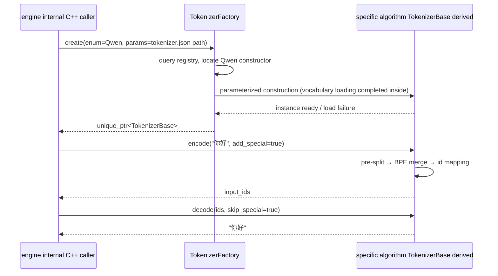

# SR20260728001 — CANN-LM Engine Tokenizer Module

English | [简体中文](../../../zh/cann_lm_engine/tokenizer/SPEC.md)

## Chapter 1 Overview

This spec defines the business behavior of the C++ tokenizer module under `cann_local_lm/engine/core/component/tokenizer`. This module provides CANN-LM inference engine with unified text tokenization capability, must support two usable tokenization implementations — **BPETokenizer** (hand-written BPE, vocabulary is HF `tokenizer.json` product (model.type=BPE), serves gemma4 model) and **QwenTokenizer** (hand-written ByteLevel BPE pipeline, vocabulary is HF `tokenizer.json` product, serves Qwen3.5-like models) — and retains **SPMTokenizer** (Google SentencePiece library path) as placeholder for this period (registered but unavailable, see 4.1.6), to accept subsequent algorithms in an extensible way without modifying existing code for new algorithms. This module is an engine internal C++ component, only consumed by same-layer C++ code (pipeline/api), **does not expose** any cross-language or external interfaces.

Requirement ID: **SR20260728001**. Software layer: **framework** (engine core reusable library, includes backward compatibility chapter).

Reader should understand within 30 seconds: this spec defines the behavior contract of a multi-algorithm, factory-creatable, self-registerable, engine-internal-consumed C++ tokenizer abstraction layer.

## Chapter 2 Glossary

| Term | Definition |
|------|------|
| Tokenizer | Component that splits text into integer token id sequences consumable by the model, and can restore id sequences back to text |
| BPE | Byte-Pair Encoding, merge-rule-based subword tokenization algorithm |
| SentencePiece | Google open-source tokenization framework (C++ library `libsentencepiece`); this module retains SPMTokenizer placeholder path (not implemented this period, library dependency introduced at implementation time) |
| QwenTokenizer | Hand-written ByteLevel BPE implementation aligned with Qwen3.5 HF tokenizer behavior, vocabulary loaded from `tokenizer.json` |
| BPETokenizer | Hand-written BPE implementation (does not depend on sentencepiece), vocabulary loaded from HF `tokenizer.json` (model.type=BPE), Metaspace (▁) pre-split/restore, serves gemma4 model |
| SPMTokenizer | Tokenizer placeholder path based on Google SentencePiece library: registered in factory but construction always fails (create → FAILURE), encode unavailable, introduced at implementation time |
| tokenizer.json | HuggingFace `tokenizers` library serialization format, single file carries vocab, merges, pre_tokenizer, decoder, added_tokens config |
| .model | sentencepiece training product protobuf serialization file (pieces + scores + types + normalizer/disambiguation config) |
| Metaspace | SentencePiece-style pre-split: replace spaces with `▁`(U+2581) and split by it; HF tokenizer.json pre_tokenizer config for SP-series models |
| Vocab | token literal to integer id mapping table, provided by training product file |
| Merges | BPE algorithm ordered merge rule table, determines subword merge order |
| Pre-tokenizer | Pre-split stage for raw text in BPE pipeline before merging (e.g. ByteLevel split) |
| Normalizer | Text normalization stage before encoding (e.g. NFC Unicode normalization); skipped this period, see open issue U-4 |
| Decoder | Decode stage, restores id sequence to text (e.g. ByteLevel restore) |
| Special tokens | Model-agreed control tokens: bos (start), eos (stop), pad (fill), unk (unknown) |
| input_ids | Integer token id sequence produced by encoding, one of model input tensors (attention mask constructed separately by caller, not in this module) |
| Factory | Component that creates specific tokenizer instance by runtime enum |
| Self-registration | Concrete algorithm derived implementation registers its construction capability into factory, so factory does not need to hardcode algorithm list |
| NFC | Unicode canonical equivalence composition normalization; Qwen Python pipeline includes this step, this module skips this period (U-4) |
| GIL | Python global interpreter lock; this module is pure C++ internal component, does not involve Python runtime, only relevant to validation Python oracle side |
| RSS | Process resident physical memory set, used to measure vocabulary load memory footprint |
| TSan | ThreadSanitizer, data race detection tool |

## Chapter 3 Background

### 3.1 Current State

Each model's (gemma4, qwen3_5, etc.) tokenization under `cann_local_lm/models` depends on external Python implementations (HuggingFace transformers / `tokenizers` / `sentencepiece`). `cann_local_lm/models/qwen3_5/tokenization_qwen3_5.py` explicitly constructs `BPE` + NFC + ByteLevel pipeline; gemma4 repo has no corresponding tokenization file, its special token ids are scattered in `configuration_gemma4.py` (pad=0, eos=1, bos=2 and boi/eoi/image/video/audio and other multimodal tokens). C++ inference path on encoding side is forced to cross-language callback Python, or each reinvents, with no unified authoritative source.

### 3.2 Problems

- **Cross-language overhead**: C++ inference engine callbacks Python tokenizer every encoding, introduces GIL, serialization, inter-process round-trip overhead, breaks end-to-end C++ closed loop.
- **Implementation fragmentation**: Each model's tokenizer pipeline (normalization, pre-split, merge, decode, special token injection) scattered, inconsistent, high maintenance and regression cost.
- **Extension rigidity**: New algorithms need hardcoded branches in multiple places, violates open-closed principle, easily introduces inconsistency.
- **Weak testability**: Behavior contract scattered in Python implementation, no independently verifiable spec.

### 3.3 Expectations

`cann_local_lm/engine/core/component/tokenizer` provides unified C++ tokenizer abstraction: defines stable behavior contract by base class, concrete implementation by derived classes (BPETokenizer and QwenTokenizer both hand-written, vocabulary HF tokenizer.json; SPMTokenizer is sentencepiece library placeholder path), creates instances by factory per runtime enum, self-registration mechanism allows new algorithms to be inserted without modifying existing code. Module as engine internal C++ component is directly consumed by pipeline/api layer, not externally exposed; its output must be element-wise id consistent with corresponding reference implementation under same input (BPETokenizer against gemma4 reference implementation, QwenTokenizer against in-repo `tokenization_qwen3_5.py`, using existing Python implementation as correctness oracle, see TC_203).

## Chapter 4 Functional Requirements

### 4.1 Behavior Spec

#### 4.1.1 Model/Vocabulary Loading

- **Preconditions**: caller holds algorithm type enum and that algorithm's required artifacts (BPETokenizer and QwenTokenizer: HF `tokenizer.json`; SPMTokenizer: sentencepiece `.model` — placeholder this period, load always fails).
- **Processing logic**:
  - Module **must** load that algorithm's required artifacts per algorithm type.
  - Module **must** accept artifacts provided as file path or memory content.
  - Module **must** build bidirectional token↔id mapping after loading (via shared VocabStore), and can report vocabulary size.
  - Module **should** return clear error code on load failure (file missing, format invalid, merges and vocab not aligned) rather than throwing undefined exception.
- **Postconditions**: tokenizer instance enters "ready" state, can be encoded/decoded.
- **Exception handling**: artifact unreadable or structurally invalid → return load failure error code, instance unavailable; caller decides retry or fallback.
- **Boundary cases**: empty vocabulary, ultra-large-scale vocabulary (e.g. 262144), same id mapped to multiple literals, tokenizer.json merges reference non-existent token in vocab, model.type inconsistent with algorithm (BPETokenizer encountering non-BPE type → load failure).

#### 4.1.2 Text Encoding (encode)

- **Preconditions**: instance ready.
- **Processing logic**:
  - Module **must** encode input text into input_ids sequence per algorithm pipeline:
    - BPETokenizer: **AddedToken extraction** (same as Qwen) → UTF-8 validation → Metaspace pre-split (▁ replace/split) → BPE merges (native Unicode literals, no byte mapping) → id mapping. Normalization (NFKC) skipped this period, see U-4.
    - QwenTokenizer: **AddedToken extraction** (product added_tokens literals extracted from original text as whole before pre-split and directly mapped to single id, aligned with reference implementation behavior) → UTF-8 validation → pre-split (std::regex byte-level, D-10) → byte-to-Unicode mapping → BPE merges → id mapping. Normalization (NFC) skipped this period, see U-4.
  - Module **must** support optional special token injection: add bos, eos at sequence head/tail per config, and add pad to fixed length as needed. **Default zero injection** (not injected when unconfigured, aligns with Qwen reference implementation post_processor behavior); injection only occurs when explicitly configured.
  - Module **must** use unk id when encountering out-of-vocabulary tokens.
  - Module **should** support `add_special_tokens` switch (default on) and `max_length` truncation (default no truncation; special counted in max_length budget, truncate content first then inject).
  - Module **may** support `padding` strategy (longest/fixed length) to align batch sequences.
- **Postconditions**: returns input_ids (attention mask not in return value, see 4.1.4).
- **Exception handling**: input not valid UTF-8 → return encoding failure error code, no partial results produced.
- **Boundary cases**: empty string, pure whitespace, overlong input, contains emoji/surrogate pairs, mixed CJK and Latin (**direct adjacent mixing is known exempted divergence, see U-4**), CR/LF control chars, non-NFC form input (normalization skipped this period, behavior difference see U-4), input containing special/added literals (via AddedToken extraction, normal path).

#### 4.1.3 ID Decoding (decode)

- **Preconditions**: instance ready.
- **Processing logic**:
  - Module **must** restore id sequence to text per algorithm decoder (QwenTokenizer is ByteLevel restore; BPETokenizer is Metaspace restore: ▁→space).
  - Module **must** support skip special tokens decode option (default skip). **Strip set is all tokens marked as special in product** (Qwen actual is 14 added_tokens with special=true, including `<|im_start|>`/`<|im_end|>` etc., not just bos/eos/pad/unk four categories), same scope as reference implementation `skip_special_tokens`.
  - Module **must** guarantee: for same instance, `decode(encode(text))` when skipping special tokens restores to text with same scope as reference implementation (using existing Python implementation as correctness oracle).
- **Postconditions**: returns restored string.
- **Exception handling**: sequence contains out-of-vocabulary id → skip or replace with unk literal, should not interrupt.
- **Boundary cases**: empty sequence, sequence containing only special tokens, sequence containing unk id.

#### 4.1.4 Attention Mask Responsibility Boundary (Not in This Module)

- **Responsibility statement**: attention mask **is not** in tokenizer module's responsibility scope. Module **only** produces input_ids; caller (engine pipeline/api) constructs attention mask itself based on pad positions in input_ids.
- **Processing logic**: Module **must not** include attention mask in encode/batch encode return values; module **does not provide** any mask query interface — "not providing this interface" is this clause's implementation method, no unauthorized query path exists.
- **Boundary cases**: not applicable (no interface means no boundary cases).

#### 4.1.5 Batch Encoding

- **Preconditions**: instance ready; input is a set of texts.
- **Processing logic**: Module **must** encode each text in the set and align to equal-length input_ids matrix per padding strategy (does not produce attention mask, see 4.1.4).
- **Postconditions**: returns batch input_ids.
- **Exception handling**: single failure → mark that one failed and continue others, should not crash entire batch.
- **Boundary cases**: empty batch, single-element batch, large length difference requiring long padding.

#### 4.1.6 Factory Creation

- **Preconditions**: caller holds algorithm type enum and load parameters.
- **Processing logic**:
  - Module **must** provide factory, accepts algorithm enum and parameters, returns corresponding algorithm's tokenizer instance (returned as base class type).
  - Module **must** support at least two usable enum values: `BPE` (hand-written BPE, tokenizer.json), `Qwen` (hand-written ByteLevel BPE, tokenizer.json); enum `SPM` is placeholder (registered but create always returns load failure, see 4.1.9 LoadFailed — expected behavior not defect).
  - Module **must** return creation failure error code for unregistered enum, does not return half-baked instance.
- **Postconditions**: caller holds ready instance or clear failure.
- **Exception handling**: enum unregistered → failure; artifact load failure → failure and release partial resources.
- **Boundary cases**: concurrent creation of same enum, empty parameters.

#### 4.1.7 Derived Class Self-registration

- **Preconditions**: some algorithm derived implementation linked into executable/library.
- **Processing logic**:
  - Derived implementation **must** register its construction capability (algorithm enum + creation function) into factory during static initialization.
  - Factory **must** be able to enumerate all currently registered algorithms when called.
  - New algorithm derived implementation **must** be recognizable by factory without modifying factory and existing derived source code (open-closed principle).
- **Postconditions**: factory registry reflects all linked derived.
- **Exception handling**: duplicate registration of same enum → later registrant rejected and produces observable warning (development-time log), should not be silent.
- **Boundary cases**: static initialization order indeterminate, cross-translation-unit registration, static library link-time registration object discarded by linker (carried by DESIGN constraints, see DESIGN §8).

#### 4.1.8 Internal Module Boundary

- **Preconditions**: tokenizer module referenced by engine internal C++ caller (pipeline/api).
- **Processing logic**:
  - Module **must** exist as engine/core internal C++ component, only exposes 4.2 interface contracts to same-layer C++ code.
  - Module **must not** expose any cross-language bindings (e.g. Python bindings) or external process interfaces; project-level external pybind exposure is outer layer's responsibility, not in this module's scope.
  - Module **should** provide header file + static/dynamic library for engine internal linking consumption.
- **Postconditions**: engine internal can directly call per 4.2 contract; no external API surface.
- **Exception handling**: not applicable (boundary constraint, no runtime exception path).
- **Boundary cases**: mistakenly exposed directly by outer layer → considered architectural overreach, constrained by DESIGN layer header file visibility.

#### 4.1.9 Error Classification

Module **must** classify all failure paths into the following unified error categories, returned as project unified `Status` error codes (`infra/status.h`), no silent error swallowing. **Category → Status mapping is design contract, see table below** (if outer layer needs cross-language exposure, outer layer responsible for mapping):

| Category | Trigger scenario | Disposition semantics | Status mapping | Related TC |
|------|----------|----------|--------------|---------|
| LoadFailed | artifact file missing/unreadable/format invalid, vocab and merges not aligned | return error code, instance unavailable | `FAILURE` | TC_101/102 |
| UnsupportedAlgorithm | unknown algorithm enum, algorithm unregistered (including Unigram empty slot) | return unregistered failure, no instance returned | `INVALID_ARGUMENT` | TC_103 |
| InvalidInput | invalid UTF-8 input, None parameter, empty padding (no real tokens) | return encoding/input failure, no partial results | `INVALID_ARGUMENT` | TC_104/201 |
| OutOfVocab | input contains out-of-vocabulary token | map to unk id, not failure | `SUCCESS` (internal map unk) | TC_202 |
| RegistrationConflict | same algorithm enum registered twice | reject + development-time observable warning, not silent | no return value (registration function is void, WARN log) | TC_105 |
| ConcurrentViolation | write operation concurrent, instance read during load | ——（see below） | `INVALID_STATE` (reserved) | TC_301/302 |

> **Concurrency violation clause (structural guarantee)**: This module's design eliminates write-read concurrency window in structural way "factory completes load within create before publishing instance, vocabulary read-only after instance published", runtime **does not set** concurrency detection and return path; this module **must** maintain this structural guarantee (only readable after load completes). If writable load/reload path appears in future, that path **must** return `INVALID_STATE`.

Self-check: 4.1.1–4.1.8's exception handling can all be classified into the above table, no unclassified failures.

### 4.2 Interface Contracts (semantic layer, no type details)

> Below are base class and factory's **semantic** contracts; specific C++ type signatures, class names, header file layout are design scope, see DESIGN.

- **TokenizerBase.encode(text, options) → input_ids**: **must** satisfy 4.1.2; options **must** be able to express add_special_tokens / max_length / padding strategy; **does not** return attention mask (see 4.1.4).
- **TokenizerBase.decode(ids, options) → text**: **must** satisfy 4.1.3; options **must** be able to express skip_special_tokens.
- **TokenizerBase.vocab_size() → int**: **must** return loaded vocabulary size.
- **TokenizerBase.special_token_id(name) → int**: **must** return model-agreed id by name (bos/eos/pad/unk), returns default or failure when unconfigured.
- **TokenizerFactory.create(enum, params) → TokenizerBase | error**: **must** satisfy 4.1.6; params **must** be able to carry file path or memory content (single artifact slot, artifact kind per algorithm).
- **TokenizerFactory.list_registered() → [enum]**: **must** satisfy 4.1.7.
- Self-check: above contracts cover all behaviors of 4.1.1–4.1.8 (load→encode→decode→mask responsibility boundary→batch→factory→self-registration→internal boundary).

### 4.3 Typical Usage Scenario

Self-check: timing consistent with 4.1.2 / 4.1.3 / 4.1.6; factory query registry echoes 4.1.7; caller is engine internal C++ code, no cross-language binding layer.

## Chapter 5 Non-Functional Requirements

> Performance thresholds are currently **budget targets** (agent proposal, no measurement baseline), listed as open issues U-1/U-3, pending DESIGN stage measurement to confirm; do not block spec behavior release. Evidence sources for factual assertions about vocabulary scale, token id, etc.: `cann_local_lm/models/qwen3_5/configuration_qwen3_5.py` (embedding scale 248320), `cann_local_lm/models/gemma4/configuration_gemma4.py` (vocab=262144, pad=0/eos=1/bos=2), **`tmp/qwen/tokenizer.json` actual (vocabulary entry total 248070 = base 248044 + added 26; config's 248320 is padding-post embedding matrix scale, not vocabulary entry count)**.

| Dimension | Metric | Test condition | Evidence source |
|------|------|----------|----------|
| Encoding throughput | ≥ 10⁶ token/s (single thread, aarch64, vocabulary ≤ 262144) | fixed corpus batch encoding timing | budget target (open U-1, pending measurement baseline) |
| Single encoding latency | 1KiB text end-to-end encode ≤ 200μs | micro-benchmark 1000 times median | budget target (open U-1, pending measurement baseline) |
| Decode consistency | decode(encode(t)) and corresponding Python oracle character-by-character consistent on same t | golden corpus regression comparison | behavioral contract (see TC_203) |
| Vocabulary load memory | peak resident ≤ vocabulary scale × estimation coefficient | RSS measurement after load | upper limit undefined (open U-3, DESIGN gives measured value) |
| Power | N/A (pure CPU tokenizer, no dedicated IP) | — | not applicable |
| Portability | g++ 13 / C++17, aarch64 (Ascend host) passes | CI matrix compile+test | environment detection (verified g++13/cmake3.20/aarch64) |
| Thread safety | same instance read-only query can be concurrent; write operations (load) cannot be concurrent | concurrent cases TC_3xx | design constraint |
| Error observability | all failure paths return error code/exception, no silent swallowing | exception TC_1xx | behavioral contract |

Self-check: each item measurable, verifiable; N/A items annotated with reason; open issues registered in "Open Issues Registry" at end.

## Chapter 6 Constraints and Dependencies

- **Hardware dependencies**: target platform aarch64 (Ascend/CANN host) and OHOS musl cross target; no dedicated IP, pure CPU computation.
- **Software dependencies**: C++17 compiler (g++ 13 verified; pre-split uses std::regex byte-level + POSIX character classes, see DESIGN D-10), CMake ≥ 3.20, GoogleTest 1.14 (UT); tokenizer.json parsing dependency see DESIGN D-09 (vendored nlohmann/json single header). **No sentencepiece runtime dependency this period** (SPMTokenizer is placeholder; library dependency introduction deferred to its implementation time, see open issue U-5). Test artifact strategy: small fixture + pre-generated golden ids in repo (A layer), real artifacts (`tmp/`, gitignore) drive `tokenizer_realdata` target (B layer, see U-6); optional transformers/tokenizers Python reference implementation for golden generation (test period only). Module does not depend on pybind11 (internal component, not exposed to Python).
- **Cross-module interactions**:
  - `cann_local_lm/models/*`: this module's output must align with each model's tokenizer behavior, using existing Python implementation as correctness oracle (see TC_203).
  - `cann_local_lm/engine/core`: tokenizer as core submodule, consumed by pipeline/api layer.
  - `cann_local_lm/converter`: conversion chain may reuse tokenizer for id alignment validation.
- Self-check: no implicit dependencies omitted — explicitly does not depend on GPU/NPU operators; explicitly does not undertake dynamic library hot-unload support; NFC normalization skipped this period (U-4) does not introduce ICU dependency.

## Chapter 7 Backward Compatibility

- This module is new engine internal C++ component, no existing C++ tokenizer interface needs binary compatibility, also does not expose interfaces externally, so no external API compatibility burden.
- **Behavior alignment**: module output **must** be element-wise id consistent with existing Python reference implementations (BPETokenizer against sentencepiece, QwenTokenizer against in-repo `tokenization_qwen3_5.py`) under same input, using existing Python implementation as correctness oracle; deviation is defect (see TC_203, comparison scope: both sides add_special_tokens=false). Known exemptions (U-4): NFC normalization skip and pre-split regex implementation difference (D-10) — non-NFC input, Latin↔CJK direct adjacent mixing, words starting with non-ASCII letter, uppercase abbreviations, non-ASCII whitespace allowed to diverge from oracle, golden corpus must exclude such cases. **Special injection zero default** (aligns with reference implementation post_processor no injection behavior); input containing added/special literals via AddedToken extraction guarantees consistency with reference implementation (not exempted).
- **Validation path**: development period uses original Python tokenizer as shadow oracle, golden ids **pre-generated into repo** (runtime does not depend on Python), per-model compare output id and decode restored text, all consistent means behavior alignment achieved. Module itself does not expose Python interface; oracle only used for test period validation, does not enter runtime dependency.
- Self-check: framework layer retains this chapter, clarifies no external interface compatibility burden and behavior alignment caliber.

## Chapter 8 Verification Standards

> Numbering: TC_0xx normal / TC_1xx exception / TC_2xx boundary / TC_3xx concurrency. Each associates §4.1's "must" behavior and declares minimum coverage category.

### Normal Paths (TC_0xx)

> Verification environment: aarch64 real machine (g++ 13 / C++17, GoogleTest 1.14); consistency TC_203 needs same environment to hold original Python reference implementation as correctness oracle (test period only).

**TC_001 Factory creates Qwen instance by enum and loads vocabulary** (associates 4.1.1/4.1.6; category: normal path)
- Given a legal Qwen3.5 `tokenizer.json` and enum Qwen
- When call factory.create(Qwen, params)
- Then returns non-null instance, vocab_size() equals product actual entry total (actual scope **248070** = base 248044 + added 26; note configuration_qwen3_5.py's 248320 is padding-post embedding matrix scale, **not** vocabulary entry count), and encode does not throw

**TC_001b Factory creates BPE instance by enum and loads vocabulary** (associates 4.1.1/4.1.6; category: normal path)
- Given a legal gemma4 `tokenizer.json` (model.type=BPE) and enum BPE
- When call factory.create(BPE, params)
- Then returns non-null instance, vocab_size() equals product actual entry count (record specific value by fixture measurement, design layer refers to gemma4 vocabulary scale 262144), and encode does not throw

**TC_002 Qwen encode special injection (zero default + explicit override two paths)** (associates 4.1.2; category: normal path)
- Given loaded Qwen instance
- When respectively execute: ①encode("hello", add_special_tokens=true) (**no explicit special configured**); ②after explicitly configuring add_bos/add_eos and bos/eos id via LoadParams, encode("hello", add_special_tokens=true)
- Then ①returns input_ids **not containing any injected special** (zero default, aligns with reference implementation post_processor no injection behavior); ②starts with configured bos, ends with configured eos (no attention mask, see 4.1.4)

**TC_003 Decode skip special tokens restore original** (associates 4.1.3; category: normal path)
- Given loaded instance
- When decode(encode("你好世界", add_special=true), skip_special=true)
- Then returns string == "你好世界"

**TC_004 Factory enumerates registered algorithms** (associates 4.1.7; category: normal path)
- Given BPE, Qwen, SPM (placeholder stub) derived linked
- When call factory.list_registered()
- Then returns set containing BPE, Qwen, SPM three enum values (SPM registered but create always FAILURE, see TC_103b)

**TC_103b SPM placeholder creation failure** (associates 4.1.6; category: boundary resource)
- Given enum SPM (placeholder stub registered) and arbitrary parameters
- When factory.create(SPM, params)
- Then returns `FAILURE` (placeholder load failure, expected behavior not defect), no instance returned

### Exception Paths (TC_1xx)

**TC_101 Vocabulary file missing** (associates 4.1.1; category: dependency fault)
- Given a non-existent vocabulary path
- When factory.create(Qwen, bad_path)
- Then returns `FAILURE`, no half-baked instance returned

**TC_102 Vocabulary structure invalid** (associates 4.1.1; category: boundary resource)
- Given tokenizer.json merges reference non-existent token in vocab, or JSON structure invalid
- When create + load
- Then returns `FAILURE` (structure invalid), no instance returned

**TC_103 Unknown algorithm enum** (associates 4.1.6; category: unauthorized rejection)
- Given an unregistered enum value (e.g. forced cast value outside Algorithm domain)
- When factory.create(unregistered enum, ...)
- Then returns `INVALID_ARGUMENT`, no instance returned

**TC_104 Encode non-UTF-8 input** (associates 4.1.2; category: boundary resource)
- Given a piece of invalid UTF-8 bytes
- When encode(...)
- Then returns `INVALID_ARGUMENT`, no partial ids output

**TC_105 Duplicate registration of same enum** (associates 4.1.7; category: abuse robustness)
- Given same algorithm enum registered twice
- When second registration during static initialization
- Then later one rejected and produces observable warning (development-time WARN log), not silent

### Boundary Conditions (TC_2xx)

**TC_201 Empty string encoding** (associates 4.1.2; category: boundary resource)
- Given ready instance
- When encode("", add_special=false)
- Then returns empty input_ids, no exception

**TC_202 Out-of-vocabulary token uses unk** (associates 4.1.2; category: boundary resource)
- Given input contains out-of-vocabulary character
- When encode(...)
- Then corresponding position mapped to unk id

**TC_203 Element-wise id consistent with original Python reference implementation (correctness oracle validation)** (associates 4.1.2/4.1.3; category: normal path + boundary resource)
- Given golden corpus (contains Chinese-English, emoji, whitespace mixing; **NFC form and excludes U-4 exempted categories** — Latin↔CJK direct adjacent mixing, non-ASCII letter-initial words like über, uppercase abbreviation 'S, non-ASCII whitespace)
- When for each text respectively use this C++ module and corresponding Python oracle (Qwen→`tokenization_qwen3_5.py`; BPE→gemma4 reference implementation (transformers/tokenizers)) to encode, **both sides add_special_tokens=false** (pinned comparison scope: bare pipeline element-wise id comparison; injection semantics separately validated by TC_002)
- Then two input_ids sequences element-wise equal; decode restored text character-by-character equal (skip_special both sides on)

**TC_204 Overlong input truncation** (associates 4.1.2; category: boundary resource)
- Given max_length=128 and overlong input
- When encode(text, max_length=128, truncation=true)
- Then input_ids length == 128 (special counted in budget: truncate content to 128−injection count first, then inject, eos not truncated off)

**TC_205 Ultra-large-scale vocabulary loading** (associates 4.1.1; category: boundary resource)
- Given gemma4 `tokenizer.json` vocabulary scale 262144
- When create(BPE, ...) load
- Then load succeeds, vocab_size() equals product actual entry count, memory peak within DESIGN constraints

**TC_205b Real-scale tokenizer.json load and memory** (associates 4.1.1; category: boundary resource)
- Given `tmp/qwen/tokenizer.json` (248044+26 entries, 12.8MB; locally placed, test target runs only if detected exists)
- When create(Qwen, ...) load
- Then load succeeds, vocab_size()==248070, load time and resident memory measured and recorded on file (U-3 coefficient basis)

### Concurrency Scenarios (TC_3xx)

**TC_301 Same instance concurrent read-only query** (associates §5 thread safety / 4.1.2; category: abuse robustness)
- Given a ready instance
- When multi-threaded concurrent encode different texts
- Then no data race (TSan clean), results consistent with serial

**TC_302 Factory concurrent creation of different enums** (associates 4.1.6/4.1.7; category: abuse robustness)
- Given BPE and Qwen both registered
- When multi-threaded simultaneously factory.create(BPE,...) and create(Qwen,...)
- Then two instances each ready, registry no concurrent corruption

### Coverage Dimension Verification

| Category | Covered TC |
|------|---------|
| Normal path | TC_001/001b/002/003/004/203 |
| Unauthorized rejection | TC_103 |
| Boundary resource | TC_102/103b/104/201/202/204/205/205b/203 |
| Dependency fault | TC_101 |
| Abuse robustness | TC_105/301/302 |

Self-check: all "must" behaviors in 4.1 have corresponding TC (load 001/001b/101/102/205/205b, encode 002/104/201/202/204/203, decode 003/203, mask responsibility boundary 4.1.4 is constraint clause produces no TC, batch see DESIGN split TC, factory 001/103/103b/302, self-registration 004/105/302, internal boundary 4.1.8 is constraint clause carried by DESIGN header file visibility constraint). 5 categories minimum coverage dimension each ≥1. Batch encoding (4.1.5) specific TC supplemented to §8 increment when DESIGN splits modules.

## Open Issues Registry

| ID | Open issue | Category | Blocks spec release | Disposition stage |
|----|--------|------|----------------|----------|
| U-1 | Encoding throughput/latency thresholds (10⁶ token/s, 200μs) are budget targets, no measurement baseline | Acceptance criteria | No (budget, pending measurement confirmation/adjustment) | DESIGN performance budget + implementation-time micro-benchmark |
| U-3 | Vocabulary load memory upper limit coefficient undefined | Resource constraint | No (DESIGN gives measured value) | DESIGN |
| U-4 | Known exempted divergence (user decision 2026-08-31/09-01): ①NFC normalization skipped; ②Qwen pre-split regex implemented with std::regex byte-level POSIX class (D-10), diverges from oracle `\p{L}\p{M}\p{N}` property class on **Latin↔CJK direct adjacent mixing, non-ASCII letter-initial words (e.g. über), uppercase abbreviation 'S, non-ASCII whitespace** four categories of input | Behavior alignment exemption | No (golden corpus excludes such input; input containing special literals not exempted — AddedToken extraction guarantees consistency) | Implement if needed (review trigger: product corpus largely falls into exempted category, D-07/D-10 §5) |
| U-5 | Google SentencePiece library integration: **deferred to SPMTokenizer implementation time** (neither this machine nor OHOS musl pre-installs it, needs source build, including protobuf handling, OHOS SHARED library PIC link form) — no such dependency this period | Build dependency (deferred) | No | When SPM implementation need arises |
| U-6 | Test artifact source: `tmp/qwen/` (tokenizer.json + tokenizer_config.json, gitignore) placed; **`tmp/gemma/` tokenizer.json pending placement and model.type==BPE pending validation** (if Unigram type then BPETokenizer route needs re-discussion); golden ids pre-generation script and small fixture generation script pending implementation | Test asset | No (M-8 A+B layering strategy decided) | Implementation period (A layer fixture first, B layer gemma pending artifact) |
| U-2 | Gemma4 tokenizer algorithm type (verified SentencePiece, refer to gemma_pytorch/gemma/tokenizer.py) | System boundary | Closed | — |

**Blocking-level open issues cleared**: U-1/U-3 are budget/resource items; U-4 is registered behavior exemption (list clear); U-5 is implementation-time build item (DESIGN already gives integration constraints and fallback path); U-6 is test asset item (A+B strategy decided, gemma artifact pending placement); U-2 closed. No trust/authorization boundary, no security red line related open issues.

## Consistency Self-Check (Generation Period)

- Interface contract coverage: each semantic interface in 4.2 traceable to 4.1 behavior (encode↔4.1.2, decode↔4.1.3, vocab_size↔4.1.1, special_token_id↔4.1.2, create↔4.1.6, list_registered↔4.1.7). ✓
- Test coverage: each "must" in 4.1 has TC in Chapter 8. ✓
- Term consistency: all terms in document defined in Chapter 2. ✓
- Timing consistency: 4.3 timing no contradiction with 4.1. ✓
- Layer adaptation: framework layer includes Chapter 7. ✓
- Diagram consistency: degraded mode, no diagram references. ✓
