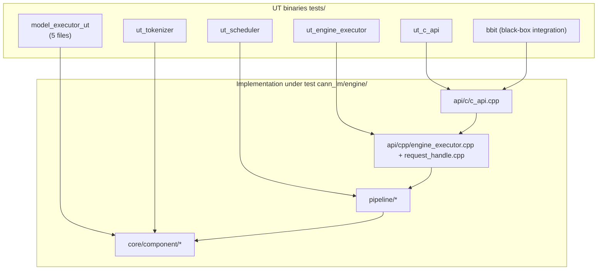

# Unit Test (UT) Design (DESIGN)

English | [简体中文](../../../zh/cann_lm_engine/ut/DESIGN.md)

> **Module positioning**: UT is the horizontal quality assurance layer of CANN-LM Engine, covering the external interface surface and key internal behaviors of `api/c` / `api/cpp` / `pipeline` / `core/component`. This document describes the How — UT binary organization, naming conventions, Stub Era vs Real Era classification, coverage matrix, drift prevention rules, CMake wiring. What/Why see SPEC.

---

## §1 Module Positioning

| Attribute | Value |
|------|-----|
| Code path | `tests/cpp/engine/`, `tests/cpp/engine/model_executor/`, `examples/test_engine/bbit/` |
| Framework | GoogleTest 1.14 (`find_package(GTest REQUIRED)`) |
| CMake entry | `cann_lm/engine/CMakeLists.txt:66-127` |
| Build artifacts | 10 executables: `model_executor_ut` / `ut_engine_executor` / `ut_tokenizer` / `ut_c_api` / `ut_scheduler` / `ut_sampler` / `ut_request_handle` / `ut_logger` / `ut_text_embedding` / `bbit` |
| Test discovery | `gtest_discover_tests()` registered into CTest (bbit manually via `add_test`) |
| Namespace | `cann_lm::engine` (consistent with code under test; anonymous namespace for fixtures and TESTs) |
| Upstream | each module's DESIGN/SPEC (see depends_on) |

## §2 Architecture Overview



**Key boundaries**:
- UT and code under test in same compilation unit, include paths point to `cann_lm/engine/` (`target_include_directories(... PRIVATE ${CMAKE_CURRENT_SOURCE_DIR})`)
- Each UT binary statically links `libcann_lm_engine.a` + `GTest::gtest` + `GTest::gtest_main` (main provided by gtest_main, no need to write own)
- bbit does not link gtest, is pure C++ black-box consumer, simulates real user calling C API

## §3 Naming Conventions

### §3.1 TEST Suite Names

- Form `TEST(<Module>Test, <Behavior>_<TCXXX>)`, `<Module>` is tested module name (e.g. `EngineExecutorTest`, `TokenizerFactoryTest`, `SamplerTest`, `RequestHandleTest`, `CApiTest`, `SchedulerTest`, `DfxCollectorTest`)
- Same suite name consistent within same fixture; different fixtures do not reuse suite names

### §3.2 Case Names (Core Anti-Drift Rule)

**Mandatory**: case name `<Behavior>` part **must** be consistent with actual assertion type. Following situations are considered drift, must fix before PR:

| Anti-pattern | Example | Fix Direction |
|--------|------|----------|
| Name contains status code but assertion doesn't verify it | `ConcurrentGenerateSameContextReturnsInvalidState` only `EXPECT_FALSE(s.ok())` | Rename to `ReturnsFailureStubEra` or add `EXPECT_EQ(s.code, Status::INVALID_STATE)` |
| Name contains semantics but actually calls different semantics | `CreateUnknownReturnsFailure` actually passes `Algorithm::BPE` | Rename to `CreateBPEReturnsInvalidArgumentStubEra` or use truly "unknown" input |
| Name claims Success but assertion only `EXPECT_FALSE(s.ok())` | — | Rename to `ReturnsFailure...` or change assertion to `EXPECT_TRUE` |

### §3.3 Stub Era Suffix

- Cases expecting FAILURE / INVALID_ARGUMENT in stub era, name ends with `_StubEra` suffix
- After real backend lands, add `_RealEra` comparison cases (not written now, marked deferred)
- This way from case name alone you can tell which era's expectation the current assertion corresponds to

### §3.4 TC Numbering

- `TC0xx` normal path
- `TC1xx` exception path
- `TC2xx` boundary condition
- `TC3xx` concurrency scenario
- Aligned with each module SPEC §8 TC numbering (same behavior same TC, UT implements that TC's executable version)

## §4 Stub Era vs Real Era Classification

CANN-LM Engine is currently in **stub era**: `stub_model_manager.cpp` / `stub_built_model.cpp` return nullptr; `BpeTokenizer::encode` returns FAILURE; `Sampler::Sample` returns FAILURE. But `EngineExecutor` construction and `CreateContext` succeed (`PipelineExecutorFactory::create` doesn't depend on real backend, construction-time `Load` failure swallowed).

### §4.1 Stub Era UT Scope (This Phase)

| Behavior Category | Stub Era Expectation | Related Module |
|----------|--------------|----------|
| Executor construction (path/buffer) | SUCCESS (no actual load at construction) | api/cpp + c_api |
| Context create / destroy / configure / cancel | SUCCESS (ContextId monotonically increasing; idempotent) | pipeline/scheduler |
| Same Context concurrent GenerateAsync | FAILURE (PreparePrefill fails), second time also FAILURE (active synchronously cleared) | pipeline_executor |
| RequestHandle empty state query | GetStatus=Queued / IsDone=false / operator bool=false | api/cpp/request_handle |
| RequestHandle empty state control | Cancel=SUCCESS (no-op) / Wait=INVALID_STATE / TryGetResult=INVALID_STATE | api/cpp/request_handle |
| Sampler param validation | !out → INVALID_ARGUMENT; slot<0 → INVALID_ARGUMENT | core/component/sampler |
| Sampler real sampling | !batch_logits → FAILURE; non-empty logits → FAILURE (stub) | core/component/sampler |
| Scheduler::Step no work | INVALID_STATE | pipeline/scheduler |
| Scheduler::Submit param validation | !req \|\| !out → INVALID_ARGUMENT; otherwise SUCCESS (PendingPrefillCount++) | pipeline/scheduler |
| Scheduler::Cancel not found | NOT_FOUND | pipeline/scheduler |
| Scheduler::CancelContext empty table | SUCCESS | pipeline/scheduler |
| Tokenizer BPE stub encode | FAILURE | core/component/tokenizer |
| TokenizerFactory::create | always INVALID_ARGUMENT (stub) | core/component/tokenizer |
| TokenizerFactory::list_registered | returns {BPE, SentencePieceUnigram} | core/component/tokenizer |
| C API ExecutorCreate | SUCCESS | api/c/c_api |
| C API ExecutorCreateFromBuffer | SUCCESS (same as path entry) | api/c/c_api |
| C API Request* null pointer | RequestIsDone(nullptr)=0 / RequestCancel(nullptr)=SUCCESS / RequestGetStatus(nullptr)=QUEUED | api/c/c_api |

### §4.2 Real Era UT Scope (deferred)

Added after real backend integration (not in this phase's UT):
- `Generate` successfully returns complete Result
- `RequestHandle::Wait` blocking wait for terminal state
- `Sampler::Sample` real sampling (greedy/top-k/top-p)
- `Tokenizer` real BPE encode/decode (consistent with Python oracle per id, aligned with docs/tokenizer/SPEC.md TC_203)
- `bbit` end-to-end inference success path

Each Real Era case marked `[deferred]` in SPEC.

## §5 Coverage Matrix (Module × UT Binary × Gap)

> Behavior only lists external interface surface + Stub Era verifiable internal behaviors. Real Era inference path not in this table.

| Module | Interface Symbol | Current UT File | Stub Era Coverage | Gap → This Phase Fill |
|------|---------|-------------|--------------|--------------|
| api/cpp EngineExecutor | ctor(path) | test_engine_executor.cpp | ✓ (indirectly via EngineExecutor ee(DummyPath())) | — |
| | ctor(buffer) | — | ✗ | (cpp interface no direct UT; C API covers via CreateFromBuffer) |
| | CreateContext | test_engine_executor.cpp | ✓ (TC001 etc.) | — |
| | DestroyContext | test_engine_executor.cpp | ✓ (idempotent + nonexistent) | — |
| | ConfigureContext | test_engine_executor.cpp | ✓ (NOT_FOUND + success) | — |
| | CancelContext | test_engine_executor.cpp | ✓ (NOT_FOUND + success) | — |
| | Generate | test_engine_executor.cpp | ✓ (empty ctx + valid ctx stub FAILURE) | — |
| | GenerateAsync | test_engine_executor.cpp | ✓ (empty ctx + valid ctx stub FAILURE + concurrent) | — |
| api/cpp RequestHandle | default construction | test_engine_executor.cpp | ✗ (only declares variable, doesn't verify empty state query) | **test_request_handle.cpp** (new) |
| | GetStatus / IsDone / operator bool | — | ✗ | **test_request_handle.cpp** (new) |
| | Cancel / Wait / TryGetResult (empty state) | — | ✗ | **test_request_handle.cpp** (new) |
| api/c c_api | ExecutorCreate | test_c_api.cpp | ✓ | — |
| | **ExecutorCreateFromBuffer** | — | ✗ | **test_c_api.cpp append** (new) |
| | ContextCreate / Destroy / Cancel | test_c_api.cpp | ✓ | — |
| | ExecutorGenerate | test_c_api.cpp | ✓ (NOT_FOUND + stub FAILURE) | — |
| | Request* null pointer | test_c_api.cpp | ✓ | — |
| core/component Sampler | Sample param validation | — | ✗ | **test_sampler.cpp** (new) |
| | Sample stub path | — | ✗ | **test_sampler.cpp** (new) |
| core/component Tokenizer | BpeTokenizer::encode/decode | test_tokenizer.cpp | ✓ (stub FAILURE) | — |
| | batch_encode | test_tokenizer.cpp | ✓ (continue-on-failure + empty + null out) | — |
| | TokenizerFactory::create | test_tokenizer.cpp | ⚠ naming drift (see §8) | **fix naming** |
| | TokenizerFactory::list_registered | test_tokenizer.cpp | ✓ | — |
| pipeline Scheduler | construct + DecodeCapacity + counting | test_scheduler.cpp | ✓ | — |
| | Step no work | test_scheduler.cpp | ✓ (INVALID_STATE) | — |
| | **Submit** | — | ✗ | **test_scheduler.cpp append** (new) |
| | **Cancel** | — | ✗ | **test_scheduler.cpp append** (new) |
| | **CancelContext** | — | ✗ | **test_scheduler.cpp append** (new) |
| core/component model_executor etc sub-modules | each module tests | tests/cpp/engine/model_executor/ | ✓ (5 files, DFX/KV/IA/ME/TM) | — |
| black-box integration bbit | C API full path | examples/test_engine/bbit/bbit.cpp | ✓ (--check + flow) | — |

## §6 Test Fixture and Helper Conventions

### §6.1 Fixture Style

- Simple fixture uses `struct XxxFixture { ... }` (POD, no setup/teardown), see `test_scheduler.cpp:12`
- Needs setup/teardown uses `class XxxFixture : public ::testing::Test` + `SetUp/TearDown`
- Shared helper functions in anonymous namespace, prefixed `Make` / `Dummy` / `Count` etc. (see `test_dfx_collector.cpp:15-29`)

### §6.2 Path and Buffer Placeholders

- path placeholder uses `"dummy.omc"` / `"dummy.weight"` (see `test_engine_executor.cpp:8-10`, `test_c_api.cpp:8`)
- buffer placeholder uses stack `char buf[8]` wrapping `Tensor` (see `test_dfx_collector.cpp:15-18`)
- C API buffer test needs construct `CANN_LMEngine_ModelArtifact{...}`, pre-fill `{buffer, buffer, buffer}` three segments

### §6.3 Status Assertion Patterns

```cpp
// Success
EXPECT_TRUE(s.ok());
EXPECT_EQ(s.code, Status::SUCCESS);

// Failure (don't care about specific code)
EXPECT_FALSE(s.ok());

// Failure (care about specific code — must be consistent with case name)
EXPECT_EQ(s.code, Status::INVALID_ARGUMENT);
```

## §7 GoogleTest Configuration and CMake Wiring

`cann_lm/engine/CMakeLists.txt:66-127` already defines 5 UT binaries + bbit. This phase adds:

```cmake
# ut_sampler
add_executable(ut_sampler ${UT_DIR}/test_sampler.cpp)
target_link_libraries(ut_sampler PRIVATE cann_lm_engine GTest::gtest GTest::gtest_main)
target_compile_options(ut_sampler PRIVATE -Wall -Wextra -Wpedantic)
target_include_directories(ut_sampler PRIVATE ${CMAKE_CURRENT_SOURCE_DIR})
gtest_discover_tests(ut_sampler)

# ut_request_handle
add_executable(ut_request_handle ${UT_DIR}/test_request_handle.cpp)
target_link_libraries(ut_request_handle PRIVATE cann_lm_engine GTest::gtest GTest::gtest_main)
target_compile_options(ut_request_handle PRIVATE -Wall -Wextra -Wpedantic)
target_include_directories(ut_request_handle PRIVATE ${CMAKE_CURRENT_SOURCE_DIR})
gtest_discover_tests(ut_request_handle)
```

`test_engine_executor.cpp`, `test_tokenizer.cpp`, `test_c_api.cpp`, `test_scheduler.cpp` only change source code, CMake no changes needed.

## §8 Drift Fix List

> Source: UT audit (see SPEC §8.1). Each includes old name, new name, fix rationale.

| ID | File:Line | Old Name | New Name | Fix Rationale |
|------|---------|------|------|----------|
| DRIFT-1 | `test_engine_executor.cpp:105` | `ConcurrentGenerateSameContextReturnsInvalidState` | `ConcurrentGenerateSameContextReturnsFailureStubEra` | Name contains `InvalidState` but actually both `GenerateAsync` calls return FAILURE (first synchronously clears active flag), assertion only `EXPECT_FALSE(s.ok())` doesn't verify INVALID_STATE code. Rename reflects real expectation. |
| DRIFT-2 | `test_tokenizer.cpp:42` | `CreateUnknownReturnsFailure` | `CreateBPEReturnsInvalidArgumentStubEra` | Name contains `Unknown` but input is `Algorithm::BPE` (registered algorithm); name contains `ReturnsFailure` but stub implementation returns `INVALID_ARGUMENT`. Rename reflects real input and real code. |

Fix principle: **change case name + change expected assertion** (don't change tested implementation behavior). The tested code itself is correct; it's the test name and expectation mismatch.

## §9 New Case List

| ID | File | Case Name | Category | Related SPEC TC |
|------|------|--------|------|--------------|
| NEW-1 | test_sampler.cpp | `SampleWithNullOutReturnsInvalidArgument_TC201` | exception | UT-TC-SAMPLER-001 |
| NEW-2 | test_sampler.cpp | `SampleWithNegativeSlotReturnsInvalidArgument_TC202` | exception | UT-TC-SAMPLER-002 |
| NEW-3 | test_sampler.cpp | `SampleWithEmptyLogitsReturnsFailureStubEra_TC203` | exception-stub | UT-TC-SAMPLER-003 |
| NEW-4 | test_sampler.cpp | `SampleWithValidLogitsReturnsFailureStubEra_TC204` | exception-stub | UT-TC-SAMPLER-004 |
| NEW-5 | test_request_handle.cpp | `EmptyHandleGetStatusReturnsQueued_TC001` | normal | UT-TC-RH-001 |
| NEW-6 | test_request_handle.cpp | `EmptyHandleIsDoneReturnsFalse_TC002` | normal | UT-TC-RH-002 |
| NEW-7 | test_request_handle.cpp | `EmptyHandleBoolConversionReturnsFalse_TC003` | normal | UT-TC-RH-003 |
| NEW-8 | test_request_handle.cpp | `EmptyHandleCancelReturnsSuccess_TC004` | normal | UT-TC-RH-004 |
| NEW-9 | test_request_handle.cpp | `EmptyHandleWaitReturnsInvalidState_TC101` | exception | UT-TC-RH-005 |
| NEW-10 | test_request_handle.cpp | `EmptyHandleTryGetResultReturnsInvalidState_TC102` | exception | UT-TC-RH-006 |
| NEW-11 | test_request_handle.cpp | `EmptyHandleWaitWithNullOutReturnsInvalidArgument_TC103` | exception | UT-TC-RH-007 |
| NEW-12 | test_c_api.cpp | `CreateFromBufferSucceedsStubEra_TC001` | normal | UT-TC-CAPI-FB-001 |
| NEW-13 | test_c_api.cpp | `CreateFromBufferNullPrefillReturnsInvalidArgument_TC101` | exception | UT-TC-CAPI-FB-002 |
| NEW-14 | test_c_api.cpp | `CreateFromBufferNullDecodeReturnsInvalidArgument_TC102` | exception | UT-TC-CAPI-FB-003 |
| NEW-15 | test_c_api.cpp | `CreateFromBufferNullOutReturnsInvalidArgument_TC103` | exception | UT-TC-CAPI-FB-004 |
| NEW-16 | test_c_api.cpp | `CreateFromBufferSupportsContextCreate_TC002` | normal | UT-TC-CAPI-FB-005 |
| NEW-17 | test_scheduler.cpp | `SubmitWithNullReqReturnsInvalidArgument_TC101` | exception | UT-TC-SCHED-001 |
| NEW-18 | test_scheduler.cpp | `SubmitWithNullOutReturnsInvalidArgument_TC102` | exception | UT-TC-SCHED-002 |
| NEW-19 | test_scheduler.cpp | `SubmitSucceedsIncrementsPendingCount_TC001` | normal | UT-TC-SCHED-003 |
| NEW-20 | test_scheduler.cpp | `SubmitAssignsMonotonicRequestIds_TC002` | normal | UT-TC-SCHED-004 |
| NEW-21 | test_scheduler.cpp | `CancelNonexistentReturnsNotFound_TC103` | exception | UT-TC-SCHED-005 |
| NEW-22 | test_scheduler.cpp | `CancelContextWithNoMatchingContextsReturnsSuccess_TC104` | normal | UT-TC-SCHED-006 |

## §10 Decisions and Open Items

| ID | Topic | Status | Description |
|----|------|------|------|
| D-01 | UT and code under test in same namespace | accepted | facilitates accessing internal types (e.g. `RequestImpl`), consistent with existing `test_engine_executor.cpp` |
| D-02 | Stub Era case suffix `_StubEra` | accepted | makes case name一眼可辨 current expectation belongs to which era, facilitates adding comparison after Real Era lands |
| D-03 | Don't write mock for stub behavior | accepted | stub behavior itself observable, assertable; introducing mock bypasses code under test |
| D-04 | CMake `gtest_discover_tests()` | accepted | consistent with existing 5 UT binaries; bbit still uses `add_test` manual registration |
| D-05 | Don't add independent UT for `text_embedding` / `pipeline_executor` / `preprocessor` / `history_prompt_manager` / `infra/logger` / `core/context` in this phase | accepted | these modules have no independently verifiable external interfaces (all return via path in stub era), this phase focuses on external interface surface + exposed gaps |
| U-1 | `Algorithm` enum only has BPE/SP two values, can't construct truly "unknown" enum | open | stub era `TokenizerFactory::create` always returns `INVALID_ARGUMENT`, can't distinguish "unknown enum" from "load failure". This phase UT name changed to `CreateBPEReturnsInvalidArgumentStubEra`, real era add `CreateUnknownAlgorithmReturnsInvalidArgument_RealEra` needs extending Algorithm enum or injecting unknown value via test hook. |
| U-2 | `ExecutorCreateFromBuffer` actual success path depends on `PipelineExecutorFactory::create(buffer)` not returning error | open | currently `EngineExecutor::Impl::init_pipeline_buffer` swallows factory return value (`engine_executor.cpp:67 (void)`), in stub era whether `pipeline_` is non-null determines `CreateContext` behavior. This phase UT only asserts `ExecutorCreateFromBuffer` returns SUCCESS, stepping into `CreateContext` to verify whether `pipeline_` is truly ready — NEW-16 does this verification. |
| U-3 | `bbit --check` and `bbit` both run FAILURE path in stub era | open | bbit's `--check` goes through NULL defense (should all SUCCESS or INVALID_ARGUMENT), `bbit` goes full flow (should have multiple FAILURE). Needs bbit.cpp itself aligned — this phase doesn't fix bbit. |

## §11 Change Log

| Version | Date | Changes |
|------|------|------|
| 0.1 | 2026-08-25 | Initial draft. Establishes UT overall architecture, naming conventions, Stub/Real Era classification, coverage matrix, 2 drift fixes, 22 new case list. |
