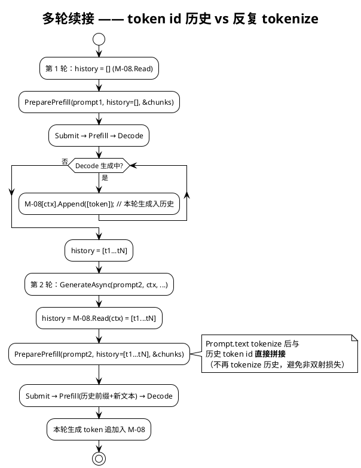

# LM Engine 推理流程图

简体中文 | [English](../../en/cann_lm_engine/lm_engine_inference_flow.md)

> 本文用 PlantUML 活动图描述 `lm_engine`（L1 `EngineExecutor` + L2 `PipelineExecutor`）的自回归推理流程。
> 依据：
> - `docs/pipeline+engine_executor/DESIGN.md`（§11 模块、§12 契约、§13 关键流程 F-01~F-05）
> - `docs/pipeline+engine_executor/SPEC.md`（行为规格 SR20260806001）
> - `docs/model_executor/DESIGN_HUMAN.md`（前向壳 / KV 池 / 输入组装器细节，含对 pipeline 文档的 3 处澄清）
>
> PlantUML 源码以 ```` ```plantuml ```` 代码块给出，可用 PlantUML / VS Code 插件渲染。

## 0. 涉及的模块与契约（速查）

| ID | 名称 | 职责 |
|----|------|------|
| M-01 | EngineExecutor | L1 PIMPL 外壳，转发公开 API |
| M-02 | PipelineExecutor | L2 编排骨架，worker 驱动 + 后处理 + 注册表 |
| M-03 | Scheduler | 排队 + decode 池 + iteration 组批/交错/cancel |
| M-04 | ModelExecutor | 前向产 logits（prefill/decode 双实例）+ KV 光标记账 |
| M-05 | ModelLoader | 加载 thin wrapper，派生 json |
| M-06 | Preprocessor | tokenize/拼接历史/占位符/查表/切块 |
| M-07 | 后处理流 | 采样→写历史→detokenize→回调→stop |
| M-08 | HistoryPromptManager | 按 Context 隔离的 token id 历史 |
| C-01 | ITokenizer | 文本↔token id |
| C-02 | ITextEmbedding | token id→embedding 张量查表 |
| C-03 | ISampler | logits+参数→token id |
| C-04 | IModelManager | 模型加载/前向/释放/元信息 |

## 1. 整体推理活动图

下图覆盖构造加载（F-01）→ 提交（用户线程）→ worker RunLoop（F-02/F-04）→ 终态/取消（F-05）。

```plantuml
@startuml lm_engine_inference
!theme plain
skinparam ActorStyle awesome
skinparam responseMessageBelowArrow true

title lm_engine 推理流程（构造 → 提交 → worker RunLoop → 终态）

|用户线程|
|worker 线程|
|L3 底层运行时|

|用户线程|
start
:EngineExecutor(prefill_artifact, decode_artifact, opts,\n  4×shared_ptr<ITokenizer/ITextEmbedding/ISampler/IModelManager>);
note right
  构造期一次性加载
  不支持热加载
end note
:M-05 ModelLoader.Load(prefill) / Load(decode);
|L3 底层运行时|
:C-04 Load 两个 om 图（权重去重）;
:C-04 GetMeta → max_batch_size, max_seq_len;
|用户线程|
if (Load 失败 or 元信息缺失?) then (是)
  :构造失败（不残留部分资源）;
  stop
else (否)
endif
:M-04 prefill_executor.Bind(handle_prefill);
:M-04 decode_executor.Bind(handle_decode);
:M-03 Scheduler(max_batch_size);
:启动 worker 线程 RunLoop;
|worker 线程|
:进入 RunLoop;
repeat
  :M-03.Step(&out);
  if (Step 返回 INVALID_STATE?) then (是·无活任务)
    :condvar.wait();
    repeat while (被 Submit 唤醒? 唤醒) is (否) not (是)
  else (否·有产出)
    partition "逐 slot 后处理（M-07）" {
      while (slot ∈ out.slot_to_request?) is (是)
        :req = registry[out.slot_to_request[slot]];
        if (req.canceled?) then (是)
          :req.status = Canceled;\n丢弃部分输出;
        else (否)
          :C-03 Sample(out.batch_logits, slot, params) → token;
          :req.token_ids.append(token);
          :M-08[req.ctx].Append([token]);
          :C-01 DecodeToken(token) → text_piece;
          :req.text_buffer += text_piece;
          if (命中 stop_token?) then (是)
            :finish=StopToken; status=Completed\n(倾向不回调);
          elseif (命中 stop_string?) then (是)
            :finish=StopString; status=Completed\n去掉停止部分;
          else (否)
            :StreamCallback(token, text_piece);
          endif
          if (token_ids.size() == max_tokens?) then (是)
            :finish=MaxTokens; status=Completed;
          endif
        endif
        if (req 进入终态?) then (Completed/Failed/Canceled)
          :释放 KV 槽（幂等）;\n历史保留已生成 token;
        endif
      endwhile (无更多 slot)
    }
  endif
repeat while (stop_ == false?) is (是) not (否·析构)
|worker 线程|
:析构：stop_=true → 唤醒 → join → Release;
stop

|用户线程|
fork
  :CreateContext(&ctx) → ContextImpl;
end fork

|用户线程|
:GenerateAsync(prompt, ctx, params, &handle, cb);
:M-08 Read(ctx) → history token ids;
:M-06 PreparePrefill(prompt, history, &chunks);
note right
  tokenize Prompt.text → 拼接 history
  → 占位符替换 → C-02 Embed/EmbedMixed
  → 切块（token 级，倾向守 C5）
end note
:M-03 Submit(chunks, req_impl, &req_id);
note right
  入 prefill 队列（FIFO）
  + 唤醒 worker
end note
:返回 RequestHandle（非阻塞）;

fork again
  :RequestHandle.Cancel();
  note right
    req_impl->canceled.store(true)  // atomic
    不立即中断当前前向
    下个决策点 / 后处理生效
    历史不回滚
  end note
end fork

@enduml
```

## 2. Scheduler.Step 决策细节（Continuous Batching）

每次 iteration worker 调一次 `Step`，做组批/交错决策与一次前向。下图标出 prefill 与 decode 两条前向路径的差异（补齐、光标推进、KV 槽）。

```plantuml
@startuml scheduler_step
!theme plain
title M-03 Scheduler.Step —— iteration 级组批 / 交错决策

start

:1. 清理终态 / cancel;
note right
  遍历 decode 池：
  req.status ∈ {Completed, Canceled, Failed}
  → slot=empty
end note
:从 pending_decode 补位到空 slot;

if (prefill 队列空 and decode 池全空 and pending 空?) then (是)
  :return INVALID_STATE  // worker 休眠;
  stop
else (否)
endif

if (有空位 and prefill 队列非空?) then (是·优先 Prefill)
  :取 prefill 队首 task 的下一个 chunk;
  :M-06 PreparePrefillChunk(chunk) → input;
  |M-04 prefill 实例|
  :InputAssembler.AssemblePrefill\n  (位置从光标推导, batch=1, 无补齐);
  :推进该 seq 光标 += chunk_len;
  |L3 底层运行时|
  :C-04 Forward(prefill handle, 输入束) → logits;
  |M-04 prefill 实例|
  if (该 task chunk 耗尽?) then (是)
    :task 出 prefill 队列;\nreq 入 pending_decode;
  else (否)
  endif
  :out = {Phase::Prefill, logits, [req_id]};
else (否·Decode)
  :收集 decode 池所有 active 的 last_token;
  :M-06 PrepareDecodeStep(last_token) → input (逐 seq);
  |M-04 decode 实例|
  :InputAssembler.AssembleDecode\n  (位置从光标推导, 补齐到 max_batch_size,\n  掩码屏蔽 padded 位, padded 位不推进光标);
  :各 active seq 光标 += 1;
  |L3 底层运行时|
  :C-04 Forward(decode handle, 补齐后输入束) → batched logits;
  |M-04 decode 实例|
  :按 slot 拆分 logits;
  :out = {Phase::Decode, logits, slot_to_request};
endif

:return OK + out;
stop
@enduml
```

## 3. 多轮续接（F-03）历史流转



## 4. 关键澄清（model_executor 文档对 pipeline 的修正）

下述 3 点以 `docs/model_executor/DESIGN_HUMAN.md` 为准，流程图已采用：

1. **KV 光标不沉底层**：KV 槽位/光标管理在 M-04（`KvCachePool`），与 batch 维调度、补齐、维测紧耦合；只有 tensor 内存申请/释放归 `TensorManager`，底层算子（KV 拼接/写入）在 C-04 前向内。
2. **M-04 不止"仅前向"**：还向上暴露 load/unload/LoRA 控制接口（具体实现委托 C-04）。对应 `LifecycleController`，同一引擎实例同时只有一对活跃前向壳（prefill+decode），不支持运行时热切换。
3. **decode 必须补齐到 `max_batch_size`**：因 om 图 batch 维固定；补齐位用零填充 + 注意力掩码屏蔽，且**不推进光标**（避免污染 KV）。仅 prefill 实例 batch=1 不补齐。
   > 注：pipeline 文档原文称 Continuous Batching "无 padding"，已由此澄清修正为"decode 补齐 + 掩码屏蔽"。

## 5. 并发与终态要点（对应图中的分支）

- **提交层并发 / 执行层串行**：用户多线程可并发 `GenerateAsync`（线程安全）；worker 单线程串行跑 `Step` + 后处理；多请求并行靠单次 batch 内数据并行（D-02/D-03）。
- **Cancel 原子标记**：`RequestImpl::canceled` 为 atomic，用户线程写、worker 读；不立即中断当前前向，下一个决策点/后处理生效；历史保留已生成 token（不回滚）。
- **终态枚举**：`Completed`（StopToken / StopString / MaxTokens）、`Canceled`、`Failed`（前向/采样/detokenize 失败，保留部分输出）。
- **同 Context 并发**：返回 `INVALID_STATE`。
- **回调安全**：`StreamCallback` 在 worker 触发，须非阻塞；用户回调异常被 catch 守护，不影响引擎稳定性。
- **性能预算**：引擎层开销 <10% 端到端；调度决策 <1%；单 chunk 预处理 <该 chunk 前向耗时 5%；前向壳转发 <0.1%（均为预算，绝对值待真机 benchmark）。
