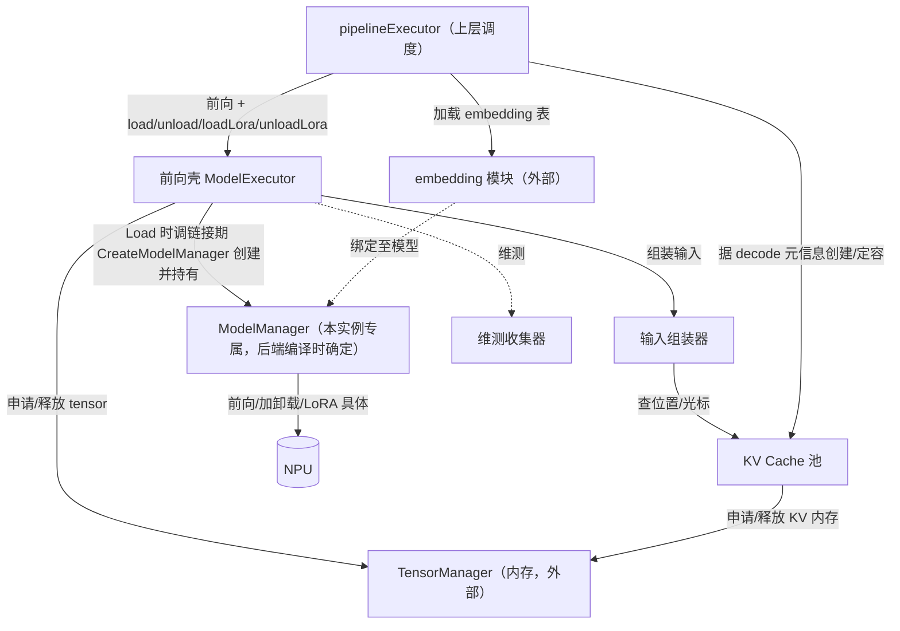
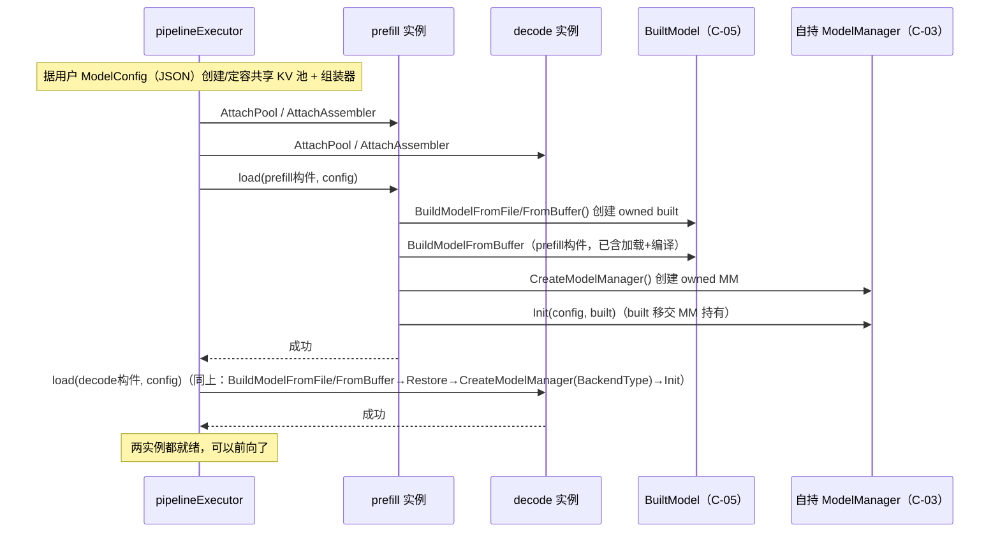
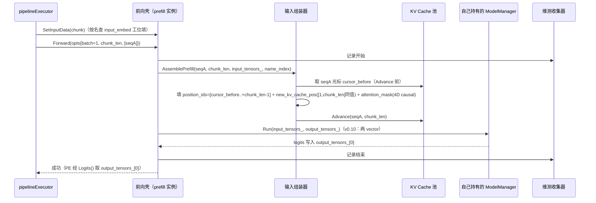
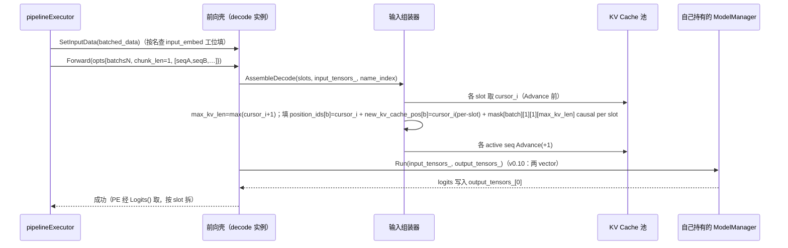
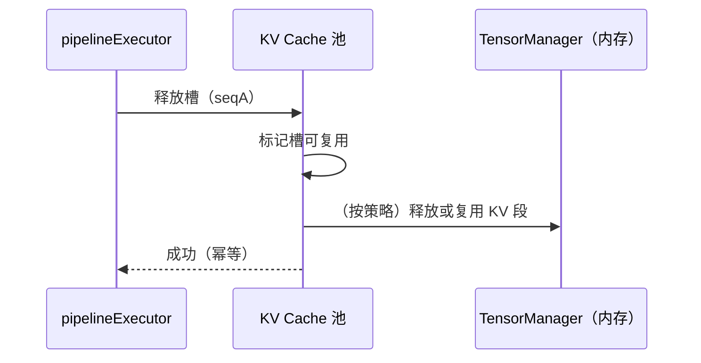
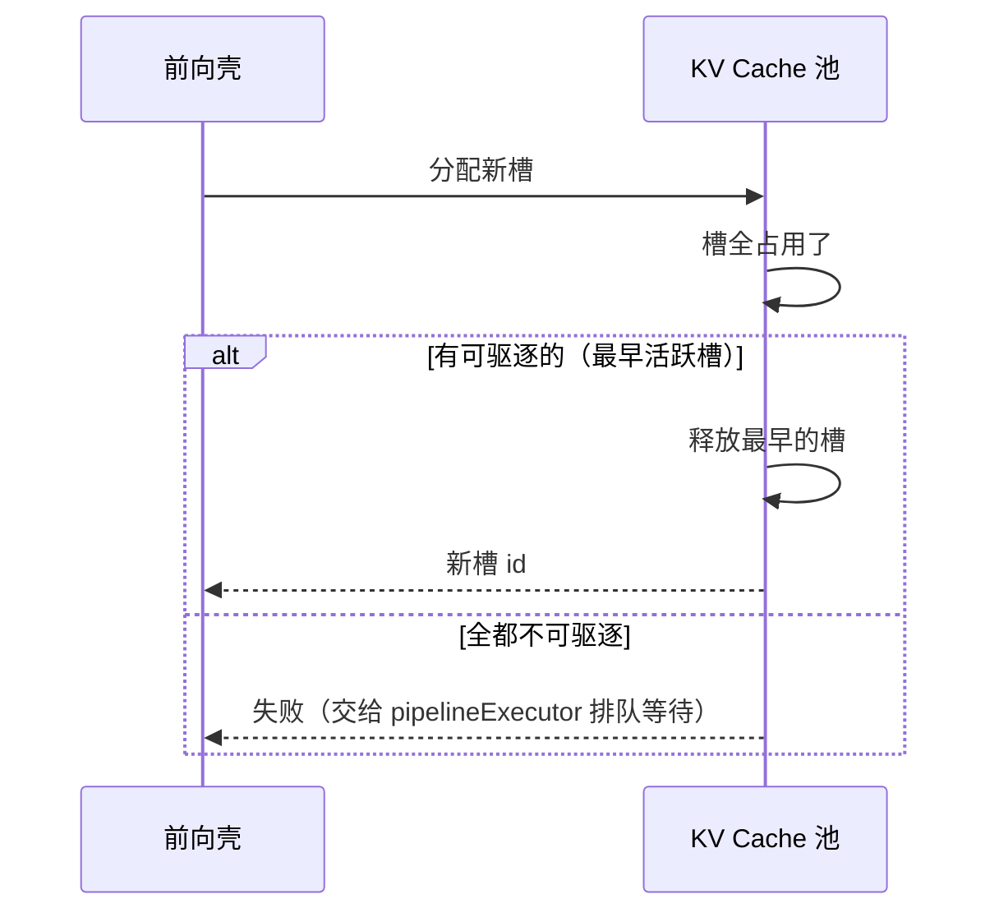
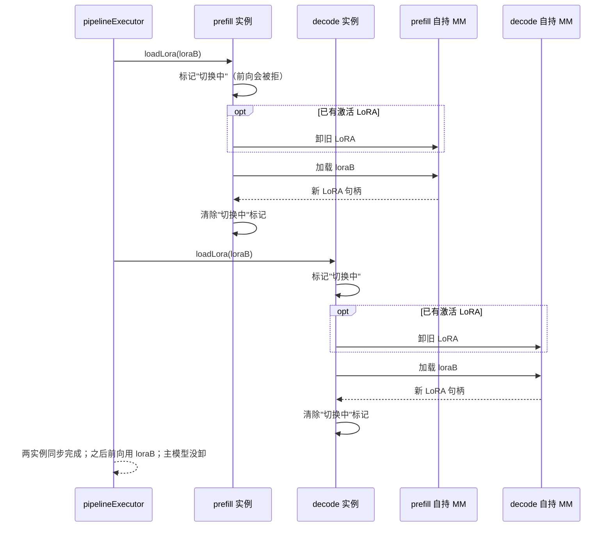

<!--
人类可读版设计文档。内容与 DESIGN.md 等价，但以叙述为主、编号缩写为辅。
机器可读的权威版本仍为 ./DESIGN.md（含完整 ID 交叉引用）。
v0.2: 取消独立生命周期控制器，控制面直接并入 ModelExecutor。
v0.3: 每个实例在 Load 时自己创建并持有自己的 ModelManager（经工厂解耦后端）。
-->

# ModelExecutor 模块设计（人类可读版）

简体中文 | [English](../../../en/cann_lm_engine/model_executor/DESIGN_HUMAN.md)

> 配套：`SPEC.md`（行为规格）、`DESIGN.md`（机器可读的权威设计，含完整编号交叉引用）。
> 本文档是 DESIGN.md 的叙述式重写，方便通读；技术决策完全一致。

## 这个模块是做什么的

一句话：**它是推理引擎里的"前向壳"——把组装好的输入交给底层去跑前向，拿回 logits；同时管好 KV Cache 的位置记账；还直接提供模型加载/卸载、LoRA 加载/卸载的控制入口——而底层执行器（ModelManager）由它自己在加载时创建并持有。**

它夹在 `pipelineExecutor`（上层调度）和 `ModelManager`（底层真正调 NPU 跑图的人）之间，干四件事：

1. **前向（Forward）**：把输入组装成完整的一束（embedding 或 tokenId + 位置 + 注意力掩码 + KV 句柄），委托**自己持有的** ModelManager 跑出 logits 返回。
2. **KV Cache 记账**：管每个序列在 KV 池里写到哪了（位置/光标），但池子的实际内存申请/释放归 `TensorManager`。
3. **模型加卸载 / LoRA 控制**：**直接**给 pipelineExecutor 提供 `load`、`unload`、`loadLora`、`unloadLora` 接口；**ModelManager 实例由本模块在 Load 时自己创建并持有**（每实例一个），具体活儿仍委托它，本模块只管 om 句柄生命周期。不再单设一个"生命周期控制器"子模块。
4. **维测（DFX）**：逐次前向的输入输出 dump、耗时统计、KV 池快照，可开关。

它是 engine 内部的 C++ 组件，**只**被 pipelineExecutor 消费，不对外暴露 Python 绑定。

> **后端编译时确定（v0.4）**：ModelManager 的具体后端类型在**编译时**就定好了——model_executor 不感知、也不引用具体后端类名。Load 时调一个**链接期**的自由函数 `CreateModelManager()`（声明在 `IModelManager` 头里，定义由编译时选定链接的后端库提供）拿到 owned ModelManager，之后只持有 `unique_ptr<IModelManager>` 抽象。没有运行时工厂注入。需要换后端 = 换链接库、重新构建。

### prefill / decode 是两个实例

这是理解本模块的关键。prefill（处理整段 prompt）和 decode（逐 token 生成）用的是**两个不同的离线编译图（om 文件）**，所以本类会起**两个实例**，各绑一个图，**各持一个自己的 ModelManager**：

- **prefill 实例**：om 图的 batch 维固定为 1，一次跑一段 prompt。Load 时创建并持有自己的 ModelManager，加载 prefill om。
- **decode 实例**：om 图的 batch 维固定为 `max_batch_size`，多个序列组一拨一起跑。Load 时创建并持有自己的 ModelManager，加载 decode om。

两个实例**共享同一个 KV Cache 池**，零拷贝——prefill 写进去的 KV，decode 直接读。前提是两个 om 图的 KV 布局一致（加载时会校验，不一致就拒载）。

### 对 pipeline 设计文档的三处纠正

pipeline 设计文档里对这块的描述有三处和实际需求对不上，本设计做了澄清：

1. **KV 光标不该"沉底层"**：pipeline 文档说 KV 维护归底层的 ModelManager。但光标/槽位和上层的 batch 维调度、padding、维测紧耦合，沉到底层就看不见了。所以**光标管理放在本模块**，只有 tensor 内存申请/释放归 TensorManager。
2. **本模块不止"仅前向"**：pipeline 文档把这块限定成"只做前向、不做加卸载"。实际上本模块还**直接暴露 load/unload/LoRA 控制接口**（实现仍委托自己持有的 ModelManager）。
3. **batch 必须补齐，不是"无 padding"**：pipeline 文档说 Continuous Batching "无 padding"。但 om 图 batch 维是固定的，decode 没跑满时**必须补齐到 `max_batch_size`**，padded 位置用注意力掩码屏蔽掉。（仅 decode 实例如此；prefill 实例 batch=1，不需要补。）

### v0.3 的结构变化（重要）

v0.3 起，**ModelManager 不再由外部注入，而是每个 ModelExecutor 实例在 Load 时自己创建并持有**（每实例一个）。要点：

- **所有权清晰**：每个实例拥有自己的 ModelManager（随实例生灭），不再有"外部注入的共享 MM 归谁管"的歧义。
- **Load 改为按实例各调一次**：`Load(artifact)` 取单个 om 构件。prefill 实例 Load prefill om、decode 实例 Load decode om。原来的 `LoadModel(prefill, decode)`（一次取俩）取消。
- **公共 `Bind` 取消**：MM 创建和 om 句柄绑定并入 `Load`；跨实例依赖（TensorManager、KV 池、组装器、维测器）在构造期或 Load 后注入。
- **权重去重**：原来"prefill/decode 两 om 共享同一份权重、由一个 ModelManager 去重"不再成立（现在两个独立 MM 各管各的 om）。跨实例权重去重下放给 TensorManager（权重 blob 级）或不再强制。
- **LoRA 成对同步**：每个实例的 LoRA 挂在自己的 ModelManager 上；prefill+decode 两个 MM 都要加载同一 LoRA，由调用方（或薄协调层）保证成对调用。
- **加载顺序约束**：decode 实例必须先 Load（取 max_batch_size/max_seq_len 来定容共享 KV 池），再 prefill Load。两实例都就绪后才能 Forward。

### v0.4 的进一步收紧（重要）

v0.3 曾用一个运行时注入的 `ModelManagerFactory`（工厂对象）来创建 owned MM。v0.4 取消它——后端在**编译时**就确定，不需要运行时工厂。具体：

- Load 时调**链接期自由函数** `CreateModelManager()`（声明在 `IModelManager` 头里，定义由编译时选定链接的后端库提供），拿到 owned MM。
- model_executor 只持有 `unique_ptr<IModelManager>` 抽象，**不引用、不感知任何具体后端类名**（grep 不到具体后端类名）。
- 构造期不再注入任何工厂参数——调用方零负担。
- 换后端 = 换链接库、重新构建（构建配置选定后端 lib）；同一构建产物不支持运行时多后端切换。
- UT 链接一个 stub 定义（返 mock MM）。

> v0.2 的变化（取消独立"生命周期控制器"子模块、控制面直接并入 ModelExecutor）仍然有效。

### v0.5 的排布补充

补一条 KV 池的内存排布规则：池底层 tensor 按 **layer-major** 组织，维度顺序 `[layer][batch_slot][position][K/V][head][dim]`，**同一层内多个 batch（槽）的 KV 连续排布**。这样 om 能按层一次性绑定"该层所有 batch 的 KV"整块。槽 = batch lane 索引；per-seq 光标只推进 position 维、跨层同步。零拷贝前提随之具象：prefill/decode 两 om 都必须按此排布（含 head/dim/K-V 子序一致），加载期断言。

### v0.7 的加载流重构（重要）

v0.7 把"模型加载"拆成两个同级 L3 角色，并改了配置来源：

- **新增 `IBuiltModel`**（与 `IModelManager` 同级，声明在 `cann_local_lm/engine/core/tensor_manager.h`）：负责"构件 → 已构建模型"——`BuildModelFromFile/FromBuffer()` 加载 om 路径/buffer 成已构建模型（含编译），`GetInputDescs/GetOutputDescs` 暴露 om 图 I/O 张量描述（`TensorDesc` 定义在 `core/tensor_manager.h`）。经链接期 `BuildModelFromFile/FromBuffer()` 创建（同 CreateModelManager 模式，后端编译时确定）。
- **`ModelHandle` 移除**——被 `IBuiltModel` 替代。模型引用即 owned `IBuiltModel`，经 `Init` 移交给 ModelManager 持有，ModelExecutor 不再持句柄。
- **`ModelMetaInfo` → `ModelConfig`**：配置**不再是加载时从 artifact meta_json 解析出来的输出**，而是**用户用 JSON 传给 pipeline、由 pipeline 调 `model_executor::Load` 时作为入参传入**。Load 签名变成 `Load(artifact, ModelConfig)`。
- **`IModelManager::Load` 去掉，改 `Init(ModelConfig, shared_ptr<IBuiltModel>)`**：ModelManager **不直接经 artifact 加载**——构件加载归 IBuiltModel，MM 只接收已构建的 BuiltModel 做运行时初始化（权重上 NPU、图就绪）。`Forward`/`Release` 不再接收 handle（MM 经 Init 绑定唯一 built）。`GetMeta`→`GetConfig`。

新的加载流（每实例）：`Load(artifact, config)` → `BuildModelFromFile/FromBuffer()` + `（已含加载+编译）` → `CreateModelManager()` + `mm->Init(config, std::move(built))`（built 移交 MM）。

**顺带消除了 v0.3 的加载顺序约束**：因为 `ModelConfig` 是用户侧入参（Load 前就已知），pipeline 可以**先据 config 创建/定容共享 KV 池并 Attach 两实例，再 Load**——不再有"decode 先 Load 取 meta 才能定容 pool"的 chicken-egg。

> 术语映射（旧→新）：`ModelHandle`→`IBuiltModel`；`ModelMetaInfo`→`ModelConfig`（用户 JSON 入参）；`IModelManager::Load`→`Init(ModelConfig, IBuiltModel)`；`GetMeta`→`GetConfig`；`LoadModel(artifact,&meta)`→`Load(artifact, ModelConfig)`。

### v0.8 的 tensor 申请路径（重要）

v0.8 给出了模型输入/输出 tensor 的申请路径：

- **`TensorManager` 改为具体单例**（`core/tensor_manager.h`，`Instance()`）——`CreateTensor(TensorDesc, modelId)` 按 desc + modelId 申请 tensor，RAII 释放。当前是 malloc 桩（按 ∏dims×dtype 字节分配），真实后端落地后由后端提供 NPU 设备内存分配。
- **`IModelManager::GetModelID() → uint32_t`**——返回模型 id（后端分配，关联已加载模型/NPU 上下文）。ModelExecutor 在 `Init` 后调它取得 modelId。
- **`Load` 时申请输入/输出 tensor**：`Init(config, built)` 后 → `GetModelID()` → 据 `built->GetInputDescs/GetOutputDescs`（在 Init move 前取）返回的 `TensorDesc`，向 `TensorManager::Instance().CreateTensor(desc, modelId)` 申请输入/输出 tensor，存为 `input_tensors_`/`output_tensors_`，供 Forward 使用。

即：构件加载（BuildModelFromFile/FromBuffer）→运行时初始化（MM::Init）→取模型 id（GetModelID）→据 I/O desc 向 TensorManager 单例申请 tensor。`modelId` 把"申请的 tensor"与"已加载的模型"绑定（真实后端用于关联 NPU 上下文/设备）。

> v0.12 起：全链路改 backend 类型——TensorManager 代理 CreateTensorBuffer；shared_ptr ITensorBuffer 替代 Tensor；TensorDesc 替代 NDTensorDesc；GetData/GetSize 替代 data/size；mm->Run 替代 mm->Forward；mm->DeInit 替代 mm->Release；BuildModelFromFile/FromBuffer + CreateModelManager(BackendType) 替代 CreateBuiltModel/CreateModelManager；engine Status 不改（map_backend_status 边界映射）。

---

## 整体结构



四个内部部件：

| 部件 | 干什么 |
|------|--------|
| **前向壳** ModelExecutor | 既是前向面（组装输入、推进 KV 光标、委托自己持有的 ModelManager 跑前向、返回 logits；prefill/decode 各一个实例；一次只允许一个前向在飞），又是控制面（load/unload/loadLora/unloadLora/getMeta，Load 时自创建自持有 ModelManager，管单活跃）。 |
| **KV Cache 池** KvCachePool | 管槽位和光标：分配/释放槽位、推进光标、池满驱逐最早、快照查询。内存由 TensorManager 出；容量由 decode 实例的元信息定容。 |
| **输入组装器** InputAssembler | 从光标推导位置 id、构造注意力掩码、decode 时把 batch 补齐到 max_batch_size。产出完整输入束。 |
| **维测收集器** DfxCollector | 逐次前向的 IO dump、耗时统计、KV 池快照。可开关，关了就零开销。 |

依赖关系没有环：底层外部接口（ModelManager、TensorManager）← KV 池、前向壳；KV 池 ← 输入组装器、维测；输入组装器/KV 池/维测 ← 前向壳。ModelManager 由前向壳自己在 Load 时创建并持有。

---

## 关键流程（讲故事版）

下面把六条主流程用大白话讲一遍。

### 流程一：加载（v0.7：构件→BuiltModel→MM::Init，config 入参）

pipelineExecutor 持用户 `ModelConfig`（JSON），对**每个**实例各调一次 `load(artifact, config)`。**不再有 decode-先约束**：config 是入参、Load 前就已知，pipeline 先据 config 建/定容共享 KV 池并 Attach 两实例，再 Load。



要点：
- 每个实例 Load 时：先 `BuildModelFromFile/FromBuffer()` + `（已含加载+编译）`（构件→built），再 `CreateModelManager()` + `mm->Init(config, built)`（运行时初始化，built 移交 MM）。后端编译时确定，model_executor 不感知具体后端类名。
- `ModelManager` 不直接经 artifact 加载——构件加载归 `IBuiltModel`，MM 只 Init。
- `ModelConfig` 是用户 JSON 配置入参（max_batch_size/max_seq_len 等），**不从 artifact 解析**。pipeline 据它在 Load **前**定容共享 KV 池——故无 decode-先 chicken-egg。
- 一个引擎实例里同时只有一对活跃前向壳（prefill+decode），不支持运行时热切换。已有活跃对时再 load，要先 unload。
- embedding 表不走这条线——由 pipelineExecutor 调 embedding 模块加载并绑定到模型上。

异常：`BuildModelFromFile`/`FromBuffer` + `CreateModelManager(BackendType)` 返空/后端未链接 → 加载失败（构建期保证链接后端定义）；`mm->Init` 失败 → 失败；`ModelConfig.max_batch_size/max_seq_len<=0` → 参数非法；路径和 buffer 来源混用 → 参数非法。

### 流程二：prefill 前向（v0.13：按 name→index 查工位填输入）

pipelineExecutor 先 `SetInputData(chunk)` 把 chunk data 填进名为 `input_embed` 的工位（按 name→index 映射查，非硬编码下标），再 `Forward(opts{batch=1, chunk_len, slots=[seqA]})`：



要点：
- prefill **不补齐**——om 图 batch 维就是 1。
- data 由调用方经 `SetInputData` 填入名为 `input_embed` 的工位（embedding 或 tokenId 路径，tokenId 走模型内部 embedding）。`position_ids`/`new_kv_cache_pos`/`attention_mask` 由 assembler **按 name→index 映射查工位**填入、从光标推导——不硬编码下标（工位排序由 om 图决定）。
- `position_ids`（`batch×seqLen`）与 `new_kv_cache_pos`（`[batch, seqLen]` per-slot，指导 KV 写入位置、可能绕回）是**两个不同工位**，不可合并。
- `attention_mask` 为 4 维 `batch×1×seqLen×kvCacheLen`（第 2 维固定 1），causal：当前位置及之前可见=0，之后遮蔽=`-FLT_MAX`。
- 光标在 `Advance` **前**读取（先取位置填 tensor，再推进）。
- 长 prompt 切块，多次调用，每次追加一段 KV。

异常：光标越界 → 失败；`opts.slots` 空 → 参数非法；name→index 缺 `position_ids`/`new_kv_cache_pos`/`attention_mask` → 参数非法；底层前向失败 → 失败。

### 流程三：decode 前向（逐 token 生成）

pipelineExecutor 先 `SetInputData(batched_data)`（把各活跃序列 token 拼进 `input_embed` 工位，真实后端按 batch 维填；stub 取首个），再 `Forward(opts{batch≤N, chunk_len=1, slots=[seqA,seqB,…]})`：



要点：
- decode **必须补齐**到 max_batch_size——om 图 batch 维固定。没跑满的位置用 dummy 槽/零填充，注意力掩码按名查工位填、屏蔽 padded 位，**补的位不推进光标**。
- batch 内不同 cursor 的 slot 取 `max_kv_len=max(cursor_i+1)`，短 slot 尾部置 `-FLT_MAX`。
- 每个序列每步只追加一个 token 的 KV。
- 跑满时（active = max_batch_size）就不补，掩码全有效。

### 流程四：序列结束/取消，释放槽

序列到头或被取消时，释放它占的 KV 槽：



释放是幂等的，重复释放不报错。释放后腾出的槽可以接新请求。

### 流程五：池满，驱逐最早

新请求要分配槽，但池子满了（所有槽都活跃）：



默认驱逐**最早**那个活跃序列（FIFO）。驱逐策略细节（最早 vs 优先级 vs LRU）留作未决，但接口稳定。

### 流程六：LoRA 加载/卸载（每实例委托自己的 ModelManager；成对同步）

pipelineExecutor 调前向壳的 `loadLora` 或 `unloadLora`。**注意：prefill 和 decode 两个实例各有自己的 ModelManager，所以要对两个实例都调用**，让两个 MM 同步加载同一份 LoRA：



要点：同一时刻每个实例只一个 LoRA 激活；`loadLora` 检测到已有激活就先 `unloadLora` 再加载（切换=卸载+加载，主模型不卸），没有单独的 switch 方法。**两个实例必须成对调用**，否则两个 MM 的 LoRA 状态分叉，行为未定义。切换期间前向会被拒（状态非法）。

---

## 接口长什么样

下面是 C++ 接口骨架。外部类型（ModelManager 抽象、TensorManager、Tensor）只做前置声明，定义在底层。

### 状态码

对齐 pipeline 的 6 个粗粒度状态码，不静默吞错：

```cpp
enum class Status {
  Success = 0,       // 成功
  Failure,           // 失败（底层失败、加载失败、MM 工厂创建失败、池满无可驱逐、光标越界）
  InvalidArgument,   // 参数非法（shape/pos 不一致、路径/buffer 混用）
  InvalidState,      // 状态非法（未加载就前向、pool/asm 未注入、LoRA 切换中前向、并发违规）
  NotFound,          // 找不到（模型/LoRA 未加载）
  Canceled           // 取消
};
```

### 前向壳（含控制面，v0.7：构件→BuiltModel→MM::Init）

```cpp
// v0.7：ModelHandle 移除（被 IBuiltModel 替代）；ModelMetaInfo→ModelConfig（用户 JSON 入参）。
struct ForwardOptions {
  int batch;                 // prefill=1；decode ≤ max_batch_size
  std::size_t chunk_len;     // 本步 token 数（prefill=chunk；decode=1）
  std::vector<SlotId> slots;  // 本次 batch 对应的 KV 槽
  bool dump;                  // 维测开关
};

struct ModelConfig {          // 用户 JSON 配置（pipeline 调 Load 时传入，非从 artifact 解析）
  int max_batch_size;
  int max_seq_len;
};

// 后端创建（链接期自由函数，后端编译时确定；定义由编译时选定链接的后端库提供）：
std::shared_ptr<IBuiltModel>  BuildModelFromFile/FromBuffer();    // 构件→已构建模型
std::unique_ptr<IModelManager> CreateModelManager();  // 运行时初始化+前向+释放

class ModelExecutor {
 public:
  // 构造：注入跨实例/外部依赖。无后端工厂注入（后端编译时确定）。
  ModelExecutor(std::shared_ptr<KvCachePool> pool,
                std::shared_ptr<InputAssembler> asm_,
                std::shared_ptr<DfxCollector> dfx);

  Status AttachPool(std::shared_ptr<KvCachePool> pool);
  Status AttachAssembler(std::shared_ptr<InputAssembler> asm_);

  // ---- 控制面：直接暴露给 pipelineExecutor ----
  // 加载（v0.7）：BuildModelFromFile/FromBuffer（已含加载+编译）(artifact) → CreateModelManager + mm->Init(config, built)。
  // config 为用户 JSON 入参。单活跃：已加载则先 unload。
  Status Load(const ModelArtifact& artifact, const ModelConfig& config);
  Status Load(const ModelArtifactPath& artifact, const ModelConfig& config);
  Status Unload();                 // 委托 mm->DeInit + 释放 owned MM，幂等
  Status GetConfig(ModelConfig* out) const;   // 返回 Load 时传入的配置

  // LoRA：单激活；loadLora 检测到已有激活时先 unloadLora 再加载（切换=卸载+加载，主模型不卸）
  Status LoadLora(const ModelArtifact& lora);
  Status UnloadLora();

  // ---- 前向面（v0.9/v0.13：不接收 inputs/count/out_logits，用私有 input_tensors_/output_tensors_）----
  // 填输入 data 至名为 input_embed 的工位（按 input_name_index_ 查名，Forward 前调）。
  Status SetInputData(const std::shared_ptr<ITensorBuffer>& data);
  // 单步前向：assembler 按 name_index 查 position_ids/new_kv_cache_pos/attention_mask 工位填 input_tensors_
  //   （光标 Advance 前从 KV 池取）+ 推进光标 → mm->Run(input_tensors_, output_tensors_)。
  // 同步、单飞串行（mutex 兜底）。
  Status Forward(const ForwardOptions& opts);
  // 取输出 logits（output_tensors_[0]，Forward 后读）。
  std::shared_ptr<ITensorBuffer> Logits() const;

  explicit operator bool() const noexcept;   // 已加载且 pool/asm 齐备
};
```

前向失败的几种情况：没加载 / `output_tensors_` 空 → 状态非法；`opts.slots` 空 → 参数非法；name→index 缺 `position_ids`/`new_kv_cache_pos`/`attention_mask` → 参数非法；底层失败 → 失败；LoRA 切换中调 → 状态非法。

加载失败的几种情况：`BuildModelFromFile`/`FromBuffer` + `CreateModelManager(BackendType)` 返空/后端未链接 → 失败（构建期保证链接后端定义）；`mm->Init` 失败 → 失败；`ModelConfig.max_batch_size/max_seq_len<=0` → 参数非法；路径/buffer 混用 → 参数非法；已有活跃又 load → 先 unload 或拒绝。

### KV Cache 池

```cpp
using SlotId = int;   // -1 表示无槽

struct SlotInfo {
  SlotId id;
  size_t cursor;     // 下一个可写位置（已写长度 = cursor）
  bool active;
};

class KvCachePool {
 public:
  // 容量由 decode 实例的元信息（max_batch_size/max_seq_len）定容
  // 排布（D-13）：layer-major [layer][batch_slot][position][K/V][head][dim]，
  //              同一层内多个 batch（槽）的 KV 连续；槽 = batch lane 索引
  KvCachePool(int max_batch_size, int kv_cache_max_len, int num_hidden_layers,
              int num_attention_kv_heads, int num_attention_head_dims,
              DataType dtype);   // 构造即经 TensorManager 单次批量申请 2×层数个
                                  // per-layer K/V tensor（C-04；v0.14）

  Status AllocKvSlot(SlotId* out);   // 分配一条 batch lane；池满则驱逐最早；满且无可驱逐 → 失败
  Status FreeKvSlot(SlotId id);       // 幂等；复用 batch lane，不搬移其他槽
  Status Advance(SlotId id, size_t n); // 推进该槽 position 光标 n（跨层同步）；越界 → 失败
  size_t NextPosition(SlotId id) const;   // = cursor（position 维，跨层一致）
  Status Snapshot(std::vector<SlotInfo>* out) const;   // 维测快照
  size_t TensorCount() const noexcept;   // 已申请 tensor 数（= 2×num_hidden_layers）
  std::shared_ptr<ITensorBuffer> KTensor(int layer) const noexcept;   // 按层 K tensor
  std::shared_ptr<ITensorBuffer> VTensor(int layer) const noexcept;   // 按层 V tensor
};
```

槽位数 = max_batch_size；每个序列占一条 batch lane（槽 = batch 索引）。光标越界（position 超过 max_seq_len）是质量红线，强校验拦截。

### 输入组装器（v0.13：按 name→index 查工位）

模型的输入张量工位由 om 图定义（每个 omc 排序可能不同），Load 后据 `IBuiltModel::GetInputDescs()` 的 `TensorDesc.name → i` 建立 `input_name_index_` 映射。组装器按名查工位填入，不硬编码下标。6 个工位见 `INPUT_INFO.md`：

| 名称 | 类型 | 维度 | 填充者 |
|------|------|------|--------|
| `input_embed` | FLOAT16 | `[batch, seqLen, hidden]` | 调用方（`SetInputData`） |
| `embed_scales` | FLOAT32 | `batch×seqLen×1` | embedding 模块（当前搁置） |
| `attention_mask` | FLOAT32 | `batch×1×seqLen×kvCacheLen` | InputAssembler（causal） |
| `position_ids` | INT32 | `batch×seqLen` | InputAssembler |
| `new_kv_cache_pos` | INT32 | `[batch, seqLen]` | InputAssembler |
| `kvCache` | — | `[numLayers, max_batch, max_seqLen, 2, heads, dim]` | KV 池 buffer（Load 时申请） |

```cpp
class InputAssembler {
 public:
  InputAssembler(std::shared_ptr<KvCachePool> pool, int max_batch_size);

  // prefill：batch=1，无补齐。按 name_index 查 position_ids/new_kv_cache_pos/attention_mask，
  //   取 cursor_before → pos=[cursor_before..+chunk_len-1] + new_kv_cache_pos([1,chunk_len]同值)
  //   + mask[1][1][chunk_len][cursor_before+chunk_len] causal → Advance(slot, chunk_len)
  Status AssemblePrefill(SlotId slot, std::size_t chunk_len,
                         std::vector<std::shared_ptr<ITensorBuffer>>& tensors,
                         const std::unordered_map<std::string, std::size_t>& name_index);
  // decode：seqLen=1。各 slot 取 cursor_i → max_kv_len=max(cursor_i+1) →
  //   pos[b]=cursor_i + new_kv_cache_pos[b]=cursor_i(per-slot [batch,1]) + mask[batch][1][1][max_kv_len] causal per slot
  //   → Advance(各 slot, 1)
  Status AssembleDecode(const std::vector<SlotId>& slots,
                        std::vector<std::shared_ptr<ITensorBuffer>>& tensors,
                        const std::unordered_map<std::string, std::size_t>& name_index);
  int max_batch_size() const noexcept;
};
```

关键规则：
- `position_ids`（`batch×seqLen`）与 `new_kv_cache_pos`（`[batch, seqLen]` per-slot，指导 KV 写入位置、可能绕回）是**两个不同工位**，不可合并。
- `attention_mask` 第 2 维固定为 1；causal = 当前位置及之前 `0`、之后 `-FLT_MAX`；decode padding 时短 slot 尾部遮蔽。
- 光标在 `Advance` **前**读取（先取位置填 tensor，再推进）。
- 写入前检查 `GetData()` 非空，memcpy 长度 `min(数据, GetSize())` 截断。

### 维测收集器

```cpp
struct DfxConfig {
  bool io_dump = false;        // IO dump 开关
  bool timing = true;          // 耗时统计开关
  std::filesystem::path dump_dir;
};

class DfxCollector {
 public:
  DfxCollector(DfxConfig cfg, std::shared_ptr<KvCachePool> pool);

  // 前向后由前向壳调用；dump 关闭时零开销早退
  Status OnForwardStart(const ForwardBundle& in, const ForwardOptions& opts);
  Status OnForwardEnd(const std::shared_ptr<ITensorBuffer>& logits, double elapsed_us);
  Status PoolSnapshot(std::vector<SlotInfo>* out) const;   // 委托 KV 池
  Status FlushTimings(/*输出*/ void* out) const;            // 汇总耗时
};
```

dump 落盘失败只记告警，**不**打断推理。

---

## 为什么这么设计（关键决策讲明白）

### 1. KV 光标为什么放在本模块，不沉到底层

pipeline 文档说 KV 维护归底层 ModelManager。但光标/槽位和上层的 batch 维调度、padding、维测绑得很紧，沉到底层就丢掉了 batch 维的可见性，padding 和维测都没法协同。所以光标管理放本模块的 KV 池里，**tensor 内存的申请/释放仍归 TensorManager**，底层算子（KV 拼接/写入）仍在 ModelManager 的前向里。

代价：本模块要扛光标一致性责任——光标越界是质量红线，强校验拦死。

### 2. 为什么 prefill/decode 共享同一个池、零拷贝

prefill 写、decode 读，共享一个池就不用拷贝。前提是两个 om 图的 KV 排布一致——**都按 layer-major、同层多 batch 连续**（`[layer][batch_slot][position][K/V][head][dim]`，head/dim/K-V 子序也要一致）。加载时断言两 om 排布一致，不一致就拒载（注意两个 om 现在由两个独立 ModelManager 加载，但排布一致性校验仍要在加载期对两 om 断言）。

### 3. 为什么用"连续槽位 + per-seq 光标"而不是分页

简单、碎片可控、光标操作 O(1)。每个序列占一条 batch lane（槽 = batch 索引 0..max_batch_size-1），槽内已写 position 连续、per-seq 光标推进 position 维且跨层同步。代价是每个槽按 max_seq_len 预分配，短序列会浪费空间（所以池容量随 max_seq_len 放大，是高风险预算项）。

### 3b. 为什么 KV 池按 layer-major 排布、同层多 batch 连续

om 图是按层算 attention 的——它要为每一层绑定一块"该层所有 batch 的 KV"的连续内存。所以池底层 tensor 按 **layer-major** 组织：维度顺序 `[layer][batch_slot][position][K/V][head][dim]`，**同一层内多个 batch（槽）的 KV 连续排布**（layer 最外、batch 其次，所以一层下所有 batch 是一个连续块）。这样 om 按层绑定整层 KV 一气呵成。

和 per-seq 光标完全兼容：光标只管 position 维（槽内已写位置连续），各层同 token 同步推进——单条 sequence 跨层虽然不连续（各层段分散），但 om 按层访问，不影响正确性。零拷贝前提也就清晰了：prefill om 和 decode om 都必须按这个 layer-major 排布（head/dim/K-V 子序也要一致），加载期断言，不一致就拒载。

### 4. 为什么 decode 要补齐到 max_batch_size

因为 om 图的 batch 维是固定的（离线编译时就定死），decode 没跑满时必须补到固定维才能喂进图。补的位置用 dummy 槽/零填充，注意力掩码屏蔽掉，且不推进光标。prefill 的图 batch 维固定为 1，所以不补。

### 5. 为什么单飞串行

同一实例并发前向会抢光标。单飞串行（mutex）最简单、最安全。多序列的并行靠单次 batch 内的数据并行，不靠并发前向——这跟设备本质串行是一致的，没有损失。

### 6. 为什么单 LoRA、切换=卸载+加载（没有 switch 方法）

简单，先落地。同一时刻每个实例只一个 LoRA 激活，`loadLora` 检测到已有激活就先 `unloadLora` 再加载（主模型不卸）。不单独提供 switch 方法——切换就是卸载+加载的组合，控制面接口最小。切换期间前向会被拒（状态非法）。

**v0.3 注意**：两个实例各有自己的 ModelManager，所以 LoRA 要对 prefill 和 decode **两个实例都调**，让两个 MM 同步加载同一份 LoRA。如果只对一个实例调，两个 MM 状态会分叉，行为未定义。

### 7. 为什么支持 tokenId 直入、embedding 表归谁

支持两条路径：已查表的 embedding，或 tokenId（走模型内部 embedding，由 om 图查表）。这样能兼容 om 内置 embedding 的模型。embedding 表**由 pipelineExecutor 调 embedding 模块加载并绑定到模型**，不是 ModelManager 负责，本模块也不加载/拥有 embedding 表、不重新实现查表。

### 8. 为什么维测可开关、且不阻断推理

维测 dump 在前向路径上，关了必须零开销（早退），开了也不能因为落盘失败就把推理打断。生产环境靠开关控成本。

### 9. 为什么每实例单活跃对、不热切换

简单、先落地。一个引擎实例里同时只有一对活跃前向壳（prefill+decode），不支持运行时热切换模型。多引擎实例可以共存、资源池隔离。v0.3：每实例单活跃 om（load 前先 unload），各持自己的 ModelManager。

### 10. 为什么取消独立的"生命周期控制器"子模块

v0.1 曾单设一个子模块中转 load/unload/LoRA 控制。但 SPEC 本来就把这些契约列在 ModelExecutor 上，独立子模块多一层中转、增加阅读和调用成本；而且前向与控制共享同一份 om 句柄和状态，合并反而减少状态散落和同步开销。所以 v0.2 把控制方法直接并入 ModelExecutor。

### 11. 为什么 ModelManager 由每个实例自己创建并持有（v0.3），且后端编译时确定、无运行时工厂（v0.4）

v0.2 是外部注入一个共享 ModelManager 给两个实例用，所有权归属不清（这个 MM 归谁管、什么时候销毁）。v0.3 改成：**每个实例在 Load 时创建并持有自己的 ModelManager**（随实例生灭）。

v0.3 曾用一个运行时注入的 `ModelManagerFactory`（工厂对象）来创建 MM。v0.4 进一步收紧：后端在**编译时**就确定，不需要运行时工厂。Load 时调一个**链接期自由函数** `CreateModelManager()`（声明在 `IModelManager` 头里，定义由编译时选定链接的后端库提供），拿到 owned MM。model_executor 只持有 `unique_ptr<IModelManager>` 抽象，**不引用、不感知任何具体后端类名**（grep 不到具体后端类）。构造期不再注入任何工厂参数。

好处：所有权清晰、每 MM 职责单一、调用面更简（构造期少一个参数）、core 不耦合后端具体类、后端选择是构建期决策、无运行时后端切换的状态/安全风险。

代价（要记牢的几点）：
1. **跨实例权重去重没了**：原来"prefill/decode 两 om 共享同一份权重、由一个 MM 去重"不再成立——两个独立 MM 各管各的 om。去重要么下放给 TensorManager（权重 blob 级），要么不再强制。
2. **LoRA 要成对同步**：每个实例的 LoRA 挂在自己的 MM 上，必须对 prefill 和 decode 两个实例都调 loadLora/unloadLora。
3. **加载有顺序**：decode 必须先 Load（拿 max_batch_size/max_seq_len 来定容共享 KV 池），再 prefill Load。
4. **后端单选编译**：同一构建产物不支持运行时多后端切换；需多后端则多构建产物（换链接库重新构建）。`CreateModelManager()` 未链接后端定义 → 链接期 unresolved symbol，构建期保证；函数返空 → 作为 Load 失败处理。

---

## 性能预算

下面这些目前都是**预算目标**（没有实测基线），等真机微基准校准：

| 指标 | 目标 | 怎么测 | 风险 |
|------|------|--------|------|
| 前向壳转发开销 | <0.1% 端到端（不含底层算子） | 单次前向微基准（mock 底层返假 logits 隔离） | 低 |
| KV 池内存 | 定长 = num_layers × max_batch_size × max_seq_len × 2(K&V) × num_heads × head_dim × dtype（layer-major 排布） | 加载后 RSS/NPU 内存 | **高**（随模型规模线性放大，绝对值未绑定） |
| 池操作（分配/释放/推进/取位） | 可忽略 O(1) | 池操作微基准 | 低 |
| prefill 输入组装 | < 该 chunk 前向耗时 5% | 每 chunk | 中 |
| decode 输入组装（含补齐） | <0.1% 端到端 | 每步 | 低 |
| 加载（含 MM 创建，不含底层加载） | 一次性 | 构造期 | 低 |
| 维测关闭时开销 | 零 | 关 vs 开基线对比 | 低（行为契约保证） |

两个高风险/红线项：

1. **KV 池内存**：容量随层数/hidden/seq_len/max_batch_size 线性放大，绝对值要等模型规模定了才能测。如果超预算，退化路径是逐层 KV 量化或减小 max_batch_size。
2. **KV 光标越界**（质量红线，非性能）：多轮长对话时光标逼近 max_seq_len，越界即崩溃。靠光标强校验 + 测试覆盖拦截。

---

## 并发与线程安全

- 没有独立线程、没有事件循环。前向壳实例是调用线程持有的同步对象，前向执行串行。
- **单飞**：同一实例同一时刻只允许一个前向在飞，用 mutex 串行化。
- **KV 池操作互斥**：分配/释放/推进光标都经 mutex 保护，prefill/decode 两实例共享同一个池。
- **控制面串行**：load/unload/loadLora/unloadLora（含 ModelManager 的创建/释放）经 lifecycle mutex 串行，且与 Forward 经 `lora_switching_` 原子标志协调——前向时不持 lifecycle 锁，避免前向阻塞加载/LoRA，反之亦然。
- 锁层级：生命周期锁（含 owned MM 生命周期）> 前向锁 > 池锁，不反向嵌套。
- 多实例隔离：无全局单例，各对资源池独立，各持自己的 ModelManager。

---

## 错误怎么分等级

| 等级 | 定义 | 例子 | 默认处理 |
|------|------|------|---------|
| L1 致命 | 不可恢复 | 光标越界、KV 布局漂移 | FATAL 日志，请求判失败 |
| L2 严重 | 可重试 | 加载失败、shape 不一致、MM 工厂创建失败 | 返回失败/参数非法 |
| L3 可降级 | 影响质量/可观测 | dump 落盘失败、池快照失败 | 告警，不阻断推理 |

---

## 还没定的事（未决项）

| 未决 | 影响 | 兜底 |
|------|------|------|
| 前向壳开销预算无基线 | <0.1% 可能失准 | 实现期微基准校准 |
| KV 池容量未绑定模型规模 | 内存预算失准 | 模型规模定后实测；容量由 decode 元信息定容 |
| 两 om KV 排布一致性 | 零拷贝失败 | 加载期断言两 om 均 layer-major、同层多 batch 连续、子序一致，不一致拒载 |
| 驱逐策略细节 | 驱逐语义争议 | 默认驱逐最早，策略可调 |
| LoRA 跨 prefill/decode 成对同步 | 两 MM 状态可能分叉 | 调用方成对调用两实例，或引入薄协调层 |
| dummy 槽/padded 位 KV 处理 | 越界/污染 | 零填充 + 掩码屏蔽 + 不推进光标 |
| 跨实例权重去重不再由 MM 负责 | 权重可能重复驻留 NPU | 下放 TensorManager 权重 blob 级去重，或不强制 |
| 后端编译时单选，不支持运行时切换 | 多后端共存受限 | 后端编译时确定（构建配置）；需多后端则多构建产物 |

---

## 接下来怎么落地（给实现的人）

实现顺序（按依赖拓扑）：

1. 先声明外部接口（ModelManager 抽象、TensorManager 抽象）。
2. 写 KV Cache 池（配 mock TensorManager，跑通分配/释放/驱逐/快照）。
3. 写输入组装器（配 mock KV 池，跑通位置推导 + 补齐 + 掩码）。
4. 写维测收集器（配 mock 文件 sink，跑通 dump 开关 + 落盘失败降级）。
5. 写前向壳（链接 stub 定义 `CreateModelManager()` 返 mock MM，跑通：Load 时确实调它创建并持有 owned MM、两条输入路径 + 单飞、load/unload/loadLora/unloadLora 控制面）。grep 断言 M-01 代码不引用任何具体后端类名。
6. 最后：prefill + decode 两个实例 + 共享池，跑通零拷贝衔接（decode 先 Load→定容 pool→prefill Load）。

可并行：KV 池和维测互不依赖，可以同时开工。

源码落 `cann_local_lm/engine/core/model_executor/`，UT 落 `tests/cpp/engine/model_executor/`。后端库由构建配置选定链接，提供 `CreateModelManager()` 定义；UT 链接 stub（返 mock MM）。

---

## 一致性说明

本文档与 `DESIGN.md` 技术决策完全等价，只是去掉了编号缩写的交叉引用、改用叙述。机器可读的权威版本（含完整模块/契约/流程/决策编号、用于实现期精确追溯）仍是 `DESIGN.md`。两边如有出入，以 `DESIGN.md` 为准。
