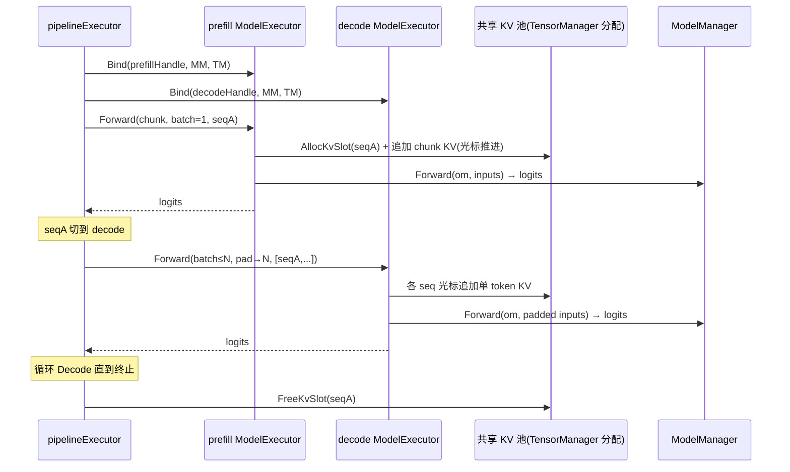

# SR20260807001 — CANN-LM Engine ModelExecutor 模块

简体中文 | [English](../../../en/cann_lm_engine/model_executor/SPEC.md)

## 第 1 章 概述

本规格定义 `cann_local_lm/engine/core/model_executor` 下 C++ ModelExecutor 模块的业务行为。该模块为 CANN-LM 推理引擎提供**单步前向执行（前向壳）**与 **KV Cache ringBuffer 光标管理**、**输入填充**、**模型加卸载/LoRA 控制**能力，位于 `pipelineExecutor`（上）与 `ModelManager`（下，backend 具体实现）、`TensorManager`（tensor 内存）之间。prefill 与 decode 分别为本模块两个实例（各绑定一个 om 离线编译图），二者共享同一 KV Cache 池、零拷贝。该模块是 engine 内部 C++ 组件，仅被 `pipelineExecutor` 消费，**不对外暴露**任何跨语言或外部接口。

需求编号：**SR20260807001**。软件层次：**framework**（engine core 可复用库，含向后兼容性章节）。

**对 pipeline DESIGN（`docs/pipeline+engine_executor/DESIGN.md` §11.4 M-04）的三处澄清/纠正**：
1. **KV 光标归属**：pipeline DESIGN 将 KV 维护标注为"沉底层 C5（C-04 IModelManager）"。本规格澄清——**KV ringBuffer 的 pos/offset/光标管理归本模块**；仅 tensor 内存申请/释放在 `TensorManager`。
2. **M-04 范围**：pipeline DESIGN 将 M-04 限定为"仅前向、不做 load/unload"。本规格澄清——本模块不止前向，还**向上向 `pipelineExecutor` 暴露 load/unload/LoRA 控制接口**，具体加卸载/LoRA 实现在 `ModelManager`，本模块委托调用。
3. **batch padding**：pipeline SPEC/DESIGN 称 Continuous Batching"无 padding"。本规格纠正——om 图 batch 维固定，**active batch 未满时本模块必须 pad 到 `max_batch_size`**（仅 decode executor：其 om 固定 batch 维 = `max_batch_size`）；prefill executor om 固定 batch=1，**无 padding**。padded 位置靠 attentionMask 屏蔽。

读者应在 30 秒内理解：本 spec 规定一个前向壳 + KV 光标管理 + 加卸载/LoRA 控制委托、prefill/decode 双实例、被 `pipelineExecutor` 消费的 C++ 内部组件的行为契约。

## 第 2 章 术语表

| 术语 | 定义 |
|------|------|
| ModelExecutor | 本模块，engine/core 内部 C++ 前向壳组件 |
| 前向壳 / forward shell | 只组装输入并委托底层执行前向、产出 logits 的薄层 |
| om / omc | Ascend 离线编译模型图，本模块以路径或已读入 buffer 加载 |
| prefill executor / decode executor | 本模块的两个实例，分别绑定 prefill om 与 decode om |
| ModelManager | backend 具体实现层，提供加卸载/前向/LoRA 的具体实现，位于本模块之下 |
| TensorManager | tensor 内存管理组件，本模块经其申请/释放权重与 KV 池内存 |
| KV ringBuffer | 定长 KV Cache 池，按槽位 + 光标环形管理 |
| slot / 槽位 | KV 池中一个 sequence 占用的连续区段 |
| cursor / 光标 | per-sequence 的下一个可写 KV 位置 |
| pos / offset | 序列在 KV 池中的位置偏移，由光标推导 |
| next-position | 下一步写入 KV 的位置，由光标维护 |
| inputEmbedding | 已查表的 token embedding 张量，Forward 输入之一 |
| tokenId | token id 张量，Forward 输入之一；走模型内部 embedding 路径 |
| embedding 模块（C-02 ITextEmbedding） | token id→token embedding 查表与 embedding 表加载能力；由 pipelineExecutor 调用加载 embedding 表并绑定至模型，非 ModelManager 职责 |
| positionIds | 位置 id 序列，Forward 输入之一 |
| logits | 模型前向输出，词表维度概率分布前值 |
| attentionMask | per-sequence 有效长度/causal 掩码，并屏蔽 padded 位置 |
| batch padding | active batch < max_batch_size 时补齐到 max_batch_size |
| max_batch_size | 模型元信息给定的 decode 池/batch 维容量上限 |
| max_seq_len | 模型元信息给定的单序列最大长度 |
| ModelMetaInfo | 加载后可查的模型元信息结构 |
| ModelHandle | 不透明模型句柄，由 ModelManager::Load 返回 |
| LoRA | 低秩适配器，单份激活，切换需重载 |
| 单飞 / single-flight | 同一 executor 实例同一时刻只允许一个 Forward 在飞 |
| Chunked Prefill | 长 prompt 切块、分多次 prefill 调用、逐块追加 KV |
| Continuous Batching | decode 阶段多请求组批成一次前向，请求可中途加入/退出 |
| 维测 / DFX | dump IO、耗时统计、池状态快照等可观测能力 |
| 驱逐 | KV 池满且需接纳新 sequence 时回收最早 sequence 的槽 |
| dummy 槽 | batch padding 时 padded 位置占用的占位 KV 槽 |

## 第 3 章 背景

### 3.1 现状

`cann_local_lm/models` 下各模型推理依赖外部 Python 实现。C++ 推理路径缺乏统一的"前向壳 + KV 管理 + 加卸载控制"组件。pipeline DESIGN（`docs/pipeline+engine_executor`）定义了 L2 `M-04 ModelExecutor` 为前向壳、L3 `C-04 IModelManager` 为底层运行时契约，但将 KV 维护标注为"沉底层 C5"、将 M-04 限定为"仅前向"、并主张 Continuous Batching"无 padding"。

### 3.2 问题

- **KV 归属错位**：pipeline DESIGN 把 KV pos/offset 放底层 C-04，但光标/槽位管理与上层 batch 维调度、padding、dfx 紧密耦合，沉底层会丢失 batch 维可见性与可观测能力。
- **M-04 范围过窄**：仅前向无法承载向上暴露 load/unload/LoRA 控制的需求。
- **固定 batch 维**：om 图 batch 维固定，pipeline"无 padding"假设与实际 om 形状约束不符，未满 batch 必须补齐。
- **embedding 路径单一**：仅接受外部查表后的 embedding，无法支持模型内部 embedding（tokenId 直入）路径。

### 3.3 期望

ModelExecutor 作为前向壳统一承载：前向组装与 logits 产出、KV ringBuffer 光标管理（内存归 `TensorManager`）、load/unload/LoRA 控制（实现归 `ModelManager`）、输入填充（含 batch padding）、维测；prefill/decode 双实例共享 KV 池零拷贝；Forward 输入支持 embedding 与 tokenId 两路径（tokenId 走模型内部 embedding）；行为可测。本模块行为以 om 图 + 权重为正确性 oracle（见 TC_003/004）。

## 第 4 章 功能需求

### 4.1 行为规格

#### 4.1.1 前向 Forward（壳）

- **前置条件**：实例已 Load（owned ModelManager + `input_tensors_`/`output_tensors_` 已据 descs 申请）；KV 池已分配；调用方已经 `SetInputData` 填入 data。
- **处理逻辑**：
  - 模块**必须**提供单步前向 `Forward(ForwardOptions) → status`——**不**接收 inputs/count/out_logits（v0.9）；输入/输出 tensor 使用私有 `input_tensors_`/`output_tensors_`（Load 时据 descs 向 `TensorManager` 单例申请）。
  - 调用方**必须**先经 `SetInputData(data)` 把 data 填入名为 `input_embed` 的工位（按 name→index 查找，非硬编码下标）。
  - Forward **必须**经 `InputAssembler` 按 name→index 映射查找 `position_ids`/`new_kv_cache_pos`/`attention_mask` 工位并填入（v0.13：光标在推进前从 KV 池读取，先填位置再 `Advance`），并推进 KV 光标；随后调 `ModelManager::Forward(input_tensors_, output_tensors_)`（v0.10：传两个 vector，MM 填 output buffer），logits 经 `Logits()`（返 `output_tensors_[0]`）取出。
  - `input_tensors_` 共 6 个工位（见 `INPUT_INFO.md`）：`input_embed`（调用方填）、`embed_scales`（embedding 模块填，当前搁置）、`attention_mask`、`position_ids`、`new_kv_cache_pos`（三者由 InputAssembler 填）、`kvCache`（KV 池 buffer，Load 时据 descs 申请）。
  - prefill 实例**必须** `batch=1`；decode 实例**必须** `batch ≤ max_batch_size`。
  - 模块**必须**单 executor 单飞、内部串行化（一次一个 batch；并发调用串行化）。
- **后置条件**：`output_tensors_[0]` 含当前步 `logits`（经 `Logits()` 取）；KV 槽光标按 prefill/decode 语义推进。
- **异常处理**：未 Load / `output_tensors_` 空 → `INVALID_STATE`；`opts.slots` 空 → `INVALID_ARGUMENT`；name→index 映射缺 `position_ids`/`new_kv_cache_pos`/`attention_mask` → `INVALID_ARGUMENT`；底层前向失败 → `FAILURE`。
- **边界情况**：空 batch、单 token decode、超长 prompt 触发驱逐。

#### 4.1.2 KV ringBuffer 管理

- **前置条件**：共享 KV 池已由 `TensorManager` 分配；槽位容量 = `max_batch_size`。
- **处理逻辑**：
  - KV 池定长，槽位数 = `max_batch_size`；**pos/offset/光标管理在本模块**；tensor 申请/释放在 `TensorManager`。
  - 模块**必须**以 per-sequence 光标管理（槽 = batch lane 索引，0..max_batch_size-1；per-seq 光标只推进 position 维、跨层同步）；`next-position` 由光标推导。
  - 池底层**必须**为每层独立的 K/V tensor（共 `2×num_hidden_layers` 个，经 `TensorManager::CreateKvCacheTensor` 构造时单次批量申请，C-04；v0.14）。单 tensor 维度 `[kv_cache_max_len][num_attention_kv_heads][batch][num_attention_head_dims]`（batch 维 = 池槽位数；dtype 由 meta_json `kv_cache_type` 解析，缺省/未知回退 FLOAT16），序 `[k0,v0,k1,v1,...]`，`KTensor/VTensor` 按层暴露——满足 om 按层绑定整层 K/V tensor 的要求。详见 DESIGN D-13（v0.14 演进）。
  - prefill **必须**按 chunk 追加（Chunked Prefill：多次调用，每次追加该 chunk 长度个 token 的 KV）。
  - decode **必须**每 sequence 每步追加单 token。
  - prefill/decode 两实例**必须**零拷贝共享同一池（两 om 图 KV 排布一致为前提——per-layer K/V tensor 维度/dtype/K-V 子序一致，见 U-3）。
  - 池满（槽全占用）时新请求**必须**排队等待（**不**报错，对齐 pipeline decode 池满语义）。
  - sequence 结束/取消 → 模块**必须**释放其槽（标记复用或经 `TensorManager` 释放）。
  - 池满且需接纳新 sequence 时模块**必须**驱逐最早 sequence（具体策略见未决 U-4）。
  - 模块**必须**支持 KV 池状态查询（dfx）。
- **后置条件**：光标与槽占用状态一致更新。
- **异常处理**：槽分配失败（池满且无可驱逐）→ `FAILURE`；两 om KV 排布不一致（per-layer tensor 维度/dtype/子序不同）→ 加载期 `FAILURE`。
- **边界情况**：单 seq 独占全池；所有 seq 同时结束池清空；驱逐与自然终止竞争。

#### 4.1.3 输入填充准备

- **前置条件**：本模块已获 embedding/tokenId 与光标。
- **处理逻辑**：
  - 模块**必须**做 batch padding：仅 decode executor 适用——其 om 固定 batch 维 = `max_batch_size`，active batch < `max_batch_size` 时补齐到 `max_batch_size`；padded 位置 KV 用 dummy 槽/零填充。prefill executor om 固定 batch=1，**无 padding**。
  - 模块**必须**构造 attentionMask（4 维 `batch×1×seqLen×kvCacheLen`，第 2 维固定为 1）：causal mask（当前位置及之前可见=0，之后遮蔽=`-FLT_MAX`）+ 对 padded 位置尾部遮蔽。decode batch 内不同 cursor 的 slot 取 `max_kv_len=max(cursor_i+1)` 取 max，短 slot 尾部置 `-FLT_MAX`。
  - 模块**必须**按 name→index 映射查找 `position_ids`/`new_kv_cache_pos`/`attention_mask` 工位填充——**不**硬编码下标（工位排序由 om 图决定，每个 omc 可能不同）。`position_ids`（`batch×seqLen`）与 `new_kv_cache_pos`（`[batch, seqLen]` per-slot，指导 KV 写入位置、可能绕回）**必须分别填入不同工位**，不可合并。
  - 模块**必须不**承担 tokenizer 与上游 token 查表（embedding 路径上游查表归 pipeline M-06/C-02；tokenId 路径查表在模型内部）。
- **后置条件**：输入张量 batch 维 = `max_batch_size`，mask 与有效 token 对齐。
- **异常处理**：mask 构造失败 → `FAILURE`。
- **边界情况**：decode 单 seq（active batch=1）pad 到 `max_batch_size`；decode 全满（active=max_batch_size）无 padding；prefill batch=1 无 padding。

#### 4.1.4 load/unload 控制

- **前置条件**：调用方持 om 构件（路径或 buffer）与用户 `ModelConfig`（JSON 配置）；后端编译时确定。
- **处理逻辑**：
  - 模块**必须**向上向 `pipelineExecutor` 暴露 `Load(artifact, ModelConfig)`/`Unload` 控制接口。`ModelConfig`（用户 JSON 配置，至少含 `max_batch_size`、`max_seq_len`）由 `pipelineExecutor` 在调 `Load` 时传入，**不经 artifact meta_json 解析**（v0.7：config 为用户侧输入，非从构件解析）。
  - 加载流（v0.7）**必须**分两步：(1) 经链接期 `BuildModelFromFile/FromBuffer()` 创建 `IBuiltModel`（与 `IModelManager` 同级 L3，后端编译时确定、本模块不感知具体后端类型）；(2) 经链接期 `CreateModelManager()` 创建 owned `ModelManager`，调 `mm->Init(ModelConfig, shared_ptr<IBuiltModel>)` 做运行时初始化，`built` 移交 `ModelManager` 持有。
  - `ModelManager` **必须不**直接经 `ModelArtifact` 加载——构件加载归 `BuildModelFromFile/FromBuffer`（已含加载+编译），`ModelManager` 只接收已构建的 `BuiltModel` 做 Init。
  - `ModelExecutor` 各实例**必须**在 `Load` 时自创建并持有自己的 `BuiltModel` + `ModelManager`（每实例各一个，随实例生灭）。`ModelHandle`（v0.7 起移除）被 `IBuiltModel` 替代——模型引用即 owned `IBuiltModel`，经 `Init` 移交 `ModelManager`。
  - v0.8：`Load` 在 `Init` 后**必须**经 `IModelManager::GetModelID + InitWeights(weight)（图与权重分离：Init 只加载图结构，权重经 InitWeights 单独加载；路径模式传 weight 路径，buffer 模式待 backend API 扩展）()` 取 int 型 `modelId`（关联已加载模型/NPU 上下文），并据 `IBuiltModel::GetInputDescs/GetOutputDescs`（在 `Init` move 前取）返回的 `TensorDesc`，向 **`TensorManager` 单例** `CreateTensor(desc, modelId)` 申请输入/输出 tensor，供 Forward 使用。
  - 模块**必须**支持加载来源：(a) 路径（`ModelArtifactPath`）；(b) 已读入 buffer（`ModelArtifact`）。
  - 跨实例权重去重（prefill/decode 同权重）**不再由 `ModelManager` 强制负责**；去重**可**下放 `TensorManager`（权重 blob 级）或不强制。
  - 模块**必须**保持单活跃对：每引擎实例内同一时刻一对活跃 executor（prefill+decode）；**不**支持运行时热切换模型。多引擎实例可共存、资源池隔离（对齐 pipeline C7）。
- **后置条件**：实例自创建 owned `BuiltModel`+`ModelManager`、`Init` 完成、配置可查（`GetConfig`）、就绪可 Forward。
- **异常处理**：`BuildModelFromFile`/`BuildModelFromBuffer` + `CreateModelManager(BackendType)` 返空 → `FAILURE`；`mm->Init` 失败 → `FAILURE`；`mm->InitWeights` 失败（权重缺失/损坏）→ `FAILURE`；`ModelConfig.max_batch_size/max_seq_len<=0` → `INVALID_ARGUMENT`。
- **边界情况**：路径与 buffer 来源混用 → `INVALID_ARGUMENT`。

#### 4.1.5 LoRA 控制

- **前置条件**：主模型已加载。
- **处理逻辑**：
  - 模块**必须**向上暴露 LoRA 控制（加载/切换/卸载）。
  - 模块**必须**保持单 LoRA 激活；切换**必须**重载该 LoRA（主模型**不**卸）。
  - 具体 LoRA 加卸载实现在 `ModelManager`；模块**必须**委托调用。
  - LoRA 跨 prefill/decode 两实例的协调方式见未决 U-5。
- **后置条件**：当前 LoRA 激活；后续 Forward 应用该 LoRA。
- **异常处理**：LoRA 构件缺失/损坏 → `FAILURE`；切换期 Forward → `INVALID_STATE`。
- **边界情况**：无 LoRA 时纯主模型 Forward。

#### 4.1.6 维测（DFX）

- **前置条件**：dfx 配置可开关。
- **处理逻辑**：
  - 模块**必须**支持逐 Forward 的 IO dump（输入 embedding/tokenId、positionIds、attentionMask、输出 logits），可开关，按步/sequence 标记。
  - 模块**必须**记录单次及汇总推理耗时（**可**按 prefill/decode 拆分）。
  - 模块**必须**支持 KV 池状态快照（各槽占用、光标、驱逐事件）。
- **后置条件**：dump 落盘/可查询。
- **异常处理**：dump 落盘失败**必须不**中断推理（降级告警）。
- **边界情况**：dump 关闭时**必须**零开销。

#### 4.1.7 模块边界/交互

- **前置条件**：ModelExecutor 被 `pipelineExecutor` 引用。
- **处理逻辑**：
  - 模块**必须**作为 engine/core 内部 C++ 组件，仅对 `pipelineExecutor` 暴露 4.2 所列接口契约。
  - 模块**必须不**对外暴露任何跨语言绑定（如 Python 绑定）或外部进程接口；项目级 pybind 暴露属外层职责。
  - 模块**必须**经 `TensorManager` 申请/释放 tensor（权重、KV 池）。
  - 模块**必须**经 `ModelManager` 做加卸载/前向/LoRA 具体实现。
  - 模块**必须不**承担 tokenizer/采样（归 C-01/C-03）；embedding 路径上游查表归 pipeline M-06/C-02，tokenId 路径查表在模型内部。
- **后置条件**：`pipelineExecutor` 可按 4.2 契约直接调用；无外部 API 面。
- **异常处理**：不适用（边界约束）。
- **边界情况**：误被外层直接暴露 → 视为架构越权，由 DESIGN 层约束头文件可见性。

#### 4.1.8 错误分类

模块**必须**将全部失败路径对齐 pipeline 6 个粗粒度状态码（SUCCESS/FAILURE/INVALID_ARGUMENT/INVALID_STATE/NOT_FOUND/CANCELED），不静默吞错：

| 类别 | 触发场景 | 处置语义 | 关联 TC |
|------|----------|----------|---------|
| LoadFailed | om 缺失/损坏/版本不匹配、`BuildModelFromFile`/`BuildModelFromBuffer` + `CreateModelManager(BackendType)` 返空、`MM::Init` 失败 | FAILURE，实例不可用 | TC_101/106 |
| ConfigInvalid | `ModelConfig.max_batch_size/max_seq_len<=0`（用户 JSON 配置缺字段） | INVALID_ARGUMENT | TC_106 |
| PoolFull | 池满且无可驱逐槽 | FAILURE 或排队等待 | TC_201/202 |
| NotBound | 未 Bind 即 Forward | INVALID_STATE | TC_102 |
| InputInvalid | 输入 shape/pos 不一致、来源混用 | INVALID_ARGUMENT | TC_104 |
| NotFound | 模型/LoRA 未加载 | NOT_FOUND | — |
| ConcurrentViolation | 并发 Forward 违规（内部串行化） | INVALID_STATE | TC_301 |
| RunFailed | 底层前向失败 | FAILURE | TC_103 |
| LoRABusy | LoRA 切换期 Forward | INVALID_STATE | TC_105 |

自检：4.1.1–4.1.7 的异常处理均可归入上表，无未分类失败。

### 4.2 接口契约（语义层，不含类型细节）

> 以下为**语义**契约；具体 C++ 类型签名、类名、头文件布局属设计范畴，见 DESIGN。
> v0.7 术语映射：`ModelHandle`→`IBuiltModel`；`ModelMetaInfo`→`ModelConfig`（用户 JSON 入参）；`IModelManager::Load`→`Init(ModelConfig, IBuiltModel)`；`GetMeta`→`GetConfig`。

- **ModelExecutor.Load(artifact{path|buffer}, ModelConfig) → status**：**必须**满足 4.1.4——构件→`IBuiltModel`（`BuildModelFromFile/FromBuffer`，已含加载+编译）→`ModelManager::Init(config, built)`；`ModelConfig` 为用户 JSON 配置入参。Load 后**必须**据 `IBuiltModel::GetInputDescs()` 的 `TensorDesc.name → i` 建立 name→index 映射（供 InputAssembler/`SetInputData` 按名查工位）。
- **ModelExecutor.Unload() → status**：**必须**满足 4.1.4（委托 `ModelManager::Release`）。
- **ModelExecutor.GetConfig() → ModelConfig**：**必须**返回 Load 时传入的配置（从缓存）。
- **ModelExecutor.Forward(ForwardOptions{batch, chunk_len, slots, dump}) → status**：**必须**满足 4.1.1——不接收 inputs/count/out_logits（v0.9）；输入/输出用私有 `input_tensors_`/`output_tensors_`；调用方先 `SetInputData`，Forward 后经 `Logits()` 取 logits。
- **ModelExecutor.SetInputData(data) → status**：把 data 填入名为 `input_embed` 的工位（按 name→index 查找；Forward 前调）。
- **ModelExecutor.Logits() → Tensor**：返 `output_tensors_[0]`（Forward 后读）。
- **IBuiltModel（与 IModelManager 同级 L3）**：`BuildModelFromFile/FromBuffer()` 创建（链接期，后端编译时确定）（BuildModelFromFile/FromBuffer 已含加载+编译）；`GetInputDescs()` / `GetOutputDescs()` 暴露 om 图 I/O 张量描述。**不经其加载/拥有 embedding 表**。
- **IModelManager（L3）**：`CreateModelManager()` 创建（链接期）；`Init(ModelConfig, shared_ptr<IBuiltModel>)` 运行时初始化（built 移交持有）；`GetModelID + InitWeights(weight)（图与权重分离：Init 只加载图结构，权重经 InitWeights 单独加载；路径模式传 weight 路径，buffer 模式待 backend API 扩展）() → uint32_t` 返回模型 id（v0.8，供 TensorManager 申请 tensor）；`Forward(input_tensors, output_tensors)`（v0.10：两个 vector，MM 读 input 填 output，**不**接收 ModelHandle——MM 经 Init 绑定唯一 built；input_tensors 含一算子推理配置参数工位）；`Release()` 释放。
- **TensorManager（具体单例，v0.8）**：`TensorManager::Instance()`；`CreateTensor(TensorDesc, int modelId) → Tensor` 按 desc + modelId 申请 tensor（输入/输出 buffer，RAII 释放）；`Release(t)` 显式释放（可选）。ModelExecutor 在 Load（Init + GetModelID + InitWeights(weight)（图与权重分离：Init 只加载图结构，权重经 InitWeights 单独加载；路径模式传 weight 路径，buffer 模式待 backend API 扩展））后据 built descs 向其申请输入/输出 tensor。
- **ModelExecutor.LoadLora / UnloadLora(...) → status**：**必须**满足 4.1.5（委托 `ModelManager`）。切换语义 = `UnloadLora` + `LoadLora`（单激活，切换重载，主模型不卸），**不**单独提供 SwitchLora 方法。
- **KV 池管理：AllocKvSlot(seqId) / FreeKvSlot(seqId) / NextPosition(seqId) / PoolSnapshot() → status | snapshot**：**必须**满足 4.1.2 / 4.1.6。
- 自检：以上契约覆盖 4.1.1–4.1.7 的全部行为（forward→4.1.1、KV→4.1.2、padding→4.1.3、load/unload→4.1.4、lora→4.1.5、dfx→4.1.6、边界→4.1.7）。✓

### 4.3 典型使用场景

自检：时序与 4.1.1/4.1.2/4.1.3 一致；prefill batch=1、decode pad 到 N 呼应 4.1.3；委托 `ModelManager` 呼应 4.1.4/4.1.7。

## 第 5 章 非功能需求

> 性能阈值当前为**预算目标**（agent 提案，无实测基线），列为未决项 U-1/U-2，待 DESIGN 阶段实测后确认；不阻塞 spec 行为放行。

| 维度 | 指标 | 测试条件 | 证据来源 |
|------|------|----------|----------|
| 前向壳开销 | 转发开销 < 0.1% 端到端（不含底层算子） | 单次前向微基准 | 预算目标（未决 U-1） |
| 内存 | KV 池定长 = 2×num_hidden_layers 个 tensor，单 tensor = kv_cache_max_len × num_attention_kv_heads × batch × num_attention_head_dims × dtype 字节（per-layer K/V tensor，v0.14；见 DESIGN D-13 演进） | 加载后 RSS 测量 | 预算目标（未决 U-2） |
| 可移植 | g++ 13 / C++17，aarch64（Ascend 宿主）通过 | CI 矩阵编译+测试 | 环境探测（已验证 g++13/cmake3.20/aarch64） |
| 线程安全 | 单 executor 单飞串行；KV 池操作互斥 | 并发用例 TC_3xx | 设计约束 |
| 错误可观测 | 全部失败映射 6 粗码，无静默吞错 | 异常 TC_1xx | 行为契约 |
| 无全局单例 | 资源池归属实例自身 | 多实例隔离 TC_303 | pipeline C7 |
| DFX 可开关 | dump 关闭时零开销 | dump 开关 TC_205 | 行为契约 |

自检：每项可测量/可验证；未决项登记见文末。

## 第 6 章 约束与依赖

- **硬件依赖**：目标平台 aarch64（Ascend/CANN 宿主）；经 `ModelManager` 访问 NPU。
- **软件依赖**：C++17 编译器（g++ 13 已验证）、CMake ≥ 3.20、GoogleTest 1.14（UT）。
- **跨模块交互**：
  - `pipelineExecutor`：本模块向其暴露 forward + load/unload/LoRA 控制接口（消费方）。
  - `TensorManager`：本模块经其申请/释放 tensor（权重、KV 池）。
  - `ModelManager`：本模块各实例在 `Load` 时经 `CreateModelManager()` 创建 owned MM（后端编译时确定），构件先经 `BuildModelFromFile/FromBuffer` 加载（已含编译），再调 `MM::Init(ModelConfig, built)` 运行时初始化（built 移交 MM 持有）；**不**经 MM 直接加载 artifact（v0.7）；**不**经其加载/拥有 embedding 表；跨实例权重去重不再由其强制负责。
  - `IBuiltModel`：与 `IModelManager` 同级 L3；经 `BuildModelFromFile/FromBuffer()` 创建（链接期，后端编译时确定）（BuildModelFromFile/FromBuffer 已含加载+编译），`GetInputDescs/GetOutputDescs` 暴露 om 图 I/O 描述。`ModelHandle`（v0.7 移除）被其替代。
  - `TensorManager`（v0.8，具体单例）：`Instance()` 单例访问；`CreateTensor(TensorDesc, modelId)` 按 desc + modelId 申请输入/输出 tensor（RAII 释放）。ModelExecutor 在 Load（Init + `GetModelID + InitWeights(weight)（图与权重分离：Init 只加载图结构，权重经 InitWeights 单独加载；路径模式传 weight 路径，buffer 模式待 backend API 扩展）`）后据 built descs 向其申请 tensor。
  - `embedding 模块（C-02 ITextEmbedding）`：embedding 表由 `pipelineExecutor` 调用本模块加载并绑定至模型；本模块 tokenId 路径经模型内部（om 图）使用该表查表。
  - `cann_local_lm/models/*`：权重与 om 构件来源；行为对齐以 om 图 + 权重为 oracle。
- **明确不依赖**：tokenizer（归 C-01）、采样（归 C-03）；embedding 路径上游查表归 pipeline M-06/C-02，tokenId 路径查表在模型内部，本模块不重新实现查表、不加载/拥有 embedding 表（embedding 表加载由 embedding 模块经 `pipelineExecutor` 负责，非 `ModelManager`）。
- 自检：未遗漏隐式依赖——`CreateModelManager()` 链接符号（构建期保证链接选定后端库）+ `TensorManager` 必须就绪否则本模块无法实例化（`ModelManager` 实例本身在 Load 时由本模块创建，非预先存在）；tokenId 路径前置需 embedding 模块已加载并绑定 embedding 表；decode 须先于 prefill `LoadModel` 以定容共享 KV 池。

## 第 7 章 向后兼容性

- 本模块为新增 engine 内部 C++ 组件，无既有 C++ ModelExecutor 接口需保持二进制兼容，也不对外暴露接口，故无外部 API 兼容负担。
- **对 pipeline DESIGN 的澄清**：本 spec 对 `docs/pipeline+engine_executor/DESIGN.md` §11.4 M-04 的三处纠正（KV 光标归本模块、M-04 含 load/unload/LoRA 控制、batch padding）为纠正既有设计错误，非破坏性扩展；pipeline DESIGN 侧应据此同步修订 M-04/C-04 描述。
- **行为对齐**：模块输出**必须**与 om 图 + 权重的参考输出一致，以离线 om 为正确性 oracle（见 TC_003/004）；tokenId 路径与 embedding 路径在相同输入下产出 logits 一致。
- 自检：framework 层保留本章，明确无外部接口兼容负担与行为对齐口径。

## 第 8 章 验证标准

> 编号：TC_0xx 正常 / TC_1xx 异常 / TC_2xx 边界 / TC_3xx 并发。每条关联 §4.1 的"必须"行为并声明最小覆盖类别。
> 验证环境：aarch64 真机（g++ 13 / C++17，GoogleTest 1.14）；前向底层注入 mock `ModelManager`（返 fake logits），不依赖真实 NPU。

### 正常路径（TC_0xx）

**TC_001 prefill Forward 追加 KV 返 logits**（关联 4.1.1/4.1.2；类别：正常路径）
- Given 已 Bind 的 prefill 实例与已分配 KV 池
- When Forward(chunk, batch=1, seqA)
- Then 返回 logits；seqA 槽光标推进 chunk_len；KV 写入与 oracle 一致

**TC_002 decode Forward pad 后返 logits**（关联 4.1.1/4.1.3；类别：正常路径）
- Given 已 Bind 的 decode 实例，active batch=2，max_batch_size=4
- When Forward(batch=2, pad→4, [seqA,seqB])
- Then 输入 batch 维=4、padded 位置 mask 无效；返回 logits；各 seq 槽光标 +1

**TC_003 tokenId 与 embedding 两路径 logits 一致**（关联 4.1.1；类别：正常路径）
- Given 同一已 Bind 实例
- When 分别以 (tokenId, pos) 与 (embedding, pos) 走模型内部/外部查表 Forward
- Then 两路径 logits 逐元素一致（模型内部 embedding 正确）

**TC_004 共享池零拷贝一致**（关联 4.1.2；类别：正常路径）
- Given prefill 写入 seqA 的 KV
- When decode 实例读取同一槽
- Then 读到与写入一致的 KV（零拷贝、两 om 布局一致）

**TC_005 LoadModel 路径/buffer + GetMeta**（关联 4.1.4；类别：正常路径）
- Given 合法 prefill+decode 构件（路径与 buffer 各一组）
- When LoadModel 后 GetMeta
- Then 返回 ModelHandle；max_batch_size / max_seq_len 可查

**TC_006 LoRA 切换重载、主模型不卸**（关联 4.1.5；类别：正常路径）
- Given 主模型已加载、LoRA-A 激活
- When 切换到 LoRA-B
- Then LoRA-B 激活、主模型仍就绪；后续 Forward 应用 LoRA-B

**TC_007 Chunked Prefill 多次追加**（关联 4.1.2；类别：正常路径）
- Given 长 prompt 切成 3 块
- When 3 次 prefill Forward
- Then seqA 槽光标累计推进 3 块长度，KV 连续一致

**TC_008 decode batch 未满 padding**（关联 4.1.3；类别：正常路径）
- Given decode active batch=1、max_batch_size=8
- When Forward
- Then 输入 batch 维=8、padded 7 位 mask 无效

### 异常路径（TC_1xx）

**TC_101 om 缺失加载失败**（关联 4.1.4；类别：依赖故障）
- Given 不存在的 om 路径
- When LoadModel
- Then 返回 FAILURE，不返回 handle，不泄漏部分资源

**TC_102 未 Bind 即 Forward**（关联 4.1.1；类别：越权拒绝）
- Given 未 Bind 的实例
- When Forward
- Then 返回 INVALID_STATE

**TC_103 底层前向失败**（关联 4.1.1；类别：依赖故障）
- Given mock ModelManager 返失败
- When Forward
- Then 返回 FAILURE（映射自底层）

**TC_104 pos/shape 不一致**（关联 4.1.1；类别：越权拒绝）
- Given positionIds 与 embedding batch/seq 维不一致
- When Forward
- Then 返回 INVALID_ARGUMENT

**TC_105 LoRA 切换期 Forward**（关联 4.1.5；类别：滥用鲁棒）
- Given LoRA 切换进行中
- When Forward
- Then 返回 INVALID_STATE

**TC_106 元信息缺 max_batch_size**（关联 4.1.4；类别：依赖故障）
- Given om 元信息缺 max_batch_size
- When LoadModel + GetMeta
- Then 返回 FAILURE

### 边界条件（TC_2xx）

**TC_201 池满排队等待**（关联 4.1.2；类别：边界资源）
- Given max_batch_size 槽全占用、无 pending prefill
- When 新请求提交
- Then 入队等待空位，不返回错误

**TC_202 池满驱逐最早 sequence**（关联 4.1.2；类别：边界资源）
- Given 池满且需接纳新 sequence
- When AllocKvSlot
- Then 驱逐最早 sequence 的槽，新 sequence 入槽

**TC_203 decode 全满无 padding**（关联 4.1.3；类别：边界资源）
- Given decode active batch=max_batch_size（全满）
- When Forward
- Then 无 padding、batch 维=max_batch_size、mask 全有效

**TC_204 单 token decode**（关联 4.1.1；类别：边界资源）
- Given decode seq=1
- When Forward
- Then 光标 +1，返 logits

**TC_205 dump 关闭零开销**（关联 4.1.6；类别：边界资源）
- Given dump 关闭
- When Forward 多次
- Then 无 IO 落盘、耗时与关闭前基线一致

### 并发场景（TC_3xx）

**TC_301 单 executor 并发 Forward 串行化**（关联 4.1.1/§5；类别：滥用鲁棒）
- Given 已 Bind 实例
- When 多线程并发 Forward
- Then 内部串行化（TSan 干净），结果与串行一致

**TC_302 KV 池 alloc/free 并发安全**（关联 4.1.2；类别：滥用鲁棒）
- Given 多 sequence 并发 alloc/free 槽
- When 高并发
- Then 槽状态无竞争损坏（TSan 干净）

**TC_303 多实例隔离无全局单例**（关联 §5；类别：滥用鲁棒）
- Given 同进程两个 executor 对（A、B）
- When A 高频 Forward、B 切换 LoRA
- Then 状态完全隔离、资源池不共享

### 覆盖维度核验

| 类别 | 覆盖 TC |
|------|---------|
| 正常路径 | TC_001–008 |
| 越权拒绝 | TC_102/104/105 |
| 边界资源 | TC_201–205 |
| 依赖故障 | TC_101/103/106 |
| 滥用鲁棒 | TC_301–303 |

自检：4.1 中全部"必须"行为均有对应 TC（forward 001/002/003/004/204、KV 001/004/007/201/202、padding 002/008/203、load/unload 005/101/106、lora 006/105、dfx 205、边界 4.1.7 为约束性条款由 DESIGN 头文件可见性承接）。5 类最小覆盖维度每类 ≥1 条。✓

## 未决项登记

| ID | 未决项 | 类别 | 阻塞 spec 放行 | 处置阶段 |
|----|--------|------|----------------|----------|
| U-1 | 前向壳转发开销/延迟阈值（<0.1%）为预算目标，无实测基线 | 验收标准 | 否（预算，待实测确认） | DESIGN 性能预算 + 实现期微基准 |
| U-2 | KV 池容量具体值（max_batch_size/max_seq_len/层数/hidden/dtype 绑定模型规模） | 资源约束 | 否（DESIGN 给实测值） | DESIGN |
| U-3 | 两 om 图 KV 排布一致性前提（per-layer K/V tensor 维度/dtype/K-V 子序一致；v0.14。v0.5 的 layer-major 连续性前提由每层独立 tensor 天然满足） | 系统边界 | 否（spec 行为契约声明共享池且排布规则，加载期断言两 om 一致） | DESIGN 加载期校验 om 排布 |
| U-4 | 驱逐策略细节（最早 vs 优先级 vs LRU） | 行为细节 | 否（spec 声明"驱逐最早"，策略可选可调） | DESIGN |
| U-5 | LoRA 跨 prefill/decode 两实例协调方式（单控 vs 协调器） | 行为细节 | 否（spec 声明委托 ModelManager，协调方式留 DESIGN） | DESIGN |
| U-6 | batch padding 时 dummy 槽/padded 位置 KV 处理细节 | 行为细节 | 否（spec 声明 dummy/零填充 + mask 屏蔽，细节留 DESIGN） | DESIGN |

**阻塞级未决项清零**：U-1/U-2 为预算/资源项，不构成对 spec 行为契约的阻塞；U-3–U-6 在 spec 层不阻塞（行为契约已声明兜底语义），DESIGN 阶段细化。无信任/授权边界、无安全红线相关未决项。

## 一致性自检（生成期）

- 接口契约覆盖：4.2 每个语义接口均可追溯至 4.1 行为（Forward↔4.1.1、KV 管理↔4.1.2、padding↔4.1.3、Load/Unload↔4.1.4、LoRA↔4.1.5、PoolSnapshot/dfx↔4.1.6、Bind↔4.1.4/4.1.7）。✓
- 测试覆盖：4.1 每条"必须"在第 8 章有 TC。✓
- 术语一致：全文术语在第 2 章有定义。✓
- 时序一致：4.3 时序与 4.1 无矛盾。✓
- 层次适配：framework 层含第 7 章。✓
- 图谱一致：degraded 模式，无图谱引用。✓

## 变更记录

| 版本 | 日期 | 变更内容 |
|------|------|----------|
| 0.1.0 | 2026-08-07 | 初版：8 章 SDD 规格。基于 `requirements.md` + 与用户交互式确认 + 对齐 `docs/pipeline+engine_executor` SPEC/DESIGN。覆盖 7 个功能行为组（Forward/KV ringBuffer/输入填充/load-unload/LoRA/DFX/边界）、接口契约、4.3 时序场景、7 类非功能指标、错误分类对齐 pipeline 6 粗码、向后兼容性（含对 pipeline DESIGN §11.4 的三处澄清）、23 条 Given-When-Then 验证用例（5 维覆盖）。内部实现细节（类、数据结构、算法）留待 DESIGN。 |
| 0.2.0 | 2026-08-17 | §4.2：取消 SwitchLora，切换语义=UnloadLora+LoadLora。 |
| 0.3.0 | 2026-08-17 | §4.1.4/§4.1.8/§6：`ModelManager` 改由各 ModelExecutor 实例在 `LoadModel` 时自创建自持有（每实例一个）；`LoadModel` 按实例取单个 om 构件；跨实例权重去重不再由 MM 强制；新增加载顺序约束（decode 先于 prefill）；错误表 LoadFailed 增补加载失败原因。 |
| 0.4.0 | 2026-08-17 | §4.1.4/§4.1.8/§6：取消 v0.3 的运行时 `ModelManagerFactory` 注入；后端编译时确定——本模块调链接期自由函数 `CreateModelManager()`（声明在 `IModelManager` 头，定义由编译时选定链接的后端库提供）创建 owned MM，仅依赖 `IModelManager` 抽象、不感知具体后端类型；错误表 LoadFailed 增补 `CreateModelManager()` 失败/后端未链接。 |
| 0.5.0 | 2026-08-17 | §4.1.2/§5：补充 KV 排布规则——池底层 tensor layer-major `[layer][batch_slot][position][K/V][head][dim]`，**同一层内多个 batch（槽）的 KV 连续排布**；槽 = batch lane；per-seq 光标只推进 position 维、跨层同步。U-3 由"布局一致"具象为"均 layer-major 且子序一致"。内存公式补全 num_layers/num_heads/head_dim。 |
| 0.7.0 | 2026-08-20 | §4.1.4/§4.2/§4.1.8/§6：新增 `IBuiltModel`（与 IModelManager 同级 L3）替代 `ModelHandle`；`ModelMetaInfo`→`ModelConfig`（用户 JSON 配置，Load 入参，非从 artifact 解析）；`IModelManager::Load`→`Init(ModelConfig, IBuiltModel)`，MM 不直接经 artifact 加载（构件加载归 BuildModelFromFile/FromBuffer）；`GetMeta`→`GetConfig`；Load 签名 `Load(artifact, ModelConfig)`。 |
| 0.8.0 | 2026-08-20 | §4.1.4/§4.2/§6：`TensorManager` 改为具体单例（`Instance()` + `CreateTensor(TensorDesc, modelId)`，替代抽象 ITensorManager）；`IModelManager` 新增 `GetModelID + InitWeights(weight)（图与权重分离：Init 只加载图结构，权重经 InitWeights 单独加载；路径模式传 weight 路径，buffer 模式待 backend API 扩展）()→int`；Load 在 Init 后据 built descs + modelId 向 TensorManager 单例申请输入/输出 tensor（`input_tensors_`/`output_tensors_`）。 |
| 0.9.0 | 2026-08-20 | §4.1.1/§4.2：`Forward` 入参去除 `inputs/count/out_logits`，输入/输出改用私有 `input_tensors_`/`output_tensors_`；新增 `SetInputData(data)`（填 `input_tensors_[0]`）与 `Logits()`（返 `output_tensors_[0]`）；`InputAssembler` 不再产 `AssembleResult`，直接填 `input_tensors_[1]/[2]`（stub 下 pos/mask 填充 no-op，光标推进真实）。 |
| 0.10.0 | 2026-08-22 | §4.1.1/§4.2：`IModelManager::Forward` 改为 `Forward(input_tensors, output_tensors)`（两个 vector，MM 读 input 填 output buffer，不替换 shared_ptr）；`input_tensors` 新增一算子推理配置参数工位（输入准备时填入，具体如何设置待定）。 |
| 0.11.0 | 2026-08-26 | §4.1.1/§4.1.3/§4.2：输入填充改 name→index 查找（取消硬编码 `[0]`/`[1]`/`[2]` 下标）。Load 后据 `TensorDesc.name → i` 建映射；`SetInputData` 按 `input_embed` 名查工位；InputAssembler 按 `position_ids`/`new_kv_cache_pos`/`attention_mask` 名查工位。明确 6 工位组成（见 `INPUT_INFO.md`）与 attention_mask 4 维 causal 规则、`new_kv_cache_pos` 1D 不可与 `position_ids` 合并、光标 Advance 前读取时序。 |
| 0.14.0 | 2026-09-08 | §4.1.2/§5：KV 排布规则演进（v0.14）——池底层改 **per-layer K/V tensor**（共 `2×num_hidden_layers` 个，经 `TensorManager::CreateKvCacheTensor` 构造时单次批量申请，C-04 落地），单 tensor 维度 `[kv_cache_max_len][num_attention_kv_heads][batch][num_attention_head_dims]`，序 [k0,v0,k1,v1,...]，`KTensor/VTensor` 按层暴露；v0.5 的 layer-major 单 buffer 布局废弃（"按层绑定"动机由每层独立 tensor 直接满足）。容量/形状参数自 meta_json model_config 段 4 新字段（num_attention_kv_heads/num_attention_head_dims/batch_num/kv_cache_type）解析驱动。U-3 同步具象化；内存公式改 2×层数 tensor 形式。 |
