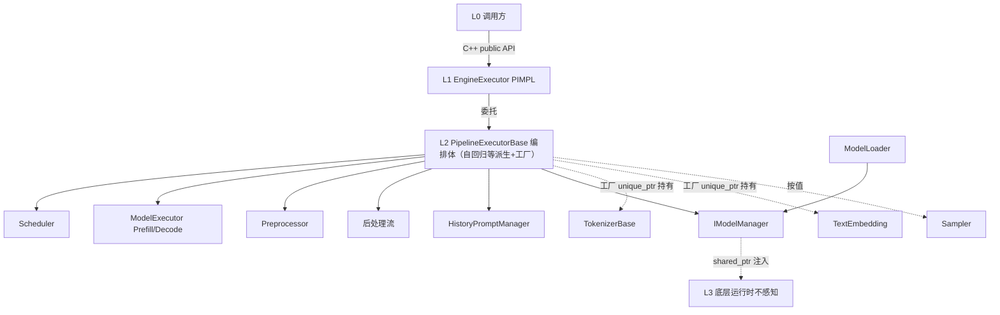
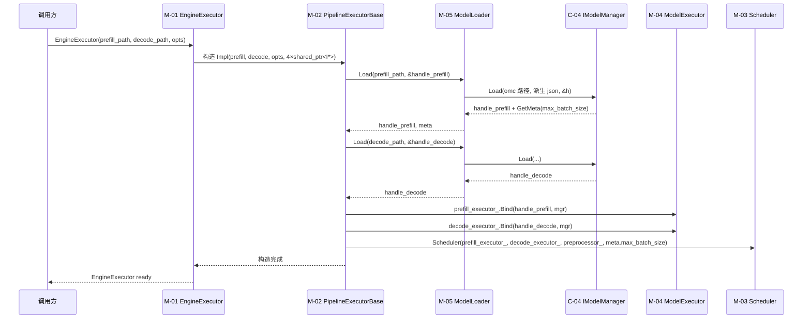
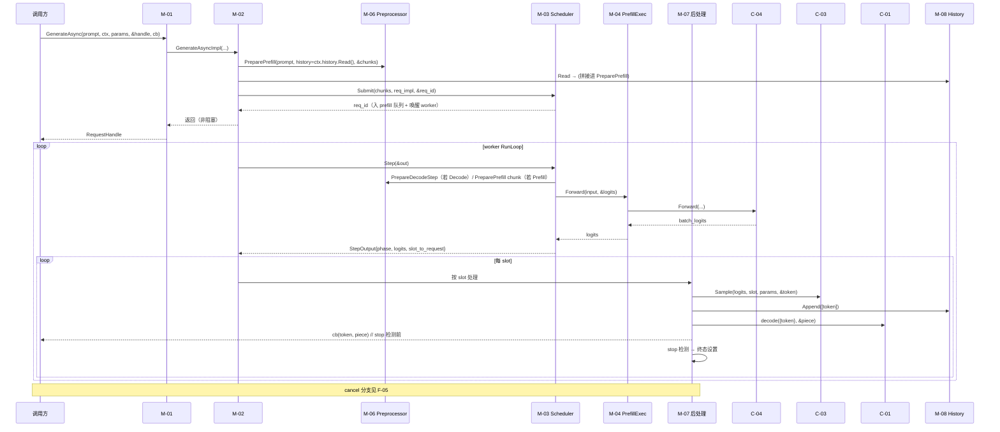
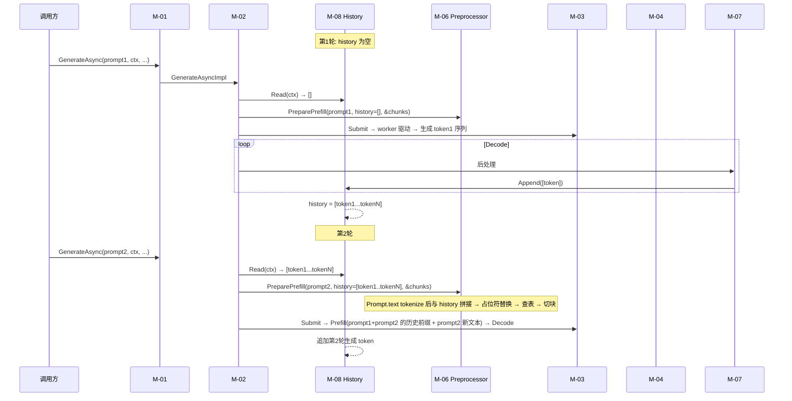

# LLM 自回归推理引擎 Design（渲染视图）

简体中文 | [English](../../../en/cann_lm_engine/pipeline+engine_executor/DESIGN.md)

> 本文件由 `.project/AGENTS/llm_engine/DESIGN/` 目录（overview + modules + contracts + flows + nfr + decisions）渲染而来，去除 frontmatter，合并为单一可评审文档。
> spec_source: `../SPEC/llm-inference-engine.md`（SR20260806001）
> REQ-* / SCN-* 与 spec `SR20260806001` §4.1 功能组 / §4.3 场景一一对应。映射表：
>
> | Spec 功能组 (§4.1) | Design REQ ID | | Spec 场景 (§4.3) | Design SCN ID |
> |---|---|---|---|---|
> | F-LOAD | REQ-LOAD | | 4.3.1 单次推理 | SCN-SINGLE |
> | F-CTX | REQ-CTX | | 4.3.2 多轮续接 | SCN-MULTITURN |
> | F-GEN | REQ-GEN | | 4.3.3 并发请求 | SCN-CONCURRENT |
> | F-STAGE | REQ-STAGE | | 4.3.4 取消请求 | SCN-CANCEL |
> | F-STREAM | REQ-STREAM | | | |
> | F-CANCEL | REQ-CANCEL | | | |
> | F-HISTORY | REQ-HISTORY | | | |
> | F-BATCH | REQ-BATCH | | | |
> | F-INPUT | REQ-INPUT | | | |
> | F-API | REQ-API | | | |
> 本设计综合 `llm_engine/docs/01-04`（已评审定稿的架构/组件/机制/接口文档）重组为 SDD 结构。
> 4 Gate 人机决策依据 `01-architecture.md §8 架构取舍记录`（9 项已定决策）与上游 `基础需求和约束 v0.5`，非 greenfield 开放取舍。

---

## §1 范围与目标

- **In scope**：L1 公开 API（PIMPL 外壳）、L2 编排骨架（PipelineExecutor）、调度器、Prefill/Decode 执行器、模型加载、预处理、后处理流、历史管理、4 个 L2→L3 抽象接口。
- **Out of scope**（理由 C5 边界纪律）：KV Cache 管理、硬件设备抽象、张量算子执行、设备调度——沉底层运行时；服务化治理——外层 wrapper 零侵入实现。
- **设计目标优先级**：低延迟（TTFT/TPOT）> 高吞吐（tokens/sec）> 可扩展 > 内存峰值可控。

## §2 架构总览

### §2.1 架构风格与哲学



风格声明：**分层 + PIMPL 接口分离 + 抽象注入点 + 串行执行 + Continuous Batching 数据并行**。上层只调紧邻下层；L2 经链接期 `CreateModelManager()` 工厂持有唯一 L2→L3 抽象注入点（后端编译时确定，D-12）；`Tokenizer`（`TokenizerBase` 多态基类 + 工厂 + BPE/SP 派生）/ `TextEmbedding`（load+bind）为 engine 内部模块（M-02 经工厂 `unique_ptr<TokenizerBase>` 持有 TokenizerBase、按值持有 TextEmbedding，C8 v1.2）；`Sampler` 为 engine 内部具体类（按值）；均不重新实现底层、非底层注入。

### §2.2 运行时架构

- **线程模型**：用户线程（提交层并发，`GenerateAsync` 线程安全）+ worker 单线程（执行层串行，循环 `Scheduler::Step` + 后处理）。
- 通信机制表：

| 调用方 | 被调方 | 通信方式 | 同步/异步 | 备注 |
|--------|--------|----------|-----------|------|
| 用户线程 | M-01 | 函数调用 | sync | 提交层并发 |
| M-01 | M-02 | PIMPL 转发 | sync | 单向 |
| M-02 worker | M-03 | 函数调用 `Step` | sync | 每 iteration |
| M-03 | M-04/M-06 | 函数调用 | sync | 决策+前向 |
| M-02 | M-07/M-08 | 函数调用 | sync | 逐 slot 后处理 |
| worker | 用户线程 | `StreamCallback` / `RequestHandle` | async | 回调在 worker 触发 |

- 同步点：worker 与用户线程经 `RequestImpl` 共享状态（mutex/atomic），无跨处理器域同步（纯 CPU，不感知硬件）。

### §2.3 部署与硬件映射

| 模块 | 处理器 | 备注 |
|------|--------|------|
| M-01~M-08 | CPU | 引擎层不感知硬件 |
| C-04 实现（IModelManager） | 底层（CPU/加速器） | 由底层运行时提供，引擎经 `shared_ptr` 注入访问 |
| C-01（TokenizerBase）/C-02（TextEmbedding）/C-03（Sampler） | engine 内部 | 引擎自身实现；TokenizerBase 经工厂 unique_ptr、C-02/C-03 按值（C8 v1.2） |

内存域：引擎层不持有设备内存；`Tensor` 经 `shared_ptr` 引用底层拥有的张量。无 DMA buffer 归属引擎。功耗域 N/A（C5）。

### §2.4 并发与线程安全

- 锁策略：worker 写 `RequestImpl` 输出字段、用户线程读——经 mutex/atomic；`canceled` 为 atomic；`histories_`/`ContextImpl`/`RequestImpl` 注册表经 mutex。
- 共享资源：`RequestImpl`（worker 写输出/用户读状态/cancel）、`histories_` 注册表（worker 读写/用户 destroy）。
- 无 NPU/DSP command queue（C5）。锁层级：注册表 mutex > `RequestImpl` mutex。

## §3 模块清单

| ID | 名称 | 一句话职责 | 依赖 | 详情 |
|----|------|-----------|------|------|
| M-01 | EngineExecutor | L1 PIMPL 外壳，转发 public API | M-02 | 见 §11.1 |
| M-02 | PipelineExecutorBase | L2 编排骨架抽象基类（自回归等派生+工厂，约束 #3） | worker 驱动 + 后处理 + 注册表 | M-03..M-08, C-01..C-04 | 见 §11.2 |
| M-03 | Scheduler | 排队 + decode 池 + iteration 组批 + 交错 + cancel | M-04, M-06 | 见 §11.3 |
| M-04 | ModelExecutor | 前向产 logits（Prefill/Decode 两实例） | C-04 | 见 §11.4 |
| M-05 | ModelLoader | 加载 thin wrapper，派生 json | C-04 | 见 §11.5 |
| M-06 | Preprocessor | tokenize/拼接/占位符/查表/切块 | C-01, C-02 | 见 §11.6 |
| M-07 | 后处理流 | 采样→写历史→detokenize→回调→stop | C-03, C-01, M-08 | 见 §11.7 |
| M-08 | HistoryPromptManager | 按 Context 隔离的 token id 历史 | — | 见 §11.8 |

## §4 契约清单

| ID | 生产者 | 消费者 | 一句话契约 | 详情 |
|----|--------|--------|-----------|------|
| C-01 | M-02（engine 内部模块） | M-06/M-07 | 文本↔token id 分词能力（TokenizerBase 多态） | 见 §12.1 |
| C-02 | M-02（engine 内部模块） | M-06 | embedding 表加载+绑定至模型（查表在 om 图内部） | 见 §12.2 |
| C-03 | M-02（engine 内部具体类） | M-07 | logits+参数→token id 采样能力 | 见 §12.3 |
| C-04 | L3 运行时 | M-05/M-04 | 模型加载/前向/释放/元信息能力 | 见 §12.4 |
| C-05 | M-03 | M-02 | 单次 iteration 前向产出（logits+slot 映射） | 见 §12.5 |

## §5 关键流程清单

| ID | 场景 | 关键路径 | 详情 |
|----|------|---------|------|
| F-01 | 模型加载 | M-01→M-05→C-04→M-04 Bind | 见 §13.1 |
| F-02 | 单次异步推理 | M-02→M-06→M-03→M-04→M-07→回调 | 见 §13.2 |
| F-03 | 多轮续接 | M-08 Read→M-06 拼接→Prefill→Decode | 见 §13.3 |
| F-04 | Continuous Batching | M-03 iteration 决策→组批/交错 | 见 §13.4 |
| F-05 | Cancel | 用户→RequestImpl.canceled→M-03 退出池 | 见 §13.5 |

## §6 质量属性与跨切面策略

| 维度 | 核心策略 | 详情 |
|------|---------|------|
| 性能 | 引擎层开销 <10% 端到端；调度 <1%；吞吐高于单请求串行基线 | 见 §14.1 |
| 安全 | 不可信 Prompt 隔离 + 回调安全约束 | 见 §14.2 |
| DFX | L1/L2/L3 异常分级 + 自研日志 + 运行时计数 | 见 §14.3 |
| 并发 | 提交层并发/执行层串行 + 注册表 mutex | 见 §14.4 |
| 错误传播 | `Status` 6 常量粗粒度 + 日志详情 | spec §6.1.1 + 各模块 §6 |
| 数据一致性 | 无跨域 cache（C5），`Tensor` 共享指针引用 | §2.3 |

## §7 决策索引

| ID | 主题 | 状态 |
|----|------|------|
| D-01 | 形态：嵌入式库（非服务） | accepted |
| D-02 | Executor 串行 + batch 数据并行 | accepted |
| D-03 | Continuous Batching：Prefill 独立 + Decode 多 batch | accepted |
| D-04 | Prefill/Decode 双独立实例 | accepted |
| D-05 | 切块归属 Preprocessor | accepted |
| D-06 | 独立 HistoryPromptManager | accepted |
| D-07 | `Status` 错误模型（非异常） | accepted |
| D-08 | PIMPL 接口分离 | accepted |
| D-09 | Tokenizer/TextEmbedding 为 engine 内部模块（多态/load+bind，M-02 经工厂 unique_ptr/按值持有）；Sampler 为 engine 内部具体类（按值）；均非底层注入（C8 v1.2 修正 v1.1） | accepted（v1.2 修订） |
| D-10 | Pipeline 为多态基类 + 工厂（PipelineExecutorBase + AutoregressivePipelineExecutor 派生 + PipelineExecutorFactory，约束 #3） | accepted |
| D-11 | LifecycleController/ModelLoader 已拆解——M-04 ModelExecutor 直接持有 Load/Unload/GetMeta 控制面（M-05 合并入 M-04） | accepted（v0.6） |
| D-12 | 链接期 `CreateModelManager()` 工厂取代 `shared_ptr<IModelManager>` 运行时注入（后端编译时确定） | accepted（v0.6） |

## §8 Code Plan Hints

- **实现顺序**（依赖拓扑）：C-04 接口契约 + C-01 TokenizerBase/工厂 + C-02/C-03 → M-08（无依赖）→ M-04→M-05→C-04 → M-06→C-01/C-02 → M-03→M-04/M-06 → M-07→C-03/M-08 → M-02→全 L2 → M-01→M-02。
- **最小文件集**：实现 M-NN → 读 M-NN.md + 其 depends_on 模块 + 涉及 C-* 契约 + 涉及 F-* 流程。
- **可并行**：C-04 接口 + C-01 TokenizerBase/工厂 + C-02/C-03 定义；M-08 与 M-04/M-05。
- **必须串行**：M-03 依赖 M-04/M-06；M-02 依赖全部 L2；M-01 依赖 M-02。
- **集成里程碑**：① M-04+C-04 mock 跑通假前向；② M-03+M-06 跑通单请求 prefill→decode；③ M-02+M-07 跑通流式+stop；④ M-02 多请求 Continuous Batching；⑤ M-01 PIMPL 公开 API 链接 `api_smoke`。

## §9 风险与未决项

| 风险 | 影响 | 缓解 | 触发条件 |
|------|------|------|----------|
| TTFT/TPOT 绝对值未绑定 | 性能验收缺绝对基线 | 集成 benchmark 阶段补 measured | 待参考硬件+模型规模 |
| Chunked Prefill 切块机制未定（token 级 vs 张量 slice） | M-06 实现路径分叉 | 倾向 token 级守 C5；D-05 复审 | 若需张量 slice 则触 C5 边界 |
| 流式 detokenize 缓冲/stop string 命中缓冲去留未定 | M-07 输出正确性 | 倾向不泄露停止标记 | 实测 stop string 场景 |
| HistoryPromptManager 截断/KV 对齐未定 | 超长历史正确性 | 当前不支持，留扩展点 | 长对话场景 |
| worker 唤醒/同步原语选型未定 | M-02 实现细节 | condvar 倾向 | 实现期 |

## §10 变更日志

| 版本 | 日期 | 变更 | 触发 spec 章节 |
|------|------|------|----------------|
| 0.1.0 | 2026-08-06 | 初版：综合 01-04 重组为 SDD design 目录。8 模块 + 5 契约 + 5 流程 + 4 NFR + 9 决策。Gate 1-4 依据 01 §8 已定决策自动确认。 | spec §4-§8 全 |
| 0.1.1 | 2026-08-06 | 审计修复：3 处无量纲词量化；22 子文件补 spec_id+level frontmatter；补 gate_history；performance §1 补 5% 预算行。审计结论 CONDITIONAL_PASS（0 critical）。 | audit 反馈 |
| 0.1.2 | 2026-08-06 | 微调收尾：F-01 mermaid 补 M-03 participant 声明；overview 补 REQ/SCN ↔ spec 功能组正式交叉引用表。剩余 0 阻塞项。 | audit minor |
| 0.2.0 | 2026-08-13 | C8 v1.1 架构收敛：`IModelManager` 保留为唯一 L2→L3 抽象接口（注入点，`shared_ptr`）；`Tokenizer`/`TextEmbedding`/`Sampler` 降级为 L2 内部具体类（去 `I` 前缀、无虚函数、M-02 按值持有、可从测试数据构造）。同步：§2 风格+mermaid、§4 契约清单生产者列、§7/§15 D-09 反转、§11.2 M-02 持有/构造签名/测试钩子、§11.6 M-06 非拥有指针、§11.7 M-07、§12.1-12.3 契约改写为具体类、§12.4 标注唯一注入点、§14 持有表。联动 spec §3.3/§5 NFR/§6.1/§6.3。 | spec §3.3/§5/§6.1/§6.3 + C8 |
| 0.3.0 | 2026-08-13 | C8 v1.2 对账（修正 v1.1 过冲 + 回灌 model_executor C3）：Tokenizer 重升为 engine 内部多态模块（`ITokenizer` 基类 + `TokenizerFactory` + BPE/SP 派生自注册，per `docs/tokenizer/`），M-02 经工厂 `unique_ptr` 持有、M-06/M-07 经非拥有 `ITokenizer*`；TextEmbedding 重定为 engine 内部 embedding 模块（load 表 + 绑定模型，per `model_executor` §4.1.1；tokenId 查表在 om 图内部，非查表产张量）；Sampler 保持 engine 内部具体类（无多态需求）。回灌 C3：§11.4 M-04 改为前向壳+KV ringBuffer 光标+load/unload/LoRA 委托、decode batch pad 到 max_batch_size（attentionMask 屏蔽）、§11.3/§6.1 修正“无 padding”。同步：§2 mermaid/风格/§2.3、§4 契约清单、§7/§15 D-09、§11.2 M-02 ctor/持有/测试钩子、§11.6 M-06 ITokenizer*、§11.7 M-07、§12.1-12.4 契约。联动 spec §3.3/§5 NFR/§6.1/§6.3、基础 v0.7。 | spec §3.3/§5/§6.1/§6.3 + C8 + C3(model_executor) |
| 0.4.0 | 2026-08-13 | 源头约束修订（#1/#2/#3）：① #1 Tokenizer 错误归一——去模块自有 `TokenizerError`，encode/decode/batch_encode/create 统一返回项目 `Status`（OOV 内部映射 unk→SUCCESS）；② #2 多态基类 `ITokenizer`→`TokenizerBase`（Base 后缀取代 I 前缀），BPE/SP 派生+工厂+Registrar 同步；③ #3 PipelineExecutor 本身多态化——新增抽象基类 `PipelineExecutorBase`+`PipelineExecutorFactory`+`PipelineType` 枚举，现 PipelineExecutor 改名 `AutoregressivePipelineExecutor`（自回归，当前唯一派生），为非自回归等 pipeline 预留扩展点。同步：§2 mermaid、§3 模块清单 M-02、§7 D-10、§11.2 M-02 基类+工厂+派生、§12.1 C-01 契约。联动 spec §3.3/§5 NFR/§6.1、基础 v0.8。 | 约束 #1/#2/#3 + 联动 spec/基础 |
| 0.5.0 | 2026-08-19 | ModelExecutor 架构重构：M-04 升级为前向壳+控制面（Load/Unload/GetMeta 直接暴露，调链接期 CreateModelManager() 自持 owned IModelManager）；M-05 ModelLoader 职责合并入 M-04（已拆解）；§11.4 改写、§11.5 标记 [已拆解 v0.5]。联动 model_executor DESIGN v0.5。 | model_executor DESIGN + C3 |
| 0.6.0 | 2026-08-19 | 硬切 v0.6：去除 shared_ptr<IModelManager> 运行时注入——PipelineExecutorFactory::create / AutoregressivePipelineExecutor ctor 不再接受 shared_ptr<IModelManager>；ModelExecutor::Load 自调链接期 CreateModelManager() 创建 owned MM（D-12）。M-05 ModelLoader 拆解确认（D-11）。§2/§11.2/§11.4/§11.5/§12.4 同步更新。联动基础 v0.11。 | D-11/D-12 + 基础 v0.11 |

---

## §11 模块详情

### §11.1 M-01 EngineExecutor

**职责**：L1 公开 API 的 PIMPL 外壳，转发公开 API，零业务逻辑。构造期校验加载来源（路径/buffer，prefill+decode 各一份构件）交 M-02。不可复制、可移动；移动后原对象置空。public 头不暴露任何内部类型（C6）。

**对外接口**：
```cpp
EngineExecutor(const ModelArtifactPath& prefill, const ModelArtifactPath& decode, const EngineOptions& = {});
EngineExecutor(const ModelArtifact& prefill, const ModelArtifact& decode, const EngineOptions& = {});
Status CreateContext(Context* out);
Status DestroyContext(ContextId);
Status ConfigureContext(ContextId, /* 字段待列 */);
Status CancelContext(ContextId);
Status Generate(const Prompt&, const Context&, const SamplingParams&, Result* out);
Status GenerateAsync(const Prompt&, const Context&, const SamplingParams&, RequestHandle* out, StreamCallback = {});
```
语义: 构造期加载（一次性，不支持热加载）；Generate = GenerateAsync(空回调)+Wait；同 Context 并发返回 INVALID_STATE。
错误: 构造加载失败 → FAILURE；Context 不存在 → NOT_FOUND；同 Context 并发 → INVALID_STATE。

**内部结构**：`std::unique_ptr<Impl> impl_`，`Impl` 即 M-02（04 §17）。无其他状态——运行期状态全在 M-02。不变量：本对象析构后残留 Context/RequestHandle 使用 → INVALID_STATE。

**关键依赖与硬件契约**：仅单向委托 M-02（L1→L2）。句柄内部 `shared_ptr` 回指 M-02 持有的 `ContextImpl`/`RequestImpl`。无硬件依赖（C5）。无 DMA/cross-domain。

**性能预算**：

| 路径 | 预算 | 测量条件 | 来源 |
|---|---|---|---|
| PIMPL 转发开销 | <0.1% 端到端 | 单次 API 调用 | estimated |

**失效模式**：

| 失效 | 触发 | 检测 | 处理 |
|---|---|---|---|
| 加载失败 | 构件不存在/损坏 | 构造期 | 抛构造失败（无部分资源泄漏） |
| 句柄悬挂使用 | EngineExecutor 析构后 | 运行期 | 返回 INVALID_STATE |

**可观测点**：log key: `engine.init`, `engine.context.create/destroy`；metric: 累计 CreateContext 次数。

**测试钩子**：PIMPL 转发可用 M-02 mock 验证；公开类型清单不暴露内部类型（编译期断言）。`api_smoke` 可执行验证公开 API 表面链接。

### §11.2 M-02 PipelineExecutorBase（+ AutoregressivePipelineExecutor + PipelineExecutorFactory）

**职责**：M-01 的 PIMPL impl，L2 唯一编排体（抽象基类 PipelineExecutorBase；自回归为当前唯一派生，经 PipelineExecutorFactory 构造，约束 #3）。转发公开 API impl；拥有 worker 线程循环驱动 M-03::Step + 后处理（M-07）；持有全部共享组件与 L2 模块；拥有 ContextImpl/RequestImpl/HistoryPromptManager 注册表；持有 engine 内部模块 TokenizerBase（经工厂 `unique_ptr`）/ TextEmbedding（按值，load+bind）/ Sampler（按值，具体类）；L2→L3 注入经链接期 `CreateModelManager()` 工厂（D-12，ModelExecutor::Load 自调，owned MM）。

**对外接口**：
```cpp
class PipelineExecutorBase {   // 抽象基类（约束 #3）：各派生 pipeline 实现这组虚函数
public:
  virtual ~PipelineExecutorBase() = default;
  virtual Status CreateContext(Context* out) = 0;
  virtual Status DestroyContext(ContextId) = 0;
  virtual Status ConfigureContext(ContextId, const ContextOptions&) = 0;
  virtual Status CancelContext(ContextId) = 0;
  virtual Status Generate(const Prompt&, const Context&, const SamplingParams&, Result* out) = 0;
  virtual Status GenerateAsync(const Prompt&, const Context&, const SamplingParams&, RequestHandle* out, StreamCallback) = 0;
};
class PipelineExecutorFactory {   // 工厂（约束 #3）：按 PipelineType 选择派生构造
public:
  static Status create(PipelineType, const ModelArtifactPath&/const ModelArtifact& prefill, decode,
                       const EngineOptions&, std::unique_ptr<TokenizerBase> tokenizer,
                       TextEmbedding, Sampler,
                       std::unique_ptr<PipelineExecutorBase>* out);
};
class AutoregressivePipelineExecutor final : public PipelineExecutorBase {   // 自回归派生（当前唯一）
  AutoregressivePipelineExecutor(const ModelArtifactPath&/const ModelArtifact& prefill, decode, const EngineOptions&,
                 std::unique_ptr<TokenizerBase> tokenizer, TextEmbedding text_embedding, Sampler sampler);
  // ...override 全部虚函数；RunLoop(): M-03.Step(&out) → INVALID_STATE 休眠；否则逐 slot 后处理（M-07）
};
```
语义: worker 单线程；GenerateAsync 不阻塞（Submit 后唤醒 worker 即返回）。同 Context 并发 → INVALID_STATE。
错误: 各阶段失败映射 FAILURE；Context 不存在 → NOT_FOUND。

**内部结构**：
- engine 内部模块: `tokenizer_`（`unique_ptr<TokenizerBase>`，工厂产物）/ `text_embedding_`（按值，load+bind）/ `sampler_`（按值，具体类）；L2→L3 注入经链接期 `CreateModelManager()` 工厂（D-12，ModelExecutor::Load 自调创建 owned MM，后端编译时确定）。
- L2 成员: `prefill_executor_/decode_executor_/preprocessor_/scheduler_`（M-05 ModelLoader 已拆解 v0.5，职责合并入 M-04，D-11）。
- 注册表: `histories_`(map<ContextId, shared_ptr<HistoryPromptManager>>) mutex；ContextImpl 注册表 mutex；RequestImpl 注册表（供 M-03/M-07/RequestHandle 共享）。
- worker: `std::thread worker_` + `std::atomic<bool> stop_` + condvar 唤醒（选型见 §9 风险）。
- 析构序: stop_=true→唤醒→join→M-04 析构调 C-04::Release→释放注册表。

**关键依赖与硬件契约**：持有 C-01（`unique_ptr<TokenizerBase>`，工厂）/ C-02（按值，load+bind）/ C-03（按值，具体类）+ C-04 `shared_ptr`（唯一 L2→L3 注入点，01 §7.2）。C-04::Forward 把拼接/KV tensor 内存沉底层（C5；KV ringBuffer 光标归 M-04，见 §11.4）。无硬件感知。fake logits 经 mock C-04 注入；TokenizerBase 经工厂构造、C-02/C-03 从测试数据构造（NFR-015/TC_NFR_001）。

**性能预算**：

| 路径 | 预算 | 测量条件 | 来源 |
|---|---|---|---|
| 后处理每 slot（采样+写历史+detokenize+回调+stop） | 属引擎层 <10% 占比内 | 每 iteration 每 slot | estimated |
| worker 调度循环（Step+后处理编排） | <1% 端到端 | 每 iteration | estimated |

**失效模式**：

| 失效 | 触发 | 检测 | 处理 |
|---|---|---|---|
| 同 Context 并发 | 状态冲突 | 运行期检查 | INVALID_STATE |
| worker 异常 | 底层不可恢复 | 异常日志 | 请求置 Failed |
| 析构竞态 | stop_ 后残留句柄 | 析构序 | INVALID_STATE |

**可观测点**：log key: `pipeline.submit`, `pipeline.step`, `pipeline.postprocess`, `phase.switch`；metric: 各阶段排队深度、worker 空转/休眠次数。

**测试钩子**：mock C-04 注入 + TokenizerBase 经工厂构造（可注入 BPE/SP 桩）/ C-02/C-03 从测试数据构造；M-03/M-07 可独立实例化；fake logits 测调度+后处理链路。

### §11.3 M-03 Scheduler

**职责**：L2 核心组件。FIFO 任务排队、decode 池管理（容量=`max_batch_size`）、iteration 级组批决策、Prefill/Decode 交错（有空位先处理 Prefill）、cancel 标记与退出。不做预处理串联/切块/采样/detokenize/历史/stop（归 M-06/M-07/M-02）。不自驱跨阶段——由 M-02 worker 循环调 `Step` 驱动。

**对外接口**：
```cpp
Scheduler(ModelExecutor* prefill_executor, ModelExecutor* decode_executor, Preprocessor* preprocessor, int max_batch_size);
Status Submit(vector<shared_ptr<Tensor>> prefill_chunks, shared_ptr<RequestImpl> req, RequestId* out);
Status Step(StepOutput* out);   // 决策+前向+slot 映射；无活任务返回 INVALID_STATE
Status Cancel(RequestId);
Status CancelContext(ContextId);
int ActiveDecodeCount()/PendingPrefillCount()/DecodeCapacity() const noexcept;
```
语义: Submit 建 PrefillTask 入 prefill 队列+唤醒 worker。Step 每 iteration 决策（见 Step 决策伪代码）。错误: 无活任务 → INVALID_STATE（worker 休眠）；Cancel 不存在 → NOT_FOUND。

**内部结构**：

| 数据结构 | 类型 | 用途 |
|---|---|---|
| prefill 队列 | `std::deque<PrefillTask>` | FIFO，chunk 顺序消费 |
| decode 池 | `vector<optional<RequestId>>`（大小=max_batch_size） | active decode 按 slot 占位 |
| pending decode 队列 | `std::deque<RequestId>` | prefill 完成待入池 |
| RequestId→RequestImpl | `unordered_map` | 共享状态 O(1) |
| cancel 标记 | 复用 `RequestImpl::canceled`（atomic） | 不另设 cancel set |

不变量: active ≤ max_batch_size；**无 variable padding**（不按 batch 内最长补齐，各请求 KV 独立，需求 #3）；decode om 图 batch 维固定 = `max_batch_size`，active 未满时本模块 pad 到 `max_batch_size`（靠 attentionMask 屏蔽，见 §11.4 / model_executor §1），prefill om 固定 batch=1 无 padding；同一请求同时刻只在一个队列（由 `RequestImpl::status` 反映）。

Step 决策伪代码（来自 03 §4）:
```
1. 清理终态/cancel（释放 slot）→ 从 pending 补位
2. 无活任务 → INVALID_STATE
3. 有空位 + pending prefill 非空 → 跑一个 Prefill(batch=1) → task chunk 耗尽则迁 pending
4. 否则 → Decode batch=N（各 active last token 经 M-06.PrepareDecodeStep）→ 填 StepOutput
```

**关键依赖与硬件契约**：持 M-04*/M-06* 指针（M-02 拥有，M-03 编排）。前向委托 C-04::Forward。无硬件感知。

**性能预算**：

| 路径 | 预算 | 测量条件 | 来源 |
|---|---|---|---|
| 单次 Step 决策（不含前向） | <1% 端到端 | 每 iteration | estimated |
| 组批/交错决策 | <0.1% 端到端（纯决策，不含前向） | 每 iteration | estimated |

**失效模式**：

| 失效 | 触发 | 检测 | 处理 |
|---|---|---|---|
| 前向失败 | C-04 失败 | Step 返回 | 映射 FAILURE，请求 Failed |
| 池满 | active=N | Step 决策 | pending 排队（非错误） |

**可观测点**：metric: ActiveDecodeCount, PendingPrefillCount, DecodeCapacity, 累计提交, 累计 cancel, 队列深度。

**测试钩子**：M-04 mock 返 fake logits 测组批/交错/退出逻辑；decode 池容量边界测（N=1/满/超限）。

### §11.4 M-04 ModelExecutor

**职责**：前向壳（组装输入 + 委托底层前向 + 产出 logits）+ KV Cache ringBuffer 光标管理（pos/offset/光标，per-sequence）+ 控制面 Load/Unload/GetMeta（v0.5 合并 M-05，直接暴露给 pipelineExecutor；具体实现在 ModelManager，本模块委托）。不做采样（C-03）、tensor 内存申请/释放（归 `TensorManager`）、内建请求级并发（C4 串行）。batch 维度数据并行：PrefillExecutor om 固定 batch=1（无 padding），DecodeExecutor om 固定 batch=`max_batch_size`（active 未满时 pad 到 max_batch_size，靠 attentionMask 屏蔽）。PrefillExecutor 与 DecodeExecutor 是**同一类的两个实例**（非子类），共享同一 KV Cache 池、零拷贝，差异仅在所绑 handle（prefill om / decode om）。

**对外接口**：
```cpp
ModelExecutor(std::shared_ptr<KvCachePool> pool,
              std::shared_ptr<InputAssembler> asm_,
              std::shared_ptr<DfxCollector> dfx);
Status AttachPool(std::shared_ptr<KvCachePool> pool);
Status AttachAssembler(std::shared_ptr<InputAssembler> asm_);
Status Load(const ModelArtifactPath&/const ModelArtifact& artifact, ModelMetaInfo* out_meta);  // 调 CreateModelManager()
Status Unload();
Status GetMeta(ModelMetaInfo* out) const;
Status Forward(const shared_ptr<Tensor>* inputs, size_t count,
              const ForwardOptions& opts, shared_ptr<Tensor>* out_logits);
ModelHandle Handle() const noexcept;
explicit operator bool() const noexcept;  // 已 Load 且 pool/asm 齐备
```
语义: Load 调链接期 `CreateModelManager()` 创建 owned MM（D-12）；Forward 委托 owned MM::Forward；串行（forward_mutex_），一次一个 batch，调用方（M-03）保证不重入。错误: CreateModelManager() 返空→FAILURE；C-04 失败 → FAILURE；未 Load → INVALID_STATE。

**内部结构**：`ModelHandle handle_` + `unique_ptr<IModelManager> mm_`（Load 时经 CreateModelManager() 创建并持有）+ `shared_ptr<KvCachePool> pool_` + `shared_ptr<InputAssembler> asm_` + `shared_ptr<DfxCollector> dfx_` + `ModelMetaInfo meta_` + KV ringBuffer 光标状态。RAII：析构调 owned MM::Release。不可复制、可移动。两实例共享同一 KV Cache 池（零拷贝），差异仅 handle（prefill om / decode om）；权重共享由 ModelManager 去重。

**关键依赖与硬件契约**：owned MM::Forward 把张量拼接/batch 拼接/KV tensor 内存沉底层（C5）；**KV ringBuffer 光标管理归本模块**（非底层）。Engine 层只按 slot 顺序接收 batched logits。Load/Unload/GetMeta 委托 owned MM（经链接期 CreateModelManager() 创建）。无硬件感知。无 DMA/cross-domain。

**性能预算**：

| 路径 | 预算 | 测量条件 | 来源 |
|---|---|---|---|
| Forward（不含底层算子） | <0.1% 端到端（非关键路径，仅函数转发） | 单次前向 | estimated |

**失效模式**：

| 失败 | 触发 | 检测 | 处理 |
|---|---|---|---|
| 未 Load 即 Forward | 状态冲突 | operator bool 校验 | INVALID_STATE |
| 底层前向失败 | C-04 返回失败 | Forward 返回 | FAILURE（映射） |

**可观测点**：log key: `executor.forward`, `executor.bind`, `executor.release`。

**测试钩子**：stub CreateModelManager() 返 nullptr → Load::FAILURE；两实例隔离测；权重去重由 owned MM 验证；KV 光标推进/复用可独立测；decode padding（pad 到 max_batch_size + attentionMask 屏蔽）用例。

### §11.5 M-05 ModelLoader `[已拆解 v0.5→v0.6]`

**职责**：**已拆解**（D-11）。M-05 ModelLoader 的职责（路径模式派生 omc 同名 json → 调 C-04::Load → 返回 ModelHandle）已合并入 M-04 ModelExecutor::Load（v0.5）。本节保留为历史索引。

> 历史接口（v0.4 及以前）：`explicit ModelLoader(shared_ptr<IModelManager> mgr)` + `Load(ModelArtifactPath/ModelArtifact, ModelHandle*)`。v0.5 后由 M-04 `ModelExecutor::Load` 取代，不再注入 shared_ptr（D-12）。

### §11.6 M-06 Preprocessor

**职责**：单一职责协调预处理链路（需求 #7）：tokenize → 拼接历史 → 占位符定位 → 切块（tokenId→向量查表在 om 图前向内部，非 Preprocessor 调 TextEmbedding 查表，C8 v1.2 per model_executor §4.1.1）。无状态（每次调用纯函数语义，历史由调用方传入，便于注入 mock）。不做调度/跨阶段自驱；不独占持有 C-01/C-02（经非拥有指针 `TokenizerBase*`/`TextEmbedding*` 接收，TokenizerBase 由 M-02 经工厂 unique_ptr 持有、TextEmbedding load+bind 由 M-02 init，多阶段复用，C8 v1.2）。

**对外接口**：
```cpp
Preprocessor(TokenizerBase* tokenizer, TextEmbedding* text_embedding, int default_chunk_size);
Status PreparePrefill(const Prompt& prompt, const vector<TokenId>& history, vector<shared_ptr<Tensor>>* out_chunks);
Status PrepareDecodeStep(TokenId id, shared_ptr<Tensor>* out_input);
```
语义: PreparePrefill 全链路（tokenize Prompt.text→拼接 history→占位符定位→切块；tokenId→向量查表在 om 图前向内部）产出多 chunk 输入；PrepareDecodeStep fast path 单 token→输入张量。错误: tokenize/占位符不匹配 → FAILURE。

**内部结构**：`TokenizerBase* tokenizer_`（非拥有）+ `TextEmbedding* text_embedding_`（非拥有）+ `int default_chunk_size_`。占位符 ↔ embedding 顺序映射：按 Prompt.embeddings 数组顺序 ↔ 占位符出现顺序（不论 ModalityTag，需求 #1）。

**关键依赖与硬件契约**：C-01::TokenizerBase::encode（预处理 tokenize + 后处理 detokenize 复用，多态分派 BPE/SP）；C-02::LoadAndBind（M-02 init 期加载表+绑定模型；tokenId 查表在 om 图内部）。TokenizerBase 由 M-02 经工厂 unique_ptr 持有，M-06 经非拥有指针访问（多阶段复用，C8 v1.2）。切块机制待定（token 级 chunk-then-embed vs 张量 slice；倾向前者守 C5，见 §9 风险）。

**性能预算**：

| 路径 | 预算 | 测量条件 | 来源 |
|---|---|---|---|
| 单 chunk 预处理 | < 该 chunk 前向耗时 5% | 每 chunk | estimated |
| PrepareDecodeStep | <0.1% 端到端（单 token 查表，不含前向） | 每 step | estimated |

**失效模式**：

| 失败 | 触发 | 检测 | 处理 |
|---|---|---|---|
| tokenize 失败 | C-01 返回失败 | PreparePrefill | FAILURE |
| 占位符/embedding 数量不一致 | 校验 | PreparePrefill | FAILURE |

**可观测点**：log key: `preprocess.prefill`, `preprocess.decode_step`, `preprocess.chunk`；metric: prefill chunk 数、平均 chunk 大小。

**测试钩子**：无状态 → 可单独实例化，注入经工厂构造的 TokenizerBase 桩 + 从测试数据构造的 C-02 测全链路；占位符顺序映射用例（多模态 + 纯文本）。

### §11.7 M-07 后处理流（采样+detokenize+stop）

**职责**：由 M-02 控制（非独立类）：logits → 采样 → 写历史 → detokenize → StreamCallback → stop 检测。复用 C-03（Sampler，M-02 按值拥有具体类）/ C-01（TokenizerBase，非拥有指针，多态分派 BPE/SP），无独立持久状态（C8 v1.2）。流式 detokenize 缓冲为 per-request 局部状态。

**对外接口**：（由 M-02 逐 slot 调用，无独立公开接口）
```
每 slot: C-03::Sample(batch_logits, slot, params, *token) → RequestImpl.token_ids += [token] → M-08.Append → C-01->decode({token}, opts, &piece) → 流式回调 → stop 检测 → 终态设置
```
错误: 采样失败 → FAILURE/INVALID_ARGUMENT；detokenize 非法 token → FAILURE。

**内部结构**：流式 detokenize 缓冲：per-request 局部（生命周期=单次请求），多 token 合成完整字/词到边界再输出。无跨请求共享状态。

逐 slot 处理（来自 03 §6 伪代码）:
```
if req.canceled: req.status=Canceled; continue   # 部分丢弃
token = C-03.Sample(logits, slot, params)         # 不感知历史
req.token_ids.append(token); M-08[ctx].Append([token])
text_piece = C-01->decode({token}, opts, &text_piece); req.text_buffer += text_piece   # TokenizerBase 多态分派（C8 v1.2）
if stop_token 命中: finish=StopToken; status=Completed   # 倾向不回调
elif stop_string 命中: finish=StopString; status=Completed  # 倾向不回调，text 去掉 stop 部分
else: callback(token, text_piece); req.last_token=token
if token_ids.size()==max_tokens: finish=MaxTokens; status=Completed
```

**关键依赖与硬件契约**：C-03::Sample 只收当前步 logits + params（不读 M-08，故 penalty 类不支持，需求 #8）。C-01::TokenizerBase::decode 流式增量（多态分派 BPE/SP）。StreamCallback 触发点：detokenize 后、stop 检测前；命中 stop string 那步倾向不回调（避免泄露停止标记，待定见 §9）。

**性能预算**：

| 路径 | 预算 | 测量条件 | 来源 |
|---|---|---|---|
| 采样 + 写历史 + detokenize + 回调 + stop（每 slot） | 属引擎层 <10% 占比内 | 每 slot | estimated |

**失效模式**：

| 失败 | 触发 | 检测 | 处理 |
|---|---|---|---|
| 采样参数非法/形状异常 | C-03 返回 | Sample | FAILURE/INVALID_ARGUMENT |
| detokenize 非法 token | C-01 返回 | TokenizerBase::decode | FAILURE |

**可观测点**：log key: `postprocess.sample`, `postprocess.stop`；metric: 终态分布（MaxTokens/StopToken/StopString/Canceled/Failed）、回调触发次数。

**测试钩子**：fake logits（mock C-04）+ 经工厂构造的 TokenizerBase 桩 + 从测试数据构造的 C-03 测 stop 检测/流式缓冲/cancel 丢弃/Failed 填部分。不支持项验证：Beam search/n>1/logprobs/penalty 拒绝或留空。

### §11.8 M-08 HistoryPromptManager

**职责**：独立模块（需求 #9），按 ContextId 隔离（每 Context 一个实例）。管理 token id 历史（非文本），供下一轮 prefill 拼接；避免反复 tokenize 与 tokenizer 非双射损失。写入主体是 M-02（每步 Decode 后），用户无感。

**对外接口**：
```cpp
Status Append(const std::vector<TokenId>& ids);
Status Read(std::vector<TokenId>* out) const;
Status Clear();
size_t Size() const noexcept;
```
语义: Append 追加本轮生成 token；Read 取历史供下轮 prefill 拼接；Clear 用于 DestroyContext。错误: 底层失败映射 FAILURE（实际为内存操作，极少失败）。

**内部结构**：`std::vector<TokenId> history_`，按值持，跨轮增长（C3 大对象按值持；移动语义移交）。不可拷贝共享（每 Context 独立实例）。

**关键依赖与硬件契约**：无下层依赖（纯内存）。M-02 持 `map<ContextId, shared_ptr<HistoryPromptManager>>` 注册表。截断/滑动窗口/KV 长度对齐策略待定（当前不支持，留扩展点，见 §9 风险）。

**性能预算**：

| 路径 | 预算 | 测量条件 | 来源 |
|---|---|---|---|
| Append/Read | <0.1% 端到端（非关键路径，纯内存操作） | 每步/每轮 | estimated |

**失效模式**：

| 失败 | 触发 | 检测 | 处理 |
|---|---|---|---|
| 超长历史未截断 | 超长对话 | Size 校验 | 待截断策略（当前不支持，留扩展点） |

**可观测点**：metric: 各 Context 历史长度（Size）、Append 累计次数。

**测试钩子**：可单独实例化测 Append/Read/Clear 隔离；多 Context 不串扰验证。

---

## §12 契约详情

### §12.1 C-01 Tokenizer（engine 内部多态模块，C8 v1.2）

**契约一句话**：engine 内部 tokenizer 模块（`cann_local_lm/engine/core/tokenizer`，见 `docs/tokenizer/`）向 M-06（encode）/M-07（decode）提供文本↔token id 分词能力。多态基类 `TokenizerBase` + `TokenizerFactory` + BPE/SentencePiece 派生（自注册）；engine 内部、非底层注入（C8 v1.2，修正 v1.1 的具体类机制；约束 #1/#2：错误归一 Status + 基类名 TokenizerBase 取代 ITokenizer；IModelManager 仍为唯一 L2→L3 注入点）。

**数据 schema**：
```cpp
enum class Algorithm { BPE, SentencePieceUnigram };
// 错误归一（约束 #1）：不返回模块自有错误码，统一用项目 Status（infra/status.h）
struct EncodeOptions { bool add_special_tokens; std::optional<size_t> max_length;
                       enum class Padding { None, Longest, Fixed } padding; ... };
struct DecodeOptions { bool skip_special_tokens; };
class TokenizerBase {   // 多态基类（约束 #2，取代 ITokenizer）
public:
  virtual ~TokenizerBase() = default;
  virtual Status encode(std::string_view, const EncodeOptions&, std::vector<int>* out_ids) = 0;
  virtual Status decode(const std::vector<int>&, const DecodeOptions&, std::string* out_text) = 0;
  virtual size_t vocab_size() const = 0;
  virtual std::optional<int> special_token_id(std::string_view) const = 0;
  virtual Status batch_encode(...) ;  // 默认实现
};
class TokenizerFactory {
public:
  static Status create(Algorithm, const LoadParams&, std::unique_ptr<TokenizerBase>* out);
  static std::vector<Algorithm> list_registered();
};
class BpeTokenizer final : public TokenizerBase { ... };            // M-03
class SentencePieceTokenizer final : public TokenizerBase { ... }; // M-04
```
注：错误归一（约束 #1）——tokenizer 不返回模块自有错误码，统一用项目 `Status`（infra/status.h）；词表外（OOV）非失败，内部映射 unk 后返回 `Status::SUCCESS`。与 pipeline 层 `TokenId` 的适配（int↔TokenId）在 Preprocessor 内完成。

**时序与同步语义**：同步调用。M-02 经 `TokenizerFactory::create(Algorithm, LoadParams)` 返回 `std::unique_ptr<TokenizerBase>` 持有；M-06/M-07 经非拥有 `TokenizerBase*` 访问（多阶段复用：预处理 tokenize + 后处理 detokenize）。多算法多态分派（BPE/SentencePiece）。自注册经 `REGISTER_TOKENIZER` 宏（静态初始化期，SIOF 由 create 断言兜底）。

**错误契约**：

| 错误 | 谁抛 | 谁处理 | 是否可恢复 |
|---|---|---|---|
| tokenize 失败/非法 UTF-8 | TokenizerBase 派生 | M-06/M-07 | 返回 `Status::INVALID_ARGUMENT`（详情经日志） |
| 词表外 | TokenizerBase 派生 | M-06/M-07 | 内部映射 unk，返回 `Status::SUCCESS`（非失败） |
| 算法未注册/加载失败 | TokenizerFactory | M-02 | 返回 `Status::INVALID_ARGUMENT`（未知算法）/ `Status::FAILURE`（加载失败） |

**版本演进规则**：新增派生算法经 `REGISTER_TOKENIZER` 宏自注册（开闭，不改工厂）；`Algorithm` 枚举增值前向兼容；`EncodeOptions`/`DecodeOptions`/`LoadParams` 字段增加带缺省前向兼容。修改虚函数签名须 bump major。

### §12.2 C-02 TextEmbedding（engine 内部 embedding 模块，C8 v1.2）

**契约一句话**：engine 内部 embedding 模块，由 M-02 调用加载 embedding 表并绑定至模型（per `model_executor` §4.1.1）；**tokenId 路径的查表在 om 图前向内部完成**（非本模块产张量）。engine 内部、非底层注入（C8 v1.2，修正 v1.1 的“查表产张量”机制）。

**数据 schema**：
```cpp
struct ModalityEntry {
  size_t                  position;    // 占位符在 token 序列中的下标（Preprocessor 占位符定位用）
  std::shared_ptr<Tensor> embedding;  // 对应多模态 embedding（来自 Prompt，已算好）
};
class TextEmbedding {
public:
  TextEmbedding() = default;
  // 加载 embedding 表并绑定至模型句柄（M-02 于 init 期调用；model_executor §4.1.1）
  // 真实签名（model handle / 表数据源）deferred，待 embedding 模块 DESIGN（暂无独立 docs/embedding/）
  Status LoadAndBind();
};
```

**时序与同步语义**：同步调用。M-02 按值持有；M-02 于 init 期调 `LoadAndBind`（加载表 + 绑定模型）。Per-request 查表不在本模块（om 图前向内部按 tokenId 查表）。多模态占位符定位由 Preprocessor 用 `ModalityEntry`（embedding 来自 Prompt）。

**错误契约**：

| 错误 | 谁抛 | 谁处理 | 是否可恢复 |
|---|---|---|---|
| 表加载/绑定失败 | TextEmbedding | M-02（init） | LoadFailed 映射 FAILURE |

**版本演进规则**：`ModalityEntry` 字段增加前向兼容。多态性（`ITextEmbedding` 基类 + 派生）待 `docs/embedding/` DESIGN（model_executor 提及 `ITextEmbedding`，暂无独立模块文档；v1.2 暂以具体类 + load+bind 落地）。

### §12.3 C-03 Sampler（engine 内部具体类，C8 v1.2）

**契约一句话**：M-02 向 M-07 提供 logits + 采样参数 → token id 采样能力。engine 内部具体类（无 sibling 模块文档、无多态需求，C8 v1.2）；无状态（不感知历史）；可从测试数据构造。

**数据 schema**：
```cpp
struct SamplingParams {
  int max_tokens;
  std::vector<TokenId> stop_token_ids;
  std::vector<std::string> stop_strings;
  // 注：不支持 beam search/n>1/logprobs/penalty（需求 #8），字段不出现
};
class Sampler {
public:
  Sampler() = default;
  Status Sample(const std::shared_ptr<Tensor>& batch_logits, int slot,
               const SamplingParams& params, TokenId* out);
};
```

**时序与同步语义**：同步调用。M-02 按值持有，M-07 经非拥有指针访问（C8 v1.2）。**关键约束（需求 #8）**：Sample 只收当前步 logits + params，**不读历史**——故不支持 logit bias / frequency penalty / presence penalty 类需历史输入的特性。多 token 候选（n>1）/logprobs 不在接口内。

**错误契约**：

| 错误 | 谁抛 | 谁处理 | 是否可恢复 |
|---|---|---|---|
| 采样参数非法/形状异常 | Sampler | M-07 | INVALID_ARGUMENT / FAILURE |

**版本演进规则**：`SamplingParams` 新增字段前向兼容；不支持类特性的支持须以新方法或上层包装实现，不得改 Sample 语义。

### §12.4 C-04 IModelManager（唯一 L2→L3 注入点，C8 v1.2）

**契约一句话**：L3 运行时向 M-05（Load）/M-04（Forward）提供模型加载/前向/释放/元信息能力。C-04 为 C8 v1.2 后**唯一保留的 L2→L3 抽象接口**（注入点）；把张量拼接/batch 拼接/KV 维护全沉底层（C5 边界）。

**数据 schema**：
```cpp
struct ModelMetaInfo {
  int max_batch_size;              // → 传 M-03 作 decode 池容量
  // 其余字段由底层定义，Engine 仅取 max_batch_size
};
using ModelHandle = void*;         // 不透明句柄
class IModelManager {
public:
  virtual ~IModelManager() = default;
  virtual Status Load(const std::string& model_path, const std::string& meta_json,
                      ModelHandle* out) = 0;
  virtual Status Load(const void* buffer, size_t size, const std::string& meta_json,
                      ModelHandle* out) = 0;
  virtual Status GetMeta(ModelHandle, ModelMetaInfo* out) = 0;
  virtual Status Forward(ModelHandle, const std::shared_ptr<Tensor>* inputs, size_t count,
                         std::shared_ptr<Tensor>* out_logits) = 0;
  virtual Status Release(ModelHandle) = 0;
};
```

**时序与同步语义**：同步调用。M-04 ModelExecutor::Load 调链接期 `CreateModelManager()` 创建 owned `unique_ptr<IModelManager>`（D-12），M-04 经 owned MM 访问 Forward/Release/GetMeta。`Forward` 由 M-03 保证不重入（执行层串行，C4）。底层负责 batch 维度张量拼接与 KV Cache 维护——Engine 层按 slot 顺序接收 batched logits。权重共享：prefill omc / decode omc 加载去重由 C-04 实现负责（同构件仅一份权重）。

**错误契约**：

| 错误 | 谁抛 | 谁处理 | 是否可恢复 |
|---|---|---|---|
| 加载失败（文件/buffer/json/版本） | IModelManager | M-05 | FAILURE（详情靠日志） |
| 前向失败 | IModelManager | M-04 | FAILURE |
| 元信息缺 max_batch_size | GetMeta | M-05 | FAILURE |

**版本演进规则**：`ModelMetaInfo` 新增字段前向兼容。`ModelHandle` 不透明，实现自有。`Tensor` 内部结构变化由底层负责。Load 新增 source 类型须新增重载，不改现有签名。

### §12.5 C-05 StepOutput（M-03→M-02）

**契约一句话**：M-03 `Step` 单次 iteration 前向产出：phase 标识 + batched logits + slot→RequestId 映射。供 M-02 逐 slot 跑后处理流（M-07）。

**数据 schema**：
```cpp
struct StepOutput {
  enum class Phase { Prefill, Decode };
  Phase phase;
  std::shared_ptr<Tensor> batch_logits;   // batch 维 = active slot 数（Prefill 时=1）
  std::vector<RequestId> slot_to_request;  // size == batch 维；slot i 对应 RequestId
};
```

**时序与同步语义**：`M-03::Step(&out)` 同步返回 StepOutput。M-02 收到后按 `slot_to_request` 逐 slot 跑后处理。无活任务时 M-03 返回 INVALID_STATE（非产出 StepOutput），worker 休眠。

**错误契约**：

| 错误 | 谁抛 | 谁处理 | 是否可恢复 |
|---|---|---|---|
| 无活任务 | M-03（Step 返回 INVALID_STATE） | M-02 worker 休眠 | 是（新 Submit 唤醒） |
| 前向失败 | M-03（Step 返回 FAILURE） | M-02 标记对应 RequestImpl::Failed | 请求级不可恢复 |

**版本演进规则**：`Phase` 枚举新增值须 M-02 后处理分支同步。`slot_to_request` 与 `batch_logits` batch 维必须一致（不变量）。

---

## §13 关键流程详情

### §13.1 F-01 模型加载流程

**覆盖**: REQ-LOAD（加载不属 spec 场景，但属 REQ-LOAD）。**参与方**: M-01, M-02, M-05, C-04, M-04。



**伪代码**：
```
// M-01 构造 → M-02 构造（一次性加载，不支持热加载）
prefill_handle = M-05.Load(prefill_path)   // 派生同名 json
decode_handle  = M-05.Load(decode_path)
meta = C-04.GetMeta(prefill_handle)        // max_batch_size
prefill_executor.Bind(prefill_handle); decode_executor.Bind(decode_handle)
scheduler = Scheduler(&prefill_executor, &decode_executor, &preprocessor, meta.max_batch_size)
worker = thread(RunLoop)
```

**关键决策点**：

| 决策 | 选项 | 选定 | 理由 |
|---|---|---|---|
| 加载时机 | 构造期/运行期 | 构造期 | 需求 #3，避免运行期加载抖动 |
| meta 来源 | 派生 json/构件内 | 派生 json（路径）/构件内（buffer） | 01 §6.3 |

**异常路径**：

| 分支 | 处理 |
|---|---|
| prefill 或 decode Load 失败 | 构造失败，不残留部分资源（已加载 handle 由析构回滚） |
| GetMeta 缺 max_batch_size | 构造失败 |

**失败模式与可观测**：log key: `engine.init`, `loader.load`, `loader.meta`, `executor.bind`；metric: 加载耗时、模型构件元信息。

### §13.2 F-02 单次异步推理流程（含 cancel 检查点）

**覆盖**: SCN-SINGLE, SCN-CANCEL；REQ-GEN, REQ-CTX, REQ-INPUT, REQ-STAGE, REQ-STREAM, REQ-CANCEL。**参与方**: M-01, M-02, M-06, M-03, M-04, M-07, C-04, C-03, C-01, M-08。



**伪代码（worker RunLoop + 后处理，来自 03 §4/§6）**：
```
while !stop_:
    if M-03.Step(&out) == INVALID_STATE: condvar.wait(); continue
    for slot, req_id in out.slot_to_request:
        req = registry[req_id]
        if req.canceled: req.status=Canceled; continue
        token = C-03.Sample(out.batch_logits, slot, params)
        req.token_ids.append(token); M-08[req.ctx].Append([token])
        C-01->decode({token}, opts, &text_piece)   # TokenizerBase 多态（C8 v1.2）
        req.text_buffer += text_piece
        if stop_token命中: req.finish=StopToken; status=Completed   # 不回调倾向
        elif stop_string命中: req.finish=StopString; status=Completed  # 去掉stop部分，不回调倾向
        else: req.cb(token, text_piece)
        if token_ids.size()==max_tokens: finish=MaxTokens; status=Completed
```

**关键决策点**：

| 决策 | 选项 | 选定 | 理由 |
|---|---|---|---|
| Generate vs GenerateAsync | Generate = GenerateAsync+Wait | GenerateAsync 为主 | 需求 #5 流式 |
| 回调触发点 | detokenize 后/前 | detokenize 后、stop 检测前 | 03 §6 |
| 命中 stop string 那步回调 | 回调/不回调 | 倾向不回调（避免泄露停止标记） | 见 §9 风险 |

**异常路径**：

| 分支 | 处理 |
|---|---|
| PreparePrefill 失败 | GenerateAsync 返回 FAILURE |
| 前向失败（C-04） | Step 返回 FAILURE → req.status=Failed |
| 采样/detokenize 失败 | req.status=Failed（保留部分输出，03 §7） |
| cancel（见 F-05） | req.canceled=true → 后处理置 Canceled，部分输出丢弃 |

**失败模式与可观测**：log key: `pipeline.submit`, `pipeline.step`, `postprocess.sample`, `postprocess.stop`；metric: TTFT、TPOT、tokens/sec、终态分布、回调触发次数。

### §13.3 F-03 多轮续接流程

**覆盖**: SCN-MULTITURN；REQ-HISTORY, REQ-CTX, REQ-INPUT, REQ-GEN。**参与方**: M-01, M-02, M-08, M-06, M-03, M-04, M-07。



**伪代码**：
```
// 每轮 GenerateAsync
history = M-08[ctx].Read()                // 上一轮及更早生成的 token id
chunks = M-06.PreparePrefill(prompt, history, &chunks)
// chunks 含 [历史 token + 本轮 prompt token] 经查表切块
M-03.Submit(chunks, req, &id)
// worker 驱动 Prefill + Decode
// 后处理每 token: M-08[ctx].Append([token])  ← 本轮生成入历史
```

**关键决策点**：

| 决策 | 选项 | 选定 | 理由 |
|---|---|---|---|
| 历史载体 | 文本/token id | token id | 避免反复 tokenize + tokenizer 非双射损失（需求 #9） |
| 历史管理归属 | tokenizer 内/Prefill 内/独立模块 | 独立 HistoryPromptManager | 需求 #9 |
| 历史拼接 | Prefill 内部 | M-06.PreparePrefill 接收 history 参数 | M-06 单一职责协调（需求 #7） |

**异常路径**：

| 分支 | 处理 |
|---|---|
| 历史超长未截断 | 当前不支持，留扩展点（见 M-08 §9） |
| 第 N 轮 PreparePrefill 失败 | GenerateAsync 返回 FAILURE，历史保留前 N-1 轮 |

**失败模式与可观测**：log key: `history.read`, `history.append`, `preprocess.prefill`（含历史拼接）；metric: 各 Context 历史长度、轮次计数。

### §13.4 F-04 Continuous Batching 流程（多请求组批/交错）

**覆盖**: SCN-CONCURRENT；REQ-BATCH, REQ-STAGE, REQ-GEN, REQ-CANCEL。**参与方**: M-02, M-03, M-04, M-06, C-04。

```mermaid
sequenceDiagram
    participant L0 as 多个调用方线程
    participant M2 as M-02 worker
    participant M3 as M-03 Scheduler
    participant M4p as M-04 PrefillExec
    participant M4d as M-04 DecodeExec
    participant C4 as C-04
    par 提交层并发
        L0-->>M3: Submit(req_A chunks) [slot 空闲时入 prefill 队列]
    and
        L0-->>M3: Submit(req_B chunks)
    and
        L0-->>M3: Submit(req_C chunks)
    end
    Note over M3: prefill 队列: [A,B,C]; decode 池空
    loop iteration
        M2->>M3: Step(&out)
        alt 有空位 + prefill 非空
            M3->>M6: PreparePrefill chunk(A 第1块)
            M3->>M4p: Forward(batch=1, &logits)
            M4p->>C4: Forward
            M3-->>M2: out{phase=Prefill, batch=1, slot→A}
            Note over M3: A 的 chunk 耗尽 → A 迁 pending
        else decode 池有 active
            M3->>M6: PrepareDecodeStep(各 active last token)
            M3->>M4d: Forward(batch=N, &logits)  # N=active 数；M-04 pad 到 max_batch_size（attentionMask 屏蔽，无 variable padding，见 §11.4）
            M4d->>C4: Forward
            M3-->>M2: out{phase=Decode, batch=N, slot→[A,B,...]}
        end
        M2->>M2: 逐 slot 后处理（M-07）
    end
    Note over M3: 某 req 终态 → 释放 slot → pending 补位或下一 prefill 入池
```

**伪代码（M-03 Step 决策，来自 03 §4）**：
```
Step(&out):
    # 1. 清理终态/cancel → 释放 slot → pending decode 补位
    for slot in decode_pool:
        if req.status in {Completed,Canceled,Failed}: slot=empty
    while has_empty_slot and pending_decode:
        fill slot with pending_decode.pop()
    # 2. 无活任务（prefill 队列空 + decode 池全空 + pending 空）
    if prefill_queue.empty() and decode_pool_all_empty() and pending_decode.empty():
        return INVALID_STATE   # worker 休眠
    # 3. 交错：有空位 + prefill 非空 → 跑一个 Prefill(batch=1)
    if has_empty_slot() and not prefill_queue.empty():
        task = prefill_queue.front()
        chunk = task.next_chunk()
        input = M-06.PreparePrefillChunk(chunk)   # 或 PrepareDecodeStep 类接口
        M-04_prefill.Forward([input], &logits)
        out = {Phase::Prefill, logits, [task.req_id]}
        if task.chunk_exhausted(): prefill_queue.pop(); pending_decode.push(task.req_id)
    # 4. 否则 Decode batch=N
    else:
        inputs = [M-06.PrepareDecodeStep(req.last_token) for req in active]
        M-04_decode.Forward(inputs, &logits)
        out = {Phase::Decode, logits, slot_to_request}
    return OK
```

**关键决策点**：

| 决策 | 选项 | 选定 | 理由 |
|---|---|---|---|
| 组批粒度 | iteration 级 | iteration 级 | D-03 Continuous Batching |
| 交错策略 | 有空位先 Prefill | 有空位先 Prefill | D-03，避免 decode 饥饿同时利用空位 |
| Prefill batch | 1 / 多 | 1（batch=1） | D-03 Prefill 独立；避免长 prompt 阻塞 decode |
| Decode batch | N（active 数；M-04 pad 到 max_batch_size，attentionMask 屏蔽，无 variable padding） | N=active 数 | 需求 #2 + model_executor §1 |
| 跨阶段自驱 | Scheduler 自驱 | M-02 worker 驱动 Step | 单一编排体 |

**异常路径**：

| 分支 | 处理 |
|---|---|
| 某 slot 前向失败 | 该 req.status=Failed；释放 slot；其他 slot 不受影响 |
| 池满新 prefill | prefill 队列排队（非错误） |
| cancel（见 F-05） | 该 req.canceled=true → Step 决策时清理 |

**失败模式与可观测**：log key: `pipeline.step`, `scheduler.decision`；metric: ActiveDecodeCount、PendingPrefillCount、DecodeCapacity（利用率）、Prefill/Decode 切换频率、batch 大小分布。

### §13.5 F-05 Cancel 流程（请求级 / Context 级）

**覆盖**: SCN-CANCEL；REQ-CANCEL。**参与方**: L0, M-01, M-02, M-03, M-07, M-08。

```mermaid
sequenceDiagram
    participant L0 as 调用方
    participant M1 as M-01
    participant M2 as M-02
    participant M3 as M-03
    participant M7 as M-07 后处理
    participant M8 as M-08 History
    L0->>M1: RequestHandle.Cancel()  # 或 CancelContext(ctx)
    M1->>M2: RequestImpl->canceled.store(true)   # atomic
    Note over M3: 不立即中断当前前向（原子标记，下个决策点生效）
    loop worker
        M2->>M3: Step(&out)
        alt Step 在 Prefill 中
            Note over M3: 当前 Prefill 完成后才检查；req 迁 pending 后 Step 决策清理
        else Step 在 Decode
            M3-->>M2: out{slot_to_request}
            M2->>M7: 按 slot 处理
            M7->>M7: if req.canceled: req.status=Canceled; continue  # 部分输出丢弃
        end
    end
    M3->>M3: 下次 Step 清理：decode 池对应 slot 释放
    M8-->>M8: 历史保留已生成 token（不回滚）  # 见决策
    M2-->>L0: cb 收到终态 Canceled（或不回调，见决策）
```

**伪代码**：
```
// 用户侧
RequestHandle.Cancel() → req_impl->canceled.store(true)   // 线程安全，用户线程可调
CancelContext(ctx) → 遍历该 Context 所有 active req → canceled=true

// worker 后处理（M-07）
for slot, req_id in out.slot_to_request:
    req = registry[req_id]
    if req.canceled.load(): req.status = Canceled; continue   # 跳过采样/写历史/回调

// M-03 Step 决策清理
for slot in decode_pool:
    if req.status in {Completed,Canceled,Failed}: slot=empty   # 释放，下次补位
```

**关键决策点**：

| 决策 | 选项 | 选定 | 理由 |
|---|---|---|---|
| Cancel 实现粒度 | 协程中断/原子标记 | 原子标记 + 下个决策点清理 | 04 §15.1，避免前向打断 |
| 中断时机 | 立即/下一个决策点 | 下一个决策点（不立即中断当前前向） | 需求 #6 |
| 部分输出 | 保留/丢弃 | 丢弃（Canceled 状态不回调流式 token） | 03 §6 |
| 历史回滚 | 回滚/保留 | 保留（已生成 token 入历史，不回滚） | 多轮续接语义清晰 |
| CancelContext 语义 | 级联取消该 Context 全部 active req | 级联 | 需求 #6 |

**异常路径**：

| 分支 | 处理 |
|---|---|
| Cancel 不存在 RequestId | NOT_FOUND |
| Cancel 已终态请求 | 返回 OK（幂等）或 NOT_FOUND |
| 前向进行中 cancel | 不立即中断；当前前向完成，下次决策清理 |

**失败模式与可观测**：log key: `request.cancel`, `context.cancel`；metric: 累计 Cancel 次数、cancel→生效延迟（iteration 数）。

---

## §14 质量属性详情

### §14.1 性能（NFR-PERF）

**性能指标定义与预算**：

| 指标 | 定义 | 预算/目标 | 来源 | 测量方式 |
|---|---|---|---|---|
| TTFT | 首 token 延迟（Submit→首次回调） | 绝对值待定（见 §3 风险）；引擎层贡献<10% | spec §6.2 / 01 §7.3 | benchmark 集成阶段 measured |
| TPOT | 每 token 延迟（Decode iteration） | 绝对值待定；引擎层贡献<10% | spec §6.2 | measured |
| 吞吐 tokens/sec | 端到端 tokens/sec | 高于单请求串行基线 | 01 §7.3 | measured |
| 引擎层开销占比 | 引擎层耗时 / 端到端耗时 | <10% | spec §6.2 | measured |
| 调度开销占比 | M-03 Step 决策 / iteration | <1% | spec §6.2 | measured |
| 后处理开销占比 | M-07 每 slot / iteration | 含于引擎层<10% | spec §6.2 | measured |
| 单 chunk 预处理 | M-06 PreparePrefill 每 chunk | <该 chunk 前向耗时 5% | spec §6.2 | estimated |

> 所有绝对值目标未定（见 §3 风险）—— 依赖参考硬件 + 模型规模，集成 benchmark 阶段补 measured。

**性能热点与关键路径**：

| 热点 | 位置 | 缓解策略 |
|---|---|---|
| 前向计算 | C-04（沉底层） | 引擎层不优化，依赖底层 |
| 调度决策 | M-03 Step | iteration 级组批 + 交错，无 variable padding（decode 固定 max_batch_size pad，见 §11.4）；预算<1% |
| 采样 | C-03 | 沉底层；引擎层仅转发 logits |
| detokenize 流式 | M-07 + C-01::TokenizerBase::decode | 增量 detokenize（多态分派 BPE/SP），避免全量重算 |
| 历史拼接 | M-06 | token id 历史（避免反复 tokenize） |
| 后处理 | M-02 逐 slot | 串行，但每 slot 开销小 |

关键路径：Submit→PreparePrefill→Prefill Forward→Sample→Write history→detokenize→callback→stop。其中 Forward 与 Sample 沉底层。

**性能退化检测策略**：运行时计数（NFR-DFX）：各阶段累计耗时、iteration 计数、batch 大小分布、排队深度。退化告警阈值：调度开销占比>1% / 引擎层占比>10% → 日志 warn。

### §14.2 安全（NFR-SEC）

**安全需求与威胁模型**：

| 威胁 | 场景 | 缓解策略 | 来源 |
|---|---|---|---|
| 不可信 Prompt 隔离 | 调用方 Prompt 可能构造恶意内容 | 每 Context 独立隔离；token id 历史/资源/状态按 ContextId 完全隔离，不跨 Context 共享可变状态 | spec §6.4 / 04 §18 |
| 回调安全约束 | StreamCallback 可能在 worker 触发，用户回调异常影响引擎 | 回调异常不得影响引擎稳定性（catch 守护）；回调在 worker 触发，用户须保证非阻塞 | spec §6.4 / 04 §10 |
| Context 间数据泄漏 | 多调用方共用同一 EngineExecutor | 注册表按 ContextId 隔离；DestroyContext 清理资源与历史 | spec §6.4 |
| 历史泄漏 | 前一 Context 历史残留 | 每 Context 独立 HistoryPromptManager；DestroyContext 清理 | M-08 |

**访问控制与隔离边界**：

| 资源 | 访问边界 | 隔离机制 |
|---|---|---|
| ContextImpl 注册表 | M-02 拥有 | mutex；ContextId 隔离 |
| RequestImpl 状态 | worker 写 / 用户线程读+cancel | mutex + atomic canceled |
| HistoryPromptManager | 每 Context 独立实例 | 注册表 map<ContextId, shared_ptr> |
| L3 抽象接口 C-04（IModelManager） + engine 内部模块 C-01（TokenizerBase）/C-02（TextEmbedding）/C-03（Sampler） | M-02 持 shared_ptr<C-04> + 工厂 unique_ptr<TokenizerBase> + 按值 C-02/C-03 | C-04 跨 Context 共享只读（实现保证线程安全）；C-01 经工厂 unique_ptr 归属 M-02、C-02/C-03 按值归属 M-02（C8 v1.2） |

**密钥/凭证管理**：N/A（推理引擎不持密钥；模型构件路径由调用方提供，引擎不存储凭证）。

### §14.3 DFX（NFR-DFX）

**可观测性需求**：

| 维度 | 需求 | 实现 |
|---|---|---|
| 日志 | 自研轻量日志（不引入第三方，C11） | 各模块 §7 log key |
| 运行时计数 | 各阶段累计耗时、iteration、batch 大小、排队深度、终态分布 | metric key 各模块 §7 |
| 链路追踪 | （非首版必需） | 留扩展点 |

**异常分级与错误传播**：

| 层 | 错误模型 | 错误码 | 传播 |
|---|---|---|---|
| L1 公开 API | Status（非异常） | SUCCESS/FAILURE/INVALID_ARGUMENT/INVALID_STATE/NOT_FOUND/CANCELED（6 常量，C11） | 直接返回用户 |
| L2/L3 内部 | Status + 日志详情 | 同上 | 经 M-02 汇聚 → 映射公开码 |

详情靠日志（C11）；Status 只给粗粒度。ReqFailed 携带部分输出（03 §7）。终态枚举：Completed/Failed/Canceled（03 §7）。

**关键日志与计数清单（汇总）**：
- log: `engine.init`, `engine.context.{create,destroy}`, `pipeline.{submit,step,postprocess}`, `phase.switch`, `preprocess.{prefill,decode_step,chunk}`, `executor.{forward,bind,release}`, `loader.{load,meta}`, `postprocess.{sample,stop}`, `request.cancel`, `context.cancel`, `history.{read,append}`
- metric: 各阶段排队深度、worker 空转/休眠次数、ActiveDecodeCount/PendingPrefillCount/DecodeCapacity、累计提交/Cancel、终态分布、回调触发次数、TTFT/TPOT/tokens/sec、batch 大小分布

### §14.4 并发（NFR-CONC）

**并发模型**：

| 层 | 并发模型 | 理由 |
|---|---|---|
| 提交层（用户线程） | 并发（`GenerateAsync` 线程安全） | 多调用方同时提交 |
| 执行层（worker） | 串行（单 worker，循环 Step + 后处理） | D-02，避免内部锁争用；batch 数据并行补吞吐 |
| batch 维度 | 数据并行（多请求组批） | D-03 Continuous Batching |

无跨处理器域同步（纯 CPU，不感知硬件，C5）。

**线程安全矩阵**：

| 资源 | 并发访问 | 同步原语 | 备注 |
|---|---|---|---|
| `RequestImpl` 输出字段 | worker 写 / 用户线程读 | mutex | 输出 token_ids/text_buffer |
| `RequestImpl::canceled` | 用户线程写 / worker 读 | atomic | cancel 机制 |
| `histories_` 注册表 | worker 读写 / 用户 destroy | mutex | map<ContextId, shared_ptr<M-08>> |
| ContextImpl 注册表 | worker 读写 / 用户 create/destroy | mutex | |
| RequestImpl 注册表 | worker 读写 / 用户 cancel | mutex | 供 M-03/M-07/RequestHandle 共享 |
| C-04 抽象 + C-01（TokenizerBase 多态）/C-02/C-03 | worker 串行调（执行层串行） | 无需（执行层串行） | 多阶段复用同一 TokenizerBase/TextEmbedding/Sampler 实例（C8 v1.2） |

**死锁与竞态分析**：

| 风险 | 场景 | 缓解 |
|---|---|---|
| 锁层级反转 | 注册表 mutex vs RequestImpl mutex | 锁层级：注册表 mutex > RequestImpl mutex（不反向获取） |
| 析构竞态 | EngineExecutor 析构 vs 残留句柄使用 | 析构序：stop_→join worker→释放资源；残留使用返回 INVALID_STATE |
| cancel 竞态 | 用户 cancel vs worker 终态设置 | atomic canceled + 终态幂等检查 |
| 同 Context 并发提交 | 用户重复 GenerateAsync 同一 Context | 运行期检查 → INVALID_STATE |

**同步点与唤醒机制**：worker 唤醒：condvar（选型见 §9 风险，实现期定）。新 Submit 唤醒；stop_ 唤醒退出。无跨处理器域同步（C5）。无 NPU/DSP command queue（C5）。

---

## §15 取舍决策记录

> 来源：`01-architecture.md §8`（9 项已评审定稿决策）+ 上游 `基础需求和约束 v0.5`。
> Spec 模式下 4 Gate 人机决策依据此 9 项已定决策，非 greenfield 开放取舍。

### D-01 形态：嵌入式库（非服务）
- **取舍选项**：嵌入式库 / 独立服务
- **选定**：嵌入式库
- **理由**：`基础需求和约束` 指明嵌入式 C++ 库形态，外层 wrapper 实现服务化治理（C5 边界纪律：引擎不感知服务化）。
- **代价/影响**：引擎不持服务治理逻辑；调用方负责服务化封装。
- **覆盖 spec**：§3 形态约束
- **关联模块**：M-01

### D-02 Executor 串行 + batch 数据并行
- **取舍选项**：Executor 并发 / 串行 + batch 数据并行
- **选定**：串行 + batch 数据并行
- **理由**：避免引擎层内部锁争用与复杂并发；通过 Continuous Batching 的 batch 维度并行补吞吐。
- **代价/影响**：执行层单 worker；提交层并发由 API 线程安全保证。
- **覆盖 spec**：§6.2 性能 / §6.3 并发
- **关联模块**：M-02, M-03, M-04

### D-03 Continuous Batching：Prefill 独立 + Decode 多 batch
- **取舍选项**：静态组批 / Continuous Batching
- **选定**：Continuous Batching（iteration 级组批，Prefill batch=1，Decode batch=N active；M-04 pad 到 max_batch_size，attentionMask 屏蔽，无 variable padding，见 §11.4 / model_executor §1）
- **理由**：动态利用空位，吞吐高于单请求串行基线。
- **代价/影响**：交错策略——有空位先处理 Prefill，避免 decode 饥饿同时利用空位。
- **覆盖 spec**：§4.1 F-BATCH / §4.3 SCN-CONCURRENT
- **关联模块**：M-03

### D-04 Prefill/Decode 双独立实例
- **取舍选项**：单 Executor 双模式 / 双独立实例
- **选定**：双独立实例（同一类的两个实例，非子类；权重由 C-04 去重共享）
- **理由**：分离 Prefill 与 Decode 前向语义，便于各自 bind 与 batch 维度管理。
- **代价/影响**：M-04 持两实例；C-04 负责权重去重。
- **覆盖 spec**：§4.1 F-STAGE
- **关联模块**：M-04, C-04

### D-05 切块归属 Preprocessor
- **取舍选项**：切块在底层 / 在 Preprocessor
- **选定**：在 Preprocessor
- **理由**：Engine 层协调预处理链路（需求 #7）；切块是预处理一环。
- **代价/影响**：切块机制（token 级 vs 张量 slice）待定，倾向 token 级守 C5（见 §9 风险）。
- **覆盖 spec**：§4.1 F-INPUT
- **关联模块**：M-06

### D-06 独立 HistoryPromptManager
- **取舍选项**：历史在 tokenizer 内 / 在 Prefill 内 / 独立模块
- **选定**：独立模块（按 Context 隔离）
- **理由**：避免反复 tokenize 与 tokenizer 非双射损失（需求 #9）。
- **代价/影响**：新增 M-08；多轮续接经 M-08.Read → M-06 拼接。
- **覆盖 spec**：§4.1 F-HISTORY
- **关联模块**：M-08

### D-07 `Status` 错误模型（非异常）
- **取舍选项**：异常 / Status 返回码
- **选定**：Status（6 常量粗粒度，详情靠日志）
- **理由**：C11 自研轻量；异常跨边界不可控。
- **代价/影响**：调用方须检查 Status；详情不在返回值内。
- **覆盖 spec**：§6.1.1
- **关联模块**：全部

### D-08 PIMPL 接口分离
- **取舍选项**：直接暴露内部 / PIMPL
- **选定**：PIMPL（L1 公开头不暴露内部类型）
- **理由**：ABI 稳定；C6（仅紧邻下层依赖）。
- **代价/影响**：M-01 为外壳，Impl 即 M-02。
- **覆盖 spec**：§3 形态约束 / §6.4
- **关联模块**：M-01

### D-09 Tokenizer/TextEmbedding 为 engine 内部模块；Sampler 为 engine 内部具体类（C8 v1.2 修正 v1.1）
- **取舍选项**：底层抽象接口（`shared_ptr` 注入）/ engine 内部具体类（按值，v1.1）/ engine 内部多态模块 + 工厂（v1.2）
- **选定**：Tokenizer = engine 内部多态模块（`TokenizerBase` 基类 + `TokenizerFactory` + BPE/SP 派生自注册，per `docs/tokenizer/`），M-02 经工厂 `unique_ptr<TokenizerBase>` 持有，M-06/M-07 经非拥有 `TokenizerBase*` 访问；TextEmbedding = engine 内部 embedding 模块（load 表 + 绑定模型，per `model_executor` §4.1.1；tokenId 查表在 om 图内部，非本模块产张量），M-02 按值持有；Sampler = engine 内部具体类（无 sibling 模块文档、无多态需求），M-02 按值持有。三者均**非底层注入**；IModelManager 仍为唯一 L2→L3 注入点。
- **理由**：tokenizer 需多算法多态（BPE/SentencePiece）+ 自注册开闭（`docs/tokenizer/` DESIGN 明确），v1.1 的“具体类无虚”与该模块冲突；embedding 角色经 `model_executor` 澄清为 load+bind（非查表产张量），v1.1 的“查表产张量”机制错误；Sampler 无多态需求、无 sibling 文档，保持具体类。多阶段复用仍满足；可从测试数据/工厂桩构造（NFR-015/TC_NFR_001）。
- **代价/影响**：TokenizerBase 经工厂 `unique_ptr` 归属 M-02；TextEmbedding/Sampler 按值归属 M-02；M-06/M-07 经非拥有指针；L2→L3 注入点仅 IModelManager。
- **覆盖 spec**：§5 接口契约 / §6.1 底层抽象（C8 v1.2）
- **关联模块**：M-02, M-06, M-07, C-01, C-02, C-03

### D-11 LifecycleController/ModelLoader 已拆解（v0.6）
- **取舍选项**：独立 ModelLoader 模块（M-05）/ ModelExecutor 直接持有控制面
- **选定**：ModelExecutor 直接持有 Load/Unload/GetMeta 控制面（M-05 合并入 M-04）
- **理由**：ModelLoader 仅 thin wrapper（参数解析→路径派生 json→调 C-04::Load），独立模块引入不必要的间接层。合并后 M-04 在 Load 时直接调 `CreateModelManager()` 创建 owned MM 并执行加载，减少一次跨模块调用。
- **代价/影响**：M-05 标记 [已拆解]；§11.5 保留为历史索引；M-04 §11.4 扩展控制面职责。
- **覆盖 spec**：model_executor DESIGN v0.5
- **关联模块**：M-04（原 M-05）

### D-12 链接期 CreateModelManager() 工厂取代 shared_ptr 运行时注入（v0.6）
- **取舍选项**：运行时 `shared_ptr<IModelManager>` 注入 / 链接期自由函数工厂
- **选定**：链接期 `CreateModelManager()` 自由函数（声明在 `i_model_manager.h`，定义由编译时选定链接的后端库提供）
- **理由**：`shared_ptr` 运行时注入要求调用方在构造 EngineExecutor 前知道后端类型并创建 MM 实例，违反"后端编译时确定"的约束。链接期工厂使后端在编译/链接时确定，无需运行时注入；ModelExecutor::Load 自调工厂创建 owned MM（unique_ptr），pipeline 不感知后端类型。
- **代价/影响**：PipelineExecutorFactory::create / AutoregressivePipelineExecutor ctor 不再接受 shared_ptr<IModelManager>；stub 后端提供 CreateModelManager() 返 nullptr（测试期处理为 FAILURE）。
- **覆盖 spec**：基础需求和约束 v0.11 C8
- **关联模块**：M-02, M-04, C-04

---

## §16 风险与未决项（汇总）

| 风险 | 影响 | 缓解 | 触发条件 |
|------|------|------|----------|
| TTFT/TPOT 绝对值未绑定 | 性能验收缺绝对基线 | 集成 benchmark 阶段补 measured | 待参考硬件+模型规模 |
| Chunked Prefill 切块机制未定（token 级 vs 张量 slice） | M-06 实现路径分叉 | 倾向 token 级守 C5；D-05 复审 | 若需张量 slice 则触 C5 边界 |
| 流式 detokenize 缓冲/stop string 命中缓冲去留未定 | M-07 输出正确性 | 倾向不泄露停止标记 | 实测 stop string 场景 |
| HistoryPromptManager 截断/KV 对齐未定 | 超长历史正确性 | 当前不支持，留扩展点 | 长对话场景 |
| worker 唤醒/同步原语选型未定 | M-02 实现细节 | condvar 倾向 | 实现期 |

---

## §17 变更日志

| 版本 | 日期 | 变更 | 触发 spec 章节 |
|------|------|------|----------------|
| 0.1.0 | 2026-08-06 | 初版：综合 01-04 重组为 SDD design 目录。8 模块 + 5 契约 + 5 流程 + 4 NFR + 9 决策。Gate 1-4 依据 01 §8 已定决策自动确认。 | spec §4-§8 全 |
| 0.1.1 | 2026-08-06 | 审计修复：3 处无量纲词量化；22 子文件补 spec_id+level frontmatter；补 gate_history；performance §1 补 5% 预算行。审计结论 CONDITIONAL_PASS（0 critical）。 | audit 反馈 |
| 0.1.2 | 2026-08-06 | 微调收尾：F-01 mermaid 补 M-03 participant 声明；overview 补 REQ/SCN ↔ spec 功能组正式交叉引用表。剩余 0 阻塞项。 | audit minor |
| 0.2.0 | 2026-08-13 | C8 v1.1 架构收敛：`IModelManager` 保留为唯一 L2→L3 抽象接口（注入点，`shared_ptr`）；`Tokenizer`/`TextEmbedding`/`Sampler` 降级为 L2 内部具体类（去 `I` 前缀、无虚函数、M-02 按值持有、可从测试数据构造）。同步：§2 风格+mermaid、§4 契约清单生产者列、§7/§15 D-09 反转、§11.2 M-02 持有/构造签名/测试钩子、§11.6 M-06 非拥有指针、§11.7 M-07、§12.1-12.3 契约改写为具体类、§12.4 标注唯一注入点、§14 持有表。联动 spec §3.3/§5 NFR/§6.1/§6.3。 | spec §3.3/§5/§6.1/§6.3 + C8 |
| 0.3.0 | 2026-08-13 | C8 v1.2 对账（修正 v1.1 过冲 + 回灌 model_executor C3）：Tokenizer 重升为 engine 内部多态模块（`ITokenizer` 基类 + `TokenizerFactory` + BPE/SP 派生自注册，per `docs/tokenizer/`），M-02 经工厂 `unique_ptr` 持有、M-06/M-07 经非拥有 `ITokenizer*`；TextEmbedding 重定为 engine 内部 embedding 模块（load 表 + 绑定模型，per `model_executor` §4.1.1；tokenId 查表在 om 图内部，非查表产张量）；Sampler 保持 engine 内部具体类（无多态需求）。回灌 C3：§11.4 M-04 改为前向壳+KV ringBuffer 光标+load/unload/LoRA 委托、decode batch pad 到 max_batch_size（attentionMask 屏蔽）、§11.3/§6.1 修正“无 padding”。同步：§2 mermaid/风格/§2.3、§4 契约清单、§7/§15 D-09、§11.2 M-02 ctor/持有/测试钩子、§11.6 M-06 ITokenizer*、§11.7 M-07、§12.1-12.4 契约。联动 spec §3.3/§5 NFR/§6.1/§6.3、基础 v0.7。 | spec §3.3/§5/§6.1/§6.3 + C8 + C3(model_executor) |
| 0.4.0 | 2026-08-13 | 源头约束修订（#1/#2/#3）：① #1 Tokenizer 错误归一——去模块自有 `TokenizerError`，encode/decode/batch_encode/create 统一返回项目 `Status`（OOV 内部映射 unk→SUCCESS）；② #2 多态基类 `ITokenizer`→`TokenizerBase`（Base 后缀取代 I 前缀），BPE/SP 派生+工厂+Registrar 同步；③ #3 PipelineExecutor 本身多态化——新增抽象基类 `PipelineExecutorBase`+`PipelineExecutorFactory`+`PipelineType` 枚举，现 PipelineExecutor 改名 `AutoregressivePipelineExecutor`（自回归，当前唯一派生），为非自回归等 pipeline 预留扩展点。同步：§2 mermaid、§3 模块清单 M-02、§7 D-10、§11.2 M-02 基类+工厂+派生、§12.1 C-01 契约。联动 spec §3.3/§5 NFR/§6.1、基础 v0.8。 | 约束 #1/#2/#3 + 联动 spec/基础 |
| 0.5.0 | 2026-08-19 | ModelExecutor 架构重构：M-04 升级为前向壳+控制面（Load/Unload/GetMeta 直接暴露，调链接期 CreateModelManager() 自持 owned IModelManager）；M-05 ModelLoader 职责合并入 M-04（已拆解）；§11.4 改写、§11.5 标记 [已拆解 v0.5]。联动 model_executor DESIGN v0.5。 | model_executor DESIGN + C3 |
| 0.6.0 | 2026-08-19 | 硬切 v0.6：去除 shared_ptr<IModelManager> 运行时注入——PipelineExecutorFactory::create / AutoregressivePipelineExecutor ctor 不再接受 shared_ptr<IModelManager>；ModelExecutor::Load 自调链接期 CreateModelManager() 创建 owned MM（D-12）。M-05 ModelLoader 拆解确认（D-11）。§2/§11.2/§11.4/§11.5/§12.4 同步更新。联动基础 v0.11。 | D-11/D-12 + 基础 v0.11 |
