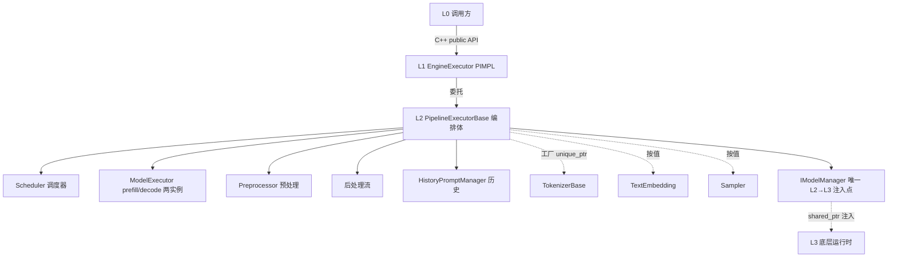
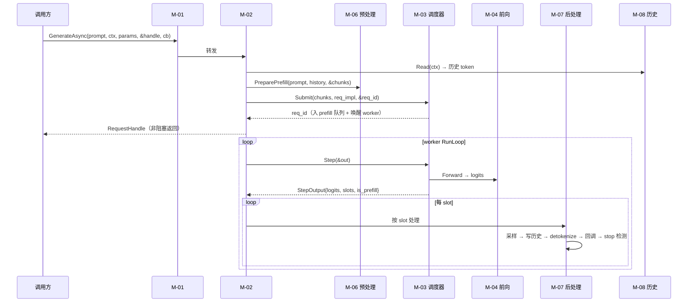

<!--
人类可读版设计文档。内容与 DESIGN.md 等价，但以叙述为主、编号缩写为辅，
并着重展开「模块间如何交互」「交互的数据结构长什么样」。
机器可读的权威版本仍为 ./DESIGN.md（含完整 ID 交叉引用）。
本文数据结构取自实际头文件（api/cpp/types.h、infra/status.h、core/tensor.h、
core/context.h、api/cpp/engine_executor.h、api/cpp/request_handle.h、
pipeline/scheduler.h、pipeline/pipeline_executor.h、pipeline/preprocessor.h、
core/i_model_manager.h），与代码对齐。
-->

# LLM 自回归推理引擎 设计（人类可读版）

简体中文 | [English](../../../en/cann_lm_engine/pipeline+engine_executor/DESIGN_HUMAN.md)

> 配套：`SPEC.md`（行为规格）、`DESIGN.md`（机器可读的权威设计，含完整编号交叉引用）。
> 本文档是 DESIGN.md 的叙述式重写，方便通读；技术决策完全一致。两边如有出入，以 `DESIGN.md` 为准。

## 这个引擎是做什么的

一句话：**它是一个嵌入式 C++ 库，把一段 Prompt 喂进模型、自回归地一个 token 一个 token 生成出明文，并支持多轮对话、流式输出、多请求组批和取消。**

它通过 pybind11 暴露 Python 接口，服务 Ascend/CANN 生态的大模型落地。形态是**嵌入式库而非独立服务**（D-01）——服务化治理由外层 wrapper 零侵入实现，引擎本身不感知服务化。

设计目标优先级：**低延迟（TTFT/TPOT）> 高吞吐（tokens/sec）> 可扩展 > 内存峰值可控**。

### 边界：引擎层做什么、不做什么

引擎层（L1/L2）只做"编排"：接收 Prompt、分词、拼历史、切块、组批调度、采样、反分词、回调、停止检测、历史记账。它**不碰**硬件——KV Cache 的实际内存、张量算子执行、设备调度都沉到底层运行时（L3）。引擎层只经 `shared_ptr` 引用底层拥有的张量，自己不持有设备内存、不做 DMA（C5 边界纪律）。

引擎层和底层之间**只有一个抽象注入点**：`IModelManager`（C-04）。这是 C8 v1.2 收敛后的结果——Tokenizer / TextEmbedding / Sampler 都是引擎**内部**模块，不重新实现底层、不是底层注入。

### 后端编译时确定（v0.6 关键变化）

`IModelManager` 的具体后端类型在**编译时**就定好了。引擎不感知、也不引用任何具体后端类名。`ModelExecutor::Load` 时调一个**链接期自由函数** `CreateModelManager()`（声明在 `i_model_manager.h`，定义由编译时选定链接的后端库提供），拿到 owned `unique_ptr<IModelManager>`。没有运行时工厂注入。换后端 = 换链接库、重新构建；同一构建产物不支持运行时多后端切换。UT 链接一个 stub 定义（返 mock MM）。

---

## 整体结构：三层 + PIMPL



风格：**分层 + PIMPL 接口分离 + 抽象注入点 + 串行执行 + Continuous Batching 数据并行**。

- **L1（EngineExecutor）**：公开 API 的 PIMPL 外壳，零业务逻辑，只转发。public 头不暴露任何内部类型（D-08，ABI 稳定）。
- **L2（PipelineExecutorBase）**：唯一编排体。抽象基类 + 工厂，自回归是当前唯一派生 `AutoregressivePipelineExecutor`，为非自回归 pipeline 预留扩展点（D-10）。它拥有 worker 线程、持有全部共享组件、拥有 Context/Request/History 注册表。
- **L3（底层运行时）**：经 `IModelManager` 这一个抽象点注入，引擎不感知。

上层只调紧邻下层；L2 经链接期 `CreateModelManager()` 工厂持有唯一 L2→L3 抽象注入点。

### 线程模型

- **提交层并发**：多个用户线程可同时调 `GenerateAsync`（线程安全）。
- **执行层串行**：单个 worker 线程循环驱动 `Scheduler::Step` + 后处理。避免引擎层内部锁争用；多请求的并行靠 batch 维度数据并行补吞吐（D-02）。
- **通信**：worker 与用户线程经 `RequestImpl` 共享状态（mutex/atomic）通信，无跨处理器域同步（纯 CPU）。

---

## 模块清单（讲故事版）

| 模块 | 干什么 | 关键交互 |
|------|--------|----------|
| **M-01 EngineExecutor** | L1 PIMPL 外壳，转发公开 API。 | 单向委托 M-02。内部 `unique_ptr<Impl>` 即 M-02。 |
| **M-02 PipelineExecutorBase** | L2 唯一编排体。转发 API impl；拥有 worker；持有全部组件与注册表。 | 拥有 M-03~M-08、C-01~C-03；经 `CreateModelManager()` 持有 C-04。 |
| **M-03 Scheduler** | 排队 + decode 池 + iteration 组批 + 交错 + cancel。不自驱，由 worker 调 `Step` 驱动。 | 持 M-04*/M-06* 非拥有指针；产 `StepOutput` 给 M-02。 |
| **M-04 ModelExecutor** | 前向壳（组装输入 + 委托底层 + 产 logits）+ KV 光标 + Load/Unload/GetMeta 控制面。prefill/decode 两实例。 | Load 时调 `CreateModelManager()` 自持 owned MM；委托 MM::Forward。 |
| ~~M-05 ModelLoader~~ | **已拆解**（v0.5→v0.6）。职责合并入 M-04::Load。 | — |
| **M-06 Preprocessor** | tokenize→拼历史→占位符定位→切块。无状态。 | 经非拥有指针收 `TokenizerBase*`/`TextEmbedding*`。 |
| **M-07 后处理流** | 采样→写历史→detokenize→回调→stop。由 M-02 逐 slot 调用，非独立类。 | 用 C-03（采样）、C-01（detokenize）、M-08（写历史）。 |
| **M-08 HistoryPromptManager** | 按 Context 隔离的 token id 历史。供下轮 prefill 拼接。 | 无下层依赖（纯内存）；M-02 持注册表。 |

### 契约（交互能力）一览

| 契约 | 生产者 | 消费者 | 能力 |
|------|--------|--------|------|
| C-01 Tokenizer | M-02（内部多态模块） | M-06/M-07 | 文本↔token id 分词（TokenizerBase + 工厂 + BPE/SP 派生自注册） |
| C-02 TextEmbedding | M-02（内部模块） | M-06 | embedding 表加载 + 绑定至模型（tokenId 查表在 om 图内部） |
| C-03 Sampler | M-02（内部具体类） | M-07 | logits + 参数 → token id 采样（无状态，不读历史） |
| C-04 IModelManager | L3 运行时 | M-04 | 模型加载/前向/释放/元信息（**唯一 L2→L3 注入点**） |
| C-05 StepOutput | M-03 | M-02 | 单次 iteration 前向产出（phase + batched logits + slot→req 映射） |

---

## 重点一：模块之间怎么交互

下面把交互关系按"谁持有谁、谁调谁、数据怎么流"讲清楚。

### 所有权与持有关系

```
EngineExecutor
 └─ unique_ptr<Impl>  →  AutoregressivePipelineExecutor (M-02)

AutoregressivePipelineExecutor 拥有：
 ├─ unique_ptr<TokenizerBase>   tokenizer_     （工厂产物，多态；M-06/M-07 经非拥有指针访问）
 ├─ TextEmbedding               text_embedding_（按值，load+bind）
 ├─ Sampler                     sampler_        （按值，具体类，无状态）
 ├─ ModelExecutor  prefill_executor_           （Load 时自调 CreateModelManager() 自持 owned MM）
 ├─ ModelExecutor  decode_executor_
 ├─ shared_ptr<KvCachePool>      kv_pool_        （decode Load 定容后创建，两实例共享）
 ├─ Preprocessor   preprocessor_                （持 tokenizer*/text_embedding* 非拥有指针）
 ├─ Scheduler      scheduler_                   （持 prefill_executor_*/decode_executor_*/preprocessor* 非拥有指针）
 ├─ map<ContextId, Context>                     contexts_       （mutex）
 ├─ map<ContextId, shared_ptr<HistoryPromptManager>> histories_   （mutex）
 ├─ set<ContextId>                              active_generates_（同 Context 并发检查）
 ├─ thread        worker_
 ├─ atomic<bool>  stop_
 └─ condition_variable  worker_cv_
```

要点：
- **L2 持有一切**：worker 线程、所有 L2 模块、注册表、内部组件。
- **非拥有指针**：M-03 Scheduler 和 M-06 Preprocessor 持的是 M-02 拥有对象的裸指针，生命周期由 M-02 保证（它们比 M-02 成员先析构？不——M-02 析构时先 join worker 再按声明逆序释放，裸指针所指对象在 M-03/M-06 析构时仍存活）。
- **C-04 唯一注入点**：M-02 不直接持 `IModelManager`；两个 `ModelExecutor` 实例各自在 Load 时经 `CreateModelManager()` 创建并 owned 自己的 MM。
- **注册表按 ContextId 隔离**：安全隔离的落点——每 Context 一个 HistoryPromptManager，资源/状态不跨 Context 共享。

### 调用链（谁调谁）

| 调用方 | 被调方 | 通信方式 | 同步/异步 |
|--------|--------|----------|-----------|
| 用户线程 | M-01 | 函数调用 | sync（提交层并发） |
| M-01 | M-02 | PIMPL 转发 | sync |
| M-02 worker | M-03 | `Step(&out)` | sync（每 iteration） |
| M-03 | M-04 / M-06 | 函数调用 | sync（决策+前向） |
| M-02 | M-07 / M-08 | 函数调用 | sync（逐 slot 后处理） |
| worker | 用户线程 | `StreamCallback` / `RequestHandle` | async（回调在 worker 触发） |

---

## 重点二：交互的数据结构长什么样

这是本文的重点。下面每个结构都取自真实头文件，并标注"谁生产、谁消费、在哪条路径上流动"。

### 2.1 对外 API 层：用户看到的数据结构

这些定义在 `api/cpp/types.h`、`infra/status.h`、`core/context.h`、`api/cpp/request_handle.h`，是用户直接接触的稳定表面。

**状态码**（`status.h`，贯穿全部 API，非异常，详情靠日志）：

```cpp
struct Status {
    int code;
    static constexpr int SUCCESS          = 0;  // 成功
    static constexpr int FAILURE          = 1;  // 通用失败（加载/运行时内部错误）
    static constexpr int INVALID_ARGUMENT = 2;  // 参数非法
    static constexpr int INVALID_STATE    = 3;  // 状态冲突（如同 Context 并发调用）
    static constexpr int NOT_FOUND        = 4;  // Context/文件/请求不存在
    static constexpr int CANCELED         = 5;  // 已取消
};
```

**Prompt 与多模态**（`types.h`）。用户输入的起点：

```cpp
using TokenId = uint32_t;   // 默认 uint32_t，大词表可编译期切 uint64_t

enum class ModalityTag { Image, Audio, Video /*, 可扩展*/ };

struct ModalityEmbedding {
    ModalityTag                  tag;         // 模态标注，仅标识，不参与占位符匹配
    std::shared_ptr<Tensor>      embedding;  // 已算好的多模态 embedding，共享所有权避免拷贝
};

struct Prompt {
    std::string                       text;        // 单段文本，不含多轮 chat
    std::vector<ModalityEmbedding>    embeddings;  // 可空，纯文本时为空
};
```

> 占位符匹配规则（需求 #1）：多模态 embedding 按 `Prompt.embeddings` 数组顺序 ↔ 占位符在 token 序列中出现顺序，不论 `ModalityTag`。

**采样参数**（`types.h`，每请求级，独立于 Prompt）：

```cpp
struct SamplingParams {
    int      max_tokens      = 0;     // 0 = 用模型默认上限
    std::vector<TokenId>    stop_token_ids;   // 含 EOS
    std::vector<std::string> stop_strings;
    float    temperature      = 1.0f;
    int      top_k            = 0;     // 0 = 不启用
    float    top_p            = 1.0f;  // 1.0 = 不启用
};
// 注：不支持 beam search / n>1 / logprobs / penalty（需求 #8）。
//      Sampler 只收当前步 logits + params，不读历史，故 penalty 类特性不支持。
```

**结果与终止原因**（`types.h`）：

```cpp
enum class FinishReason { MaxTokens, StopToken, StopString, Canceled, Error };

struct Result {
    std::vector<TokenId> token_ids;
    std::string          text;
    FinishReason         finish_reason = FinishReason::MaxTokens;
};
```

**Context 句柄**（`context.h`，轻量、可复制，内部状态共享）：

```cpp
struct ContextId {
    uint64_t value = 0;
    bool operator==(const ContextId&) const noexcept;
    bool operator<(const ContextId&) const noexcept;   // 有序容器
    explicit operator bool() const noexcept;            // value != 0 = 有效
};

class Context {
    ContextId id() const noexcept;          // 取标识
    explicit operator bool() const noexcept;
private:
    std::shared_ptr<ContextImpl> impl_;     // 实体由 pipeline 拥有，用户持句柄读 id
    friend class EngineExecutor;
    friend class AutoregressivePipelineExecutor;
};
```

**RequestHandle**（`request_handle.h`，轻量、move-only，持请求槽所有权）：

```cpp
enum class RequestStatus {
    Queued, Prefilling, Decoding, Completed, Canceled, Failed
};

class RequestHandle {
    RequestStatus GetStatus() const noexcept;   // 可并发调用
    bool IsDone() const noexcept;               // 终态？
    Status Cancel();                            // 标记 canceled，当前 iteration 后退出池
    Status Wait(Result* out);                   // 阻塞等待
    Status TryGetResult(Result* out) const;     // 非阻塞取
private:
    std::shared_ptr<RequestImpl> impl_;        // 指向 M-02 管理的共享状态
};
```

**流式回调**（`types.h`，在 worker 线程触发，detokenize 后、stop 检测前）：

```cpp
using StreamCallback = std::function<void(TokenId, std::string)>;
```

**模型构件**（`types.h`，路径模式 vs buffer 模式）：

```cpp
struct Buffer {                 // 只读 buffer 视图（C++17 无 span，自研轻量）
    const void* data = nullptr;
    size_t      size = 0;
};
struct ModelArtifact {          // buffer 模式：omc 图 + 权重 + 元信息 json
    Buffer omc;
    Buffer weight;
    Buffer meta_json;
};
struct ModelArtifactPath {      // 路径模式：meta json 由 omc 路径同名派生
    std::string omc;
    std::string weight;
};
```

**EngineOptions / ContextOptions**（`engine_executor.h`）：

```cpp
struct EngineOptions {
    int      default_chunk_size      = 1024;  // 默认切块大小（token 数）
    int      max_concurrent_prefill  = 1;      // 并发 prefill 上限（Continuous Batching 默认 1）
    int      max_batch_size_override = 0;      // 0 = 用模型元信息 max_batch_size；>0 覆盖
    LogLevel log_level               = LogLevel::Info;
};
struct ContextOptions {};   // 占位，字段待列
```

### 2.2 引擎内部层：模块之间流动的数据结构

这些是用户看不到的，定义在 `pipeline/scheduler.h`、`pipeline/pipeline_executor.h`、`core/i_model_manager.h`、`pipeline/preprocessor.h`。

**RequestImpl —— 单请求共享状态**（`scheduler.h`）。这是用户线程与 worker 之间通信的核心载体，`RequestHandle` 持 `shared_ptr<RequestImpl>` 指向它：

```cpp
struct RequestId {
    uint64_t value = 0;
    bool operator==(const RequestId&) const noexcept;
    explicit operator bool() const noexcept;   // value != 0
};

struct RequestImpl {
    // —— 状态（原子，用户线程读 / worker 写）——
    std::atomic<RequestStatus> status{RequestStatus::Queued};
    std::atomic<bool>           canceled{false};           // cancel 机制

    // —— 请求参数（提交期定）——
    SamplingParams   sampling_params;
    ContextId        context_id;
    StreamCallback   callback;          // 可空 = 非流式

    // —— 输出（mutex 保护；worker 写 / 用户线程读）——
    std::vector<TokenId> token_ids;
    std::string          text;
    FinishReason         finish_reason{FinishReason::MaxTokens};

    // —— Wait/TryGetResult 同步原语 ——
    std::mutex              mtx;
    std::condition_variable cv;

    // worker 调：设终态并唤醒 Wait
    void SetTerminal(RequestStatus s, FinishReason fr);
};
```

> 这是理解并发模型的关键结构：`canceled` 是 atomic（用户线程写、worker 读），输出字段是 mutex 保护，`status` 原子。cancel 不立即中断前向——原子标记，下个决策点生效。

**StepOutput —— 单次 iteration 产出**（`scheduler.h`，契约 C-05）。M-03 `Step` 生产、M-02 后处理消费：

```cpp
struct StepOutput {
    std::shared_ptr<Tensor>                       logits;        // batched logits（N slot）
    std::vector<std::shared_ptr<RequestImpl>>     slots;         // slot i → 请求
    bool                                          is_prefill = false;
};
// 不变量：slots.size() == logits 的 batch 维。
```

> M-02 收到 StepOutput 后按 `slots` 逐 slot 跑后处理流（采样→写历史→detokenize→回调→stop）。无活任务时 M-03 返回 `INVALID_STATE`（不产出 StepOutput），worker 休眠。

**Scheduler 内部调度状态**（`scheduler.h`，mutex 保护）。这些是 Continuous Batching 的账本：

```cpp
struct PrefillTask {                          // prefill 队列元素（FIFO）
    RequestId                                id;
    std::shared_ptr<RequestImpl>             req;
    std::vector<std::shared_ptr<Tensor>>     chunks;      // 已切好的 prefill 块
    size_t                                   next_chunk = 0;  // 下个待跑 chunk 下标
    SlotId                                   kv_slot = -1;    // prefill 开始时从 KV 池分配
};
struct DecodeSlot {                           // decode 池元素（容量 = max_batch_size）
    RequestId                  id{};
    std::shared_ptr<RequestImpl> req;
    TokenId                    last_token = 0;
    SlotId                     kv_slot = -1;     // 从 prefill 继承
    bool                       active = false;
};
struct PendingEntry {                        // prefill 完成、待入 decode 池
    std::shared_ptr<RequestImpl> req;
    SlotId                       kv_slot = -1;
};

// Scheduler 成员：
std::deque<PrefillTask>     prefill_queue_;    // FIFO
std::vector<DecodeSlot>     decode_pool_;     // 容量 = max_batch_size
std::deque<PendingEntry>    pending_decode_;  // prefill 完成待入池
```

> 不变量：active ≤ max_batch_size；**无 variable padding**（不按 batch 内最长补齐，各请求 KV 独立）；decode om 固定 batch = max_batch_size，active 未满时 pad 到 max_batch_size（靠 attentionMask 屏蔽）；prefill om 固定 batch=1 无 padding；同一请求同时刻只在一个队列（由 `RequestImpl::status` 反映）。

**IModelManager —— 唯一 L2→L3 接口**（`i_model_manager.h`，C-04）。底层运行时实现，引擎经 `CreateModelManager()` 拿 owned 实例：

```cpp
struct ModelHandle {                // 底层模型实例的不透明句柄
    uint64_t value = 0;
    explicit operator bool() const noexcept;   // value != 0
};
struct ModelMetaInfo {              // Engine 需要的子集
    int max_batch_size = 0;         // → 传 M-03 作 decode 池容量
    int max_seq_len    = 0;
};

class IModelManager {
public:
    virtual Status Load(const ModelArtifactPath&, ModelHandle* out) = 0;   // 路径加载
    virtual Status Load(const ModelArtifact&,     ModelHandle* out) = 0;   // buffer 加载
    // 前向：inputs 数组契约——
    //   inputs[0] = data（embedding 或 tokenId；tokenId 走模型内部 embedding）
    //   inputs[1] = position_ids（由 ModelExecutor 从 KV 光标推导）
    //   inputs[2] = attention_mask（padded 位置置无效）
    //   count >= 3；底层按 handle 区分 prefill/decode 语义，负责张量拼接与 KV 更新
    virtual Status Forward(ModelHandle, const std::shared_ptr<Tensor>* inputs,
                           size_t count, std::shared_ptr<Tensor>* out_logits) = 0;
    virtual Status GetMeta(ModelHandle, const ModelMetaInfo** out) const = 0;
    virtual Status Release(ModelHandle) = 0;
};

// 链接期自由函数（D-12）：定义由编译时选定链接的后端库提供。
// 返回 nullptr = 后端初始化失败（按 Status::FAILURE 处理）。
std::unique_ptr<IModelManager> CreateModelManager();
```

> 底层把"张量拼接/batch 拼接/KV 维护"全沉到底层（C5）。Engine 层只按 slot 顺序接收 batched logits。权重共享：prefill omc / decode omc 加载去重由 C-04 实现负责（同构件仅一份权重）。

**TokenizerBase —— 引擎内部多态分词模块**（C-01，`tokenizer.h`，per `docs/tokenizer/`）。M-02 经工厂 `unique_ptr` 持有，M-06/M-07 经非拥有指针访问：

```cpp
enum class Algorithm { BPE, SentencePieceUnigram };
struct EncodeOptions { bool add_special_tokens; std::optional<size_t> max_length;
                       enum class Padding { None, Longest, Fixed } padding; /*...*/ };
struct DecodeOptions { bool skip_special_tokens; };

class TokenizerBase {   // 多态基类（约束 #2，取代 ITokenizer）
public:
    virtual Status encode(std::string_view, const EncodeOptions&, std::vector<int>* out_ids) = 0;
    virtual Status decode(const std::vector<int>&, const DecodeOptions&, std::string* out_text) = 0;
    virtual size_t  vocab_size() const = 0;
    virtual std::optional<int> special_token_id(std::string_view) const = 0;
    virtual Status  batch_encode(/*...*/);   // 默认实现
};
class TokenizerFactory {
public:
    static Status create(Algorithm, const LoadParams&, std::unique_ptr<TokenizerBase>* out);
    static std::vector<Algorithm> list_registered();
};
// 错误归一（约束 #1）：不返回模块自有错误码，统一用项目 Status；
//   OOV 非失败，内部映射 unk 后返回 SUCCESS。
//   int ↔ TokenId 适配在 Preprocessor 内完成。
// 自注册经 REGISTER_TOKENIZER 宏（静态初始化期）。
```

**TextEmbedding —— embedding 模块**（C-02，`text_embedding.h`）。M-02 按值持有，init 期 `LoadAndBind`：

```cpp
struct ModalityEntry {
    size_t                   position;    // 占位符在 token 序列中的下标
    std::shared_ptr<Tensor>  embedding;   // 来自 Prompt 的多模态 embedding
};
class TextEmbedding {
public:
    Status LoadAndBind();   // 加载 embedding 表并绑定至模型句柄（M-02 init 期调）
    // 真实签名 deferred，待 embedding 模块 DESIGN
};
// 注：tokenId 路径的查表在 om 图前向内部完成，非本模块产张量。
```

**Sampler —— 采样器**（C-03，`sampler.h`）。M-02 按值持有，M-07 经非拥有指针访问：

```cpp
class Sampler {
public:
    Status Sample(const std::shared_ptr<Tensor>& batch_logits, int slot,
                  const SamplingParams& params, TokenId* out);
};
// 关键约束（需求 #8）：只收当前步 logits + params，不读历史。
//   故不支持 logit bias / frequency penalty / presence penalty / n>1 / logprobs。
```

**Preprocessor 接口**（`preprocessor.h`，M-06，无状态）：

```cpp
class Preprocessor {
public:
    Preprocessor(TokenizerBase* tokenizer, TextEmbedding* text_embedding, int default_chunk_size);
    // Prefill 路径：Prompt + 历史 token → 多 chunk 输入张量
    //   tokenize Prompt.text → 拼接历史 → 占位符定位 → 切块
    Status PreparePrefill(const Prompt&, const std::vector<TokenId>& history,
                          std::vector<std::shared_ptr<Tensor>>* out_chunks);
    // Decode fast path：单 token id → 输入张量
    Status PrepareDecodeStep(TokenId id, std::shared_ptr<Tensor>* out_input);
private:
    TokenizerBase*    tokenizer_;        // 非拥有
    TextEmbedding*    text_embedding_;   // 非拥有
    int               default_chunk_size_;
};
```

**Tensor**（`tensor.h`，DESIGN 阶段占位 stub，未来由底层运行时替换）。引擎层只持 `shared_ptr<Tensor>` 引用，不感知内部结构：

```cpp
class Tensor {
public:
    void*  data() const noexcept;
    size_t size() const noexcept;
    explicit operator bool() const noexcept;   // data_ != nullptr
    // 不可拷贝、可移动
};
```

---

## 关键流程（讲故事版）

下面五条主流程用大白话讲一遍。所有流程都是 worker 单线程串行驱动的。

### 流程一：模型加载（每实例自己创建 ModelManager）

`EngineExecutor` 构造时一次性加载（不支持热加载）。M-01 把 prefill + decode 两份构件交 M-02，M-02 对**每个** ModelExecutor 实例各调一次 `Load`。

```
调用方 → EngineExecutor(prefill_path, decode_path, opts)
  → M-02 构造（一次性加载）
    → decode_executor_.Load(decode_path)   // decode 先 Load，取 max_batch_size/max_seq_len
        → CreateModelManager()              // 链接期工厂，创建 owned MM
        → MM::Load(omc + 派生 json) → decode 句柄
        → MM::GetMeta → max_batch_size / max_seq_len
    → 据 decode 元信息创建/定容共享 KV 池 + decode 组装器
    → AttachPool/AttachAssembler（两实例）
    → prefill_executor_.Load(prefill_path)  // prefill 后 Load
        → CreateModelManager() → MM::Load → prefill 句柄
    → Scheduler(prefill_exec, decode_exec, preprocessor, max_batch_size)
    → worker = thread(RunLoop)
```

要点：
- 每实例 Load 时调链接期 `CreateModelManager()` 创建并持有自己的 MM，后端编译时确定。
- **decode 先 Load**，是为了拿 max_batch_size/max_seq_len 来定容共享 KV 池。
- 两实例就绪后才能 Forward。
- embedding 表不走这条线——它由 M-02 调 TextEmbedding 模块加载并绑定到模型。

异常：`CreateModelManager()` 返空 → 加载失败（构建期保证链接后端定义）；om 缺失/损坏/json 失败 → 加载失败，不泄漏部分资源（已加载 handle 由析构回滚）。

### 流程二：单次异步推理（含 cancel 检查点）



worker RunLoop + 后处理伪代码：

```
while !stop_:
    if M-03.Step(&out) == INVALID_STATE:
        condvar.wait(); continue              # 无活任务，休眠
    for slot, req in out.slots:
        if req.canceled.load(): req.SetTerminal(Canceled, Canceled); continue   # 部分丢弃
        token = C-03.Sample(out.logits, slot, params)           # 不感知历史
        req.token_ids.append(token); M-08[req.context_id].Append([token])
        text_piece = C-01->decode({token}, opts)                 # TokenizerBase 多态
        req.text += text_piece
        if stop_token 命中:     finish=StopToken;    status=Completed  # 倾向不回调
        elif stop_string 命中:  finish=StopString;    status=Completed  # 去掉 stop 部分，倾向不回调
        else: req.callback(token, text_piece)                    # stop 检测前回调
        if token_ids.size()==max_tokens: finish=MaxTokens; status=Completed
```

回调触发点：detokenize 后、stop 检测前；命中 stop string 那步倾向不回调（避免泄露停止标记，待定见未决项）。

异常：PreparePrefill 失败 → GenerateAsync 返 FAILURE；前向失败 → Step 返 FAILURE → req.status=Failed；采样/detokenize 失败 → req.status=Failed（保留部分输出）；cancel → 部分输出丢弃。

### 流程三：多轮续接

历史载体是 **token id**（不是文本），避免反复 tokenize 和 tokenizer 非双射损失（D-06）。

```
第1轮: history 为空
  M-08.Read(ctx) → []
  M-06.PreparePrefill(prompt1, history=[], &chunks)  # tokenize prompt1 → 占位符 → 切块
  M-03.Submit → worker 驱动 Prefill + Decode
  后处理每 token: M-08[ctx].Append([token])          # 本轮生成逐 token 入历史
  → history = [token1...tokenN]

第2轮:
  M-08.Read(ctx) → [token1...tokenN]
  M-06.PreparePrefill(prompt2, history=[token1..tokenN], &chunks)
    # tokenize prompt2 → 与历史拼接 → 占位符替换 → 切块
  M-03.Submit → Prefill(历史前缀 + prompt2 新文本) → Decode
  → 追加第2轮生成 token 入历史
```

异常：历史超长未截断（当前不支持，留扩展点）；第 N 轮 PreparePrefill 失败 → 返 FAILURE，历史保留前 N-1 轮。

### 流程四：Continuous Batching（多请求组批/交错）

组批粒度是 **iteration 级**（D-03）。交错策略：**有空位先处理 Prefill**，避免 decode 饥饿同时利用空位。Prefill batch=1，Decode batch=N（active 数）。

M-03 Step 决策伪代码：

```
Step(&out):
    # 1. 清理终态/cancel → 释放 slot → pending decode 补位
    for slot in decode_pool:
        if req.status in {Completed,Canceled,Failed}: slot.active=false
    while has_empty_slot and pending_decode:
        fill slot with pending_decode.pop()

    # 2. 无活任务 → worker 休眠
    if prefill_queue.empty() and decode_pool_all_empty() and pending_decode.empty():
        return INVALID_STATE

    # 3. 交错：有空位 + prefill 非空 → 跑一个 Prefill(batch=1)
    if has_empty_slot() and not prefill_queue.empty():
        task = prefill_queue.front()
        chunk = task.chunks[task.next_chunk++]
        M-04_prefill.Forward([chunk], &logits)
        out = {logits, [task.req], is_prefill=true}
        if task.next_chunk == task.chunks.size():     # chunk 耗尽
            prefill_queue.pop(); pending_decode.push({req, kv_slot})

    # 4. 否则 Decode batch=N（M-04 pad 到 max_batch_size，attentionMask 屏蔽）
    else:
        inputs = [M-06.PrepareDecodeStep(req.last_token) for req in active]
        M-04_decode.Forward(inputs, &logits)
        out = {logits, slot_to_request, is_prefill=false}
    return OK
```

异常：某 slot 前向失败 → 该 req.status=Failed，释放 slot，其他 slot 不受影响；池满新 prefill → prefill 队列排队（非错误）。

### 流程五：Cancel（请求级 / Context 级）

```
用户侧:
  RequestHandle.Cancel() → req_impl->canceled.store(true)     # 线程安全，用户线程可调
  CancelContext(ctx) → 遍历该 Context 所有 active req → canceled=true

worker 后处理（M-07）:
  for slot, req in out.slots:
      if req.canceled.load(): req.SetTerminal(Canceled, Canceled); continue   # 跳过采样/写历史/回调

M-03 Step 决策清理:
  for slot in decode_pool:
      if req.status in {Completed,Canceled,Failed}: slot.active=false   # 释放，下次补位
```

关键决策：
- **原子标记 + 下个决策点清理**，不立即中断当前前向（避免前向打断）。
- **部分输出丢弃**（Canceled 状态不回调流式 token）。
- **历史不回滚**——已生成 token 入历史，多轮续接语义清晰。
- CancelContext **级联取消**该 Context 全部 active req。
- 幂等：Cancel 已终态请求返回 OK 或 NOT_FOUND。

---

## 接口长什么样（公开 API 骨架）

```cpp
class EngineExecutor {
public:
    // 构造（路径 / buffer 加载，prefill + decode 各一份）
    EngineExecutor(const ModelArtifactPath& prefill, const ModelArtifactPath& decode,
                   const EngineOptions& = {});
    EngineExecutor(const ModelArtifact& prefill, const ModelArtifact& decode,
                   const EngineOptions& = {});
    // 不可复制、可移动；移动后原对象置空

    // Context 管理
    Status CreateContext(Context* out);
    Status DestroyContext(ContextId);           // 幂等
    Status ConfigureContext(ContextId, const ContextOptions&);
    Status CancelContext(ContextId);            // 级联取消该 Context 全部在飞请求

    // 推理
    Status Generate(const Prompt&, const Context&, const SamplingParams&, Result* out);
    Status GenerateAsync(const Prompt&, const Context&, const SamplingParams&,
                         RequestHandle* out, StreamCallback = {});
private:
    class Impl;
    std::unique_ptr<Impl> impl_;   // 即 M-02
};
```

语义：构造期一次性加载；`Generate` = `GenerateAsync`（空回调）+ `Wait`；同 Context 并发返回 `INVALID_STATE`。句柄残留使用（EngineExecutor 析构后）→ `INVALID_STATE`。

---

## 为什么这么设计（关键决策讲明白）

### 1. 形态为什么是嵌入式库

引擎只管推理，不持服务治理逻辑（鉴权/限流/熔断）。外层 wrapper 实现服务化，引擎零侵入（D-01）。代价：调用方负责服务化封装。

### 2. 为什么执行层串行 + batch 数据并行

避免引擎层内部锁争用与复杂并发。多请求的并行靠单次 batch 内的数据并行（Continuous Batching），不靠并发前向——这跟设备本质串行一致，没有损失（D-02）。提交层并发由 API 线程安全保证。

### 3. 为什么 Continuous Batching：Prefill 独立 + Decode 多 batch

动态利用 decode 池空位，吞吐高于单请求串行基线。Prefill batch=1（避免长 prompt 阻塞 decode），Decode batch=N active（M-04 pad 到 max_batch_size，attentionMask 屏蔽，无 variable padding）。交错策略：有空位先 Prefill（D-03）。

### 4. 为什么 prefill/decode 是双独立实例

分离两阶段前向语义，便于各自 bind om 图与 batch 维度管理。两实例是**同一类的两个实例**（非子类），共享同一 KV Cache 池零拷贝，差异仅 handle（prefill om / decode om）；权重去重由 C-04 实现（D-04）。

### 5. 为什么切块归属 Preprocessor

Engine 层协调预处理链路（需求 #7），切块是预处理一环。切块机制（token 级 vs 张量 slice）待定，倾向 token 级守 C5（D-05）。

### 6. 为什么独立 HistoryPromptManager

避免反复 tokenize 和 tokenizer 非双射损失（需求 #9）。历史载体是 token id，按 Context 隔离，每 Context 一个实例。写入主体是 M-02（每步 Decode 后），用户无感（D-06）。截断/滑动窗口/KV 长度对齐策略待定（当前不支持，留扩展点）。

### 7. 为什么 Status 错误模型（非异常）

C11 自研轻量；异常跨边界不可控。6 常量粗粒度，详情靠日志。调用方须检查 Status（D-07）。

### 8. 为什么 PIMPL 接口分离

ABI 稳定；public 头不暴露任何内部类型。M-01 为外壳，Impl 即 M-02（D-08）。

### 9. 为什么 Tokenizer/TextEmbedding 是 engine 内部模块，Sampler 是具体类；IModelManager 是唯一注入点（C8 v1.2）

Tokenizer 需多算法多态（BPE/SentencePiece）+ 自注册开闭，v1.1 的"具体类无虚"与该模块冲突；embedding 角色经 model_executor 澄清为 load+bind（非查表产张量），v1.1 错误；Sampler 无多态需求、无 sibling 文档，保持具体类。三者均**非底层注入**，IModelManager 仍为唯一 L2→L3 注入点（D-09）。

### 10. 为什么 Pipeline 多态基类 + 工厂

新增抽象基类 `PipelineExecutorBase` + `PipelineExecutorFactory` + `PipelineType` 枚举，现 `AutoregressivePipelineExecutor` 是当前唯一派生，为非自回归等 pipeline 预留扩展点（约束 #3，D-10）。

### 11. 为什么 LifecycleController/ModelLoader 已拆解

ModelLoader 仅 thin wrapper（参数解析→路径派生 json→调 C-04::Load），独立模块引入不必要的间接层。合并后 M-04 在 Load 时直接调 `CreateModelManager()` 创建 owned MM 并加载，减少一次跨模块调用（D-11）。M-05 标记 [已拆解]，§11.5 保留为历史索引。

### 12. 为什么链接期 CreateModelManager() 取代运行时注入

`shared_ptr<IModelManager>` 运行时注入要求调用方在构造 EngineExecutor 前知道后端类型并创建 MM，违反"后端编译时确定"约束。链接期工厂使后端在编译/链接时确定，无需运行时注入；ModelExecutor::Load 自调工厂创建 owned MM（unique_ptr），pipeline 不感知后端类型（D-12）。stub 后端提供 `CreateModelManager()` 返 nullptr（测试期处理为 FAILURE）。

---

## 性能预算

目前都是**预算目标**（无实测基线），等真机 benchmark 校准：

| 指标 | 目标 | 怎么测 |
|------|------|--------|
| TTFT（首 token 延迟） | 绝对值待定；引擎层贡献 <10% | benchmark 集成阶段 measured |
| TPOT（每 token 延迟） | 绝对值待定；引擎层贡献 <10% | measured |
| 吞吐 tokens/sec | 高于单请求串行基线 | measured |
| 引擎层开销占比 | <10% 端到端 | measured |
| 调度开销（M-03 Step 决策） | <1% 端到端 | 每 iteration |
| 后处理每 slot（采样+写历史+detokenize+回调+stop） | 含于引擎层 <10% | 每 slot |
| 单 chunk 预处理 | < 该 chunk 前向耗时 5% | 每 chunk |
| 前向壳转发（M-04，不含底层算子） | <0.1% 端到端 | 单次前向 |

关键路径：Submit → PreparePrefill → Prefill Forward → Sample → Write history → detokenize → callback → stop。其中 Forward 与 Sample 沉底层。退化告警：调度开销 >1% 或引擎层占比 >10% → 日志 warn。

---

## 并发与线程安全

| 资源 | 并发访问 | 同步原语 |
|------|----------|----------|
| `RequestImpl` 输出字段 | worker 写 / 用户线程读 | mutex |
| `RequestImpl::canceled` | 用户线程写 / worker 读 | atomic |
| `histories_` 注册表 | worker 读写 / 用户 destroy | mutex |
| ContextImpl 注册表 | worker 读写 / 用户 create/destroy | mutex |
| RequestImpl 注册表 | worker 读写 / 用户 cancel | mutex |
| C-04 / C-01 / C-02 / C-03 | worker 串行调（执行层串行） | 无需（串行） |

死锁与竞态防护：
- **锁层级**：注册表 mutex > RequestImpl mutex，不反向获取。
- **析构竞态**：stop_ → join worker → 释放资源；残留句柄使用返 `INVALID_STATE`。
- **cancel 竞态**：atomic canceled + 终态幂等检查。
- **同 Context 并发提交**：运行期检查 → `INVALID_STATE`。
- worker 唤醒：condvar（选型见未决项）。新 Submit 唤醒；stop_ 唤醒退出。无跨处理器域同步（C5）。

---

## 错误怎么分等级

| 层 | 错误模型 | 传播 |
|----|----------|------|
| L1 公开 API | Status（6 常量，非异常） | 直接返回用户 |
| L2/L3 内部 | Status + 日志详情 | 经 M-02 汇聚 → 映射公开码 |

终态枚举：Completed / Failed / Canceled。ReqFailed 携带部分输出（便于排查/续接）；Canceled 不返回部分（丢弃）。详情靠日志，Status 只给粗粒度。

---

## 还没定的事（未决项）

| 未决 | 影响 | 兜底 |
|------|------|------|
| TTFT/TPOT 绝对值未绑定 | 性能验收缺基线 | 集成 benchmark 阶段补 measured（待参考硬件+模型规模） |
| Chunked Prefill 切块机制（token 级 vs 张量 slice） | M-06 实现路径分叉 | 倾向 token 级守 C5；D-05 复审；若需张量 slice 则触 C5 边界 |
| 流式 detokenize 缓冲 / stop string 命中缓冲去留 | M-07 输出正确性 | 倾向不泄露停止标记；实测 stop string 场景 |
| HistoryPromptManager 截断 / KV 对齐 | 超长历史正确性 | 当前不支持，留扩展点 |
| worker 唤醒/同步原语选型 | M-02 实现细节 | condvar 倾向 |

---

## 接下来怎么落地（给实现的人）

实现顺序（按依赖拓扑）：

1. C-04 接口契约 + C-01 TokenizerBase/工厂 + C-02/C-03 定义（可并行）。
2. M-08（无依赖）。
3. M-04 → M-05（已合并）→ C-04。
4. M-06 → C-01/C-02。
5. M-03 → M-04/M-06。
6. M-07 → C-03/M-08。
7. M-02 → 全 L2。
8. M-01 → M-02。

必须串行：M-03 依赖 M-04/M-06；M-02 依赖全部 L2；M-01 依赖 M-02。

集成里程碑：
1. M-04 + C-04 mock 跑通假前向；
2. M-03 + M-06 跑通单请求 prefill → decode；
3. M-02 + M-07 跑通流式 + stop；
4. M-02 多请求 Continuous Batching；
5. M-01 PIMPL 公开 API 链接 `api_smoke`。

---

## 一致性说明

本文档与 `DESIGN.md` 技术决策完全等价，只是去掉了编号缩写的交叉引用、改用叙述，并补充了取自真实头文件的交互数据结构。机器可读的权威版本（含完整模块/契约/流程/决策编号、用于实现期精确追溯）仍是 `DESIGN.md`。两边如有出入，以 `DESIGN.md` 为准。
