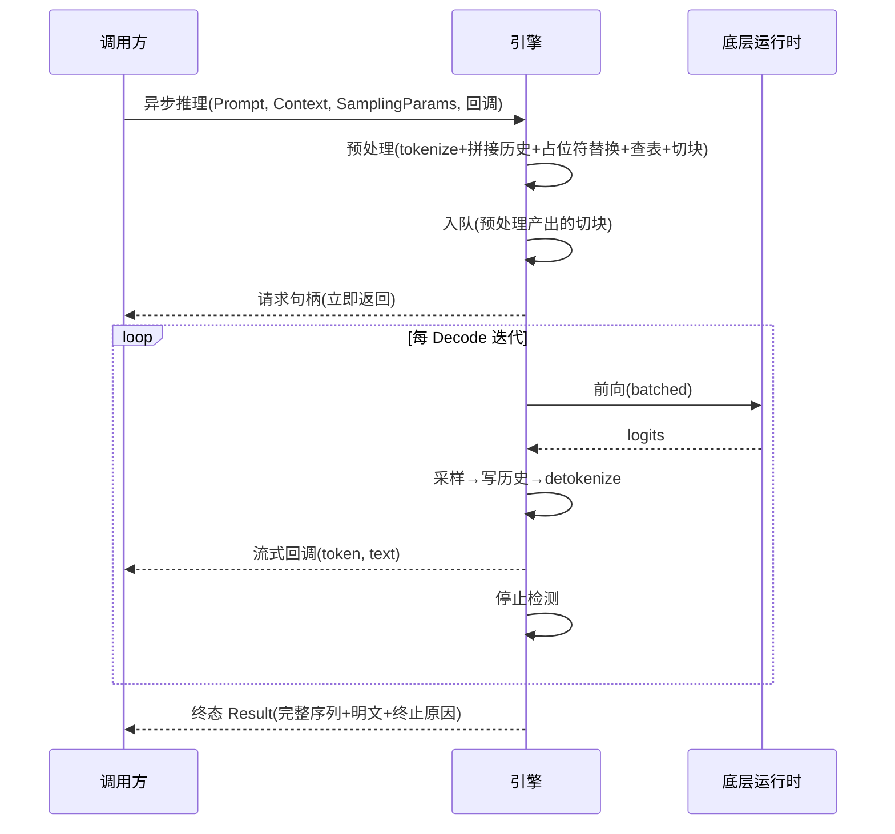
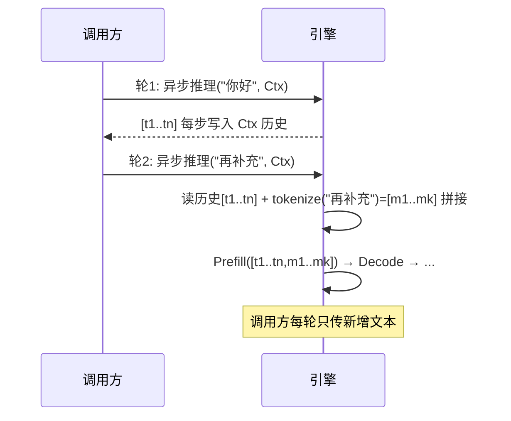
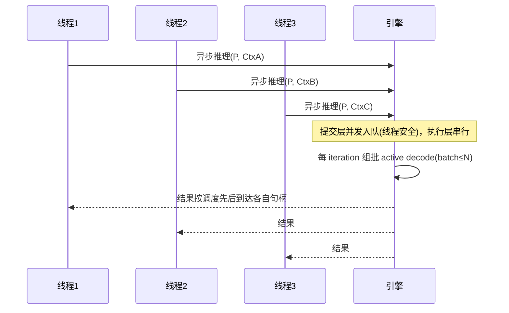
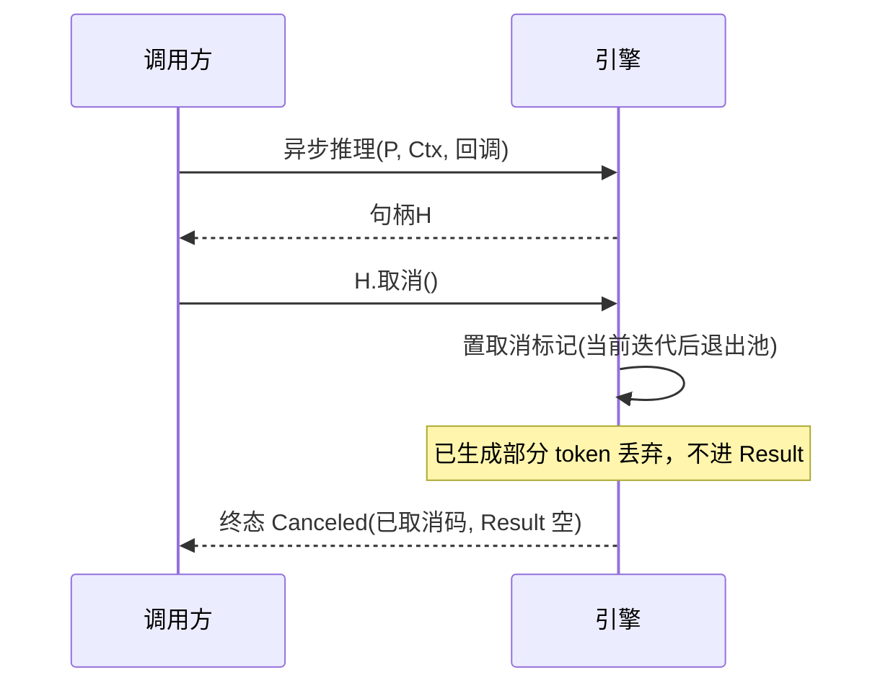

# LLM 自回归推理引擎 — 功能规格

简体中文 | [English](../../../en/cann_lm_engine/pipeline+engine_executor/SPEC.md)

> 需求编号：SR20260806001
> 软件层次：framework（嵌入式 C++ 库）
> 本文描述"系统应表现出什么业务行为"（What & Why），不含实现细节。

---

## 第 1 章 概述

本规格定义一个用于大语言模型自回归推理的 **LLM 推理引擎**，形态为**嵌入式 C++ 库**（非独立服务）。引擎对外只暴露 C++ API 边界，承担自回归推理流程编排、Prefill/Decode 两阶段执行、队列调度与 batching、输入预处理、采样后处理、模型加载与上下文管理；**不承担** KV Cache 管理、硬件设备抽象与张量算子执行、服务化治理（RPC/多租户鉴权等）——这些由底层运行时与外层 wrapper 提供，引擎只调用封装接口、零侵入服务化。

调用方持有一个引擎实例，通过"上下文 + 提示"进行上下文管理与推理调用；支持多实例、多会话复用同一引擎、多轮对话续接、流式输出与取消。本规格覆盖引擎的全部对外可观测行为、非功能目标、约束依赖、向后兼容性与验证标准（SR20260806001）。

---

## 第 2 章 术语表

| 术语 | 定义 |
|------|------|
| 引擎 / Engine | 本规格定义的 LLM 自回归推理库整体。 |
| 调用方 | 持有引擎实例、发起推理请求的用户应用或上层服务 wrapper。 |
| 上下文 / Context | 一次会话的状态载体，由调用方持有句柄；承载多轮历史与配置，按标识区分。 |
| 提示 / Prompt | 单次推理输入，含一段文本与零或多个多模态 embedding。 |
| 多模态 embedding | 图像/音频/视频等模态预计算好的张量，经文本占位符定位后参与推理。 |
| 采样参数 / SamplingParams | 每请求独立的采样配置（最大生成数、停止条件、温度、top-k、top-p），独立于 Prompt。 |
| 自回归推理 | 逐 token 生成、每步将上一步输出回填为下一步输入的循环过程。 |
| Prefill | 处理提示（含历史拼接）的阶段，计算密集。 |
| Decode | 逐 token 自回归生成的阶段，访存密集。 |
| Chunked Prefill | 长 prompt 切块、分多次执行的机制，用于控制首 token 延迟与单步显存峰值。 |
| Continuous Batching | 迭代级动态组批：Decode 阶段多请求组批成一次前向，请求可中途加入/退出。 |
| decode 池 | 同一时刻可处于 active decode 的请求集合，容量上限由模型元信息决定。 |
| 请求句柄 / RequestHandle | 异步推理返回的轻量句柄，可查询状态、取消、等待完整结果。 |
| 流式回调 / StreamCallback | 每步 Decode 产出 token 后触发的回调，供调用方增量获取。 |
| 结果 / Result | 一次推理的完整产出，含 token id 序列、明文、终止原因。 |
| 状态码 / Status | 统一返回的粗粒度状态（成功/失败/参数非法/状态冲突/未找到/已取消），详情靠日志。 |
| omc | 离线编译模型格式，引擎经路径或已读入的 buffer 加载。 |
| max_batch_size | 模型元信息给定的 decode 池容量上限。 |
| KV Cache | 跨步骤缓存的历史键值状态，由底层运行时管理，引擎不感知。 |
| 底层运行时 | 提供 KV/算子/硬件抽象的外部实现，引擎经封装接口访问。 |
| TTFT | Time To First Token，首 token 延迟（从提交到收到第一个 token 的端到端延迟）。 |
| TPOT | Time Per Output Token，Decode 阶段每 token 的平均生成延迟。 |
| EOS | End-Of-Sequence，模型自带的序列结束 token，属停止 token 之一。 |
| DFX | Design for X（可靠性/可测试/可观测/可配置等非功能属性的设计要求集合）。 |
| mock | 测试中替换真实底层依赖的可控替身实现。 |
| 占位符 | 文本中标记多模态 embedding 插入位置的特殊 token，预处理期被替换为对应 embedding。 |

---

## 第 3 章 背景

### 3.1 现状

自回归 LLM 推理在工程上分两个阶段：处理提示的 Prefill（计算密集）与逐 token 生成的 Decode（访存密集）。设备本质串行——一次只跑一次前向。传统方案要么把推理逻辑与服务治理耦合（稀释 pipeline 设计精力），要么把 batch 管理做在请求级并发（与设备串行本质矛盾），要么要求调用方每轮重传全部历史文本（反复 tokenize 且引入 tokenizer 非双射损失）。多会话并发与取消语义常被隐性排队掩盖，导致 bug 难以暴露。

### 3.2 问题

- **服务化耦合**：推理 pipeline 与 RPC/鉴权/生命周期混在一起，难以聚焦 pipeline 自身设计。
- **并发模型错位**：在串行设备上做请求级并发无收益，真实吞吐杠杆应是迭代级动态组批，而非多线程抢占。
- **历史重传负担**：调用方每轮重传全文，反复 tokenize 浪费算力且 tokenizer 非双射导致精度损失。
- **错误掩盖**：同一会话并发调用被隐性排队而非显式报错，掩盖调用方 bug。
- **可扩展性不足**：新采样算法、新模态、更复杂调度策略缺乏扩展点。

### 3.3 期望

构建一个**嵌入式 C++ 库**：对外只到 C++ API 边界，服务化由外层 wrapper 零侵入实现；C API 层（`extern "C"` + opaque handle，见 `docs/c_api/`）提供 ABI 稳定边界供跨语言绑定；采用 Prefill/Decode 两阶段分离 + Continuous Batching（迭代级动态组批）作为真实并发杠杆；以独立历史管理模块承载 token id 历史，调用方每轮只传新增文本；以统一状态码显式暴露状态冲突（同一上下文并发即报错）；以 IModelManager 注入点 + engine 内部模块预留扩展点（新分词算法经 `TokenizerBase` 派生自注册 `TokenizerFactory`；新 pipeline 类型经 `PipelineExecutorBase` 派生 + `PipelineExecutorFactory` 构造；新模态/embedding 经 TextEmbedding；采样经 Sampler；模型管理/前向经 IModelManager 注入点扩展）。引擎不感知 KV tensor 内存/算子/硬件（KV ringBuffer 光标归 ModelExecutor），性能预算以"引擎层自身开销占端到端延迟比例"表达。

---

## 第 4 章 功能需求

### 4.1 行为规格

> **证据来源声明（BDV_001/002）**：本节所有"必须"级行为断言可追溯到上游 `基础需求和约束.md` v0.5 的功能点 #1–#9 与约束 C1–C12（见 frontmatter upstream），非仅用户口述。下方对"数值/限制/阈值 + 边界/权限/信任边界"类断言追加内联 `[来源: #N / Cn]` 标注；非数值的行为断言以上游功能点整体为来源，按本声明追溯。

#### 4.1.1 引擎实例化与模型加载（F-LOAD）

**前置条件**：调用方备好两个模型构件（Prefill 构件 + Decode 构件），来源为"路径"或"已读入 buffer"之一。

**处理逻辑**：
- 引擎**必须**在实例化时一次性加载 Prefill 与 Decode 两个模型构件，当前版本**不**支持运行时热加载或切换模型。
- 引擎**必须**支持两种加载来源：(a) 文件路径（图路径 + 权重路径 + 与图同名的 json 元信息）；(b) 已读入的 buffer（图 + 权重 + 元信息）。
- 引擎**必须**在加载后读取模型元信息（至少含 decode 池容量上限 `max_batch_size`、单序列最大长度）。[来源: #4 + 04 §11.4 ModelMetaInfo]
- 引擎**应该**允许两个构件引用同一份权重（同模型不同编译版），底层去重，引擎不做特殊优化。
- 引擎实例**必须**不可复制、可移动；移动后原对象**必须**置空。
- 引擎**必须**支持同进程内实例化多个引擎实例，不依赖全局单例，资源池归属各实例自身。

**后置条件**：两个构件加载完成、元信息可查、引擎就绪可接受推理请求。

**异常处理**：
- 加载失败（文件不存在 / buffer 损坏 / 版本不匹配 / json 解析失败）**必须**以失败状态码返回，详情经日志输出。
- 实例化失败时引擎**必须**不泄漏部分资源（失败即释放已获取资源）。

**边界情况**：
- 元信息 `max_batch_size` 缺失或非法 → 加载**必须**失败。
- 构件路径与 buffer 来源混用 → **必须**拒绝（参数非法）。

---

#### 4.1.2 上下文管理（F-CTX）

**前置条件**：引擎已就绪。

**处理逻辑**：
- 引擎**必须**提供创建上下文，返回有效句柄与标识。
- 引擎**必须**提供销毁上下文，释放该上下文的历史与底层资源句柄。
- 引擎**必须**提供配置上下文（按上下文覆盖如默认切块大小、并发上限等，具体字段由设计阶段列）。
- 引擎**必须**提供上下文级取消，取消该上下文上所有在飞请求。
- 上下文句柄**必须**是可复制的轻量句柄（内部状态共享）。
- 每个上下文**必须**拥有独立的历史管理实例，按上下文隔离。
- 引擎**必须**支持同一引擎内多上下文间切换复用；**不**支持跨引擎实例迁移上下文。
- 引擎**可以**支持上下文持久化（保存/恢复）；当前版本**不**支持。

**后置条件**：上下文处于可推理状态，历史按上下文隔离累积。

**异常处理**：
- 引擎析构后使用其上下文 → **必须**返回状态冲突码。
- 上下文/标识不存在 → **必须**返回未找到码。

**边界情况**：
- 销毁已销毁上下文 → **应该**幂等返回成功或未找到。
- 配置字段非法 → **必须**返回参数非法码，上下文保持原状。

---

#### 4.1.3 推理提交——同步与异步（F-GEN）

**前置条件**：存在有效上下文；调用方提供 Prompt 与 SamplingParams。

**处理逻辑**：
- 引擎**必须**提供同步推理：阻塞至完成，返回完整 Result。
- 引擎**必须**提供异步推理：立即返回请求句柄，不阻塞。
- 异步推理**必须**支持可选流式回调（传空表示非流式）。
- 同步推理**必须**等价于"异步推理（空回调）+ 阻塞等待完整结果"。
- 每次推理的 Prompt **必须**只含本轮新增文本；历史由历史管理模块承载（见 4.1.7）。
- 请求句柄**必须**可查询状态（排队 / Prefill 中 / Decode 中 / 完成 / 已取消 / 失败）、可取消、可等待完整结果、可非阻塞尝试取结果。
- 请求句柄**必须**是 move-only 轻量句柄（持请求槽所有权，不可复制；可移动）。

**后置条件**：请求进入排队；最终到达终态（完成/已取消/失败）并产出或丢弃结果。

**异常处理**：
- 同一上下文并发调用推理 → **必须**返回状态冲突码（显式暴露，不隐性排队）。[来源: #6 线程模型 + 04 §7]
- 多上下文并发提交 → **必须**允许（提交层并发，执行层串行）。
- decode 池满且无空位 → **必须**入队等待，**不**作为错误暴露。
- 参数非法 → **必须**返回参数非法码。

**边界情况**：
- 空文本 Prompt 与无 embedding → **应该**按模型行为处理（不必然报错）。
- Prompt 含多模态 embedding 但无对应占位符（或反之）→ **必须**返回失败码。

---

#### 4.1.4 自回归推理两阶段与终止（F-STAGE）

**前置条件**：请求已入队。

**处理逻辑**：
- 推理**必须**分 Prefill 与 Decode 两阶段；Prefill 处理提示（含历史拼接），Decode 逐 token 自回归生成。
- 每步 Decode 产出 token 后**必须**回填作为下一步输入，直至终止。
- Decode **必须**在满足以下任一条件时终止：(a) 达到 `max_tokens`；(b) 命中停止 token（含 EOS）或停止字符串；(c) 用户取消。
- 终止原因**必须**在 Result 中体现（达到上限 / 停止 token / 停止字符串 / 已取消 / 出错）。
- Prefill **必须**支持 Chunked Prefill：长 prompt 切块、分多次执行，控制首 token 延迟与单步显存峰值。
- Chunked Prefill 的切块大小**必须**可配置，且有默认值，可被上下文级配置覆盖。

**后置条件**：请求到达终态，Result 按 4.1.6 语义产出。

**异常处理**：
- 底层前向失败 → **必须**映射为失败状态码。
- `max_tokens = 0` → **应该**使用模型默认上限（不视为非法）。

**边界情况**：
- 极长 prompt 触发切块 → **必须**正常完成，不因切块本身报错。
- 首步即命中停止 token → **必须**正常产出空或极短结果。

---

#### 4.1.5 流式输出与采样后处理（F-STREAM）

**前置条件**：异步推理已注册流式回调；请求处于 Decode 阶段。

**处理逻辑**：
- 引擎**必须**支持基础采样算法：贪心、top-k、top-p、温度。
- 引擎**不**支持：Beam search、多采样（n>1）、logprobs 返回、penalty 类（重复/频率/存在）算法。
- 采样**必须**只基于当前步 logits + 该请求 SamplingParams，**不**读历史（故 penalty 类不支持）。
- 每步产出 token 后**必须**：写入历史 → detokenize 为文本增量 → 触发流式回调（detokenize 后、停止检测前）→ 停止检测。
- 停止检测**必须**同时支持 token id 级（停止 token 含 EOS）与文本级（停止字符串）。
- Result **必须**同时包含 token id 序列与对应明文。
- 命中停止字符串的那步 token **应该**不回调（避免向调用方泄露停止标记）。

**后置条件**：调用方经回调增量获得 token；终态时 Result 含完整序列与明文。

**异常处理**：
- 采样参数非法（如 logits 形状异常）→ **必须**返回失败/参数非法码。
- detokenize 遇非法 token id → **必须**返回失败码。

**边界情况**：
- 多 token 合成一个完整字/词 → **必须**缓冲到边界再输出（流式 detokenize 缓冲）。
- 停止字符串命中时已生成缓冲部分的去留策略由设计阶段定（倾向不泄露停止标记）。

---

#### 4.1.6 取消与终态语义（F-CANCEL）

**前置条件**：请求在飞（未达终态）。

**处理逻辑**：
- 引擎**必须**提供单请求取消；已终态再调取消**必须**返回成功。
- 引擎**必须**提供上下文级取消（取消该上下文所有在飞请求）。
- 取消**必须**在当前迭代结束后生效（释放 decode 池空位）。
- **Canceled 终态**（用户主动取消）：返回已取消状态码，Result **不**含已生成部分 token（丢弃，不返回给用户）；流式阶段已交付的 token 调用方已持有，引擎不回收、不重复聚合进 Result。[来源: #3 Cancel 语义 + 04 §6 v0.4]
- **Failed 终态**（推理过程出错）：返回失败码，Result **含**已生成部分 token（便于排查/续接）。[来源: #3 + 04 §6 v0.4]
- **Completed 终态**：返回成功状态码，Result 含完整序列与明文。
- 非阻塞尝试取结果在未终态时**必须**返回状态冲突码。

**后置条件**：请求到达对应终态；decode 池空位释放。

**异常处理**：
- 取消不存在的请求 → **必须**返回未找到码。

**边界情况**：
- 取消与自然终止竞争 → 以先到达者为准，取消对已自然终止的请求**必须**幂等返回成功。

---

#### 4.1.7 多轮对话历史续接（F-HISTORY）

**前置条件**：上下文存在且已有至少一轮推理。

**处理逻辑**：
- 历史**必须**以 token id 序列（非文本）存储，按上下文隔离。
- 每步 Decode 后引擎**必须**自动将产出 token 追加到该上下文历史（调用方无感）。
- 下一轮 Prefill **必须**读取历史 token id + 本轮新增文本的 tokenize 结果拼接成完整输入序列。
- 历史**必须**避免反复 tokenize 与 tokenizer 非双射损失。
- 历史**可以**支持截断/滑动窗口与底层 KV 长度对齐策略；当前版本该策略**待设计阶段定**。

**后置条件**：多轮对话语义连续，调用方每轮只传新增文本。

**异常处理**：
- 历史读取/写入底层失败 → **必须**映射为失败状态码。

**边界情况**：
- 超长历史触发截断 → **应该**按设计阶段策略处理，不必然报错。

---

#### 4.1.8 多会话并发与 Continuous Batching（F-BATCH）

**前置条件**：引擎已就绪，存在多个上下文或多个请求。

**处理逻辑**：
- 引擎**必须**允许异步推理多线程并发调用（请求安全入队）。
- 引擎**必须**允许多上下文并发提交（提交层并发，执行层串行）。
- 引擎**必须**实现 Continuous Batching：同一时刻最多 N 个请求处于 active decode（N = `max_batch_size`），组批成一次 Decode 前向（batch=N）。[来源: #3 Continuous Batching + 04 §11.4]
- 新请求 Prefill 完成后**必须**在下一个有空位的 Decode 迭代加入 decode 池。
- 终止请求**必须**在当前迭代结束后退出 decode 池，释放空位。
- 超出容量的 pending 请求**必须**排队等待空位（请求生命周期跨迭代，无需等整批完成）。
- 引擎**必须**采用交错策略：decode 池有空位且有 pending prefill 时优先执行一个 Prefill；否则执行一次 Decode batch。Prefill **不**与 Decode 融合为单次前向。
- 引擎**必须**不按 batch 内最长补齐 variable padding：batch 内各请求 KV 相互独立（#3）。decode om 图 batch 维固定 = `max_batch_size`，active 未满时 ModelExecutor pad 到 `max_batch_size`（靠 attentionMask 屏蔽）；prefill om 固定 batch=1 无 padding。[来源: #3 无 padding + 01 §5.4 + model_executor §1]
- 并发来源**必须**仅为多实例（横向）+ 单实例内 Continuous Batching（纵向）。

**后置条件**：多请求按容量组批推进；空位被新请求填补。

**异常处理**：
- decode 池满 → 入队等待（非错误，见 4.1.3）。
- 同一上下文并发 → 状态冲突码（见 4.1.3）。

**边界情况**：
- 单请求独占池 → 正常以 batch=1 推进。
- 所有请求同时终止 → 池清空，新请求直接入池。

---

#### 4.1.9 输入构造与多模态占位符映射（F-INPUT）

**前置条件**：调用方构造 Prompt。

**处理逻辑**：
- Prompt **必须**含单段文本，**不**引入多轮 chat / messages 列表。
- Prompt **可以**携带零或多个多模态 embedding；**不**包含绕过 tokenizer 的 token embedding 路径。
- SamplingParams **必须**独立为结构，**不**放入 Prompt；Prompt **不**承载 request_id/优先级/回调句柄等调度元数据。
- 大张量**必须**不深拷贝（按引用/视图传递）。
- 多模态 embedding **必须**通过文本中占位符 token 标记位置，在预处理阶段替换。
- 占位符 ↔ embedding 映射**必须**按 `Prompt.embeddings` 数组顺序 ↔ 文本中占位符出现顺序一一对应（不论模态标签）；模态标签仅作标注，不参与匹配。[来源: #1 占位符映射已定]

**后置条件**：输入序列含 token id 与占位符处多模态 embedding，待查表/拼接。

**异常处理**：
- embedding 数量与占位符数量不一致 → **必须**返回失败码。
- 未识别模态标签 → **必须**在加载/预处理期拒绝。

**边界情况**：
- 纯文本 Prompt（无 embedding）→ 占位符映射跳过，正常处理。

---

#### 4.1.10 接口分离与线程模型（F-API）

**前置条件**：调用方集成引擎公开 API。

**处理逻辑**：
- 引擎**必须**以接口分离机制隔离：公开头文件**不**暴露任何内部类型（具体隔离手段见 DESIGN）。
- 公开类型清单**必须**限定为：引擎、引擎选项、上下文、上下文标识、Prompt、多模态 embedding、张量（公开头中仅声明，定义在底层）、模态标签、token id、采样参数、请求句柄、结果、流式回调、状态码、buffer、模型构件（路径/buffer）。
- 异步推理**必须**线程安全（可多线程并发调用）。
- 请求句柄的状态查询/尝试取结果**必须**可并发查询；取消/等待**必须**可并发调用。
- 上下文级取消**必须**可与该上下文上的请求并发调用。
- 引擎**不**承诺 ABI 稳定，源码级兼容即可。

**后置条件**：调用方仅依赖公开类型，内部实现可独立演进。

**异常处理**：
- 内部类型意外暴露于公开头 → 视为缺陷（设计约束，非运行期错误）。

**边界情况**：
- 流式回调内调用引擎同步 API → **必须**在文档中明确禁止（回调在内部线程触发）。

---

### 4.2 接口契约（语义能力）

> 以下为公开 API 的能力语义（必须/应该/可以），不含签名实现细节。签名实现见 DESIGN。

| 能力 | 级别 | 语义契约 |
|------|------|----------|
| 实例化（路径加载） | 必须 | 接收 Prefill+Decode 两份路径构件与选项；成功后引擎就绪；失败返回失败码且不泄漏资源。 |
| 实例化（buffer 加载） | 必须 | 接收 Prefill+Decode 两份 buffer 构件与选项；语义同上。 |
| 移动语义 | 必须 | 引擎可移动，移动后原对象置空；不可复制。 |
| 创建上下文 | 必须 | 返回有效句柄与标识；失败时句柄为空。 |
| 销毁上下文 | 必须 | 释放历史与底层资源；幂等。 |
| 配置上下文 | 应该 | 按上下文覆盖可配置字段；非法字段返回参数非法码且保持原状。 |
| 上下文级取消 | 必须 | 取消该上下文所有在飞请求；可与请求并发调用。 |
| 同步推理 | 必须 | 阻塞至完成，返回完整 Result 与状态码。 |
| 异步推理 | 必须 | 立即返回请求句柄；支持可选流式回调。 |
| 请求状态查询 | 必须 | 返回排队/Prefill/Decode/完成/已取消/失败之一。 |
| 请求取消 | 必须 | 置取消标记，当前迭代后退出；已终态返回成功。 |
| 等待结果 | 必须 | 阻塞至终态；Completed 返回完整 Result，Canceled 不含部分（丢弃），Failed 含部分。 |
| 尝试取结果 | 必须 | 非阻塞；未终态返回状态冲突码；终态按类别返回。 |
| 多轮续接 | 必须 | 每轮只传新增文本，历史由引擎承载。 |
| 多会话并发 | 必须 | 多上下文可并发提交；同上下文并发返回状态冲突码。 |

**自检**：4.2 的每个能力均在 4.1 有对应行为描述（实例化↔F-LOAD，上下文↔F-CTX，推理↔F-GEN，状态/取消/等待↔F-CANCEL+F-GEN，多轮↔F-HISTORY，并发↔F-BATCH）。✓

---

### 4.3 典型使用场景

#### 4.3.1 单次异步推理端到端

#### 4.3.2 多轮对话续接

#### 4.3.3 多会话并发与 Continuous Batching

#### 4.3.4 取消流程

**自检**：4.3 时序图与 4.1 行为描述一致——单次推理含预处理→入队→迭代→回调→终止（F-GEN/F-STAGE/F-STREAM）；多轮只传新增文本（F-HISTORY）；多会话提交层并发执行层串行（F-BATCH）；取消丢弃部分 token（F-CANCEL）。✓

---

## 第 5 章 非功能需求

| 类别 | 指标 | 目标 | 测试条件 | 证据来源 |
|------|------|------|----------|----------|
| 延迟 | 引擎层开销占端到端延迟比例 | **必须 < 10%** | 含调度、预处理、采样后处理、历史读写、回调分发等引擎层自身耗时（不含底层前向算子与 KV 操作）；集成 benchmark 测量 | 01 §3 性能预算 |
| 延迟 | 调度单步开销占端到端延迟 | **应该 < 1%** | 单次任务出队/入队/阶段切换 | 01 §3 |
| 延迟 | 预处理单 chunk 开销 | **应该 < 该 chunk 前向耗时的 5%**（可忽略口径的量化上限） | tokenize/拼接/占位符/查表 vs 同 chunk 前向耗时对比测量 | 01 §3 |
| 延迟 | 首 token 延迟（TTFT） | 绝对值待绑定参考硬件+模型规模后给定 | 集成 benchmark 阶段补入 | 01 §3（待补） |
| 吞吐 | 单设备 tokens/sec | **必须**：多会话复用+Continuous Batching 下 tokens/sec **高于单请求串行基线**（相对提升可测；绝对值绑定硬件后补） | 同硬件同模型：N=1 串行基线 vs N=max_batch_size 并发，测 tokens/sec 比值 | C4 + #3 Continuous Batching |
| 资源 | 单步显存峰值 | **必须**：Chunked Prefill 下单步显存峰值 **≤ 单次完整 prompt 前向峰值的 1/块数 + 固定开销**（即切块后峰值不高于不切块） | 长 prompt 切块 vs 不切块的峰值对比 | #2 Chunked Prefill + 01 §1 |
| 功耗 | — | N/A（嵌入式库，功耗由底层硬件与外层 wrapper 决定，引擎层不感知硬件，无独立功耗预算） | — | C5 边界纪律 |
| 可扩展 | 架构不阻断未来能力升级 | **必须**满足 | 新分词算法经 `TokenizerBase` 派生 + `TokenizerFactory` 自注册（开闭）；新 pipeline 类型经 `PipelineExecutorBase` 派生 + `PipelineExecutorFactory` 构造（开闭）；新模态/embedding 经 TextEmbedding；采样算法经 Sampler；更复杂交错策略经 Scheduler 扩展；模型管理/前向经 IModelManager 注入点扩展 | #6 接口分离 + 01 §1 |
| 可测试 | 为测试预留注入点 | **必须**满足 | IModelManager 为唯一 L2→L3 注入点（抽象接口，可注入 mock）；TokenizerBase 经 `TokenizerFactory` 构造（可注入 BPE/SP 桩）；TextEmbedding/Sampler 从测试数据构造；调度/历史可单独实例化；前向经 IModelManager mock 注入 fake logits | C8 v1.2 + 01 §7.2 |
| 可观测 | 运行时计数可查询 | **应该**暴露 | 已处理请求数、各阶段排队深度、decode 池占用/空位、取消计数等 | 01 §7.1 |
| 可配置 | 三级配置优先级 | **必须**满足 | 请求级 > 上下文级 > 引擎级，未覆盖则回退上级 | #5 + 01 §7.3 |

> 绝对延迟预算（TTFT/TPOT 的 ms 数）需绑定参考硬件 + 模型规模后给定，留待集成 benchmark 阶段补入；当前版本以"引擎层开销占比"为口径。
> 证据来源标注遵循 BDV_001：所有"必须"级数值/限制/阈值断言可追溯到上游需求或架构文档。

---

## 第 6 章 约束与依赖

### 6.1 行为约束（DFX 红线）

| 约束 | 要求 | 证据来源 |
|------|------|----------|
| 错误处理 | **必须**统一状态码（成功/失败/参数非法/状态冲突/未找到/已取消），非异常；值经输出参数返回；详情靠日志。 | C2 |
| 避免拷贝 | 大对象（张量/buffer/历史 token 序列）**必须**不深拷贝（按引用/视图传递）。 | C3 |
| 边界纪律 | 引擎层**必须**不感知 KV Cache、硬件设备、张量算子、设备调度——经封装接口访问。 | C5 |
| 接口分离 | **必须**公开/内部类型清单分离；公开头不暴露内部类型（隔离手段见 DESIGN）。 | C6 |
| 多实例 | **必须**不依赖全局单例；资源池归属实例自身。 | C7 |
| 串行执行 | 单次前向**必须**串行，不内建请求级并发；batch 维度属数据并行。 | C4 |
| 语言标准 | **必须** C++17。 | C9 |
| 最小依赖 | 仅必要时引入第三方库（如 json 解析）；日志库与测试框架**必须**自研。 | C10 |
| 日志 | **必须**有自研轻量日志，覆盖调度/加载/错误/阶段切换等。 | C11 |
| 无 variable padding | Continuous Batching **必须**不按 batch 内最长补齐（各请求 KV 独立，#3）；decode om 图 batch 维固定 = `max_batch_size`，active 未满时 ModelExecutor pad 到 `max_batch_size`（靠 attentionMask 屏蔽，见 model_executor §1）；prefill om 固定 batch=1 无 padding。 | #3 + 01 §5.4 + model_executor §1 |
| 模块封装 | 足够独立且复杂的模块**必须**单独封装（引擎外壳、调度、Prefill/Decode 执行、加载、预处理、历史）。 | C1 |
| 底层抽象 | 模型管理为唯一 L2→L3 抽象接口（`IModelManager`，注入点，可注入 mock）；分词为 engine 内部多态模块（`TokenizerBase` + 工厂 + BPE/SP 派生，经工厂构造）；embedding 为 engine 内部模块（load 表+绑定模型，tokenId 查表在 om 图内部）；采样为 engine 内部具体类（不注入，从测试数据构造，NFR-015/TC_NFR_001）。 | C8 v1.2 + 01 §7.2 |

### 6.1.1 错误分类表（统一状态码 → 失败点映射）

| 失败场景 | 返回状态码 | 说明 |
|----------|------------|------|
| 一切正常完成 | 成功 | Result 含完整序列 |
| 模型加载失败（文件不存在/buffer 损坏/版本不匹配/json 解析失败） | 失败 | 详情靠日志 |
| 预处理失败（tokenize 非法输入→参数非法；查表/占位符不匹配→失败） | 失败 / 参数非法 | tokenize 非法输入返回 `Status::INVALID_ARGUMENT`（约束 #1），查表/占位符→`FAILURE`；详情靠日志 |
| 底层前向失败 | 失败 | 映射自底层；Failed 终态填部分 token |
| 采样参数非法 / logits 形状异常 | 失败 / 参数非法 | 详情靠日志 |
| detokenize 遇非法 token id | 失败 | 详情靠日志 |
| 同一上下文并发调用 | 状态冲突 | 显式暴露，不隐性排队 |
| 上下文/请求/文件不存在 | 未找到 | — |
| 用户主动取消 | 已取消 | Canceled 终态丢弃部分 token |
| decode 池满 | （入队等待）成功 | 不作为错误暴露 |

> 状态码集合固定 6 个常量，仅允许新增不允许重定义已有码值（见 §7.2）。

### 6.2 硬件依赖

- **不**绑定特定硬件设备；经底层运行时抽象访问设备。
- 模型规模相关参数（切块默认值、并发上限默认值）参数化于引擎选项，由调用方按模型规模配置。

### 6.3 软件依赖

- C++17 编译器。
- 必要时引入 json 解析（读模型元信息）。
- 底层运行时**必须**实现模型管理能力契约（`IModelManager`，具体签名见 DESIGN §12.4）：加载/前向/释放/元信息。分词为 engine 内部多态模块（`TokenizerBase` + 工厂 + BPE/SP，见 `docs/tokenizer/`）；embedding 为 engine 内部模块（load+bind，见 `docs/model_executor/` §4.1.1）；采样为 engine 内部具体类（C8 v1.2，见 DESIGN §12.1-12.3），由 Engine 自身实现、可从测试数据/工厂桩构造。底层失败统一映射为失败码。

### 6.4 跨模块交互

- 与底层运行时：经封装接口单向调用（加载/前向/释放/元信息查询）；底层失败统一映射为失败码。
- 与外层 wrapper：引擎只到 C++ API 边界，服务化由 wrapper 实现，零侵入。
- 与调用方：经公开 API + 流式回调交互；回调内禁止阻塞或调用引擎同步 API。

**自检**：隐式依赖——底层运行时必须存在且实现封装接口；否则引擎无法实例化。已列出。✓

### 6.5 未决项登记与分级

| 未决项 | 归属阶段 | 级别 | 说明 |
|--------|----------|------|------|
| TTFT/TPOT 绝对 ms 值 | 集成 benchmark | 非阻塞 | 绑定参考硬件+模型规模后补 |
| ConfigureContext 可配置字段集 | DESIGN | 非阻塞 | 已知含切块大小/并发上限覆盖，完整集待列 |
| ModelMetaInfo 完整字段（dtype/布局/词表对齐） | DESIGN | 非阻塞 | 当前已知 max_batch_size/max_seq_len |
| Chunked Prefill 切块机制（token 级 vs 张量 slice） | DESIGN | 非阻塞 | 倾向 token 级以守 C5 |
| 流式 detokenize 缓冲策略与 stop string 命中缓冲去留 | DESIGN | 非阻塞 | 倾向不泄露停止标记 |
| HistoryPromptManager 截断/滑动窗口/KV 长度对齐 | DESIGN | 非阻塞 | 当前版本不支持但留扩展点 |
| 状态码是否补可读 message 字符串 | DESIGN | 非阻塞 | 当前仅 int code |

> 阻塞级未决项（系统边界/信任授权边界/硬限制红线/验收标准）= **0**，可放行进入 DESIGN。验收标准相关项（取消终态语义、占位符映射、同上下文并发报错）均已在 §7.2 标记为不可回退，非未决。

---

## 第 7 章 向后兼容性

> 本规格软件层次为 framework，本章保留。

### 7.1 公开 API 兼容性

- 当前版本**不**承诺 ABI 稳定，源码级兼容即可。
- 公开类型清单（见 F-API）一旦发布，后续版本**应该**保持源码级兼容；移除或重命名公开类型**必须**递增主版本并给出迁移说明。
- 状态码集合（6 个常量）**应该**只增不改：新增状态码允许，重定义已有码值**必须**视为破坏性变更。

### 7.2 行为兼容性

- 已定的取消终态语义（Canceled 丢弃部分 / Failed 填部分）**必须**在后续版本保持，不得回退为"笼统填部分"。
- 占位符 ↔ embedding 顺序映射规则**必须**保持（按数组顺序 ↔ 占位符出现顺序）。
- 同一上下文并发返回状态冲突码的行为**必须**保持（不得改为隐性排队）。

### 7.3 迁移方案

- 当破坏性变更不可避免时，**必须**提供新旧并存过渡期 + 迁移指南 + 变更记录登记。
- 内部类型（不出现在公开头）可自由演进，不影响兼容性。

---

## 第 8 章 验证标准

> Given-When-Then 格式。TC 编号：TC_0xx 正常 / TC_1xx 异常 / TC_2xx 边界 / TC_3xx 并发。
> 最小覆盖维度：正常路径、越权拒绝、边界资源、依赖故障、滥用鲁棒（每类至少 1 条）。
> **验证环境**：宿主 CPU + 底层能力注入 mock（分词/查表/采样/模型管理）；前向注入 fake logits，不依赖真实模型/硬件。涉及底层故障的 TC（TC_102/103）经 mock 底层触发失败返回。

### 8.1 正常路径（TC_0xx）

**TC_001 同步推理完成** [正常路径]
- **Given** 引擎已加载就绪、上下文 Ctx 有效、SamplingParams 合法
- **When** 调用同步推理(Prompt{text="你好"}, Ctx, SamplingParams{max_tokens=10})
- **Then** 阻塞至完成，返回成功码，Result 含 ≤10 个 token id 与对应明文，终止原因为 达到上限/停止 token/停止字符串 之一
- **关联** F-GEN(4.1.3)、F-STAGE(4.1.4) 必须

**TC_002 异步推理流式回调** [正常路径]
- **Given** 引擎就绪、Ctx 有效
- **When** 调用异步推理(Prompt, Ctx, SamplingParams, 回调) 并等待句柄完成
- **Then** 立即返回句柄；Decode 期间回调被多次触发且每步收到 (token id, text)；终态 Result 含完整序列
- **关联** F-GEN(4.1.3)、F-STREAM(4.1.5) 必须

**TC_003 多轮对话续接** [正常路径]
- **Given** Ctx 已完成轮1生成 [t1..tn]
- **When** 轮2调用异步推理(Prompt{text="再补充"}, Ctx)
- **Then** 引擎读历史 [t1..tn] 与本轮 tokenize 拼接后 Prefill；语义连续；调用方未重传历史
- **关联** F-HISTORY(4.1.7) 必须

**TC_004 命中停止字符串终止** [正常路径]
- **Given** SamplingParams.stop_strings=["END"]
- **When** 生成文本出现 "END"
- **Then** 终止原因为 停止字符串；Result 明文不包含 "END"；该步 token 倾向不回调
- **关联** F-STAGE(4.1.4)、F-STREAM(4.1.5) 必须

**TC_005 多会话并发提交** [正常路径]
- **Given** 引擎就绪、CtxA/CtxB/CtxC 三个上下文
- **When** 三线程并发调用异步推理
- **Then** 三请求安全入队；结果按调度先后到达各自句柄；无数据串扰
- **关联** F-BATCH(4.1.8)、F-GEN(4.1.3) 必须

**TC_006 Chunked Prefill 长 prompt** [正常路径]
- **Given** 极长 prompt 触发切块
- **When** 提交推理
- **Then** 分多次 Prefill 执行；最终正常完成；不因切块本身报错
- **关联** F-STAGE(4.1.4) 必须

### 8.2 异常流程（TC_1xx）

**TC_101 同一上下文并发调用被拒** [越权拒绝]
- **Given** Ctx 上已有在飞请求
- **When** 同 Ctx 再次并发调用推理
- **Then** 返回状态冲突码；不隐性排队
- **关联** F-GEN(4.1.3)、F-API(4.1.10) 必须

**TC_102 模型加载失败** [依赖故障]
- **Given** 提供不存在的路径构件
- **When** 实例化引擎
- **Then** 返回失败码；不泄漏部分资源；详情经日志
- **关联** F-LOAD(4.1.1) 必须

**TC_103 底层前向失败映射** [依赖故障]
- **Given** 请求在飞
- **When** 底层前向返回失败
- **Then** 请求进入 Failed 终态；返回失败码；Result 含已生成部分 token；终止原因为 出错
- **关联** F-CANCEL(4.1.6)、F-STAGE(4.1.4) 必须

**TC_104 上下文不存在查询** [越权拒绝]
- **Given** 销毁后的上下文标识
- **When** 用该标识配置/取消上下文
- **Then** 返回未找到码
- **关联** F-CTX(4.1.2) 必须

**TC_105 参数非法拒绝** [越权拒绝]
- **Given** 非法 SamplingParams（如 logits 形状异常触发）
- **When** 提交推理
- **Then** 返回参数非法码或失败码；上下文保持原状
- **关联** F-GEN(4.1.3)、F-STREAM(4.1.5) 必须

### 8.3 边界条件（TC_2xx）

**TC_201 decode 池满入队等待** [边界资源]
- **Given** decode 池 active=N(满)、无空位
- **When** 新请求提交且其 Prefill 完成
- **Then** 新请求进入 pending 排队等待空位；**不**返回错误；有空位时入池
- **关联** F-BATCH(4.1.8)、F-GEN(4.1.3) 必须

**TC_202 max_tokens=0 用默认上限** [边界资源]
- **Given** SamplingParams.max_tokens=0
- **When** 提交推理
- **Then** 使用模型默认上限；不视为非法
- **关联** F-STAGE(4.1.4) 应该

**TC_203 取消丢弃部分 token** [边界资源]
- **Given** 请求已生成部分 token 且未终态
- **When** 调用请求取消
- **Then** 当前迭代后退出池；终态 Canceled；返回已取消码；Result 不含已生成部分（丢弃）
- **关联** F-CANCEL(4.1.6) 必须

**TC_204 Failed 填部分 token** [边界资源]
- **Given** 请求推理过程出错且已生成部分 token
- **When** 错误发生
- **Then** 终态 Failed；返回失败码；Result 含已生成部分 token；终止原因为 出错
- **关联** F-CANCEL(4.1.6) 必须

**TC_205 占位符与 embedding 数量不一致** [边界资源]
- **Given** Prompt 文本占位符数 ≠ embeddings 数组长度
- **When** 提交推理
- **Then** 返回失败码
- **关联** F-INPUT(4.1.9) 必须

### 8.4 并发场景（TC_3xx）

**TC_301 多线程并发异步提交线程安全** [滥用鲁棒]
- **Given** 多线程并发调用异步推理（多上下文）
- **When** 高并发提交
- **Then** 请求安全入队无数据竞争；无崩溃；结果不串扰
- **关联** F-BATCH(4.1.8)、F-API(4.1.10) 必须

**TC_302 上下文级取消并发** [滥用鲁棒]
- **Given** Ctx 上有多个在飞请求
- **When** 并发调用上下文级取消与某请求的查询/取结果
- **Then** 所有在飞请求进入 Canceled 终态；查询/取结果并发不崩溃
- **关联** F-CANCEL(4.1.6)、F-API(4.1.10) 必须

**TC_303 多实例隔离** [滥用鲁棒]
- **Given** 同进程两个引擎实例 A、B
- **When** A 上高频推理、B 上取消操作
- **Then** A 与 B 状态完全隔离；A 的推理不受 B 影响；资源池不共享
- **关联** F-LOAD(4.1.1)、F-BATCH(4.1.8) 必须

**TC_304 回调内禁止同步 API 调用** [滥用鲁棒]
- **Given** 已注册流式回调的请求在 Decode
- **When** 回调内调用引擎同步 API
- **Then** 文档明确禁止；若发生应不导致死锁（实现需保证或文档约束）
- **关联** F-STREAM(4.1.5)、F-API(4.1.10) 应该

### 8.5 覆盖维度核验

| 维度 | 覆盖 TC | 是否满足 |
|------|---------|----------|
| 正常路径 | TC_001–006 | ✓ |
| 越权拒绝 | TC_101, TC_104, TC_105 | ✓ |
| 边界资源 | TC_201–205 | ✓ |
| 依赖故障 | TC_102, TC_103 | ✓ |
| 滥用鲁棒 | TC_301–304 | ✓ |

**扩展触发器核验**：
- 新增/变更资源预算（decode 池容量口径）→ 已补 TC_201（边界资源）。✓
- 新增/变更恢复链路（底层前向失败）→ 已补 TC_103（依赖故障）。✓
- 兼容性行为（取消终态语义）→ 已补 TC_203/204（兼容性回归）。✓

**自检**：4.1 中所有"必须"级行为（F-LOAD/F-CTX/F-GEN/F-STAGE/F-STREAM/F-CANCEL/F-HISTORY/F-BATCH/F-INPUT/F-API）均在第 8 章有对应 TC。5 类最小覆盖维度每类 ≥1 条。✓

---

## 一致性检查（阶段 3）

| 检查项 | 规则 | 结论 |
|--------|------|------|
| 接口契约覆盖 | 4.2 每个能力在 4.1 有对应行为 | ✓ 见 4.2 自检 |
| 测试覆盖 | 4.1 每个"必须"行为在第 8 章有 TC | ✓ 见 8.5 自检 |
| 术语一致 | 全文术语在第 2 章有定义 | ✓ |
| 时序一致 | 4.3 时序图与 4.1 行为无矛盾 | ✓ 见 4.3 自检 |
| 层次适配 | framework 层保留第 7 章 | ✓ |
| 图谱一致 | 未引用图谱实体（degraded） | N/A |

---

## 变更记录

| 版本 | 日期 | 变更内容 |
|------|------|----------|
| 0.1.0 | 2026-08-06 | 初版：8 章 SDD 规格。综合 llm_engine/docs/01-04 + 基础需求和约束 v0.5 提炼 What/Why 行为。覆盖 10 个功能行为组（F-LOAD/F-CTX/F-GEN/F-STAGE/F-STREAM/F-CANCEL/F-HISTORY/F-BATCH/F-INPUT/F-API）、接口契约 15 项、4 个 Mermaid 时序场景、6 类非功能指标、12 条 DFX 红线、向后兼容性、22 条 Given-When-Then 验证用例（5 维覆盖）。内部实现细节（类、数据结构、算法）留待 DESIGN。 |
| 0.1.1 | 2026-08-06 | SPEC-AUDIT 修复（critical→0）：[BDE_009] 吞吐目标由"尽可能高"改为可测相对值（高于单请求串行基线）；[BDE_010] 移除 PIMPL/RAII/shared_ptr/StatusOr/前向声明等实现机制，4.3.1 图移除内部类型 PrefillTask；[BDV_001/002] §5/§6.1 增证据来源列，§4.1 关键数值/限制/信任边界断言加内联来源标注；[BDD_005] 术语表补 TTFT/TPOT/EOS/DFX/mock/占位符；[BDE_004] 新增 §6.1.1 错误分类表；[BDE_007/008] 功耗标 N/A+理由、资源改可测代理；[BDT_001] §6.3 依赖改具体能力契约；[BDV_003] 新增 §6.5 未决项登记（阻塞级=0）；[BDF_005] §8 补验证环境标注。 |
| 0.2.0 | 2026-08-13 | C8 v1.1 架构收敛：`IModelManager` 保留为唯一 L2→L3 抽象接口（注入点）；`Tokenizer`/`TextEmbedding`/`Sampler` 降级为 L2 内部具体类（去 `I` 前缀、无虚函数、可从测试数据构造）。联动 §3.3 期望扩展点、§5 NFR 可测试/可扩展、§6.1 底层抽象、§6.3 软件依赖。 |
| 0.3.0 | 2026-08-13 | C8 v1.2 对账（修正 v1.1 过冲 + 回灌 model_executor C3）：`Tokenizer` 重升为 engine 内部多态模块（`ITokenizer` + `TokenizerFactory` + BPE/SP 派生自注册，per `docs/tokenizer/`）；`TextEmbedding` 重定为 engine 内部 embedding 模块（load 表+绑定模型，per `docs/model_executor/` §4.1.1；tokenId 查表在 om 图内部）；`Sampler` 保持 engine 内部具体类。回灌 C3：decode batch pad 到 `max_batch_size`（attentionMask 屏蔽）、§6.1 “无 padding” 修正为“无 variable padding”。联动 §3.3/§5 NFR/§6.1/§6.3、DESIGN v0.3.0、基础 v0.7。 |
| 0.4.0 | 2026-08-13 | 源头约束修订（#1/#2/#3）：① #1 Tokenizer 错误归一——去模块自有 `TokenizerError`，encode/decode/create 统一返回项目 `Status`（OOV 内部映射 unk→SUCCESS）；② #2 多态基类 `ITokenizer`→`TokenizerBase`（Base 后缀取代 I 前缀），BPE/SP 派生+工厂+Registrar 同步；③ #3 PipelineExecutor 本身多态化——新增抽象基类 `PipelineExecutorBase`+`PipelineExecutorFactory`+`PipelineType` 枚举，现 `PipelineExecutor` 改名 `AutoregressivePipelineExecutor`（自回归，当前唯一派生）。§3.3/§5 NFR 可扩展增 pipeline 扩展点；§6.1.1 错误表 tokenize 失败→参数非法。联动 §3.3/§5/§6.1/§6.3、DESIGN v0.4.0、基础 v0.8。 | 约束 #1/#2/#3 + 联动 DESIGN/基础 |
| 0.5.0 | 2026-08-14 | 新增 C API 层（`docs/c_api/`）：18 个 `extern "C"` 函数（`CANN_LMEngine_` 前缀，按 Executor/Context/Request/Result 分类）+ opaque handle + POD struct，封装 C++ API 的 `EngineExecutor`/`Context`/`RequestHandle`。内存约定：库分配 + 调用方 `ResultDestroy`。状态码 1:1 映射 C++ `Status`。异常边界 `try/catch`→`FAILURE`。§3.3 补充 C API 层描述。联动 §3.3、基础 v0.9、c_api SPEC v0.1.0/DESIGN v0.1.0。 | c_api SPEC/DESIGN v0.1.0 |
