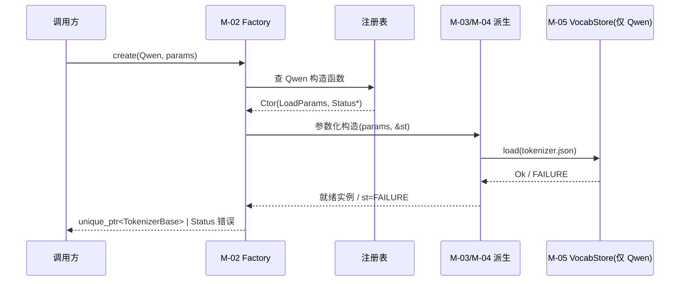
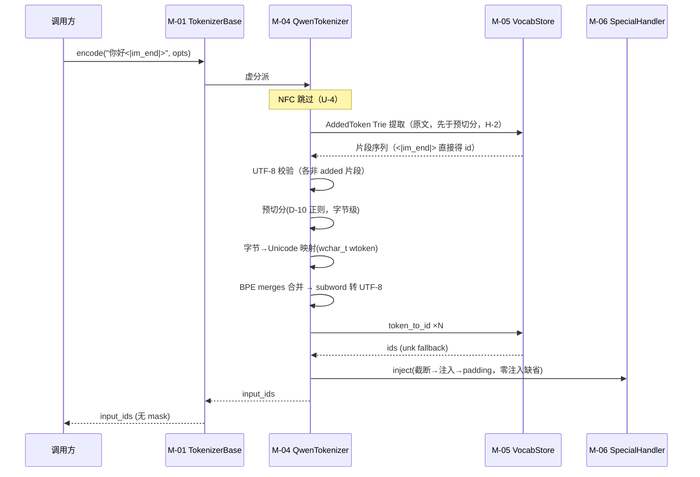
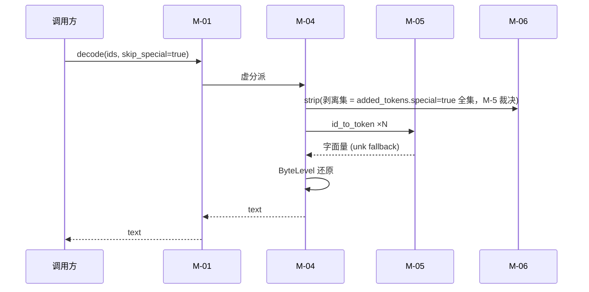
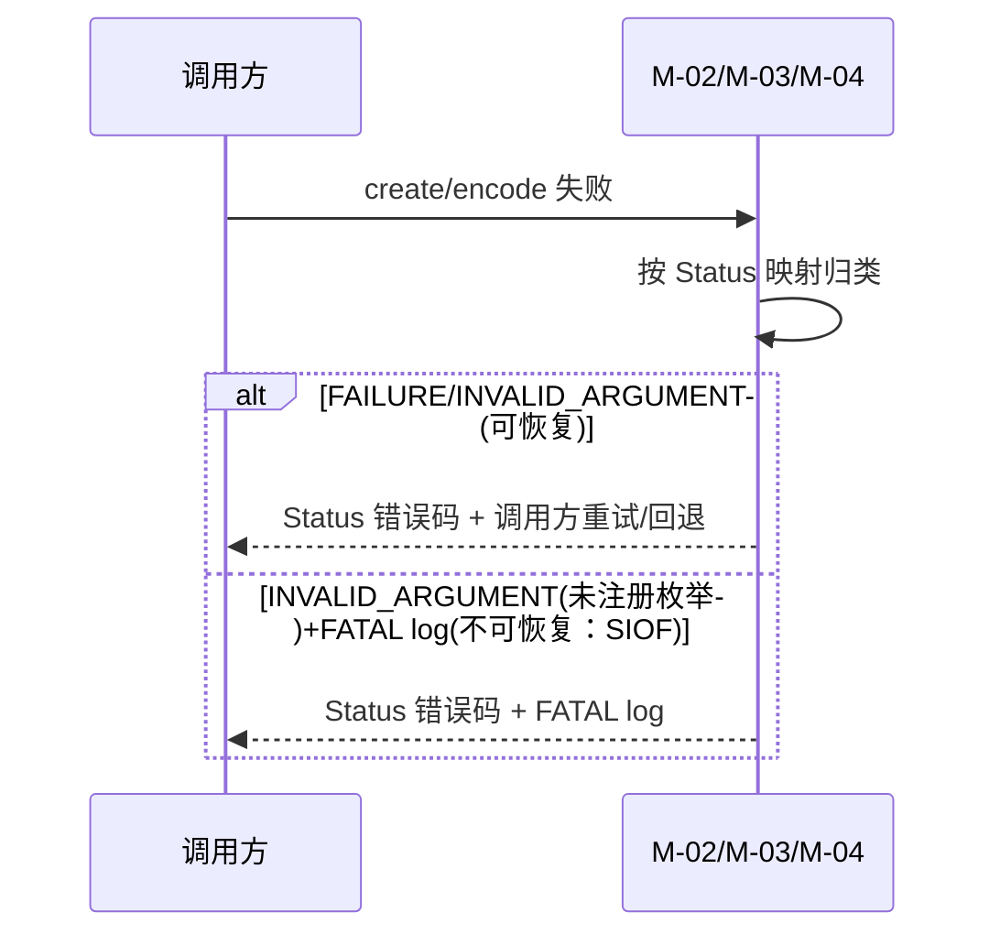
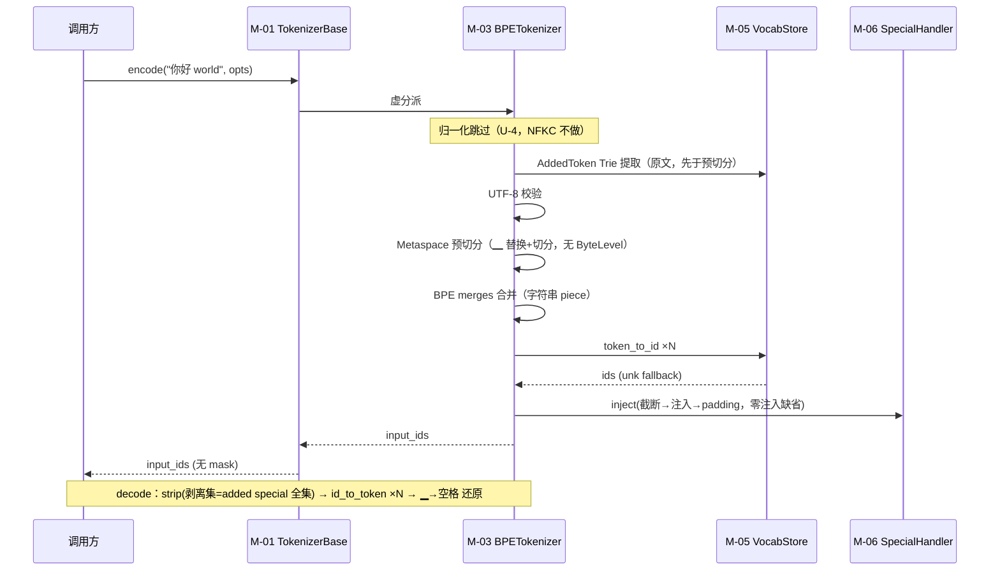

<!--
AUTO-GENERATED by sdd_design/scripts/render_design.py
Source of truth: overview.md + sibling files in this directory.
DO NOT edit this file by hand — re-run the render script.
-->

<a id="模块"></a>
# Tokenizer 模块 Design

简体中文 | [English](../../../en/cann_lm_engine/tokenizer/DESIGN.md)

## 目录

- [Spec 摘要](#spec-摘要)
- [§1 范围与目标](#1-范围与目标)
- [§2 架构总览](#2-架构总览)
  - [§2.1 架构风格与哲学](#21-架构风格与哲学)
  - [§2.2 运行时架构](#22-运行时架构)
  - [§2.3 部署与硬件映射](#23-部署与硬件映射)
  - [§2.4 并发与线程安全](#24-并发与线程安全)
- [§3 模块清单](#3-模块清单)
- [§4 契约清单](#4-契约清单)
- [§5 关键流程清单](#5-关键流程清单)
- [§6 质量属性与跨切面策略](#6-质量属性与跨切面策略)
- [§7 决策索引](#7-决策索引)
- [§8 Code Plan Hints](#8-code-plan-hints)
- [§9 风险与未决项](#9-风险与未决项)
- [§10 变更日志](#10-变更日志)
- [模块](#模块)
  - [M-01-tokenizer-base](#m-01-tokenizer-base)
    - [§1 职责](#1-职责)
    - [§2 对外接口](#2-对外接口)
    - [§3 内部结构](#3-内部结构)
    - [§4 关键依赖与硬件契约](#4-关键依赖与硬件契约)
    - [§5 性能预算](#5-性能预算)
    - [§6 失效模式](#6-失效模式)
    - [§7 可观测点](#7-可观测点)
    - [§8 测试钩子](#8-测试钩子)
  - [M-02-tokenizer-factory](#m-02-tokenizer-factory)
    - [§1 职责](#1-职责)
    - [§2 对外接口](#2-对外接口)
    - [§3 内部结构](#3-内部结构)
    - [§4 关键依赖与硬件契约](#4-关键依赖与硬件契约)
    - [§5 性能预算](#5-性能预算)
    - [§6 失效模式](#6-失效模式)
    - [§7 可观测点](#7-可观测点)
    - [§8 测试钩子](#8-测试钩子)
  - [M-03-bpe-tokenizer](#m-03-bpe-tokenizer)
    - [§1 职责](#1-职责)
    - [§2 对外接口](#2-对外接口)
    - [§3 内部结构](#3-内部结构)
    - [§4 关键依赖与硬件契约](#4-关键依赖与硬件契约)
    - [§5 性能预算](#5-性能预算)
    - [§6 失效模式](#6-失效模式)
    - [§7 可观测点](#7-可观测点)
    - [§8 测试钩子](#8-测试钩子)
  - [M-04-qwen-tokenizer](#m-04-qwen-tokenizer)
    - [§1 职责](#1-职责)
    - [§2 对外接口](#2-对外接口)
    - [§3 内部结构](#3-内部结构)
    - [§4 关键依赖与硬件契约](#4-关键依赖与硬件契约)
    - [§5 性能预算](#5-性能预算)
    - [§6 失效模式](#6-失效模式)
    - [§7 可观测点](#7-可观测点)
    - [§8 测试钩子](#8-测试钩子)
  - [M-05-vocab-store](#m-05-vocab-store)
    - [§1 职责](#1-职责)
    - [§2 对外接口](#2-对外接口)
    - [§3 内部结构](#3-内部结构)
    - [§4 关键依赖与硬件契约](#4-关键依赖与硬件契约)
    - [§5 性能预算](#5-性能预算)
    - [§6 失效模式](#6-失效模式)
    - [§7 可观测点](#7-可观测点)
    - [§8 测试钩子](#8-测试钩子)
  - [M-06-special-token-handler](#m-06-special-token-handler)
    - [§1 职责](#1-职责)
    - [§2 对外接口](#2-对外接口)
    - [§3 内部结构](#3-内部结构)
    - [§4 关键依赖与硬件契约](#4-关键依赖与硬件契约)
    - [§5 性能预算](#5-性能预算)
    - [§6 失效模式](#6-失效模式)
    - [§7 可观测点](#7-可观测点)
    - [§8 测试钩子](#8-测试钩子)
  - [M-07-spm-tokenizer](#m-07-spm-tokenizer)
    - [§1 职责](#1-职责)
    - [§2 对外接口](#2-对外接口)
    - [§3 内部结构](#3-内部结构)
    - [§4 关键依赖与硬件契约](#4-关键依赖与硬件契约)
    - [§5 性能预算](#5-性能预算)
    - [§6 失效模式](#6-失效模式)
    - [§7 可观测点](#7-可观测点)
    - [§8 测试钩子](#8-测试钩子)
- [契约](#契约)
  - [C-01-base-caller](#c-01-base-caller)
    - [§1 契约一句话](#1-契约一句话)
    - [§2 数据 schema](#2-数据-schema)
    - [§3 时序与同步语义](#3-时序与同步语义)
    - [§4 错误契约（Status 映射见 M-01 §2 唯一权威表）](#4-错误契约status-映射见-m-01-2-唯一权威表)
    - [§5 版本演进规则](#5-版本演进规则)
  - [C-02-factory-caller](#c-02-factory-caller)
    - [§1 契约一句话](#1-契约一句话)
    - [§2 数据 schema](#2-数据-schema)
    - [§3 时序与同步语义](#3-时序与同步语义)
    - [§4 错误契约（Status 映射见 M-01 §2 唯一权威表）](#4-错误契约status-映射见-m-01-2-唯一权威表)
    - [§5 版本演进规则](#5-版本演进规则)
  - [C-03-vocab-qwen](#c-03-vocab-qwen)
    - [§1 契约一句话](#1-契约一句话)
    - [§2 数据 schema](#2-数据-schema)
    - [§3 时序与同步语义](#3-时序与同步语义)
    - [§4 错误契约（Status 映射见 M-01 §2 唯一权威表）](#4-错误契约status-映射见-m-01-2-唯一权威表)
    - [§5 版本演进规则](#5-版本演进规则)
  - [C-04-special-derived](#c-04-special-derived)
    - [§1 契约一句话](#1-契约一句话)
    - [§2 数据 schema](#2-数据-schema)
    - [§3 时序与同步语义](#3-时序与同步语义)
    - [§4 错误契约（Status 映射见 M-01 §2 唯一权威表）](#4-错误契约status-映射见-m-01-2-唯一权威表)
    - [§5 版本演进规则](#5-版本演进规则)
  - [C-05-registration](#c-05-registration)
    - [§1 契约一句话](#1-契约一句话)
    - [§2 数据 schema](#2-数据-schema)
    - [§3 时序与同步语义](#3-时序与同步语义)
    - [§4 错误契约](#4-错误契约)
    - [§5 版本演进规则](#5-版本演进规则)
- [流程](#流程)
  - [F-01-factory-create-load](#f-01-factory-create-load)
    - [§1 触发与前置条件](#1-触发与前置条件)
    - [§2 时序图](#2-时序图)
    - [§3 关键路径预算](#3-关键路径预算)
    - [§4 异常分支](#4-异常分支)
    - [§5 与其他流程的交互](#5-与其他流程的交互)
  - [F-02-qwen-encode](#f-02-qwen-encode)
    - [§1 触发与前置条件](#1-触发与前置条件)
    - [§2 时序图](#2-时序图)
    - [§3 关键路径预算](#3-关键路径预算)
    - [§4 异常分支](#4-异常分支)
    - [§5 与其他流程的交互](#5-与其他流程的交互)
  - [F-03-qwen-decode](#f-03-qwen-decode)
    - [§1 触发与前置条件](#1-触发与前置条件)
    - [§2 时序图](#2-时序图)
    - [§3 关键路径预算](#3-关键路径预算)
    - [§4 异常分支](#4-异常分支)
    - [§5 与其他流程的交互](#5-与其他流程的交互)
  - [F-04-error-recovery](#f-04-error-recovery)
    - [§1 触发与前置条件](#1-触发与前置条件)
    - [§2 时序图](#2-时序图)
    - [§3 关键路径预算](#3-关键路径预算)
    - [§4 异常分支](#4-异常分支)
    - [§5 与其他流程的交互](#5-与其他流程的交互)
  - [F-05-bpe-encode-decode](#f-05-bpe-encode-decode)
    - [§1 触发与前置条件](#1-触发与前置条件)
    - [§2 时序图](#2-时序图)
    - [§3 关键路径预算](#3-关键路径预算)
    - [§4 异常分支](#4-异常分支)
    - [§5 与其他流程的交互](#5-与其他流程的交互)
- [性能与质量](#性能与质量)
  - [concurrency](#concurrency)
    - [§1 线程模型](#1-线程模型)
    - [§2 锁策略](#2-锁策略)
    - [§3 死锁预防](#3-死锁预防)
    - [§4 并发场景清单](#4-并发场景清单)
  - [dfx](#dfx)
    - [§1 异常分类（Status 映射见 M-01 §2 唯一权威表）](#1-异常分类status-映射见-m-01-2-唯一权威表)
    - [§2 熔断](#2-熔断)
    - [§3 监控](#3-监控)
    - [§4 日志](#4-日志)
    - [§5 可调试性](#5-可调试性)
  - [performance](#performance)
    - [§1 性能目标](#1-性能目标)
    - [§2 预算分解（canonical，与各模块 §5 一致）](#2-预算分解canonical与各模块-5-一致)
    - [§3 优化策略清单（阶段 3→4 细化）](#3-优化策略清单阶段-34-细化)
    - [§4 实测计划](#4-实测计划)
    - [§5 退化路径](#5-退化路径)
  - [security](#security)
    - [§1 威胁模型](#1-威胁模型)
    - [§2 认证与授权](#2-认证与授权)
    - [§3 数据保护](#3-数据保护)
    - [§4 已知未覆盖项](#4-已知未覆盖项)
- [新增决策](#新增决策)
  - [D-01-architecture](#d-01-architecture)
    - [§1 背景](#1-背景)
    - [§2 选项](#2-选项)
    - [§3 决策](#3-决策)
    - [§4 后果](#4-后果)
    - [§5 复审触发](#5-复审触发)
  - [D-02-self-registration](#d-02-self-registration)
    - [§1 背景](#1-背景)
    - [§2 选项](#2-选项)
    - [§3 决策](#3-决策)
    - [§4 后果](#4-后果)
    - [§5 复审触发](#5-复审触发)
  - [D-03-impl-strategy](#d-03-impl-strategy)
    - [§1 背景](#1-背景)
    - [§2 选项](#2-选项)
    - [§3 决策](#3-决策)
    - [§4 后果](#4-后果)
    - [§5 复审触发](#5-复审触发)
  - [D-04-unigram-scope](#d-04-unigram-scope)
    - [§1 背景](#1-背景)
    - [§2 选项](#2-选项)
    - [§3 决策](#3-决策)
    - [§4 后果](#4-后果)
    - [§5 复审触发](#5-复审触发)
  - [D-05-query-structure](#d-05-query-structure)
    - [§1 背景](#1-背景)
    - [§2 选项](#2-选项)
    - [§3 决策](#3-决策)
    - [§4 后果](#4-后果)
    - [§5 复审触发](#5-复审触发)
  - [D-06-byte-cache](#d-06-byte-cache)
    - [§1 背景](#1-背景)
    - [§2 选项](#2-选项)
    - [§3 决策](#3-决策)
    - [§4 后果](#4-后果)
    - [§5 复审触发](#5-复审触发)
  - [D-07-nfc-impl](#d-07-nfc-impl)
    - [§1 背景](#1-背景)
    - [§2 选项](#2-选项)
    - [§3 决策](#3-决策)
    - [§4 后果](#4-后果)
    - [§5 复审触发](#5-复审触发)
  - [D-08-cpp17-no-span](#d-08-cpp17-no-span)
    - [§1 背景](#1-背景)
    - [§2 选项](#2-选项)
    - [§3 决策](#3-决策)
    - [§4 后果](#4-后果)
    - [§5 复审触发](#5-复审触发)
  - [D-09-json-parser](#d-09-json-parser)
    - [§1 背景](#1-背景)
    - [§2 选项](#2-选项)
    - [§3 决策](#3-决策)
    - [§4 后果](#4-后果)
    - [§5 复审触发](#5-复审触发)
  - [D-10-pretok-regex](#d-10-pretok-regex)
    - [§1 背景](#1-背景)
    - [§2 选项](#2-选项)
    - [§3 决策](#3-决策)
    - [§4 后果](#4-后果)
    - [§5 复审触发](#5-复审触发)

---

<a id="spec-摘要"></a>
## Spec 摘要

- Spec ID：`SR20260728001`
- 上游 spec：`../SPEC/tokenizer.md`
- 基线 仓级：`null`
- 覆盖 REQ：[REQ-01, REQ-02, REQ-03, REQ-04, REQ-05, REQ-06, REQ-07, REQ-08, REQ-09]
- 覆盖 SCN：[SCN-01, SCN-02]

---

```yaml
spec_source: ../SPEC/tokenizer.md
level: spec
spec_id: SR20260728001
baseline_project_design: null   # 首个 spec，无仓级 baseline
delta_summary: v0.7 需求变更——BPETokenizer 改手写（tokenizer.json，服务 gemma4）；sentencepiece 依赖路径更名 SPMTokenizer 并占位（注册桩，本期不实现）；QwenTokenizer 不变；本期运行时零第三方依赖（除 D-09 JSON 单头）
covers_req: [REQ-01, REQ-02, REQ-03, REQ-04, REQ-05, REQ-06, REQ-07, REQ-08, REQ-09]
covers_scn: [SCN-01, SCN-02]
status: draft
```

# Tokenizer 模块 Design

> **REQ 映射**（spec §4.1.x → REQ-NN）：REQ-01=词表加载(§4.1.1) · REQ-02=文本编码(§4.1.2) · REQ-03=ID 解码(§4.1.3) · REQ-04=attention mask 职责边界(§4.1.4) · REQ-05=批量编码(§4.1.5) · REQ-06=工厂创建(§4.1.6) · REQ-07=派生自注册(§4.1.7) · REQ-08=内部模块边界(§4.1.8) · REQ-09=错误分类(§4.1.9)。
> **SCN 映射**：SCN-01=§4.3 工厂创建→encode→decode 时序 · SCN-02=§8 一致性 oracle 校验场景集（TC_001..305）。

<a id="1-范围与目标"></a>
## §1 范围与目标

- **in scope**：`cann_lm/engine/core/component/tokenizer` 下 C++ tokenizer 抽象层——薄基类 TokenizerBase + 工厂 + 参数化自注册 + **BPETokenizer（手写 BPE，词表 HF tokenizer.json，服务 gemma4，完整）** + **QwenTokenizer（手写 ByteLevel BPE，词表 tokenizer.json，服务 Qwen3.5，完整）** + **SPMTokenizer（sentencepiece 依赖，占位桩）** + 共享 VocabStore/SpecialTokenHandler。内部模块，不对 Python 暴露；不产 attention mask；本期运行时第三方依赖仅 D-09 JSON 单头（无 sentencepiece/ICU）。
- **out of scope**（含理由）：
  - pybind11 对外暴露——spec §4.1.8 明确为内部模块边界，外层职责。
  - attention mask 生成——spec §4.1.4 明确不在本模块，由调用方构造。
  - NFC 归一化——用户决议 v0.5 跳过（U-4/D-07），非 NFC 输入与 oracle 允许分叉，有需求再实现。
  - SPMTokenizer 实现（sentencepiece 库路径）——用户决议 v0.7 仅占位（注册桩、create 恒 FAILURE），实现期再引入库依赖（D-03/D-04，U-5 推迟）。
  - 动态库热卸载支持——spec §6 已声明不支持。
- **目标优先级**：行为一致性(TC_203) > 扩展性(开闭) > 编码吞吐 > 内存占用。一致性优先保证迁移校验可信；扩展性保证新算法零侵入。

<a id="2-架构总览"></a>
## §2 架构总览

<a id="21-架构风格与哲学"></a>
### §2.1 架构风格与哲学

```mermaid
graph TD
  CALL[engine 内部 C++ 调用方] -->|create| FAC[M-02 tokenizer-factory]
  FAC -->|create(enum,params)| REG[(注册表)]
  REG -.构造.-> BPE[M-03 BPETokenizer<br/>手写 BPE · gemma4]
  REG -.构造.-> QW[M-04 QwenTokenizer<br/>手写 ByteLevel BPE · Qwen3.5]
  REG -.构造.-> SPM[M-07 SPMTokenizer<br/>占位桩 · sentencepiece]
  BPE -->|inherit| BASE[M-01 tokenizer-base<br/>TokenizerBase 纯虚]
  QW -->|inherit| BASE
  SPM -->|inherit| BASE
  BPE -.组合.-> VS[M-05 vocab-store<br/>tokenizer.json]
  QW -.组合.-> VS
  BPE -.组合.-> ST[M-06 special-token-handler]
  QW -.组合.-> ST
  CALL -->|encode/decode| BASE
```

风格声明（≤100 字）：**薄基类 + 三路派生（BPE/Qwen 手写 tokenizer.json，SPM 占位桩）+ 共享 infra 组合**。基类只定稳定行为契约（纯虚 encode/decode + 选项 + 项目 Status 错误映射），BPE/Qwen 各自实现完整流水线，VocabStore/SpecialTokenHandler 独立可组合，工厂静态自注册按枚举分派。

<a id="22-运行时架构"></a>
### §2.2 运行时架构

- 进程/线程模型：engine 进程内，tokenizer 实例为同线程同步调用对象；无独立线程、无事件循环。
- 通信机制表：

| 调用方 | 被调方 | 通信方式 | 同步/异步 | 备注 |
|--------|--------|----------|-----------|------|
| engine 调用方 | M-02 factory | 函数调用 | sync | create/list_registered |
| M-02 factory | M-03/M-04/M-07 | 函数调用（经注册表，参数化 Ctor） | sync | 构造派生 + 构造内加载词表（M-07 占位恒失败） |
| engine 调用方 | M-01 base(虚) | 函数调用 | sync | encode/decode 多态分派 |
| M-04 | M-05 vocab-store | 组合持有 | sync | id↔token 查询、merges、special 导出 |
| M-03/M-04 | M-06 special-token-handler | 组合持有 | sync | special 注入/剥离 |


- 同步点：无跨处理器域；纯 CPU，无 CPU↔NPU 同步开销。

<a id="23-部署与硬件映射"></a>
### §2.3 部署与硬件映射

| 模块 | 处理器 | 备注 |
|------|--------|------|
| M-01..M-07 + vendored json（本期无 sentencepiece） | CPU | aarch64（Ascend 宿主）+ OHOS musl 交叉目标，纯 CPU计算 |
| 内存域 | DDR 共享 | 词表常驻进程堆，无 NPU 专用内存池 |
| 功耗域 | 无独立休眠 | 同步调用，调用结束即释放栈 |

<a id="24-并发与线程安全"></a>
### §2.4 并发与线程安全

- 锁策略：注册表读多写少（静态初始化期写，运行时只读）→ std::call_once 保护；实例 encode/decode 只读 vocab → 无锁并发（vocab 加载后只读）。
- 共享资源：工厂注册表（静态）、VocabStore 映射表（实例内，加载后只读）。
- 死锁预防：无跨实例锁；注册表锁不与实例锁嵌套。
- 结构性并发保证（spec §4.1.9）：加载完成后才发布实例，写读并发窗口结构性消除（nfr/concurrency）。

<a id="3-模块清单"></a>
## §3 模块清单

| ID | 名称 | 一句话职责 | 依赖 | 详情 |
|----|------|-----------|------|------|
| M-01 | tokenizer-base | TokenizerBase 纯虚接口 + Algorithm 枚举（BPE/Qwen/SPM）+ 选项/SpecialTokenConfig + 错误映射表 + mask/内部边界声明 | — | → |
| M-02 | tokenizer-factory | 工厂 create/list_registered + 静态自注册 Registrar（参数化 Ctor）+ SIOF/链接丢弃防护 | M-01 | → |
| M-03 | bpe-tokenizer | BPETokenizer 派生：手写 BPE（AddedToken 提取→Metaspace 预切分→merges→id），词表 tokenizer.json，服务 gemma4 | M-01,M-05,M-06 | → |
| M-04 | qwen-tokenizer | QwenTokenizer 派生：手写预切分(D-10 正则+ByteLevel)→BPE merges→id 映射→ByteLevel 解码（NFC 跳过） | M-01,M-05,M-06 | → |
| M-05 | vocab-store | tokenizer.json 解析 + id↔token 双向映射 + merges 表 + added_tokens/剥离集导出 | M-01 | → |
| M-06 | special-token-handler | bos/eos/pad/unk 管理 + encode 注入 / decode 剥离（剥离集=added special 全集）+ padding 对齐 | M-01 | → |
| M-07 | spm-tokenizer | SPMTokenizer 占位桩：sentencepiece 库路径预留，注册但 create 恒 FAILURE | M-01 | → |

依赖图无环校验：M-01 ← {M-02, M-05, M-06} ← {M-03, M-04}；M-01 ← M-07 ✓

<a id="4-契约清单"></a>
<a id="契约"></a>
## §4 契约清单

> `engine-caller` 为 engine 内部 C++ 调用方（外部参与者，非本设计模块），与 REQ-08 内部边界一致。

| ID | 生产者 | 消费者 | 一句话契约 | 详情 |
|----|--------|--------|-----------|------|
| C-01 | M-01 | engine-caller | TokenizerBase 多态接口，不返回 mask | → |
| C-02 | M-02 | engine-caller | create/list_registered | → |
| C-03 | M-05 | M-03, M-04 | tokenizer.json 加载与双向查询 | → |
| C-04 | M-06 | M-03, M-04 | special 注入/剥离 | → |
| C-05 | M-03, M-04, M-07 | M-02 | 静态自注册（参数化 Ctor；M-07 占位桩同样注册） | → |

<a id="5-关键流程清单"></a>
<a id="流程"></a>
## §5 关键流程清单
| ID | 场景 | 关键路径 | 详情 |
|----|------|---------|------|
| F-01 | 工厂创建+加载 | 调用方→M-02→M-04→M-05 | → |
| F-02 | Qwen encode | 调用方→M-01→M-04→M-05/M-06 | → |
| F-03 | Qwen decode | 调用方→M-01→M-04→M-05/M-06 | → |
| F-04 | 错误恢复 | 调用方→M-02/M-03/M-04 分类 | → |
| F-05 | BPE encode/decode（gemma4） | 调用方→M-01→M-03→M-05/M-06 | → |

<a id="6-质量属性与跨切面策略"></a>
## §6 质量属性与跨切面策略
| 维度 | 核心策略 | 详情 |
|------|---------|------|
| 性能 | encode ≤200μs/1KiB, ≥10⁶ tok/s（U-1 待实测） | → |
| 安全 | 输入校验 + 无外部暴露面 | → |
| DFX | L1/L2/L3 分级 + 一致性熔断 | → |
| 并发 | 注册表 call_once + 只读查询无锁 + 结构性保证 | → |
| 错误传播 | 统一项目 Status + M-01 §2 映射表，非静默 | §4.1.9 + F-04 |
| 数据一致性 | 加载后只读，无跨域 | §2.3 |

<a id="7-决策索引"></a>
## §7 决策索引
| ID | 主题 | 状态 |
|----|------|------|
| D-01 | 架构选薄基类+组合 | accepted |
| D-02 | 静态自注册+Registrar+SIOF防护 | accepted |
| D-03 | BPE/Qwen 手写（tokenizer.json）+ SPM 占位 + 测试期 oracle | accepted（v0.7 修订） |
| D-04 | SPM 占位桩（注册但 not-ready）取代 Unigram 空槽 | accepted（v0.7 修订） |
| D-05 | id↔token 查询用 unordered_map | accepted |
| D-06 | ByteLevel byte→token 缓存 | accepted（related M-04） |
| D-07 | NFC 归一化：本期跳过，有需求再实现 | accepted（v0.5 修订原"借 ICU 子集"） |
| D-08 | C++17 约束下放弃 std::span（改用 vector） | accepted |
| D-09 | tokenizer.json 解析依赖：vendored nlohmann/json 单头 | accepted（v0.6） |
| D-10 | 预切分正则：std::regex 字节级 + POSIX 类 + [a-zA-Z]ü 分支（含豁免登记） | accepted（用户拍板，v0.6） |

<a id="8-code-plan-hints"></a>
## §8 Code Plan Hints
**给下游 plan/impl agent**：
- 实现顺序（依赖拓扑）：M-01 base → M-05 vocab-store + M-06 special-handler（可并行）→ M-02 factory → M-04 qwen-tokenizer → M-03 bpe-tokenizer（手写 Metaspace/BPE）→ M-07 spm 占位桩。
- **源码落点（L-1 统一）**：平铺 `cann_lm/engine/core/component/tokenizer.{h,cpp}` 保持既有 include 路径不变（3 个消费方 include 与既有 UT 不动）；实现文件可拆 `bpe_tokenizer.cpp`/`qwen_tokenizer.cpp`/`vocab_store.cpp`/`special_token_handler.cpp`，但 **REGISTER_TOKENIZER 注册宏调用必须与 `TokenizerFactory::create` 同在 tokenizer.cpp**（链接丢弃约束）。
- **链接丢弃约束（外审 M2）**：注册宏与 create 同 TU（tokenizer.cpp），或对含注册宏的目标采用 whole-archive——防止静态库中未被引用的注册对象被链接器丢弃。
- **既有代码迁移清单（外审 M3 + M-2）**：
  1. `api/cpp/engine_executor.cpp:63/75`：`std::make_unique<BpeTokenizer>()` 两处——改为 `std::make_unique<BPETokenizer>(LoadParams{}, nullptr)`（空参数构造，加载失败即 not-ready，encode 返回 FAILURE 保持 stub 时代行为）。
  2. `tests/cpp/engine/test_tokenizer.cpp`：①`BpeTokenizer tok;` 默认构造改 `BPETokenizer tok{LoadParams{}, nullptr};`；②`CreateBPEReturnsInvalidArgumentStubEra` 拆为"create(BPE, 空参数)→FAILURE（加载失败）"+"create(未注册枚举)→INVALID_ARGUMENT"两用例；③`ListRegisteredReturnsBPEAndSP` 改断言 {BPE, Qwen, SPM}（3 个）；④`ContinueOnFailureNotAbort` 保留（not-ready 实例 encode 失败语义不变）。
  3. **`tests/cpp/engine/test_scheduler.cpp:16`：`BpeTokenizer tok;` 默认构造改 `BPETokenizer tok{LoadParams{}, nullptr};`**（参数化 Ctor 抑制隐式默认构造，不改则 ut_scheduler 编译断裂——外审 M-2）。
  4. `core/component/tokenizer/tokenizer.h` 桩：LoadParams 改单一 artifact 槽（variant 路径|字节）+ optional special_tokens（零注入缺省）；Algorithm 改 {BPE, Qwen, SPM}（删 SentencePieceUnigram）；`BpeTokenizer` 类更名为 **`BPETokenizer`**（手写）；新增 `QwenTokenizer`；`SentencePieceTokenizer` 桩更名为 **`SPMTokenizer`**（占位，注册）。
- **测试策略（M-8，A+B 分层，v0.6 用户拍板）**：
  - **A（默认 UT）**：脚本裁剪生成小型 tokenizer.json + 预生成 golden ids JSON 入库；各阶段（AddedToken 提取/预切分正则各分支（D-10 实测锚点样例）/字节→Unicode 映射/BPE 合并/special 注入剥离）精确断言；运行时零 Python 依赖。
  - **B（`tokenizer_realdata` 目标）**：CMake 注册、**检测 `tmp/qwen/tokenizer.json` 与 `tmp/gemma/tokenizer.json`（本地放置，gitignore）存在才编译/运行**；真实规模（Qwen 248044+26 词）一致性 + TC_205b 内存实测；golden ids 由 Python oracle 预生成（脚本入 `scripts/`）；**gemma4 tokenizer.json 待放置**（`tmp/gemma/` 当前为空，BPE 路径 B 层测试阻塞；落地后须校验 model.type==BPE，若为 Unigram 型回议 M-03 路线）。
- **构建接入（v0.7 简化）**：本期**无 sentencepiece**（SPM 为占位，U-5 推迟至其实现期：源码构建 + 版本 pin + OHOS musl 交叉 + protobuf 处置届时闭合）；仅 `third_party/nlohmann/json.hpp` vendor 入库（D-09）。CMake target 注册于 `cann_lm/engine/CMakeLists.txt` + `ohos/CMakeLists.txt`（过渡期复制源码清单同步）。
- 集成里程碑：①M-01+M-02+M-05+M-06+M-07 占位编译过 + factory create 用例（含 SPM 占位 FAILURE）+ 迁移清单落地；②M-04 Qwen 全流水线（含 AddedToken 提取）+ A 层 TC_203 一致 + B 层真实产物一致；③M-03 BPETokenizer 手写全流水线 + A 层 fixture 一致（B 层待 gemma4 实物）。
- 模块最小读取集：M-01 → M-01.md + C-01；M-02 → M-02.md + C-02 + C-05；M-03 → M-03.md + C-03 + C-04 + F-05 + D-03；M-04 → M-04.md + C-03 + C-04 + F-02 + F-03 + **D-10**；M-05 → M-05.md + C-03 + D-09 + nfr/performance.md §2；M-07 → M-07.md + D-04。

<a id="9-风险与未决项"></a>
## §9 风险与未决项
| 风险/未决 | 影响 | 缓解 | 触发条件 |
|-----------|------|------|----------|
| U-5 sentencepiece 构建接入（**推迟**至 SPM 实现期；本机未装、OHOS musl 需交叉、protobuf 处置、SHARED 库 PIC） | 届时 M-07 编译/链接断裂 | 届时源码子构建 + 版本 pin + pimpl 隔离（本期无此依赖） | SPM 实现需求出现 |
| U-1 性能预算无基线 | encode 预算失准 | 实现期微基准校准 | aarch64 实测 |
| U-3 内存系数 | **实测基线（2026-09-01）**：Qwen 91MB/248070 词（≈0.38KB/词）、gemma 48MB/262144 词（≈0.19KB/词） | unordered_map 已按预算内；退化用 arena 驻留池 | 超 coef 时 |
| U-4 已知豁免分叉（NFC 跳过 + D-10 正则差异） | 混排/ü 开头词/大写缩写/非 ASCII 空白/非 NFC 输入与 oracle 分叉 | golden 语料排除该类输入；豁免登记（D-10 §4 清单） | 产品语料大量落入豁免类（D-07/D-10 §5 复审） |
| 静态库注册对象链接丢弃 | 运行期注册表空 | 注册宏与 create 同 TU / whole-archive（§8 约束） | 模块拆分/链接器行为差异 |
| 🔴 M-04 CJK 子词多 | encode 超 200μs | merges 前缀树/双数组（退化路径） | CJK 语料实测 |
| D-09 JSON 解析性能 | 12.8MB tokenizer.json 加载延迟 | nlohmann SAX 流式；回退 rapidjson（D-09 §5） | 加载实测 |
| gemma4 tokenizer.json 产物缺位（tmp/gemma/ 空）且 **model.type 未校验**（若为 Unigram 型则 BPETokenizer 路线不成立，需回议） | BPE 路径 B 层测试与 TC_001b/205 阻塞；M-03 可能返工 | 待用户放置产物并校验 model.type==BPE；A 层小型 fixture 先行 | 实现期实物落地 |
| 一致性分叉 | TC_203 失败 | A+B 双层 oracle 全量比对（golden 预生成） | 黄金语料 |

<a id="10-变更日志"></a>
## §10 变更日志
| 版本 | 日期 | 变更 | 触发 spec 章节 |
|------|------|------|---------------|
| 0.1 | 2026-07-28 | 初稿（Gate1-2 通过，阶段2→3+3→4 填充） | SR20260728001 全 |
| 0.2 | 2026-07-28 | U-2 校验（Gemma=SentencePiece，参考 gemma_pytorch）；更新 D-04/M-04/§9 | SR20260728001 §4.1.1 |
| 0.3 | 2026-07-28 | D-08：std::span→C++17 替代，消除 C++20 依赖 | SR20260728001 §6 |
| 0.4 | 2026-08-19 | 源头约束修订（联动 pipeline v0.4）：①错误归一到项目 Status（去 TokenizerError）；②ITokenizer→TokenizerBase；③LoadParams 内存内容形式；④路径 core/tokenizer→core/component/tokenizer。（注：v0.4 当时只改了渲染产物未回写源文件，v0.5 回写补齐） | 约束 #1/#2 + 联动 pipeline v0.4 |
| 0.5 | 2026-08-31 | **需求变更回退设计阶段**（用户决议）：①实现目标改为 BPETokenizer（链接 Google SentencePiece 库 + .model，D-03/D-04 修订）与 QwenTokenizer（手写 ByteLevel BPE + tokenizer.json，M-04 重写）；②Unigram 留枚举空槽无实现（D-04）；③NFC 跳过、U-4 豁免登记（D-07 修订）；④LoadParams 恢复路径/内存双形式并收敛为单一 artifact 槽 + optional special_tokens（H1/H4 裁决）；⑤参数化 Ctor（H4）；⑥M-01 §2 错误类目→Status 唯一权威映射表（H2）；NotResponsible 删除（H3）；⑦外审 M1-M4/L1 落笔：并发条款结构性保证改写、链接丢弃约束、迁移清单、RegistrationConflict 无返回值订正；⑧新增 D-09（JSON 解析依赖）；⑨v0.4 修订回写源文件（H5） | SR20260728001 §3.3/§4.1.1/§4.1.2/§4.1.6/§4.1.9/§6/§8 |
| 0.6 | 2026-09-01 | **v0.5 delta 外审（3H/9M/7L，re-examiner 零误报）落笔**：①D-10 预切分正则决策（用户拍板 std::regex 字节级 + POSIX 类 + [a-zA-Z]ü 分支，aplha 笔误订正，实测锚点入档；混排/ü 开头/大写缩写/非 ASCII 空白入 U-4 豁免）；②M-04 增 AddedTokenSplitter（H-2：added_tokens 26 个先于预切分 Trie 提取）；③H-3 零注入缺省 + LoadParams 显式覆盖（实物 post_processor=ByteLevel 无注入核验）；④M-1 映射表两表对齐（6 行）；⑤M-2 迁移清单补 test_scheduler.cpp:16；⑥M-3 截断预算公式定稿；⑦M-4 special 角色不经产物推导（tokenizer_config 属模型配置域）；⑧M-5 剥离集=added_tokens.special 全集；⑨M-6 TC_205b 定义；⑩M-7 vocab_size 实物口径 248070（≠config 248320）；⑪M-8 A+B 分层测试（fixture 入库 + realdata 检测 tmp/ 存在才跑，golden 预生成）；⑫M-9 SP 注入权唯一性约束；⑬L-1 落点统一平铺+同 TU 拆分约束；⑭L-2/L-3/L-4/L-5/L-6/L-7 清理；⑮D-09 转 accepted | SR20260728001 §4.1.2/§4.1.3/§8 + 实物核验（tmp/qwen） |
| 0.7 | 2026-09-01 | **需求变更（用户决议）**：①原 sentencepiece 库路径更名 **SPMTokenizer**（M-07 新模块，注册占位桩——create 恒 FAILURE、encode not-ready，本期不实现，D-04 修订）；②**BPETokenizer**（M-03）改为不依赖 sentencepiece 的手写实现——词表 HF tokenizer.json（model.type=BPE 段），服务 gemma4，Metaspace 预切分/还原、无 ByteLevel（D-03 修订）；③Algorithm 枚举 {BPE, Qwen, SPM}（删 SentencePieceUnigram 空槽，D-04）；④sentencepiece/protobuf 依赖整体推迟至 SPM 实现期（U-5 改登记推迟）；⑤新增 F-05（BPE 编解码流程）；⑥C-03 消费者扩为 M-03+M-04、C-05 生产者扩为 M-03/M-04/M-07；⑦gemma4 测试产物改为 tokenizer.json 且 model.type==BPE 待实物校验（U-6） | SR20260728001 §4.1.1/§4.1.2/§4.1.6 |
| 0.8 | 2026-09-01 | **实现期 DOC-UPDATE**（实现完成：ctest 158/158 全绿，A 层 33 + B 层 3 新增）：①M-03 实物语义订正——gemma4 为 Replace(" "→"▁")+Split(MergedWithPrevious) 型（非 Metaspace、无 dummy ▁），已按文件配置实现；②M-05 增补 merges 双格式（"A B" 字符串 / ["A","B"] 数组）、added_tokens 内联（gemma）与追加（Qwen）双形态 overlay、token_to_id 的 C++17 透明哈希限制注记（U-1 优化项）；③D-10 豁免清单补充：ü 后跟字母（aüb）属豁免类，仅 ü 结尾词对齐（oracle 实测）；④U-3 实测基线落笔（Qwen 91MB/248070 词、gemma 48MB/262144 词、加载 1481/3307ms）；⑤迁移清单全部执行（engine_executor×2、ut_scheduler:16、ut_tokenizer 重写、tokenizer.h 桩改造、类更名 BPETokenizer/SPMTokenizer） | SR20260728001 全（实现核验） |
| 0.8.1 | 2026-09-01 | **代码外审（+2，reviewer，REWORK→修复）落笔**：F-01 id 上界校验（防 bad_alloc/int 截断）；F-02 load 局部构建成功才提交（失败实例恒 not-ready）；F-03 added overlay 语义收敛为覆写（M-05 §6 订正，与 HF 一致）；F-04 数组 merges 直出 pair；F-05 SAX kSkip 事件配对计数；F-06 路径形式流式解析；F-07 PretokRegex 钉死 classic locale；F-10 注入配置缺失 WARN；F-11 batch Longest 失败行不 padding；F-12/F-14 注释订正；F-09 补 4 条 UT（重复注册/OOV→unk×2/并发只读）——**ctest 162/162 全绿** | SR20260728001 §4.1.1/§4.1.9/§8 |


---

<a id="2-预算分解canonical与各模块-5-一致"></a>
## 模块

<a id="m-01-tokenizer-base"></a>
### M-01-tokenizer-base

<a id="1-职责"></a>
#### §1 职责

定义 tokenizer 抽象基类 TokenizerBase 的纯虚接口（encode→input_ids / decode→text / vocab_size / special_token_id / batch_encode 默认实现），声明 Algorithm 枚举（BPE/Qwen/SPM）、EncodeOptions/DecodeOptions、SpecialTokenConfig。错误归一（约束 #1 / v0.4）：不返回模块自有错误码，统一用项目 `Status`（infra/status.h），并在本模块给出 spec §4.1.9 错误类目 → Status 的**唯一权威映射表**。声明 attention mask 不在职责（REQ-04——以"不提供 mask 查询接口"为实现方式）与内部模块边界（REQ-08）。不实现任何算法流水线。

<a id="2-对外接口"></a>
#### §2 对外接口

```cpp
// 算法枚举（REQ-06）。v0.7：BPE=手写 BPE（tokenizer.json，gemma4）；
// Qwen=手写 ByteLevel BPE（tokenizer.json，Qwen3.5）；SPM=sentencepiece 依赖的
// 占位桩（注册但 not-ready，encode/decode 返回 FAILURE；将来接库时填充实现）。
enum class Algorithm { BPE, Qwen, SPM };

// 错误归一（约束 #1 / v0.4）：不返回模块自有错误码，统一用项目 Status
// （infra/status.h：SUCCESS=0, FAILURE=1, INVALID_ARGUMENT=2,
//  INVALID_STATE=3, NOT_FOUND=4, CANCELED=5）。
// spec §4.1.9 错误类目 → Status 唯一权威映射（v0.5 H2/H3 裁决，与 SPEC §4.1.9 表 1:1）：
// ┌───────────────────────┬─────────────────────┬────────────────────────────┐
// │ spec §4.1.9 类目       │ Status              │ 说明                        │
// ├───────────────────────┼─────────────────────┼────────────────────────────┤
// │ LoadFailed            │ FAILURE             │ 产物缺失/不可读/格式非法/不对齐 │
// │ UnsupportedAlgorithm  │ INVALID_ARGUMENT    │ 未知枚举/未注册（与桩一致）     │
// │ InvalidInput          │ INVALID_ARGUMENT    │ 非法 UTF-8/None/空 padding    │
// │ OutOfVocab            │ SUCCESS             │ 非失败——内部映射 unk          │
// │ ConcurrentViolation   │ INVALID_STATE       │ 结构性消除（见 nfr/concurrency）│
// │ RegistrationConflict  │ （无返回值）          │ 开发期 WARN 日志，不静默       │
// └───────────────────────┴─────────────────────┴────────────────────────────┘
// 注 1：NotResponsible 类目已删除（H3）——本模块不提供 mask 查询接口，
//       即为 REQ-04 职责边界的实现方式，无越权路径、无错误码可返回。
// 注 2：若未来出现"已注册但未实现"的派生能力，须经 SPEC §4.1.9 同步增类目后
//       才可扩展映射行（本期 SPM 为注册桩——create 因占位加载失败返回 FAILURE，
//       不新增错误类目；未注册枚举仍走 INVALID_ARGUMENT）。

// 编码选项（REQ-02）
struct EncodeOptions {
  bool add_special_tokens = true;
  std::optional<size_t> max_length;      // 截断
  enum class Padding { None, Longest, Fixed } padding = Padding::None;
  std::optional<size_t> pad_to_length;   // Padding::Fixed 时生效
};

// 解码选项（REQ-03）
struct DecodeOptions {
  bool skip_special_tokens = true;
};

// special token 配置（v0.5 新增，随 LoadParams 传入）。
// v0.6 口径（H-3 裁决 + tmp/qwen 实物核验）：**零注入缺省**——缺省 add_bos=false,
// add_eos=false（对齐 Qwen 实物：post_processor=ByteLevel 无注入、bos_token=null）。
// 引擎侧需要 eos 终止等语义时，经 LoadParams.special_tokens 显式提供
// （自 ModelConfig 组装，同 TextEmbedding EmbeddingConfig::FromModelConfig 模式）。
// decode 剥离集不走本结构——见 M-06（取产物 added_tokens.special=true 全集）。
struct SpecialTokenConfig {
  std::optional<int> bos_id, eos_id, pad_id, unk_id;
  bool add_bos = false, add_eos = false;  // 缺省零注入；显式配置时按配置注入
};

// 抽象基类（薄接口，REQ-02/03/04/05/08）
class TokenizerBase {
 public:
  virtual ~TokenizerBase() = default;
  // 语义: 同步、阻塞至返回；encode 不返回 attention mask（REQ-04）
  // 错误: INVALID_ARGUMENT(非法 UTF-8 或 out_ids==nullptr) | SUCCESS(OOV 内部映射 unk)
  virtual Status encode(std::string_view text,
                        const EncodeOptions& opts,
                        std::vector<int>* out_ids) = 0;
  // 语义: 同步；skip_special 时剥离控制 token
  // 错误: SUCCESS(OutOfVocab 跳过/替换 unk 字面量，不中断)
  virtual Status decode(const std::vector<int>& ids,
                        const DecodeOptions& opts,
                        std::string* out_text) = 0;
  virtual size_t vocab_size() const = 0;
  // 语义: 按名称返回 special id，未配置返回 nullopt
  virtual std::optional<int> special_token_id(std::string_view name) const = 0;
  // 默认实现: 循环单条 encode + padding 对齐（REQ-05）；单条失败标记不整批崩
  virtual Status batch_encode(const std::vector<std::string>& texts,
                              const EncodeOptions& opts,
                              std::vector<std::vector<int>>* out);
};
```

<a id="3-内部结构"></a>
#### §3 内部结构
- 纯接口，无子组件。batch_encode 为基类默认实现（可被派生覆盖）。
- 派生经参数化构造函数接收 LoadParams 并在构造内完成词表加载（H4 裁决，见 M-02/M-03/M-04），基类不设 load() 虚函数。

<a id="4-关键依赖与硬件契约"></a>
#### §4 关键依赖与硬件契约
- 无下层 HAL/SDK 依赖。纯 C++17 标准库（std::optional/std::variant/std::string_view/std::byte/std::vector）。不使用 std::span（C++20，超出 C++17 约束，见 D-08）。
- 无跨处理器同步点；无 DMA。
- 内部模块边界（REQ-08）：仅头文件对 engine 内部暴露，不导出跨语言绑定符号。
- 源码落点：`cann_lm/engine/core/component/tokenizer.{h,cpp}`（v0.4 路径修正，与既有桩一致）。

<a id="5-性能预算"></a>
#### §5 性能预算
| 路径 | 预算 | 测量条件 | 来源 |
|------|------|----------|------|
| batch_encode（默认）| N × 单条 encode | N 条文本 | estimated |
| virtual 分派开销 | 可忽略 | — | estimated |
（canonical 见 nfr/performance.md §2）

<a id="6-失效模式"></a>
#### §6 失效模式
| 失效 | 触发 | 检测 | 处理 |
|------|------|------|------|
| mask 越权查询 | （结构性不存在）| 接口无 mask 方法 | 无路径即 REQ-04 实现；文档声明，不设错误码（H3） |

<a id="7-可观测点"></a>
#### §7 可观测点
- log key: `tokenizer.encode.{ok|err}` / `tokenizer.decode.{ok|err}`
- metric: `tokenizer_encode_tokens_total` / `tokenizer_encode_errors_total{kind=...}`

<a id="8-测试钩子"></a>
#### §8 测试钩子
- UT 关注：encode/decode 虚分派、batch_encode 默认实现 padding 对齐、错误码传播（按 §2 映射表断言 Status 值）、out_ids==nullptr → INVALID_ARGUMENT、零注入缺省语义（add_special_tokens=true 且未配置时无注入）。
- 需 mock：派生桩（验证基类 batch_encode 默认路径）。

<a id="m-02-tokenizer-factory"></a>
### M-02-tokenizer-factory

#### §1 职责

提供 TokenizerFactory：create(enum, params) 按算法枚举经注册表构造派生实例并返回 `unique_ptr<TokenizerBase>`；list_registered() 枚举已注册算法。提供静态自注册 Registrar 机制（宏 REGISTER_TOKENIZER），派生于静态初始化期登记**参数化构造函数**进单例注册表（本期注册集 = {BPE, Qwen, SPM 桩}），首次 create 断言注册表非空以防 SIOF 静默失败。

#### §2 对外接口

```cpp
// 加载参数（REQ-01，文件路径或内存内容二选一，v0.5 单一产物槽）
// 产物种类随算法而定（v0.7）：Algorithm::BPE / Algorithm::Qwen → HF tokenizer.json；
// Algorithm::SPM → sentencepiece .model（占位，加载恒失败）。
struct LoadParams {
  std::variant<std::filesystem::path, std::vector<std::byte>> artifact;
  std::optional<SpecialTokenConfig> special_tokens;  // 显式 special 配置；缺省零注入（角色自 ModelConfig 组装）
};

// 工厂（REQ-06/07）
class TokenizerFactory {
 public:
  // 语义: 同步；查注册表定位构造函数 → 参数化构造派生（构造内完成词表加载）→ 返回就绪实例
  // 错误: INVALID_ARGUMENT(枚举未注册) | FAILURE(加载失败，含 SPM 占位恒失败，不发布实例)
  static Status create(Algorithm algo, const LoadParams& params,
                       std::unique_ptr<TokenizerBase>* out);
  // 语义: 返回当前已注册算法集合（静态初始化期已填；本期 = {BPE, Qwen, SPM}）
  static std::vector<Algorithm> list_registered();
};

// 自注册机制（REQ-07 开闭）
class Registrar {
 public:
  // 参数化 Ctor（v0.5 H4 裁决）：工厂把 LoadParams 透传给派生构造函数，
  // 派生在构造内完成词表加载，经 status 出参回传加载结果。
  using Ctor = std::unique_ptr<TokenizerBase>(const LoadParams&, Status*);
  // 语义: 静态初始化期调用；重复注册同一枚举拒绝并告警（WARN 日志，无返回值），不静默
  static void register_(Algorithm algo, Ctor ctor);
};
#define REGISTER_TOKENIZER(algo, Class) \
  static const bool _reg_##Class = []{                  \
    ::cann_lm::engine::Registrar::register_(algo,       \
      [](const LoadParams& p, Status* st)               \
        ->std::unique_ptr<::cann_lm::engine::TokenizerBase>{ \
        return std::make_unique<Class>(p, st); });     \
    return true; }();
```

#### §3 内部结构
- 注册表：单例 `std::unordered_map<Algorithm, Registrar::Ctor>`，std::call_once 初始化保护写，运行时只读。
- create 流程：查表 miss → `INVALID_ARGUMENT`；命中 → `ctor(params, &st)`，`st` 非 Ok 或返回空指针 → 透传 `st`（加载失败 `FAILURE`），不发布实例。
- SIOF 防护：`create()` 首次调用断言注册表非空；若空记 FATAL log 并返回 `INVALID_ARGUMENT`（不静默）。
- **链接丢弃约束（外审 M2）**：注册宏必须与 `TokenizerFactory::create` 同一翻译单元（tokenizer.cpp），或对含注册宏的目标采用 whole-archive 链接，防止静态库中未被引用的注册对象被链接器丢弃导致运行期注册表为空。

#### §4 关键依赖与硬件契约
- 无 SDK 依赖。C++17 标准库（std::call_once/std::variant/std::filesystem）。
- 静态初始化顺序陷阱（SIOF）：派生 Registrar 为非局部静态对象，跨翻译单元初始化顺序未定义 → 用 call_once + 首次 create 断言兜底（不依赖初始化顺序保证注册表已构造）。

#### §5 性能预算
| 路径 | 预算 | 测量条件 | 来源 |
|------|------|----------|------|
| create（注册表查+构造+加载） | 一次性，非热点 | — | estimated |
| list_registered | O(注册数)，只读 | — | estimated |

#### §6 失效模式
| 失效 | 触发 | 检测 | 处理 |
|------|------|------|------|
| UnsupportedAlgorithm | 枚举未注册 | create 查表 miss | 返回 `INVALID_ARGUMENT`，不返回实例 |
| RegistrationConflict | 重复注册 | register_ 见已存在 | 拒绝 + WARN 日志（无返回值），保留先注册者 |
| SIOF 静默失败 | 注册表空 | create 断言 | FATAL log + `INVALID_ARGUMENT` |

#### §7 可观测点
- log key: `tokenizer.factory.create` / `tokenizer.factory.register.{conflict}`
- metric: `tokenizer_factory_creates_total{algo=...}` / `tokenizer_factory_registrations`

#### §8 测试钩子
- UT 关注：create 各枚举、未知枚举拒绝、list_registered 含 {BPE, Qwen, SPM}、create(SPM)→FAILURE（占位）、重复注册告警、SIOF 空注册表断言。
- mock：桩派生类验证注册→create 闭环。

<a id="m-03-bpe-tokenizer"></a>
### M-03-bpe-tokenizer

#### §1 职责

BPETokenizer 派生（**手写 BPE、不依赖 sentencepiece，v0.7 需求变更**，服务 **gemma4** 模型）。词表产物为 HF `tokenizer.json`（经 M-05 VocabStore 解析，要求 model.type=BPE 段——gemma4 实物落地后校验，若为 Unigram 型须回议，见 §9 风险表/U-6）。编码流水线：

1. **AddedToken 提取**（同 H-2 口径）：基于 tokenizer.json `added_tokens` 的 Trie，在预切分之前从原文匹配整段字面量直接映射单一 id（gemma4 的多模态 token 如 `<start_of_image>` 等经此路径）；
2. **UTF-8 合法性校验**（非法 → INVALID_ARGUMENT）；
3. **Replace 归一 + Split 预切分**（实现期实物核验订正，v0.8）：gemma4 实物 normalizer 为 `Replace(" "→"▁")`、pre_tokenizer 为 `Split(" ", MergedWithPrevious)`（归一后无空格 → 等效整段单 piece，无 dummy 前缀 ▁；非 Metaspace 型）。实现按文件 Replace 配置执行，其余归一化类型跳过（U-4）；
4. **BPE 合并**：对 ▁ 替换后的字符串 piece 按 merges 优先级合并（**无 ByteLevel 字节映射**——SP 风格词表为原生 Unicode 字面量，与 Qwen 路径的字节映射表示不同）；
5. **id 查表**：subword 查 vocab 得 token id（miss → unk）；
6. **special 注入/截断/padding**（M-06，零注入缺省 + LoadParams 显式覆盖；gemma4 角色配置参考 configuration_gemma4.py：bos=2/eos=1/pad=0，经 ModelConfig→LoadParams 显式提供）。

解码：id→字面量→Metaspace 还原（▁→空格、剥离首 ▁）。归一化（NFKC/precompiled charsmap）**本期跳过**（U-4 豁免，同 D-07 口径）。组合 VocabStore（M-05，与 Qwen 路径共享）与 SpecialTokenHandler（M-06；剥离集取 tokenizer.json added_tokens.special=true 全集）。提供 batch_encode（默认实现继承基类）。

#### §2 对外接口

```cpp
// 继承 TokenizerBase（M-01），override encode/decode/vocab_size/special_token_id
class BPETokenizer final : public TokenizerBase {
 public:
  // 语义: 参数化构造（H4 裁决）——解析 tokenizer.json（路径或内存内容）→
  //       VocabStore 加载（校验 model.type==BPE）+ AddedToken Trie + SpecialTokenHandler 配置；
  //       失败经 status 回传 FAILURE
  // 错误: Status::FAILURE(缺失/JSON 非法/model.type 非 BPE/merges 与 vocab 不对齐)
  explicit BPETokenizer(const LoadParams& params, Status* status);
  // 语义: 同步阻塞；AddedToken 提取 → UTF-8 校验 → Metaspace 预切分 → BPE 合并
  //       → id 查表(unk fallback) → special 注入/截断/padding（M-06）
  // 错误: INVALID_ARGUMENT(非法 UTF-8 或 out_ids==nullptr) | SUCCESS(OOV 内部映射 unk)
  Status encode(std::string_view text, const EncodeOptions& opts,
                std::vector<int>* out_ids) override;
  // 语义: id→字面量→Metaspace 还原（▁→空格）；skip_special 时经 M-06 剥离
  // 错误: SUCCESS(OOV 跳过/替换，不中断)
  Status decode(const std::vector<int>& ids, const DecodeOptions& opts,
                std::string* out_text) override;
  size_t vocab_size() const override;                     // base vocab + added_tokens 总数
  std::optional<int> special_token_id(std::string_view name) const override;
 private:
  std::unique_ptr<VocabStore> vocab_;                     // M-05（与 M-04 共享 schema）
  std::unique_ptr<SpecialTokenHandler> specials_;          // M-06
};
REGISTER_TOKENIZER(Algorithm::BPE, BPETokenizer)
```

（类名从 v0.5 的 `BpeTokenizer` 更名为 **`BPETokenizer`**——v0.7 需求变更；旧名曾被 sentencepiece 库路径占用，现该路径移至 M-07 SPMTokenizer 占位。）

#### §3 内部结构
- 子组件（≤5）：
  1. `AddedTokenSplitter` — added_tokens Trie，预切分前从原文提取整段字面量（与 M-04 同口径，逻辑可共享实现）。
  2. `BpeMerger` — 对字符串 piece 按 merges 优先级合并（原生 Unicode 字面量，无字节映射）。
  3. 解码还原 — ▁→" "（Replace 逆映射）+ ByteFallback(<0xXX>→字节) 展开（decoder Sequence[Replace, ByteFallback, Fuse] 语义）。
  5. 组合 `VocabStore`(M-05) + `SpecialTokenHandler`(M-06)。
- 归一化：跳过（U-4/D-07；gemma 参考实现的 NFKC/precompiled charsmap 不实现）。

#### §4 关键依赖与硬件契约
- 运行依赖：C++17 标准库 + tokenizer.json 解析（D-09 vendored nlohmann/json）。**不依赖 sentencepiece**（v0.7）。
- 测试期依赖：gemma4 参考实现作 oracle（实物 `tmp/gemma/` 待放置，golden ids 预生成）。
- 无跨处理器同步、无 DMA。

#### §5 性能预算
| 路径 | 预算 | 测量条件 | 来源 |
|------|------|----------|------|
| encode 1KiB 全流水线 | ≤ 200μs（gemma 32MB 实物加载 3307ms，TC_205b 实测） | 微基准中位（U-1） | 加载 measured / encode estimated |
| - Metaspace 预切分 + merges 合并 | sub（热点） | 同上 | estimated 🔴 |
| decode | sub（非热点） | — | estimated |

#### §6 失效模式
| 失效 | 触发 | 检测 | 处理 |
|------|------|------|------|
| LoadFailed | tokenizer.json 缺失/JSON 非法/model.type≠BPE/不对齐 | M-05 解析校验 | 构造回传 FAILURE，实例不发布 |
| InvalidInput | 非法 UTF-8 / out_ids==nullptr | 字节序列校验 | 返回 INVALID_ARGUMENT，不输出半截 ids |
| OutOfVocab | 词表外 token | 查表 miss | 映射 unk id（SUCCESS） |
| 一致性分叉 | 与 oracle 逐 id 不符 | 测试期比对 | 修正流水线，回归 TC_203 |
| 已知豁免分叉（U-4） | 非 NFKC 归一化输入（组合字符/兼容分解形态） | golden 语料排除该类用例 | 豁免登记 |

#### §7 可观测点
- log key: `tokenizer.bpe.encode.{ok|err}` / `tokenizer.bpe.load.{ok|err}`
- metric: `tokenizer_bpe_encode_micros` / `tokenizer_bpe_oracle_mismatches_total`

#### §8 测试钩子
- UT 关注：tokenizer.json 加载（model.type=BPE 校验）、AddedToken 提取、Metaspace 预切分/还原、merges 合并、special 注入/剥离、TC_203 一致（gemma4 fixture，两侧 add_special_tokens=false）、非法 UTF-8 拒绝。
- fixture：小型 tokenizer.json 桩（BPE 模型段 + Metaspace 配置 + added_tokens 样本）；gemma4 实物走 `tokenizer_realdata`（检测 `tmp/gemma/tokenizer.json` 存在才跑）。

<a id="m-04-qwen-tokenizer"></a>
### M-04-qwen-tokenizer

#### §1 职责

QwenTokenizer 派生（**手写 ByteLevel BPE 流水线，v0.5 需求变更**，对齐 Qwen3.5 / 仓内 `tokenization_qwen3_5.py` 与 `tmp/qwen/tokenizer.json` 实物）。词表产物为 HF `tokenizer.json` 单文件（经 M-05 VocabStore 解析）。完整编码流水线（v0.6 定稿，按用户决议）：

1. **AddedToken 提取**（H-2）：基于 tokenizer.json `added_tokens`（26 个，含 14 special 与 12 非 special）的 Trie，在预切分之前从**原文**匹配整段字面量直接映射为单一 id（对齐 HF AddedVocabulary 行为；非 special 的 added token 同样提取）；
2. **UTF-8 合法性校验**（非法 → INVALID_ARGUMENT，不产半截）；
3. **预切分**：std::regex（字节级）+ 用户拍板正则（见 §3 与 D-10）；
4. **字节转 Unicode 映射**：预切分 token 的每个 UTF-8 字节经 ByteLevel byte→unicode 表映射为码点，逐 char 转 wchar_t 组成 wtoken；
5. **BPE 合并**：对每个 wtoken 按 merges 优先级合并；
6. **id 查表**：BPE 输出的每个 subword 转回 UTF-8 后查 vocab 得 token id（miss → unk）；
7. **special 注入/截断/padding**（M-06，零注入缺省，LoadParams 显式覆盖）。

解码：id→字面量→ByteLevel 还原。NFC 归一化**本期跳过**（U-4 豁免）。组合 VocabStore 与 SpecialTokenHandler。提供 batch_encode（默认实现继承基类）。经测试期 Python oracle（tokenization_qwen3_5.py，golden ids 预生成）比对保 TC_203 一致。

#### §2 对外接口

```cpp
// 继承 TokenizerBase（M-01），override encode/decode/vocab_size/special_token_id
class QwenTokenizer final : public TokenizerBase {
 public:
  // 语义: 参数化构造（H4 裁决）——解析 tokenizer.json（路径或内存内容）→
  //       VocabStore 加载 + AddedToken Trie 构建 + SpecialTokenHandler 配置；
  //       失败经 status 回传 FAILURE
  // 错误: Status::FAILURE(缺失/JSON 非法/merges 与 vocab 不对齐)
  explicit QwenTokenizer(const LoadParams& params, Status* status);
  // 语义: 同步阻塞；AddedToken 提取 → UTF-8 校验 → 预切分 → 字节→Unicode 映射(wchar_t)
  //       → BPE 合并 → subword 转 UTF-8 查表(unk fallback) → special 注入/截断/padding（M-06）
  // 错误: INVALID_ARGUMENT(非法 UTF-8 或 out_ids==nullptr) | SUCCESS(OOV 内部映射 unk)
  Status encode(std::string_view text, const EncodeOptions& opts,
                std::vector<int>* out_ids) override;
  // 语义: id→字面量→ByteLevel 还原；skip_special 时经 M-06 剥离（剥离集 = added_tokens.special=true 全集）
  // 错误: SUCCESS(OOV 跳过/替换，不中断)
  Status decode(const std::vector<int>& ids, const DecodeOptions& opts,
                std::string* out_text) override;
  size_t vocab_size() const override;   // base vocab + added_tokens 总数（实物口径 248070）
  std::optional<int> special_token_id(std::string_view name) const override;
 private:
  std::unique_ptr<VocabStore> vocab_;                  // M-05（含 added_tokens 表）
  std::unique_ptr<SpecialTokenHandler> specials_;       // M-06
};
REGISTER_TOKENIZER(Algorithm::Qwen, QwenTokenizer)
```

#### §3 内部结构
- 子组件（≤5）：
  1. `AddedTokenSplitter` — added_tokens Trie，预切分前从原文提取整段字面量（H-2，对齐 HF AddedVocabulary）。
  2. `ByteLevelPreTokenizer` — std::regex 字节级预切分（**D-10 用户拍板正则**）+ byte→初始 token 缓存表（D-06）：
     ```cpp
     // D-10（用户拍板 2026-09-01；aplha 笔误已订正为 alpha，保留 [a-zA-Z]ü 分支）：
     std::regex re(R"('s|'t|'re|'ve|'m|'ll|'d|[a-zA-Z]ü|[^\r\n[:alpha:][:digit:]]?[[:alpha:]]+|[[:digit:]]| ?[^\s[:alpha:][:digit:]]+[\r\n]*|\s*[\r\n]+|\s+(?!\S)|\s+)");
     ```
     实测（g++13）：`"Hello world"→{Hello}{ world}`、`"你好世界"→{你好世界}`、`"aüb"→{aü}{b}`（ü 分支生效，对齐 oracle 分组）、`"你abc好"→{你}{abc}{好}`（混排分叉，豁免登记）。
  3. `BpeMerger` — 对 wtoken（字节→Unicode 映射后的 wchar_t 序列）按 merges 优先级合并；输出 subword 转回 UTF-8 查 vocab。
  4. `ByteLevelDecoder` — id→字面量→字节还原。
  5. 组合 `VocabStore`(M-05) + `SpecialTokenHandler`(M-06)。
- 与 oracle 正则（`\p{L}\p{M}\p{N}` 属性类，std::regex 不支持）的差异及豁免登记见 D-10 §4 与 §6 失效模式。

#### §4 关键依赖与硬件契约
- 运行时依赖：C++17 标准库（std::regex 字节级，无 locale 依赖——C locale 下 ASCII 分类稳定，OHOS musl 安全）+ **tokenizer.json 解析依赖（D-09：vendored nlohmann/json 单头）**。
- 测试期依赖：仓内 `tokenization_qwen3_5.py` oracle（golden ids **预生成入库**，运行时不碰 Python）；真实产物 `tmp/qwen/tokenizer.json`（本地放置，gitignore）。
- 无跨处理器同步、无 DMA。

#### §5 性能预算
| 路径 | 预算 | 测量条件 | 来源 |
|------|------|----------|------|
| encode 1KiB 全流水线 | ≤ 200μs | 微基准中位（U-1） | estimated |
| - AddedToken 提取 + 预切分 + merges 合并 | sub（热点） | 同上 | estimated 🔴 |
| - token_to_id ×N | O(1)×N | 同上 | estimated |
| decode | sub（非热点） | — | estimated |

#### §6 失效模式
| 失效 | 触发 | 检测 | 处理 |
|------|------|------|------|
| LoadFailed | tokenizer.json 缺失/JSON 非法/不对齐 | M-05 解析校验 | 构造回传 FAILURE，实例不发布 |
| InvalidInput | 非法 UTF-8 / out_ids==nullptr | 字节序列校验 | 返回 INVALID_ARGUMENT，不输出半截 ids |
| OutOfVocab | 词表外 token | 查表 miss | 映射 unk id（SUCCESS） |
| 一致性分叉 | 与 oracle 逐 id 不符 | 测试期比对 | 修正流水线，回归 TC_203 |
| 已知豁免分叉（U-4/D-10，非缺陷） | ①Latin↔CJK 直接相邻混排（oracle 一片/本实现两片）②ü 等非 ASCII 字母开头词（"über"→{ü}{ber}）③大写缩写 'S（(?i:) 未实现）④非 ASCII 空白（U+3000 等，oracle \s 认/本实现 \s 不认）⑤非 NFC 输入 | golden 语料排除该类用例 | 豁免登记，语料约束见 SPEC TC_203 |

#### §7 可观测点
- log key: `tokenizer.qwen.encode.{ok|err}` / `tokenizer.qwen.oracle_mismatch`
- metric: `tokenizer_qwen_encode_micros` / `tokenizer_qwen_oracle_mismatches_total`

#### §8 测试钩子
- UT 关注：AddedToken 提取（含/不含 special 字面量输入）、预切分正则各分支（实测样例入 UT）、字节→Unicode 映射与 BPE 合并、special 注入/剥离、TC_203 黄金语料逐 id 一致（**两侧 add_special_tokens=false**，golden ids 预生成）、非法 UTF-8 拒绝、豁免语料不参与一致性断言。
- fixture：小型 tokenizer.json（脚本裁剪生成，词汇含 ü/数字/空白/CJK/added tokens）+ 预生成 golden ids；真实产物走 `tokenizer_realdata` 目标（检测 `tmp/qwen/tokenizer.json` 存在才跑，M-8 A+B 分层）。

<a id="m-05-vocab-store"></a>
### M-05-vocab-store

#### §1 职责

统一承载词表产物解析与查询（v0.5 收敛为单一 schema）：**HF `tokenizer.json`**（BPETokenizer 与 QwenTokenizer 两路共用）。解析 vocab、merges、added_tokens（实物口径：base vocab **248044** 条（dict，id 0..248043 连续）+ **26 个 added_tokens**（id 248044..248069，其中 14 个 special、12 个非 special）），建立 id↔token 双向映射（含 added_tokens），报告 vocab_size（**总数口径 248070**；注意 config 的 248320 是 padding 后嵌入矩阵规模，非词表条目数），校验 merges 与 vocab 对齐，导出 added_tokens 字面量表（供 M-04 AddedTokenSplitter）与 special 剥离集（供 M-06）。提供文件路径/内存内容两种加载入口。加载后只读，支持无锁并发查询。供 M-03（BPETokenizer）与 M-04（QwenTokenizer）组合消费（同一 schema 两路解析）。**M-07 SPMTokenizer 占位不经本模块**（将来实现时词表由 sentencepiece 库承载）。

#### §2 对外接口

```cpp
// 加载入口（REQ-01，路径或内存内容；v0.5 单一产物槽）
struct VocabSource {
  std::variant<std::filesystem::path, std::vector<std::byte>> artifact;
  enum class Schema { TokenizerJson } schema = Schema::TokenizerJson;  // v0.5 唯一 schema（预留扩展）
};

class VocabStore {
 public:
  // 语义: 同步阻塞；解析 tokenizer.json 建双向映射（含 added_tokens）；加载后只读
  // 错误: Status::FAILURE(缺失/不可读/JSON 非法/merges-vocab 不对齐/词表为空)
  Status load(const VocabSource& src);
  // 语义: O(1)（unordered_map）；只读，可并发；含 added_tokens 字面量
  std::optional<int> token_to_id(std::string_view tok) const;
  std::optional<std::string_view> id_to_token(int id) const;
  // 语义: base vocab + added_tokens 总数（实物 248070；非 config 的 248320）
  size_t vocab_size() const;
  // BPE 专属：merges 有序表（供 BpeMerger）
  const std::vector<std::pair<std::string,std::string>>& merges() const;
  // added_tokens 全集（供 M-04 AddedTokenSplitter 的 Trie 构建；special 与非 special 均含）
  const std::vector<std::pair<std::string,int>>& added_tokens() const;
  // special 剥离集导出（供 M-06 decode 剥离）：added_tokens 中 special=true 的全部 id
  const std::vector<int>& special_strip_ids() const;
 private:
  std::unordered_map<std::string,int> tok2id_;          // Gate2 决策：unordered_map
  std::vector<std::string> id2tok_;                     // id→token 字面量（驻留池，见 §6 退化）
  std::vector<std::pair<std::string,std::string>> merges_;
  std::vector<std::pair<std::string,int>> added_tokens_;
  std::vector<int> special_strip_ids_;
};
```

> **LoadParams→VocabSource 推导规则（H4）**：`VocabSource{ params.artifact, Schema::TokenizerJson }`——QwenTokenizer（M-04）构造时透传 artifact 并固定 schema。
> **special 角色口径（v0.6，H-3/M-4 裁决）**：bos/eos/pad/unk **角色 id 不从 tokenizer.json 推导**（该文件无角色标签；实物 eos=`<|im_end|>`、pad=`<|endoftext|>` 等角色在 `tokenizer_config.json`，属模型配置域）——由 LoadParams.special_tokens 显式提供（引擎侧自 ModelConfig 组装），缺省零注入。本模块仅导出**剥离集**（special=true 全集，语义无歧义）。

#### §3 内部结构
- 子组件：`TokenizerJsonParser`（JSON 解析，依赖见 D-09；SAX 状态机含 kSkip 跳过未识别子树、已识别键 null 值回退、merges 双格式支持）+ 双向映射容器。
- merges 双格式（实现期发现，v0.8）：真实产物为字符串 `"A B"`；tokenizers≥0.20 程序保存为数组 `["A","B"]`——两者均支持（数组格式直出 pair 免拼接，token 含空格不失真——外审 F-04）。
- **健壮性约束（v0.8 代码外审落笔）**：①id 合理性上界（>10^7 → FAILURE，防畸形产物 bad_alloc/int 截断——F-01）；②load 全程局部构建、成功才提交（失败实例 vocab_size()==0，杜绝"半加载可用"——F-02）；③SAX kSkip 以事件配对计数（标量不递减深度——F-05）；④路径形式直接流式解析（无整文件双缓冲——F-06）。
- added_tokens 形态（实现期核验）：Qwen 为追加式（id > base，总数 248070）；gemma4 为 base 内联式（id 落在 base 范围内，既有条目的 special 标记，总数 262144 不变）——统一按 overlay 处理（added 字面量优先）。
- token_to_id 查找（实现注记）：C++17 unordered_map 无 string_view 异构查找（透明哈希为 C++20）——构造 string 查找；encode 热点开销登记 U-1 优化项。
- 加载后容器不可变；查询路径无锁。

#### §4 关键依赖与硬件契约
- 无 SDK。C++17 std::unordered_map（内存开销高于排序数组——Gate2 已接受，U-3 风险↑）。
- JSON 解析依赖：D-09（vendored nlohmann/json 单头，SAX/流式读取控制大文件内存）。
- 无跨处理器同步、无 DMA。词表常驻进程堆。

#### §5 性能预算
| 路径 | 预算 | 测量条件 | 来源 |
|------|------|----------|------|
| 加载（248044+26 词 tokenizer.json，12.8MB） | **实测 1481ms / RSS +91MB**（aarch64，B 层 TC_205b） | aarch64 RSS | measured（2026-09-01，U-3 基线） |
| token_to_id | O(1) | — | estimated 🟡 |
| 常驻内存 | ≤ vocab×coef（**Qwen 实测 91MB/248070 词 ≈ 0.38KB/词；gemma 实测 48MB/262144 词 ≈ 0.19KB/词**） | RSS | measured（U-3 基线，2026-09-01） |

#### §6 失效模式
| 失效 | 触发 | 检测 | 处理 |
|------|------|------|------|
| LoadFailed | 文件缺失/JSON 非法 | parser 校验 | 返回 FAILURE，容器不可用 |
| vocab-merges 不对齐 | merges 引用 vocab 中不存在的 token | 加载期交叉校验 | FAILURE（结构非法） |
| 空词表 | vocab 段为空 | 加载期校验 | FAILURE（结构非法） |
| 同一 id 多字面量 | vocab dict 内 id 冲突（base 内部） | 加载期校验 | FAILURE（结构非法） |
| added 与 base id 冲突 | added_tokens id 与 base 既有条目内容不同 | overlay 规则（v0.8 外审 F-03 收敛） | **added 覆写**双向映射（与 HF AddedVocabulary 语义一致；gemma 内联/Qwen 追加两形态统一） |
| 内存超 coef | 248070 + unordered_map 开销 | RSS 测量（TC_205b） | 退化：token 字面量改驻留池/string_view（单块 arena 存字面量，两容器持视图），避免每 id 持 std::string 拷贝 |

#### §7 可观测点
- log key: `tokenizer.vocab.load.{ok|err}` / `tokenizer.vocab.memory`
- metric: `tokenizer_vocab_size` / `tokenizer_vocab_load_bytes` / `tokenizer_vocab_rss`

#### §8 测试钩子
- UT 关注：tokenizer.json 加载（路径与内存两种形式）、双向查询（含 added_tokens）、merges 不对齐/空词表/id 冲突拒绝、剥离集导出（14 special）、只读并发查询（TC_301）。
- fixture：小型 tokenizer.json 桩（含 ü/数字/空白/CJK/added_tokens 样本）；真实规模内存实测走 `tokenizer_realdata`（TC_205b，检测 tmp/qwen/ 存在才跑）。

<a id="m-06-special-token-handler"></a>
### M-06-special-token-handler

#### §1 职责

管理 bos/eos/pad/unk 特殊 token 的 id 与配置（v0.6 口径：**零注入缺省**——缺省 add_bos=false/add_eos=false，对齐 Qwen 实物 post_processor 无注入；注入仅在 LoadParams.special_tokens 显式配置时发生，H-3 裁决）。encode 尾段按配置注入 bos/eos、按 padding 策略补 pad、按 max_length 截断；decode 按剥离集（**产物 added_tokens.special=true 全集**，非仅四槽——M-5 裁决，对齐 HF skip_special_tokens 行为）剥离控制 token。供 M-03/M-04 组合调用，统一吸收跨算法共享的 special 处理逻辑。

#### §2 对外接口

```cpp
// 配置类型定义于 M-01：SpecialTokenConfig{ bos/eos/pad/unk id; add_bos=false; add_eos=false }

class SpecialTokenHandler {
 public:
  // 语义: 同步；encode 尾段调用。处理顺序（M-3 裁决，v0.6 定稿）：
  //   1) 截断——内容预算 = max_length − (add_bos?1:0) − (add_eos?1:0)，
  //      即 special 计入 max_length 预算后先截内容（TC_204 长度==max_length 成立，eos 不被截掉）；
  //   2) 注入——首注入 bos（若 add_bos 且已配置 bos_id）、尾注入 eos（若 add_eos 且已配置 eos_id）；
  //   3) padding——按 opts.padding 补 pad 至 max_length/Longest/Fixed 长度。
  // 错误: Status::INVALID_ARGUMENT(空 padding：无真实 token) 拒绝
  Status inject(std::vector<int>* ids, const EncodeOptions& opts) const;
  // 语义: 同步；decode 前调用——剥离集 = 构造期配置的 special 剥离集
  //       （Qwen 路径取 added_tokens.special=true 全集（实物 14 个，含 <|im_start|>/<|im_end|> 等）；
  //        BPE 路径取 .model 控制/用户定义 piece 面），四槽 bos/eos/pad/unk 已含于其中
  Status strip(const std::vector<int>& ids, std::vector<int>* kept) const;
  // 剥离集配置入口（构造期由派生调用：Qwen←M-05 special_strip_ids()；BPE←.model 控制 piece）
  void configure(const SpecialTokenConfig& cfg, std::vector<int> strip_ids);
  std::optional<int> id(std::string_view name) const;  // bos/eos/pad/unk 四槽查询
};
```

#### §3 内部结构
- 子组件：special id 四槽表（bos/eos/pad/unk）+ 剥离集（id 集合，含四槽与产物全部 special id）+ padding 策略分派。
- 无状态机；configure 仅构造/加载期调用，之后只读、可并发。

#### §4 关键依赖与硬件契约
- 无 SDK。C++17。无跨处理器同步、无 DMA。

#### §5 性能预算
| 路径 | 预算 | 测量条件 | 来源 |
|------|------|----------|------|
| inject / strip | 可忽略 | — | estimated 🟢 |

#### §6 失效模式
| 失效 | 触发 | 检测 | 处理 |
|------|------|------|------|
| 空(padding) | 无真实 token 全 pad | inject 检查 | INVALID_ARGUMENT 拒绝 |
| special 未配置 | 查 id 时缺失 | nullopt | 返回缺省/失败 |
| 注入语义误用 | add_bos/add_eos=true 但对应 id 未配置 | inject 检查 | 跳过该注入 + WARN 日志（不静默） |

#### §7 可观测点
- log key: `tokenizer.special.{inject|strip}` / `tokenizer.special.misconfigured`
- metric: `tokenizer_special_injects_total`

#### §8 测试钩子
- UT 关注：零注入缺省（未配置时 add_special_tokens=true 不注入）、显式配置注入顺序（bos 首/eos 尾）、截断预算公式（TC_204：长度==max_length 且 eos 保留）、pad 对齐、剥离集全集剥离（含 <|im_start|> 等非四槽 special）、空 padding 拒绝。
- mock：无（纯逻辑）。

<a id="m-07-spm-tokenizer"></a>
### M-07-spm-tokenizer

#### §1 职责

SPMTokenizer 占位桩（**v0.7 需求变更**：原 v0.5 的 sentencepiece 库路径 BpeTokenizer 更名至此，**本期仅占位无需实现**）。将来实现时为 sentencepiece 库（`libsentencepiece`）的薄封装：词表 `.model`（protobuf），encode/decode 经 `SentencePieceProcessor`（pimpl 隔离第三方头）。本期：类定义存在、**注册进工厂**（`list_registered()` 含 SPM），但构造内 `.model` 加载为占位实现——`create(SPM, 任何参数)` 返回 `FAILURE`（占位加载失败，无实例发布）；若以空 LoadParams 直接构造，实例为 not-ready，encode/decode 返回 `FAILURE`（与 stub 时代语义一致）。

#### §2 对外接口

```cpp
// 继承 TokenizerBase（M-01）——占位桩
class SPMTokenizer final : public TokenizerBase {
 public:
  // 语义: 参数化构造（占位）——.model 加载恒失败，status 回传 FAILURE，实例 not-ready
  explicit SPMTokenizer(const LoadParams& params, Status* status);
  // 语义: 占位——恒返回 FAILURE（not-ready 桩行为）
  Status encode(std::string_view text, const EncodeOptions& opts,
                std::vector<int>* out_ids) override;
  Status decode(const std::vector<int>& ids, const DecodeOptions& opts,
                std::string* out_text) override;
  size_t vocab_size() const override;                     // 0（未加载）
  std::optional<int> special_token_id(std::string_view name) const override;  // nullopt
};
REGISTER_TOKENIZER(Algorithm::SPM, SPMTokenizer)
```

#### §3 内部结构
- 无子组件（占位）。将来实现时的结构预告（非本期承诺）：`SentencePieceProcessor`（pimpl）+ `SpecialTokenHandler`(M-06)；**注入权唯一性约束**（原外审 M-9）：M-06 为唯一 special 注入点，构造后确保 processor 未启用编码期 extra options；**pimpl 特殊成员外置定义**（声明于头、定义于 .cpp）。

#### §4 关键依赖与硬件契约
- 本期：C++17 标准库，**无 sentencepiece 依赖**（U-5 推迟至本模块实现期：源码构建 + 版本 pin + OHOS musl 交叉 + protobuf 处置 + SHARED 库 PIC）。
- 将来实现时：Google SentencePiece C++ 库。

#### §5 性能预算
| 路径 | 预算 | 测量条件 | 来源 |
|------|------|----------|------|
| （占位）create(SPM) | 一次性，恒失败 | — | n/a |

#### §6 失效模式
| 失效 | 触发 | 检测 | 处理 |
|------|------|------|------|
| 占位加载失败 | create(SPM, ...) | 构造内占位校验 | 返回 FAILURE，无实例（本期预期行为，非缺陷） |
| encode/decode | not-ready 实例 | 状态检查 | 返回 FAILURE |

#### §7 可观测点
- log key: `tokenizer.spm.create.placeholder`（WARN，一次性）/ `tokenizer.spm.encode.err`
- metric: `tokenizer_spm_placeholder_hits_total`

#### §8 测试钩子
- UT 关注：create(SPM) → FAILURE（占位）；list_registered 含 {BPE, Qwen, SPM}；not-ready 实例 encode → FAILURE。
- mock：无。


---

<a id="4-错误契约"></a>
<a id="4-错误契约status-映射见-m-01-2-唯一权威表"></a>
<a id="1-契约一句话"></a>
## 契约

<a id="c-01-base-caller"></a>
### C-01-base-caller

#### §1 契约一句话
"M-01 向 engine 调用方提供 TokenizerBase 多态接口（encode/decode/batch_encode/vocab_size/special_token_id），不返回 attention mask。"

<a id="2-数据-schema"></a>
#### §2 数据 schema
见 M-01 §2：EncodeOptions / DecodeOptions / SpecialTokenConfig / Status / `std::vector<int>` input_ids。

<a id="3-时序与同步语义"></a>
#### §3 时序与同步语义
- 同步函数调用；调用方持有实例生命周期（工厂返回 unique_ptr）。
- encode/decode 只读 vocab → 可重入、线程安全（同实例并发只读）。
- 不返回 mask（REQ-04）；本模块不提供 mask 查询接口（无越权路径，H3 裁决）。

#### §4 错误契约（Status 映射见 M-01 §2 唯一权威表）
| 错误（类目→Status） | 谁抛 | 谁处理 | 可恢复 |
|------|------|--------|--------|
| InvalidInput→INVALID_ARGUMENT | 派生(M-03/04) | 调用方 | 是（修正输入重试） |
| OutOfVocab→SUCCESS | 派生 | 调用方 | 是（非失败，内部映射 unk） |

<a id="5-版本演进规则"></a>
#### §5 版本演进规则
- 可增加 EncodeOptions/DecodeOptions 字段（带缺省，前向兼容）。
- encode/decode 签名变更必须 bump major（破坏调用方）。

<a id="c-02-factory-caller"></a>
### C-02-factory-caller

#### §1 契约一句话
"M-02 工厂向调用方提供 create(enum,params)→TokenizerBase 与 list_registered()→[enum]。"

#### §2 数据 schema
见 M-02 §2：LoadParams（单一产物槽 artifact——路径或内存内容；BPE→.model、Qwen→tokenizer.json；可选 special_tokens 覆盖）、Algorithm 枚举、返回 `std::unique_ptr<TokenizerBase>`。

#### §3 时序与同步语义
- 同步；create 内完成注册表查 + 参数化派生构造（构造内完成词表加载），返回就绪实例或错误。
- 注册表运行时只读（静态初始化期写），create 无锁读。

#### §4 错误契约（Status 映射见 M-01 §2 唯一权威表）
| 错误（类目→Status） | 谁抛 | 谁处理 | 可恢复 |
|------|------|--------|--------|
| UnsupportedAlgorithm→INVALID_ARGUMENT | M-02 | 调用方 | 是（换枚举/确认注册） |
| LoadFailed→FAILURE | 派生构造(经 M-02) | 调用方 | 是（修正产物） |
| RegistrationConflict | M-02 | 注册方（开发期） | 否（保留先注册者；WARN 日志，无返回值——register_ 为 void，L1 裁决） |

#### §5 版本演进规则
- 增加 Algorithm 枚举值前向兼容；LoadParams 字段可增（带缺省）。

<a id="c-03-vocab-qwen"></a>
### C-03-vocab-qwen

#### §1 契约一句话
"M-05 VocabStore 向 M-03 BPETokenizer 与 M-04 QwenTokenizer 提供 tokenizer.json 加载与 id↔token 双向查询、merges 表、added_tokens 表与 special 剥离集导出。"

#### §2 数据 schema
见 M-05 §2：VocabSource(Schema::TokenizerJson)、`token_to_id`/`id_to_token`/`merges()`/`added_tokens()`/`special_strip_ids()`、`vocab_size()`（总数口径 248070）。

#### §3 时序与同步语义
- 同步；加载期独占写（不可并发），加载后只读可并发。
- 生命周期：M-04 持有 VocabStore unique_ptr；查询无锁。
- LoadParams→VocabSource 推导：artifact 透传 + schema 固定 TokenizerJson（M-05 §2 注）。

#### §4 错误契约（Status 映射见 M-01 §2 唯一权威表）
| 错误（类目→Status） | 谁抛 | 谁处理 | 可恢复 |
|------|------|--------|--------|
| LoadFailed→FAILURE | M-05 | M-04→M-02→调用方 | 是（修正产物） |
| vocab-merges 不对齐→FAILURE | M-05 | 同上 | 否（结构非法） |

#### §5 版本演进规则
- VocabSource.schema 枚举可增（前向兼容，如未来 .model 直读）；查询签名稳定。

<a id="c-04-special-derived"></a>
### C-04-special-derived

#### §1 契约一句话
"M-06 SpecialTokenHandler 向 M-03/M-04 派生提供 special 注入/剥离与 id 查询。"

#### §2 数据 schema
见 M-06 §2（配置类型 SpecialTokenConfig 定义于 M-01 §2，零注入缺省）：inject()/strip()/configure()/id()。strip 剥离集 = 产物全部 special token id（Qwen 取 added_tokens.special=true 全集；BPE 取 .model 控制/用户定义面）。

#### §3 时序与同步语义
- 同步；纯函数式无状态（configure 仅构造/加载期），可重入并发。
- 生命周期：M-03/M-04 持有 M-06 unique_ptr。

#### §4 错误契约（Status 映射见 M-01 §2 唯一权威表）
| 错误（类目→Status） | 谁抛 | 谁处理 | 可恢复 |
|------|------|--------|--------|
| InvalidInput(空 padding)→INVALID_ARGUMENT | M-06 | M-03/M-04→调用方 | 否（拒绝） |
| special 未配置 | M-06 | M-03/M-04 | 是（nullopt） |

#### §5 版本演进规则
- SpecialTokenConfig 字段可增（带缺省）。

<a id="c-05-registration"></a>
### C-05-registration

#### §1 契约一句话
"M-03/M-04/M-07 派生经 REGISTER_TOKENIZER 宏在静态初始化期向 M-02 Registrar 登记参数化构造函数（M-07 为占位桩，同样注册）。"

#### §2 数据 schema
见 M-02 §2：`Registrar::register_(Algorithm, Ctor)`，`Ctor = std::unique_ptr<TokenizerBase>(const LoadParams&, Status*)`。

#### §3 时序与同步语义
- 静态初始化期写注册表（call_once 保护）；运行时 create 只读。
- 重复注册同枚举：拒绝后者并告警（WARN 日志），保留先注册者（REQ-07 不静默）。
- 链接丢弃约束（外审 M2）：注册宏与 TokenizerFactory::create 同一翻译单元，或 whole-archive 链接。

#### §4 错误契约
| 错误 | 谁抛 | 谁处理 | 可恢复 |
|------|------|--------|--------|
| RegistrationConflict | M-02（WARN 日志，无返回值——register_ 为 void，L1 裁决） | 注册方（开发期） | 否（保留先者） |
| SIOF 空注册表→INVALID_ARGUMENT + FATAL log | M-02 | create 调用方 | 否 |

#### §5 版本演进规则
- 新增派生只需在派生 cpp 调用宏，不改 M-02（开闭）；Algorithm 枚举增值前向兼容。


---

<a id="5-与其他流程的交互"></a>
## 流程

<a id="f-01-factory-create-load"></a>
### F-01-factory-create-load

<a id="1-触发与前置条件"></a>
#### §1 触发与前置条件
- 触发：engine 调用方 `TokenizerFactory::create(Algorithm, LoadParams)`
- 前置：派生经 C-05 已静态注册（BPE、Qwen、SPM 桩）

<a id="2-时序图"></a>
#### §2 时序图


<a id="3-关键路径预算"></a>
#### §3 关键路径预算
| 步骤 | 模块 | 预算 | 累计 |
|------|------|------|------|
| 1. 查注册表 | M-02 | O(1) | 可忽略 |
| 2. 参数化构造（含词表加载） | M-03/M-04 + M-05 | ≤X ms | 主导 |
| 端到端 | | 一次性 | 非热点 |

<a id="4-异常分支"></a>
#### §4 异常分支
| 分支 | 触发 | 行为 |
|------|------|------|
| 未注册枚举 | Reg miss | 返回 INVALID_ARGUMENT |
| 加载失败 | 构造内 load 失败（含 SPM 占位恒失败） | 返回 FAILURE，不发布实例 |
| SIOF 空表 | Reg 为空 | FATAL log + INVALID_ARGUMENT |

#### §5 与其他流程的交互
- 成功后衔接 F-02 encode / F-03 decode。

<a id="f-02-qwen-encode"></a>
### F-02-qwen-encode

#### §1 触发与前置条件
- 触发：调用方 `TokenizerBase::encode(text, opts)`（虚分派到 M-04 QwenTokenizer）
- 前置：实例已就绪（F-01 成功）

#### §2 时序图


#### §3 关键路径预算
| 步骤 | 模块 | 预算 | 累计 |
|------|------|------|------|
| 1. AddedToken Trie 提取 | M-04/M-05 | sub | — |
| 2. UTF-8 校验 | M-04 | sub | — |
| 3. 预切分（D-10 正则） | M-04 | sub | — |
| 4. 字节→Unicode 映射 + merges 合并（热点） | M-04 | sub | — |
| 5. token_to_id ×N | M-05 | O(1)×N | — |
| 6. special 注入 | M-06 | 可忽略 | — |
| 端到端 1KiB | | ≤ 200μs | U-1 |

#### §4 异常分支
| 分支 | 触发 | 行为 |
|------|------|------|
| 非法 UTF-8 | 字节校验失败 | INVALID_ARGUMENT，不输出半截 |
| 词表外 | to_id miss | OutOfVocab → unk id（SUCCESS） |
| 非 NFC 输入 | 归一化跳过（U-4） | 不报错；与 oracle 允许分叉（豁免登记） |
| 一致性分叉 | 测试期 oracle 比对不符 | 修正流水线，回归 TC_203 |

#### §5 与其他流程的交互
- 由 F-01 就绪实例驱动；decode 见 F-03。

<a id="f-03-qwen-decode"></a>
### F-03-qwen-decode

#### §1 触发与前置条件
- 触发：调用方 `TokenizerBase::decode(ids, opts)`（虚分派到 M-04 QwenTokenizer）
- 前置：实例已就绪

#### §2 时序图


#### §3 关键路径预算
| 步骤 | 模块 | 预算 | 累计 |
|------|------|------|------|
| 1. strip special | M-06 | 可忽略 | — |
| 2. id_to_token ×N | M-05 | O(1)×N | — |
| 3. ByteLevel 还原 | M-04 | sub | — |
| 端到端 | | sub（非热点） | — |

#### §4 异常分支
| 分支 | 触发 | 行为 |
|------|------|------|
| 词表外 id | id_to_token miss | 跳过/替换 unk 字面量，不中断（SUCCESS） |
| 仅 special 序列 | 全 strip 后空 | 返回空串 |

#### §5 与其他流程的交互
- TC_203：decode(encode(t)) 还原文本须与 oracle 逐字符一致（NFC 形态语料，U-4 豁免）。

<a id="f-04-error-recovery"></a>
### F-04-error-recovery

#### §1 触发与前置条件
- 触发：F-01/F-02/F-03 任一步返回非 SUCCESS 状态码
- 前置：错误已按 M-01 §2 映射表归类（REQ-09 / §4.1.9）

#### §2 时序图


#### §3 关键路径预算
| 步骤 | 模块 | 预算 | 累计 |
|------|------|------|------|
| 1. 错误归类 | M-02/M-03/M-04 | 可忽略 | — |
| 2. 资源释放 | M-05/M-03/M-04 | 一次性 | — |
| 端到端 | | 非热点 | — |

#### §4 异常分支
| 分支 | 触发 | 行为 |
|------|------|------|
| OutOfVocab | encode 词表外 | 非失败（SUCCESS），映射 unk 继续 |
| ConcurrentViolation | （结构性消除：加载完成后才发布实例；若未来引入可写路径则返回 INVALID_STATE） | 返回错误，不破坏注册表 |
| RegistrationConflict | 重复注册 | 开发期 WARN 日志（无返回值），保留先注册者 |

#### §5 与其他流程的交互
- 不阻断主流程；可恢复错误由调用方重试 F-01/F-02。

<a id="f-05-bpe-encode-decode"></a>
### F-05-bpe-encode-decode

#### §1 触发与前置条件
- 触发：调用方 `TokenizerBase::encode/decode`（虚分派到 M-03 BPETokenizer，gemma4 路径）
- 前置：实例已就绪（F-01 成功——tokenizer.json 的 model.type=BPE 段已加载）

#### §2 时序图


#### §3 关键路径预算
| 步骤 | 模块 | 预算 | 累计 |
|------|------|------|------|
| 1. AddedToken Trie 提取 | M-03/M-05 | sub | — |
| 2. UTF-8 校验 | M-03 | sub | — |
| 3. Metaspace 预切分 | M-03 | sub | — |
| 4. merges 合并（热点） | M-03 | sub | — |
| 5. token_to_id ×N | M-05 | O(1)×N | — |
| 6. special 注入 | M-06 | 可忽略 | — |
| 端到端 1KiB | | ≤ 200μs | U-1 |

#### §4 异常分支
| 分支 | 触发 | 行为 |
|------|------|------|
| 非法 UTF-8 | 字节校验失败 | INVALID_ARGUMENT，不输出半截 |
| 词表外 | to_id miss | OutOfVocab → unk id（SUCCESS） |
| 非 NFKC 输入 | 归一化跳过（U-4） | 不报错；与 oracle 允许分叉（豁免登记） |
| 一致性分叉 | 测试期 oracle 比对不符 | 修正流水线，回归 TC_203 |

#### §5 与其他流程的交互
- 与 F-02/F-03（Qwen 路径）平行；差异点：Metaspace（▁）vs ByteLevel（字节映射）、无 vs 有 D-10 正则。
- TC_203：gemma4 fixture 逐 id 一致（两侧 add_special_tokens=false）。


---

<a id="性能与质量"></a>
## 性能与质量

<a id="concurrency"></a>
### concurrency

<a id="1-线程模型"></a>
#### §1 线程模型
| 线程名 | 职责 | 处理器亲和性 | 事件循环 |
|--------|------|-------------|----------|
| engine 调用线程 | create / encode / decode | aarch64 CPU | 无（同步调用） |

**结构性并发保证（spec §4.1.9 并发违规条款）**：工厂在 create 内完成加载后才发布实例、实例发布后词表只读——写读并发窗口被结构性消除，运行期不设检测与返回路径；若未来引入可写加载/重载路径，该路径必须返回 `INVALID_STATE`。

无独立 tokenizer 线程；实例为调用线程持有的同步对象。

<a id="2-锁策略"></a>
#### §2 锁策略
| 共享资源 | 保护方式 | 持锁路径 | 锁层级 |
|----------|---------|----------|--------|
| 工厂注册表（静态） | std::call_once 初始化保护写；运行时只读无锁 | register_（静态初始化期）/ create（只读） | L0 |
| VocabStore 映射（实例） | 加载后只读，无锁 | load（独占写）/ 查询（只读并发） | L1 |

<a id="3-死锁预防"></a>
#### §3 死锁预防
- 无跨实例锁；注册表锁不与实例查询锁嵌套（查询无锁）。
- 无超时需求（同步调用，无阻塞等待）。

<a id="4-并发场景清单"></a>
#### §4 并发场景清单
| 场景 | 竞争资源 | 保护方式 | 已知瓶颈 |
|------|----------|----------|----------|
| 同实例并发只读 encode | VocabStore 映射 | 加载后只读无锁 | 无（TC_301） |
| 工厂并发 create 不同枚举 | 注册表 | call_once + 只读 | 无（TC_302） |
| 并发 create 同枚举 | 各自实例独立 | 实例隔离 | 无 |

<a id="dfx"></a>
### dfx

<a id="1-异常分类status-映射见-m-01-2-唯一权威表"></a>
#### §1 异常分类（Status 映射见 M-01 §2 唯一权威表）
| 等级 | 定义 | 示例 | 默认处理 |
|------|------|------|---------|
| L1 致命 | 不可恢复 | SIOF 空注册表 | FATAL log + INVALID_ARGUMENT，调用方不可用该算法 |
| L2 严重 | 可重试 | LoadFailed(FAILURE)、InvalidInput(INVALID_ARGUMENT) | 返回错误码，调用方重试/回退 |
| L3 可降级 | 影响质量 | OutOfVocab(SUCCESS，映射 unk)、一致性分叉 | 映射 unk / 标记 oracle_mismatch 不中断 |
| 开发期 | 构建期 | RegistrationConflict | WARN 日志（无返回值），保留先注册者 |

<a id="2-熔断"></a>
#### §2 熔断
- 一致性熔断：测试期 oracle 比对累计 mismatch 超阈值（如 >0）→ 阻断该算法 gate，要求修正流水线再放行。
- 加载熔断：连续 LoadFailed 超阈值 → 拒绝同产物重试，日志提示检查产物来源。

<a id="3-监控"></a>
#### §3 监控
- 关键 metric（与各模块 §7 一致）：`tokenizer_encode_tokens_total` / `tokenizer_encode_errors_total{kind}` / `tokenizer_vocab_rss` / `tokenizer_qwen_oracle_mismatches_total`。
- 告警阈值：oracle_mismatches_total > 0（测试期）；encode_errors_total 突增（运行期）。

<a id="4-日志"></a>
#### §4 日志
- 级别：INFO（create/load ok）、WARN（OutOfVocab 高频/RegistrationConflict）、ERROR（LoadFailed/InvalidInput）、FATAL（SIOF）。
- 关键 log key：`tokenizer.{factory,encode,decode,vocab}.{ok|err}`、`tokenizer.factory.register.conflict`。
- 性能日志开销预算：encode 路径默认不记 INFO（热点），仅记 metric。

<a id="5-可调试性"></a>
#### §5 可调试性
- trace span：`tokenizer.create` / `tokenizer.encode` / `tokenizer.decode`。
- 关键现场抓取：一致性分叉时导出 input 文本 + C++ ids + oracle ids 三元组供回归。

<a id="performance"></a>
### performance

<a id="1-性能目标"></a>
#### §1 性能目标

端到端 + 关键子路径，全部数值化。抄录自 spec §5（SR20260728001），均为**预算目标 estimated**（未决项 U-1，待实测基线校准）。

| 指标 | 目标 | 测量条件 | 来源 |
|------|------|----------|------|
| 编码吞吐 | ≥ 10⁶ token/s | 单线程，aarch64，词表 ≤ 262144，固定语料 batch | estimated（U-1） |
| 单次编码延迟 | 1KiB 文本 encode ≤ 200μs | 微基准 1000 次取中位 | estimated（U-1） |
| 解码一致性 | decode(encode(t)) 与 Python oracle 逐字符一致 | 黄金语料集（NFC 形态，U-4 豁免） | 行为契约（TC_203） |
| 词表加载内存 | 峰值常驻 ≤ 词表规模 × 系数（待定） | 加载后 RSS | estimated（U-3，系数 TBD） |
| 功耗 | N/A | 纯 CPU，无专用 IP | 不适用 |
| 可移植 | g++13/C++17，aarch64 通过 | CI 矩阵 | measured（环境已验证） |
| 线程安全 | 同实例只读查询可并发 | TSan + 并发用例 | 设计约束 |
| 错误可观测 | 全部失败路径返回错误码 | 异常 TC_1xx | 行为契约 |

#### §2 预算分解（canonical，与各模块 §5 一致）

| 模块 | 路径 | 预算 | 测量条件 | 来源 | 风险标记 |
|------|------|------|----------|------|----------|
| M-05 vocab-store | tokenizer.json 加载（一次性） | 248070 词 ≤ X ms | aarch64，RSS 测量 | estimated（U-3） | 🔴 内存系数 TBD + JSON 解析开销 |
| M-05 vocab-store | id↔token 查询 | O(1) 哈希 | — | estimated | 🟡 哈希 vs 排序数组待定 |
| M-04 qwen-tokenizer | 1KiB encode 全流水线 | ≤ 200μs | 微基准中位 | estimated（U-1） | 🔴 CJK 子词多易超 |
| M-04 qwen-tokenizer | ByteLevel 预切分 + merges 合并 | sub-budget | 同上 | estimated | 🔴 合并查找热点 |
| M-04 qwen-tokenizer | decode（ByteLevel 还原） | sub-budget | — | estimated | 🟢 一般非热点 |
| M-03 bpe-tokenizer | encode/decode（手写 Metaspace/BPE 路径） | ≤ 200μs / sub | 微基准中位 | estimated（U-1） | 🔴 CJK 子词多（同 M-04 手写路径） |
| M-06 special-token-handler | special 注入/剥离 | 可忽略 | — | estimated | 🟢 |
| M-02 tokenizer-factory | create（含注册表查 + 参数化构造） | 一次性，非热点 | — | estimated | 🟢 |

🔴 高风险预算项（需 Gate 3 深审候选）：
1. **M-04 Qwen encode 200μs/1KiB**：aarch64 无基线；CJK 文本子词密度高（每字符多 token），ByteLevel 字节扩展 + merges 合并查找是热点，易超预算。
2. **M-05 vocab 内存系数 TBD**：248070 词表若逐 token 存 std::string+hash，内存可能数倍于词表原始体积；系数未定（U-3）。
3. **TC_203 一致性风险（非 perf 但质量红线）**：手写 ByteLevel 若与 oracle 在代理对、CR/LF、NFC 边界处分叉（NFC 已豁免 U-4，其余不豁免），逐 id 一致失败——属一致性质量风险。

🟡 供人决策的硬件亲和点（1-2 个）：
- **A. id↔token 查询数据结构**：`std::unordered_map`（O(1) 但内存/缓存差）vs 排序 `std::vector`+二分（缓存友好但 O(log n)）vs 完美哈希。影响 encode 热点吞吐与内存。需人定方向。
- ~~B. ByteLevel 预切分是否缓存 byte→初始 token 映射~~ → 已决（D-06 accepted：缓存 256 项表）。

<a id="3-优化策略清单阶段-34-细化"></a>
#### §3 优化策略清单（阶段 3→4 细化）
- 待 Gate 2 预算合理性确认后，针对 🔴 项给出手段/收益/风险。

<a id="4-实测计划"></a>
#### §4 实测计划
- aarch64 真机微基准（1KiB 固定语料 ×1000 取中位，BPE 与 Qwen 双路径）→ 校准 U-1 200μs/10⁶ 预算。
- 加载后 RSS 测量 → 校准 U-3 内存系数。
- 黄金语料集（NFC 形态）oracle 比对 → 校准 TC_203 一致性。

<a id="5-退化路径"></a>
#### §5 退化路径
- 若 encode 实测超 200μs：允许将 merges 合并改用更紧凑表示（如前缀树/双数组），或预编译 byte→id 查找表（内存换时间，需人批准 A/B 决策）。
- 若内存超系数：允许 token 字面量改用驻留池/字符串视图（单块 arena），避免每 id 持 std::string 拷贝。

<a id="security"></a>
### security

<a id="1-威胁模型"></a>
#### §1 威胁模型
- 攻击者能力假设：本模块为 engine 内部 C++ 组件，无外部暴露面（REQ-08）。威胁主要来自上游传入的不可信产物文件（`.model` / `tokenizer.json`）与不可信输入文本。
- 资产清单：词表常驻内存（进程内共享）、encode/decode 输入文本。

<a id="2-认证与授权"></a>
#### §2 认证与授权
- 无认证需求（内部组件）。调用方即 engine 内部可信代码。
- 来源校验：加载产物时校验格式与 vocab-merges 对齐（防畸形产物致未定义行为）。

<a id="3-数据保护"></a>
#### §3 数据保护
- 静态：词表为非敏感模型产物，常驻堆，无加密需求。
- 运行时内存：输入文本为调用方所有，本模块不持久化；encode/decode 完成即释放中间缓冲。
- 敏感数据清理：无密钥/凭证，无需特殊清理。

<a id="4-已知未覆盖项"></a>
#### §4 已知未覆盖项
- 产物文件来源真实性不在本模块验证范围（由上游加载链负责）。
- 拒绝服务（超大词表/超长输入）由 InvalidInput/资源约束承接，非安全边界。


---

<a id="新增决策"></a>
## 新增决策

<a id="d-01-architecture"></a>
### D-01-architecture

<a id="1-背景"></a>
#### §1 背景
spec §3.3 期望"基类契约 + 派生算法 + 工厂 + 自注册"。BPE(ByteLevel 流水线) 与 Unigram(SentencePiece 分词+viterbi) 结构差异大，需选架构风格。

<a id="2-选项"></a>
#### §2 选项
| 选项 | 优 | 劣 |
|------|----|----|
| A 厚基类模板方法 | 流程统一、复用高 | BPE/Unigram 差异致骨架泄漏算法细节 |
| B 薄基类+组合 | 算法自治、开闭好、基类稳定 | 跨算法共享逻辑需提炼到 M-05/M-06 |
| C 流水线阶段组合 | 阶段复用最高 | 9 模块过碎、接口爆炸 |

<a id="3-决策"></a>
#### §3 决策
选 B。薄基类定稳定契约，派生自实现流水线，共享 infra（vocab/special）独立组合。

<a id="4-后果"></a>
#### §4 后果
- 正面：新算法加一派生+宏注册即可（开闭）；基类变更风险低。
- 负面：M-05 须稳定承载两种 schema；special 处理集中在 M-06。

<a id="5-复审触发"></a>
#### §5 复审触发
出现第三种算法且其流水线无法用 M-05/M-06 组合承载时重评。

<a id="d-02-self-registration"></a>
### D-02-self-registration

#### §1 背景
spec §4.1.7 要求派生于静态初始化期登记构造能力进工厂，开闭原则。

#### §2 选项
| 选项 | 优 | 劣 |
|------|----|----|
| A 静态自注册+Registrar | 最贴合开闭 | SIOF 风险 |
| B 显式 init() 注册 | 无 SIOF | 违反开闭 |
| C 静态+首次 create 断言 | 保 A 并防静默 | 仍依赖静态对象存在 |

#### §3 决策
选 A，并叠加 SIOF 防护（C 的断言）：单例注册表用 call_once，首次 create 断言非空，空则 FATAL log + UnsupportedAlgorithm，不静默。

#### §4 后果
- 正面：加算法只改派生 cpp；静默失败可观测。
- 负面：静态初始化顺序仍未定义，靠断言兜底而非保证。

#### §5 复审触发
出现跨翻译单元初始化顺序导致的间歇性空注册表且断言仍漏时，升级到显式注册。

<a id="d-03-impl-strategy"></a>
### D-03-impl-strategy

#### §1 背景
spec TC_203 要求与原 Python 参考实现逐 id 一致，需选实现策略保一致且控依赖。v0.5 曾决策"BPE 链 sentencepiece 库 + Qwen 手写"二分；v0.7 用户决议再调整：**本期不引入 sentencepiece 运行时依赖**。

#### §2 选项
| 选项 | 优 | 劣 |
|------|----|----|
| A 纯手写（v0.3 原案） | 零运行时依赖 | v0.5 时认为 SP 重造风险高 |
| B BPE 链 sentencepiece 库（v0.5 方案） | BPE 一致性由同库保证 | 运行时依赖（原生+OHOS 双构建，U-5）当期不可用（本机未装） |
| C 三路：BPETokenizer/QwenTokenizer 均手写 tokenizer.json + SPMTokenizer 占位（v0.7） | 本期零第三方运行时依赖（除 D-09 JSON 单头）；gemma4 走 HF tokenizer.json 手写路径；SPM 库路径留桩待将来 | gemma4 一致性依赖手写 Metaspace/BPE 与其参考实现对齐；sentencepiece 接入推迟 |

#### §3 决策
选 C（用户定，v0.7）。
- **BPETokenizer（M-03）**：手写 BPE，词表 HF `tokenizer.json`（model.type=BPE 段），服务 gemma4；Metaspace 预切分/还原；无 ByteLevel。
- **QwenTokenizer（M-04）**：手写 ByteLevel BPE，词表 `tokenizer.json`，服务 Qwen3.5（D-10 正则）。
- **SPMTokenizer（M-07）**：sentencepiece 库路径**占位桩**（注册、create 恒 FAILURE）；将来实现时再引入 sentencepiece 依赖（U-5 届时闭合）。
- 测试期 oracle：BPE 对照 gemma4 参考实现、Qwen 对照仓内 `tokenization_qwen3_5.py`（golden ids 预生成，TC_203）。

#### §4 后果
- 正面：本期运行时依赖集 = C++17 + vendored nlohmann/json（D-09）——**无 sentencepiece、无 protobuf、无 ICU**，原生与 OHOS musl 构建面一致；gemma4 服务路径当期可用（手写）。
- 负面：gemma4 一致性靠手写对齐（Metaspace 语义、merges 顺序）；sentencepiece 库接入推迟到 SPM 实现期（届时 U-5 风险回归）。

#### §5 复审触发
SPMTokenizer 实现需求出现（引入 sentencepiece 库，U-5 闭合）；或手写在某类输入持续无法对齐 oracle 时，对应路径局部改库子组件。

<a id="d-04-unigram-scope"></a>
### D-04-unigram-scope

#### §1 背景
v0.5 曾决策 `Algorithm::SentencePieceUnigram` 保留枚举空槽（无实现注册）。v0.7 需求变更：sentencepiece 库路径以 **SPMTokenizer** 名称保留为占位桩——取代原 Unigram 空槽的扩展预留角色。

#### §2 选项
| 选项 | 优 | 劣 |
|------|----|----|
| A 枚举空槽（v0.5 方案） | 接口面最小 | 无类定义；将来恢复需补桩 |
| B 注册的占位桩类（v0.7 方案） | 类定义与注册机制就位，将来接 sentencepiece 时只填实现；`list_registered()` 如实反映算法面 | create(SPM) 恒失败（需文档明示为预期行为，防误判缺陷） |

#### §3 决策
选 B（用户定，v0.7）。`Algorithm::SPM` 枚举 + `SPMTokenizer` 占位桩类：
- **注册**进工厂——`list_registered()` 返回 {BPE, Qwen, SPM}；
- `create(SPM, 任何参数)` → `FAILURE`（占位加载失败，无实例发布）；
- 空 LoadParams 直接构造的实例 not-ready，encode/decode 返回 `FAILURE`（与 stub 时代语义一致）；
- 原 `Algorithm::SentencePieceUnigram` 枚举值移除（被 SPM 取代，无既有调用方）。

#### §4 后果
- 正面：开闭机制完整演练（注册→create→桩行为）；将来接 sentencepiece 只改 M-07 单模块。
- 负面：create(SPM) 失败是"预期行为"，UT 须显式断言并注释防回归误判；文档须与"未注册枚举→INVALID_ARGUMENT"路径区分清楚。

#### §5 复审触发
SPM 实现需求出现 → 按 M-07 §3 预告结构填充实现（pimpl + 注入权唯一性 + U-5 构建接入）。

<a id="d-05-query-structure"></a>
### D-05-query-structure

#### §1 背景
encode 热点含 N 次 token_to_id 查询，词表 ≤262144。需选数据结构（Gate2）。

#### §2 选项
| 选项 | 优 | 劣 |
|------|----|----|
| A unordered_map | O(1)，实现简 | 内存开销大、缓存差（U-3 风险↑） |
| B 排序 vector+二分 | 缓存友好、紧凑 | O(log n)≈18 比较 |
| C 完美哈希 | O(1) 且紧凑 | 构建复杂、调试成本 |

#### §3 决策
选 A（用户定）。U-3 内存系数风险升高，退化路径（token 字面量 string_view 驻留池）更关键。

#### §4 后果
- 正面：查询最简、O(1)。
- 负面：262144 词 RSS 偏高，依赖 M-05 §6 退化路径兜底。

#### §5 复审触发
RSS 实测超 U-3 系数且退化仍不达标 → 改 B/C。

<a id="d-06-byte-cache"></a>
### D-06-byte-cache

#### §1 背景
BPE encode 每次做 ByteLevel 预切分需 byte→初始 token 查表（256 项）。是否缓存。

#### §2 选项
| 选项 | 优 | 劣 |
|------|----|----|
| A 缓存 256 项表 | encode 省重复查表 | 增少量内存 |
| B 不缓存即时查 | 省内存 | 重复计算热点 |

#### §3 决策
选 A（用户定）。内存换时间，256 项常驻可忽略，适合 encode 热点。

#### §4 后果
- 正面：encode 热点吞吐改善。
- 负面：加载期多建 256 项表（可忽略）。

#### §5 复审触发
内存极度敏感场景可回退 B。

<a id="d-07-nfc-impl"></a>
### D-07-nfc-impl

#### §1 背景
Qwen 的 Python 流水线（tokenization_qwen3_5.py:67）含 NFC 归一化。v0.3 曾决策借 ICU 子集实现；v0.5 用户决议（2026-08-31）：**跳过 NFC，有需求再实现**——考量：ICU 在 OHOS musl 交叉目标不可用（外审 H6），自携数据表实现成本高，当前语料以 NFC 形态为主。

#### §2 选项
| 选项 | 优 | 劣 |
|------|----|----|
| A 借 ICU 子集（v0.3 原案） | 成熟、覆盖全 | OHOS musl 无 ICU，平台二分 |
| B 自携 NFD/NFC 数据表 | 零外部依赖 | 数据维护、覆盖边界风险、工作量 |
| C 本期跳过（不做归一化） | 零依赖零工作量，原生/OHOS 行为一致 | 非 NFC 输入与 oracle 分叉（豁免登记 U-4） |

#### §3 决策
选 C（用户定，v0.5）。QwenTokenizer 流水线不含归一化阶段；spec 登记行为豁免 U-4：黄金语料集限定 NFC 形态，非 NFC 输入不参与 TC_203 一致性断言。

#### §4 后果
- 正面：无 ICU/数据表依赖；双平台行为一致；实现面收敛。
- 负面：非 NFC 形态输入（如 NFD 组合字符序列、兼容分解字符）的编码结果与 Python oracle 可能不同——已知且已登记的行为差异。

#### §5 复审触发
产品语料出现 NFC 敏感分叉（如用户输入含 NFD 组合字符且要求与 HF 行为一致）→ 届时在 A/B 中重选（原生 ICU + OHOS 自携表的平台二分，或全平台自携表）。

<a id="d-08-cpp17-no-span"></a>
### D-08-cpp17-no-span

#### §1 背景
初稿 M-01/M-02/M-05/M-06 接口用 `std::span`（零拷贝非拥有视图）。但 `std::span` 是 C++20（`<span>`），而 spec §6 + design 软件依赖锁 C++17，自相矛盾。

#### §2 选项
| 选项 | 优 | 劣 |
|------|----|----|
| A 加载路径 `std::vector<std::byte>`、查询路径 `const std::vector<T>&` | 全 C++17、零依赖、最简 | 加载路径调用方可能拷一次；查询路径须用 vector 持有 |
| B 引 gsl::span/absl::Span 统一 | C++17 零拷贝安全 | 引外部依赖 |
| C 升 C++20 保留 std::span | 最干净 | 改 spec §6 C++17 约束，连锁 |

#### §3 决策
选 A（用户定）。加载路径（一次性、非热点）用 `std::vector<std::byte>`（owning，拷贝可接受）；查询路径（decode ids / batch_encode texts / merges()）用 `const std::vector<T>&`。`std::byte`（C++17）保留。不引外部 span 库。

#### §4 后果
- 正面：消除 C++17/C++20 矛盾；零新依赖；接口直观。
- 负面：加载内存内容路径调用方须提供 owning vector（若数据已在别处则拷一次）；非热点，可接受。

#### §5 复审触发
查询路径出现高频零拷贝需求（如 decode 在极热路径且 ids 来源非 vector）→ 局部引 gsl::span 或自写 Span。

<a id="d-09-json-parser"></a>
### D-09-json-parser

#### §1 背景
v0.5 需求变更后 QwenTokenizer 词表产物为 HF `tokenizer.json`（单文件承载 vocab/merges/added_tokens 配置，248070 词规模约数 MB～数十 MB（实物 12.8MB））。C++17 标准库无 JSON 能力，需决定解析途径。

#### §2 选项
| 选项 | 优 | 劣 |
|------|----|----|
| A vendor nlohmann/json 单头（`third_party/nlohmann/json.hpp`） | 业界标准、单头零构建接入、转义/大文件成熟、解析性能可接受（sax 流式可用） | 引入第三方代码（~25k 行单头）；license MIT（可入库） |
| B 手写最小 JSON parser | 零第三方代码 | vocab 键含 `\uXXXX` 转义、深度嵌套、大文件流式——边界多、正确性风险高、维护成本自担 |
| C 引 JSON 静态库（rapidjson 等） | 性能好 | 非单头，需 CMake 接入与源码构建（原生+OHOS 双份） |

#### §3 决策
提案选 A：vendor nlohmann/json 单头入库（`third_party/`，MIT license 文件随附）。解析按需采用 SAX/流式接口读取大词表控制内存（实现期定）。

#### §4 后果
- 正面：解析正确性由成熟库保证；接入成本一次复制；原生/OHOS 无构建差异。
- 负面：仓库新增第三方单头（体积 ~900KB）；评审需确认许可与引入口径。

#### §5 复审触发
词表加载实测成为启动瓶颈（U-1/U-3 实测）→ 换 C（rapidjson）或手写专用 tokenizer.json 有限状态机。

<a id="d-10-pretok-regex"></a>
### D-10-pretok-regex

#### §1 背景
Qwen 的 HF 预切分正则（tokenizer.json pre_tokenizer.Split.pattern）含 `\p{L}\p{M}\p{N}` Unicode 属性类与 `(?i:...)` 内联旗标组；g++13 std::regex **不支持**（完整正则编译失败；类内 `\p{L}` 曾被误以为可用——实测在 ECMAScript 文法下直接抛 `Invalid character class`/编译失败，不存在静默降级）。外审 H-1 指出设计未登记落地路径，v0.6 用户拍板。

#### §2 选项
| 选项 | 优 | 劣 |
|------|----|----|
| A std::regex 字节级 + POSIX 类（`[[:alpha:]]`/`[[:digit:]]`）+ 用户定制分支 | 零依赖、无 locale 依赖（C locale ASCII 分类稳定，OHOS musl 安全）、实测可编译 | 与 oracle 属性类语义有已知分叉（见 §4 豁免） |
| B 手写码点级扫描器 + 生成的 L/M/N 类别区间表 | 语义与 oracle 全等 | 自携 Unicode 表（D-07 已以成本为由否决同类）；实现量大 |
| C 引 RE2/PCRE2 正则库（支持 \p{}） | 语义全等 | 重依赖（原生+OHOS 双构建），与零依赖策略冲突 |

#### §3 决策
选 A（用户定，2026-09-01）。正则原文（用户拍板，`aplha` 笔误已订正为 `alpha`，**保留 `[a-zA-Z]ü` 分支**；注意原样含笔误的版本编译不过——`[[:aplha:]]` 抛 `Invalid character class`）：

```cpp
std::regex re(R"('s|'t|'re|'ve|'m|'ll|'d|[a-zA-Z]ü|[^\r\n[:alpha:][:digit:]]?[[:alpha:]]+|[[:digit:]]| ?[^\s[:alpha:][:digit:]]+[\r\n]*|\s*[\r\n]+|\s+(?!\S)|\s+)");
```

配套流水线（用户拍板）：正则对**原始 UTF-8 字节串**切分 → 每个预切分 token 经**字节转 Unicode 映射**（ByteLevel byte_encoder）逐 char 转 wchar_t 组成 wtoken → 对每个 wtoken 执行 BPE 合并 → BPE 输出的每个 subword **转回 UTF-8 查表**得 token id。

实测锚点（g++13，入 UT）：`"Hello world"→{Hello}{ world}`；`"你好世界"→{你好世界}`（整片，纯 CJK 与 oracle 一致）；`"aüb"→{aü}{b}`（`[a-zA-Z]ü` 分支生效，对齐 oracle 字母分组）；`"你abc好"→{你}{abc}{好}`（混排分叉，豁免）；`"über"→{ü}{ber}`（豁免）；`"it's a test 123\n"→{it}{'s}{ a}{ test}{ }{1}{2}{3}{\n}`。

#### §4 后果
- 正面：零运行时依赖；无 locale 依赖（字节级 ASCII 分类跨平台稳定，OHOS musl 安全）；`(?!\S)` 负向前瞻 std::regex 支持（实测）。
- 负面：与 oracle（`\p{L}\p{M}\p{N}` 按码点）的**已登记豁免分叉**（golden 语料须排除该类输入，SPEC U-4 扩展）：
  1. Latin↔CJK 直接相邻混排：oracle 一片（如 "Python很好"）/本实现两片（Python + 很好用）→ id 序列分叉；
  2. 非 ASCII 字母与 Latin 混排：ü 开头词 `"über"→{ü}{ber}`（oracle 一片）；ü 后跟字母 `"aüb"→{aü}{b}`（oracle 一片 `{aüb}`——`[a-zA-Z]ü` 分支只吞到 ü，不含后续字母）；**仅 ü 结尾词（如 "aü"）与 oracle 对齐**（实现期 oracle 实测核验，v0.8）；
  3. 大写缩写：`(?i:)` 未实现，`'S` 不匹配（可后续以显式枚举 `'s|'S|...` 补回，未计入本期）；
  4. 非 ASCII 空白（U+3000/U+00A0 等）：oracle `\s` 认/本实现 `\s` 不认（落入"其他"分支）。

#### §5 复审触发
黄金语料或产品输入大量落入豁免类（混排/ü 类/全角空白）且要求与 HF 逐 id 一致 → 升级 B（码点级扫描器 + 生成区间表，仅 L/M/N 三类别，量级数百区间）或 C。


---

## 评审 Checklist

未提供 `review-checklist.md`，默认引用 skill 的自检清单：

→ sdd_design/checks/self_check.md（按当前 `status` 字段挑对应块）
