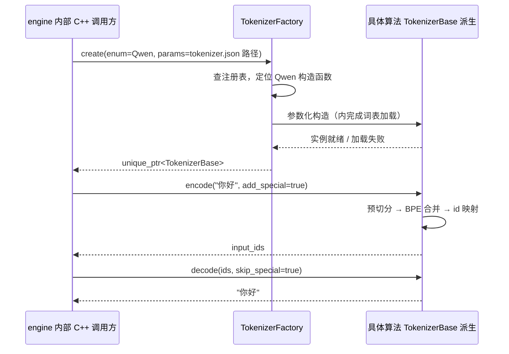

# SR20260728001 — CANN-LM Engine Tokenizer 模块

简体中文 | [English](../../../en/cann_lm_engine/tokenizer/SPEC.md)

## 第 1 章 概述

本规格定义 `cann_local_lm/engine/core/component/tokenizer` 下 C++ tokenizer 模块的业务行为。该模块为 CANN-LM 推理引擎提供统一的文本 token 化能力，必须支持两种可用分词实现——**BPETokenizer**（手写 BPE，词表为 HF `tokenizer.json` 产物（model.type=BPE），服务 gemma4 模型）与 **QwenTokenizer**（手写 ByteLevel BPE 流水线，词表为 HF `tokenizer.json` 产物，服务 Qwen3.5 类模型）——并保留 **SPMTokenizer**（Google SentencePiece 库路径）为本期占位（注册但不可用，见 4.1.6），以可扩展方式接纳后续算法，不必为新增算法改动既有代码。该模块是 engine 内部 C++ 组件，仅被同层 C++ 代码（pipeline/api）消费，**不对外暴露**任何跨语言或外部接口。

需求编号：**SR20260728001**。软件层次：**framework**（engine core 可复用库，含向后兼容性章节）。

读者应在 30 秒内理解：本 spec 规定一个多算法、工厂可创建、可自注册、engine 内部消费的 C++ tokenizer 抽象层的行为契约。

## 第 2 章 术语表

| 术语 | 定义 |
|------|------|
| Tokenizer | 将文本切分为模型可消费的整数 token id 序列、并能把 id 序列还原为文本的组件 |
| BPE | Byte-Pair Encoding，基于合并规则的子词分词算法 |
| SentencePiece | Google 开源分词框架（C++ 库 `libsentencepiece`）；本模块保留 SPMTokenizer 占位路径（本期不实现，实现期引入该库依赖） |
| QwenTokenizer | 对齐 Qwen3.5 HF tokenizer 行为的手写 ByteLevel BPE 实现，词表自 `tokenizer.json` 加载 |
| BPETokenizer | 手写 BPE 实现（不依赖 sentencepiece），词表自 HF `tokenizer.json`（model.type=BPE）加载，Metaspace（▁）预切分/还原，服务 gemma4 模型 |
| SPMTokenizer | 基于 Google SentencePiece 库的 tokenizer 占位路径：注册进工厂但构造恒失败（create → FAILURE），encode 不可用，实现期再引入 |
| tokenizer.json | HuggingFace `tokenizers` 库的序列化格式，单文件承载 vocab、merges、pre_tokenizer、decoder、added_tokens 配置 |
| .model | sentencepiece 训练产物的 protobuf 序列化文件（pieces + scores + types + normalizer/去歧义配置） |
| Metaspace | SentencePiece 风格预切分：空格替换为 `▁`(U+2581) 并按其切分；HF tokenizer.json 对 SP 系模型的 pre_tokenizer 配置 |
| Vocab / 词表 | token 字面量到整数 id 的映射表，由训练产物文件提供 |
| Merges | BPE 算法的合并规则有序表，决定子词归并顺序 |
| Pre-tokenizer | BPE 流水线中、合并前对原始文本的预切分阶段（如 ByteLevel 切分） |
| Normalizer | 编码前对文本的归一化阶段（如 NFC Unicode 归一化）；本期跳过，见未决项 U-4 |
| Decoder | 解码阶段，将 id 序列还原为文本（如 ByteLevel 还原） |
| Special tokens | 模型约定的控制 token：bos（起）、eos（止）、pad（填充）、unk（未知） |
| input_ids | 编码产出的整数 token id 序列，模型输入张量之一（attention mask 由调用方另行构造，不在本模块） |
| 工厂 | 按运行时枚举创建具体 tokenizer 实例的组件 |
| 自注册 | 具体算法派生实现将其构造能力登记进工厂，使工厂无需硬编码算法清单 |
| NFC | Unicode 规范等价合成归一化；Qwen Python 流水线含此步，本模块本期跳过（U-4） |
| GIL | Python 全局解释器锁；本模块为纯 C++ 内部组件，不涉及 Python 运行时，仅在校验用 Python oracle 侧相关 |
| RSS | 进程驻留物理内存集，用于衡量词表加载内存占用 |
| TSan | ThreadSanitizer，数据竞争检测工具 |

## 第 3 章 背景

### 3.1 现状

`cann_local_lm/models` 下各模型（gemma4、qwen3_5 等）的 token 化依赖外部 Python 实现（HuggingFace transformers / `tokenizers` / `sentencepiece`）。`cann_local_lm/models/qwen3_5/tokenization_qwen3_5.py` 显式构造 `BPE` + NFC + ByteLevel 流水线；gemma4 仓库内无对应 tokenization 文件，其特殊 token id 散落于 `configuration_gemma4.py`（pad=0、eos=1、bos=2 及 boi/eoi/image/video/audio 等多模态 token）。C++ 推理路径在编码侧被迫跨语言回调 Python，或各自重造，无统一权威源。

### 3.2 问题

- **跨语言开销**：C++ 推理引擎每次编码都回调 Python tokenizer，引入 GIL、序列化、进程间往返开销，破坏端到端 C++ 闭环。
- **实现碎片**：各模型的 tokenizer 流水线（归一化、预切分、合并、解码、特殊 token 注入）散落、口径不一，维护与回归成本高。
- **扩展僵化**：新增算法需在多处硬编码分支，违反开闭原则，易引入不一致。
- **可测性弱**：行为契约分散在 Python 实现里，无独立可验证规格。

### 3.3 期望

`cann_local_lm/engine/core/component/tokenizer` 提供统一 C++ tokenizer 抽象：以基类定义稳定行为契约，以派生类承载具体实现（BPETokenizer 与 QwenTokenizer 均为手写、词表 HF tokenizer.json；SPMTokenizer 为 sentencepiece 库占位路径），以工厂按运行时枚举创建实例、以自注册机制使新算法可插入而无需改动既有代码。模块作为 engine 内部 C++ 组件被 pipeline/api 层直接消费，不对外暴露；其输出须与对应参考实现在相同输入下逐 id 一致（BPETokenizer 对照 gemma4 参考实现、QwenTokenizer 对照仓内 `tokenization_qwen3_5.py`，以既有 Python 实现作为正确性 oracle，见 TC_203）。

## 第 4 章 功能需求

### 4.1 行为规格

#### 4.1.1 模型/词表加载

- **前置条件**：调用方持有算法类型枚举与该算法所需产物（BPETokenizer 与 QwenTokenizer：HF `tokenizer.json`；SPMTokenizer：sentencepiece `.model`——本期占位，加载恒失败）。
- **处理逻辑**：
  - 模块**必须**根据算法类型加载该算法所需产物。
  - 模块**必须**接受以文件路径或内存内容两种方式提供产物。
  - 模块**必须**在加载后建立 token↔id 双向映射（经共享 VocabStore），并能报告词表大小。
  - 模块**应该**在加载失败（文件缺失、格式非法、merges 与 vocab 不对齐）时返回明确错误码而非抛出未定义异常。
- **后置条件**：tokenizer 实例进入"已就绪"状态，可被编码/解码。
- **异常处理**：产物不可读或结构非法 → 返回加载失败错误码，实例不可用；调用方决定重试或回退。
- **边界情况**：空词表、超大规模词表（如 262144）、同一 id 映射到多个字面量、tokenizer.json 中 merges 引用 vocab 中不存在的 token、model.type 与算法不符（BPETokenizer 遇非 BPE 型 → 加载失败）。

#### 4.1.2 文本编码（encode）

- **前置条件**：实例已就绪。
- **处理逻辑**：
  - 模块**必须**按算法流水线将输入文本编码为 input_ids 序列：
    - BPETokenizer：**AddedToken 提取**（同 Qwen 口径）→ UTF-8 校验 → Metaspace 预切分（▁ 替换/切分）→ BPE merges 合并（原生 Unicode 字面量，无字节映射）→ id 映射。归一化（NFKC）本期跳过，见 U-4。
    - QwenTokenizer：**AddedToken 提取**（产物 added_tokens 字面量先于预切分从原文整段提取并直接映射单一 id，对齐参考实现行为）→ UTF-8 校验 → 预切分（std::regex 字节级，D-10）→ 字节转 Unicode 映射 → BPE merges 合并 → id 映射。归一化（NFC）本期跳过，见 U-4。
  - 模块**必须**支持可选的 special token 注入：按配置在序列首/尾添加 bos、eos，并按需添加 pad 至固定长度。**缺省零注入**（未配置时不注入，对齐 Qwen 参考实现 post_processor 行为）；注入仅在显式配置时发生。
  - 模块**必须**在遇到词表外 token 时使用 unk id。
  - 模块**应该**支持 `add_special_tokens` 开关（默认开启）与 `max_length` 截断（默认不截断；special 计入 max_length 预算，先截内容后注入）。
  - 模块**可以**支持 `padding` 策略（最长/固定长度）以对齐批量序列。
- **后置条件**：返回 input_ids（attention mask 不在返回值，见 4.1.4）。
- **异常处理**：输入非合法 UTF-8 → 返回编码失败错误码，不产生半截结果。
- **边界情况**：空串、纯空白、超长输入、含 emoji/代理对、混合 CJK 与拉丁文（**直接相邻混排为已知豁免分叉，见 U-4**）、CR/LF 控制符、非 NFC 形态输入（本期跳过归一化，行为差异见 U-4）、含 special/added 字面量输入（经 AddedToken 提取，正常路径）。

#### 4.1.3 ID 解码（decode）

- **前置条件**：实例已就绪。
- **处理逻辑**：
  - 模块**必须**将 id 序列按算法 decoder 还原为文本（QwenTokenizer 为 ByteLevel 还原；BPETokenizer 为 Metaspace 还原：▁→空格）。
  - 模块**必须**支持跳过 special tokens 的解码选项（默认跳过）。**剥离集为产物中全部标记为 special 的 token**（Qwen 实物为 added_tokens.special=true 的 14 个，含 `<|im_start|>`/`<|im_end|>` 等，非仅 bos/eos/pad/unk 四类），与参考实现 `skip_special_tokens` 同口径。
  - 模块**必须**保证：对同一实例，`decode(encode(text))` 在跳过特殊 token 时还原为与参考实现同口径的文本（以既有 Python 实现为正确性 oracle）。
- **后置条件**：返回还原后的字符串。
- **异常处理**：序列含词表外 id → 跳过或替换为 unk 字面量，不应中断。
- **边界情况**：空序列、仅含 special token 的序列、含 unk id 的序列。

#### 4.1.4 Attention Mask 职责边界（不在本模块）

- **职责声明**：attention mask **不在** tokenizer 模块职责范围。模块**只**产出 input_ids；由调用方（engine pipeline/api）依据 input_ids 中的 pad 位置自行构造 attention mask。
- **处理逻辑**：模块**必须不**在 encode/批量 encode 返回值中包含 attention mask；模块**不提供**任何 mask 查询接口——"不提供该接口"即为本条款的实现方式，不存在越权查询路径。
- **边界情况**：不适用（无接口即无边界情况）。

#### 4.1.5 批量编码

- **前置条件**：实例已就绪；输入为一组文本。
- **处理逻辑**：模块**必须**对一组文本逐条编码并按 padding 策略对齐为等长 input_ids 矩阵（不产出 attention mask，见 4.1.4）。
- **后置条件**：返回批量 input_ids。
- **异常处理**：单条失败 → 标记该条失败并继续其余，不应整批崩溃。
- **边界情况**：空批次、单元素批次、长度差异极大需长 padding。

#### 4.1.6 工厂创建

- **前置条件**：调用方持有算法类型枚举与加载参数。
- **处理逻辑**：
  - 模块**必须**提供工厂，接受算法枚举与参数，返回对应算法的 tokenizer 实例（以基类类型返回）。
  - 模块**必须**支持至少两个可用枚举值：`BPE`（手写 BPE，tokenizer.json）、`Qwen`（手写 ByteLevel BPE，tokenizer.json）；枚举 `SPM` 为占位（注册但 create 恒返回加载失败，见 4.1.9 LoadFailed——预期行为非缺陷）。
  - 模块**必须**对未注册枚举返回创建失败错误码，不返回半成品实例。
- **后置条件**：调用方持有已就绪实例或明确失败。
- **异常处理**：枚举未注册 → 失败；产物加载失败 → 失败并释放部分资源。
- **边界情况**：同一枚举并发创建、空参数。

#### 4.1.7 派生类自注册

- **前置条件**：某算法派生实现已链接进可执行/库。
- **处理逻辑**：
  - 派生实现**必须**在静态初始化期将其构造能力（算法枚举 + 创建函数）登记进工厂。
  - 工厂**必须**能在调用时枚举当前已注册的全部算法。
  - 新增算法派生实现**必须**能在不修改工厂与既有派生源码的前提下被工厂识别（开闭原则）。
- **后置条件**：工厂注册表反映全部已链接派生。
- **异常处理**：重复注册同一枚举 → 后注册者被拒绝并产生可观测告警（开发期日志），不应静默。
- **边界情况**：静态初始化顺序不确定、跨翻译单元注册、静态库链接期注册对象被链接器丢弃（由 DESIGN 约束承接，见 DESIGN §8）。

#### 4.1.8 内部模块边界

- **前置条件**：tokenizer 模块被 engine 内部 C++ 调用方（pipeline/api）引用。
- **处理逻辑**：
  - 模块**必须**作为 engine/core 内部 C++ 组件存在，仅对同层 C++ 代码暴露 4.2 所列接口契约。
  - 模块**必须不**对外暴露任何跨语言绑定（如 Python 绑定）或外部进程接口；项目级对外的 pybind 暴露属外层职责，不在本模块范围。
  - 模块**应该**以头文件 + 静态/动态库形式供 engine 内部链接消费。
- **后置条件**：engine 内部可按 4.2 契约直接调用；无外部 API 面。
- **异常处理**：不适用（边界约束，无运行时异常路径）。
- **边界情况**：误被外层直接暴露 → 视为架构越权，由 DESIGN 层约束头文件可见性。

#### 4.1.9 错误分类

模块**必须**将全部失败路径归入以下统一错误类别，以项目统一 `Status` 错误码（`infra/status.h`）返回，不静默吞错。**类目 → Status 的映射为设计契约，见下表**（外层若需跨语言暴露由外层负责映射）：

| 类别 | 触发场景 | 处置语义 | Status 映射 | 关联 TC |
|------|----------|----------|--------------|---------|
| LoadFailed | 产物文件缺失/不可读/格式非法、vocab 与 merges 不对齐 | 返回错误码，实例不可用 | `FAILURE` | TC_101/102 |
| UnsupportedAlgorithm | 未知算法枚举、算法未注册（含 Unigram 空槽） | 返回未注册失败，不返回实例 | `INVALID_ARGUMENT` | TC_103 |
| InvalidInput | 非法 UTF-8 输入、None 参数、空 padding（无真实 token） | 返回编码/输入失败，不产生半截结果 | `INVALID_ARGUMENT` | TC_104/201 |
| OutOfVocab | 输入含词表外 token | 映射为 unk id，非失败 | `SUCCESS`（内部映射 unk） | TC_202 |
| RegistrationConflict | 同一算法枚举重复注册 | 拒绝 + 开发期可观测告警，不静默 | 无返回值（注册函数为 void，WARN 日志） | TC_105 |
| ConcurrentViolation | 写操作并发、实例在加载期被读 | ——（见下） | `INVALID_STATE`（预留） | TC_301/302 |

> **并发违规条款（结构性保证）**：本模块的设计以"工厂在 create 内完成加载后才发布实例、实例发布后词表只读"的结构性方式消除写读并发窗口，运行期**不设**并发检测与返回路径；本模块**必须**维持该结构保证（加载完成后才可读）。若未来出现可写的加载/重载路径，则该路径**必须**返回 `INVALID_STATE`。

自检：4.1.1–4.1.8 的异常处理均可归入上表，无未分类失败。

### 4.2 接口契约（语义层，不含类型细节）

> 以下为基类与工厂的**语义**契约；具体 C++ 类型签名、类名、头文件布局属设计范畴，见 DESIGN。

- **TokenizerBase.encode(text, options) → input_ids**：**必须**满足 4.1.2；options **必须**可表达 add_special_tokens / max_length / padding 策略；**不**返回 attention mask（见 4.1.4）。
- **TokenizerBase.decode(ids, options) → text**：**必须**满足 4.1.3；options **必须**可表达 skip_special_tokens。
- **TokenizerBase.vocab_size() → int**：**必须**返回已加载词表大小。
- **TokenizerBase.special_token_id(name) → int**：**必须**按名称（bos/eos/pad/unk）返回该模型约定的 id，未配置时返回缺省值或失败。
- **TokenizerFactory.create(enum, params) → TokenizerBase | error**：**必须**满足 4.1.6；params **必须**能携带文件路径或内存内容（单一产物槽，产物种类随算法而定）。
- **TokenizerFactory.list_registered() → [enum]**：**必须**满足 4.1.7。
- 自检：以上契约覆盖 4.1.1–4.1.8 的全部行为（加载→编码→解码→mask职责边界→批量→工厂→自注册→内部边界）。

### 4.3 典型使用场景

自检：时序与 4.1.2 / 4.1.3 / 4.1.6 一致；工厂查注册表呼应 4.1.7；调用方为 engine 内部 C++ 代码，无跨语言绑定层。

## 第 5 章 非功能需求

> 性能阈值当前为**预算目标**（agent 提案，无实测基线），列为未决项 U-1/U-3，待 DESIGN 阶段实测后确认；不阻塞 spec 行为放行。词表规模、token id 等事实性断言的证据来源：`cann_local_lm/models/qwen3_5/configuration_qwen3_5.py`（嵌入规模 248320）、`cann_local_lm/models/gemma4/configuration_gemma4.py`（vocab=262144、pad=0/eos=1/bos=2）、**`tmp/qwen/tokenizer.json` 实物（词表条目总数 248070 = base 248044 + added 26；config 的 248320 为 padding 后嵌入矩阵规模，非词表条目数）**。

| 维度 | 指标 | 测试条件 | 证据来源 |
|------|------|----------|----------|
| 编码吞吐 | ≥ 10⁶ token/s（单线程，aarch64，词表 ≤ 262144） | 固定语料 batch 编码测时 | 预算目标（未决 U-1，待实测基线） |
| 单次编码延迟 | 1KiB 文本端到端 encode ≤ 200μs | 微基准 1000 次取中位 | 预算目标（未决 U-1，待实测基线） |
| 解码一致性 | decode(encode(t)) 与对应 Python oracle 在同一 t 上逐字符一致 | 黄金语料集回归对比 | 行为契约（见 TC_203） |
| 词表加载内存 | 峰值常驻 ≤ 词表规模 × 估算系数 | 加载后 RSS 测量 | 上限未定（未决 U-3，DESIGN 给实测值） |
| 功耗 | N/A（纯 CPU tokenizer，无专用 IP） | — | 不适用 |
| 可移植 | g++ 13 / C++17，aarch64（Ascend 宿主）通过 | CI 矩阵编译+测试 | 环境探测（已验证 g++13/cmake3.20/aarch64） |
| 线程安全 | 同一实例只读查询可并发；写操作（加载）不可并发 | 并发用例 TC_3xx | 设计约束 |
| 错误可观测 | 全部失败路径返回错误码/异常，无静默吞错 | 异常 TC_1xx | 行为契约 |

自检：每项均可测量、可验证；N/A 项已标注理由；未决项登记见文末「未决项登记」。

## 第 6 章 约束与依赖

- **硬件依赖**：目标平台 aarch64（Ascend/CANN 宿主）与 OHOS musl 交叉目标；无专用 IP，纯 CPU 计算。
- **软件依赖**：C++17 编译器（g++ 13 已验证；预切分用 std::regex 字节级 + POSIX 字符类，见 DESIGN D-10）、CMake ≥ 3.20、GoogleTest 1.14（UT）；tokenizer.json 解析依赖见 DESIGN D-09（vendored nlohmann/json 单头）。**本期运行时无 sentencepiece 依赖**（SPMTokenizer 为占位；引入库依赖推迟至其实现期，见未决项 U-5）。测试产物策略：小型 fixture + 预生成 golden ids 入库（A 层），真实产物（`tmp/`，gitignore）驱动 `tokenizer_realdata` 目标（B 层，见 U-6）；可选 transformers/tokenizers Python 参考实现用于 golden 生成（仅测试期）。模块不依赖 pybind11（内部组件，不对 Python 暴露）。
- **跨模块交互**：
  - `cann_local_lm/models/*`：本模块产出须与各模型 tokenizer 行为对齐，以既有 Python 实现为正确性 oracle（见 TC_203）。
  - `cann_local_lm/engine/core`：tokenizer 作为 core 子模块，被 pipeline/api 层消费。
  - `cann_local_lm/converter`：转换链路可能复用 tokenizer 做 id 对齐校验。
- 自检：未遗漏隐式依赖——明确不依赖 GPU/NPU 算子；明确不承担动态库热卸载支持；NFC 归一化本期跳过（U-4）不引入 ICU 依赖。

## 第 7 章 向后兼容性

- 本模块为新增 engine 内部 C++ 组件，无既有 C++ tokenizer 接口需保持二进制兼容，也不对外暴露接口，故无外部 API 兼容负担。
- **行为对齐**：模块输出**必须**与现有 Python 参考实现（BPETokenizer 对照 sentencepiece、QwenTokenizer 对照仓内 `tokenization_qwen3_5.py`）在相同输入下逐 id 一致，以既有 Python 实现为正确性 oracle；偏差即缺陷（见 TC_203，比对口径：两侧 add_special_tokens=false）。已知豁免（U-4）：NFC 归一化跳过与预切分正则实现差异（D-10）——非 NFC 输入、Latin↔CJK 直接相邻混排、非 ASCII 字母开头词、大写缩写、非 ASCII 空白允许与 oracle 分叉，黄金语料集须排除该类用例。**special 注入零缺省**（对齐参考实现 post_processor 无注入行为）；含 added/special 字面量的输入经 AddedToken 提取保证与参考实现一致（不豁免）。
- **校验路径**：开发期以原 Python tokenizer 作为影子 oracle，golden ids **预生成入库**（运行时不依赖 Python），逐模型比对输出 id 与 decode 还原文本，全部一致即视为行为对齐达成。模块本身不暴露 Python 接口；oracle 仅用于测试期校验，不进入运行时依赖。
- 自检：framework 层保留本章，明确无外部接口兼容负担与行为对齐口径。

## 第 8 章 验证标准

> 编号：TC_0xx 正常 / TC_1xx 异常 / TC_2xx 边界 / TC_3xx 并发。每条关联 §4.1 的"必须"行为并声明最小覆盖类别。

### 正常路径（TC_0xx）

> 验证环境：aarch64 真机（g++ 13 / C++17，GoogleTest 1.14）；一致性类 TC_203 需同环境持有原 Python 参考实现作为正确性 oracle（仅测试期）。

**TC_001 工厂按枚举创建 Qwen 实例并加载词表**（关联 4.1.1/4.1.6；类别：正常路径）
- Given 一个合法 Qwen3.5 `tokenizer.json` 与枚举 Qwen
- When 调用 factory.create(Qwen, params)
- Then 返回非空实例，vocab_size() 等于产物实际条目总数（实物口径 **248070** = base 248044 + added 26；注意 configuration_qwen3_5.py 的 248320 为 padding 后嵌入矩阵规模，**非**词表条目数），且 encode 不抛错

**TC_001b 工厂按枚举创建 BPE 实例并加载词表**（关联 4.1.1/4.1.6；类别：正常路径）
- Given 一个合法 gemma4 `tokenizer.json`（model.type=BPE）与枚举 BPE
- When 调用 factory.create(BPE, params)
- Then 返回非空实例，vocab_size() 等于产物实际条目数（以 fixture 实测登记具体值，设计层参考 gemma4 词表规模 262144），且 encode 不抛错

**TC_002 Qwen 编码 special 注入（零注入缺省 + 显式覆盖两径）**（关联 4.1.2；类别：正常路径）
- Given 已加载 Qwen 实例
- When 分别执行：①encode("hello", add_special_tokens=true)（**未显式配置 special**）；②经 LoadParams 显式配置 add_bos/add_eos 与 bos/eos id 后 encode("hello", add_special_tokens=true)
- Then ①返回 input_ids **不含任何注入的 special**（零注入缺省，对齐参考实现 post_processor 无注入行为）；②以配置的 bos 开头、配置的 eos 结尾（无 attention mask，见 4.1.4）

**TC_003 解码跳过特殊 token 还原原文**（关联 4.1.3；类别：正常路径）
- Given 已加载实例
- When decode(encode("你好世界", add_special=true), skip_special=true)
- Then 返回字符串 == "你好世界"

**TC_004 工厂枚举已注册算法**（关联 4.1.7；类别：正常路径）
- Given BPE、Qwen、SPM（占位桩）派生已链接
- When 调用 factory.list_registered()
- Then 返回集合含 BPE、Qwen、SPM 三个枚举值（SPM 注册但 create 恒 FAILURE，见 TC_103b）

**TC_103b SPM 占位创建失败**（关联 4.1.6；类别：边界资源）
- Given 枚举 SPM（占位桩已注册）与任意参数
- When factory.create(SPM, params)
- Then 返回 `FAILURE`（占位加载失败，预期行为非缺陷），不返回实例

### 异常路径（TC_1xx）

**TC_101 词表文件缺失**（关联 4.1.1；类别：依赖故障）
- Given 一个不存在的词表路径
- When factory.create(Qwen, bad_path)
- Then 返回 `FAILURE`，不返回半成品实例

**TC_102 词表结构非法**（关联 4.1.1；类别：边界资源）
- Given tokenizer.json 中 merges 引用 vocab 中不存在的 token，或 JSON 结构非法
- When create + 加载
- Then 返回 `FAILURE`（结构非法），不返回实例

**TC_103 未知算法枚举**（关联 4.1.6；类别：越权拒绝）
- Given 一个未注册的枚举值（如超出 Algorithm 定义域的强制转换值）
- When factory.create(未注册枚举, ...)
- Then 返回 `INVALID_ARGUMENT`，不返回实例

**TC_104 编码非 UTF-8 输入**（关联 4.1.2；类别：边界资源）
- Given 一段非法 UTF-8 bytes
- When encode(...)
- Then 返回 `INVALID_ARGUMENT`，不输出半截 ids

**TC_105 重复注册同一枚举**（关联 4.1.7；类别：滥用鲁棒）
- Given 同一算法枚举被登记两次
- When 静态初始化期第二次注册
- Then 后者被拒绝并产生可观测告警（开发期 WARN 日志），不静默

### 边界条件（TC_2xx）

**TC_201 空串编码**（关联 4.1.2；类别：边界资源）
- Given 已就绪实例
- When encode("", add_special=false)
- Then 返回空 input_ids，无异常

**TC_202 词表外 token 使用 unk**（关联 4.1.2；类别：边界资源）
- Given 输入含词表外字符
- When encode(...)
- Then 对应位置映射为 unk id

**TC_203 与原 Python 参考实现逐 id 一致（正确性 oracle 校验）**（关联 4.1.2/4.1.3；类别：正常路径+边界资源）
- Given 黄金语料集（含中英、emoji、空白混合；**NFC 形态且排除 U-4 豁免类**——Latin↔CJK 直接相邻混排、ü 等非 ASCII 字母开头词、大写缩写 `'S`、非 ASCII 空白）
- When 对每条文本分别用本 C++ 模块与对应 Python oracle（Qwen→`tokenization_qwen3_5.py`；BPE→gemma4 参考实现（transformers/tokenizers））编码，**两侧 add_special_tokens 均取 false**（钉死比对口径：裸流水线逐 id 比对；注入语义由 TC_002 单独验证）
- Then 两条 input_ids 序列逐 id 相等；decode 还原文本逐字符相等（skip_special 两侧同开）

**TC_204 超长输入截断**（关联 4.1.2；类别：边界资源）
- Given max_length=128 与超长输入
- When encode(text, max_length=128, truncation=true)
- Then input_ids 长度 == 128（special 计入预算：先截内容至 128−注入数，再注入，eos 不被截掉）

**TC_205 超大规模词表加载**（关联 4.1.1；类别：边界资源）
- Given gemma4 `tokenizer.json` 词表规模 262144
- When create(BPE, ...) 加载
- Then 加载成功、vocab_size() 等于产物实际条目数、内存峰值在 DESIGN 约束内

**TC_205b 真实规模 tokenizer.json 加载与内存**（关联 4.1.1；类别：边界资源）
- Given `tmp/qwen/tokenizer.json`（248044+26 词条，12.8MB；本地放置，测试目标检测存在才运行）
- When create(Qwen, ...) 加载
- Then 加载成功、vocab_size()==248070、加载耗时与常驻内存实测记录在案（U-3 系数依据）

### 并发场景（TC_3xx）

**TC_301 同一实例并发只读查询**（关联 §5 线程安全 / 4.1.2；类别：滥用鲁棒）
- Given 一个已就绪实例
- When 多线程并发 encode 不同文本
- Then 无数据竞争（TSan 干净），结果与串行一致

**TC_302 工厂并发创建不同枚举**（关联 4.1.6/4.1.7；类别：滥用鲁棒）
- Given BPE 与 Qwen 均已注册
- When 多线程同时 factory.create(BPE,...) 与 create(Qwen,...)
- Then 两个实例各自就绪，注册表无并发损坏

### 覆盖维度核验

| 类别 | 覆盖 TC |
|------|---------|
| 正常路径 | TC_001/001b/002/003/004/203 |
| 越权拒绝 | TC_103 |
| 边界资源 | TC_102/103b/104/201/202/204/205/205b/203 |
| 依赖故障 | TC_101 |
| 滥用鲁棒 | TC_105/301/302 |

自检：4.1 中全部"必须"行为均有对应 TC（加载 001/001b/101/102/205/205b、编码 002/104/201/202/204/203、解码 003/203、mask职责边界 4.1.4 为约束性条款不产 TC、批量见 DESIGN 拆分 TC、工厂 001/103/103b/302、自注册 004/105/302、内部边界 4.1.8 为约束性条款由 DESIGN 头文件可见性约束承接）。5 类最小覆盖维度每类 ≥1 条。批量编码（4.1.5）的具体 TC 在 DESIGN 拆分模块时补充到 §8 增量。

## 未决项登记

| ID | 未决项 | 类别 | 阻塞 spec 放行 | 处置阶段 |
|----|--------|------|----------------|----------|
| U-1 | 编码吞吐/延迟阈值（10⁶ token/s、200μs）为预算目标，无实测基线 | 验收标准 | 否（预算，待实测确认/调整） | DESIGN 性能预算 + 实现期微基准 |
| U-3 | 词表加载内存上限系数未定 | 资源约束 | 否（DESIGN 给实测值） | DESIGN |
| U-4 | 已知豁免分叉（用户决议 2026-08-31/09-01）：①NFC 归一化跳过；②Qwen 预切分正则以 std::regex 字节级 POSIX 类落地（D-10），与 oracle `\p{L}\p{M}\p{N}` 属性类在 **Latin↔CJK 直接相邻混排、非 ASCII 字母开头词（如 über）、大写缩写 'S、非 ASCII 空白** 四类输入上分叉 | 行为对齐豁免 | 否（黄金语料排除该类输入；含 special 字面量输入不豁免——AddedToken 提取保证一致） | 有需求再实现（复审触发：产品语料大量落入豁免类，D-07/D-10 §5） |
| U-5 | Google SentencePiece 库接入：**推迟至 SPMTokenizer 实现期**（本机与 OHOS musl 均未预装，需源码构建，含 protobuf 处置、OHOS SHARED 库 PIC 链接形态）——本期无此依赖 | 构建依赖（推迟） | 否 | SPM 实现需求出现时 |
| U-6 | 测试产物来源：`tmp/qwen/`（tokenizer.json + tokenizer_config.json，gitignore）已放置；**`tmp/gemma/` 的 tokenizer.json 待放置且 model.type==BPE 待校验**（若为 Unigram 型则 BPETokenizer 路线需回议）；golden ids 预生成脚本与小型 fixture 生成脚本待实现 | 测试资产 | 否（M-8 A+B 分层策略已定） | 实现期（A 层 fixture 先行，B 层 gemma 待产物） |
| U-2 | Gemma4 tokenizer 算法类型（已校验 SentencePiece，参考 gemma_pytorch/gemma/tokenizer.py） | 系统边界 | 已闭合 | — |

**阻塞级未决项清零**：U-1/U-3 为预算/资源项；U-4 为登记在案的行为豁免（清单明确）；U-5 为实现期构建项（DESIGN 已给接入约束与回退路径）；U-6 为测试资产项（A+B 策略已定，gemma 产物待放置）；U-2 已闭合。无信任/授权边界、无安全红线相关未决项。

## 一致性自检（生成期）

- 接口契约覆盖：4.2 每个语义接口均可追溯至 4.1 行为（encode↔4.1.2、decode↔4.1.3、vocab_size↔4.1.1、special_token_id↔4.1.2、create↔4.1.6、list_registered↔4.1.7）。✓
- 测试覆盖：4.1 每条"必须"在第 8 章有 TC。✓
- 术语一致：全文术语在第 2 章有定义。✓
- 时序一致：4.3 时序与 4.1 无矛盾。✓
- 层次适配：framework 层含第 7 章。✓
- 图谱一致：degraded 模式，无图谱引用。✓
