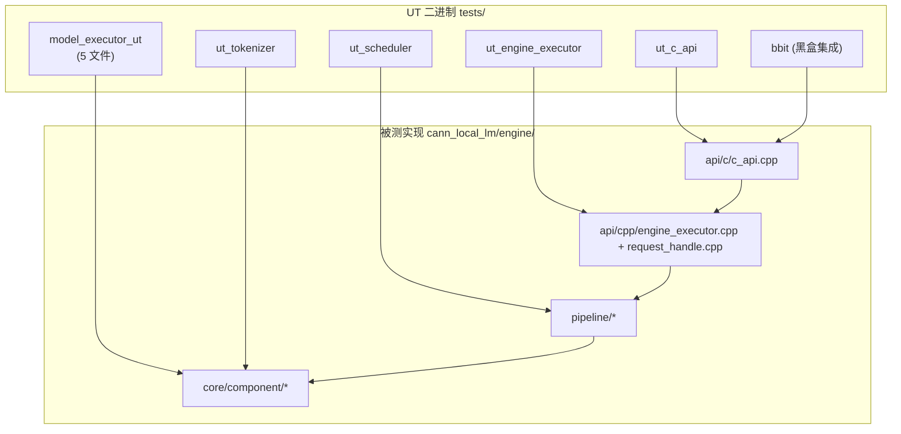

# 单元测试（UT）设计（DESIGN）

简体中文 | [English](../../../en/cann_lm_engine/ut/DESIGN.md)

> **模块定位**：UT 是 CANN-LM Engine 的横向质量保障层，覆盖 `api/c` / `api/cpp` / `pipeline` / `core/component` 的对外接口表面与关键内部行为。本文档描述 How——UT 二进制组织、命名规范、Stub Era vs Real Era 分类、覆盖矩阵、漂移防御规则、CMake 接线。What/Why 见 SPEC。

---

## §1 模块定位

| 属性 | 值 |
|------|-----|
| 代码路径 | `tests/cpp/engine/`、`tests/cpp/engine/model_executor/`、`examples/test_engine/bbit/` |
| 框架 | GoogleTest 1.14（`find_package(GTest REQUIRED)`） |
| CMake 入口 | `cann_local_lm/engine/CMakeLists.txt:66-127` |
| 编译产物 | 10 个可执行：`model_executor_ut` / `ut_engine_executor` / `ut_tokenizer` / `ut_c_api` / `ut_scheduler` / `ut_sampler` / `ut_request_handle` / `ut_logger` / `ut_text_embedding` / `bbit` |
| 测试发现 | `gtest_discover_tests()` 注册进 CTest（bbit 经 `add_test` 手工注册） |
| 命名空间 | `cann_local_lm::engine`（与被测代码一致；匿名 namespace 内放 fixture 与 TEST） |
| 上游 | 各模块 DESIGN/SPEC（见 depends_on） |

## §2 架构总览



**关键边界**：
- UT 与被测代码同编译单元，include 路径指向 `cann_local_lm/engine/`（`target_include_directories(... PRIVATE ${CMAKE_CURRENT_SOURCE_DIR})`）
- 每个 UT 二进制静态链接 `libcann_lm_engine.a` + `GTest::gtest` + `GTest::gtest_main`（main 由 gtest_main 提供，无需自写）
- bbit 不链接 gtest，是纯 C++ 黑盒消费者，模拟真实用户调用 C API

## §3 命名规范

### §3.1 TEST 套件名

- 形如 `TEST(<Module>Test, <Behavior>_<TCXXX>)`，`<Module>` 为被测模块名（如 `EngineExecutorTest`、`TokenizerFactoryTest`、`SamplerTest`、`RequestHandleTest`、`CApiTest`、`SchedulerTest`、`DfxCollectorTest`）
- 同一 fixture 下的测试套件名一致；不同 fixture 不复用套件名

### §3.2 用例名（防漂移核心规则）

**强制**：用例名 `<Behavior>` 部分**必须**与实际断言类型一致。出现下列情况即视为漂移，需在 PR 前修复：

| 反模式 | 示例 | 修复方向 |
|--------|------|----------|
| 名含状态码但断言未验证该码 | `ConcurrentGenerateSameContextReturnsInvalidState` 仅 `EXPECT_FALSE(s.ok())` | 改名 `ReturnsFailureStubEra` 或加 `EXPECT_EQ(s.code, Status::INVALID_STATE)` |
| 名含语义但实际调用的不是该语义 | `CreateUnknownReturnsFailure` 实际传 `Algorithm::BPE` | 改名 `CreateBPEReturnsInvalidArgumentStubEra` 或换真正"未知"的入参 |
| 名宣称 Success 但断言仅 `EXPECT_FALSE(s.ok())` | — | 改名 `ReturnsFailure...` 或断言改 `EXPECT_TRUE` |

### §3.3 Stub Era 后缀

- stub 时代预期返回 FAILURE / INVALID_ARGUMENT 的用例，名尾加 `_StubEra` 后缀
- 真实后端落地后追加 `_RealEra` 对照用例（暂不写，标 deferred）
- 这样从用例名一眼可辨当前断言对应哪个时代的预期

### §3.4 TC 编号

- `TC0xx` 正常路径
- `TC1xx` 异常路径
- `TC2xx` 边界条件
- `TC3xx` 并发场景
- 与各模块 SPEC §8 TC 编号对齐（同一行为同一 TC，UT 实现该 TC 的可执行版本）

## §4 Stub Era vs Real Era 分类

CANN-LM Engine 当前处于 **stub era**：`stub_model_manager.cpp` / `stub_built_model.cpp` 返回 nullptr；`BpeTokenizer::encode` 返回 FAILURE；`Sampler::Sample` 返回 FAILURE。但 `EngineExecutor` 构造与 `CreateContext` 成功（`PipelineExecutorFactory::create` 不依赖真实后端，构造期 `Load` 失败被吞）。

### §4.1 Stub Era UT 范围（本期）

| 行为类别 | Stub Era 预期 | 关联模块 |
|----------|--------------|----------|
| Executor 构造（path/buffer） | SUCCESS（构造期不实际加载） | api/cpp + c_api |
| Context 创建 / 销毁 / 配置 / cancel | SUCCESS（ContextId 单调递增；幂等） | pipeline/scheduler |
| 同 Context 并发 GenerateAsync | FAILURE（PreparePrefill 失败），第二次也 FAILURE（active 同步清除） | pipeline_executor |
| RequestHandle 空状态查询 | GetStatus=Queued / IsDone=false / operator bool=false | api/cpp/request_handle |
| RequestHandle 空状态控制 | Cancel=SUCCESS（no-op）/ Wait=INVALID_STATE / TryGetResult=INVALID_STATE | api/cpp/request_handle |
| Sampler 参数校验 | !out → INVALID_ARGUMENT；slot<0 → INVALID_ARGUMENT | core/component/sampler |
| Sampler 真实采样 | !batch_logits → FAILURE；非空 logits → FAILURE（stub） | core/component/sampler |
| Scheduler::Step 无任务 | INVALID_STATE | pipeline/scheduler |
| Scheduler::Submit 参数校验 | !req \|\| !out → INVALID_ARGUMENT；否则 SUCCESS（PendingPrefillCount++） | pipeline/scheduler |
| Scheduler::Cancel 未找到 | NOT_FOUND | pipeline/scheduler |
| Scheduler::CancelContext 空表 | SUCCESS | pipeline/scheduler |
| Tokenizer BPE stub encode | FAILURE | core/component/tokenizer |
| TokenizerFactory::create | 始终 INVALID_ARGUMENT（stub） | core/component/tokenizer |
| TokenizerFactory::list_registered | 返回 {BPE, SentencePieceUnigram} | core/component/tokenizer |
| C API ExecutorCreate | SUCCESS | api/c/c_api |
| C API ExecutorCreateFromBuffer | SUCCESS（同 path 入口） | api/c/c_api |
| C API Request* 空指针 | RequestIsDone(nullptr)=0 / RequestCancel(nullptr)=SUCCESS / RequestGetStatus(nullptr)=QUEUED | api/c/c_api |

### §4.2 Real Era UT 范围（deferred）

真实后端接入后追加（不在本期 UT 之内）：
- `Generate` 成功返回完整 Result
- `RequestHandle::Wait` 阻塞等待终态
- `Sampler::Sample` 真实采样（greedy/top-k/top-p）
- `Tokenizer` 真实 BPE encode/decode（与 Python oracle 逐 id 一致，对齐 docs/tokenizer/SPEC.md TC_203）
- `bbit` 端到端推理成功路径

每条 Real Era 用例在 SPEC 中以 `[deferred]` 标注。

## §5 覆盖矩阵（模块 × UT 二进制 × 缺口）

> 行为只列对外接口表面 + Stub Era 可验证的内部行为。Real Era 推理路径不在本表。

| 模块 | 接口符号 | 当前 UT 文件 | Stub Era 覆盖 | 缺口 → 本期补 |
|------|---------|-------------|--------------|--------------|
| api/cpp EngineExecutor | ctor(path) | test_engine_executor.cpp | ✓（间接经 EngineExecutor ee(DummyPath())） | — |
| | ctor(buffer) | — | ✗ | （cpp 接口无直接 UT；C API 经 CreateFromBuffer 覆盖） |
| | CreateContext | test_engine_executor.cpp | ✓（TC001 等） | — |
| | DestroyContext | test_engine_executor.cpp | ✓（幂等 + 不存在） | — |
| | ConfigureContext | test_engine_executor.cpp | ✓（NOT_FOUND + 成功） | — |
| | CancelContext | test_engine_executor.cpp | ✓（NOT_FOUND + 成功） | — |
| | Generate | test_engine_executor.cpp | ✓（empty ctx + valid ctx stub FAILURE） | — |
| | GenerateAsync | test_engine_executor.cpp | ✓（empty ctx + valid ctx stub FAILURE + concurrent） | — |
| api/cpp RequestHandle | 默认构造 | test_engine_executor.cpp | ✗（仅声明变量，不验证空状态查询） | **test_request_handle.cpp**（新增） |
| | GetStatus / IsDone / operator bool | — | ✗ | **test_request_handle.cpp**（新增） |
| | Cancel / Wait / TryGetResult（空状态） | — | ✗ | **test_request_handle.cpp**（新增） |
| api/c c_api | ExecutorCreate | test_c_api.cpp | ✓ | — |
| | **ExecutorCreateFromBuffer** | — | ✗ | **test_c_api.cpp 追加**（新增） |
| | ContextCreate / Destroy / Cancel | test_c_api.cpp | ✓ | — |
| | ExecutorGenerate | test_c_api.cpp | ✓（NOT_FOUND + stub FAILURE） | — |
| | Request* 空指针 | test_c_api.cpp | ✓ | — |
| core/component Sampler | Sample 参数校验 | — | ✗ | **test_sampler.cpp**（新增） |
| | Sample stub 路径 | — | ✗ | **test_sampler.cpp**（新增） |
| core/component Tokenizer | BpeTokenizer::encode/decode | test_tokenizer.cpp | ✓（stub FAILURE） | — |
| | batch_encode | test_tokenizer.cpp | ✓（continue-on-failure + empty + null out） | — |
| | TokenizerFactory::create | test_tokenizer.cpp | ⚠ 命名漂移（详见 §8） | **修复命名** |
| | TokenizerFactory::list_registered | test_tokenizer.cpp | ✓ | — |
| pipeline Scheduler | 构造 + DecodeCapacity + 计数 | test_scheduler.cpp | ✓ | — |
| | Step 无任务 | test_scheduler.cpp | ✓（INVALID_STATE） | — |
| | **Submit** | — | ✗ | **test_scheduler.cpp 追加**（新增） |
| | **Cancel** | — | ✗ | **test_scheduler.cpp 追加**（新增） |
| | **CancelContext** | — | ✗ | **test_scheduler.cpp 追加**（新增） |
| core/component model_executor 等子模块 | 各模块测试 | tests/cpp/engine/model_executor/ | ✓（5 文件，DFX/KV/IA/ME/TM） | — |
| 黑盒集成 bbit | C API 全路径 | examples/test_engine/bbit/bbit.cpp | ✓（--check + flow） | — |

## §6 Test Fixture 与 Helper 约定

### §6.1 Fixture 风格

- 简单 fixture 用 `struct XxxFixture { ... }`（POD，无 setup/teardown），见 `test_scheduler.cpp:12`
- 需 setup/teardown 用 `class XxxFixture : public ::testing::Test` + `SetUp/TearDown`
- 共享辅助函数放匿名 namespace 内，前缀 `Make` / `Dummy` / `Count` 等（见 `test_dfx_collector.cpp:15-29`）

### §6.2 路径与 Buffer 占位

- path 占位用 `"dummy.omc"` / `"dummy.weight"`（见 `test_engine_executor.cpp:8-10`、`test_c_api.cpp:8`）
- buffer 占位用栈 `char buf[8]` 包 `Tensor`（见 `test_dfx_collector.cpp:15-18`）
- C API buffer 测试需构造 `CANN_LMEngine_ModelArtifact{...}`，预填 `{buffer, buffer, buffer}` 三段

### §6.3 Status 断言模式

```cpp
// 成功
EXPECT_TRUE(s.ok());
EXPECT_EQ(s.code, Status::SUCCESS);

// 失败（不关心具体码）
EXPECT_FALSE(s.ok());

// 失败（关心具体码——必须与用例名一致）
EXPECT_EQ(s.code, Status::INVALID_ARGUMENT);
```

## §7 GoogleTest 配置与 CMake 接线

`cann_local_lm/engine/CMakeLists.txt:66-127` 已定义 5 个 UT 二进制 + bbit。本期新增需追加：

```cmake
# ut_sampler
add_executable(ut_sampler ${UT_DIR}/test_sampler.cpp)
target_link_libraries(ut_sampler PRIVATE cann_lm_engine GTest::gtest GTest::gtest_main)
target_compile_options(ut_sampler PRIVATE -Wall -Wextra -Wpedantic)
target_include_directories(ut_sampler PRIVATE ${CMAKE_CURRENT_SOURCE_DIR})
gtest_discover_tests(ut_sampler)

# ut_request_handle
add_executable(ut_request_handle ${UT_DIR}/test_request_handle.cpp)
target_link_libraries(ut_request_handle PRIVATE cann_lm_engine GTest::gtest GTest::gtest_main)
target_compile_options(ut_request_handle PRIVATE -Wall -Wextra -Wpedantic)
target_include_directories(ut_request_handle PRIVATE ${CMAKE_CURRENT_SOURCE_DIR})
gtest_discover_tests(ut_request_handle)
```

`test_engine_executor.cpp`、`test_tokenizer.cpp`、`test_c_api.cpp`、`test_scheduler.cpp` 仅改源码，CMake 无需变更。

## §8 漂移修复清单

> 来源：UT 审计（详见 SPEC §8.1）。每条含旧名、新名、修复理由。

| 编号 | 文件:行 | 旧名 | 新名 | 修复理由 |
|------|---------|------|------|----------|
| DRIFT-1 | `test_engine_executor.cpp:105` | `ConcurrentGenerateSameContextReturnsInvalidState` | `ConcurrentGenerateSameContextReturnsFailureStubEra` | 名含 `InvalidState` 但实际两次 `GenerateAsync` 均返回 FAILURE（首次同步清除 active 标记），断言仅 `EXPECT_FALSE(s.ok())` 未验证 INVALID_STATE 码。改名反映真实预期。 |
| DRIFT-2 | `test_tokenizer.cpp:42` | `CreateUnknownReturnsFailure` | `CreateBPEReturnsInvalidArgumentStubEra` | 名含 `Unknown` 但入参是 `Algorithm::BPE`（已注册算法）；名含 `ReturnsFailure` 但 stub 实现返回 `INVALID_ARGUMENT`。改名反映真实入参与真实码。 |

修复原则：**改用例名 + 改预期断言**（不改被测实现行为）。被测代码本身正确，是测试名与预期错配。

## §9 新增用例清单

| 编号 | 文件 | 用例名 | 类别 | 关联 SPEC TC |
|------|------|--------|------|--------------|
| NEW-1 | test_sampler.cpp | `SampleWithNullOutReturnsInvalidArgument_TC201` | 异常 | UT-TC-SAMPLER-001 |
| NEW-2 | test_sampler.cpp | `SampleWithNegativeSlotReturnsInvalidArgument_TC202` | 异常 | UT-TC-SAMPLER-002 |
| NEW-3 | test_sampler.cpp | `SampleWithEmptyLogitsReturnsFailureStubEra_TC203` | 异常-stub | UT-TC-SAMPLER-003 |
| NEW-4 | test_sampler.cpp | `SampleWithValidLogitsReturnsFailureStubEra_TC204` | 异常-stub | UT-TC-SAMPLER-004 |
| NEW-5 | test_request_handle.cpp | `EmptyHandleGetStatusReturnsQueued_TC001` | 正常 | UT-TC-RH-001 |
| NEW-6 | test_request_handle.cpp | `EmptyHandleIsDoneReturnsFalse_TC002` | 正常 | UT-TC-RH-002 |
| NEW-7 | test_request_handle.cpp | `EmptyHandleBoolConversionReturnsFalse_TC003` | 正常 | UT-TC-RH-003 |
| NEW-8 | test_request_handle.cpp | `EmptyHandleCancelReturnsSuccess_TC004` | 正常 | UT-TC-RH-004 |
| NEW-9 | test_request_handle.cpp | `EmptyHandleWaitReturnsInvalidState_TC101` | 异常 | UT-TC-RH-005 |
| NEW-10 | test_request_handle.cpp | `EmptyHandleTryGetResultReturnsInvalidState_TC102` | 异常 | UT-TC-RH-006 |
| NEW-11 | test_request_handle.cpp | `EmptyHandleWaitWithNullOutReturnsInvalidArgument_TC103` | 异常 | UT-TC-RH-007 |
| NEW-12 | test_c_api.cpp | `CreateFromBufferSucceedsStubEra_TC001` | 正常 | UT-TC-CAPI-FB-001 |
| NEW-13 | test_c_api.cpp | `CreateFromBufferNullPrefillReturnsInvalidArgument_TC101` | 异常 | UT-TC-CAPI-FB-002 |
| NEW-14 | test_c_api.cpp | `CreateFromBufferNullDecodeReturnsInvalidArgument_TC102` | 异常 | UT-TC-CAPI-FB-003 |
| NEW-15 | test_c_api.cpp | `CreateFromBufferNullOutReturnsInvalidArgument_TC103` | 异常 | UT-TC-CAPI-FB-004 |
| NEW-16 | test_c_api.cpp | `CreateFromBufferSupportsContextCreate_TC002` | 正常 | UT-TC-CAPI-FB-005 |
| NEW-17 | test_scheduler.cpp | `SubmitWithNullReqReturnsInvalidArgument_TC101` | 异常 | UT-TC-SCHED-001 |
| NEW-18 | test_scheduler.cpp | `SubmitWithNullOutReturnsInvalidArgument_TC102` | 异常 | UT-TC-SCHED-002 |
| NEW-19 | test_scheduler.cpp | `SubmitSucceedsIncrementsPendingCount_TC001` | 正常 | UT-TC-SCHED-003 |
| NEW-20 | test_scheduler.cpp | `SubmitAssignsMonotonicRequestIds_TC002` | 正常 | UT-TC-SCHED-004 |
| NEW-21 | test_scheduler.cpp | `CancelNonexistentReturnsNotFound_TC103` | 异常 | UT-TC-SCHED-005 |
| NEW-22 | test_scheduler.cpp | `CancelContextWithNoMatchingContextsReturnsSuccess_TC104` | 正常 | UT-TC-SCHED-006 |

## §10 决策与未决项

| ID | 主题 | 状态 | 说明 |
|----|------|------|------|
| D-01 | UT 与被测代码同命名空间 | accepted | 便于访问内部类型（如 `RequestImpl`），与现有 `test_engine_executor.cpp` 一致 |
| D-02 | Stub Era 用例后缀 `_StubEra` | accepted | 让用例名一眼可辨当前预期属于哪个时代，便于 Real Era 落地后追加对照 |
| D-03 | 不为 stub 行为写 mock | accepted | Stub 行为本身可观测、可断言；引入 mock 会绕过被测代码 |
| D-04 | CMake `gtest_discover_tests()` | accepted | 与现有 5 个 UT 二进制一致；bbit 仍用 `add_test` 手工注册 |
| D-05 | 不在本期补 `text_embedding` / `pipeline_executor` / `preprocessor` / `history_prompt_manager` / `infra/logger` / `core/context` 的独立 UT | accepted | 这些模块无对外可独立验证的接口（在 stub 时代均通过路径返回），本期聚焦对外接口表面 + 已暴露的缺口 |
| U-1 | `Algorithm` 枚举仅 BPE/SP 两值，无法构造真正"未知"枚举 | open | stub 时代 `TokenizerFactory::create` 始终返回 `INVALID_ARGUMENT`，无法区分"未知枚举"与"加载失败"。本期 UT 名改为 `CreateBPEReturnsInvalidArgumentStubEra`，真实时代补 `CreateUnknownAlgorithmReturnsInvalidArgument_RealEra` 时需扩 Algorithm 枚举或经测试 hook 注入未知值。 |
| U-2 | `ExecutorCreateFromBuffer` 实际成功路径依赖 `PipelineExecutorFactory::create(buffer)` 不返回错误 | open | 当前 `EngineExecutor::Impl::init_pipeline_buffer` 吞掉了 factory 返回值（`engine_executor.cpp:67 (void)`），stub 时代下 `pipeline_` 是否非空决定 `CreateContext` 行为。本期 UT 仅断言 `ExecutorCreateFromBuffer` 返回 SUCCESS，跨进 `CreateContext` 才能验证 `pipeline_` 是否真就绪——NEW-16 即做此验证。 |
| U-3 | `bbit --check` 与 `bbit` 在 stub 时代均会跑 FAILURE 路径 | open | bbit 的 `--check` 走 NULL 防御（应全部 SUCCESS 或 INVALID_ARGUMENT），`bbit` 走全流程（应多处 FAILURE）。需 bbit.cpp 自身已对齐——本期不修 bbit。 |

## §11 变更日志

| 版本 | 日期 | 变更 |
|------|------|------|
| 0.1 | 2026-08-25 | 初稿。建立 UT 总体架构、命名规范、Stub/Real Era 分类、覆盖矩阵、2 处漂移修复清单、22 条新增用例清单。 |
