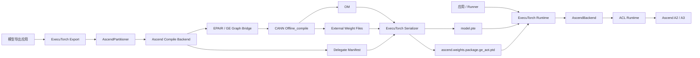
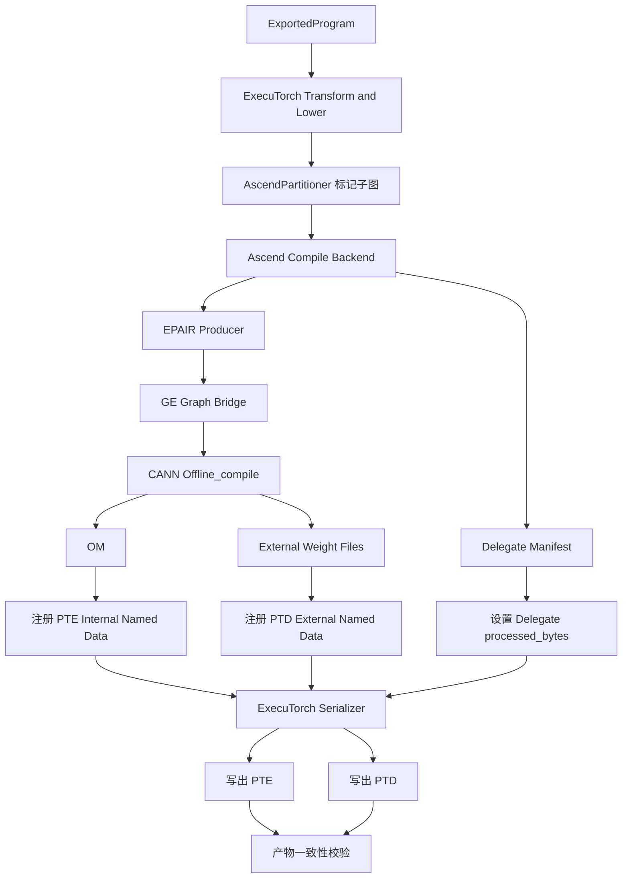
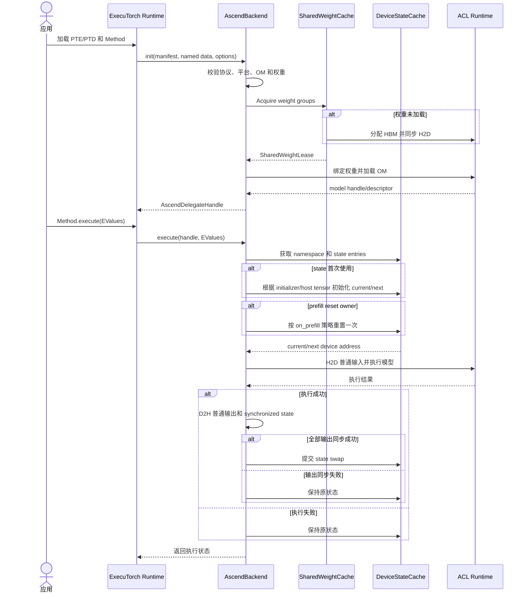
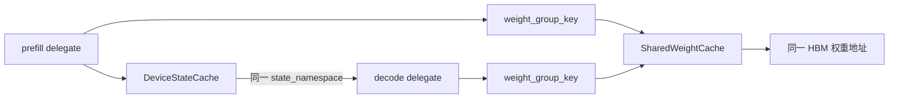
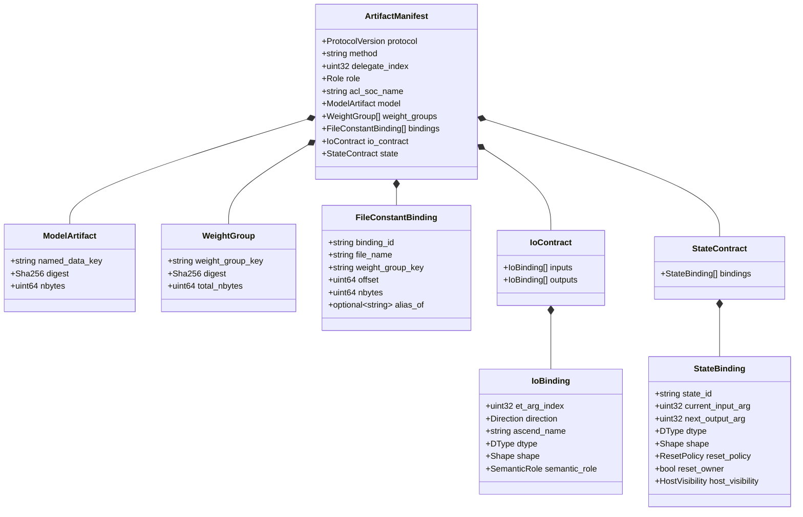
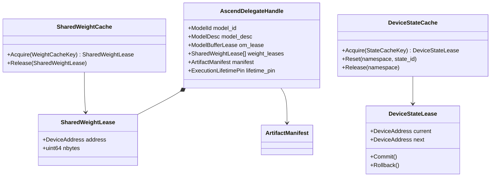
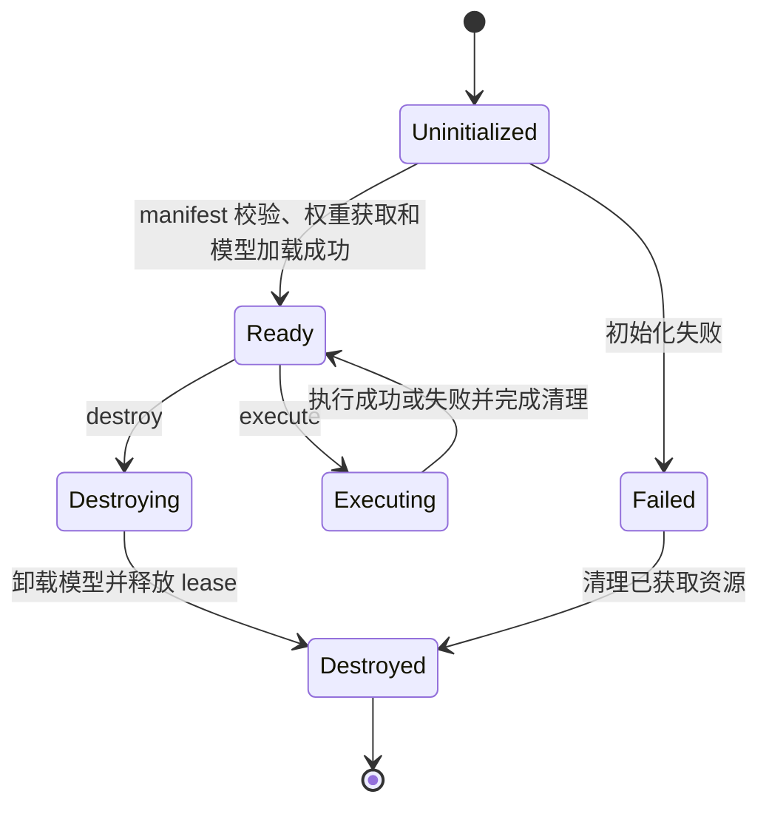
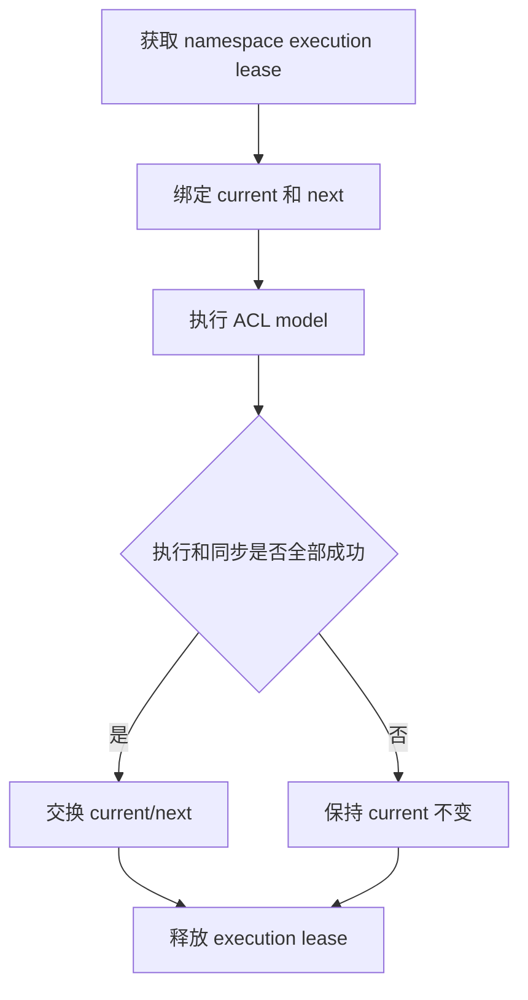

# 简介

## 目的

本文定义ExecuTorch-NPU AOT Backend的总体设计，说明从PyTorch模型导出、Ascend子图离线编译、PTE/PTD打包到昇腾设备执行的整体流程、模块边界和关键数据结构。

本文主要面向ExecuTorch-NPU编译端、运行端、集成适配层和测试框架的开发与维护人员。

Artifact字段级协议参考见
[`../../examples/manifest_schema/manifest-v1.schema.json`](../../examples/manifest_schema/manifest-v1.schema.json)，
它不参与构建或运行时校验；字段编码和运行时规则见 [`../protocol.md`](../protocol.md)。

## 范围

本文包括：

- ExecuTorch backend delegation与Ascend子图编译流程。
- EPAIR、GE Graph和CANN Offline_compile的集成边界。
- PTE、PTD和delegate manifest的产物组织方式。
- Ascend runtime backend的模型加载与同步执行流程。
- Prefill/decode权重复用和设备状态传递。
- 关键数据结构、生命周期、兼容性和测试设计。

本文不包括：

- 算子支持列表和图分区算法细节。
- EPAIR内部格式和GE图转换算法。
- Manifest的完整JSON Schema和字段级编码实现。
- 具体外部依赖版本的安装步骤；版本矩阵见 [`../supported_versions.md`](../supported_versions.md)。
- 在线编译、异步执行和device tensor零拷贝。
- 量化、服务调度和多租户常驻缓存。

# 总体概述

## 软件概述

### 项目介绍

ExecuTorch-NPU是ExecuTorch的Ascend AOT backend。编译阶段通过ExecuTorch delegation取得Ascend子图，将其转换为GE Graph，并使用CANN Offline_compile生成OM和外置权重。运行阶段由ExecuTorch加载PTE/PTD，通过Ascend runtime backend调用ACL装载和执行OM。

本方案不建立独立于ExecuTorch的模型容器或执行框架。Execution plan、delegate信息和OM复用PTE，外置权重复用PTD，编译端与运行端通过带版本的manifest传递artifact、I/O、状态和兼容性信息。

### 产品环境介绍



相关模块及职责如下：

| 模块 | 主要职责 |
|---|---|
| ExecuTorch adapter | 对接delegation、PTE/PTD序列化、Program/Method加载和backend调度 |
| `AscendPartitioner` | 识别Ascend可执行子图并标记delegate |
| Ascend compile backend | 将delegated program编译为OM，生成manifest和named data |
| EPAIR/GE Graph bridge | 完成 `ExportedProgram -> EPAIR -> GE Graph` 转换 |
| CANN offline compiler adapter | 管理离线编译并生成OM与外置权重文件 |
| Artifact packager | 将OM、权重和manifest写入PTE/PTD |
| `AscendBackend` | 校验产物、加载ACL model、执行推理并管理资源 |
| `SharedWeightCache` | 在同一设备复用只读权重HBM |
| `DeviceStateCache` | 在同一请求的多个method间维护KV等设备状态 |

## 软件功能

本方案需要实现以下功能：

1. 将一个或多个 `ExportedProgram` 接入ExecuTorch backend delegation流程。
2. 保持delegated program的ATen operator target，并转换为EPAIR和GE Graph。
3. 使用CANN Offline_compile根据编译期确定的静态或有界动态Shape profile生成OM
   和独立外置权重文件。
4. 将所有method/delegate的execution plan、manifest和OM写入一个PTE。
5. 将全部外置权重写入一个PTD，并按内容复用相同权重。
6. 运行时校验协议、平台、OM、权重、I/O和状态合约。
7. 每个delegate独立加载ACL model，prefill/decode可共享设备权重。
8. 通过显式state contract和请求namespace传递KV等设备状态。
9. 使用同步ACL执行普通I/O，执行成功后提交状态，失败时回滚。
10. 对不兼容、数据损坏、资源不足和执行失败提供确定性错误。

## 设计约束

1. 不修改ExecuTorch PTE/PTD格式和runtime核心语义。
2. 运行阶段禁止调用GE、ATC、算子编译、JIT或在线Shape编译接口。
3. 编译阶段固定使用外置权重模式，OM位于PTE，权重位于PTD。
4. 一次导出的backend发布核心产物是一个PTE和一个PTD，不生成独立manifest文件。示例或应用层可额外写出版本化metadata sidecar（例如 `generation_config.json`）以记录tokenizer或静态生成容量；sidecar不得承载、替代或覆盖delegate manifest、OM、权重、I/O或state contract，backend runtime不读取它作为artifact合约。
5. 编译端和运行端必须使用同一版本的manifest schema和golden corpus。
6. 产物身份使用named-data key、完整SHA-256和精确字节数，不使用路径或截断摘要。
7. 支持静态Shape和编译期有界动态Shape两种profile。动态Shape的维度范围必须
   在编译期写入artifact/manifest，运行时只能执行已编译范围内的Shape。
8. 普通I/O采用同步执行；异步和零拷贝需要独立设计。
9. 只读权重可跨session共享，可变状态只能在同一请求namespace内共享。
10. 外部依赖的接口差异由adapter层隔离，设计文档只定义依赖能力。
11. **编译与导出必须与NPU设备环境解耦**。PT2导出、EPAIR/GE Graph构建和OM离线
    编译三个阶段都不得要求进程可见或绑定物理NPU；目标芯片只能以 `acl_soc_name`
    参数形式传入。设备只在运行阶段（加载PTE/PTD并执行）才是必需的。任何新增的
    编译期能力若引入设备查询、设备绑定或设备侧执行，均视为违反本约束。

### Shape Profile

Profile v1支持两类离线编译Shape：

1. **静态Shape**：每个输入维度在manifest和ACL descriptor中固定。
2. **有界动态Shape**：普通输入允许包含动态维度，manifest同时记录每个动态维度的
   最小值和最大值；运行时只能使用该范围内、且已被离线编译支持的Shape。

动态Shape不表示运行时可以重新编译或扩展模型容量。所有动态范围、算子约束和物理
状态容量仍在导出和离线编译阶段确定。State tensor的物理Shape保持固定；ACL对
动态state返回未知或零size时，runtime使用已注册state的实际容量进行绑定。

## 假设和依赖关系

- ExecuTorch提供backend delegation、PTE/PTD named data和runtime backend调度能力。
- EPAIR/GE Graph集成层可以从delegated program产生可离线编译的GE Graph。
- CANN编译环境提供Offline_compile，且**无需NPU设备在位**；运行环境提供ACL、驱动和匹配设备。
- 编译环境的toolkit必须同源：OPP算子实现与TBE Python框架来自同一份CANN安装，
  不得只覆盖 `ASCEND_OPP_PATH` 而混用另一版本的TBE。
- 编译端能够取得OM FileConstant与外置权重文件的权威映射。
- Runner能向backend传入 `device_id`、`state_namespace` 和状态初值。
- 受支持版本矩阵定义固定的PyTorch、ExecuTorch、CANN和ABI组合，以及
  TorchDelegate必需能力；TorchDelegate跟随上游版本时必须重新验证该组合。

## ExecuTorch导出兼容

导出入口必须使用 `aten_edge_compile_config()`，不得在应用或示例中直接构造
`EdgeCompileConfig`。该adapter按已知ExecuTorch API签名选择配置：

| ExecuTorch API | 配置 | delegated program的处理 |
|---|---|---|
| legacy | `_use_edge_ops=False` | 保持ATen overload target |
| current | `_skip_dim_order=True` | 在进入EPAIR前将已知 `EdgeOpOverload` 恢复为底层ATen overload |
| unknown | 不构造配置 | 导出前明确失败并要求重新验证 |

current API的Edge target不是错误条件。ExecuTorch-NPU在交给TorchDelegate前恢复其底层
ATen overload；不能恢复的target必须携带节点和target上下文失败。identity
`_clone_dim_order` 可规范化为 `aten.clone`，非identity dim-order layout必须拒绝。
`aten.copy.default` 保留给TorchAir/TorchDelegate转换，不能改写为 `aten.alias.default`。

# ExecuTorch-NPU AOT Backend需求分析与设计

## 整体介绍

### 使用场景

| 场景 | 说明 |
|---|---|
| 单Method模型 | 一个PTE method包含一个或多个Ascend delegate |
| 多Method模型 | Prefill、decode等method写入同一PTE，共用一个PTD |
| 无状态推理 | 所有输入输出通过普通EValue和同步H2D/D2H处理 |
| 有状态推理 | 通过state contract和 `state_namespace` 在设备侧传递状态 |
| 权重复用 | 相同内容的权重在PTD中保存一份，在设备侧上传一次 |

### 核心设计原则

1. **AOT优先**：所有模型编译在导出阶段完成，运行时只加载和执行。
2. **编译与导出设备无关**：PT2导出、EPAIR/GE Graph构建、OM离线编译和PTE/PTD
   打包全程不依赖NPU硬件，目标芯片只以 `acl_soc_name` 参数描述。这是**设计确定项，
   不是可选优化或降级模式**：编译端与运行端因此可以位于不同机器、不同Python环境，
   产物按内容寻址交付。设备只在运行阶段（加载PTE/PTD并执行）才是必需的。
3. **ExecuTorch原生集成**：复用delegation、PTE、PTD、Program和Method。
4. **协议驱动**：运行时只依据manifest和named data，不推断编译端语义。
5. **内容寻址**：OM和权重通过key、完整摘要和大小建立确定性关联。
6. **只读与可变资源分离**：权重按设备共享，状态按请求隔离。
7. **失败不提交**：编译任一delegate失败则整次导出失败；执行失败不提交状态。

## 功能需求

### 编译与导出

1. 介绍

编译端接收一个或多个 `ExportedProgram`，通过ExecuTorch完成子图delegation，再将每个Ascend delegate编译为独立OM，最终形成统一PTE/PTD发布产物。

**编译与导出不依赖NPU硬件，这是设计确定项。** 本节全部处理步骤都必须在没有
NPU设备在位、`device_count == 0` 的进程中可完成；目标芯片只通过 `acl_soc_name`
参数描述，不由本机设备推断。因此编译端与运行端可以分处不同机器和环境，产物按
内容寻址交付。任何要求编译期查询设备、绑定设备或在设备上执行的设计都不被接受。

2. 输入

- 单个或多个method的 `ExportedProgram`。
- Ascend partition和离线编译配置。
- 已验证的ACL SoC名称和状态描述。

3. 处理

- 保持delegated program的ATen target。
- 为每个method/delegate生成EPAIR和GE Graph。该步骤在无设备环境下通过Lite
  导出机制完成，详见「关键技术 / 无设备Lite导出」。
- 使用CANN Offline_compile生成OM和外置权重。OM文件名可能带host os/arch后缀，
  打包时按前缀匹配定位，不得硬编码 `.om`。
- 生成与运行端一致的manifest。
- 将OM注册为PTE内部named data。
- 将权重注册为PTD external named data。
- 对多method权重进行内容去重。
- 对相同state ID的类型、Shape、可见性和reset policy做跨manifest校验；仅对 `on_prefill` 状态保证prefill reset owner唯一。
- 写出后重新校验PTE、PTD和manifest的对应关系。

4. 输出

- 一个包含全部execution plan、delegate manifest和OM的 `model.pte`。
- 一个包含全部外置权重的PTD。

### Artifact协议

1. 介绍

Manifest是编译端和运行端之间的唯一artifact合约。每个delegate拥有一份独立manifest，并通过 `processed_bytes` 随PTE保存。

2. 协议组成

| 分类 | 主要内容 |
|---|---|
| 协议身份 | framing version、runtime protocol、artifact ABI |
| Delegate身份 | method、delegate index、执行角色 |
| 模型信息 | OM named-data key、摘要和大小 |
| 设备信息 | 已验证ACL SoC |
| 权重信息 | weight groups和FileConstant bindings |
| I/O信息 | EValue索引、ACL tensor名、dtype、shape和语义角色 |
| 状态信息 | state ID、输入输出索引、重置策略和host可见性 |

3. 关键规则

- Profile v1使用runtime protocol v1、artifact ABI 1和单OM外置权重artifact。
- OM位置固定为PTE named data，权重位置固定为PTD named data。
- Method名、delegate index和执行角色必须显式记录。
- Weight group必须非空；每个OM FileConstant都必须有binding，重复内容可通过canonical binding和alias共享同一group范围。
- 普通I/O可以使用静态shape或编译期声明的有界动态shape，并且必须与ACL model
  descriptor及其shape range一致；state tensor的物理shape必须固定并在跨method
  contract中一致。
- Prefill/reset语义通过显式角色和reset owner表达，不从method名推断。
- 相同state ID的元数据和reset policy必须跨method一致；仅 `on_prefill` 状态在全部prefill delegate中必须恰有一个reset owner，`explicit` 和 `never` 状态不得设置owner。
- 协议行为发生变化时必须升级版本。

### 运行时加载

1. 介绍

运行端在method加载阶段解析manifest、取得PTE/PTD数据、加载权重并创建ACL model。加载完成后，执行路径不再读取编译中间产物。

2. 输入

- PTE program和delegate `processed_bytes`。
- PTD named-data map。
- `device_id`、`state_namespace` 和可选状态初值。

3. 处理

- 校验协议版本和delegate身份。
- 校验已验证的ACL SoC。
- 按key获取并校验OM与权重。
- 从共享权重缓存获取设备地址。
- 绑定FileConstant并加载ACL model。
- 使用ACL model descriptor校验I/O contract的数量、顺序、dtype和shape。
- 保存state namespace和按state ID索引的初值，供首次执行或重置使用。
- 在session组装时复核跨manifest状态一致性和reset owner唯一性。
- 创建delegate handle。

4. 输出

- 可执行的 `AscendDelegateHandle`。
- 对共享设备权重的lease。
- 与请求namespace关联的状态访问能力。

### 同步执行

1. 介绍

运行端采用同步ACL执行。普通tensor在单次调用内完成设备内存申请、H2D、执行和D2H；状态tensor通过设备状态缓存绑定。

2. 处理

- 校验EValue数量、顺序、dtype和shape。
- 为普通输入输出创建调用级ACL buffer和dataset。
- 首次使用state时按host visibility和initializer建立current/next。
- 对 `on_prefill` state仅由显式reset owner执行一次重置。
- 将状态current/next绑定到设备状态缓存。
- 调用同步ACL model execute。
- 成功后回拷普通输出并提交状态交换。
- 失败时释放调用级资源，不交换状态。

3. 输出

- 普通输出写回host EValue。
- 状态成功提交到当前请求namespace。
- ACL或协议错误转换为ExecuTorch backend error。

### 权重与状态共享

1. 介绍

权重和状态采用不同的共享范围和身份模型：

| 资源 | 共享范围 | 身份 |
|---|---|---|
| 只读权重 | 同一设备上的多个model/session | device、weight key、完整摘要、大小 |
| 可变状态 | 同一请求的多个method/delegate | device、state namespace、state ID |

2. 处理

- Prefill/decode引用相同权重时复用同一HBM地址。
- 最后一个model lease释放后回收权重HBM。
- 每个state使用current/next双缓冲。
- 相同namespace的执行串行化，不同namespace相互隔离。
- `on_prefill`、`explicit` 和 `never` 按state contract执行初始化和重置。
- 只有执行和同步全部成功后才交换状态。
- `device_only` 与 `synchronized` 状态按manifest定义不同的host可见性。

## 基本流程

### 编译与打包流程



### 运行时加载与执行流程



### 多Method共享流程



## 非功能需求

### 可维护性

- 编译端和运行端共用manifest schema、版本定义和golden corpus。
- ExecuTorch、EPAIR/GE和CANN差异集中在adapter层。
- Artifact、ACL model、权重和状态使用独立模块管理。
- 总体设计与详细设计分层维护，避免外部依赖实现细节进入稳定架构文档。

### 可测试性

- 编译流程、manifest、packaging、cache和状态逻辑均支持fake或stub。
- 无NPU环境可完成协议、PTE/PTD和资源生命周期测试。
- 真实已验证Ascend SoC环境覆盖ACL加载、执行、精度和长稳测试。

### 可移植性

本设计的profile v1面向Linux/aarch64和已验证的Ascend SoC。设备差异通过产物 `acl_soc_name` 与运行设备SoC名称的精确匹配校验表达，不在核心流程中散布设备型号分支。

### 可靠性

- 所有外部数据在使用前校验版本、边界、摘要和大小。
- 模型、权重、状态和调用级资源使用明确的所有权和释放顺序。
- 多delegate导出采用全有或全无语义。
- 执行失败不污染已经提交的设备状态。
- Destroy等待in-flight execution后再卸载模型和释放lease。

### 平台化要求

生产运行必须显式指定 `device_id` 和请求唯一的 `state_namespace`。自动选卡只能作为显式启用的便利策略，并记录实际选择结果。

### 特性交叉分析

| 场景 | 适用性 | 设计结论 |
|---|---|---|
| 静态Shape | 适用 | 编译、manifest、ACL descriptor和EValue必须一致 |
| 动态Shape | 适用 | 仅支持编译期确定范围的有界动态Shape；运行时不触发在线编译 |
| 多Method | 适用 | 每个delegate独立OM，共享PTE/PTD、权重和状态协议 |
| 离线场景 | 适用 | 所有模型编译在发布前完成 |
| 在线编译 | 不适用 | Runtime不包含GE/ATC/JIT路径 |
| CPU fallback | 不在范围 | 由分区和上层execution plan决定，不改变Ascend artifact协议 |

## 性能

### 模型编译时长

每个delegate独立执行EPAIR转换和Offline_compile。多method场景通过复用Offline_compile生命周期减少重复初始化，并通过确定性遍历保证产物稳定。编译流程优先保证正确性，不在总体设计中承诺并行编译。

### PTE/PTD大小和加载内存

OM写入PTE，权重写入PTD。跨method/delegate的相同权重按完整内容身份保存一次。运行时权重按设备复用，OM按delegate独立持有。

### 执行性能

同步执行profile的主要开销是普通I/O的H2D/D2H和dataset创建。权重不在execute中重复上传，设备状态不在prefill/decode间重复回拷。后续性能优化必须以本同步流程为正确性基线。

## 接口设计

### 外部接口

| 接口类别 | 作用 |
|---|---|
| Python export entry | 接收一个或多个 `ExportedProgram`，输出PTE/PTD |
| Backend registration | 在method加载前注册 `AscendBackend` |
| Program/Method runner | 加载PTE/PTD、传递backend options并执行method |
| State control | 初始化、重置和释放指定namespace的设备状态 |

### Backend核心接口

| 接口 | 总体语义 |
|---|---|
| Availability | 无副作用地探测backend基础可用性 |
| Init | 解析manifest、校验产物、获取权重并加载ACL model |
| Execute | 校验I/O、绑定普通tensor和状态、同步执行并提交结果 |
| Destroy | 等待在途执行、卸载model并释放权重lease |

具体ExecuTorch版本的函数签名和backend option传递方式由adapter层处理，不改变上述总体语义。

### 接口检查项

| 检查项 | 结论 |
|---|---|
| 对外模型格式 | 复用PTE/PTD，不新增容器格式 |
| 编译与运行协议 | 需要联合评审和版本管理 |
| 调用时序 | export -> package -> register -> load -> execute -> destroy |
| 非法输入 | 在Offline_compile或ACL execute前确定性失败 |
| 生命周期 | PTE/PTD、model、weight lease和state namespace必须覆盖使用范围 |
| 独立测试 | 协议、packaging、cache、state和ACL facade均需测试 |

## 软件设计

### 关键数据结构



Manifest只描述artifact和运行语义，不持有OM、权重或设备资源。OM和权重通过named-data key独立查找。



关键数据结构职责如下：

| 数据结构 | 职责 |
|---|---|
| `ArtifactManifest` | 编译端和运行端共享的artifact合约 |
| `ModelArtifact` | 定位和校验PTE中的OM |
| `WeightGroup` | 定位、校验和复用PTD权重数据 |
| `FileConstantBinding` | 将OM FileConstant映射到权重group地址范围 |
| `IoContract` | 约束ExecuTorch EValue与ACL model I/O |
| `StateContract` | 描述状态身份、参数映射、重置和可见性 |
| `AscendDelegateHandle` | 持有单个ACL model及其运行依赖 |
| `SharedWeightLease` | 管理共享只读权重的设备生命周期 |
| `DeviceStateLease` | 管理调用期间的状态current/next和提交语义 |

### 关键技术

#### 无设备Lite导出

编译链路中唯一强制要求物理设备的环节是TorchAir的GE引擎初始化，它把「初始化
GE」和「绑定设备」耦合在一次C++ 调用里。本项目只需要前者，因此按
`EXECUTORCH_NPU_HOST_ONLY=1` 启用Lite导出，把两者拆开。

设备依赖分为两层，必须分别处理：

| 层 | 位置 | 无设备时的表现 | 处理方式 |
|---|---|---|---|
| Python | `torchair.core._backend._get_device_id()` | 因 `torch_npu` 已导入而调用 `npu.current_device()`，抛 `aclInit 107001` | 替换为读取 `ASCEND_DEVICE_ID` 的lambda |
| C++ | `_torchair.InitializeGraphEngine()` | 内部无条件 `acl.rt.set_device()`，返回107001 | 打桩C++ 叶子函数 |

C++ 层无法通过参数绕过：`deviceId` 传 `0` 报 `ACL set device id failed`，传 `-1`
触发 `assert device_index_ >= 0`，`ge_run_with_torch_npu` 置 `0`、改用独立编译的
TorchAir、乃至完全屏蔽 `torch_npu` 均无效。因此只能打桩。

打桩必须覆盖 `fx2ge_converter.initialize_graph_engine`。该模块以
`from torchair.core._backend import initialize_graph_engine` 直接导入名字，仅替换
`_backend` 上的属性对其无效。

打桩只解决「不再绑定设备」，但 `EpairModelLoader` 仍要求 **GE已初始化**（否则报
`TdEpairModelLoaderCreate failed with status=1`）。这一需求由CANN的host-only
接口满足：

```python
ge.offline_compile.build_initialize({"ge.socVersion": soc, "ge.graphRunMode": "0"})
```

该调用不触碰设备，且**不得传 `ge.externalWeightDir`**：一旦指定，外置权重会落到
session workspace，导致 `build_manifest` 报 `CANN produced no external weight
files`；不指定时 GE 按输出路径把权重写入 partition 的 `weight/` 目录，与打包约定
一致。

Lite导出只改变GE引擎的初始化方式，不替换任何算子。KV cache在CPU与NPU上
统一使用 `torch_npu.scatter_update_`，导出图中的算子与设备侧导出完全一致，因此
不存在算子语义或精度差异；`scatter_update_` 的CPU参考实现仅用于eager执行和
测试，不进入导出图。

Lite导出的边界：

- 覆盖PT2导出、EPAIR/GE Graph构建、OM离线编译与PTE/PTD打包。
- 不覆盖运行阶段。加载PTE/PTD并执行仍需匹配的NPU、驱动和ACL运行时。
- 无设备时GE产出的OM可能带host os/arch后缀（如 `model_linux_aarch64.om`），
  产物因此绑定该host平台；跨平台部署需在目标平台重新编译。
- 打桩对象是TorchAir内部符号，TorchAir升级后必须重新验证。

#### Artifact内容寻址

OM和权重均使用named-data key、完整SHA-256和逻辑字节数验证。PTE/PTD文件名和路径只用于部署，不参与运行时正确性判断。

#### 权重复用

相同内容的权重映射到同一个weight group。运行时按设备和内容身份取得共享lease，从而让prefill/decode的不同ACL model使用相同HBM地址。

#### 状态双缓冲

每个state ID在请求namespace下维护current和next两块设备内存。执行读取current、写入next；成功后交换，失败时保持current不变。

#### 生命周期管理

资源生命周期分为四层：

| 层级 | 资源 |
|---|---|
| 导出级 | Offline_compile上下文、staging、named-data store |
| Delegate级 | Manifest、OM、ACL model、weight leases |
| Session级 | device ID、state namespace、state entries |
| 调用级 | ACL dataset、普通I/O device buffer、execution lease |

上层资源不得借用生命周期更短的下层内存。Destroy必须等待调用级资源退出后再释放delegate资源。

### 流程设计

#### Delegate生命周期



#### 状态提交



### 对子模块的修改

| 子模块 | 主要能力 |
|---|---|
| Python export | 统一单/多method导出入口和PTE/PTD写出 |
| Ascend partitioner | Ascend delegate标记和编译配置传递 |
| Compile backend | EPAIR/GE/OM编译、manifest和named data生成 |
| Artifact protocol | Schema、framing、producer/parser和golden corpus |
| Runtime backend | Backend注册、init/execute/destroy和ACL facade |
| Weight cache | 设备权重复用和lease管理 |
| State cache | Namespace隔离、双缓冲、reset/release |
| Validation | PTE/PTD写后校验、fake ACL和硬件测试 |

### 错误处理

#### 编译错误

| 异常 | 处理方式 |
|---|---|
| IR、Shape或分区不满足要求 | 停止该次导出，不生成部分发布产物 |
| EPAIR/GE Graph转换失败 | 返回method/delegate上下文和转换阶段 |
| Offline_compile失败 | 清理本次中间资源，整次导出失败 |
| OM/权重映射不完整 | 拒绝打包 |
| Manifest或PTE/PTD校验失败 | 删除无效临时产物并返回错误 |

#### 运行错误

| 异常 | 处理方式 |
|---|---|
| 协议、ABI、平台或能力不兼容 | 在模型加载前返回兼容性错误 |
| OM/权重缺失或摘要不符 | 返回external data错误，不调用ACL execute |
| I/O或状态不匹配 | 返回参数或类型错误 |
| 权重上传或模型加载失败 | 释放已获取资源并返回ACL运行错误 |
| Execute、同步或D2H失败 | 不提交状态，返回执行错误 |
| Destroy与execute冲突 | 等待或返回生命周期错误，不提前释放资源 |

# 安全检查

## 编码军规

- 所有size、offset、shape乘积和整数转换必须检查溢出。
- 不信任PTE、PTD和manifest中的字符串、数组或索引。
- C++ 资源使用RAII，不手工维护易失配的释放路径。
- 不记录输入tensor、OM、权重和状态内容。
- 不在全局cache锁下执行H2D、ACL model load或execute。

## 编码检查项

| 检查项 | 是否涉及 | 说明 |
|---|---|---|
| 外部数据解析 | 是 | Manifest、PTE和PTD均需边界与摘要校验 |
| 设备资源生命周期 | 是 | ACL model、HBM权重、状态和调用级buffer分层管理 |
| 新建线程 | 否 | 同步profile不创建backend工作线程 |
| 并发 | 是 | 权重acquire、state namespace、execute/destroy需并发保护 |
| 动态库和ABI | 是 | 由受支持版本矩阵和adapter层控制 |

# 兼容性检查

| 检查项 | 结论 |
|---|---|
| ExecuTorch模型格式 | 复用PTE/PTD，不修改格式 |
| Backend ID | 固定为 `AscendBackend` |
| Manifest | 通过framing、runtime protocol和artifact ABI版本化 |
| ACL SoC | 编译目标、manifest和实际设备使用同一精确名称校验 |
| 权重 | 按named-data key、完整摘要和大小兼容 |
| Shape | Profile v1支持静态Shape和编译期有界动态Shape |
| 旧协议 | 仅在存在显式迁移逻辑时兼容，否则确定性拒绝 |
| 新语义 | 新artifact、未声明的动态Shape、异步或状态语义需升级协议 |

# DT设计

## 测试边界

测试入口包括Python export、Ascend preprocess、PTE/PTD loader、backend registration、method load、execute、state reset/release和destroy。测试出口包括发布产物、manifest、ACL调用序列、权重上传次数、输出结果、状态提交和资源释放。

## 测试设计

| 测试类别 | 关键测试项 | 用例类型 |
|---|---|---|
| 编译 | 单/多method、ATen target、静态/有界动态Shape、编译失败回滚 | UT/ST |
| 协议 | Producer/parser等价、版本、边界、重复键和fuzz | UT |
| 打包 | 一个PTE/PTD、OM/权重位置、key/hash/size一致 | UT/ST |
| 加载 | 平台兼容、OM/权重校验、ACL model加载 | UT/ST |
| 权重 | Prefill/decode H2D一次、并发acquire、最终释放 | UT/ST |
| 状态 | Namespace隔离、reset、成功swap、失败rollback | UT/ST |
| 执行 | 普通I/O、ACL错误、execute内无编译和权重加载 | UT/ST |
| 生命周期 | Destroy/execute竞态、OM/weight/state释放顺序 | UT/ST |
| 硬件 | A2/A3精度、长稳、内存和运行时编译次数为零 | ST/BBIT |

## 测试框架设计

测试分为三层：

1. 无硬件单测：schema、parser、packaging、cache、state和fake ACL。
2. Host集成测试：真实PTE/PTD loader与backend调度，ACL使用stub或fake。
3. A2/A3硬件测试：真实OM加载、权重绑定、执行精度、状态和长稳。

硬件任务被跳过时必须明确报告，不能视为执行功能验证通过。

# 验收标准

1. 单method和多method模型均可导出一个有效PTE和一个有效PTD。
2. PTE包含全部execution plan、delegate manifest和OM，PTD包含全部外置权重。
3. 编译端生成的manifest可被运行端一致解析和校验。
4. Runtime不调用任何模型编译接口。
5. Prefill/decode共享权重时，设备侧只分配和上传一次。
6. 相同state namespace正确传递状态，不同namespace不发生串扰。
7. 任一执行失败均不提交状态，任一初始化失败均不泄漏资源。
8. 不兼容、数据损坏、I/O错误和ACL错误均在正确阶段确定性返回。
9. A2/A3上静态Shape和有界动态Shape模型分别通过功能、精度、并发和长稳测试。
10. 总体设计、详细设计、schema、实现和测试使用一致的协议版本与关键不变量。

## 设计文档检查结果

- [x] 编译与运行边界：编译阶段生成OM，运行阶段只加载和执行。
- [x] Artifact边界：PTE保存execution plan、manifest和OM，PTD保存外置权重。
- [x] 多Method：每个delegate独立OM，共享PTE/PTD和内容寻址权重。
- [x] 状态管理：通过显式state contract、namespace和双缓冲传递状态。
- [x] 生命周期：明确导出级、delegate级、session级和调用级资源。
- [x] 长期可维护性：外部依赖按能力描述，版本和接口差异由adapter层管理。
