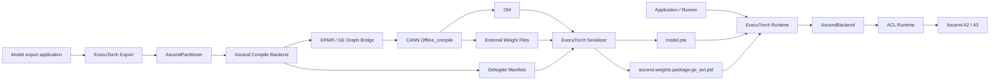
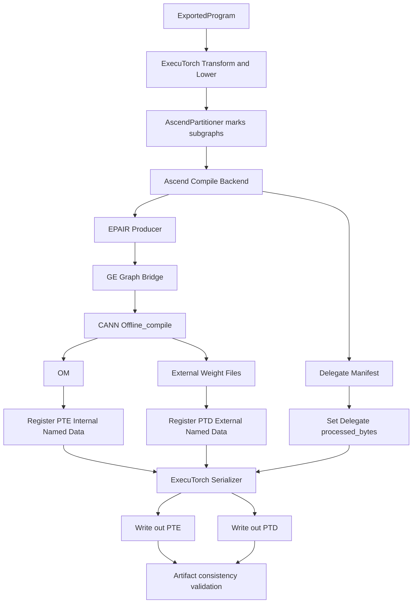
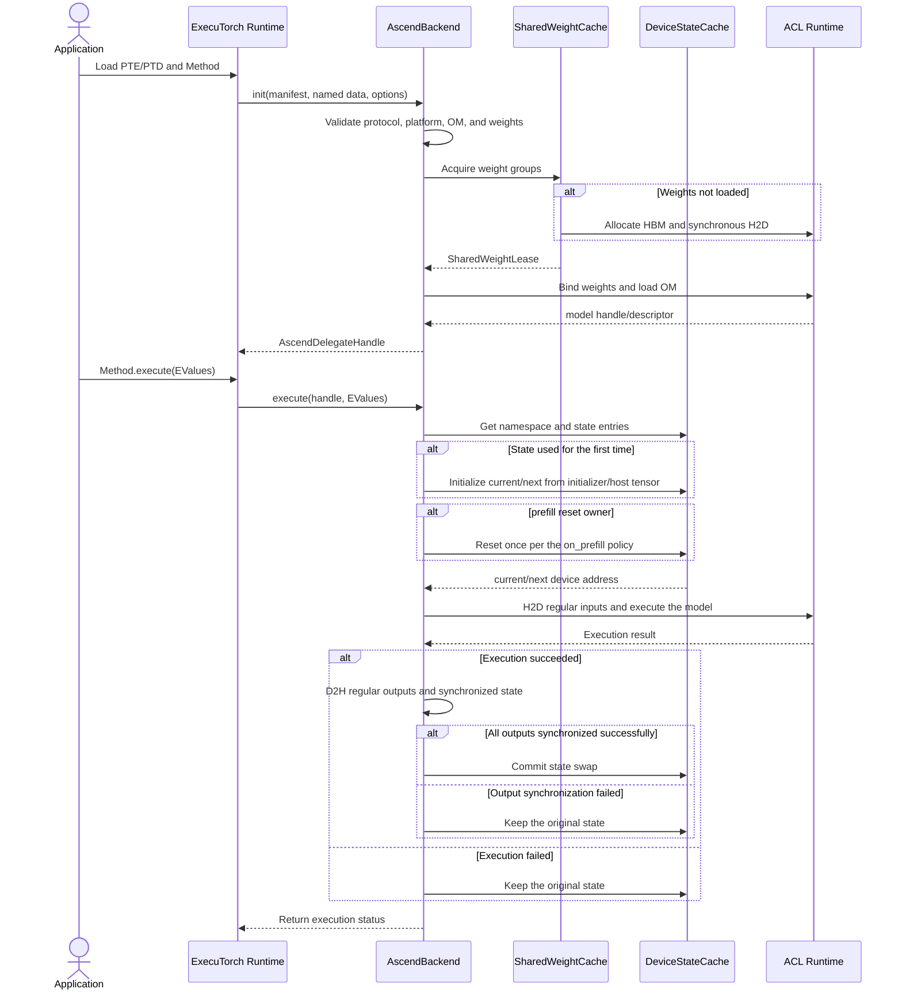
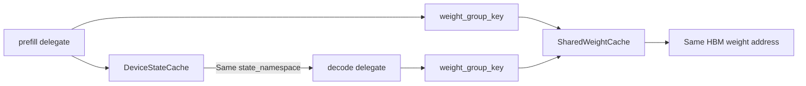
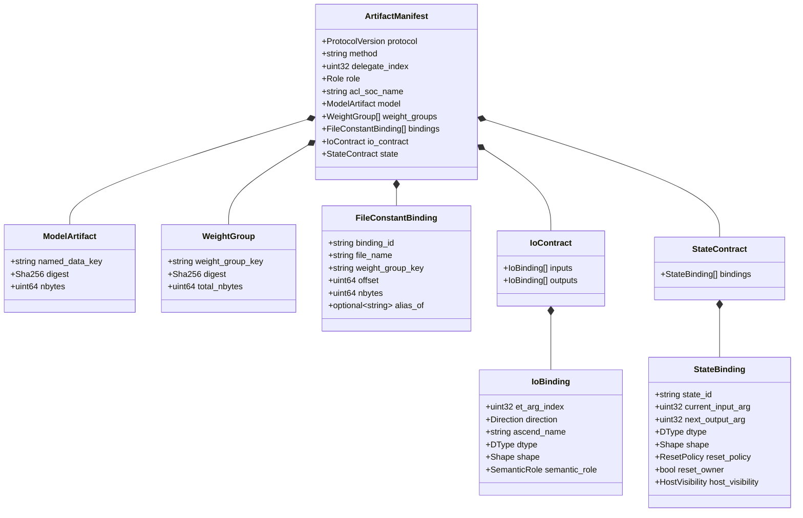
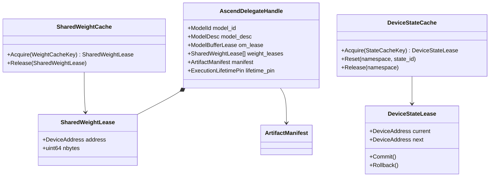
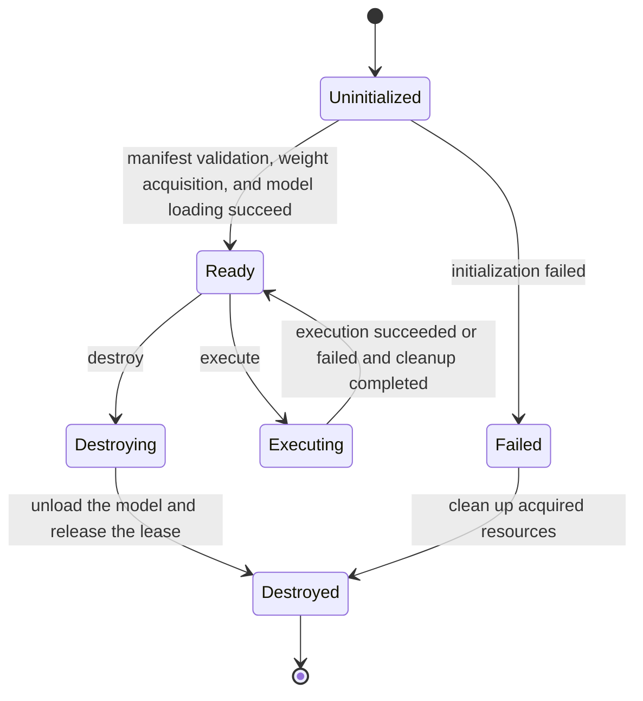
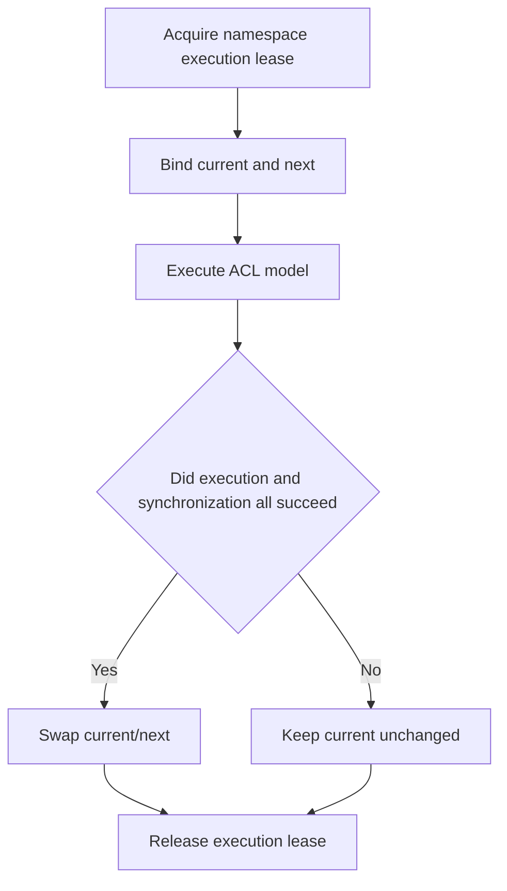

# Introduction

## Purpose

This document defines the overall design of the ExecuTorch-NPU AOT Backend, describing the end-to-end flow, module boundaries, and key data structures from PyTorch model export, offline compilation of Ascend subgraphs, and PTE/PTD packaging through to execution on Ascend devices.

This document is primarily intended for developers and maintainers of the ExecuTorch-NPU compile side, runtime side, integration adapter layer, and test framework.

For the field-level protocol reference of the artifact, see
[`../../examples/manifest_schema/manifest-v1.schema.json`](../../examples/manifest_schema/manifest-v1.schema.json);
it does not participate in build or runtime validation. For field encoding and runtime rules, see [`../protocol.md`](../protocol_en.md).

## Scope

This document covers:

- ExecuTorch backend delegation and the Ascend subgraph compilation flow.
- Integration boundaries of EPAIR, GE Graph, and CANN Offline_compile.
- Artifact organization of PTE, PTD, and the delegate manifest.
- Model loading and synchronous execution flow of the Ascend runtime backend.
- Prefill/decode weight reuse and device state passing.
- Key data structures, lifecycles, compatibility, and test design.

This document does not cover:

- Operator support lists and graph partitioning algorithm details.
- EPAIR internal formats and GE graph conversion algorithms.
- The complete JSON Schema of the manifest and field-level encoding implementations.
- Installation steps for specific external dependency versions; for the version matrix, see [`../supported_versions.md`](../supported_versions_en.md).
- Online compilation, asynchronous execution, and device tensor zero-copy.
- Quantization, serving scheduling, and multi-tenant resident caching.

# Overall Overview

## Software Overview

### Project Introduction

ExecuTorch-NPU is the Ascend AOT backend for ExecuTorch. During the compilation phase, it obtains Ascend subgraphs through ExecuTorch delegation, converts them into GE Graphs, and uses CANN Offline_compile to generate OMs and external weights. During the runtime phase, ExecuTorch loads the PTE/PTD and calls ACL through the Ascend runtime backend to load and execute the OMs.

This solution does not establish a model container or execution framework independent of ExecuTorch. The execution plan, delegate information, and OMs reuse the PTE; external weights reuse the PTD; and the compile side and runtime side pass artifact, I/O, state, and compatibility information through a versioned manifest.

### Product Environment



The related modules and their responsibilities are as follows:

| Module | Main Responsibilities |
|---|---|
| ExecuTorch adapter | Interfaces with delegation, PTE/PTD serialization, Program/Method loading, and backend dispatch |
| `AscendPartitioner` | Identifies Ascend-executable subgraphs and marks delegates |
| Ascend compile backend | Compiles delegated programs into OMs and generates manifests and named data |
| EPAIR/GE Graph bridge | Performs the `ExportedProgram -> EPAIR -> GE Graph` conversion |
| CANN offline compiler adapter | Manages offline compilation and generates OMs and external weight files |
| Artifact packager | Writes OMs, weights, and manifests into PTE/PTD |
| `AscendBackend` | Validates artifacts, loads ACL models, executes inference, and manages resources |
| `SharedWeightCache` | Reuses read-only weight HBM on the same device |
| `DeviceStateCache` | Maintains device state such as KV across multiple methods of the same request |

## Software Functions

This solution needs to implement the following functions:

1. Bring one or more `ExportedProgram` instances into the ExecuTorch backend delegation flow.
2. Preserve the ATen operator targets of delegated programs and convert them into EPAIR and GE Graph.
3. Use CANN Offline_compile to generate OMs based on static or bounded dynamic shape profiles determined at compile time,
   along with separate external weight files.
4. Write the execution plans, manifests, and OMs of all methods/delegates into a single PTE.
5. Write all external weights into a single PTD and reuse identical weights by content.
6. Validate the protocol, platform, OM, weights, I/O, and state contracts at runtime.
7. Load an ACL model independently for each delegate; prefill/decode can share device weights.
8. Pass device state such as KV through an explicit state contract and request namespace.
9. Use synchronous ACL execution for regular I/O; commit state after successful execution and roll back on failure.
10. Provide deterministic errors for incompatibility, data corruption, insufficient resources, and execution failures.

## Design Constraints

1. Do not modify the ExecuTorch PTE/PTD formats or runtime core semantics.
2. Calling GE, ATC, operator compilation, JIT, or online shape compilation interfaces is prohibited during the runtime phase.
3. The compilation phase always uses external weight mode: the OM resides in the PTE and the weights reside in the PTD.
4. The core release artifacts of one export from the backend are one PTE and one PTD; no standalone manifest file is generated. Examples or the application layer may additionally write a versioned metadata sidecar (for example `generation_config.json`) to record the tokenizer or static generation capacity; the sidecar must not carry, replace, or override the delegate manifest, OM, weights, I/O, or state contract, and the backend runtime does not read it as an artifact contract.
5. The compile side and runtime side must use the same version of the manifest schema and golden corpus.
6. Artifact identity uses the named-data key, full SHA-256, and exact byte count; paths or truncated digests are not used.
7. Two profiles are supported: static shape and compile-time bounded dynamic shape. The dimension ranges of dynamic shapes must
   be written into the artifact/manifest at compile time; at runtime, only shapes within the already compiled ranges can be executed.
8. Regular I/O uses synchronous execution; asynchronous and zero-copy modes require a separate design.
9. Read-only weights can be shared across sessions; mutable state can only be shared within the same request namespace.
10. Interface differences of external dependencies are isolated by the adapter layer; the design document only defines dependency capabilities.
11. **Compilation and export must be decoupled from the NPU device environment**. The three phases of PT2 export, EPAIR/GE Graph construction, and OM offline
    compilation must not require the process to see or bind a physical NPU; the target chip can only be passed in as the `acl_soc_name`
    parameter. A device is required only in the runtime phase (loading the PTE/PTD and executing). Any newly added
    compile-time capability that introduces device queries, device binding, or device-side execution is considered a violation of this constraint.

### Shape Profile

Profile v1 supports two categories of offline compilation shapes:

1. **Static shape**: every input dimension is fixed in the manifest and the ACL descriptor.
2. **Bounded dynamic shape**: regular inputs may contain dynamic dimensions, and the manifest also records the
   minimum and maximum value of each dynamic dimension; at runtime, only shapes within that range and already supported by offline compilation can be used.

Dynamic shape does not mean the model can be recompiled at runtime or its capacity expanded. All dynamic ranges, operator constraints, and physical
state capacities are still determined during the export and offline compilation phases. The physical shape of state tensors remains fixed; when ACL returns
an unknown or zero size for dynamic state, the runtime binds using the actual capacity of the registered state.

## Assumptions and Dependencies

- ExecuTorch provides backend delegation, PTE/PTD named data, and runtime backend dispatch capabilities.
- The EPAIR/GE Graph integration layer can produce an offline-compilable GE Graph from a delegated program.
- The CANN compile environment provides Offline_compile and **does not require an NPU device to be present**; the runtime environment provides ACL, drivers, and a matching device.
- The toolkits in the compile environment must come from the same source: the OPP operator implementation and the TBE Python framework must come from the same CANN installation;
  `ASCEND_OPP_PATH` must not be the only thing overridden while mixing in a TBE from another version.
- The compile side can obtain the authoritative mapping between OM FileConstants and external weight files.
- The Runner can pass `device_id`, `state_namespace`, and initial state values to the backend.
- The supported version matrix defines fixed combinations of PyTorch, ExecuTorch, CANN, and ABI, as well as
  the required TorchDelegate capabilities; when TorchDelegate follows an upstream version, the combination must be re-validated.

## ExecuTorch Export Compatibility

The export entry must use `aten_edge_compile_config()`; `EdgeCompileConfig` must not be constructed directly
in applications or examples. This adapter selects the configuration according to the known ExecuTorch API signature:

| ExecuTorch API | Configuration | Handling of the delegated program |
|---|---|---|
| legacy | `_use_edge_ops=False` | Preserve the ATen overload target |
| current | `_skip_dim_order=True` | Restore known `EdgeOpOverload` targets to their underlying ATen overloads before entering EPAIR |
| unknown | Do not construct a configuration | Fail explicitly before export and require re-validation |

Edge targets of the current API are not an error condition. ExecuTorch-NPU restores their underlying
ATen overloads before handing them to TorchDelegate; targets that cannot be restored must fail with node and target context. The identity
`_clone_dim_order` can be normalized to `aten.clone`; non-identity dim-order layouts must be rejected.
`aten.copy.default` is reserved for TorchAir/TorchDelegate conversion and must not be rewritten as `aten.alias.default`.

# ExecuTorch-NPU AOT Backend Requirements Analysis and Design

## Overall Introduction

### Usage Scenarios

| Scenario | Description |
|---|---|
| Single-method model | One PTE method contains one or more Ascend delegates |
| Multi-method model | Methods such as prefill and decode are written into the same PTE and share one PTD |
| Stateless inference | All inputs and outputs are handled through regular EValues and synchronous H2D/D2H |
| Stateful inference | State is passed on the device side through the state contract and `state_namespace` |
| Weight reuse | Weights with identical content are stored once in the PTD and uploaded once on the device side |

### Core Design Principles

1. **AOT first**: all model compilation is completed in the export phase; the runtime only loads and executes.
2. **Device-independent compilation and export**: PT2 export, EPAIR/GE Graph construction, OM offline compilation, and PTE/PTD
   packaging never depend on NPU hardware throughout the process; the target chip is described only by the `acl_soc_name` parameter. This is a **design certainty,
   not an optional optimization or degraded mode**: the compile side and runtime side can therefore reside on different machines and in different Python environments,
   and artifacts are delivered by content addressing. A device is required only in the runtime phase (loading the PTE/PTD and executing).
3. **ExecuTorch-native integration**: reuse delegation, PTE, PTD, Program, and Method.
4. **Protocol-driven**: the runtime relies only on the manifest and named data and does not infer compile-side semantics.
5. **Content addressing**: OMs and weights are deterministically associated via key, full digest, and size.
6. **Separation of read-only and mutable resources**: weights are shared per device; state is isolated per request.
7. **No commit on failure**: if compiling any delegate fails, the entire export fails; if execution fails, state is not committed.

## Functional Requirements

### Compilation and Export

1. Introduction

The compile side receives one or more `ExportedProgram` instances, completes subgraph delegation through ExecuTorch, compiles each Ascend delegate into an independent OM, and finally produces the unified PTE/PTD release artifacts.

**Compilation and export do not depend on NPU hardware; this is a design certainty.** All processing steps in this section must be
completable in a process with no NPU device present and `device_count == 0`; the target chip is described only through the `acl_soc_name`
parameter and is not inferred from local devices. The compile side and runtime side can therefore reside on different machines and environments, and artifacts are
delivered by content addressing. Any design that requires querying devices, binding devices, or executing on devices at compile time is not accepted.

2. Inputs

- An `ExportedProgram` for a single method or multiple methods.
- Ascend partitioning and offline compilation configuration.
- A validated ACL SoC name and state description.

3. Processing

- Preserve the ATen targets of the delegated program.
- Generate EPAIR and GE Graph for each method/delegate. This step is completed in a device-free environment through the Lite
  export mechanism; see "Key Technologies / Device-Free Lite Export".
- Use CANN Offline_compile to generate the OM and external weights. OM file names may carry a host os/arch suffix;
  locate them by prefix matching during packaging and do not hardcode `.om`.
- Generate a manifest consistent with the runtime side.
- Register the OM as PTE internal named data.
- Register the weights as PTD external named data.
- Deduplicate weights across multiple methods by content.
- Perform cross-manifest validation of the type, shape, visibility, and reset policy of the same state ID; a unique prefill reset owner is guaranteed only for `on_prefill` states.
- Re-validate the correspondence among the PTE, PTD, and manifest after writing.

4. Outputs

- One `model.pte` containing all execution plans, delegate manifests, and OMs.
- One PTD containing all external weights.

### Artifact Protocol

1. Introduction

The manifest is the only artifact contract between the compile side and the runtime side. Each delegate has an independent manifest, saved alongside the PTE via `processed_bytes`.

2. Protocol Composition

| Category | Main Content |
|---|---|
| Protocol identity | framing version, runtime protocol, artifact ABI |
| Delegate identity | method, delegate index, execution role |
| Model information | OM named-data key, digest, and size |
| Device information | validated ACL SoC |
| Weight information | weight groups and FileConstant bindings |
| I/O information | EValue indices, ACL tensor names, dtype, shape, and semantic role |
| State information | state ID, input/output indices, reset policy, and host visibility |

3. Key Rules

- Profile v1 uses runtime protocol v1, artifact ABI 1, and a single-OM external-weight artifact.
- The OM location is fixed as PTE named data; the weight location is fixed as PTD named data.
- The method name, delegate index, and execution role must be explicitly recorded.
- A weight group must be non-empty; every OM FileConstant must have a binding, and duplicate content can share the same group range through a canonical binding and alias.
- Regular I/O can use static shapes or bounded dynamic shapes declared at compile time, and must be consistent with the ACL model
  descriptor and its shape range; the physical shape of state tensors must be fixed and consistent in the cross-method
  contract.
- Prefill/reset semantics are expressed through explicit roles and the reset owner, not inferred from method names.
- The metadata and reset policy of the same state ID must be consistent across methods; only `on_prefill` states must have exactly one reset owner among all prefill delegates, and `explicit` and `never` states must not have an owner set.
- The version must be upgraded whenever protocol behavior changes.

### Runtime Loading

1. Introduction

During the method loading phase, the runtime side parses the manifest, obtains the PTE/PTD data, loads the weights, and creates the ACL model. After loading completes, the execution path no longer reads compilation intermediates.

2. Inputs

- The PTE program and delegate `processed_bytes`.
- The PTD named-data map.
- `device_id`, `state_namespace`, and optional initial state values.

3. Processing

- Validate the protocol version and delegate identity.
- Validate the validated ACL SoC.
- Obtain and validate the OM and weights by key.
- Obtain device addresses from the shared weight cache.
- Bind FileConstants and load the ACL model.
- Validate the count, order, dtype, and shape of the I/O contract using the ACL model descriptor.
- Save the state namespace and the initial values indexed by state ID for first execution or reset.
- Re-check cross-manifest state consistency and reset owner uniqueness during session assembly.
- Create the delegate handle.

4. Outputs

- An executable `AscendDelegateHandle`.
- A lease on the shared device weights.
- State access capability associated with the request namespace.

### Synchronous Execution

1. Introduction

The runtime side uses synchronous ACL execution. Regular tensors complete device memory allocation, H2D, execution, and D2H within a single call; state tensors are bound through the device state cache.

2. Processing

- Validate the count, order, dtype, and shape of EValues.
- Create call-level ACL buffers and datasets for regular inputs and outputs.
- On first use of a state, establish current/next according to host visibility and the initializer.
- For `on_prefill` states, perform the reset exactly once, only by the explicit reset owner.
- Bind the state current/next to the device state cache.
- Call the synchronous ACL model execute.
- On success, copy back regular outputs and commit the state swap.
- On failure, release call-level resources and do not swap the state.

3. Outputs

- Regular outputs are written back to host EValues.
- State is committed to the current request namespace on success.
- ACL or protocol errors are converted into ExecuTorch backend errors.

### Weight and State Sharing

1. Introduction

Weights and states use different sharing scopes and identity models:

| Resource | Sharing Scope | Identity |
|---|---|---|
| Read-only weights | Multiple models/sessions on the same device | device, weight key, full digest, size |
| Mutable state | Multiple methods/delegates of the same request | device, state namespace, state ID |

2. Processing

- When prefill/decode reference the same weights, the same HBM address is reused.
- Weight HBM is reclaimed after the last model lease is released.
- Each state uses current/next double buffering.
- Executions within the same namespace are serialized; different namespaces are isolated from each other.
- `on_prefill`, `explicit`, and `never` perform initialization and reset according to the state contract.
- State is swapped only after execution and synchronization all succeed.
- `device_only` and `synchronized` states have different host visibility as defined by the manifest.

## Basic Flows

### Compilation and Packaging Flow



### Runtime Loading and Execution Flow



### Multi-Method Sharing Flow



## Non-Functional Requirements

### Maintainability

- The compile side and runtime side share the manifest schema, version definitions, and golden corpus.
- Differences among ExecuTorch, EPAIR/GE, and CANN are concentrated in the adapter layer.
- Artifacts, ACL models, weights, and states are managed by independent modules.
- The overall design and the detailed design are maintained in separate layers, keeping external dependency implementation details out of the stable architecture document.

### Testability

- The compilation flow, manifest, packaging, cache, and state logic all support fakes or stubs.
- Protocol, PTE/PTD, and resource lifecycle tests can be completed without an NPU environment.
- A real validated Ascend SoC environment covers ACL loading, execution, accuracy, and long-term stability tests.

### Portability

Profile v1 of this design targets Linux/aarch64 and validated Ascend SoCs. Device differences are expressed through exact-match validation between the artifact `acl_soc_name` and the runtime device SoC name, without scattering device model branches throughout the core flow.

### Reliability

- All external data is validated for version, bounds, digest, and size before use.
- Models, weights, states, and call-level resources use explicit ownership and release order.
- Multi-delegate export uses all-or-nothing semantics.
- Execution failure does not pollute already-committed device state.
- Destroy waits for in-flight executions before unloading models and releasing leases.

### Platform Requirements

Production runs must explicitly specify `device_id` and a request-unique `state_namespace`. Automatic card selection can only be an explicitly enabled convenience policy, and the actual selection result must be recorded.

### Feature Cross-Analysis

| Scenario | Applicability | Design Conclusion |
|---|---|---|
| Static shape | Applicable | Compilation, manifest, ACL descriptor, and EValue must be consistent |
| Dynamic shape | Applicable | Only bounded dynamic shapes with compile-time determined ranges are supported; the runtime does not trigger online compilation |
| Multi-method | Applicable | Each delegate has an independent OM and shares the PTE/PTD, weight, and state protocols |
| Offline scenarios | Applicable | All model compilation is completed before release |
| Online compilation | Not applicable | The runtime contains no GE/ATC/JIT path |
| CPU fallback | Out of scope | Determined by partitioning and the upper-layer execution plan; does not change the Ascend artifact protocol |

## Performance

### Model Compilation Duration

Each delegate independently performs EPAIR conversion and Offline_compile. In multi-method scenarios, repeated initialization is reduced by reusing the Offline_compile lifecycle, and deterministic traversal guarantees stable artifacts. The compilation flow prioritizes correctness and does not commit to parallel compilation in the overall design.

### PTE/PTD Size and Loading Memory

The OM is written into the PTE and the weights into the PTD. Identical weights across methods/delegates are saved once by full content identity. At runtime, weights are reused per device, while OMs are held independently per delegate.

### Execution Performance

The main overhead of the synchronous execution profile is the H2D/D2H of regular I/O and dataset creation. Weights are not re-uploaded during execute, and device state is not repeatedly copied back between prefill/decode. Subsequent performance optimizations must use this synchronous flow as the correctness baseline.

## Interface Design

### External Interfaces

| Interface Category | Purpose |
|---|---|
| Python export entry | Receives one or more `ExportedProgram` instances and outputs PTE/PTD |
| Backend registration | Registers `AscendBackend` before method loading |
| Program/Method runner | Loads PTE/PTD, passes backend options, and executes methods |
| State control | Initializes, resets, and releases device state of a specified namespace |

### Backend Core Interfaces

| Interface | Overall Semantics |
|---|---|
| Availability | Probes basic backend availability without side effects |
| Init | Parses the manifest, validates artifacts, acquires weights, and loads the ACL model |
| Execute | Validates I/O, binds regular tensors and state, executes synchronously, and commits results |
| Destroy | Waits for in-flight executions, unloads the model, and releases weight leases |

Function signatures and backend option passing for specific ExecuTorch versions are handled by the adapter layer and do not change the overall semantics above.

### Interface Checklist

| Checklist Item | Conclusion |
|---|---|
| External model format | Reuse PTE/PTD; no new container format |
| Compile and runtime protocol | Requires joint review and version management |
| Call sequence | export -> package -> register -> load -> execute -> destroy |
| Illegal inputs | Fail deterministically before Offline_compile or ACL execute |
| Lifecycle | PTE/PTD, model, weight lease, and state namespace must cover their usage scope |
| Independent testing | Protocol, packaging, cache, state, and the ACL facade all require tests |

## Software Design

### Key Data Structures



The manifest only describes artifacts and runtime semantics; it does not hold OMs, weights, or device resources. OMs and weights are looked up independently via named-data keys.



The responsibilities of the key data structures are as follows:

| Data Structure | Responsibility |
|---|---|
| `ArtifactManifest` | The artifact contract shared between the compile side and runtime side |
| `ModelArtifact` | Locates and validates the OM in the PTE |
| `WeightGroup` | Locates, validates, and reuses PTD weight data |
| `FileConstantBinding` | Maps OM FileConstants to weight group address ranges |
| `IoContract` | Constrains ExecuTorch EValues against ACL model I/O |
| `StateContract` | Describes state identity, argument mapping, reset, and visibility |
| `AscendDelegateHandle` | Holds a single ACL model and its runtime dependencies |
| `SharedWeightLease` | Manages the device lifecycle of shared read-only weights |
| `DeviceStateLease` | Manages state current/next and commit semantics during a call |

### Key Technologies

#### Device-Free Lite Export

The only step in the compilation chain that mandatorily requires a physical device is TorchAir's GE engine initialization, which couples "initializing
GE" and "binding a device" in a single C++ call. This project only needs the former, so Lite export is enabled via
`EXECUTORCH_NPU_HOST_ONLY=1` to separate the two.

Device dependencies fall into three layers, which must be handled separately:

| Layer | Location | Behavior without a device | Handling |
|---|---|---|---|
| Python | `torchair.core._backend._get_device_id()` | Calls `npu.current_device()` because `torch_npu` is already imported, throwing `aclInit 107001` | Replace with a lambda that reads `ASCEND_DEVICE_ID` |
| C++ | `_torchair.InitializeGraphEngine()` | Unconditionally calls `acl.rt.set_device()` internally, returning 107001 | Stub the C++ leaf function |
| Op converter | `torchair._utils.check_platform.is_arch35()` | Reads the physical device name through `torch_npu.npu.get_device_name()`; without a device the device index resolves to `None`, so `None < 0` raises `TypeError`, and TorchAir only catches `ImportError` | Replace `get_device_name()` with returning `acl_soc_name`, leaving the architecture decision to TorchAir's own device-name rule |

The third layer covers 25 converter modules in the currently pinned TorchAir revision (including
`native_batch_norm_legit_no_training`, `max_pool2d_with_indices`, `native_group_norm`, `std`, and
`npu_rotary_mul`). Its result selects GE op versions, attributes, layouts, and output semantics, so it cannot be
hardcoded to `False`; only the device-name source is replaced. Without `torch_npu` the function takes its
`ImportError` branch and returns `False`, which agrees with the currently registered SoCs; adding an arch35
target (device name containing `Ascend910_95` or `Ascend950`) requires `torch_npu` to be installed so that
`acl_soc_name` takes part in the decision.

The C++ layer cannot be bypassed via parameters: passing `0` for `deviceId` reports `ACL set device id failed`, passing `-1`
triggers `assert device_index_ >= 0`, and setting `ge_run_with_torch_npu` to `0`, switching to an independently compiled
TorchAir, or even completely blocking `torch_npu` are all ineffective. Stubbing is therefore the only option.

The stub must cover `fx2ge_converter.initialize_graph_engine`. That module imports the name directly via
`from torchair.core._backend import initialize_graph_engine`, so replacing the attribute on
`_backend` alone has no effect on it.

Stubbing only solves "no longer binding a device", but `EpairModelLoader` still requires **GE to be initialized** (otherwise it reports
`TdEpairModelLoaderCreate failed with status=1`). This requirement is satisfied by CANN's host-only
interface:

```python
ge.offline_compile.build_initialize({"ge.socVersion": soc, "ge.graphRunMode": "0"})
```

This call does not touch the device, and **`ge.externalWeightDir` must not be passed**: once specified, external weights end up in
the session workspace, causing `build_manifest` to report `CANN produced no external weight
files`; when it is not specified, GE writes the weights into the partition's `weight/` directory according to the output path, consistent with the packaging
convention.

Lite export only changes how the GE engine is initialized; it does not replace any operators. The KV cache uniformly uses
`torch_npu.scatter_update_` on both CPU and NPU, and the operators in the exported graph are completely identical to device-side export, so there are
no operator semantic or accuracy differences; the CPU reference implementation of `scatter_update_` is only used for eager execution and
testing and does not enter the exported graph.

Boundaries of Lite export:

- Covers PT2 export, EPAIR/GE Graph construction, OM offline compilation, and PTE/PTD packaging.
- Does not cover the runtime phase. Loading the PTE/PTD and executing still require a matching NPU, driver, and ACL runtime.
- Without a device, the OM produced by GE may carry a host os/arch suffix (such as `model_linux_aarch64.om`),
  so the artifact is bound to that host platform; cross-platform deployment requires recompilation on the target platform.
- The stubbed objects are internal TorchAir symbols and must be re-validated after a TorchAir upgrade.

#### Artifact Content Addressing

Both OMs and weights are validated using the named-data key, full SHA-256, and logical byte count. PTE/PTD file names and paths are used only for deployment and do not participate in runtime correctness decisions.

#### Weight Reuse

Weights with identical content map to the same weight group. At runtime, a shared lease is obtained by device and content identity, allowing different ACL models for prefill/decode to use the same HBM address.

#### State Double Buffering

Each state ID maintains two device memory blocks, current and next, under the request namespace. Execution reads current and writes next; on success they are swapped, and on failure current remains unchanged.

#### Lifecycle Management

Resource lifecycles are divided into four layers:

| Layer | Resources |
|---|---|
| Export level | Offline_compile context, staging, named-data store |
| Delegate level | Manifest, OM, ACL model, weight leases |
| Session level | device ID, state namespace, state entries |
| Call level | ACL dataset, regular I/O device buffer, execution lease |

Upper-layer resources must not borrow lower-layer memory with a shorter lifetime. Destroy must wait until call-level resources have exited before releasing delegate resources.

### Flow Design

#### Delegate Lifecycle



#### State Commit



### Modifications to Submodules

| Submodule | Main Capabilities |
|---|---|
| Python export | Unified single/multi-method export entry and PTE/PTD writing |
| Ascend partitioner | Ascend delegate marking and compile configuration passing |
| Compile backend | EPAIR/GE/OM compilation, manifest and named data generation |
| Artifact protocol | Schema, framing, producer/parser, and golden corpus |
| Runtime backend | Backend registration, init/execute/destroy, and ACL facade |
| Weight cache | Device weight reuse and lease management |
| State cache | Namespace isolation, double buffering, reset/release |
| Validation | PTE/PTD post-write validation, fake ACL, and hardware tests |

### Error Handling

#### Compilation Errors

| Exception | Handling |
|---|---|
| IR, shape, or partitioning does not meet requirements | Stop that export; do not produce partial release artifacts |
| EPAIR/GE Graph conversion failure | Return the method/delegate context and the conversion stage |
| Offline_compile failure | Clean up the intermediate resources of this run; the entire export fails |
| Incomplete OM/weight mapping | Refuse to package |
| Manifest or PTE/PTD validation failure | Delete invalid temporary artifacts and return an error |

#### Runtime Errors

| Exception | Handling |
|---|---|
| Protocol, ABI, platform, or capability incompatibility | Return a compatibility error before model loading |
| Missing OM/weights or digest mismatch | Return an external data error; do not call ACL execute |
| I/O or state mismatch | Return a parameter or type error |
| Weight upload or model load failure | Release acquired resources and return an ACL runtime error |
| Execute, synchronization, or D2H failure | Do not commit state; return an execution error |
| Conflict between destroy and execute | Wait or return a lifecycle error; do not release resources prematurely |

# Safety Checks

## Coding Rules

- All sizes, offsets, shape products, and integer conversions must be checked for overflow.
- Do not trust strings, arrays, or indices in the PTE, PTD, and manifest.
- C++ resources use RAII; do not manually maintain release paths prone to mismatch.
- Do not log the contents of input tensors, OMs, weights, or state.
- Do not perform H2D, ACL model load, or execute under the global cache lock.

## Coding Checklist

| Checklist Item | Involved | Description |
|---|---|---|
| External data parsing | Yes | Manifest, PTE, and PTD all require bounds and digest validation |
| Device resource lifecycle | Yes | ACL model, HBM weights, state, and call-level buffers are managed in layers |
| New threads | No | The synchronous profile does not create backend worker threads |
| Concurrency | Yes | Weight acquire, state namespace, and execute/destroy require concurrency protection |
| Dynamic libraries and ABI | Yes | Controlled by the supported version matrix and the adapter layer |

# Compatibility Checks

| Checklist Item | Conclusion |
|---|---|
| ExecuTorch model format | Reuse PTE/PTD; do not modify the format |
| Backend ID | Fixed as `AscendBackend` |
| Manifest | Versioned via framing, runtime protocol, and artifact ABI |
| ACL SoC | The compile target, manifest, and actual device are validated with the same exact name |
| Weights | Compatible by named-data key, full digest, and size |
| Shape | Profile v1 supports static shape and compile-time bounded dynamic shape |
| Old protocols | Compatible only when explicit migration logic exists; otherwise deterministically rejected |
| New semantics | New artifacts, undeclared dynamic shapes, asynchronous or state semantics require a protocol upgrade |

# DT Design

## Test Boundaries

Test entries include Python export, Ascend preprocess, PTE/PTD loader, backend registration, method load, execute, state reset/release, and destroy. Test exits include release artifacts, manifest, ACL call sequence, weight upload count, output results, state commit, and resource release.

## Test Design

| Test Category | Key Test Items | Case Type |
|---|---|---|
| Compilation | Single/multi-method, ATen target, static/bounded dynamic shape, compilation failure rollback | UT/ST |
| Protocol | Producer/parser equivalence, versions, bounds, duplicate keys, and fuzz | UT |
| Packaging | One PTE/PTD, OM/weight locations, key/hash/size consistency | UT/ST |
| Loading | Platform compatibility, OM/weight validation, ACL model loading | UT/ST |
| Weights | Prefill/decode H2D once, concurrent acquire, final release | UT/ST |
| State | Namespace isolation, reset, successful swap, failed rollback | UT/ST |
| Execution | Regular I/O, ACL errors, no compilation or weight loading inside execute | UT/ST |
| Lifecycle | Destroy/execute races, OM/weight/state release order | UT/ST |
| Hardware | A2/A3 accuracy, long-term stability, memory, and zero runtime compilations | ST/BBIT |

## Test Framework Design

Tests are divided into three layers:

1. Hardware-free unit tests: schema, parser, packaging, cache, state, and fake ACL.
2. Host integration tests: real PTE/PTD loader and backend dispatch, with ACL using a stub or fake.
3. A2/A3 hardware tests: real OM loading, weight binding, execution accuracy, state, and long-term stability.

When hardware tasks are skipped, this must be explicitly reported and must not be treated as passing functional verification.

# Acceptance Criteria

1. Both single-method and multi-method models can export one valid PTE and one valid PTD.
2. The PTE contains all execution plans, delegate manifests, and OMs; the PTD contains all external weights.
3. The manifest generated by the compile side can be consistently parsed and validated by the runtime side.
4. The runtime does not call any model compilation interface.
5. When prefill/decode share weights, the device side allocates and uploads them only once.
6. The same state namespace passes state correctly; different namespaces do not cross-talk.
7. No execution failure commits state; no initialization failure leaks resources.
8. Incompatibility, data corruption, I/O errors, and ACL errors are all returned deterministically at the correct stage.
9. Static shape and bounded dynamic shape models on A2/A3 pass functional, accuracy, concurrency, and long-term stability tests respectively.
10. The overall design, detailed design, schema, implementation, and tests use a consistent protocol version and key invariants.

## Design Document Check Results

- [x] Compile and runtime boundary: the compilation phase generates the OM; the runtime phase only loads and executes.
- [x] Artifact boundary: the PTE stores the execution plan, manifest, and OM; the PTD stores external weights.
- [x] Multi-method: each delegate has an independent OM and shares the PTE/PTD and content-addressed weights.
- [x] State management: state is passed through an explicit state contract, namespace, and double buffering.
- [x] Lifecycle: export-level, delegate-level, session-level, and call-level resources are clearly defined.
- [x] Long-term maintainability: external dependencies are described by capability; version and interface differences are managed by the adapter layer.
