# ExecuTorch-NPU Stack

本文用分层结构图描述ExecuTorch-NPU从PyTorch模型导出到Ascend NPU
执行的完整链路。图中内容对应当前仓库的静态shape、整图委托和外置权重
profile，不表示ExecuTorch或CANN的全部能力。

## 总体结构

```mermaid
flowchart TB
    subgraph PREP["程序准备 / Offline & Compile-time"]
        direction TB

        subgraph AUTHORING["模型准备"]
            direction LR
            USER["模型开发者"]:::modeling --> MODULE["PyTorch nn.Module<br/>例如 MobileNetV2"]:::modeling
            MODULE --> EXPORT["torch.export.export"]:::executorch
            EXPORT --> EP["ExportedProgram<br/>ATen operators + static shape"]:::executorch
        end

        subgraph LOWERING["ExecuTorch 转换与委托"]
            direction TB
            EDGE["to_edge_transform_and_lower<br/>aten_edge_compile_config()"]:::executorch
            PART["接入层 1：AscendPartitioner<br/>当前 profile 整图委托"]:::integration
            DELEGATED["Delegated ExportedProgram<br/>CompileSpec + delegate identity"]:::executorch
            PREPROCESS["接入层 2：BackendDetails<br/>AscendBackend.preprocess"]:::integration
            EXT_PART["扩展点 A<br/>算子能力检测、部分图委托与 fallback"]:::extension
            EDGE --> PART --> DELEGATED --> PREPROCESS
            PART -.-> EXT_PART
        end

        subgraph CANN_AOT["torch-delegate 与 CANN AOT 编译"]
            direction TB
            EPAIR["torch-delegate<br/>ExportedProgram to EPAIR"]:::bridge
            GE["EpairModelLoader<br/>EPAIR to GE Graph"]:::bridge
            OFFLINE["CANN Offline_compile<br/>ge.externalWeight = 1"]:::cann
            OM["OM 模型"]:::artifact
            WEIGHTS["CANN 外置权重文件"]:::artifact
            EXT_COMPILE["扩展点 B<br/>新 converter、量化、动态 shape 与编译选项"]:::extension
            EPAIR --> GE --> OFFLINE
            OFFLINE --> OM
            OFFLINE --> WEIGHTS
            GE -.-> EXT_COMPILE
        end

        subgraph PACKAGE["ExecuTorch 产物封装"]
            direction TB
            CONTRACT["I/O contract + state contract<br/>manifest + SHA-256"]:::backend
            STORE["NamedDataStore"]:::executorch
            SERIALIZE["ExecuTorch serialization<br/>to_executorch"]:::executorch
            PTE["model.pte<br/>execution plan + manifest + OM"]:::artifact
            PTD["ascend.weights.package.ge_aot.ptd<br/>external weights"]:::artifact
            EXT_PROTOCOL["扩展点 C<br/>协议版本、多 profile 与新 artifact kind"]:::extension
            CONTRACT --> SERIALIZE
            STORE --> SERIALIZE
            SERIALIZE --> PTE
            SERIALIZE --> PTD
            CONTRACT -.-> EXT_PROTOCOL
        end

        EP --> EDGE
        PREPROCESS --> EPAIR
        PREPROCESS -.->|构造契约| CONTRACT
        OM --> STORE
        WEIGHTS --> STORE
    end

    subgraph EXEC["程序执行 / Online & Runtime"]
        direction TB

        subgraph APP["应用层"]
            direction LR
            INPUT["应用输入<br/>ExecuTorch Tensor"]:::modeling --> APPLICATION["Application /<br/>executorch_npu_runner"]:::modeling
            APPLICATION --> MODULE_API["ExecuTorch Module API"]:::executorch
        end

        subgraph ET_RUNTIME["ExecuTorch Runtime"]
            direction TB
            LOAD["加载 PTE + PTD<br/>合并 NamedDataMap"]:::executorch
            DISPATCH["执行 execution plan<br/>dispatch AscendBackend"]:::executorch
            LOAD --> DISPATCH
        end

        subgraph ASCEND_RUNTIME["接入层 3：ExecuTorch BackendInterface / ExecuTorch-NPU Runtime"]
            direction TB
            INIT["BackendInterface.init<br/>校验 manifest、ACL SoC、OM 和权重"]:::integration
            WEIGHT_CACHE["SharedWeightCache<br/>权重 H2D + FileConstant 绑定"]:::backend
            MODEL_LOAD["aclmdlLoadWithConfig<br/>校验 ACL model descriptor"]:::cann
            EXECUTE["BackendInterface.execute<br/>校验 I/O + 组织 ACL datasets"]:::integration
            ACL_EXEC["aclmdlExecute<br/>输入 H2D / 输出 D2H"]:::cann
            EXT_RUNTIME["扩展点 D<br/>零拷贝、异步执行、buffer 复用与性能分析"]:::extension
            INIT --> WEIGHT_CACHE --> MODEL_LOAD --> EXECUTE --> ACL_EXEC
            EXECUTE -.-> EXT_RUNTIME
        end

        subgraph DEVICE["Ascend 运行平台"]
            direction TB
            ASCENDCL["AscendCL Runtime"]:::cann
            DRIVER["Ascend Driver + Firmware"]:::cann
            NPU["Ascend NPU"]:::cann
            ASCENDCL --> DRIVER --> NPU
        end

        MODULE_API --> LOAD
        DISPATCH --> INIT
        ACL_EXEC --> ASCENDCL
        NPU --> OUTPUT["推理输出<br/>ExecuTorch Tensor"]:::modeling
        OUTPUT --> APPLICATION
    end

    PTE --> LOAD
    PTD --> LOAD

    classDef modeling fill:#dcefd5,stroke:#55734d,color:#152311,stroke-width:1px
    classDef executorch fill:#ddd6ed,stroke:#665985,color:#1d1830,stroke-width:1px
    classDef backend fill:#c7b9e2,stroke:#554276,color:#1d1530,stroke-width:1px
    classDef integration fill:#b8a5dd,stroke:#452d70,color:#160d29,stroke-width:3px
    classDef bridge fill:#d9e6f5,stroke:#4f6f92,color:#122338,stroke-width:1px
    classDef cann fill:#f8e8b8,stroke:#8b6a27,color:#332508,stroke-width:1px
    classDef artifact fill:#f5d99b,stroke:#8b6a27,color:#332508,stroke-width:1px
    classDef extension fill:#fff4cf,stroke:#9b6d00,color:#3a2800,stroke-width:2px,stroke-dasharray:5 3
```

图中粗紫色边框表示ExecuTorch标准backend接入层，黄色虚线边框表示当前实现
之上的主要扩展点。EPAIR、GE Graph、CANN Offline_compile和ASCD manifest
位于标准接口内部，是CANN专用实现。

## 接入层级与扩展点

| 标记 | 标准接口或扩展方向 | 当前实现 |
|---|---|---|
| 接入层1 | `Partitioner`：识别可委托节点并生成delegation tag | `AscendPartitioner(AllNodePartitioner)`，当前整图委托 |
| 接入层2 | `BackendDetails.preprocess()`：将delegated program编译成backend产物 | `AscendBackend.preprocess()` 内执行EPAIR、GE和CANN离线编译 |
| 接入层3 | `BackendInterface`：运行时backend的 `init/execute/destroy` | C++ `AscendBackend` 加载OM、绑定权重并调用AscendCL |
| 扩展点A | 算子能力和图划分 | 增加算子支持表、部分图委托、多partition和unsupported-op fallback |
| 扩展点B | 编译桥和编译能力 | 增加ATen/Edge converter、量化、动态shape、精度与调优选项 |
| 扩展点C | 产物和协议 | 增加artifact kind、多shape profile、量化信息或新runtime protocol |
| 扩展点D | 运行时性能与设备I/O | 增加buffer池、device tensor、零拷贝、异步stream和profiling |

## 分层职责

| 层次 | 主要职责 | 对应实现 |
|---|---|---|
| 模型准备 | 构造 `nn.Module`，用样例输入导出静态 `ExportedProgram` | 示例入口：[`examples/mobilenet_v2/export.py`](../../examples/mobilenet_v2/export.py) |
| ExecuTorch转换 | 使用compatibility adapter配置导出；进入TorchDelegate前将已知Edge target恢复为ATen，再将完整计算图标记为 `AscendBackend` delegate | [`edge_compile_config.py`](../../python/executorch_npu/edge_compile_config.py)、[`partitioner.py`](../../python/executorch_npu/partitioner.py)、[`compile_spec.py`](../../python/executorch_npu/compiler/compile_spec.py) |
| Ascend AOT backend | 生成EPAIR、取得GE Graph并调用CANN Offline_compile | [`backend.py`](../../python/executorch_npu/backend.py)、[`pipeline.py`](../../python/executorch_npu/compiler/pipeline.py)、[`offline.py`](../../python/executorch_npu/compiler/offline.py) |
| 产物封装 | 构造Pydantic Manifest，完成业务检查后编码，将OM写入PTE internal named data、外置权重写入统一PTD external named data | [`builder.py`](../../python/executorch_npu/artifacts/builder.py)、[`io_contract.py`](../../python/executorch_npu/artifacts/io_contract.py)、[`manifest.py`](../../python/executorch_npu/artifacts/manifest.py) |
| ExecuTorch Runtime | 加载PTE/PTD，执行execution plan，将delegate调度到注册名 `AscendBackend` | ExecuTorch runtime与 `runtime/ascend_backend.cpp` |
| Ascend backend runtime | 校验协议和产物，缓存并绑定设备权重，加载OM，搬运I/O并调用ACL执行 | `runtime/ascend_backend.cpp`、`runtime/manifest.cpp` |
| Ascend平台 | 提供AscendCL、驱动、固件和NPU执行环境 | CANN Toolkit和设备软件栈 |
