# ExecuTorch-NPU Stack

This document uses a layered structure diagram to describe the complete ExecuTorch-NPU path from PyTorch model export to Ascend NPU
execution. The diagram corresponds to the current repository's static-shape, whole-graph-delegation, and external-weights
profile; it does not represent the full capabilities of ExecuTorch or CANN.

## Overall Structure

```mermaid
flowchart TB
    subgraph PREP["Program Preparation / Offline & Compile-time"]
        direction TB

        subgraph AUTHORING["Model Preparation"]
            direction LR
            USER["Model Developer"]:::modeling --> MODULE["PyTorch nn.Module<br/>e.g. MobileNetV2"]:::modeling
            MODULE --> EXPORT["torch.export.export"]:::executorch
            EXPORT --> EP["ExportedProgram<br/>ATen operators + static shape"]:::executorch
        end

        subgraph LOWERING["ExecuTorch Transformation and Delegation"]
            direction TB
            EDGE["to_edge_transform_and_lower<br/>aten_edge_compile_config()"]:::executorch
            PART["Integration Layer 1: AscendPartitioner<br/>whole-graph delegation in the current profile"]:::integration
            DELEGATED["Delegated ExportedProgram<br/>CompileSpec + delegate identity"]:::executorch
            PREPROCESS["Integration Layer 2: BackendDetails<br/>AscendBackend.preprocess"]:::integration
            EXT_PART["Extension Point A<br/>operator capability detection, partial-graph delegation, and fallback"]:::extension
            EDGE --> PART --> DELEGATED --> PREPROCESS
            PART -.-> EXT_PART
        end

        subgraph CANN_AOT["torch-delegate and CANN AOT Compilation"]
            direction TB
            EPAIR["torch-delegate<br/>ExportedProgram to EPAIR"]:::bridge
            GE["EpairModelLoader<br/>EPAIR to GE Graph"]:::bridge
            OFFLINE["CANN Offline_compile<br/>ge.externalWeight = 1"]:::cann
            OM["OM Model"]:::artifact
            WEIGHTS["CANN External Weights File"]:::artifact
            EXT_COMPILE["Extension Point B<br/>new converters, quantization, dynamic shape, and compile options"]:::extension
            EPAIR --> GE --> OFFLINE
            OFFLINE --> OM
            OFFLINE --> WEIGHTS
            GE -.-> EXT_COMPILE
        end

        subgraph PACKAGE["ExecuTorch Artifact Packaging"]
            direction TB
            CONTRACT["I/O contract + state contract<br/>manifest + SHA-256"]:::backend
            STORE["NamedDataStore"]:::executorch
            SERIALIZE["ExecuTorch serialization<br/>to_executorch"]:::executorch
            PTE["model.pte<br/>execution plan + manifest + OM"]:::artifact
            PTD["ascend.weights.package.ge_aot.ptd<br/>external weights"]:::artifact
            EXT_PROTOCOL["Extension Point C<br/>protocol versions, multiple profiles, and new artifact kinds"]:::extension
            CONTRACT --> SERIALIZE
            STORE --> SERIALIZE
            SERIALIZE --> PTE
            SERIALIZE --> PTD
            CONTRACT -.-> EXT_PROTOCOL
        end

        EP --> EDGE
        PREPROCESS --> EPAIR
        PREPROCESS -.->|Construct contract| CONTRACT
        OM --> STORE
        WEIGHTS --> STORE
    end

    subgraph EXEC["Program Execution / Online & Runtime"]
        direction TB

        subgraph APP["Application Layer"]
            direction LR
            INPUT["Application Input<br/>ExecuTorch Tensor"]:::modeling --> APPLICATION["Application /<br/>executorch_npu_runner"]:::modeling
            APPLICATION --> MODULE_API["ExecuTorch Module API"]:::executorch
        end

        subgraph ET_RUNTIME["ExecuTorch Runtime"]
            direction TB
            LOAD["Load PTE + PTD<br/>merge NamedDataMap"]:::executorch
            DISPATCH["Execute the execution plan<br/>dispatch AscendBackend"]:::executorch
            LOAD --> DISPATCH
        end

        subgraph ASCEND_RUNTIME["Integration Layer 3: ExecuTorch BackendInterface / ExecuTorch-NPU Runtime"]
            direction TB
            INIT["BackendInterface.init<br/>validate manifest, ACL SoC, OM, and weights"]:::integration
            WEIGHT_CACHE["SharedWeightCache<br/>weight H2D + FileConstant binding"]:::backend
            MODEL_LOAD["aclmdlLoadWithConfig<br/>validate the ACL model descriptor"]:::cann
            EXECUTE["BackendInterface.execute<br/>validate I/O + assemble ACL datasets"]:::integration
            ACL_EXEC["aclmdlExecute<br/>input H2D / output D2H"]:::cann
            EXT_RUNTIME["Extension Point D<br/>zero-copy, asynchronous execution, buffer reuse, and profiling"]:::extension
            INIT --> WEIGHT_CACHE --> MODEL_LOAD --> EXECUTE --> ACL_EXEC
            EXECUTE -.-> EXT_RUNTIME
        end

        subgraph DEVICE["Ascend Runtime Platform"]
            direction TB
            ASCENDCL["AscendCL Runtime"]:::cann
            DRIVER["Ascend Driver + Firmware"]:::cann
            NPU["Ascend NPU"]:::cann
            ASCENDCL --> DRIVER --> NPU
        end

        MODULE_API --> LOAD
        DISPATCH --> INIT
        ACL_EXEC --> ASCENDCL
        NPU --> OUTPUT["Inference Output<br/>ExecuTorch Tensor"]:::modeling
        OUTPUT --> APPLICATION
    end

    PTE --> LOAD
    PTD --> LOAD

    classDef modeling fill:#dcefd5,stroke:#55734d,color:#152311,stroke-width:1px
    classDef executorch fill:#ddd6ed,stroke:#665985,color:#1d1830,stroke-width:1px
    classDef backend fill:#c7b9e2,stroke:#554276,color:#1d1530,stroke-width:1px
    classDef integration fill:#b8a5dd,stroke:#452d70,color:#160d29,stroke-width:3px
    classDef bridge fill:#d9e6f5,stroke:#4f6f92,color:#122338,stroke-width:1px
    classDef cann fill:#f8e8b8,stroke:#8b6a27,color:#332508,stroke-width:1px
    classDef artifact fill:#f5d99b,stroke:#8b6a27,color:#332508,stroke-width:1px
    classDef extension fill:#fff4cf,stroke:#9b6d00,color:#3a2800,stroke-width:2px,stroke-dasharray:5 3
```

In the diagram, thick purple borders mark the standard ExecuTorch backend integration layers, and yellow dashed borders mark the main
extension points on top of the current implementation. EPAIR, GE Graph, CANN Offline_compile, and the ASCD manifest
sit inside the standard interfaces and are CANN-specific implementations.

## Integration Layers and Extension Points

| Marker | Standard interface or extension direction | Current implementation |
|---|---|---|
| Integration Layer 1 | `Partitioner`: identifies delegable nodes and generates delegation tags | `AscendPartitioner(AllNodePartitioner)`, currently whole-graph delegation |
| Integration Layer 2 | `BackendDetails.preprocess()`: compiles the delegated program into backend artifacts | EPAIR, GE, and CANN offline compilation run inside `AscendBackend.preprocess()` |
| Integration Layer 3 | `BackendInterface`: runtime backend `init/execute/destroy` | The C++ `AscendBackend` loads the OM, binds weights, and calls AscendCL |
| Extension Point A | Operator capability and graph partitioning | Add operator support tables, partial-graph delegation, multiple partitions, and unsupported-op fallback |
| Extension Point B | Compilation bridge and compilation capabilities | Add ATen/Edge converters, quantization, dynamic shape, precision, and tuning options |
| Extension Point C | Artifacts and protocols | Add artifact kinds, multiple shape profiles, quantization information, or new runtime protocols |
| Extension Point D | Runtime performance and device I/O | Add buffer pools, device tensors, zero-copy, asynchronous streams, and profiling |

## Layer Responsibilities

| Layer | Main responsibilities | Corresponding implementation |
|---|---|---|
| Model preparation | Build an `nn.Module` and export a static `ExportedProgram` with sample inputs | Example entry point: [`examples/mobilenet_v2/export.py`](../../examples/mobilenet_v2/export.py) |
| ExecuTorch transformation | Configure the export with the compatibility adapter; restore known Edge targets to ATen before entering TorchDelegate, then mark the full computation graph as an `AscendBackend` delegate | [`edge_compile_config.py`](../../python/executorch_npu/edge_compile_config.py), [`partitioner.py`](../../python/executorch_npu/partitioner.py), [`compile_spec.py`](../../python/executorch_npu/compiler/compile_spec.py) |
| Ascend AOT backend | Generate EPAIR, obtain the GE Graph, and call CANN Offline_compile | [`backend.py`](../../python/executorch_npu/backend.py), [`pipeline.py`](../../python/executorch_npu/compiler/pipeline.py), [`offline.py`](../../python/executorch_npu/compiler/offline.py) |
| Artifact packaging | Build the Pydantic Manifest, encode it after business checks pass, write the OM into PTE internal named data, and write external weights into the unified PTD external named data | [`builder.py`](../../python/executorch_npu/artifacts/builder.py), [`io_contract.py`](../../python/executorch_npu/artifacts/io_contract.py), [`manifest.py`](../../python/executorch_npu/artifacts/manifest.py) |
| ExecuTorch Runtime | Load PTE/PTD, execute the execution plan, and dispatch the delegate to the registered name `AscendBackend` | ExecuTorch runtime and `runtime/ascend_backend.cpp` |
| Ascend backend runtime | Validate protocols and artifacts, cache and bind device weights, load the OM, move I/O, and call ACL execution | `runtime/ascend_backend.cpp`, `runtime/manifest.cpp` |
| Ascend platform | Provide AscendCL, drivers, firmware, and the NPU execution environment | CANN Toolkit and device software stack |
