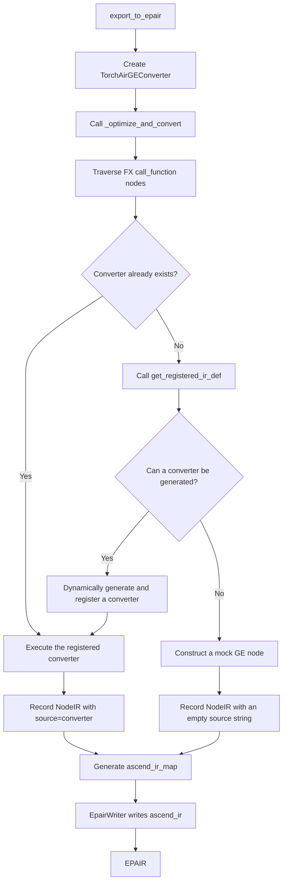
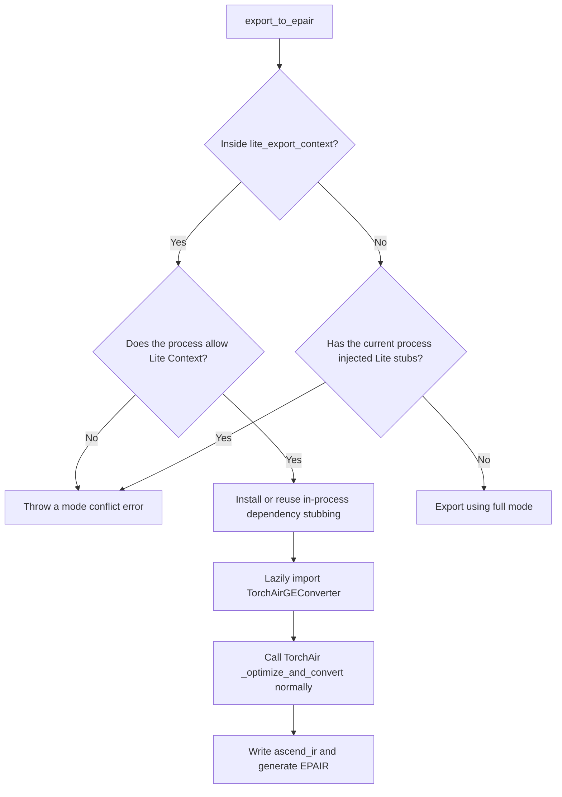
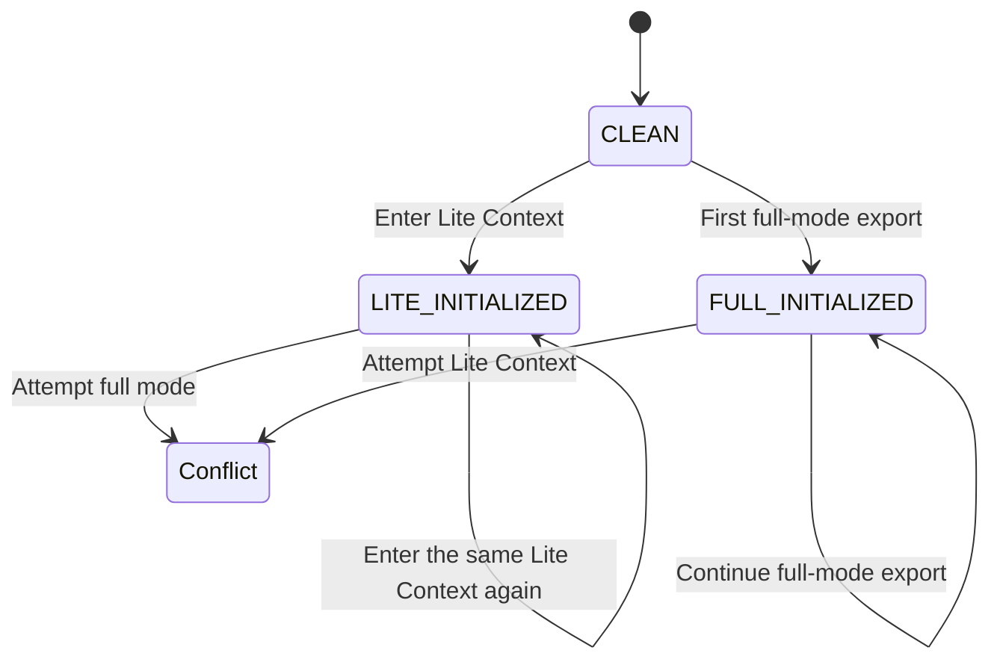

# Lite Context Mode Design

> The core idea of Lite Context is isolation up front and reuse at the back end: pre-install stub/fake objects into sys.modules before TorchAir is imported, so the interpreter does not load the real `_torchair.so` or torch_npu, allowing GE protobuf graph construction to complete in a CANN-free environment. The cost is the loss of capabilities in three areas:
> - Dynamic converter generation and fallback nodes — they rely on real GE schema queries, which the stub explicitly rejects;
> - Extended dtypes (FP4/INT4/HIFLOAT8) — PyTorch and GE use different dtype numbering domains, so a simple mapping is not possible;
> - Irreversible process state — once the module cache and converter global registrations are completed along the Lite path, the current process cannot fall back to full mode.
>
> Platform information that can be determined by user configuration, such as HF32 and device model, is provided explicitly through LiteConfig. CANN-version-related paths report errors directly in the first version rather than fabricating version conclusions. TorchAir's converter registration, `_optimize_and_convert`, and protobuf graph construction logic are fully preserved.

## Background

When exporting EPAIR models, TorchDelegate relies on the TorchAir converter to convert PyTorch FX nodes into GE IR and writes node-level `ascend_ir` into the ExportedProgram JSON. The main body of the TorchAir converter is Python protobuf graph construction logic, but its package import, Graph Engine initialization, and some converter helper interfaces further depend on CANN and torch_npu. As a result, the current EPAIR export requires TorchAir, CANN, and torch_npu to be installed together, along with a usable NPU environment.

Kirin on-device inference plans to use EPAIR as the model delivery format. Model export may happen in a general development or build environment that has no CANN, torch_npu, or NPU device, so an EPAIR export method that does not depend on the local Ascend runtime environment is needed.

This document designs Lite Context mode. In this mode, TorchDelegate isolates TorchAir's functional dependencies on CANN and torch_npu through in-process dependency stubbing, then continues to call TorchAir's original conversion interfaces to complete `ascend_ir` annotation. The solution does not reimplement the converter and does not introduce an independent converter registry.

## Current-state analysis

For the detailed dependency analysis, see [torchair_converter_cann_dependency_analysis.md](./torchair_cann_dependency.md). This section only retains the conclusions directly relevant to the Lite Context design.

### Standard TorchDelegate conversion flow

The current main flow of `export_to_epair()` is as follows:

1. Create a `TorchAirGEConverter`.
2. Call TorchAir `_optimize_and_convert()` to optimize the ExportedProgram and execute the registered converters one by one.
3. The TorchAir converter calls the generated GE API to construct `GraphDef`, `OpDef`, and symbolic Tensors in memory.
4. TorchAir records the NodeIR corresponding to each FX node, forming an `ascend_ir_map`.
5. `EpairWriter` writes the NodeIR into the `ascend_ir` field of the EP JSON.
6. `epair_save()` saves the EPAIR using the PT2 archive format.



EPAIR export only needs GE protobuf and NodeIR; it does not need to load, compile, or execute a GE graph. However, TorchAir does not currently fully separate protobuf graph construction capability from the native backend, so the export path still triggers CANN and torch_npu dependencies.

### CANN and torch_npu dependency analysis

These dependencies fall into three categories:

| Category | Dependency point | Characteristics |
|---|---|---|
| Structural dependency | `_torchair`, Graph Engine lifecycle, `TorchNpuGraph` | EPAIR does not need these execution capabilities, but TorchAir import and object construction still trigger them |
| Graph construction semantic dependency | `get_registered_ir_def`, `check_cann_compat`, device model, CANN version, HF32, extended dtype | Query results affect whether conversion is possible or what GE IR is ultimately generated, so they cannot be uniformly replaced with a fixed success value |
| Export metadata dependency | CANN version in the EPAIR manifest | Does not participate in converter graph construction but must be written as target deployment information |

#### `torchair.core._torchair` native extension

`torchair.core._torchair` is the bridge module through which TorchAir Python code accesses CANN native capabilities. It is usually provided by `_torchair.so`, which links dynamic libraries such as GE, ACL, and Ascend metadef. When Python executes `import torchair`, multiple TorchAir modules import it indirectly.

This dependency occurs very early: before converter functions may even execute, Python needs to load `_torchair.so` and its linked libraries. If the CANN dynamic libraries are missing, the import fails directly. Therefore, even if a converter function body only calls `ge.Add()` to write protobuf, its module cannot be assumed to import directly in a CANN-free environment.

Lite Context must place a same-named Python stub into `sys.modules` before TorchAir's first import. Subsequent TorchAir code still imports `torchair.core._torchair` along the original path but gets the TorchDelegate stub instead of the real `_torchair.so`.

#### Graph Engine lifecycle

The Graph Engine lifecycle is the global initialization and release process of the CANN GE runtime, not a single GE graph itself. TorchAir's Python interface names are `initialize_graph_engine()` and `finalize_graph_engine()`, which eventually enter `_torchair.InitializeGraphEngine()` and `_torchair.FinalizeGraphEngine()`. Real initialization may perform GE initialization, set devices, and create runtime resources.

The current call relationship can be simplified as:

```text
_optimize_and_convert()
  -> construct GeConcreteGraph
     -> initialize_graph_engine()
        -> _torchair.InitializeGraphEngine()
           -> GE/ACL global initialization and device access
```

`_optimize_and_convert()` runs the FX interpreter here to traverse nodes and call converters; it does not execute the model on the NPU. However, `GeConcreteGraph` serves both "graph construction" and "subsequent execution", so the Graph Engine is initialized during construction. Thus EPAIR export, which only needs protobuf, is forced into the CANN lifecycle.

In Lite Context, these two lifecycle interfaces can safely be stubbed as no-ops, because the export flow does not call GE graph loading, compilation, or execution. The no-ops only skip runtime preparation unrelated to this export and do not change the converter logic that writes `GraphDef` and `OpDef`. If the conversion path starts to use the real GE runtime, this stub can no longer be used and must report an explicit error.

#### `TorchNpuGraph`

`TorchNpuGraph` is the native executor object associated with a single GE graph. It is not the same concept as the Graph Engine lifecycle:

- The Graph Engine lifecycle manages the process-level GE/ACL runtime environment.
- `TorchNpuGraph` represents the native backend handle of a single graph, used to subsequently load, compile, execute, or tune that graph.
- Python `GeGraph` also holds the protobuf `GraphDef`; that part is what converter graph construction actually needs.

Currently `GeGraph` combines the two in a single object and unconditionally creates the executor during construction:

```text
GeConcreteGraph
  -> GeGraph
     -> GraphDef                 # needed by Lite export
     -> TorchNpuGraph executor   # not needed by Lite export
```

EPAIR export does not call the executor's `load()`, `compile()`, `run()`, or `auto_tune()`, but merely constructing `GeGraph` creates `TorchNpuGraph`. The real class comes from the TorchAir backend and depends on the `_torchair` native interface, so a CANN-free environment fails at "creating a graph object that has not yet executed".

Lite Context provides a build-only fake for it. The fake only satisfies the object shape and minimal state required by `GeGraph` construction and does not create a native handle. Any load, compile, execute, or tune call throws `LiteGraphExecutionUnsupported`. This does not replace `GraphDef`; the converter still writes into TorchAir's original protobuf graph.

The difference between the Graph Engine lifecycle and `TorchNpuGraph` can be summarized as:

| Comparison item | Graph Engine lifecycle | `TorchNpuGraph` |
|---|---|---|
| Scope | Process-level runtime | A single GE graph |
| Main responsibility | Initialize and release the GE/ACL environment | Hold the graph's native executor and provide load, compile, and execute interfaces |
| Current trigger point | Initialized when constructing `GeConcreteGraph` | Created when constructing `GeGraph` |
| Needed for EPAIR protobuf graph construction? | No | Its executor part is not needed |
| Lite Context handling | Initialization and release are no-ops | Uses a build-only fake; execution interfaces are explicitly rejected |

#### `get_registered_ir_def`

This interface queries the real GE for the IR definition already registered for an operator type, including input, output, and attribute schemas. TorchAir calls it in two scenarios:

- When an FX node has no registered converter, it attempts to dynamically generate a converter based on the GE schema.
- When a converter calls `custom_op()`, it confirms the interface definition of the custom GE op.

The query result determines whether TorchAir can construct the operator and how to connect inputs, outputs, and attributes. This is not ordinary environment probing. In a CANN-free environment there is no trustworthy live GE registry, and Lite Context cannot return an empty schema or a fixed success result, otherwise it may generate structurally wrong but superficially valid OpDefs.

The first version's stub throws `LiteRegisteredIrQueryUnsupported` for this interface. Therefore, Lite Context only supports converters that are already registered and do not call `custom_op()`; it does not support dynamic converter generation or custom operators that depend on this query.

#### `check_cann_compat`

Some generated GE APIs carry an `IrDef` that declares interface information such as optional inputs and optional attributes. When calling these APIs, TorchAir uses `check_cann_compat` to check whether the operator schema actually registered in the current CANN is compatible with this declaration.

This query is not checking "whether CANN is installed" but "whether the concrete interface of the target op matches the current Python wrapper". Returning an incorrect success result may cause the generated OpDef to use inputs or attributes unsupported by the target CANN.

The first version has no trustworthy offline schema list, so the stub reports an explicit error. Later, if a validated offline compatibility list is provided for the target CANN version, the live query can then be replaced with offline results.

#### Device model query

Some converters call `is_arch35()`. This function reads the current device name through `torch_npu.npu.get_device_name()` and determines whether the name contains `Ascend910_95` or `Ascend950`.

The result changes the actual graph construction, for example choosing a different version of a GE op, different attributes, layout, shape handling, or output semantics. In a non-NPU environment it cannot simply return `False`, because the export target device may be exactly arch35.

Lite Context provides target device information from `LiteConfig.target_soc`. The fake returns a device name consistent with TorchAir's current determination rules. It describes the deployment target, not the export host.

#### CANN version query

A small number of converters query the local CANN version through torch_npu and then choose a different graph construction approach based on the version. For example, old and new CANN may use different packed INT4 representations or choose different communication ops.

This dependency affects the OpDef structure and cannot be forced to the old-version branch on the grounds that "the export machine has no CANN". The first version of Lite Context reports an error directly when encountering this query, leaving offline comparison of official and RC versions as a follow-up issue.

The version here represents the target CANN compatibility version to which the EPAIR will be deployed.

#### HF32 configuration

Some matrix computation converters read `torch.npu.matmul.allow_hf32` and write it into the GE op's `enable_hf32` attribute. This is a user-chosen computation precision configuration, not a fixed capability that can be inferred from the device model.

Lite Context provides this value explicitly through `LiteConfig.allow_hf32`. The fake only exposes this configuration and does not provide a real `torch.npu` runtime.

#### torch_npu extended dtypes

Some converters read extended dtypes defined by torch_npu, such as HIFLOAT8, FP4, and INT4, to determine input types, choose quantization paths, perform bitcasts, or fill output descriptors.

There are two different numbering domains here: the PyTorch dtype identifier and the GE `DataType` enum. For example, a torch_npu dtype's PyTorch identifier value cannot be directly replaced by a GE enum value with the same name. Simply attaching a same-named integer to the fake may make type comparisons pass while selecting the wrong graph construction branch.

The first version does not support converters that need these extended dtypes. Access throws `LiteExtendedDtypeUnsupported`. Later support requires an explicit, validated mapping from PyTorch dtypes to GE dtypes.

#### CANN version in the EPAIR manifest

`EpairWriter` currently attempts to obtain the CANN version through `torch_npu.npu.utils.get_cann_version()` and writes it into `EpairManifest.cann_version`. This value is EPAIR metadata and does not participate in converter graph construction. Without torch_npu, the current implementation records `unknown`.

Lite Context does not require recording the CANN version in the manifest. That change should be placed in TorchDelegate's API/manifest routing and does not need to go around through a torch_npu fake.

### Conclusion

The core work of an ordinary converter is to construct GE protobuf, which can run without initializing CANN or accessing the NPU. The main reason blocking CANN-free export is module import and helper interface coupling, not that the EPAIR format itself requires CANN.

The first version of Lite Context can perform in-process stubbing for these dependency points, then import TorchAir normally and call `_optimize_and_convert()`. Lifecycle interfaces use stubs, and executor objects use fakes; device and version information must be provided by export configuration; capabilities that rely on real GE schema queries cannot be guaranteed semantically correct by a generic stub and should be explicitly rejected in the first version.

## Scope

### Included

- Provide the public `lite_export_context` context interface.
- Export EPAIR in environments without CANN, without torch_npu, and without NPU devices.
- Inject TorchAir and torch_npu dependency stubbing modules into the current process.
- Continue to reuse `TorchAirGEConverter` and `_optimize_and_convert()` after stub injection.
- Provide device model, CANN version, and HF32 configuration from explicit target platform configuration.
- Identify unsupported dependency calls in Lite Context and report accurate errors.
- Keep the EPAIR, NodeIR, and `ascend_ir` data formats unchanged.
- Define mutual exclusion rules between in-process Lite Context and full mode.

### Excluded

- Reimplementing the TorchAir converter or generated GE API.
- Establishing an independent converter registry or changing the TorchAir converter registration mechanism.
- Graph splitting on the Python side.
- Loading, compiling, or executing GE graphs in Lite Context.
- Fabricating conclusions about GE registered operator IR or CANN operator compatibility.
- Generating Lite Context fallback annotations for nodes without registered converters.
- Supporting converters that depend on real NPU execution results.
- Modifying the C++ EPAIR loading, Fallback Codegen, and execution flows.
- Guaranteeing compatibility across arbitrary combinations of TorchAir, PyTorch, and TorchDelegate versions.

## Overview

### Design approach

Lite Context mode adopts the design of "inject dependency replacements first, then call TorchAir normally":

1. The user enters `lite_export_context`.
2. TorchDelegate confirms that the current process has not yet loaded the real TorchAir native extension or torch_npu.
3. TorchDelegate pre-installs the `_torchair` stub and torch_npu fake into `sys.modules` and supplements the configuration objects required by `torch.npu`.
4. `export_to_epair()` imports `TorchAirGEConverter` lazily.
5. TorchAir completes Python module import and converter registration through the normal package entry point.
6. `TorchAirGEConverter` calls `_optimize_and_convert()` normally to generate the `ascend_ir_map`.
7. `EpairWriter` generates the manifest using the target CANN version in Lite Context and writes the EPAIR.

Dependency stubbing only replaces native capabilities not needed by EPAIR graph construction, or provides static platform information from explicit configuration. Interfaces that cannot preserve semantics must report errors rather than return guessed values.

The first version uses in-process stub injection. Python module caching, TorchAir converter registration, and some PyTorch global object modifications cannot be fully restored in the current process, so Lite Context and full mode cannot be mixed in the same process.

### Terminology

| Term | Meaning |
|---|---|
| Lite Context mode | The EPAIR export mode provided by TorchDelegate that does not depend on local CANN or torch_npu |
| Full mode | The existing export mode using the real TorchAir, CANN, torch_npu, and NPU environment |
| stub | An interface replacement that provides no-ops or explicit rejection behavior, such as Graph Engine lifecycle and schema query interfaces |
| fake | A dependency replacement that provides the minimal state and object behavior needed for graph construction, such as the build-only `TorchNpuGraph`, device information, and version information |
| mock node | The fallback NodeIR recorded by TorchAir for unconverted nodes, unrelated to dependency stubbing |

### User interface

Provide `lite_export_context` externally without modifying the function signatures of `export_to_epair()` and `epair_save()`.

```python
import os

# If torch_npu is installed in the environment, backend autoloading must be disabled before importing torch.
os.environ["TORCH_DEVICE_BACKEND_AUTOLOAD"] = "0"

import torch

from torch_delegate import (
    LiteConfig,
    epair_save,
    export_to_epair,
    lite_export_context,
)

model = MyModel().eval()
example_inputs = (torch.randn(1, 3, 224, 224),)
ep = torch.export.export(model, example_inputs)

config = LiteConfig(
    target_soc="Ascend910_9362",
    target_cann_version="9.2.0",
)

with lite_export_context(config):
    contents = export_to_epair(ep)

# Saving does not call TorchAir, so it can be placed outside the context.
epair_save(contents, "model.epair")
```

The recommended configuration definition is as follows:

```python
@dataclasses.dataclass(frozen=True)
class LiteConfig:
    target_soc: str
    target_cann_version: str | None = None
    allow_hf32: bool = False
```

Field meanings:

| Field | Required | Description |
|---|---|---|
| `target_soc` | Yes | Target deployment device, not queried from the current host; its value semantics must be consistent with TorchAir platform determination |
| `target_cann_version` | No | Reserved target deployment information; the Lite manifest does not require recording the CANN version, and dependency version queries report an error directly when hit |
| `allow_hf32` | No | HF32 configuration of the target graph, disabled by default |

### Operating modes



### Software features

- Explicitly select Lite Context mode; do not automatically degrade based on the environment.
- Install CANN and torch_npu dependency stubbing modules before TorchAir is imported.
- Reuse TorchAir's existing converter registration, graph optimization, and `ascend_ir` recording logic.
- Provide device, version, and HF32 information from target platform configuration.
- Prevent Lite Context from calling graph loading, compilation, execution, and real device queries.
- Return structured errors for converter capabilities that cannot be safely replaced.
- Prevent mixing Lite Context and full mode in the same process.
- Keep the existing EPAIR file format and save/load interfaces unchanged.

### Design constraints

- The first version uses in-process stub injection and does not use a separate worker.
- No new converter registry is added; TorchAir still registers and looks up converters through its original mechanism.
- `TorchAirGEConverter` must be imported only after the mode is determined and stubs are installed.
- Lite Context must not be enabled after the real `torchair.core._torchair` or torch_npu has been loaded.
- After Lite Context is initialized, the current process must not use full mode again.
- After the current process has used full mode, it must not enter Lite Context.
- stubs/fakes must not fabricate unknown schemas, compatibility, or device capabilities as supported.
- Lite Context is only responsible for export and does not provide NPU execution capability.
- External inputs, target platform configuration, and conversion results are strictly validated.

### Assumptions and dependencies

- The TorchAir Python package remains a required dependency, but its native extension is not required to be loadable.
- PyTorch, TorchAir, and TorchDelegate use validated version combinations.
- The target deployment device and CANN version are accurately provided by the caller.
- The converters required by the target model are already registered by TorchAir, and the execution path does not rely on capabilities explicitly prohibited by Lite Context.
- Actual compilation and execution of EPAIR occur on the deployment side with a matching CANN environment.
- If the same business needs to use both full mode and Lite Context, different processes should be used.

## Feature requirements analysis and design

### Context design

#### Interface responsibilities

`lite_export_context` is responsible for:

- Validating `LiteConfig`.
- Checking whether the current process has already loaded conflicting modules.
- Installing one-time in-process dependency stubbing modules.
- Marking the current call as being in Lite Context mode.
- Providing the current target platform configuration to the fakes.
- Restoring the context activation state on exit.

Exiting the context only restores the logical state of "whether exporting is in progress"; it does not unload Python modules already imported, nor does it attempt to restore all global modifications of TorchAir and PyTorch. Therefore, exiting the context does not mean the current process can switch to full mode.

#### Process state

Process state falls into three categories:

| State | Meaning | Allowed operations |
|---|---|---|
| `CLEAN` | TorchAir has not been imported and Lite stubs have not been installed | Can choose full mode or enter Lite Context for the first time |
| `LITE_INITIALIZED` | Lite dependency stubbing modules are installed and TorchAir was imported along the Lite path | Can only continue exporting in Lite Context |
| `FULL_INITIALIZED` | TorchAir or real native dependencies were imported in full mode | Can only continue using full mode |

State transitions are as follows:



`LITE_INITIALIZED` and `FULL_INITIALIZED` cannot transition into each other within the process lifetime.

#### Initialization and import order

The current `torch_delegate/api.py` imports `TorchAirGEConverter` at module level, which loads TorchAir before the user enters the context. Implementing Lite Context requires changing this to a lazy import.

The order for entering Lite Context for the first time is as follows:

1. Validate configuration fields and version format.
2. Check whether `sys.modules` contains the real `torchair.core._torchair`, torch_npu, or other conflicting modules.
3. Check whether the current process has already executed full mode.
4. Create and inject the `_torchair` stub.
5. Create and inject the torch_npu fake and required submodules.
6. Install or validate the minimal configuration object of `torch.npu`.
7. Set the process state to `LITE_INITIALIZED`.
8. Set the current Lite Context configuration.
9. `export_to_epair()` lazily imports `TorchAirGEConverter` internally.
10. TorchAir imports through the normal entry point and registers converters.

If any step fails, the TorchAir conversion interfaces must not be called.

#### Context pseudocode

```python
@contextlib.contextmanager
def lite_export_context(config: LiteConfig):
    validated = _validate_lite_config(config)
    _initialize_lite_process_once(validated)

    token = _ACTIVE_LITE_CONFIG.set(validated)
    try:
        yield
    finally:
        _ACTIVE_LITE_CONFIG.reset(token)
```

The mode routing of `export_to_epair()` is as follows:

```python
def _create_converter(config):
    lite_config = _ACTIVE_LITE_CONFIG.get()
    process_mode = _get_process_mode()

    if lite_config is not None:
        if process_mode is not ProcessMode.LITE_INITIALIZED:
            raise LiteContextStateError()
    elif process_mode is ProcessMode.LITE_INITIALIZED:
        raise ConverterModeConflictError()
    else:
        _mark_full_mode()

    from .converter.torchair_converter import TorchAirGEConverter
    return TorchAirGEConverter(config=config)
```

#### Nesting, repetition, and concurrency

- The same thread may nest Lite Contexts with identical configuration.
- Nested contexts with different target platform configurations report an error directly.
- After exit, Lite Context with exactly the same configuration may be entered again.
- The first version does not support using different target platform configurations sequentially in the same process.
- The first version does not support multi-threaded concurrent entry into Lite Context or concurrent EPAIR conversion.
- Parallel export for multiple target platforms should be done by the caller using different processes.

#### Impact on full mode outside the context

The first version uses in-process stub injection, which affects subsequent full-mode exports in the same process. The impact depends on whether the current process has already initialized Lite Context:

| Scenario | Full-mode export outside the context | Reason |
|---|---|---|
| Never entered Lite Context | Unaffected | The `_torchair` stub and torch_npu fake have not been injected, so full mode loads real dependencies along the existing path |
| Lite Context is active | Not allowed | The current call explicitly selects Lite Context, and full mode cannot run concurrently in the same process |
| Lite Context has been exited | Not allowed | The context only restores the activation flag and cannot safely undo module caches, import references, and converter global registrations |
| Another independent process | Unaffected | `sys.modules`, TorchAir registration state, and dependency stubbing modules are all in-process state |

After entering Lite Context for the first time, the following state persists until the process exits:

- `sys.modules["torchair.core._torchair"]` points to the TorchDelegate stub.
- `sys.modules["torch_npu"]` and related submodules point to the TorchDelegate fake.
- Imported TorchAir Python modules hold references to stub/fake objects.
- The TorchAir converter has written into `OpOverload._ge_converter` or `_CONVERTERS`.
- `GeGraph`, `_backend`, and converter helper modules have been imported under the Lite dependency environment.

The process state changes to `LITE_INITIALIZED` when entering the context, rather than waiting for the first call to `export_to_epair()`. Therefore, even if no export is performed within the context, full mode cannot be used in the current process after exit. This ensures there is no observable intermediate state between stub installation, mode marking, and TorchAir lazy import.

Deleting stubs/fakes from `sys.modules` alone cannot restore full mode. Direct symbol references in imported modules, class inheritance relationships, decorator registration results, and other global state still point to the Lite implementation. Continuing to execute full mode at this point may cause the following problems:

- Full mode mistakenly uses the no-op Graph Engine initialization, so export appears to succeed but does not use the real environment.
- Schema queries or graph execution still enter Lite rejection interfaces.
- After re-importing the real torch_npu or `_torchair.so`, two inconsistent sets of objects exist in the process simultaneously.
- Converter registration and module caches come from different initialization paths, so conversion behavior depends on import order.

Therefore, after `lite_export_context` exits, `export_to_epair()` outside the context must check the process state. When the state is `LITE_INITIALIZED`, it must throw a mode conflict error directly and must not attempt to restore, reload, or automatically switch to full mode.

This restriction only applies to `export_to_epair()` which requires TorchAir conversion. Already-generated `EpairContents` can call `epair_save()` outside the context to save, and can also call `epair_load()` to load existing EPAIR; these two operations should not trigger mode switching.

If the business needs both Lite Context and full mode, execute them separately from clean processes:

```text
Process A: Lite Context -> export_to_epair -> epair_save
Process B: Full mode    -> export_to_epair -> epair_save
```

### Dependency point stubbing

#### Stubbing principles

Dependency replacement falls into three categories:

| Type | Handling principle | Example |
|---|---|---|
| Lifecycle or execution capabilities not needed for graph construction | stub as no-op or explicit rejection | GE initialization, graph loading, compilation, and execution |
| Information needed for graph construction and determinable from target configuration | fake returns the configured value | Device model, CANN version, HF32 |
| Runtime schema or compatibility information that cannot be derived from configuration | Report an explicit error | `get_registered_ir_def`, `check_cann_compat` not verified offline |

All dependency stubbing modules must be injected before TorchAir's first import. The first version does not modify the TorchAir converter registration logic or change how `_optimize_and_convert()` is called.

#### `_torchair` stub

Pre-install `torchair.core._torchair` into `sys.modules` to prevent Python from loading the real `_torchair.so`. The stub must cover the symbols used by the currently pinned TorchAir revision during import and protobuf graph construction.

| Interface | Lite Context behavior |
|---|---|
| `TorchNpuGraphBase` | Provide a constructible build-only fake that only stores minimal state such as the graph name |
| `InitializeGraphEngine` | No-op; does not call GE or ACL |
| `FinalizeGraphEngine` | No-op |
| Graph load, compile, execute, and tune interfaces | Throw `LiteGraphExecutionUnsupported` |
| `get_registered_ir_def` | Throw `LiteRegisteredIrQueryUnsupported` |
| `check_cann_compat` | First version throws `LiteCannCompatibilityQueryUnsupported` |
| Other uncovered symbols | Throw `LiteStubCoverageError`; must not return a default success value |

Illustrative code:

```python
class BuildOnlyTorchNpuGraphBase:
    def __init__(self, name=""):
        self.name = str(name)

    def _unsupported(self, *args, **kwargs):
        raise LiteGraphExecutionUnsupported()

    load = compile = run = auto_tune = _unsupported


def InitializeGraphEngine(options=None):
    return None


def FinalizeGraphEngine():
    return None


def get_registered_ir_def(op_type):
    raise LiteRegisteredIrQueryUnsupported(op_type)


def check_cann_compat(op_type, optional_inputs, optional_attrs):
    raise LiteCannCompatibilityQueryUnsupported(
        op_type, optional_inputs, optional_attrs
    )
```

TorchAir can continue to import the real Python `_backend.py`. The `TorchNpuGraphBase` and lifecycle functions referenced by that module are provided by the `_torchair` stub, so `GeGraph` and `GeConcreteGraph` can complete construction but do not enter the native backend.

#### torch_npu fake

The torch_npu fake satisfies TorchAir top-level import and static platform queries of supported converters. The fake does not provide tensor execution, device management, or communication capabilities.

| Dependency point | Lite Context behavior |
|---|---|
| `torch_npu.npu.get_device_name()` | Return a device name compatible with TorchAir platform determination based on `target_soc` |
| `torch_npu.npu.utils.get_cann_version()` | Return `target_cann_version` |
| `_is_gte_cann_version(version)` | Compare the target CANN version using normalized versions |
| `torch.npu.matmul.allow_hf32` | Return `allow_hf32` |
| Device count, current device, stream, event, memory, communication interfaces | Throw `LiteNpuRuntimeUnsupported` |
| NPU tensor creation and execution interfaces | Throw `LiteNpuRuntimeUnsupported` |

The mapping from `target_soc` to device name must be consistent with the determination semantics of the pinned TorchAir revision. For example, `is_arch35()` currently recognizes names containing `Ascend910_95` or `Ascend950`, so `Ascend910B` must not be mapped to arch35 by default.

CANN version comparison must support official versions and RC versions and must not use simple string comparison.

#### Extended dtypes

torch_npu extended dtypes cannot be replaced merely by GE `DataType` constants with the same name, because PyTorch dtype identifiers and GE dtype enums belong to different numbering domains. The first version handles them according to the following rules:

- Ordinary PyTorch dtypes are supported normally.
- Converters that import torch_npu only for import purposes but do not read extended dtypes can continue to run.
- Converters that need torch_npu extended dtypes such as HIFLOAT8, FP4, and INT4 as inputs or for branch decisions are not supported yet.
- When an extended dtype access is hit, throw `LiteExtendedDtypeUnsupported`, reporting the node, converter, and dtype name.
- If support is needed later, a stable explicit mapping from PyTorch dtype identifiers to GE dtypes must be added; GE enum values must not be reused directly.

#### EPAIR manifest

Full mode continues to obtain the CANN version from the real environment. Lite Context mode no longer dynamically imports torch_npu in `EpairWriter._get_cann_version()` and does not require writing the CANN version into the manifest.

This field represents the target deployment compatibility version, not the version installed on the export host. The documentation and field descriptions must make this semantics clear.

#### Calling TorchAir normally

After dependency stubbing is installed, the main conversion flow does not branch:

```python
converter = TorchAirGEConverter(config=epair_config)
converted_ep = converter.convert_graph(ep)
ascend_ir_map = converter.get_ascend_ir_map()
```

`TorchAirGEConverter.convert_graph()` still calls `_optimize_and_convert()`. TorchAir is still responsible for:

- Batch converter import and decorator registration.
- ExportedProgram optimization and decomposition.
- FX interpreter traversal.
- Converter lookup and invocation.
- Generated GE API protobuf graph construction.
- NodeIR and `ascend_ir_map` recording.

TorchDelegate does not copy registration results or maintain a second converter lookup logic.

#### Conversion result validation

After Lite Context conversion, the following must be validated:

- The types of the OpDef, mapping, and source fields in `ascend_ir_map` are valid.
- All `call_function` nodes are annotated by registered converters, with `source="converter"`.
- Interfaces rejected by stubs are not swallowed by the conversion flow and downgraded to ambiguous results.
- During conversion, the real `_torchair.so`, CANN dynamic libraries, or torch_npu native extensions are not loaded.
- The CANN version in the manifest equals the target configuration.

When a stub rejects an interface, it must first record the violation type and call arguments, then throw a dedicated exception. After conversion, TorchDelegate checks the violation record; even if TorchAir catches the exception and generates a mock node, the export must be terminated according to the original violation reason. Insufficient dependency capability must not be disguised as an ordinary missing converter.

### Error handling

#### Error classification

| Error | Trigger condition | Handling |
|---|---|---|
| `InvalidLiteConfig` | Invalid target SoC or HF32 configuration | Report an error before entering the context |
| `LiteContextImportOrderError` | The real TorchAir native extension or torch_npu was loaded before entering the context | Report the conflicting module and its source |
| `ConverterModeConflictError` | Mixing Lite Context and full mode in the same process | Explicitly prompt to use independent processes |
| `LiteConfigConflict` | Nested or repeated use of different target configurations | Report the current configuration and the requested configuration |
| `LiteStubCoverageError` | The pinned TorchAir revision requests a symbol not covered by the stub | Report the module, symbol, and TorchAir revision |
| `LiteRegisteredIrQueryUnsupported` | Automatic converter or `custom_op()` queries GE IR | Report the FX node, target, converter, and op type |
| `LiteCannCompatibilityQueryUnsupported` | Generated GE API queries live CANN compatibility | Report the GE op and optional inputs/attributes |
| `LiteExtendedDtypeUnsupported` | Converter accesses torch_npu extended dtypes | Report the dtype and converter |
| `LiteNpuRuntimeUnsupported` | Converter requests real NPU runtime capabilities | Report the called interface and node context |
| `LiteGraphExecutionUnsupported` | Calling GE graph load, compile, execute, or tune interfaces | Terminate immediately |
| `LiteNativeDependencyLoaded` | Real CANN or torch_npu native libraries are found during conversion | Terminate export and report the library path |

#### Error context

Errors during the converter execution stage contain at least:

- Mode: `lite`.
- Conversion stage: import, initialization, converter execution, or result validation.
- FX node name and target.
- Converter module and function name.
- The dependency interface that was triggered.
- Target SoC and target CANN version.
- Original exception and call chain.
- Actionable handling suggestions.

Error example:

```text
Lite Context conversion failed

Error: LiteRegisteredIrQueryUnsupported
Node: npu_custom_op
Target: torch.ops.npu.custom_op.default
Converter: torchair...conveter_npu_custom_op
Dependency: _torchair.get_registered_ir_def("CustomOp")
Target SoC: Ascend950
Target CANN: 9.2.0

This converter requires runtime GE schema information and is not supported
by Lite Context. Export this model in full mode using a separate process.
```

#### Strict error rules

- When the full-mode environment is missing, do not automatically switch to Lite Context.
- When Lite Context capabilities are insufficient, do not automatically exit the context and retry with full mode.
- When a stub does not cover a symbol, do not continue execution with `None`, an empty dict, or a fixed success value.
- When target platform information is missing, do not read the current host device as a default value.
- Do not catch all exceptions and uniformly convert them into "converter not supported".
- Do not generate partial EPAIR files; do not return incomplete `EpairContents` when conversion fails.

### Lite Context limitations

The first version of Lite Context does not support the following capabilities:

| Unsupported capability | Reason | Suggestion |
|---|---|---|
| Mixing Lite Context and full mode in the same process | In-process module caches and global registration state cannot be reliably restored | Export separately using independent processes |
| Using different target platform configurations in the same process | Fake modules and TorchAir global state have been initialized according to the first configuration | Use an independent process for each target platform |
| Multi-threaded concurrent export | Stubs, TorchAir registration, and some PyTorch state are process-level global state | Export serially or use multiple processes |
| Enabling Lite Context after TorchAir or torch_npu is already loaded | Cannot guarantee that real native modules have been fully isolated | Enter Lite Context early in program startup |
| Automatic converter generation | Depends on `get_registered_ir_def` to query the real GE schema | Use an existing converter or full mode |
| Unregistered converters and Python mock fallback | TorchAir needs to query the GE schema first, and Lite Context cannot fabricate query results | Add registered converters or use full mode |
| Converters calling `custom_op()` | `custom_op()` unconditionally queries the real GE schema | Use full mode, or provide a converter that does not depend on this interface |
| Generated GE API requiring live `check_cann_compat` | No local CANN, so schema compatibility cannot be confirmed | Use full mode in the first version; an offline compatibility list can be introduced later |
| torch_npu extended dtypes | PyTorch dtype identifiers and GE dtype enums cannot be simply interchanged | Support later after adding stable mappings |
| Automatic schema registration for NPU custom operators | No real torch_npu package to perform schema registration | The caller explicitly provides a pure-Python schema, or use full mode |
| NPU tensor, stream, event, communication, and random number runtime | These capabilities require a real device and runtime | Use full mode |
| GE graph load, compile, execute, and tune | Lite Context only generates EPAIR IR | Use a full CANN environment on the deployment side |
| Automatically detecting the target device and CANN version from the current host | The export host does not represent the deployment target | Explicitly fill in `LiteConfig`; CANN queries report errors in the first version |
| Arbitrary TorchAir revisions | The symbols covered by stubs and import behavior are version-dependent | Use the version combination pinned and validated by the project |

The following code is not supported:

```python
# Wrong: use Lite Context first, then full mode, in the same process.
with lite_export_context(lite_config):
    lite_contents = export_to_epair(ep)

full_contents = export_to_epair(ep)  # ConverterModeConflictError
```

```python
# Wrong: the current process has already imported TorchAir in full mode.
full_contents = export_to_epair(ep)

with lite_export_context(lite_config):  # ConverterModeConflictError
    lite_contents = export_to_epair(ep)
```

If the business must perform both types of export above, complete them in two independent processes.

## Submodule modifications

| Submodule | Change |
|---|---|
| `torch_delegate/lite_context.py` | Add configuration types, context management, process state, and mode conflict checks |
| `torch_delegate/lite_stubs/` | Add the `_torchair` stub, torch_npu fake, `torch.npu` configuration adaptation, and version comparison |
| `torch_delegate/api.py` | Remove the module-level `TorchAirGEConverter` import and import it lazily after the mode is determined |
| `torch_delegate/converter/torchair_converter.py` | Keep the main `_optimize_and_convert()` flow; add Lite error context and result validation entry points |
| `torch_delegate/epair/writer.py` | Read the CANN version from the target configuration in Lite Context without dynamically importing torch_npu |
| `torch_delegate/__init__.py` | Export `lite_export_context` and `LiteConfig` |
| `tests/python/` | Add tests for CANN-free export, stub coverage, mode mutual exclusion, and limitation items |

The first version adds no converter registry, does not modify TorchAir decorators, and does not copy converter source code.

## Compatibility and safety

### Version compatibility

- Lite dependency stubbing modules are developed and tested against the pinned TorchAir revision.
- When TorchAir is upgraded, the `_torchair` import symbols, torch_npu call sites, and converter dependencies must be re-checked.
- When PyTorch minor versions are upgraded, the `torch.ops` registration behavior and the `torch.npu` namespace behavior must be verified.
- The stub module should record the target TorchAir revision; on mismatch, report an error at the import stage.

### Native dependency isolation

Both after Lite Context initialization and after conversion, check:

- `torchair.core._torchair` points to the Python stub created by TorchDelegate, not the extension file.
- `torch_npu` points to the TorchDelegate fake, not the real package in the installation directory.
- The loaded dynamic libraries contain no newly added GE, ACL, HCCL, or torch_npu native libraries.
- The source and version of the dependency stubbing modules match the current TorchDelegate release configuration.

### Environment variables

If torch_npu is installed on the machine, the caller must set the following before importing PyTorch:

```bash
export TORCH_DEVICE_BACKEND_AUTOLOAD=0
```

TorchDelegate should check whether the real torch_npu has been automatically loaded when entering Lite Context; if it is already loaded, report an error directly and must not attempt to delete it from `sys.modules` and continue.

Tests that directly call `torch.export` or `serialize()` still need to follow the project's protobuf Python implementation constraints.

## Test design

### Basic functionality

- Export EPAIR containing ordinary ATen converters in an environment without CANN and torch_npu.
- Save and reload EPAIR, and validate the manifest and `ascend_ir`.
- Compare the OpDef and mapping generated by Lite Context with those generated by a fixed full environment.
- Verify that the target CANN version is written into the manifest.
- Verify that `target_soc` and `allow_hf32` affect the corresponding converter branches.

### Stub/Fake

- The `_torchair` stub is installed before TorchAir import.
- Graph Engine initialization and release are no-ops.
- The build-only `TorchNpuGraphBase` can complete `GeGraph` construction.
- Graph load, compile, execute, and tune interfaces report explicit errors.
- Device name, CANN version, and HF32 return configured values.
- Uncovered `_torchair` symbols trigger `LiteStubCoverageError`.
- After conversion, no CANN or torch_npu native dynamic libraries are loaded.

### Mode state

- A `CLEAN` process can enter Lite Context for the first time.
- After Lite Context initialization, calling `export_to_epair()` outside the context triggers a mode conflict.
- Entering without performing an export and then exiting the context, calling full mode still triggers a mode conflict.
- After full mode initialization, entering Lite Context triggers a mode conflict.
- Nested and repeated Lite Contexts with the same configuration work normally.
- Nested and repeated Lite Contexts with different configurations trigger configuration conflicts.
- Concurrent entry from multiple threads is explicitly rejected, with no race injection.

### Limitations and errors

- An automatic converter generation request triggers `LiteRegisteredIrQueryUnsupported`.
- When a converter is not registered, export is terminated and no mock NodeIR with `source=""` is generated.
- A `custom_op()` converter triggers an explicit error.
- A `check_cann_compat` request triggers an explicit error.
- Extended dtype access triggers `LiteExtendedDtypeUnsupported`.
- NPU runtime calls trigger `LiteNpuRuntimeUnsupported`.
- Entering the context fails when the real torch_npu or `_torchair.so` is already loaded.
- Any failure returns no partial `EpairContents` and produces no half-finished EPAIR.
- `EpairContents` exported by Lite Context can call `epair_save()` outside the context, and existing EPAIR can call `epair_load()` outside the context.

## Acceptance criteria

1. In an environment without CANN, without torch_npu, and without NPU devices, EPAIR of ordinary ATen models can be exported, saved, and loaded through Lite Context.
2. Lite Context isolates CANN and torch_npu through in-process dependency stubbing, without loading the real `_torchair.so` or related native dynamic libraries.
3. Lite Context does not establish an independent converter registry; conversion is still completed by `TorchAirGEConverter` calling `_optimize_and_convert()`.
4. `export_to_epair()` imports `TorchAirGEConverter` only after stubs are installed.
5. The target device and HF32 come from `LiteConfig`, not the current host device; CANN version queries report errors directly in the first version.
6. Unsupported schema queries, unregistered converters, compatibility queries, extended dtypes, and NPU runtime calls all return explicit errors.
7. The same process cannot mix Lite Context and full mode, and the error message prompts to use independent processes.
8. After Lite Context initialization, exiting the context cannot restore full mode.
9. Lite Context affects only the current process; other clean processes can still use full mode.
10. `epair_save()` and `epair_load()` are not subject to mode mutual exclusion and can be called outside Lite Context.
11. The EPAIR, NodeIR, and `ascend_ir` formats remain consistent with full mode; the first version of Lite Context only generates NodeIR with `source="converter"`.
12. Lite Context does not generate partial EPAIR on failure and does not fabricate CANN or device capabilities.

## Conclusion

Lite Context mode injects CANN and torch_npu dependency stubbing modules into the current TorchDelegate process, enabling TorchAir's existing converters to continue completing GE protobuf graph construction and `ascend_ir` annotation in the absence of a local Ascend environment. The first version keeps TorchAir's main registration, optimization, and conversion flows unchanged and adds no converter registry.

In-process injection reduces the scope of change in the first version but also brings explicit limitations: Lite Context and full mode cannot be mixed in the same process, and converters that depend on real GE schemas, live CANN compatibility, torch_npu extended dtypes, or the NPU runtime are not supported. Such models should be exported using full mode in an independent process, or validated offline replacement capabilities should be added in later versions.

## Confirmed decisions and implementation guidelines

This section records the confirmation results after the design review. Where there are differences from the preceding text, this section prevails; subsequent implementations must not make opposite assumptions based solely on early illustrative content.

### Goals and naming

- The goal is TorchAir EPAIR export without a CANN runtime, requiring neither CANN, `torch_npu`, nor NPU devices to be installed, but still requiring a usable TorchAir Python package.
- The public context name is `lite_export_context`, and the configuration type is `LiteConfig`; it is not designed as a general-purpose runtime Context.
- Lite mode only builds GE IR and EPAIR and does not support graph loading, compilation, execution, or other NPU runtime capabilities.
- The first version accepts process-level irreversible state. If mixing Full/Lite in the same process is needed later, evaluate a cross-process worker solution separately and do not introduce it in this implementation.

### Dependency isolation

- If `torch_npu` is installed in the environment, the caller should set `TORCH_DEVICE_BACKEND_AUTOLOAD=0` before importing `torch`.
- TorchDelegate must check whether the real `torch_npu` or `_torchair` is already loaded; when isolation is impossible, throw a friendly error with handling suggestions instead of attempting to forcibly delete it from `sys.modules` and continue.
- TorchAir version startup checks are not performed for now. After implementation, compatibility analysis of import symbols, fake coverage, and behavior differences across versions will be maintained as a known issue.
- Native dependency load failures must be caught and converted into errors containing the mode, stage, module, original exception, and handling suggestions. Linux dynamic library snapshots are only used as a testing and diagnostics means.

### Configuration and manifest

- Lite configuration is separate from the existing `EpairConfig` and can only be activated through `lite_export_context`; it cannot be passed as an extra argument to `export_to_epair()`.
- Target device information is used to construct the fake return value of `torch_npu.npu.get_device_name()`. The implementation must refer to the actual determination logic of TorchAir's current `is_arch35()` and must not replace device-name semantics with unverified architecture family guesses.
- No target SoC whitelist is maintained for now; unknown device-related behavior follows the actual TorchAir branch results or explicit dependency errors.
- The manifest exported in Lite mode does not require recording the CANN version number. The API layer still needs to explicitly decide the source of manifest metadata and must not bypass Writer through the fake to read the CANN version; Lite mode can use a compatible value of the existing field (such as `unknown`), but it must not be interpreted as the target or host version.
- Do not add manifest fields and do not modify the EPAIR, NodeIR, and `ascend_ir` formats.

### Mode, nesting, and concurrency

- Process state includes at least `CLEAN`, `LITE_INITIALIZED`, `FULL_INITIALIZED`, and conflict/unknown states. When it cannot be confirmed that the process is clean, entering Lite must fail and provide suggestions to clean modules, restart the process, or use an independent process.
- Full mode is marked before the first TorchAir import or conversion; if TorchAir-related modules, real native extensions, or converter registrations are found to have occurred earlier, Lite must not be enabled either.
- Entering Lite Context immediately completes configuration checks, environment checks, stub injection, and process state switching; even if no conversion is performed, the Lite process state remains after exit.
- Lite Contexts with the same configuration can be nested; nesting or sequential use with different configurations is not supported. Q-22 is not filled in; handle it according to this default rule.
- Lite does not support multi-threaded concurrency; `export_to_epair()` uses a process-level conversion lock covering PyTorch patches, TorchAir conversion, result validation, and restoration flows.
- Real imports, mode conflicts, and native dependency isolation in Lite tests use clean child processes.

### Converter and unsupported capabilities

- Lite does not establish a second converter registry and does not maintain a fixed initial whitelist of a few operators. The implementation uses all converters registered by TorchAir, and fails gracefully when it actually executes a converter that does not meet Lite conditions.
- "Support all converters" means "allow attempting to execute all TorchAir-registered converters", not that every converter is guaranteed to succeed in the Lite environment. Unsupported capabilities must be accurately exposed at runtime and must not be downgraded to success.
- Lite prohibits fallback/mock nodes. Unsupported paths such as unregistered converters, dynamic converter generation, `custom_op()`, `check_cann_compat`, `_is_gte_cann_version`, extended dtypes, and NPU runtime all fail directly.
- Do not implement a pre-check support list. A so-called "support list" can only be used for later analysis, testing, and capability records and must not evolve into a second converter lookup or execution logic.
- stub rejections must preserve violation records; even if TorchAir catches the exception and generates a mock node, conversion must fail forcibly according to the violation before it ends.
- The first version of Lite forcibly disables TorchAir `pattern_fusion_pass`. This global optimization stage may access unregistered `torch.ops.npu` schemas when registering patterns; disabling it only loses the relevant operator fusion, does not fabricate schemas, and does not affect ordinary converters from continuing to execute.
- The GraphDef of Lite and Full may have expected differences due to different pattern fusion switches; differential tests must record this configuration difference. If fusion needs to be restored later, separately implement per-pattern failure degradation or a solution where the user provides schema/Fake implementations.

### Result and failure semantics

- Lite conversion failure returns no `EpairContents` and writes no half-finished EPAIR.
- `export_to_epair()` may modify `ExportedProgram` in place according to existing behavior; after failure, the same object is not guaranteed to be retryable.
- Result validation is classified by node, requiring only deployable compute nodes to have valid converter IR; `getitem`, higher-order helper nodes, or metadata-only nodes must not be uniformly treated as ordinary compute nodes without classification.
- Establish a unified Lite exception base class, and provide the mode, conversion stage, node, target, dependency interface, original exception, and actionable handling suggestions in the error.

### Public API compatibility

- `import torch_delegate` must not load TorchAir.
- To satisfy both Lite import isolation and existing public import compatibility, `torch_delegate.converter` should preserve the visible API of `TorchAirGEConverter` through lazy loading rather than importing it directly in `__init__.py`. Before calling this symbol, the Full/Lite mode must already be determined; in Lite mode, stub injection must be completed first.
- The existing conversion semantics of full mode remain unchanged. This time only the minimal changes required by Lite are made; the default parameter style of `EpairConfig` is not adjusted for now.

### Testing and delivery

- Both normal and abnormal scenarios must be covered. Test cases are selected from the actual TorchAir converter code and dependency call sites, without pre-limiting the first version scope to `add/mm/abs/relu`.
- Coverage is needed for ordinary converters, platform branches, schema queries, CANN version queries, extended dtypes, unregistered converters, fallback prohibition, import conflicts, nesting, concurrency, save/load, and failure without producing results.
- Full/Lite differential comparison uses normalized GraphDef, OpDef, attributes, dtype, shape, and NodeIR mapping, ignoring non-semantic differences such as temporary names and serialization order.
- The minimum standard for the first version is to complete Lite export, save, and load in a clean CANN-free environment and report friendly errors for unsupported capabilities; the project team performs final validation in a real CANN-free environment after coding is complete.

## Current development progress and known issues

### Completed

- Added `LiteConfig` and `lite_export_context`, implementing Lite process state, nesting with the same configuration, conflicts with different configurations, cross-thread rejection, and process-level conversion locking.
- `import torch_delegate` no longer actively loads TorchAir or `torch_npu`; `TorchAirGEConverter` retains a compatible entry point but is changed to lazy loading.
- Implemented the `_torchair` stub, torch_npu fake, Graph Engine lifecycle no-ops, the build-only `TorchNpuGraphBase`, and some symbols required at import time.
- Split fake module construction into `torch_delegate/fake_module_builder.py`, building the `torchair`/`torch_npu` module trees through an explicit interface registry; `lite_context.py` retains process state, context, and conversion flow responsibilities.
- Lite mode can identify the built-in TorchAir Python source in `torch_npu/dynamo/torchair` and load it in a controlled manner without importing the real `torch_npu`; an independently installed top-level `torchair` package can still be used.
- Verified device determination against TorchAir's current `is_arch35()` implementation: `target_soc` is returned as is by the fake `torch_npu.npu.get_device_name()`, returning `True` when it contains `Ascend910_95` or `Ascend950`, for example `Ascend910B` returns `False`.
- Implemented the Lite exception base class, dependency call violation records, and post-conversion secondary checks.
- Lite mode forcibly disables TorchAir `pattern_fusion_pass` to avoid accessing unregistered `torch.ops.npu` schemas during the pattern registration stage; the cost is that the relevant operators are not fused.
- Added child-process tests covering import isolation, process state, nesting, configuration conflicts, thread restrictions, preloaded `torch_npu` conflicts, and pattern fusion disabling.

Currently passing:

```text
tests/python/test_lite_context.py: 8 passed
python -m compileall -q torch_delegate tests/python/test_lite_context.py
```

### Current limitations

- Completed Lite export validation for ordinary ATen in the current CPU Python environment: `add` can be exported, saved, and loaded, and `mm -> abs -> relu` can complete fallback-free conversion. Re-verification in a clean environment without CANN, `torch_npu`, and NPU is still needed.
- Verification currently uses the TorchAir Python source bundled inside the `torch_npu` installation package; compatibility conclusions for different TorchAir distribution methods and versions are not yet complete.
- The Lite fake only covers discovered import and graph construction helper interfaces; other TorchAir private symbols or `torch_npu` interfaces may still trigger missing errors. No whitelist is currently maintained for target devices, and device-name semantics must be provided by the caller according to TorchAir rules.
- Lite does not support CANN version queries, dynamic converters, `custom_op()`, `check_cann_compat`, extended dtypes, NPU runtime, or pattern fusion.
- Lite and Full may produce expected IR differences due to different pattern fusion switches; normalized differential tests are not yet complete.

### High-priority known issues

1. Complete end-to-end validation of `export_to_epair`, `epair_save`, and `epair_load` in a clean child process without CANN, without `torch_npu`, and without NPU.
2. Implement strict Lite result validation: prohibit `source=""` fallback/mock NodeIR, identify unconverted deployable compute nodes, and do not return partial `EpairContents` on failure.
3. Uniformly convert uncovered `_torchair` and `torch_npu` accesses into Lite exceptions carrying the module, symbol, stage, and handling suggestions, avoiding bare `AttributeError` or `ImportError`.
4. Add child-process tests for ordinary ATen, multiple operators, unregistered converters, schema queries, CANN version queries, extended dtypes, NPU runtime, and failure without producing results.

### Follow-up known issues

- Complete normalized differential tests of Full/Lite GraphDef, OpDef, attributes, dtype, shape, and NodeIR mapping, and record the expected differences caused by disabling pattern fusion.
- Analyze and clarify the compatibility version strategy for TorchAir, PyTorch, and `torch_npu`; startup version checks are not performed for now.
- Evaluate offline CANN version comparison and RC version support.
- Evaluate stable mappings or fake implementations for `torch_npu` extended dtypes.
- If fusion needs to be restored, evaluate per-pattern-group degradation or a solution where the caller pre-registers matching `torch.library` schemas and Fake/Meta implementations.
- If the same business process needs to mix Full/Lite, evaluate a worker cross-process isolation solution.
