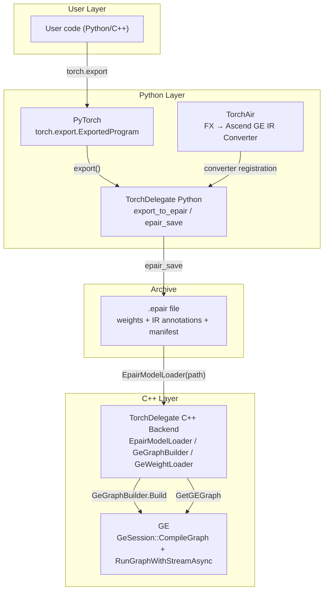
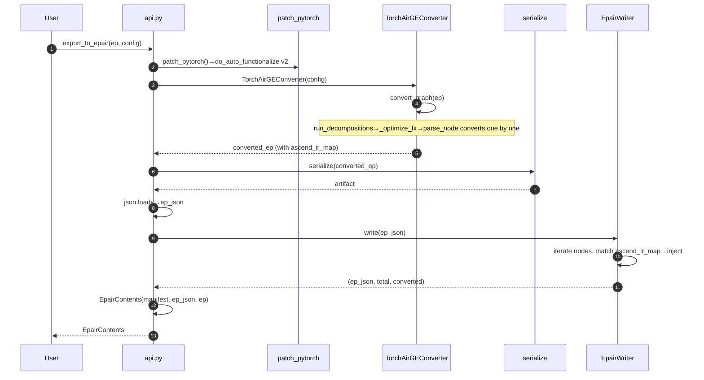
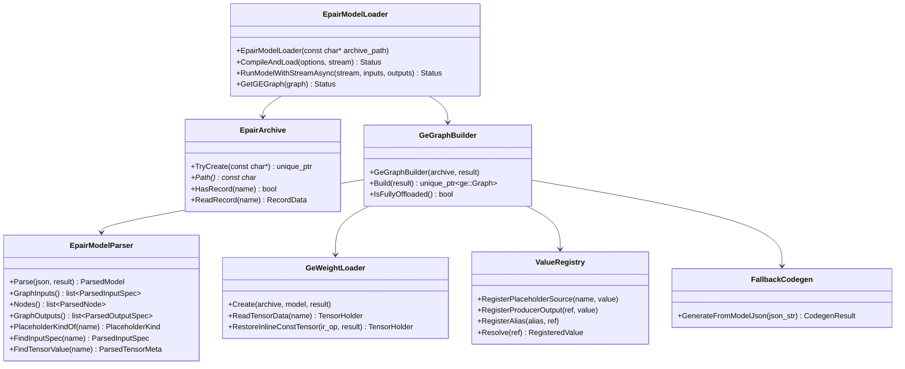
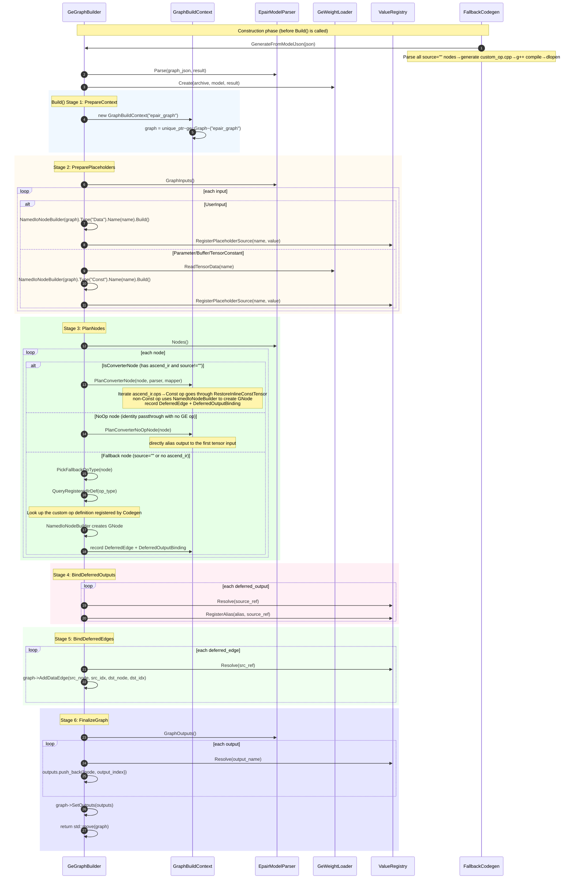
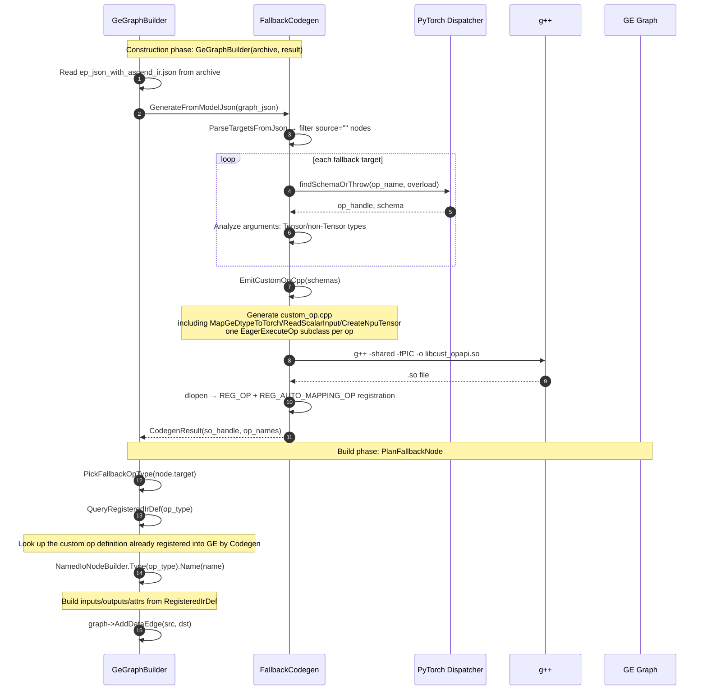

# TorchDelegate Overall Design (2026-06-30)

> [!NOTE] Document Status
> This is a design draft dated 2026-06-30, and parts of the implementation have since evolved. For current usage, see [Build and Install](../guide/build.md) and [epair Packaging Guide](../guide/build_epair.md).

## Introduction

### Purpose

To deploy PyTorch models to Ascend NPU for execution, the industry's mainstream approaches are either calling the NPU backend provided by torchair through `torch.compile` to enter the graph, or exporting an `.air` model via `torchair.dynamo_export` and then entering the graph through ATC or Graph construction. These approaches have the following problems:

- **Strong binding to the Python environment**: IR conversion and compilation both depend on the Python environment and torchair, so the deployment side must still keep the full Python software stack and cannot achieve pure C++ deployment.
- **Closed format**: `.air` is a binary proprietary format and cannot interoperate with the PyTorch ecosystem toolchain (`torch.export.save/load`, `ExportedProgram`).
- **High barrier to operator extension**: integrating a custom operator requires hand-writing GE custom operator code (`REG_OP` + shape inference + Execute method), which has high development cost and a long iteration cycle.

**TorchDelegate** provides an intermediate path; its core idea is to separate "IR conversion" from "graph construction":

- On the Python side, atomic-level IR annotation is completed via `torch.export.ExportedProgram` + torchair converter, producing an `.epair` archive compatible with the PT2 format
- On the C++ side, `EpairModelLoader` loads the `.epair` and completes GE Graph construction, compilation, and execution, enabling pure C++ deployment
- For custom operators, **Fallback Codegen** automatically generates GE custom operator code; users only need to register the PyTorch operator via `torch.library`, with no need to hand-write GE code

**Highlights**:

| Highlight | Description |
|------|------|
| PT2 format compatibility | `.epair` is a valid PT2 Archive and can be executed directly on CPU via `torch.export.load`, seamlessly integrating with the PyTorch toolchain |
| Lean deployment environment | The C++ side only needs ACL Runtime + GE Runtime to run, with no dependency on a Python environment |
| Zero-cost operator extension | After a user registers a `torch.library` operator, Fallback Codegen automatically generates `REG_OP` + `EagerExecuteOp` code, compiles it, and loads it |
| ABI safety | External interfaces use `ge::AscendString` + PIMPL, supporting mixed `_GLIBCXX_USE_CXX11_ABI=0/1` |
| Flexible delegation mechanism | Python only annotates and does not decide; the C++ side dynamically determines execution boundaries based on IR contiguity and target device capabilities, so `.epair` can be reused across hardware |

This document is intended for GE and torch-delegate developers and describes the software requirements and overall design of TorchDelegate 0630 v1, the first release.

### Scope

**Included**:

- Python-side epair export (`export_to_epair` / `epair_save` / `epair_load`)
- C++ Backend (epair archive parsing, GE Graph construction, weight loading, compilation and execution)
- Fallback Codegen (integrated into the Backend graph construction flow, automatically generating GE custom operator code)
- Python and C++ external interface design

**Not included**:

- Graph partitioning (deferred to a later version)
- CPU Fallback (all nodes delegated to NPU; CPU segment generation not supported)
- Heterogeneous scheduling code generation (HeteroCodegen + runner .so packaging)
- Offline deployable deployable.epair (currently only supports exporting an annotated.epair with annotations only)

---

## Overall Summary

### Software Overview

#### Project Introduction

TorchDelegate is the middleware between the GE backend and PyTorch model export. It converts a `torch.export.ExportedProgram` into an `.epair` model archive carrying Ascend IR annotations, and completes GE Graph construction, compilation, and execution on the C++ side. Its core idea is the **delegation mechanism**: the Python side completes atomic-level Ascend IR annotation, but defers the decision of "which nodes are delegated to GE for execution and how execution boundaries are divided" to the C++ side — Python only annotates and does not decide; the C++ side dynamically determines subgraph boundaries based on the contiguity of IR annotations and the target device, and drives compilation and execution.



---

### Delegate Usage Scenarios

#### Model Export (Python Side)

The user exports a model in a Python environment and generates an `.epair` archive:

```python
from torch_delegate import export_to_epair, epair_save
from torch.export import export

ep = export(model, (inputs,))
contents = export_to_epair(ep)
epair_save(contents, "model.epair")
```

The resulting `.epair` is a ZIP archive compatible with the PT2 format and can be loaded and executed directly via `torch.export.load`.

#### NPU Deployment (C++ Side)

The deployer loads the `.epair` on an NPU device and completes GE Graph construction, JIT compilation, and execution:

```cpp
#include "torch_delegate/epair_model_loader.h"

td::EpairModelLoader loader("model.epair");

std::map<ge::AscendString, ge::AscendString> options = {
    {ge::AscendString("ge.exec.deviceId"), ge::AscendString("0")},
};
void* stream = nullptr;
aclrtCreateStream(&stream);

loader.CompileAndLoad(options, stream);

std::vector<gert::Tensor> inputs, outputs;
loader.RunModelWithStreamAsync(stream, inputs, outputs);
```

The v1 release only supports the JIT online path, and the runtime side uses GE Session.

#### Custom Operator Integration

Users register custom operators via `torch.library` and call them directly in the model. During export, these operators do not carry ascend_ir annotations; the C++ Backend's Fallback Codegen module automatically identifies them and generates GE custom operator code, invoking the user's NPU implementation through the PyTorch Dispatcher.

> **v1 constraint**: The 630 release only supports custom operators with pure Tensor inputs. If the operator schema includes non-Tensor parameters such as Scalar/int/float/bool, Fallback Codegen reports an error. Scalar parameter support is planned for the 715 release.

**Step 1: Register the custom operator on the Python side**

```python
import torch

# Define the operator schema
lib = torch.library.Library("my_ops", "DEF")
lib.define("add_scalar(Tensor x, float alpha) -> Tensor")

# Meta implementation (used for shape inference in graph mode)
@torch.library.register_fake("my_ops::add_scalar")
def _add_scalar_meta(x: torch.Tensor, alpha: float) -> torch.Tensor:
    return torch.empty_like(x)

# NPU implementation (registered to the PrivateUse1 dispatch key)
@torch.library.impl("my_ops::add_scalar", "PrivateUse1")
def _add_scalar_npu(x: torch.Tensor, alpha: float) -> torch.Tensor:
    # Actual NPU implementation (aclnn / AscendC, etc.); this is a placeholder
    return x + alpha
```

**Step 2: Use it in the model and export the epair**

```python
class MyModel(torch.nn.Module):
    def forward(self, x):
        return torch.ops.my_ops.add_scalar(x, 0.5)

ep = torch.export.export(MyModel(), (torch.randn(4, 4),))
contents = export_to_epair(ep)  # The add_scalar node has no ascend_ir, source=""
epair_save(contents, "model.epair")
```

**Step 3: C++ Fallback Codegen processing**

During the GeGraphBuilder construction phase, Fallback Codegen scans nodes with `source=""`, generates custom operator code in batches, and compiles and loads it. During the PlanNodes phase, registered op definitions are found via `QueryRegisteredIrDef` and the graph is built with `NamedIoNodeBuilder`. At Execute runtime, operator parameters are mapped as follows:
1. Tensor parameters → `GetInputTensor` + `CreateNpuTensor` (`from_blob` zero copy)
2. Scalar parameters → value-dependency INPUT, read out via `aclrtMemcpy` D2H at runtime
3. Dispatcher `callBoxed` invokes the user's NPU implementation

---

### Software Functions

| Function Domain | Module | Language | Description |
|--------|------|------|------|
| Epair export | `torch_delegate/api.py` + `converter/` + `epair/` | Python | Convert `ExportedProgram` into an `.epair` archive with Ascend IR annotations |
| Backend load and compile | `csrc/backend/` | C++ | Parse epair → build GE Graph → compile → execute |
| Fallback Codegen | `csrc/fallback_codegen/` | C++ | Automatically generate GE custom operator code, integrated into the graph construction flow |
| External interfaces | Python API + C++ API | Python/C++ | Top-level entry points for users |

---

### Design Constraints

#### Format Constraints

- Make a **minimal extension** to the PT2 Archive format — add only two files under the `extra_files` mechanism of `torch.export.save`:
  - `epair_manifest.json`: metadata (version, backend name, CANN version, node statistics)
  - `ep_json_with_ascend_ir.json`: complete EP JSON with Ascend IR annotations
- `models/model.json` remains standard EP JSON without intrusion
- The `.epair` file is fully compatible with the PT2 toolchain and can be loaded and executed directly via the `torch.export.load` interface

#### ABI Constraints

- C++ external headers must not expose `std::string`, `std::unordered_map`, or `std::filesystem::path`
- Uniformly use: `ge::AscendString` instead of `std::string`, `std::map<ge::AscendString, ge::AscendString>`, `const char*` instead of paths
- External classes isolate implementation details via PIMPL (`std::unique_ptr<Impl>`)
- New code must compile with zero warnings under `-Wall -Wextra -Werror`

---

### Assumptions and Dependencies

The dependency relationships between TorchDelegate and surrounding components are as follows:

- **PyTorch 2.9**: provides `ExportedProgram`, the `torch.export.save/load` serialization framework, the `torch.library` custom operator registration mechanism, and `torch::Dispatcher` C++ runtime dispatch. Both the Python side and the C++ side depend on it heavily.
- **torch_npu**: a version matched with PyTorch 2.9, providing the NPU device backend (`at::kPrivateUse1`) and version query via `torch_npu.npu.utils.get_cann_version()`. The NPU implementation of custom ops is registered through the `PrivateUse1` dispatch key; during C++ Fallback Codegen execution, zero-copy conversion from GE tensor to `at::Tensor` is done via `libtorch_npu.so` (`at_npu::native::from_blob`).
- **torchair**: a version matched with PyTorch 2.9, providing the converter registration mechanism from FX → Ascend GE IR. On the Python side, `TorchAirGEConverter` completes node-level IR conversion via torchair's `GeConcreteGraph` and `parse_node`.
- **CANN >= 9.2.0**: provides `GeSession` (`libge_runner_v2.so`, including `CompileGraph` / `RunGraphWithStreamAsync`), the ACL runtime (`libacl_rt.so`, including stream management and device management), and the `ge::NamedIoNodeBuilder` graph construction interface (`<graph/named_io_node_builder.h>`). The installation path is specified via the `ASCEND_HOME_PATH` environment variable.

---

## Feature 1 Python-Side Epair Export

### Overview

The Python side completes model export through a three-stage API: `export_to_epair` (convert) → `epair_save` (persist) → `epair_load` (load). The core idea is to convert PyTorch's `ExportedProgram` through the torchair converter into an EP JSON annotated with Ascend GE IR, and pack it together with weights and a manifest into an `.epair` archive.



### Functional Requirements

#### export_to_epair

**Description**: Converts an `ExportedProgram` into `EpairContents`. Internally it calls the torchair converter to complete node-level FX → Ascend GE IR conversion, and the conversion results are recorded in `ascend_ir_map`.

**Inputs**:

| Parameter | Type | Description |
|------|------|------|
| `ep` | `ExportedProgram` | The computation graph exported by PyTorch, including weights and metadata |
| `config` | `EpairConfig` (optional) | Controls optimization switches and the retained decomposition list |

`EpairConfig` field descriptions:

```python
@dataclasses.dataclass
class EpairConfig:
    remove_noop_ops: bool = True            # Whether to remove no-op operators
    pattern_fusion_pass: bool = True        # Whether to enable pattern fusion
    whitelist_decompositions: set = {       # Set of operators kept undecomposed
        torch.ops.aten.linear.default,
        torch.ops.aten.matmul.default,
        torch.ops.aten.layer_norm.default,
        torch.ops.aten.softmax.int,
        # ...
    }
```

**Processing**:

1. Patch PyTorch: replace `do_auto_functionalize` with the v2 version (handles mutable args and view information)
2. Create `TorchAirGEConverter`, passing in `config`
3. `converter.convert_graph(ep)`:
   - `ep.run_decompositions()` expands composite ops
   - `_optimize_fx` applies graph optimization (remove_noop, pattern fusion)
   - `EpairGraphConverter` traverses each FX Graph node and calls `parse_node` to complete GE conversion
   - Conversion success: record opdef + mapping into `ascend_ir_map`
   - Conversion failure: create a mock node, marked with `source=""`
4. `serialize(converted_ep)` → `artifact.exported_program` (JSON bytes)
5. `EpairWriter._inject_ascend_ir(ep_json)`: traverse EP JSON nodes, match `ascend_ir_map`, and inject the `ascend_ir` field
6. Build `EpairManifest` (version, backend_name, cann_version, node statistics)
7. Wrap in `EpairContents` and return
8. Restore the patched PyTorch function in the finally block

**Output**: `EpairContents(manifest, ep_json, ep)`

**Usage Example**:

```python
from torch_delegate import export_to_epair, epair_save
from torch_delegate import EpairConfig

config = EpairConfig(
    remove_noop_ops=True,
    pattern_fusion_pass=True,
)
contents = export_to_epair(ep, config=config)

# Inspect conversion statistics
print(f"Converted {contents.manifest.converted_nodes}/{contents.manifest.total_nodes} nodes")
print(f"CANN version: {contents.manifest.cann_version}")

# Save
epair_save(contents, "model.epair")
```

#### epair_save

**Description**: Writes `EpairContents` to an `.epair` file.

**Processing**:
- `manifest` → JSON → `epair_manifest.json`
- `ep_json` → JSON → `ep_json_with_ascend_ir.json`
- Write into the PT2 Archive via `torch.export.save(contents.ep, f, extra_files={...})`

**EP Format Extension — File Structure**:

```text
model.epair (ZIP structure, PT2-compatible)
├── epair_manifest.json               ← added by TorchDelegate: metadata
├── ep_json_with_ascend_ir.json       ← added by TorchDelegate: EP JSON with ascend_ir
├── models/
│   └── model.json                    ← standard EP JSON (without ascend_ir, generated by torch.export.save)
└── data/
    ├── weights/                      ← weight tensors (managed by torch.export.save)
    ├── constants/                    ← constant tensors (managed by torch.export.save)
    └── model_sample_inputs.pt        ← sample inputs
```

`epair_manifest.json` format:

```json
{
  "version": 1,
  "backend_name": "ascend_ge",
  "cann_version": "9.2.0",
  "total_nodes": 20,
  "converted_nodes": 15
}
```

Example of the `ascend_ir` field of a node in `ep_json_with_ascend_ir.json`:

```json
{
  "target": "torch.ops.aten.add.Tensor",
  "inputs": [...],
  "outputs": [...],
  "ascend_ir": {
    "source": "converter",
    "ops": [{
      "name": "Add",
      "attr": [{"key": "alpha", "value": {"f": 1.0}}],
      "input": [{"name": "x", "type": "tensor"}, {"name": "y", "type": "tensor"}],
      "output": [{"name": "z", "type": "tensor"}]
    }],
    "mapping": {
      "inputs": {"input_0": "x", "input_1": "y"},
      "outputs": {"add_1": "z:0"}
    }
  }
}
```

**Compatibility note**: The `.epair` file is a valid PT2 Archive and can be loaded with `torch.export.load` to execute inference directly (just ignore the extra files).

#### epair_load

**Description**: Restores `EpairContents` from an `.epair` file.

**Processing**:
- `torch.export.load(f, extra_files={'epair_manifest.json': '', 'ep_json_with_ascend_ir.json': ''})`
- Parse the manifest and annotated EP JSON
- Return `EpairContents(manifest, ep_json, ep)`

**Usage Example**:

```python
from torch_delegate import epair_load

contents = epair_load("model.epair")
print(f"Backend: {contents.manifest.backend_name}")

# Execute directly (PT2-compatible)
outputs = contents.ep.module()(inputs)
```

#### Mock Mechanism

For nodes that the torchair converter cannot convert, a mock node is created:

```python
try:
    ge_outputs = super().parse_node(target, args, kwargs, meta_outputs)
    self._record_ascend_ir(fx_node_name, ge_outputs, new_opdefs, is_mock=False)
except RuntimeError as e:
    logger.warning(f"Failed to convert {fx_node_name}: {e}")
    ge_outputs = self._create_mock_node_for_op(fx_node_name, target, args, kwargs)
    self._record_ascend_ir(fx_node_name, ge_outputs, new_opdefs, is_mock=True)
```

| source Value | Meaning | C++-side Handling |
|-----------|------|-----------|
| `"converter"` | Normal GE conversion | Build the graph using the opdef in ascend_ir |
| `""` (empty string) | Mock node | Generate GE custom operator code via Fallback Codegen |

### Data Structures

```python
@dataclasses.dataclass
class NodeIR:
    source: str                      # "converter" or "" (mock)
    ops: list[dict]                  # GE opdef protobuf converted to dict
    mapping: dict[str, str] | None   # Output mapping (aten→GE)

@dataclasses.dataclass
class EpairManifest:
    version: int                     # Format version number, currently 1
    backend_name: str                # Backend name, "ascend_ge"
    cann_version: str                # CANN version number
    total_nodes: int                 # Total number of compute nodes in the EP JSON
    converted_nodes: int             # Number of successfully converted nodes

@dataclasses.dataclass
class EpairContents:
    manifest: EpairManifest          # Metadata
    ep_json: dict[str, Any]          # EP JSON with ascend_ir
    ep: ExportedProgram              # Executable ExportedProgram
```

---

## Feature 2 C++ Backend

### Overview

The C++ Backend is responsible for loading the `.epair` archive, parsing the annotated EP JSON, building a `ge::Graph`, compiling, and executing. It is accomplished by the following core components working together:



### Functional Requirements

#### EpairArchive

A C++ wrapper around the PT2 ZIP archive that provides read capabilities.

**Interfaces**:

| Method | Description |
|------|------|
| `EpairArchive(const char* path)` / `TryCreate(path)` | Constructor or factory method to open the archive |
| `Path()` → `const char*` | Archive path |
| `HasRecord(name)` → `bool` | Whether the specified record is present |
| `ReadRecord(name)` → `RecordData` | Read the byte data of the specified record |

**Implementation**: Based on `caffe2::serialize::PyTorchStreamReader`.

#### EpairModelParser

Parses the annotated EP JSON into strongly typed C++ structs.

**Input**: The JSON string of `ep_json_with_ascend_ir.json`

**Processing**:
- Parse `graph_module.graph.nodes` → `ParsedNode` list
- Parse `graph_module.graph.inputs` → placeholder list
- Parse `graph_module.graph.outputs` → output list
- Extract the `ascend_ir` field of each node (source, ops, mapping)
- Extract non-Tensor parameters (scalar, int, bool, etc.) to provide inputs for Fallback Codegen

**Output**:

| Method | Return Type | Description |
|------|----------|------|
| `GraphInputs()` | `std::vector<ParsedInputSpec>` | All graph inputs |
| `Nodes()` | `std::vector<ParsedNode>` | All compute nodes |
| `GraphOutputs()` | `std::vector<ParsedOutputSpec>` | All graph outputs |
| `PlaceholderKindOf(name)` | `PlaceholderKind` | Placeholder type (UserInput/Parameter/Buffer/TensorConstant) |
| `FindInputSpec(name)` | `ParsedInputSpec` | Find the spec information of the specified input |
| `FindTensorValue(name)` | `ParsedTensorMeta` | Find the shape/dtype information of the specified tensor |

**Key Data Structures**:

```cpp
struct ParsedNode {
    std::string target;              // e.g. "torch.ops.aten.add.Tensor"
    std::vector<std::string> input_names;  // tensor inputs only
    std::vector<std::string> output_names;
    AscendIrInfo ascend_ir;          // may be empty (fallback node)
};

struct AscendIrInfo {
    std::string source;              // "converter" or ""
    std::vector<AscendIrOpDef> ops;  // list of GE opdefs
    AscendIrMapping mapping;         // input/output name mapping
};
```

#### GeWeightLoader

Reads weight and constant tensor data from the archive.

**Processing flow**:

```text
GeWeightLoader::Create(archive, model, result)
  1. Parse placeholder → logical_name mapping
  2. Read data/weights/model_weights_config.json
  3. Read data/constants/model_constants_config.json
  4. Build logical_name → TensorRecordInfo mapping
  5. Verify every placeholder has a corresponding entry in records

GeWeightLoader::ReadTensorData(name)
  1. Look up logical_name → TensorRecordInfo
  2. Verify the archive record exists
  3. Verify byteorder (only little-endian is supported)
  4. Read bytes → decode into vector<T>
  5. Construct TensorHolder (values + dims + dtype + format)
```

**Validation rules**:
- `use_pickle=True` → report Error (pickle-serialized weights are not supported)
- Byte size mismatch → report Error
- Unsupported dtype → report Error

#### GeGraphBuilder (Core)

A multi-stage graph construction flow, the most central design of this release. When the GeGraphBuilder is constructed, Fallback Codegen pre-execution, epair parsing, and weight loading are already complete; `Build()` drives the following stages of graph construction:



**Key design points**:

1. **Two-phase graph construction**: The PlanNodes phase only creates node skeletons and registers output references without actually connecting edges; the BindDeferredEdges phase connects data edges uniformly. This is because, during the PlanNodes phase, a referenced producer node may not yet be created (the order in the graph is not necessarily topological).

2. **ValueRegistry**: A deferred-resolution registry of `name → RegisteredValue` (containing `ge::GNode` + `output_index`), supporting:
   - `RegisterPlaceholderSource(name, value)` — register input/constant node outputs
   - `RegisterProducerOutput(ref, value)` — register operator node outputs (`"op_name:0"`)
   - `RegisterAlias(alias, ref)` — register output aliases (FX tensor name → GE producer ref)
   - `Resolve(ref)` → `RegisteredValue` — recursively resolve references

3. **Pre-execution of FallbackCodegen**: codegen completes before `Build()` is called, generating a complete `.so`, `dlopen`-ing it, and registering it into the GE operator table. PlanFallbackNode only needs to look up the registered definition via `QueryRegisteredIrDef()`.

4. **Converter nodes vs Fallback nodes**:
   - Has `ascend_ir` and `source="converter"`: use the opdef information in ascend_ir to build the GE node via `NamedIoNodeBuilder`
   - No `ascend_ir` or `source=""`: use the op_type pre-registered by FallbackCodegen, also building via `NamedIoNodeBuilder`

#### EpairModelLoader (Top-Level Entry)

The v1 release exposes `EpairModelLoader` as the unified C++ entry point. Construction completes epair parsing and GE Graph building, after which compilation and execution can be done in a single step:

```cpp
class EpairModelLoader {
public:
    explicit EpairModelLoader(const char *archive_path);

    Status CompileAndLoad(
        const std::map<ge::AscendString, ge::AscendString> &options,
        void *stream);

    Status RunModelWithStreamAsync(
        void *stream,
        const std::vector<gert::Tensor> &inputs,
        std::vector<gert::Tensor> &outputs);

    Status GetGEGraph(ge::Graph *graph) const;
};
```

**Processing flow**:
1. Construction: open the archive → validate the annotated payload → initialize GeGraphBuilder (which internally creates Parser + WeightLoader) → call Build to construct the GE Graph
2. `CompileAndLoad`: complete online compilation and load it to the specified stream via `GeSession::AddGraph` + `CompileGraph`
3. `RunModelWithStreamAsync`: execute inference via `GeSession::RunGraphWithStreamAsync`
4. `GetGEGraph`: return a **copy** of the internal `ge::Graph` for the user to manage compilation and execution themselves

---

## Feature 3 Fallback Codegen

### Overview

#### Three Operator Scenarios

TorchDelegate v1 classifies operators into three scenarios based on whether they carry `ascend_ir` annotations and whether they have GE graph-entry deliverables:

| Scenario | Description | ascend_ir | GE Deliverable | Graph Construction Method | v1 Support |
|------|------|-----------|-----------|----------|---------|
| **Scenario 1** | Operator with a complete graph-entry deliverable. The operator definition (`REG_OP`) is already registered on the GE side, and torchair provides a complete converter conversion | `source="converter"`, ops contains the complete opdef | Yes | `NamedIoNodeBuilder` builds the graph directly from ascend_ir.opdef | ✅ Supported |
| **Scenario 2** | Fallback callback operator without a GE graph-entry deliverable. The user registers a PyTorch custom operator via `torch.library`, with no need to hand-write GE custom operator code | `source=""` or no ascend_ir | No, automatically generated by Fallback Codegen | Codegen generates GE `EagerExecuteOp` code → compile `.so` → `dlopen` registration → at runtime, call back to the PyTorch Dispatcher to invoke the user implementation | ✅ Supported |
| **Scenario 3** | CPU operator (HostCpu backend) that needs to execute on CPU via libtorch | `source=""`, `device="cpu"` | No, automatically generated by Fallback Codegen | Codegen generates `HostCpuExecuteOp + ShapeInferOp` (`REG_OP_BACKEND(..., kHostCPU)`), calling back to the PyTorch CPU implementation at runtime | ✅ Supported |

The branching logic for the three scenarios in GeGraphBuilder:

```text
GeGraphBuilder::Build()
  ├── Construction phase: FallbackCodegen::GenerateFromModelJson()
  │     Scan all nodes with source="" → generate custom operator code for Scenario 2 in batches
  │
  └── PlanNodes phase
        ├── IsConverterNode(node) == true    → Scenario 1: PlanConverterNode
        ├── IsConverterNoOpNode(node) == true → Scenario 1 NoOp: PlanConverterNoOpNode (alias passthrough)
        └── else                              → Scenario 2: PlanFallbackNode (look up the registered custom op)

Scenario 3 (`ascend_ir.device == "cpu"`) is dispatched via the `IsCpuNode`
predicate to `FallbackNodePlanner(ctx, deps, ge::kPlacementHost)`, sharing the
graph build flow with Scenario 2. Graphs containing CPU nodes take the GE v2
executor internally (unknown marking); the `IsFullyOffloaded()` criterion is
unchanged (CPU nodes carry ascend_ir as well).
```

#### Fallback Codegen Flow



### Functional Requirements

#### Operator Description Extraction

Codegen extracts the following from each `source=""` node in the EP JSON:

| Information | Source | Purpose |
|------|------|------|
| Operator target | `node.target` | Look up the PyTorch Schema via Dispatcher |
| Tensor inputs | `node.inputs[].arg.as_tensor` | Generate GE INPUT definitions |
| Non-Tensor parameters | `node.inputs[].arg.as_int/as_float/as_bool/...` | Generate value-dependency INPUT (IntTensorType, etc.), read out via D2H at runtime |
| Output names | `node.outputs[]` | Generate GE OUTPUT definitions |

#### Schema Parsing

Obtain the operator schema via `torch::Dispatcher::singleton().findSchemaOrThrow(target, "")`, with each parameter mapped to a `SchemaArgInfo` (containing `type_category`, `input_kind`, `ge_tensor_type`, `has_default`, etc.). It distinguishes 21 `InputKind`s:

- `TENSOR` / `OPTIONAL_TENSOR` / `TENSOR_LIST` → GE `TensorType::ALL()` input
- `INT` / `FLOAT` / `BOOL` / `STRING` → GE `IntTensorType()` / `FloatTensorType()` / `BoolTensorType()` / `StringTensorType()` and other value-dependency inputs
- `SCALAR` → GE `TensorType::ALL()`, branching to int64 or float→double at runtime based on dtype

All non-tensor parameters are registered via `InputsDataDependency`, and GE waits for these 1-element tensors to be read back from device to host before execution.

#### Execute Code Generation (Actual Pattern)

```cpp
graphStatus Execute(gert::EagerOpExecutionContext* ctx) override {
    // 1. Tensor inputs: GetInputTensor + CreateNpuTensor (zero-copy from_blob)
    at::Tensor torch_input_0 = CreateNpuTensor(ctx->GetInputTensor(0));

    // 2. Scalar input: D2H read out 1-element buffer → reinterpret_cast
    int64_t scalar_val = *reinterpret_cast<const int64_t*>(
        ReadScalarInput(ctx->GetInputTensor(1)));  // aclrtMemcpy D2H

    // 3. Assemble the c10::IValue argument list
    std::vector<c10::IValue> args;
    args.emplace_back(torch_input_0);
    args.emplace_back(scalar_val);

    // 4. Dispatcher callBoxed invocation
    static const auto op_handle = torch::Dispatcher::singleton()
        .findSchemaOrThrow("my_ops::add_scalar", "");
    op_handle.callBoxed(args);

    // 5. Output: aclrtMemcpyAsync D2D or MakeOutputRefInput (inplace op)
    return ge::GRAPH_SUCCESS;
}
```

**Tensor zero copy**: Uses `at_npu::native::from_blob` to reference the GE tensor's device memory directly, with no data copy.

**Scalar parameter handling**: Not treated as a GE ATTR, but as a value-dependency INPUT (a 1-element tensor such as `IntTensorType()`). At Execute time, the scalar value is read out via D2H and converted to the corresponding C++ type before assembling `c10::IValue`.

#### Parameter Type Mapping

| PyTorch Schema Type | InputKind | GE input type | Execute Read Method |
|---------------------|-----------|---------------|-----------------|
| `Tensor` | TENSOR | `TensorType::ALL()` | `CreateNpuTensor` |
| `Tensor?` | OPTIONAL_TENSOR | `.OPTIONAL_INPUT` | null check |
| `Tensor[]` | TENSOR_LIST | `.DYNAMIC_INPUT` | loop index |
| `int` | INT | `IntTensorType()` | `reinterpret_cast<int64_t>` |
| `float` / `double` | FLOAT | `FloatTensorType()` | `reinterpret_cast<float>` → `double` |
| `bool` | BOOL | `BoolTensorType()` | `reinterpret_cast<uint8_t>` → `bool` |
| `str` | STRING | `StringTensorType()` | read buffer → `string` |
| `int[]` | INT_LIST | `IntTensorType()` | split by `sizeof(int64_t)` |
| `Scalar` | SCALAR | `TensorType::ALL()` | branch by dtype to int64 or float→double |

---

## External Interfaces

### Python Interfaces

#### export_to_epair

```python
def export_to_epair(
    ep: ExportedProgram,
    config: EpairConfig = EpairConfig()
) -> EpairContents
```

#### epair_save

```python
def epair_save(contents: EpairContents, f: str | os.PathLike) -> None
```

#### epair_load

```python
def epair_load(archive_path: str) -> EpairContents
```

#### Complete Usage Example

```python
from torch_delegate import export_to_epair, epair_save, epair_load
from torch_delegate import EpairConfig
from torch.export import export

# 1. Export
ep = export(model, (inputs,))
config = EpairConfig(remove_noop_ops=True, pattern_fusion_pass=True)
contents = export_to_epair(ep, config=config)
epair_save(contents, "model.epair")
print(f"Converted {contents.manifest.converted_nodes}/{contents.manifest.total_nodes}")

# 2. Load and execute (PT2-compatible)
loaded = epair_load("model.epair")
outputs = loaded.ep.module()(inputs)
```

### C++ External Interfaces (ABI-safe)

External header directory: `csrc/inc/external/torch_delegate/`, containing two files: `td_types.h` and `epair_model_loader.h`.

#### td::Status (td_types.h)

```cpp
namespace td {
using Status = int64_t;

inline constexpr Status SUCCESS = 0;
inline constexpr Status FAILED = 1;
inline constexpr Status INVALID_PARAM = 2;
inline constexpr Status INTERNAL_ERROR = 3;
inline constexpr Status UNIMPLEMENTED = 4;
}
```

#### td::EpairModelLoader (epair_model_loader.h)

```cpp
class EpairModelLoader {
public:
    explicit EpairModelLoader(const char *archive_path);
    ~EpairModelLoader();
    EpairModelLoader(const EpairModelLoader &) = delete;
    EpairModelLoader &operator=(const EpairModelLoader &) = delete;

    Status CompileAndLoad(
        const std::map<ge::AscendString, ge::AscendString> &options,
        void *stream);

    Status RunModelWithStreamAsync(
        void *stream,
        const std::vector<gert::Tensor> &inputs,
        std::vector<gert::Tensor> &outputs);

    Status GetGEGraph(ge::Graph *graph) const;
};
```

#### Complete Usage Example (JIT Online Compile and Execute)

```cpp
#include "torch_delegate/epair_model_loader.h"
#include "torch_delegate/td_types.h"

int main() {
    // 1. Construction completes epair parsing and GE Graph building
    td::EpairModelLoader loader("model.epair");

    // 2. JIT compile and load
    std::map<ge::AscendString, ge::AscendString> options = {
        {ge::AscendString("ge.exec.deviceId"), ge::AscendString("0")},
        {ge::AscendString(ge::ir_option::SOC_VERSION), ge::AscendString("Ascend910B2")},
    };
    void* stream = nullptr;
    aclrtCreateStream(&stream);

    td::Status status = loader.CompileAndLoad(options, stream);
    if (status != td::SUCCESS) return 1;

    // 3. Execute inference
    std::vector<gert::Tensor> inputs = /* ... */;
    std::vector<gert::Tensor> outputs;
    status = loader.RunModelWithStreamAsync(stream, inputs, outputs);
    if (status != td::SUCCESS) return 1;

    aclrtSynchronizeStream(stream);
    aclrtDestroyStream(stream);

    // Or fetch only the Graph for the user to manage compilation and execution
    // ge::Graph graph;
    // loader.GetGEGraph(&graph);
    return 0;
}
```

#### Interface Checklist

| Check Item | Sub-item | Applicable |
|--------|----------|---------|
| **Interface description** | Does the interface need review | Yes (inter-component interface) |
| **Interface description** | Does documentation need to be supplemented | Yes |
| **Interface description** | Are the prototype, functionality, and return values clear | Yes |
| **Interface compatibility** | Behavioral compatibility, whether it changes before and after | Yes (new interface, no compatibility issues) |
| **Interface compatibility** | Does the new interface work on older versions | Yes (new v1 interface, not applicable) |
| **Interface compatibility** | Does it involve usage scenarios or call sequence constraints | Yes (must CompileAndLoad before Run) |
| **Interface constraints** | Does it report errors clearly when constraints are not met | Yes (Status error codes) |
| **Interface constraints** | Does it need dedicated test cases | Yes |

---

## Cross-Feature Analysis

| Scenario | Applicability | Analysis |
|------|--------|----------|
| Static Shape | Applicable | Supported by both GeGraphBuilder graph construction and GeSession::CompileGraph online compilation; graph construction uses fixed shapes to create NamedIoNodeBuilder nodes |
| Dynamic Shape | Applicable | At the `torch.export` stage, the input shape range is specified as dynamic via the `dynamic_shapes` parameter; after export to epair, the C++ side automatically sets GE nodes to dynamic shape based on the operator's symbolic information, and GE internally handles runtime shape inference |
| Dynamic Shape with static subgraphs (graph splitting) | Applicable | GeSession manages both static subgraphs (v1 path) and dynamic subgraphs (v2 path); the TorchDelegate graph construction phase does not distinguish between them, and GE internally branches by shape information during CompileGraph |
| Offline scenario (atc / aclgrphBuildModel) | Not supported | v1 only provides the JIT online path and does not call offline compilation interfaces such as aclgrphBuildModel |
| Online scenario (EpairModelLoader / GeSession) | Applicable | The entire flow is completed via GeSession::AddGraph + CompileGraph + RunGraphWithStreamAsync |

---

## Software Design

### Key Technologies

#### Two-Phase Graph Construction

PlanNodes and BindDeferredEdges are separated. The PlanNodes phase creates GE node skeletons node by node in graph order, but does not connect data edges yet (at this point the depended-on nodes may not have been created). The outputs of all nodes are first registered in `ValueRegistry`; once all node skeletons are created, the BindDeferredEdges phase resolves references and connects edges uniformly.

#### ValueRegistry Registry

The core data structure, supporting deferred resolution of name → RegisteredValue (containing `ge::GNode` + `output_index`):

```text
ValueRegistry:
  placeholder_sources_:  name → RegisteredValue    // input/constant nodes
  producer_outputs_:     "op:idx" → RegisteredValue // operator outputs
  aliases_:              fx_name → "op:idx"        // FX tensor name → GE producer reference
```

Resolution chain: `Resolve(fx_output_name)` → look up aliases_ to get `"op:0"` → look up producer_outputs_ to get `RegisteredValue`.

#### Strict Error Reporting

- Validation macros: `TD_ASSERT`, `TD_ASSERT_NOTNULL`, `TD_ASSERT_TRUE`, `TD_CHK_STATUS`
- `ErrorResult` type deduction: on failure, automatically returns the default-constructed type (`false`, `nullptr`, empty vector, empty string, etc.)
- Strict parsing: encounter an unknown field type in the JSON → Error, no silent skipping

#### ABI Safety

- External headers use `ge::AscendString` instead of `std::string`
- Path parameters use `const char*`
- PIMPL isolates implementation details
- Compilation options use `std::map<ge::AscendString, ge::AscendString>`

### Error Handling

#### System Errors

| Error Type | Handling |
|----------|----------|
| Archive file does not exist/unreadable | Return FAILED at construction |
| JSON parsing failure/field missing | parser returns Error, passed through to the caller |
| Weight data corrupted/size mismatch | weight loader returns Error |
| Graph construction failure | builder returns Error |
| Compilation failure (GeSession::CompileGraph) | Return the corresponding Status error code |

#### Interface Errors

| Status | Value | Description |
|--------|-----|------|
| `SUCCESS` | 0 | Success |
| `FAILED` | 1 | Generic failure |
| `INVALID_PARAM` | 2 | Invalid parameter |
| `INTERNAL_ERROR` | 3 | Internal error |
| `UNIMPLEMENTED` | 4 | Unimplemented |

### Safety Checks

| Check Item | Applicable | Description |
|--------|----------|------|
| Resource lifetime management | Yes | GeSession is managed inside EpairModelLoader, following RAII |
| Whether new threads are created | No | GE compilation and execution are synchronous calls that do not create new threads |
| Coding standards | Yes | Follows the Google C++ Style Guide, zero-warning principle |

---

## Compatibility Check

| Check Item | Description | Status |
|--------|------|------|
| .epair backward compatibility | v1 is the first release; no compatibility issues | N/A |
| PT2 compatibility | .epair is a valid PT2 Archive and can be loaded by torch.export.load | Compatible |

---

## DT Design

### Test Boundary

- **Test entry**: Python side `export_to_epair` + `epair_save` / `epair_load`; C++ side `EpairModelLoader`
- **Test exit**: verify the EP JSON structure, ascend_ir field completeness, GE Graph topology correctness, and weight loading correctness
- **Stubbed modules**: CANN stub (libascendcl.so), GE stub (libge_runner_v2.so)

### Test Design

| Test Category | Key Test Items | Test Method | Case Type |
|----------|-----------|----------|----------|
| **Functional** | export_to_epair basic export | Single-operator model → verify the EP JSON contains ascend_ir | UT |
| **Functional** | Mock node generation | Unrecognized op → verify source="" | UT |
| **Functional** | epair_save / epair_load round trip | Save then load → verify manifest, ep_json, ep are consistent | UT |
| **Functional** | GeGraphBuilder graph construction | Fully connected/multi-branch model → verify GE Graph structure and edges | UT |
| **Functional** | GeWeightLoader weight reading | Model with weight/constant → verify tensor data is correct | UT |
| **Functional** | EpairModelLoader end-to-end | Complete model → CompileAndLoad → RunModelWithStreamAsync → verify output | ST |
| **Functional** | Fallback Codegen | Nodes without ascend_ir → trigger the codegen path | UT |
| **Functional** | EpairConfig control | Different config settings → verify differences in conversion behavior | UT |
| **Performance** | Compilation duration | Compile time statistics across multiple models | ST |
| **Accuracy** | Output accuracy comparison | Execute after export vs original model → verify output consistency | ST |
| **Compatibility** | PT2 loading | Execute .epair via torch.export.load | ST |
| **Compatibility** | ABI compatibility | Compile and run under _GLIBCXX_USE_CXX11_ABI=0/1 | UT |
| **Feature cross** | Static Shape | Full flow of a fixed-shape model passes | ST |

---

## Acceptance Criteria

1. **CI engineering acceptance**: Following README.md and the build guide, the build, installation, upgrade, and demo execution of torch-delegate can be completed on the test environment. A script can complete environment preparation and build with a single command (excluding failures caused by network issues).

2. **Functional acceptance**:
   - Based on JD customer network acceptance, the epair model is successfully exported and can be loaded and executed successfully via the C++ interface.
   - Register a torch custom operator, export a model containing the custom operator, load it normally via the C++ interface, correctly generate the Fallback callback function, and the model executes successfully. (Constraint: before 630, only operators with Tensor inputs are supported; if an operator contains a scalar, an error is reported; scalar support is planned for 715.)

3. **Accuracy acceptance**: When loading and executing the epair model, the output accuracy should be close to single-operator / torchair graph mode.

4. **Performance acceptance**: When loading and executing the epair model, the end-to-end execution performance should be consistent with torchair graph mode.

5. **Feature cross**: All features supported by GE online scenarios should be supported; it is recommended to focus on language-agnostic custom operators, automatic fusion, dynamic shape, DataDump, and Profiling-related features.

6. **Interface acceptance**: External APIs work in applications with ABI=0 and ABI=1. External interface documentation is clear and easy to understand, with invocation examples provided.

7. **Maintainability and testability features**: Support printing APP plog, and calling interfaces fails with clear ERROR logs. Note: the error code feature is not yet supported.
