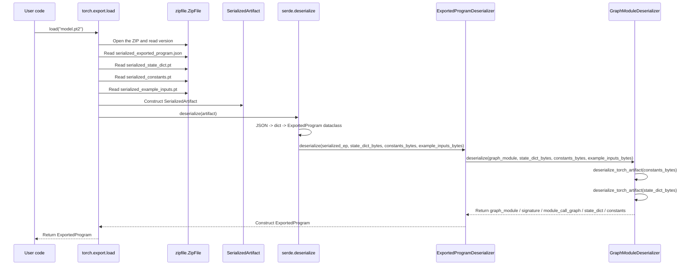
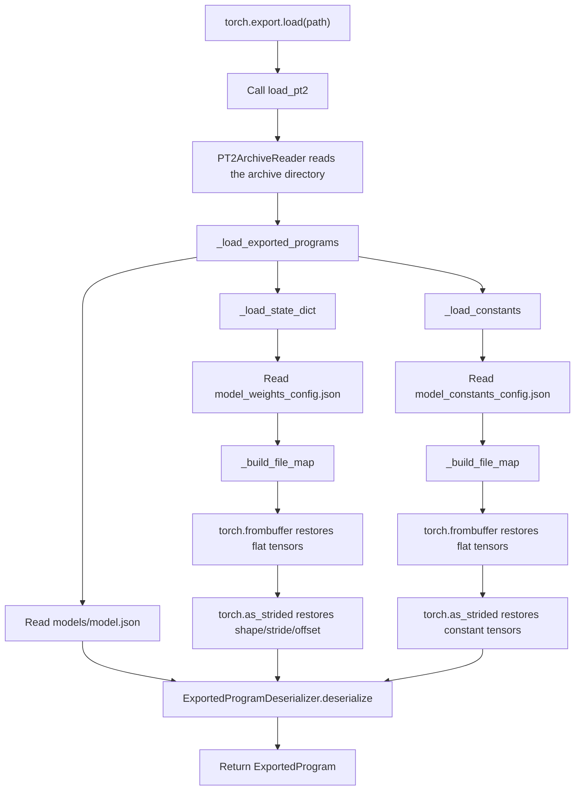
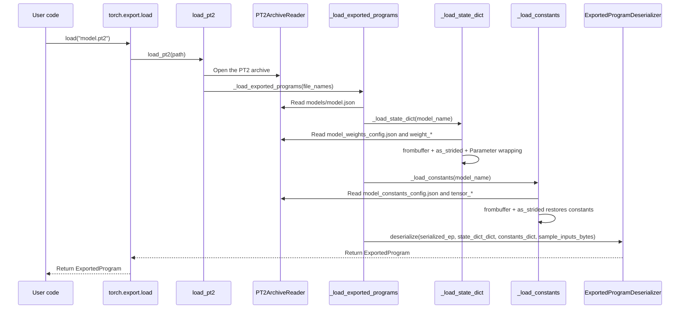
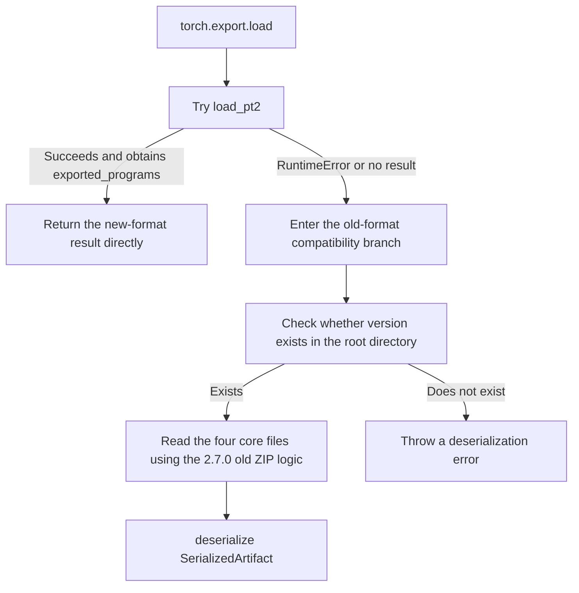
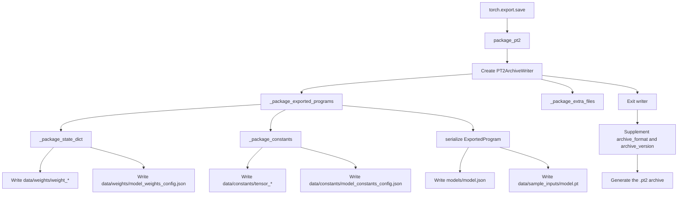

# Understanding the PT2 Model Archive Format

## What this article answers

`torch.export` is the model export API introduced in PyTorch 2.x. It captures an `nn.Module` as a serializable `ExportedProgram` object. This object stores the computation graph, parameters, buffers, constants, and calling constraints together. The exported `.pt2` file is essentially a ZIP archive: some files describe the graph structure, and other files store tensor data and archive metadata.

Based on actual export results from PyTorch 2.7.0 and PyTorch 2.9.0, this article analyzes the composition and implementation of the PT2 model archive format, including the structure of `ExportedProgram`, the save output of `torch.export.save`, and how weights, constants, and example inputs are persisted.

## PT2 archive format overview

### Model example

```python
import torch
import torch.nn as nn

class DemoModel(nn.Module):
    def __init__(self):
        super().__init__()
        # Parameters (model weights, participate in training)
        self.weight = nn.Parameter(torch.randn(4, 4))
        # Buffers (not trained, but saved to state_dict)
        self.register_buffer("running_scale", torch.ones(4))
        # Constants (plain Python attributes, not part of state_dict)
        self.const_bias = torch.tensor([1.0, 2.0, 3.0, 4.0])

    def forward(self, x):
        y = x @ self.weight
        y = y * self.running_scale
        y = y + self.const_bias

        return y


model = DemoModel()
model.eval()
example_input = (torch.randn(2, 4),)
exported_program = torch.export.export(
    model,
    example_input
)
torch.export.save(exported_program, "./demo_model.pt2")
```

### ZIP structure from flat to layered

The `.pt2` format in PyTorch 2.7.0 uses a flat layout. After decompression, all core objects sit directly in the archive root, without a top-level directory such as `demo_model/`:

```text
serialized_exported_program.json   # graph definition + metadata
serialized_state_dict.pt           # overall state_dict of parameters + buffers
serialized_constants.pt            # constant tensors
serialized_example_inputs.pt       # example inputs
version                            # schema version marker
```

The `.pt2` in PyTorch 2.9.0 uses a layered directory structure, organizing model files by function. For the example `demo_model.pt2` in this article, the archive contents are as follows:

```text
demo_model
├── .data
│   ├── serialization_id
│   └── version
├── archive_format
├── archive_version
├── byteorder
├── data
│   ├── constants
│   │   ├── model_constants_config.json
│   │   └── tensor_0
│   ├── sample_inputs
│   │   └── model.pt
│   └── weights
│       ├── model_weights_config.json
│       ├── weight_0
│       └── weight_1
└── models
    └── model.json
```

This change reflects a clear direction: `.pt2` evolves from "a few large objects packaged directly" into "a formal archive format specification", where the model description, weights, weight configuration, sample inputs, and archive metadata are managed structurally.

### File composition details

The graph definition file is represented as JSON in both versions, but the file path differs:

| Version | Graph definition file |
| --- | --- |
| PyTorch 2.7.0 | `serialized_exported_program.json` |
| PyTorch 2.9.0 | `models/model.json` |

Their top-level structure is similar, usually containing fields such as `graph_module`, `opset_version`, `range_constraints`, `schema_version`, `verifiers`, and `torch_version`; in PyTorch 2.9.0, `guards_code` is also seen. The most core part is `graph_module.graph`, which records the inputs, outputs, and nodes of the exported computation graph, corresponding to the serialized result of `ExportedProgram.graph_module.graph`.

Weight storage is the most obvious change point:

| Version | Storage method |
| --- | --- |
| PyTorch 2.7.0 | Parameters and buffers are stored together in `serialized_state_dict.pt`; reading is basically equivalent to `torch.load(...)` |
| PyTorch 2.9.0 | Each tensor is split into a separate file, for example `weight_0` and `weight_1`; the mapping from logical names to metadata such as `shape`, `dtype`, `device`, and `stride` is stored in `data/weights/model_weights_config.json` |

This split lets external tools read the metadata first and then locate concrete tensor data on demand, without loading an entire `state_dict.pt` first.

Example inputs are also saved in both versions:

| Version | Example input file |
| --- | --- |
| PyTorch 2.7.0 | `serialized_example_inputs.pt` |
| PyTorch 2.9.0 | `data/sample_inputs/model.pt` |

These files can usually be restored through `torch.load(...)`, and their content is generally in `(args, kwargs)` form, convenient for testing the export result.

PyTorch 2.9.0 also explicitly introduces archive-level metadata files:

| File | Meaning |
| --- | --- |
| `archive_format` | Identifies the current archive type as `pt2` |
| `archive_version` | Archive format version |
| `.data/version` | Internal version marker |
| `byteorder` | Byte order information |
| `.data/serialization_id` | Serialization identifier |


## ExportedProgram core structure

`.pt2` is only the persisted form of `ExportedProgram`. To understand the concrete source of each file in the archive, you first need to clarify the in-memory organization of `ExportedProgram`.

Taking the example model in this article, after export in PyTorch 2.7.0 and PyTorch 2.9.0, the public fields of `ExportedProgram` are basically the same. The core fields are as follows:

| Field | Meaning |
| --- | --- |
| `graph` / `graph_module` | The computation graph itself |
| `graph_signature` | Semantic signature of graph inputs and outputs |
| `state_dict` | Parameters and persistent buffers |
| `constants` | Constant tensors promoted to graph inputs |
| `example_inputs` | Example inputs used during export |
| `range_constraints` | Symbolic dimension constraints |
| `module_call_graph` | Module-level call relationships |
| `verifiers` | Graph consistency verification information |

Among these fields, `graph_module.graph`, `graph_signature`, `state_dict`, and `constants` are the most critical:

- `graph_module.graph` records which nodes exist in the graph
- `graph_signature` records what each graph input represents
- `state_dict` records which tensors belong to model state (trainable parameters)
- `constants` records which tensors are constants rather than user inputs

### Division of labor between graph and graph_signature

Printing `graph_module.graph` directly shows the following structure:

```python
print(exported_program.graph_module.graph)
graph():
    %p_weight : [num_users=1] = placeholder[target=p_weight]
    %b_running_scale : [num_users=1] = placeholder[target=b_running_scale]
    %c_const_bias : [num_users=1] = placeholder[target=c_const_bias]
    %x : [num_users=1] = placeholder[target=x]
    %matmul : [num_users=1] = call_function[target=torch.ops.aten.matmul.default](args = (%x, %p_weight), kwargs = {})
    %mul : [num_users=1] = call_function[target=torch.ops.aten.mul.Tensor](args = (%matmul, %b_running_scale), kwargs = {})
    %add : [num_users=1] = call_function[target=torch.ops.aten.add.Tensor](args = (%mul, %c_const_bias), kwargs = {})
    return (add,)
```

The corresponding `graph_signature` print result is as follows; in the serialized JSON, the corresponding field name is `graph_module.signature`:

```python
print(exported_program.graph_signature)
# inputs
p_weight: PARAMETER target='weight'
b_running_scale: BUFFER target='running_scale' persistent=True
c_const_bias: CONSTANT_TENSOR target='const_bias'
x: USER_INPUT

# outputs
add: USER_OUTPUT
```

There is a point here that is easy to misunderstand: the `placeholder` in the graph does not correspond only to user inputs. The exported graph promotes parameters, buffers, and constants all to graph inputs, and then `graph_signature` explains the semantics of each of these inputs.

In the example of this article, the input classification of `graph_signature` is as follows:

| Graph input name | Classification | Corresponding logical name |
| --- | --- | --- |
| `p_weight` | `PARAMETER` | `weight` |
| `b_running_scale` | `BUFFER` | `running_scale` |
| `c_const_bias` | `CONSTANT_TENSOR` | `const_bias` |
| `x` | `USER_INPUT` | User input |

In other words, `graph` only cares which values are needed during execution and does not directly distinguish whether these values come from model weights, buffers, constants, or user inputs; the real semantic mapping is provided by `graph_signature`. This layering is important because it separates "graph execution" from "input source".

From a serialization perspective, this split is also very natural:

| Component | Role |
| --- | --- |
| `graph_module.graph` | Records nodes and data flow |
| `graph_module.signature` | Records the mapping from placeholders to logical names |
| `state_dict` and `constants` | Provide the data actually referenced by these placeholders |

### Boundary between state_dict and constants

For the example model in this article, the exported object can be summarized in the following table:

| Field | Keys |
| --- | --- |
| `state_dict.keys()` | `["weight", "running_scale"]` |
| `constants.keys()` | `["const_bias"]` |

This result is consistent with the model definition:

| Name | Source | Destination |
| --- | --- | --- |
| `weight` | `nn.Parameter` | `state_dict` |
| `running_scale` | Buffer registered via `register_buffer` | `state_dict` |
| `const_bias` | Plain tensor attribute on the module | `constants` |

This directly explains the archive format differences:

| Version | Parameters and buffers | Constants |
| --- | --- | --- |
| PyTorch 2.7.0 | Serialized into `serialized_state_dict.pt` | Written to `serialized_constants.pt` |
| PyTorch 2.9.0 | Mapped to `data/weights/` | Mapped to `data/constants/` |

Taking the PyTorch 2.9.0 output of the example in this article:

| Configuration file | Recorded content |
| --- | --- |
| `data/weights/model_weights_config.json` | `weight -> weight_0`, `running_scale -> weight_1` |
| `data/constants/model_constants_config.json` | `const_bias -> tensor_0` |

In addition to the mapping from logical names to file names, the configuration files also record tensor metadata such as `dtype`, `sizes`, `strides`, `device`, `storage_offset`, and `requires_grad`. In other words, PyTorch 2.9.0 `.pt2` is no longer a simple package of "a `state_dict` serialization file plus a constants serialization file", but a combination of "graph description + tensor metadata + tensor data".

## In-depth analysis of model.json

In the PyTorch 2.9.0 archive structure, `models/model.json` is the most core description file. It is responsible for recording the computation graph, input/output signatures, module call relationships, and some archive-level metadata; however, it does not directly store the binary content of weights and constants.

In other words, `model.json` answers "how the model executes", while `data/weights/` and `data/constants/` answer "where the data used during execution comes from".

### Top-level structure

The top-level fields of the example `model.json` in this article are as follows:

| Field | Example value | Role |
| --- | --- | --- |
| `graph_module` | Object | Stores the graph itself, graph signature, module call relationships, and local metadata |
| `opset_version` | `{"aten": 10}` | Records the operator set version |
| `range_constraints` | `{}` | Records symbolic dimension constraints; empty in this example |
| `schema_version` | `{"major": 8, "minor": 14}` | Records the schema version of the current JSON structure |
| `verifiers` | `["TRAINING"]` | Graph consistency verification type |
| `torch_version` | `"2.9.0+cpu"` | Records the PyTorch version at export time |
| `guards_code` | `[]` | Records additional constraint code; empty in this example |

From the structure above, the design goal of model.json is not to "save everything", but to divide information into two levels:

- Archive-level description: carried by top-level fields, including overall archive information such as version, constraints, and verifiers.

- Graph representation: carried by the graph_module field, responsible for describing the computation graph structure and its execution semantics.

### Composition of graph_module

`graph_module` is the main body of `model.json`. In the example of this article, it contains the following fields:

| Field | Role |
| --- | --- |
| `graph` | Records graph inputs and graph outputs, expressing the operator DAG (data flow graph) |
| `signature` | Records the semantic classification of graph inputs and outputs |
| `module_call_graph` | Records module-level call relationships |
| `metadata` | Extensible field recording graph-module-level metadata; an empty object in this example |
| `treespec_namedtuple_fields` | Related to the PyTorch pytree system; records namedtuple fields when the tree structure is expanded; an empty object in this example |

Here `graph_module` can be understood as a layered description:

| Subfield | Core question |
| --- | --- |
| `graph` | What values, nodes, and edges are in the graph |
| `signature` | Whether these values represent parameters, buffers, constants, or user inputs |
| `module_call_graph` | How original module calls map to graph call interfaces after export |

### JSON form of graph nodes and data flow

`graph_module.graph` is the JSON version of `exported_program.graph_module.graph` in Python. Its top-level fields are as follows:

| Field | Role |
| --- | --- |
| `inputs` | List of graph inputs |
| `outputs` | List of graph outputs |
| `nodes` | List of operator nodes |
| `tensor_values` | Metadata table for each tensor value |
| `sym_int_values` | Table of symbolic integer values |
| `sym_bool_values` | Table of symbolic boolean values |
| `sym_float_values` | Table of symbolic float values |
| `custom_obj_values` | Table of custom object values |
| `is_single_tensor_return` | Whether the return value is a single tensor |

For the example in this article, the actual contents of `inputs` and `outputs` are as follows:

```json
{
  "inputs": [
    {"as_tensor": {"name": "p_weight"}},
    {"as_tensor": {"name": "b_running_scale"}},
    {"as_tensor": {"name": "c_const_bias"}},
    {"as_tensor": {"name": "x"}}
  ],
  "outputs": [
    {"as_tensor": {"name": "add"}}
  ]
}
```

The logical names `weight`, `running_scale`, and `const_bias` do not appear here; instead, the value names used internally by the graph are written uniformly, such as `p_weight`, `b_running_scale`, and `c_const_bias`. This again shows that `graph` only describes the value flow on the graph and is not responsible for interpreting the source of these values in module semantics.

Nodes are stored as structured JSON. Taking the first `matmul` node as an example:

```json
{
  "target": "torch.ops.aten.matmul.default",
  "inputs": [
    {
      "name": "self",
      "arg": {"as_tensor": {"name": "x"}},
      "kind": 1
    },
    {
      "name": "other",
      "arg": {"as_tensor": {"name": "p_weight"}},
      "kind": 1
    }
  ],
  "outputs": [
    {"as_tensor": {"name": "matmul"}}
  ],
  "metadata": {
    "stack_trace": "... line 22, in forward\\n    y = x @ self.weight",
    "nn_module_stack": "L__self__,,__main__.DemoModel",
    "torch_fn": "matmul_1;method_descriptor.matmul"
  },
  "is_hop_single_tensor_return": null
}
```

There are three key points in this structure:

| Field | Meaning |
| --- | --- |
| `target` | The corresponding operator target, here `torch.ops.aten.matmul.default` |
| `inputs` / `outputs` | The node's input and output values and their names |
| `metadata` | Debug and traceability information, such as source code location, module stack, and original calling function |

Therefore, `nodes` is not just "a list of operator names" but a complete record of a node's call target, parameter binding relationships, output value names, and debugging context.

### tensor_values tensor metadata

There is another very critical but easily overlooked field in `graph`: `tensor_values`. It is not the tensor data itself but a metadata table for each tensor value in the graph.

Taking the input `p_weight` as an example, the corresponding record is as follows:

```json
"p_weight": {
  "dtype": 7,
  "sizes": [{"as_int": 4}, {"as_int": 4}],
  "requires_grad": true,
  "device": {"type": "cpu", "index": null},
  "strides": [{"as_int": 4}, {"as_int": 1}],
  "storage_offset": {"as_int": 0},
  "layout": 7
}
```

The role of this layer of information can be summarized as:

| Field | Description |
| --- | --- |
| `dtype` | Tensor data type, encoded using internal enum values |
| `sizes` | Tensor shape |
| `requires_grad` | Whether it participates in gradient computation |
| `device` | Device information |
| `strides` | Stride information |
| `storage_offset` | Storage offset |
| `layout` | Layout type, encoded using internal enum values |

This shows that `model.json` must at least be able to independently express "what each value in the graph looks like"; otherwise, even if an external tool understands the node relationships, it cannot know the basic tensor attributes of each value.

At the same time, note the boundary: `tensor_values` only stores tensor metadata and not concrete tensor data. The actual data content is still in binary files such as `data/weights/weight_*` and `data/constants/tensor_*`.

### signature restores tensor names to graph nodes

If `graph` solves "how values flow", then `graph_module.signature` solves "what each of these values is". The `signature` fragment in the example of this article is as follows:

```json
{
  "input_specs": [
    {
      "parameter": {
        "arg": {"name": "p_weight"},
        "parameter_name": "weight"
      }
    },
    {
      "buffer": {
        "arg": {"name": "b_running_scale"},
        "buffer_name": "running_scale",
        "persistent": true
      }
    },
    {
      "tensor_constant": {
        "arg": {"name": "c_const_bias"},
        "tensor_constant_name": "const_bias"
      }
    },
    {
      "user_input": {
        "arg": {"as_tensor": {"name": "x"}}
      }
    }
  ],
  "output_specs": [
    {
      "user_output": {
        "arg": {"as_tensor": {"name": "add"}}
      }
    }
  ]
}
```

The most important thing here is the mapping from "value name to semantics":

| Graph value name | Semantic type | Logical name |
| --- | --- | --- |
| `p_weight` | Parameter | `weight` |
| `b_running_scale` | Buffer | `running_scale` |
| `c_const_bias` | Constant tensor | `const_bias` |
| `x` | User input | Input parameter `x` |
| `add` | User output | Forward return value |

Therefore, `signature` is the key bridge in `model.json` that connects "graph internal representation" back to "module semantics". Without this layer, external tools would only see a set of placeholders and value names and could not determine which value should be loaded from the weight file and which value should be provided by the caller as input.

### InputSpec type system

Each entry in `signature.input_specs[]` corresponds to a graph input (placeholder), and its type is defined by the `InputKind` enum in the PyTorch source `graph_signature.py`. Understanding this type system is essential for external tools parsing EP JSON.

#### InputKind enum

The PyTorch source (`torch/export/graph_signature.py`) defines 7 `InputKind` values:

| InputKind | JSON key | arg type | Description |
|---|---|---|---|
| `USER_INPUT` | `user_input` | TensorArgument / SymIntArgument / SymFloatArgument / SymBoolArgument | User input (tensor or symbolic value) |
| `USER_INPUT` (ConstantArgument) | `constant_input` | as_int / as_float / as_bool / as_string / as_none | Scalar constant (already specialized at export) |
| `PARAMETER` | `parameter` | TensorArgument | Model parameter (`nn.Parameter`) |
| `BUFFER` | `buffer` | TensorArgument | Buffer (`register_buffer`), with a `persistent` flag |
| `CONSTANT_TENSOR` | `tensor_constant` | TensorArgument | Tensor constant (plain tensor attribute on the module) |
| `CUSTOM_OBJ` | `custom_obj` | CustomObjArgument | Custom object |
| `TOKEN` | `token` | TokenArgument | Effect token |

#### arg types of user_input

When `InputKind` is `USER_INPUT` and `arg` is not a `ConstantArgument`, the serializer (`serialize.py:1408`) selects the JSON key based on the actual type of `ArgumentSpec`:

| JSON key | Python type | Description |
|---|---|---|
| `as_tensor` | TensorArgument | Tensor input |
| `as_sym_int` | SymIntArgument | Symbolic integer |
| `as_sym_float` | SymFloatArgument | Symbolic float |
| `as_sym_bool` | SymBoolArgument | Symbolic boolean |
| `as_custom_obj` | CustomObjArgument | Custom object |

#### value types of constant_input

When `InputKind` is `USER_INPUT` and `arg` is a `ConstantArgument`, it is serialized as `constant_input`, and its `value` field (`serialize.py:1262`):

| JSON key | Python type | Description |
|---|---|---|
| `as_int` | int | Integer constant |
| `as_float` | float | Float constant |
| `as_bool` | bool | Boolean constant |
| `as_string` | str | String constant |
| `as_none` | None | Null value |

#### Type difference between placeholders and node inputs

One easily confused point is that EP JSON contains two "input" concepts whose type spaces differ.

| Concept | Source | Type space | List types |
|---|---|---|---|
| **InputSpec** (placeholder / graph-level input) | `signature.input_specs[]` | Tensor, SymInt, SymFloat, SymBool, ScalarInt, ScalarFloat, ScalarBool, ScalarString | **Not supported** |
| **ParsedNodeInput** (node input) | `nodes[].inputs[]` | All of the above + SymListInt/Float/Bool, ScalarListInt/Float/Bool, Enum, TensorList, Operator, None | Supported |

List types (`as_ints`, `as_sym_ints`, etc.) and `Enum` appear only in node-level inputs, because they represent inline parameters of operator calls (such as the `tensors` list in `torch.ops.aten.cat.default(tensors, dim)`), not the external signature of the graph. PyTorch's `ArgumentSpec` type union (`graph_signature.py:69`) contains only single-value types, and the type of `InputSpec.arg` is restricted to `ArgumentSpec`, so list types never appear on the placeholder path.

This difference directly affects the parsing logic on the C++ side: placeholder handling functions (such as `PrepareUserInput`) only need to cover single-value types, while list type handling is the responsibility of the node planner (such as `FallbackNodePlanner`).

### module_call_graph preserves module call relationships

`graph_module.module_call_graph` records module-level calling conventions. The example in this article has only one top-level module, so this field contains only one record:

```json
[
  {
    "fqn": "",
    "signature": {
      "inputs": [],
      "outputs": [],
      "in_spec": "[1, {\"type\": \"builtins.tuple\", ...}]",
      "out_spec": "[1, {\"type\": null, ...}]",
      "forward_arg_names": ["x"]
    }
  }
]
```

This field focuses not on operator execution but on the call interface:

| Subfield | Role |
| --- | --- |
| `fqn` | Fully qualified name of the module; an empty string for the top-level module |
| `forward_arg_names` | Parameter names of the forward call |
| `in_spec` | Input tree structure specification |
| `out_spec` | Output tree structure specification |

For the example in this article, `forward_arg_names` contains only `x`, indicating that from the caller's perspective the forward interface still has only one user input; parameters, buffers, and constants are not exposed as user call parameters.

## Weight and constant storage

The previous two sections explained that `model.json` only describes the graph structure and semantics and does not directly store concrete tensor data. The actual weights and constants are stored in separate files in the archive.

This part needs to answer three questions:

| Question | Focus |
| --- | --- |
| Where weights and constants are stored respectively | File layout |
| Whether the parsing approach is the same in PyTorch 2.7.0 and PyTorch 2.9.0 | Serialization format differences |
| Whether it is suitable for direct loading with C++ / LibTorch | Engineering boundary |

### Storage comparison

The differences between PyTorch 2.7.0 and PyTorch 2.9.0 at this layer are very obvious:

| Version | Weight storage | Constant storage | Parsing entry |
| --- | --- | --- | --- |
| PyTorch 2.7.0 | `serialized_state_dict.pt` | `serialized_constants.pt` | Direct `torch.load(...)` |
| PyTorch 2.9.0 | `data/weights/weight_*` + `model_weights_config.json` | `data/constants/tensor_*` + `model_constants_config.json` | Read configuration first, then rebuild tensors |

This means the parsing approaches of the two `.pt2` versions are not the same. The PyTorch 2.7.0 `.pt2` is essentially two overall serialized objects, so parsing complexity is lower; the PyTorch 2.9.0 version uses JSON configuration plus raw tensor bytes, so parsing complexity is relatively higher. Here parsing complexity refers to the complexity of parsing weights on the Python side; when moving away from the PyTorch API, the weight format used by the PyTorch 2.9.0 version offers convenience for external tool parsing.

### PyTorch 2.7.0 overall serialized objects

In PyTorch 2.7.0, parameters and buffers are packed together into `serialized_state_dict.pt`, and constants are packed into `serialized_constants.pt`. Both files can be passed directly to `torch.load(...)`.

For the example in this article, the actual parsing results are as follows:

| File | Parsing result |
| --- | --- |
| `serialized_state_dict.pt` | `weight`, `running_scale` |
| `serialized_constants.pt` | `const_bias` |

They can be read directly with the following code:

```python
import io
import zipfile

import torch


def load_pt2_payload_27(pt2_path: str):
    with zipfile.ZipFile(pt2_path) as zf:
        state_dict = torch.load(
            io.BytesIO(zf.read("serialized_state_dict.pt")),
            map_location="cpu",
        )
        constants = torch.load(
            io.BytesIO(zf.read("serialized_constants.pt")),
            map_location="cpu",
        )
    return state_dict, constants


state_dict, constants = load_pt2_payload_27("demo_model.pt2")
print(state_dict.keys())
print(constants.keys())
```

This approach is simple, but the visibility for external tools is weak. The reader can basically only deserialize the entire object and then analyze its contents.

### PyTorch 2.9.0 configuration file plus raw tensor bytes

PyTorch 2.9.0 no longer packs all weights into a single overall object. Instead, it splits each tensor into a separate file and records the mapping from logical names to file names through configuration files.

For the example in this article, the actual file correspondence is as follows:

| Logical name | Type | Configuration file record | Data file | File size |
| --- | --- | --- | --- | --- |
| `weight` | Parameter | `data/weights/model_weights_config.json` | `data/weights/weight_0` | 64 bytes |
| `running_scale` | Buffer | `data/weights/model_weights_config.json` | `data/weights/weight_1` | 16 bytes |
| `const_bias` | Constant tensor | `data/constants/model_constants_config.json` | `data/constants/tensor_0` | 16 bytes |

In the example of this article, `use_pickle` is `false` for all three configuration entries, so the corresponding data files are raw tensor bytes rather than serialized objects generated by `torch.save(...)`.

This can be seen directly from the file sizes:

| File | Size | Meaning |
| --- | --- | --- |
| `weight_0` | 64 bytes | A `4 x 4` `float32` tensor, `16 x 4` bytes in total |
| `weight_1` | 16 bytes | `4` `float32` elements |
| `tensor_0` | 16 bytes | `4` `float32` elements |

Combined with `byteorder=little` in the archive, these files are actually tensor data written directly in little-endian order. Taking `const_bias = [1.0, 2.0, 3.0, 4.0]` as an example, the first 16 bytes of `tensor_0` can be interpreted directly as four `float32` values:

```text
00 00 80 3f 00 00 00 40 00 00 40 40 00 00 80 40
```

This corresponds exactly to `1.0, 2.0, 3.0, 4.0`.

### Configuration file structure of PyTorch 2.9.0

What really determines how tensors are restored in 2.9.0 is not the file names `weight_0` or `tensor_0` themselves, but the `tensor_meta` in the configuration file.

Taking the configuration of `weight` as an example, `model_weights_config.json` records:

```json
{
  "path_name": "weight_0",
  "is_param": true,
  "use_pickle": false,
  "tensor_meta": {
    "dtype": 7,
    "sizes": [{"as_int": 4}, {"as_int": 4}],
    "requires_grad": true,
    "device": {"type": "cpu", "index": null},
    "strides": [{"as_int": 4}, {"as_int": 1}],
    "storage_offset": {"as_int": 0},
    "layout": 7
  }
}
```

This contains at least three layers of information:

| Information layer | Related fields | Role |
| --- | --- | --- |
| File location | `path_name` | Indicates the actual data file name |
| Semantic classification | `is_param` | Distinguishes parameters from buffers |
| Tensor reconstruction | `tensor_meta` | Provides information such as `dtype`, shape, stride, offset, and device |

This shows that the restoration logic in PyTorch 2.9.0 is not "directly `torch.load` an object" but "read the configuration first, then rebuild raw bytes into tensors based on metadata".

### How to parse weights and constants in PyTorch 2.9.0

For PyTorch 2.9.0, the most reliable approach is still to use the official entry point `torch.export.load(...)` directly:

```python
import torch


ep = torch.export.load("demo_model.pt2")
print(ep.state_dict.keys())
print(ep.constants.keys())
```

This path automatically handles:

| Step | Description |
| --- | --- |
| Read `model.json` | Restore `ExportedProgram` |
| Read `model_weights_config.json` | Establish the mapping from weight names to files |
| Read `model_constants_config.json` | Establish the mapping from constant names to files |
| Restore tensors by `tensor_meta` | Restore shape, stride, offset, and device |

If you only want to analyze the archive structure, you can also parse manually. The example code below demonstrates the core idea equivalent to the official implementation: read the configuration first, then rebuild tensors with `torch.frombuffer(...)` and `torch.as_strided(...)`.

```python
import json
import zipfile

import torch


DTYPE_MAP = {
    7: torch.float32,
}


def _decode_int_list(items):
    return [item["as_int"] for item in items]


def _decode_device(device_desc):
    if device_desc["index"] is None:
        return torch.device(device_desc["type"])
    return torch.device(f"{device_desc['type']}:{device_desc['index']}")


def _load_payload_table(zf, config_path, base_dir):
    config = json.loads(zf.read(config_path))["config"]
    result = {}

    for logical_name, meta in config.items():
        if meta["use_pickle"]:
            raise NotImplementedError("The example in this article does not involve object serialization content")

        tensor_meta = meta["tensor_meta"]
        raw = bytearray(zf.read(f"{base_dir}/{meta['path_name']}"))

        flat = torch.frombuffer(
            raw,
            dtype=DTYPE_MAP[tensor_meta["dtype"]],
            requires_grad=tensor_meta["requires_grad"],
        ).to(_decode_device(tensor_meta["device"]))

        tensor = torch.as_strided(
            flat,
            size=_decode_int_list(tensor_meta["sizes"]),
            stride=_decode_int_list(tensor_meta["strides"]),
            storage_offset=tensor_meta["storage_offset"]["as_int"],
        )

        if meta.get("is_param", False):
            tensor = torch.nn.Parameter(tensor)

        result[logical_name] = tensor

    return result


def load_pt2_payload_29(pt2_path: str):
    with zipfile.ZipFile(pt2_path) as zf:
        names = zf.namelist()
        prefix = next(
            name.split("/", 1)[0]
            for name in names
            if name.endswith("models/model.json")
        )

        state_dict = _load_payload_table(
            zf,
            f"{prefix}/data/weights/model_weights_config.json",
            f"{prefix}/data/weights",
        )
        constants = _load_payload_table(
            zf,
            f"{prefix}/data/constants/model_constants_config.json",
            f"{prefix}/data/constants",
        )

    return state_dict, constants
```

This code is already sufficient to parse the example in this article, but note two points:

| Note | Description |
| --- | --- |
| `DTYPE_MAP` | This article only adds `float32` used in the example; for general parsing, the internal type code mapping must be completed |
| `use_pickle=true` | Some entries may still go through the object serialization path and cannot all be handled as raw bytes |

### Core differences and compatibility

PyTorch 2.7.0 uses overall object serialization (a single `.pt` file), while PyTorch 2.9.0 uses a sharded approach of raw tensor bytes plus JSON configuration, which is more conducive to random access and external tool parsing. In terms of compatibility, PyTorch 2.9.0 is backward compatible with PyTorch 2.7.0 (loading an old archive prompts that the format is outdated), but the reverse is not possible: PyTorch 2.7.0 cannot recognize the new PyTorch 2.9.0 layout.


## Loading and deserialization

The previous sections mainly answer "what is stored in the files". This section turns to another question: how exactly does `torch.export.load(...)` restore these files into an `ExportedProgram`?

Two concepts need to be distinguished first:

| Concept | Meaning |
| --- | --- |
| Loading | Reading bytes, JSON, and tensor data from the `.pt2` ZIP archive |
| Deserialization | Restoring these raw contents into Python objects such as `ExportedProgram`, `state_dict`, `constants`, and example inputs |

For this article, the relevant sources are mainly in the following files:

| Version | Key source files |
| --- | --- |
| PyTorch 2.7.0 | `torch/export/__init__.py`, `torch/_export/serde/serialize.py` |
| PyTorch 2.9.0 | `torch/export/__init__.py`, `torch/export/pt2_archive/_package.py`, `torch/_export/serde/serialize.py` |

The call chain analysis in this section is based on the actual source implementations of PyTorch 2.7.0 and PyTorch 2.9.0.

### Direct loading path of the old format ZIP in PyTorch 2.7.0

The `torch.export.load(...)` implementation in PyTorch 2.7.0 is relatively direct. The entry function is in `torch/export/__init__.py`, and the core steps are as follows:

| Step | Key function | Role |
| --- | --- | --- |
| 1 | `torch.export.load(...)` | Open the `.pt2` ZIP file |
| 2 | `zipfile.ZipFile(...).read(...)` | Read `version` and the four core files |
| 3 | `SerializedArtifact(...)` | Wrap the four raw contents into an intermediate object |
| 4 | `torch._export.serde.serialize.deserialize(...)` | Enter the main deserialization entry |
| 5 | `ExportedProgramDeserializer.deserialize(...)` | Restore `ExportedProgram` |
| 6 | `GraphModuleDeserializer.deserialize(...)` | Restore the graph module, graph signature, and module call graph |
| 7 | `deserialize_torch_artifact(...)` | Restore the bytes of `state_dict`, `constants`, and `example_inputs` into Python objects |

The corresponding source call flow can be summarized as:



There are two key points here.

First, `load()` in PyTorch 2.7.0 itself does not understand the internal structure of weights, constants, and example inputs. It only reads the raw bytes of these files in bulk and hands them to the unified `deserialize(...)` entry point.

Second, the actual action of restoring `serialized_state_dict.pt` and `serialized_constants.pt` into objects does not happen in the outer `load()` but inside `GraphModuleDeserializer.deserialize(...)`. In other words, **in 2.7.0, `state_dict` and `constants` are passed down as bytes all the way into deeper deserialization logic and then restored through `deserialize_torch_artifact(...)`**.

This is also consistent with the file organization of 2.7.0: weights and constants are originally overall object serialization outputs, and the most natural handling is "read them out as a whole, then deserialize as a whole".

### PyTorch 2.9.0 prefers the PT2 archive loader

The surface interface of `torch.export.load(...)` in PyTorch 2.9.0 is unchanged, but internally it has switched to the new PT2 archive loader. The entry is still in `torch/export/__init__.py`, but the main path becomes `torch.export.pt2_archive._package.load_pt2(...)`.

The main call chain is as follows:

| Step | Key function | Role |
| --- | --- | --- |
| 1 | `torch.export.load(...)` | Overall entry point |
| 2 | `load_pt2(...)` | Read the new PT2 archive |
| 3 | `PT2ArchiveReader` | Enumerate archive files |
| 4 | `_load_exported_programs(...)` | Restore the exported programs in the archive one by one |
| 5 | `_load_state_dict(...)` | Restore parameters and buffers |
| 6 | `_load_constants(...)` | Restore constants |
| 7 | `ExportedProgramDeserializer.deserialize(...)` | Construct `ExportedProgram` |

Compared with 2.7.0, the most fundamental change is: **before entering `ExportedProgramDeserializer`, PyTorch 2.9.0 has already restored weights and constants from sharded files into dictionary objects**.

This process can be represented by the following Mermaid flowchart:



Written as a sequence diagram closer to the function call order:



### Key source paths in PyTorch 2.9.0

At the source level, the new PyTorch 2.9.0 path has three particularly critical functions.

#### `_load_exported_programs(...)`

This function is located in `torch/export/pt2_archive/_package.py`. It does:

| Action | Description |
| --- | --- |
| Find `models/*.json` | Determine which exported programs are in the archive |
| Read `model.json` | Obtain the serialized `ExportedProgram` description |
| Read example inputs | Obtain example input bytes from `data/sample_inputs/model.pt` |
| Call `_load_state_dict(...)` | Restore parameters and buffers |
| Call `_load_constants(...)` | Restore constants |
| Call `ExportedProgramDeserializer.deserialize(...)` | Construct the final object |

Its significance is: **2.9.0 no longer mixes "reading the graph description" and "reading parameter constants" into a unified byte object; instead it restores each part separately at a higher level and then aggregates them into an `ExportedProgram`**.

#### `_load_state_dict(...)`

This function restores parameters and buffers, with the core logic as follows:

| Step | Description |
| --- | --- |
| Read `model_weights_config.json` | Get the mapping from logical names to files and tensor metadata |
| `_build_file_map(...)` | First restore `weight_*` raw bytes into flat tensors |
| `torch.as_strided(...)` | Restore the real tensor view according to `sizes`, `strides`, and `storage_offset` |
| `is_param` check | Wrap as `torch.nn.Parameter` if it is a parameter |

In other words, weight restoration in 2.9.0 is a two-stage process:

| Stage | Role |
| --- | --- |
| Flat restoration | Use `torch.frombuffer(...)` to interpret bytes as a 1-D tensor |
| View restoration | Use `torch.as_strided(...)` to restore the original tensor layout |

#### `_load_constants(...)`

The constant restoration flow is basically parallel to weights:

| Step | Description |
| --- | --- |
| Read `model_constants_config.json` | Determine constant files and metadata |
| `_build_file_map(...)` | Restore `tensor_*` bytes into flat tensors |
| `torch.as_strided(...)` | Restore the constant tensor view |
| Special branch | If the constant is a custom object rather than a tensor, go through the object loading path |

Therefore, "loading" in PyTorch 2.9.0 is no longer just reading a few ZIP files but a real archive parsing process.

### Differences in deserialization paths between PyTorch 2.7.0 and PyTorch 2.9.0

If you only look at the unified `deserialize(...)` entry, the two versions look very similar: both restore the serialized graph description into dataclasses and then call `ExportedProgramDeserializer.deserialize(...)`. However, before entering this entry, the two versions already do noticeably different things.

| Dimension | PyTorch 2.7.0 | PyTorch 2.9.0 |
| --- | --- | --- |
| Graph description restoration | `json.loads(...)` + `_dict_to_dataclass(...)` | `_bytes_to_dataclass(...)` |
| `state_dict` passed as | Raw `.pt` bytes | Already-restored dictionary object |
| `constants` passed as | Raw `.pt` bytes | Already-restored dictionary object |
| Tensor reconstruction timing | In the deeper `deserialize_torch_artifact(...)` | Completed in advance in `_load_state_dict(...)` / `_load_constants(...)` |
| Archive understanding capability | Understands only the old layout | Understands the new PT2 archive and retains old-format fallback |

This difference is very critical. It shows that the 2.9.0 design has divided "archive parsing" and "object deserialization" into two clearer layers:

| Layer | PyTorch 2.7.0 | PyTorch 2.9.0 |
| --- | --- | --- |
| Archive parsing layer | Very thin | Very strong |
| Object deserialization layer | Takes on more data restoration work | More focused on graph and object reconstruction |

### Old-format fallback path in PyTorch 2.9.0

`torch.export.load(...)` in PyTorch 2.9.0 also has a noteworthy implementation detail: it first tries `load_pt2(...)`, and if that fails, falls back to the old-format ZIP loading logic.

This branch can be expressed by the following Mermaid diagram:



## Save and packaging implementation in PyTorch 2.9.0

The previous section discussed the `load` side. To close the loop, this section adds a short subsection explaining how PyTorch 2.9.0 packages an `ExportedProgram` into a `.pt2` archive.

The relevant sources are mainly in:

| File | Role |
| --- | --- |
| `torch/export/__init__.py` | `torch.export.save(...)` entry |
| `torch/export/pt2_archive/_package.py` | Main PT2 archive packaging logic |
| `torch/_export/serde/serialize.py` | `ExportedProgram` serialization logic |

### Top-level call chain

The `torch.export.save(...)` implementation in PyTorch 2.9.0 is very thin; the core code is:

```python
from torch.export.pt2_archive._package import package_pt2

package_pt2(
    f,
    exported_programs={"model": ep},
    extra_files=extra_files,
    pickle_protocol=pickle_protocol,
    opset_version=opset_version,
)
```

In other words, `save()` itself does almost no concrete packaging work; it only wraps a single `ExportedProgram` as `{"model": ep}` and hands it to the lower-level `package_pt2(...)`.

### What package_pt2(...) does

The main flow of `package_pt2(...)` is not complicated; the core steps are as follows:

| Step | Key function | Role |
| --- | --- | --- |
| 1 | `package_pt2(...)` | Validate input parameters and the target file name |
| 2 | `PT2ArchiveWriter(...)` | Open the archive writer |
| 3 | `_package_exported_programs(...)` | Package `ExportedProgram`-related files |
| 4 | `_package_aoti_files(...)` | Package AOTInductor artifacts together, if any |
| 5 | `_package_extra_files(...)` | Write extra files |
| 6 | `PT2ArchiveWriter.__exit__()` | Automatically supplement `archive_format` and `archive_version` |

This process can be represented by the following flowchart:



### Responsibility allocation of `_package_exported_programs(...)`

`_package_exported_programs(...)` is the true core of model packaging. For each `model_name, ep`, it does three things in sequence:

| Order | Action | Result |
| --- | --- | --- |
| 1 | `_package_state_dict(ep, ...)` | Generate weight files and `model_weights_config.json` |
| 2 | `_package_constants(ep, ...)` | Generate constant files and `model_constants_config.json` |
| 3 | `serialize(ep, ...)` | Generate graph description bytes and example input bytes |

The corresponding source structure can be summarized as:

```python
weights_config = _package_state_dict(ep, archive_writer, pickle_protocol)
_package_payload_config(archive_writer, weights_config, weights_config_file)

constants_config = _package_constants(ep, archive_writer, pickle_protocol)
_package_payload_config(archive_writer, constants_config, constants_config_file)

artifact = serialize(ep, opset_version, pickle_protocol)
archive_writer.write_bytes(MODELS_FILENAME_FORMAT.format(model_name), artifact.exported_program)
archive_writer.write_bytes(SAMPLE_INPUTS_FILENAME_FORMAT.format(model_name), artifact.example_inputs)
```

There is a very important design point here: **packaging weights/constants and serializing the graph description are two parallel chains**.

| Chain | Output |
| --- | --- |
| `_package_state_dict` / `_package_constants` | Binary tensor files + configuration JSON |
| `serialize(ep, ...)` | `model.json` bytes + example input bytes |

### How `_package_state_dict(...)` writes weights

`_package_state_dict(...)` traverses `exported_program.state_dict` and decides the file name and write method for each weight tensor. Its core logic is as follows:

| Branch | Behavior |
| --- | --- |
| Ordinary tensor | Take `untyped_storage()` and extract raw bytes into `weight_*` |
| Tensor subclass and not a fake tensor | Write using `torch.save(...)` |
| Multiple tensors sharing underlying storage | Deduplicate through `storage_map` to avoid duplicate writes |

At the same time, it writes the following for each logical name:

- `path_name`
- `is_param`
- `use_pickle`
- `tensor_meta`

into `PayloadMeta`, and finally aggregates them into `model_weights_config.json`.

### How `_package_constants(...)` writes constants

`_package_constants(...)` is very similar to `_package_state_dict(...)`, but it handles `exported_program.constants`.

For tensor constants, it does:

| Branch | Behavior |
| --- | --- |
| Ordinary constant tensor | Write `tensor_*` raw bytes |
| Tensor subclass | Fall back to `torch.save(...)` |
| Constants sharing storage | Deduplicate through `storage_map` |

For custom object constants, it does:

| Type | Write method |
| --- | --- |
| `torch._C.ScriptObject` | Serialize by calling `torch._C._pickle_save(...)` |

The final result is:

| File | Content |
| --- | --- |
| `data/constants/tensor_*` | Constant tensor data |
| `data/constants/custom_obj_*` | Custom object constants |
| `data/constants/model_constants_config.json` | Constant configuration and metadata |

### How `serialize(ep, ...)` generates `model.json`

Besides weights and constants, `serialize(ep, ...)` is responsible for converting the `ExportedProgram` itself into a `SerializedArtifact` that can be written into the archive. For PyTorch 2.9.0, this step generates:

| Field | Corresponding file or purpose |
| --- | --- |
| `artifact.exported_program` | Written to `models/model.json` |
| `artifact.example_inputs` | Written to `data/sample_inputs/model.pt` |
| `artifact.state_dict` | Not directly persisted on the new archive path |
| `artifact.constants` | Not directly persisted on the new archive path |

In other words, in the new archive implementation of 2.9.0, `serialize(ep, ...)` still constructs the complete `SerializedArtifact`, but when actually persisted, only `exported_program` and `example_inputs` are used directly; the actual persistence of `state_dict` and `constants` has been moved forward to dedicated packaging functions.

### When PT2ArchiveWriter archive-level metadata is written

`PT2ArchiveWriter` internally writes the archive based on `torch._C.PyTorchFileWriter` and ensures two files exist in `__exit__()`:

| File | Write timing | Meaning |
| --- | --- | --- |
| `archive_format` | `__exit__()` | Archive format identifier, value `pt2` |
| `archive_version` | `__exit__()` | PT2 archive specification version |

At the same time, the underlying `PyTorchFileWriter` also writes PyTorch container-level metadata such as `.data/version`. This is why the 2.9.0 `.pt2` above shows more archive-level files than 2.7.0.
