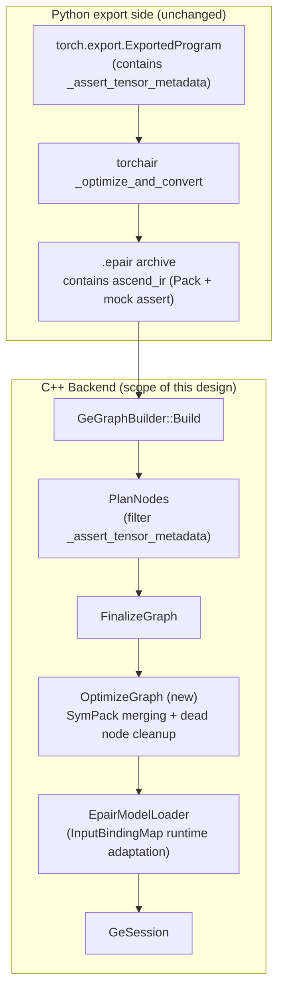
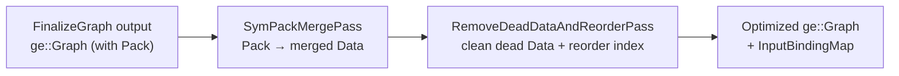
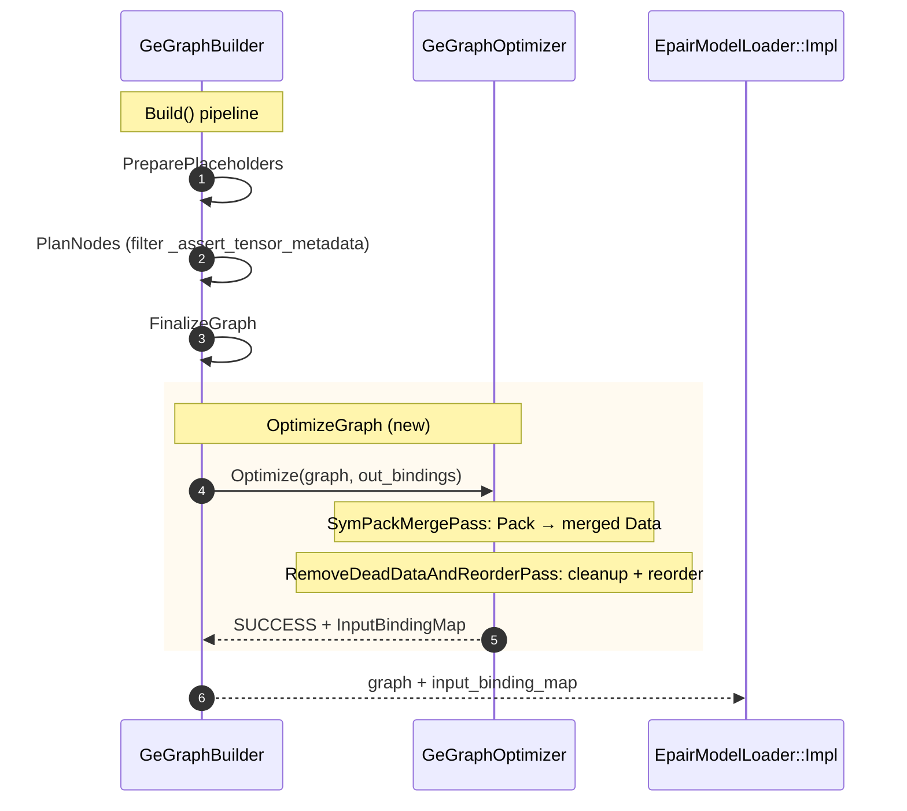

# Epair Supports SymPack Optimization and the AssertTensorMetadata Type

> [!NOTE] Document status
> This is the design draft dated 2026-07-10, describing the implementation of SymPack merging and metadata node filtering. For current interface documentation, see [EpairModelLoader API](../api/epair_model_loader.md).

## Introduction

### Purpose

This document describes two optimizations introduced at the GE Graph construction stage of the C++ Backend:

1. **SymPack merging optimization**: eliminate redundant SymPack nodes in the epair path, achieving the same Pack elimination effect as the torchair `torch.compile` path.
2. **AssertTensorMetadata node filtering**: filter `aten._assert_tensor_metadata` nodes during the `PlanNodes` stage, solving the problem where metadata validation nodes automatically inserted by PyTorch 2.9 `torch.export` block GE graph conversion.

Both optimizations are implemented inside the C++ Backend. They do not modify the Python-side export flow and do not change the epair format.

### Scope

**Included**:

- `OptimizeGraph` stage: `SymPackMergePass` (replace Pack with merged CPU Data) + `RemoveDeadDataAndReorderPass` (dead Data cleanup + index reordering)
- `InputBindingMap`: mapping from merged Data to the user's original inputs, used to build merged tensors at runtime
- `_assert_tensor_metadata` node filtering in the `PlanNodes` stage
- Comparison of the flow differences between the torchair and delegate paths

**Excluded**:

- Migration of other torchair passes (unrelated to Pack elimination)
- Changes to the epair serialization format (binding information lives only in C++ memory and is not persisted)
- Python-side converter changes

---

## Overview

### Software overview

torch-delegate converts a PyTorch model into a `.epair` archive via `torch.export` + the torchair converter, then loads it on the C++ side and builds a GE Graph for execution.

#### Problem 1 SymPack redundancy

When a model uses dynamic SymInt (such as `x.view([m, n])`), the torchair `torch.compile` path eliminates all Pack nodes through `optimize_sym_pack`, but the epair path lacks this optimization, resulting in: redundant Pack nodes being retained, CondGraph conditional subgraphs bloating, and an extra Pack kernel call on every inference.

This design adds an `OptimizeGraph` stage in `GeGraphBuilder::Build` to implement the equivalent graph transformation.

#### Problem 2 AssertTensorMetadata noise nodes

PyTorch 2.9 `torch.export` inserts an `aten._assert_tensor_metadata` validation node before every `aten.to.*`. The node schema is `-> ()` (no output) and it has no computational semantics, yet it blocks conversion because torchair has no matching converter.

This design filters the node by `node.target` during the C++ `PlanNodes` stage, leaving the EP JSON unchanged.

#### Product environment



### Software features

| Feature | Module | Description |
|------|------|------|
| SymPack merging | `GeGraphOptimizer` | Replace Pack nodes with `_inputs_all_sym=True` by merged CPU Data nodes |
| Dead node cleanup and index reordering | `GeGraphOptimizer` | Delete unreferenced original scalar Data and reorder indices into a contiguous sequence |
| Runtime input adaptation | `EpairModelLoader` | Pack user scalars into merged tensors according to `InputBindingMap` |
| AssertTensorMetadata filtering | `PlanNodes` | Skip `_assert_tensor_metadata` by `node.target` without creating a GE GNode |

### Design constraints

1. **Do not change the epair format**: binding information lives only in C++ memory and is not persisted; EP JSON stays unchanged
2. **Do not change the Python side**: `torchair_converter.py` and `epair/writer.py` remain unchanged
3. **GE API constraints**: use the public `ge::Graph` + `ge::GNode` APIs; do not rely on internal implementations
4. **Zero-overhead no-op**: for graphs without target nodes, both optimization paths are no-ops
5. **Minimal changes**: for assert_tensor_metadata, add only one target-matching condition to the `PlanNodes` loop

---

## Feature 1 SymPack merging optimization

### Overall introduction

Add an `OptimizeGraph` stage after `FinalizeGraph` in `GeGraphBuilder::Build`:



### Functional requirement 1 SymPackMergePass

Replace all Pack nodes with `_inputs_all_sym=True` in the graph by merged CPU Data nodes. Packs with identical inputs share the same merged Data.

**Input**:
- `ge::Graph` (`FinalizeGraph` output)
- CPU Data nodes (SymInt scalars, `shape=[]`, `placement=Host`)
- Pack nodes (carrying `_inputs_all_sym=True`, `axis=0`)

**Processing**:

```text
// Step 1: scan CPU Data and SymPack
for node in graph.GetAllNodes():
    if node is CPU Data:  record index
    elif node is _inputs_all_sym Pack:  collect it

// Step 2: deduplicate by input combination, create merged Data
for each Pack:
    if same-input Data already exists:  reuse it
    else:
        create CPU Data(shape=[N], dtype=int64, placement=Host)
        record InputBindingMap: {new_data_name → [source user input indices]}
    delete Pack node

// Step 3: reconnect downstream references
for each node consuming Pack output:
    RemoveEdge(Pack, 0, consumer, port)
    AddDataEdge(merged_data, 0, consumer, port)
```

**Output**: the modified `ge::Graph` + `InputBindingMap`

| Before | After |
|--------|--------|
| Data `m` + Data `n` (CPU scalars) | Deleted (cleaned up by pass 2) |
| Pack(m,n) × 4 + Pack(n,m) × 2 | Data_A(shape=[2]) + Data_B(shape=[2]) |
| Reshape(x, Pack) × 6 | Reshape(x, Data_A) × 4 + Reshape(x, Data_B) × 2 |

### Functional requirement 2 RemoveDeadDataAndReorderPass

Clean up the original scalar Data (such as `m`, `n`) that become unreferenced after replacement, and reorder the indices of the remaining Data into a contiguous sequence.

**Why reindexing is necessary**: torchair `remove_dead_data_and_reorder_data_index` also reindexes (`graph_pass.py:387-389`), and GE requires Data indices to be contiguous starting from 0. If dead Data is deleted without reordering, the indices contain holes, causing errors in the `AddGraph`/`CompileGraph` stages or input misalignment at runtime.

**Processing**:

```text
// Step 1: count Data references
for all nodes:  count references to each Data

// Step 2: delete dead Data in graph traversal order, reorder surviving Data indices
new_index = 0
for each Data (in graph traversal order):
    if refcount == 0:  RemoveNode
    else:
        old_index = data.GetAttr("index")
        data.SetAttr("index", new_index)
        record: old_index → new_index
        new_index++

// Step 3: build the complete InputBindingMap (in new_index order)
for each surviving Data (ordered by new_index):
    if Data is merged (created by SymPackMergePass):
        binding = {source_user_indices = pack_input_idx_list}  // size > 1
    else:
        binding = {source_user_indices = [old_index]}          // size == 1, pass through directly
```

**Effect on this model** (delegate path, EP JSON input order is `[x, m, n]`):

| Before | After |
|--------|--------|
| Data `x` (index=0, NPU) | Data `x` (index=0, NPU) — pass through user inputs[0] directly |
| Data `m` (index=1, CPU) — dead node | Deleted |
| Data `n` (index=2, CPU) — dead node | Deleted |
| Data_A (index=3, CPU, newly merged) | Data_A (index=1, CPU) — pack user inputs[1,2] |
| Data_B (index=4, CPU, newly merged) | Data_B (index=2, CPU) — pack user inputs[1,2] (in reverse order) |

> Note: in the torchair path, SymInt Data may come before tensors (in the demo, m=0, n=1, x=2), so after optimization x goes from idx=2 → 0. The delegate path creates Data in EP JSON order (x=0, m=1, n=2), so after optimization x stays at idx=0. The final GE Graph structure is the same on both paths, but the reindex mapping differs. In the delegate path, the Data index initially equals the user argument index (`PreparePlaceholders` increments `user_input_index` in `model_.GraphInputs()` order), which simplifies building the binding map.

### Functional requirement 3 Runtime input adaptation

After SymPack optimization, the input structure of the GE Graph changes, but the user-provided inputs do not, so runtime adaptation is required.

```text
Before optimization: user inputs [x, m scalar, n scalar]  →  GE Graph: Data(x, idx=0) Data(m, idx=1) Data(n, idx=2) Pack(m,n)
After optimization:  user inputs [x, m scalar, n scalar]  →  GE Graph: Data(x, idx=0) Data_A(idx=1, shape=[2])
                                                                        ↑ what it needs is tensor([m,n])
```

**`InputBindingMap`** covers all surviving Data and is stored in ge_index order, equivalent to torchair's `saved_inputs_info`:

```text
InputBindingMap = [
    { source_user_indices = [0] },        // ge_idx=0: x, pass through user inputs[0] directly
    { source_user_indices = [1, 2] },     // ge_idx=1: Data_A, pack user inputs[1,2]
    { source_user_indices = [1, 2] },     // ge_idx=2: Data_B, pack user inputs[1,2]
]
```

- `source_user_indices.size() == 1`: pass through directly (equivalent to torchair `_TensorInput`)
- `source_user_indices.size() > 1`: pack into an int64 Host tensor (equivalent to torchair `_SymPackInput`)
- **Empty table = identity**: when SymPack optimization is not triggered, the loader passes user_inputs through to GE directly

### `gert::Tensor` move-only constraint

`gert::TensorData` is move-only (its copy constructor is deleted), so `gert::Tensor` is also move-only. You cannot shallow-copy with `ge_inputs.push_back(user_inputs[idx])`; handle it per scenario:

| Scenario | Handling | placement |
|------|----------|-----------|
| `InputBindingMap` is empty | Pass `user_inputs` through to `RunGraphWithStreamAsync` directly | Keep original placement |
| `size==1` (tensor input) | `CloneTensorView`: copy metadata + `ShareFrom` to share the data pointer | Keep original placement |
| `size>1` (scalar packing) | `PackScalars`: read int64 values → create `vector<int64_t>` → `MakeInt64HostTensor` | `kOnHost` |

### Host input dimension limitation

Refer to torchair `DynamicNpuGraphExecutor::UpdateHostInput` (`dynamic_npu_graph_executor.cpp:108`): **GE only supports 1-D or Scalar Host inputs**. Multi-dimensional host inputs require an H2D copy to the device (torchair implements this via `H2DMemcpy` + `host_input_holders_`).

The input after SymPack merging is 1-D `[N]` (`_SymPackInput` produces `torch.tensor([idx_list])`, which is always 1-D), satisfying the GE constraint, so passing `kOnHost` directly is sufficient.

> **TODO**: if multi-dimensional host input scenarios arise in the future, add H2D logic after `PackScalars` (`aclrtMalloc` + `aclrtMemcpy` → `kOnDeviceHbm` tensor), referring to torchair `UpdateHostInput`. Currently, multi-dimensional host inputs are handled as errors.

### `EpairModelLoader` runtime logic

```text
if InputBindingMap is empty:
    // no SymPack optimization: pass through directly, zero overhead
    return session->RunGraphWithStreamAsync(graph_id, stream, user_inputs, outputs)

// with SymPack optimization: build ge_inputs according to InputBindingMap
std::vector<gert::Tensor> ge_inputs
std::vector<std::vector<int64_t>> packed_storage  // holds packed data locally

for ge_idx in 0..InputBindingMap.size():
    indices = InputBindingMap[ge_idx].source_user_indices
    if indices.size() == 1:
        // pass through: ShareFrom shallow copy (share data pointer, no deep copy)
        ge_inputs.push_back(CloneTensorView(user_inputs[indices[0]]))
    else:
        // pack scalars: read int64 value → new vector → new Host tensor
        packed_storage.emplace_back()
        for idx in indices:
            packed_storage.back().push_back(ReadInt64Scalar(user_inputs[idx]))
        ge_inputs.push_back(MakeInt64HostTensor(packed_storage.back()))

session->RunGraphWithStreamAsync(graph_id, stream, ge_inputs, outputs)
// packed_storage is destroyed when the function returns; GE has already finished reading data before the call returns
```

Equivalent to torchair's `_GeInputInfo.func.__call__(*user_args)` + `AssembleInputs`.

---

## Feature 2 `_assert_tensor_metadata` node filtering

### Overall introduction

While traversing EP JSON nodes in `PlanNodes`, skip `_assert_tensor_metadata` nodes by `node.target`. The node schema is `-> ()` (no output), so skipping it does not affect any data dependency.

### Functional requirement 4 Filtering in the PlanNodes stage

```cpp
static bool IsAssertTensorMetadataNode(const ParsedNode &node) {
    return node.target == "torch.ops.aten._assert_tensor_metadata.default";
}

Status PlanNodes(...) {
    for (const auto &node : parser.Nodes()) {
        if (IsAssertTensorMetadataNode(node)) {
            TDLOGI("PlanNodes skipping _assert_tensor_metadata node: %s", node.name.c_str());
            continue;
        }
        // ... existing node planning logic
    }
}
```

**Safety**: the node `outputs` is empty (schema `-> ()`), with no downstream references, so no edge disconnection/reconnection is needed. Its input nodes (such as `aten.mm`) are always consumed normally by other nodes (such as `aten.to.dtype`).

### How it is produced

`torch.export.export()` internally runs `_insert_aten_to_metadata_assert_pass` (`torch/_export/utils.py:659`), inserting `aten._assert_tensor_metadata.default` before `aten.to.device` / `aten.to.dtype` / `aten.to.dtype_layout` nodes. Any model containing `tensor.to(dtype)` / `tensor.float()` / `tensor.bfloat16()` triggers it.

**FX Graph example** (a simple model with 2 `aten.to.dtype`):

```text
%mm → %_assert_tensor_metadata_default(num_users=0) → %to.dtype → %relu
     → %_assert_tensor_metadata_default_1(num_users=0) → %to.dtype → return
```

Each validation node has `num_users=0` (no consumers).

**In EP JSON** the node stays as is, and torchair's try/except creates a mock `ascend_ir` for it (`source=""`). C++ `PlanNodes` filters by `target` and does not create a GE GNode.

---

## Comparison with the torchair flow

### SymPack comparison

| Dimension | torchair `torch.compile` | epair (this design) |
|------|--------------------------|----------------|
| Graph transformation location | Python side `optimize_graph_without_runtime` | C++ side `GeGraphBuilder::OptimizeGraph` |
| Operation target | `GraphDef` protobuf (direct field read/write) | `ge::Graph` + `ge::GNode` (API calls) |
| Input binding | `_GeInputInfo(func=_SymPackInput(...))` | `InputBindingMap` (C++ `unordered_map`) |
| Runtime construction | `_SymPackInput.__call__` | `PackScalarInputs` function |
| Pass scope | 8 passes | 2 passes (only SymPack merging + dead cleanup) |

The two paths are implemented differently but are semantically equivalent, and the final GE Graph structure is the same.

### AssertTensorMetadata comparison

| Path | Contains the node | Behavior | Result |
|------|----------|------|------|
| torchair `torch.compile` (direct) | No (dynamo trace does not go through `torch.export`) | Naturally immune | Success |
| torchair `torch.compile` (based on EP) | Yes | `get_or_auto_gen_converter` throws RuntimeError | Failure |
| delegate epair (no filtering) | Yes | Mock node enters `PlanFallbackNode` | Failure |
| delegate epair (after filtering) | Yes (EP JSON unchanged) | PlanNodes skips by target | Success |

**Key point**: the torchair direct compile path does not go through `torch.export` and is naturally immune; delegate must go through it, and filtering at the C++ graph construction stage is enough.

---

## Non-functional requirements

### Maintainability

- `GeGraphOptimizer` is an independent class, with each pass as a static method, without intruding into existing graph construction logic
- assert_tensor_metadata filtering is a 3-line function placed at the top of the `PlanNodes` loop

### Testability

- The two SymPack passes can be unit-tested independently (constructing graphs with/without Pack)
- assert_tensor_metadata filtering can verify the GE Graph dump with a minimal model (only `aten.to.dtype`)
- End-to-end verification: epair dump vs torchair dump graph structure consistency

### Reliability

- Pack `axis` must be 0 and inputs must be CPU Data, otherwise an error is returned
- Edge reconnection failures return an error code rather than being silently skipped
- `_assert_tensor_metadata` has no output, so filtering carries no risk of dangling edges
- Exact string matching on `node.target` avoids affecting other nodes
- **Host input dimension limitation**: GE only supports 1-D or Scalar Host inputs (refer to torchair `UpdateHostInput`); after SymPack merging the input is 1-D `[N]`, satisfying the constraint; multi-dimensional host inputs are currently handled as errors (TODO: H2D)

### Performance

- `OptimizeGraph`: two graph traversals, O(N+E), microseconds for typical models
- assert_tensor_metadata filtering: one O(1) string comparison each time
- Reduced OM size (Pack deletion > Data addition; useless validation nodes eliminated)
- Runtime elimination of Pack kernel calls (6→0) and CondGraph scheduling (12→0)
- Zero overhead when `InputBindingMap` is empty (pass through user_inputs directly)
- When `size==1`, `ShareFrom` only copies metadata, no data copy
- When `size>1`, packing scalars involves a tiny amount of data (int64 scalars, typically N≤10)

---

## Interface design

This design adds no new public interfaces. Internal changes:

- `ge_graph_optimizer.h/cc` (new): defines the `GeGraphOptimizer` class and `InputBindingMap`
- `ge_graph_builder.h/cc`: `Build()` gains a new `InputBindingMap &` out parameter; `PlanNodes()` gains filtering
- `epair_model_loader.cc`: `Impl` gains a new `input_binding_map_` member; `RunModelWithStreamAsync` gains input adaptation

---

## Software design

### Key data structures

```cpp
struct GeInputBinding {
    std::vector<int64_t> source_user_indices;  // list of user argument indices
    // size==1 → pass through (equivalent to _TensorInput)
    // size>1  → pack into int64 Host tensor (equivalent to _SymPackInput)
};
using InputBindingMap = std::vector<GeInputBinding>;  // in ge_index order
```

`InputBindingMap` covers all surviving Data and is stored in `ge_index` order, equivalent to torchair's `saved_inputs_info`. An empty table means SymPack optimization was not triggered (identity). Its lifetime follows `EpairModelLoader::Impl`.

> In the delegate path, the Data index initially equals the user argument index (`PreparePlaceholders` increments in `model_.GraphInputs()` order), so non-packed Data has `source_user_indices` as `[old_index]` (single element), and packed Data as `[pack_input_idx_list]` (multiple elements).

assert_tensor_metadata filtering adds no new data structures and uses `ParsedNode::target` directly.

### Key techniques

#### Pack input deduplication and edge reconnection

Determine whether the combinations are the same by comparing the Pack's input Data list; on a hit, reuse the merged Data already created. Edge reconnection uses `RemoveEdge` + `AddDataEdge` in two steps:

```cpp
graph.RemoveEdge(pack_node, 0, consumer, port);
graph.AddDataEdge(merged_data, 0, consumer, port);
```

#### Merged Data and runtime packing

```cpp
// Create merged Data (shape=[N], int64, Host)
ge::Operator data_op("Data");
data_op.SetAttr("index", next_index);  // initially = number of Data nodes in the graph, later reordered by the reindex pass
ge::TensorDesc desc(ge::Shape({N}), ge::FORMAT_ND, ge::DT_INT64);
desc.SetPlacement(ge::kPlacementHost);
ge::GNode data_node = graph.AddNodeByOp(data_op);
// record pack_input_idx_list for RemoveDeadDataAndReorderPass to build InputBindingMap

// Runtime: read int64 values from user scalars
static int64_t ReadInt64Scalar(const gert::Tensor &tensor) {
    const void *addr = tensor.GetAddr();
    TD_ASSERT_NOTNULL(addr, "ReadInt64Scalar failed: tensor addr is null");
    return *static_cast<const int64_t *>(addr);
}

// Runtime: pack scalars into a 1-D Host tensor (shape=[N], kOnHost)
// Note: GE only supports 1-D or Scalar Host inputs; multi-dimensional host inputs require H2D (TODO)
static gert::Tensor MakeInt64HostTensor(const std::vector<int64_t> &values) {
    gert::StorageShape shape;
    shape.MutableOriginShape().AppendDim(static_cast<int64_t>(values.size()));
    shape.MutableStorageShape().AppendDim(static_cast<int64_t>(values.size()));

    gert::Tensor tensor;
    tensor.GetShape() = shape;
    tensor.SetDataType(ge::DT_INT64);
    tensor.MutableFormat() = gert::StorageFormat(ge::FORMAT_ND, ge::FORMAT_ND, {});

    // View mode: manager=nullptr, the data address points to values.data()
    // values is held by the caller's packed_storage and survives until RunGraphWithStreamAsync returns
    const size_t byte_size = values.size() * sizeof(int64_t);
    gert::TensorData tensor_data(const_cast<int64_t *>(values.data()), nullptr, byte_size, gert::kOnHost);
    tensor.SetData(std::move(tensor_data));
    return tensor;
}

// Runtime: shallow-copy a tensor (ShareFrom shares the data pointer, no deep copy)
// Used for the size==1 case; because gert::Tensor is move-only, it cannot be copied directly
static gert::Tensor CloneTensorView(const gert::Tensor &src) {
    gert::Tensor dst;
    dst.GetShape() = src.GetShape();
    dst.SetDataType(src.GetDataType());
    dst.MutableFormat() = src.GetFormat();
    dst.MutableTensorData().ShareFrom(src.GetTensorData());
    return dst;
}
```

#### assert_tensor_metadata filtering

At the top of the `PlanNodes` loop, match `node.target` exactly and `continue` to skip. The node has no output (schema `-> ()`), so no edge operations are needed. Its inputs always have other consumers (such as `aten.to.dtype`).

### Flow design



### Modifications to submodules

| Module | Change |
|------|------|
| `csrc/backend/ge_graph_optimizer.h/cc` | New: `GeGraphOptimizer` class + `InputBindingMap` |
| `csrc/backend/ge_graph_builder.cc` | `PlanNodes()` gains filtering; `Build()` gains an `OptimizeGraph` call |
| `csrc/backend/ge_graph_builder.h` | `Build()` signature gains an out parameter |
| `csrc/backend/epair_model_loader.cc` | New `input_binding_map_` + input adaptation logic |
| `csrc/CMakeLists.txt` | New `ge_graph_optimizer.cc` compilation target |

### Error handling

| Error | Status |
|------|--------|
| `AddNodeByOp` / `RemoveNode` / edge operation failure | `FAILED` + ERROR log |
| Pack input not CPU Data / axis≠0 | `INVALID_PARAM` + ERROR log |
| No target node in the graph | `SUCCESS` (no-op, zero overhead) |
| `_assert_tensor_metadata` non-empty outputs | Cannot happen (guaranteed by schema) |
| Host input dimension > 1 | `UNIMPLEMENTED` + ERROR log (TODO: needs H2D, refer to torchair `UpdateHostInput`) |

---

## Safety check

| Check item | Description |
|--------|------|
| Resource lifetime | `InputBindingMap` is managed by `EpairModelLoader::Impl`; `packed_storage` is held locally and destroyed when the function returns; filtering allocates no resources |
| Data lifetime | `ShareFrom` shares the user_inputs data pointer, so user_inputs must survive until `RunGraphWithStreamAsync` returns; `MakeInt64HostTensor` data is held by `packed_storage` |
| Threading | All execution is synchronous |

---

## Compatibility check

| Scenario | Result |
|------|------|
| Old epair running on new code | no-op or normal filtering, behavior unchanged |
| New epair running on old code | No optimization but it still passes (EP JSON unchanged) |
| epair format / public API | Unchanged |

---

## DT design

### Test design

| Category | Feature | Test item | Method |
|------|------|--------|------|
| Function | SymPack | No Pack → no-op | Build a simple graph and verify Optimize changes nothing |
| Function | SymPack | Pack is replaced | Build a graph with `_inputs_all_sym` Pack and verify Pack=0 + Data creation |
| Function | SymPack | Redundant Pack deduplication | 4 Packs with identical inputs → only 1 merged Data |
| Function | SymPack | Dead Data cleanup + index reordering | Verify dead Data is deleted and remaining indices are contiguous |
| Function | SymPack | InputBindingMap correctness | Verify source_indices correspond to Pack inputs |
| Function | SymPack | Edge reconnection correctness | Reshape input goes from Pack → merged Data |
| Function | Assert | EP JSON contains validation nodes | Check JSON after `torch.export` |
| Function | Assert | C++ GE Graph contains no validation nodes | Dump GE Graph to verify |
| Function | Assert | No `aten.to` → no-op | Filtering matches no node |
| Function | Assert | Output consistent after filtering | C++ vs Python reference `max‖diff‖=0` |
| End-to-end | Both | Precision | C++ vs Python/torchair `max_err < 1e-5` |
| Compatibility | Both | Pure tensor model | Behavior unchanged |

### Test framework

UT uses GoogleTest, and ST uses the existing `pack_pass` example project.

---

## Acceptance criteria

1. **SymPack**: Pack node count = 0, CondGraph = 0, output max_err < 1e-5
2. **AssertTensorMetadata**: EP JSON contains the node, GE Graph does not, output max|diff| = 0
3. **Compile performance**: compile time increase < 5%
4. **Compatibility**: old epair loads normally; pure tensor model behavior unchanged; EP JSON unchanged

---

## Appendix

### Appendix A `_assert_tensor_metadata` schema

```text
aten::_assert_tensor_metadata(
    Tensor a, SymInt[]? size=None, SymInt[]? stride=None,
    ScalarType? dtype=None, *, Device? device=None, Layout? layout=None
) -> ()
```

- **Output**: none (`-> ()`)
- **Semantics**: validate at runtime whether tensor metadata matches export time
- **Trigger**: the graph contains `aten.to.device` / `aten.to.dtype` / `aten.to.dtype_layout`

### Appendix B Relevant PyTorch internal code locations

| File | Line | Description |
|------|------|------|
| `torch/_export/utils.py` | 659 | Definition of `_insert_aten_to_metadata_assert_pass` |
| `torch/_export/utils.py` | 735 | Pass call site |
| `torch/_subclasses/functional_tensor.py` | 263 | Another insertion path in `FunctionalTensor.to()` |

### Appendix C Minimal verification example

```python
class SimpleModel(nn.Module):
    def __init__(self):
        super().__init__()
        self.weight = nn.Parameter(torch.randn(4, 3))
    def forward(self, x):
        y = torch.mm(x, self.weight)
        y = y.to(torch.float32)     # → aten.to.dtype → _assert_tensor_metadata
        y = torch.relu(y)
        return y.to(torch.bfloat16)  # → aten.to.dtype → _assert_tensor_metadata
```

Triggered by standard `aten.to.dtype` alone; no custom operator and no fallback codegen required.
