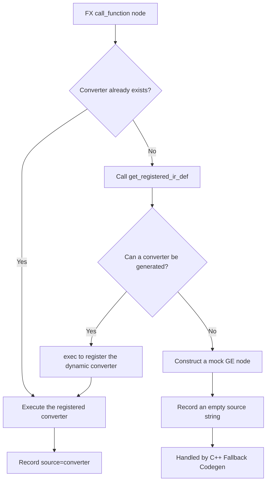
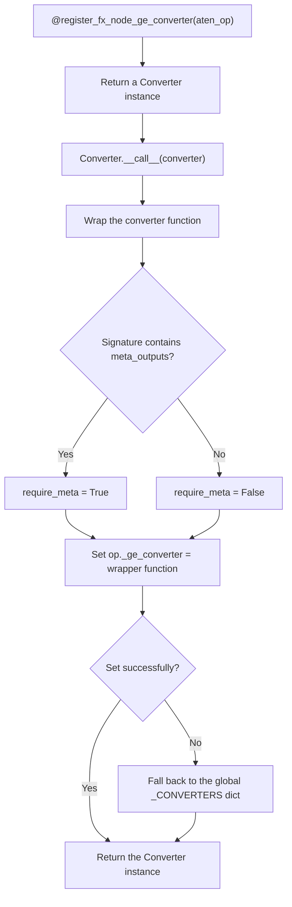
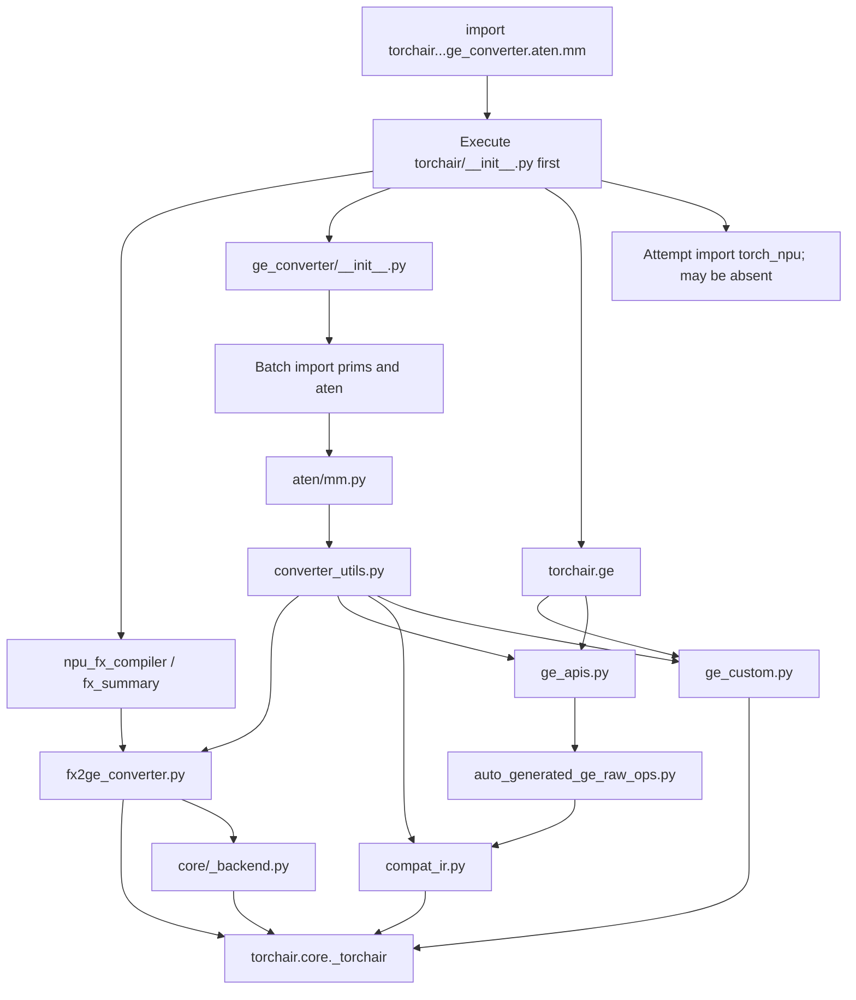
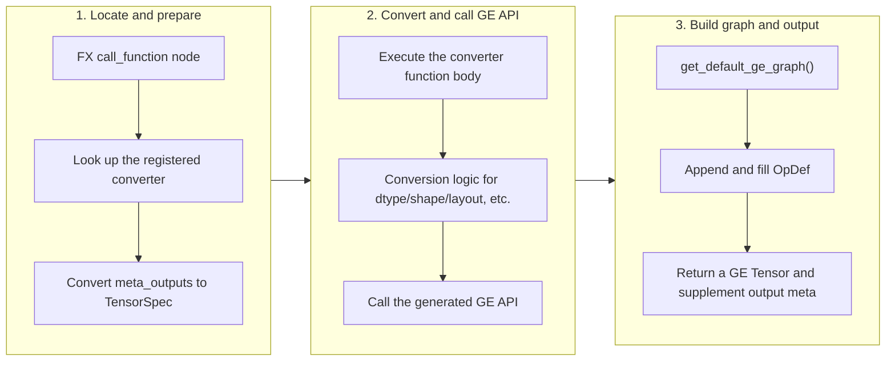
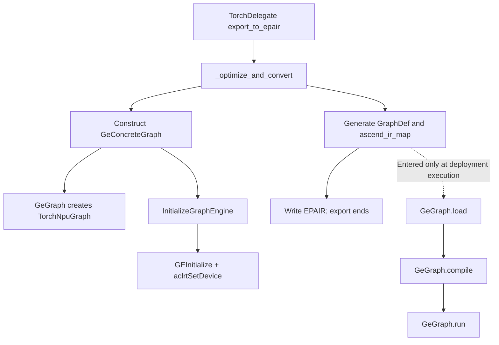

# CANN Dependency Analysis of the TorchAir Converter

This document analyzes the CANN dependency chain triggered when the TorchAir Converter is imported and executed, covering the complete dependency trace from `torchair/__init__.py` down to an individual converter function body. This analysis serves as the basis for the Lite converter design.

## Converter conversion flow

### Standard TorchDelegate conversion flow

When `record_ascend_ir=True`, TorchAir executes the following flow for each FX node. Runtime exceptions from registered converters do not enter the mock branch and terminate conversion directly.



### Converter registration mechanism analysis

First, look at what a real converter looks like, using `aten/add.py` as an example:

```python
@declare_supported([Support(F32(2, 2), F32(2, 1)), ...])
@register_fx_node_ge_converter(torch.ops.aten.add.Tensor)
def conveter_aten_add_Tensor(self, other, *, alpha=1, meta_outputs=None):
    if alpha == 1:
        self, other = dtype_promote(self, other, target_dtype=meta_outputs.dtype)
        return ge.Add(self, other)
    else:
        self, other, alpha = dtype_promote(self, other, alpha, target_dtype=meta_outputs.dtype)
        return ge.AxpyV2(self, other, alpha)
```

A converter file consists of three parts: the **registration declaration** (`@register_fx_node_ge_converter` binds the function to `torch.ops.aten.add.Tensor`), the **support declaration** (`@declare_supported` lists the input combinations supported by the operator), and the **conversion function body** (translating the FX node into GE ops such as `ge.Add`).

The registration declaration is the focus of this document. It is implemented jointly by the `Converter` class in `fx2ge_converter.py` and the factory function `register_fx_node_ge_converter`. The factory receives `aten_op` and returns a `Converter` instance; when `@register_fx_node_ge_converter(...)` is applied to a function as a decorator, Python calls the instance's `__call__` method, executing the registration logic on the passed converter function. The flow is as follows:



Registration ultimately lands in two places: it first attaches the converter to `aten_op._ge_converter` (directly modifying the PyTorch global `OpOverload` object); if that object does not allow setting attributes, it falls back to the global `_CONVERTERS` dict.

Key side effect: this path modifies process-level global state (`OpOverload` attributes or `_CONVERTERS`), and the impact is persistent. The first version of Lite Context follows this registration mechanism, so after in-process stub injection it cannot switch to full mode; when both modes are needed, different processes must be used.

## Actual dependencies of Converter and TorchAir

The analysis is based on TorchAir revision `be0c45f60b305ef9ffa5f2f02feaab06fe80361f`. Dependencies are divided into three stages here to avoid conflating "importing a native extension" with "calling CANN":

- Import stage: Python loads modules, executes decorators, and loads `_torchair.so`.
- Conversion stage: the converter writes FX nodes as GE protobuf; some paths also query the device or CANN IR.
- Backend interface: the current export path initializes the Graph Engine in advance but does not load, compile, or execute GE graphs.

### Normal import path

When Python imports `torchair._ge_concrete_graph.ge_converter.aten.mm`, it first executes the parent package `torchair/__init__.py`. Therefore this is not "importing only the mm converter": the top-level package loads the compiler, GE API, converter package, and other public modules.



Main source evidence:

- `torchair/__init__.py:11-28` imports the compiler, `ge_converter`, `fx2ge_converter`, and `torchair.ge`.
- `ge_converter/__init__.py:2-22` imports the fixed converter groups and traverses all modules under `prims` and `aten`.
- `converter_utils.py:16-31` imports `ge_apis`, `compat_ir`, `fx2ge_converter`, `_ge_graph`, `check_platform`, and `ge_custom` at the same time.
- `fx2ge_converter.py:34-35`, `compat_ir.py:5`, `ge_custom.py:7`, and `core/_backend.py:18` all import `_torchair` at module load time.
- `ge_apis.py:14` imports `auto_generated_ge_raw_ops`, which imports `compat_ir` at `auto_generated_ge_raw_ops.py:11`, so `ge_apis` also loads `_torchair` indirectly.

This import chain demonstrates two facts. First, importing a single converter via the standard package path still executes `torchair/__init__.py` and triggers batch registration of aten/prims. Second, even if a converter function body only writes protobuf, its module may not be directly importable in an environment without CANN dynamic libraries, because `_torchair.so` is already an import-time dependency.

### What happens during import

During the import stage:

- Python dynamically loads `_torchair.so`. This extension links dynamic libraries such as GE, ACL, Ascend metadef, and HCCL, so the system must be able to resolve these link dependencies.
- `ge_converter/__init__.py` batch-imports aten/prims converters; the decorators of each module execute immediately and modify `OpOverload._ge_converter` or `_CONVERTERS`.
- `core/_backend.py:113-116` registers `atexit` and `SIGTERM`/`SIGINT` handlers.
- `torchair/__init__.py:38-44` attempts to import `torch_npu`. It catches `ImportError` and `AttributeError`, so a missing `torch_npu` does not necessarily cause the top-level import to fail.

The import stage does not execute converter function bodies and does not query the device just because `check_platform.py` is imported. The `import torch_npu` and `get_device_name()` inside `is_arch35()` execute only when the function is called (`check_platform.py:2-8`). Similarly, importing `_torchair.so` does not mean `GEInitialize` has been called.

### Converter execution path

After registration, the converter is called during FX node conversion. For `aten.add.Tensor`, for example, `dtype_promote` may insert `Cast` or `Const` first, then call `ge.Add` or `ge.AxpyV2`. These generated GE APIs obtain the current `GeGraph`, append an `OpDef` to `GraphDef.op`, and finally return a `Tensor` representing the output edge.



`ge.Add` (`auto_generated_ge_raw_ops.py:10728-10762`) and `ge.MatMul` (`auto_generated_ge_raw_ops.py:34674-34721`) themselves do not perform numerical computation or call GE Session. They only write protobuf. What is easily confused here is that not all generated APIs have only protobuf behavior.

#### Additional queries during the conversion stage

The following paths cross the protobuf graph construction boundary during converter execution:

1. `custom_op()` unconditionally calls `_torchair.get_registered_ir_def(op_type)` at `ge_custom.py:15`. This interface queries IR information of operators already registered with GE and depends on the GE and CANN environment. Even if the caller explicitly passes `inputs`, `outputs`, and `attrs`, the query still happens first; the `len(args)` check comes after the query.
2. `ge_op(..., ir=IrDef(...))` calls `_torchair.check_cann_compat()` at `compat_ir.py:228-238`. There are currently 52 such call sites in the generated GE API, spread across 50 generated wrappers.
3. `is_arch35()`, `torch.npu.matmul.allow_hf32`, and local `torch_npu` imports query the device, platform configuration, or extended dtypes.
4. `GeGraph()` creates the `TorchNpuGraph` native executor object at `_ge_graph.py:751-769`. It has not yet initialized GE but already requires `_torchair` and its dynamic libraries to be available.

### Graph Engine initialization and graph execution

TorchDelegate exporting EPAIR only needs to generate GE protobuf and node-level IR; it does not need to load, compile, or execute GE graphs. `converter.run(*new_input_values)` in `_optimize_and_convert()` is the FX interpreter traversing the graph and invoking converters, not `GeGraph.run()`.

However, the current TorchAir implementation still initializes the Graph Engine in advance on the export path:



- `_optimize_and_convert()` constructs `GeConcreteGraph` at `ge_graph_ascend.py:309`.
- `GeConcreteGraph.__init__` creates `GeGraph` at `fx2ge_converter.py:964-990`, then calls `initialize_graph_engine()`.
- `GeGraph.__init__` creates the `TorchNpuGraph` native executor object at `_ge_graph.py:751-769`.
- `core/_backend.py:85-93` passes the initialization request to `_torchair.InitializeGraphEngine()`.
- `ge_graph_ascend.py` does not call `GeGraph.load/compile/run`; these three methods are used only on the deployment execution path.

So graph loading, compilation, and execution do not affect TorchDelegate export, but Graph Engine initialization still does. It is not a step required to generate EPAIR; it is coupling caused by `GeConcreteGraph` serving both graph construction and execution. Lite Context mode isolates the construction-time native executor and initialization calls through dependency stubbing.

"Not depending on `torch_npu`" also does not mean "not depending on CANN". `core/_backend.py:33-57` uses environment variables and default compile options when `torch_npu` is absent, and then still calls GE and ACL through `_torchair.InitializeGraphEngine()`.

### Converter source dependency statistics

This statistics is file-based and does not equate one file with one converter function. Under `ge_converter/` there are 954 non-`__init__.py` Python modules, of which 952 contain converter registrations; the other two are `converter_utils.py` and `experimental/hcom_allreduce.py`.

| Scope | aten | custom | prims | Other | Total |
|---|---:|---:|---:|---:|---:|
| Non-`__init__.py` modules | 686 | 123 | 124 | 21 | 954 |
| Modules with registrations | 686 | 123 | 124 | 19 | 952 |

A static scan of the 954 modules yields the following sets. The categories overlap and cannot be summed directly.

| Set | File count | Meaning |
|---|---:|---|
| Calls `is_arch35()` | 25 | aten 10, custom 15; imports `torch_npu` and queries the device name when called |
| Locally imports `torch_npu` | 19 | custom 17, experimental 1, lite 1; uses include dtype and CANN version queries |
| Reads `torch.npu.matmul.allow_hf32` | 2 | `fused_matmul.py`, `transpose_batchmatmul.py` |
| Calls `custom_op()` | 5 | Each call queries GE registered operator IR through `get_registered_ir_def` |
| Calls generated GE API with `IrDef` | 81 | These APIs may execute `check_cann_compat` |

The first four categories have 44 deduplicated modules with direct device/schema dependencies, not the sum of 51. Including the generated `IrDef` APIs, the five categories cover 96 deduplicated modules. The remaining 858 modules do not hit these known patterns, but this can only be treated as a candidate set and cannot be used to assert "completely independent of CANN": module import still loads `_torchair`, and indirect calls and paths added in later versions also require separate audits.

### What converters do after using `torch_npu`

The `torch_npu` dependencies in converters are not all for the same purpose. The source can be divided into four categories: determining the target architecture, identifying extended dtypes, determining the CANN version, and reading the HF32 configuration. These values all change the final GE graph written; they are not used only for logging or environment checks.

#### Architecture determination

`is_arch35()` imports `torch_npu` in `check_platform.py:2-8`, calls `torch_npu.npu.get_device_name()`, and returns `True` when the device name contains `Ascend910_95` or `Ascend950`. `ImportError` is treated as `False`; other exceptions from the device query itself are not caught.

The 25 converter modules have 34 call sites in total. The results mainly affect the following graph construction behaviors:

| Behavior | Result | Modules involved |
|---|---|---|
| Switch GE op versions | Choose among V1/V2/V3/V4 or old/new operators, for example `BNInfer`/`BatchNormV3`, `GroupNorm`/`GroupNormV2`, `QuantBatchMatmulV3`/`V4` | `aten/batch_norm_elemt.py`, `_native_batch_norm_legit.py`, `_native_batch_norm_legit_no_training.py`, `native_batch_norm_backward.py`, `native_group_norm.py`, `native_group_norm_backward.py`, `max_pool2d_with_indices.py`, `max_pool2d_with_indices_backward.py`, `std.py`; `custom/all_gather_matmul.py`, `matmul_reduce_scatter.py`, `quantmatmul.py`, `npu_moe_finalize_routing.py` |
| Restrict operator support scope | Some converters support only arch35, or conversely reject on arch35 | `custom/fused_matmul.py`, `quant_matmul_inplace_add.py`, `quant_grouped_matmul_inplace_add.py`, `flash_attention.py`; `aten/_native_batch_norm_legit.py` |
| Change op attributes and communication modes | Choose `ccu`/`ai_cpu`/`aiv`, or decide whether a parameter is allowed | `custom/grouped_matmul_allto_allv.py`, `allto_allv_grouped_matmul.py`, `matmul_all_reduce.py`, `matmul_reduce_scatter_v2.py` |
| Change layout, shape, and output meaning | Choose NCHW/NCDHW, adjust the pooling attribute length, or decide whether to additionally compute/convert the output | The batch norm, group norm, and max pool modules above |
| Change quantization and packed dtype handling | Enable A16W4/MxA8W4, choose INT4/FP4 bitcast, reshape, and output dtype | `custom/grouped_matmul.py`, `quantmatmul.py` |
| Choose operator combinations | Choose among `Axpy`, `AxpyV2`, `Mul+Sub`, `Sxpy`, or old/new rotary interfaces | `aten/rsub.py`, `custom/npu_rotary_mul.py`, `npu_rotary_mul_backward.py` |

Several representative differences:

- `max_pool2d_with_indices.py:44-57`: arch35 uses the V3 interface and two-dimensional spatial attributes; the old path uses V1, four-dimensional attributes, and changes how indices are handled.
- `native_group_norm.py:28-38`: arch35's `GroupNormV2` returns `rstd` directly; the old `GroupNorm` returns variance, and the converter still needs to construct `Rsqrt(variance + eps)`.
- `quantmatmul.py:225-254`: arch35 constructs `QuantBatchMatmulV4`, while the old platform constructs V3, with different scale, offset, and output dtype handling.
- `flash_attention.py:46-47,116-117`: two old flash-attention converters reject directly on arch35 instead of choosing a new op.

Lite Context mode cannot interpret a missing torch_npu as `is_arch35() == False`. The architecture result must come from the target device configuration and remain consistent with the device-name determination above.

#### Extended dtypes

19 modules import `torch_npu` inside function bodies, of which 15 modules read `torch_npu.*` attributes. Five extended dtypes are actually used:

| `torch_npu` dtype | PyTorch dtype identifier | GE dtype | Operation after reading |
|---|---:|---|---|
| `hifloat8` | 290 | `DT_HIFLOAT8` (34) | Validate input/output dtype, insert `Bitcast`, or modify the output descriptor |
| `float8_e8m0fnu` | 293 | `DT_FLOAT8_E8M0` (37) | Convert dequant scale, or annotate the quantization scale output |
| `float4_e2m1fn_x2` | 296 | `DT_FLOAT4_E2M1` (40) | Identify packed FP4, extend the shape, bitcast, reshape, and adjust the descriptor |
| `float4_e1m2fn_x2` | 297 | `DT_FLOAT4_E1M2` (41) | Identify packed FP4 together with E2M1 and choose the corresponding bitcast/repack path |
| `int4` | 285 | `DT_INT4` (29) | Bitcast packed weights to INT4 |

PyTorch dtype identifiers and GE `DataType` are two separate numberings. For example, `torch_npu.hifloat8` corresponds to 290, while `DataType.DT_HIFLOAT8` is 34. The mapping is done in `_ge_graph.py:211-268`. Therefore you cannot change:

```python
x_dtype == torch_npu.float4_e2m1fn_x2
```

directly to:

```python
x_dtype == DataType.DT_FLOAT4_E2M1
```

The correct approach is to first convert `x_dtype` with `torch_dtype_value_to_ge_type(x_dtype)` to a GE dtype, then compare with `DataType.DT_FLOAT4_E2M1`. Only when the output is known to necessarily be a certain type and only the protobuf descriptor needs to be filled is it appropriate to use GE/protobuf dtype constants directly.

These dtypes mainly produce three types of operations in converters:

1. Input validation and branch selection. `quant_lightning_indexer.py:52-60` and `kv_quant_sparse_flash_attention.py:47-55` accept only HIFLOAT8; `quantmatmul.py:98-106` uses the FP4 identifier to determine the MXFP4/A8W4 path.
2. Packed data unpacking. `quantmatmul.py:110-167`, `grouped_matmul.py:329-348`, and `matmul_all_reduce.py:103-128` multiply the last dimension by 2 (FP4) or by 8 (INT4), then perform `Bitcast` and `Reshape`.
3. Descriptor correction. `npu_quant_scatter.py:43-68`, `quant_conv2d.py:48-82`, `all_gather_matmul_v2.py:140-141`, etc. explicitly fill in the HIFLOAT8/FP4 output dtype after graph construction.

There are three places where `import torch_npu` is local and no `torch_npu` attribute is read afterward:

- `custom/allto_all_quant_matmul.py:99`
- `custom/allto_allv_quant_grouped_matmul.py:76`
- `custom/quant_matmul_allto_all.py:87`

These imports only bring load side effects and environment check effects. They are inside function bodies, occur later than module decorator execution, and cannot be used to register `torch.ops.npu` schemas. Lite Context can isolate these imports through fakes, but the required operator schemas must be explicitly registered in the current process through pure-Python modules.

#### CANN version determination

Three converter paths import `_is_gte_cann_version` from `torch_npu.npu.utils`. This function enters `torch_npu._C` to query the installed CANN component version, and the result changes the GE graph:

| Call site | Condition | Subsequent operation |
|---|---|---|
| `custom/grouped_matmul.py:84-92` | CANN `>= 8.5.0` | The new version uses `Bitcast(..., keep_dim=True)`; the old version multiplies the last dimension by 8, then bitcasts and reshapes |
| `custom/grouped_matmul_finalize_routing.py:78-86` | CANN `>= 8.5.0` | Likewise chooses between two INT4 packed representations |
| `experimental/hcom_alltoall.py:87-103` | CANN `>= 8.2.RC1` | Uses `HcomAllToAll` when counts are uniform; otherwise uses `HcomAllToAllV` |

Lite Context mode can read the CANN compatibility version from the target platform configuration, but must preserve RC version ordering and the specific thresholds. When the target version is missing, report an error rather than defaulting to the old-version branch.

#### HF32 configuration

Two converters read `torch.npu.matmul.allow_hf32`:

- `custom/fused_matmul.py:39-42`: performs the arch35 check first, and when supported writes the boolean into `FusedMatMul.enable_hf32`.
- `custom/transpose_batchmatmul.py:21-23`: writes the boolean directly into `TransposeBatchMatMul.enable_hf32`.

This value is a user configuration and should not be automatically inferred based on the SoC. Lite Context mode needs it to be explicitly provided by the target platform configuration and written verbatim into the GE op attribute.

## Reusable scope independent of torch_npu / CANN

### First distinguish "source reuse" from "module direct import"

The main body of the TorchAir converter is Python graph construction logic, which is reusable; however, the existing module boundaries place it on the same import chain as `_torchair`, `_backend`, and the `GeGraph` executor. Therefore what is reusable is the code capability, not the unprocessed TorchAir package import method.

Directly executing the following statement does not bypass CANN:

```python
from torchair._ge_concrete_graph.ge_converter.aten.mm import *
```

Python executes `torchair/__init__.py` first, then loads `_torchair.so` through multiple paths. In an environment without the corresponding dynamic libraries, this step may fail before the converter function has a chance to execute.

### Reusable graph construction parts

Ignoring the current import coupling, the following categories of code do not need a compute device and are not responsible for graph compilation or execution:

- Converter registration rules: operator-to-converter mapping, `meta_outputs` signature checks, and wrapping logic.
- GE data representation: `DataType`, `Tensor`, `TensorSpec`, `GraphDef`, `OpDef`, and attribute objects.
- Graph stack and ordinary generated GE API: obtain the current graph, append OpDef, connect inputs and outputs, and return symbolic Tensors.
- Conversion helpers for dtype, shape, layout, `SymInt`, etc.
- Converter function bodies that do not trigger device queries, `custom_op`, or `IrDef` compatibility checks.

The work done by these code parts stops at "generating GE protobuf". They do not include `GEInitialize`, `AddGraph`, `CompileGraph`, or `RunGraph`.

### Boundaries that cannot be reused as is

#### Package import and registration

Standard package import loads `_torchair.so`, batch-imports converters, and modifies PyTorch global `OpOverload`. The first version of Lite Context pre-installs the `_torchair` stub before TorchAir import to prevent the real extension from loading; converters are still batch-registered through the standard package entry. This global registration state is not restored, so Lite Context and full mode are mutually exclusive within a process.

#### `GeGraph` object

`GeGraph` holds both the protobuf graph and `_executor`. Graph construction only needs the former, but the existing constructor unconditionally creates `TorchNpuGraph`. The CANN-free mode needs a graph object that does not create a native executor, or an explicit isolation layer for this construction dependency; `load/compile/run` should not enter the Lite path.

#### CANN IR queries

The two query paths must be handled separately:

- `custom_op()` always queries GE registered operator IR through `get_registered_ir_def`. Lite Context mode does not provide this query capability; the current 5 calling modules should be marked as unsupported and must not be considered safe just because they use keyword-form `inputs/outputs/attrs`.
- 81 modules call generated GE APIs with `IrDef`. These APIs may query the current CANN's operator prototypes through `check_cann_compat`.

A CANN-free environment cannot fabricate query success. `get_registered_ir_def` has no offline replacement, and any flow depending on this interface does not enter the Lite support scope. `check_cann_compat` may be skipped only when the target CANN version, optional inputs, and optional attributes have been verified by an offline list; otherwise the corresponding converter should also be marked as unsupported.

#### Device and `torch_npu` information

25 modules call `is_arch35()`, 19 modules locally import `torch_npu`, 3 paths query the CANN version, and 2 modules read the HF32 configuration. The replacement approach must be split by semantics: architecture, CANN version, and HF32 come from target platform configuration; extended dtypes are handled through a stable mapping from PyTorch dtype identifiers to GE dtypes.

In particular, the current `is_arch35()` determines whether the device name contains `Ascend910_95` or `Ascend950` (`check_platform.py:2-8`) and cannot be simply replaced with `soc_family == "Ascend910B"`. For offline determination, the platform configuration must use the same device semantics as TorchAir.

Extended dtypes also cannot be directly replaced with same-named `DataType` constants, because the value domains differ on the two sides. The mapping equivalent to `torch_dtype_value_to_ge_type()` should be called first; only fixed output descriptors can directly fill GE/protobuf dtypes.

#### Dynamic converters and Graph Engine

Automatic converter generation for unregistered operators depends on `get_registered_ir_def` to query GE registered operator IR. Lite Context mode uses only already-registered and audited converters and does not support automatic generation; converters calling `custom_op()` depend on the same query interface and are also unsupported. Mock nodes belong to the fallback of the complete conversion flow and are likewise outside the scope of "reusing registered converters to generate protobuf". Graph loading, compilation, and execution do not appear in the EPAIR export flow; the GE initialization triggered when constructing `GeConcreteGraph` is isolated by dependency stubbing.

### How to determine the reusable scope

A converter can be reused in an environment without `torch_npu` and without CANN only if it satisfies at least:

1. It can complete registration after dependency stubbing modules are pre-installed without loading the real `_torchair.so`; its process-level registration state is used only for Lite Context.
2. Its execution path uses only protobuf graph construction interfaces; if it calls a generated API with `IrDef`, an offline compatibility result matching the target CANN version already exists.
3. It does not read local device state. When platform branching is needed, the required fields are explicitly provided by the target platform configuration.
4. It does not call graph initialization, loading, compilation, or execution interfaces.

According to the current static scan, 858 modules do not hit the known device/schema query patterns and can serve as the first-round candidate set; this is not the final supported count. The final list should still be verified item by item according to the converter's actual call graph, the target CANN version, and the source revision.

### Dependency replacement in Lite Context mode

Prototype validation based on revision `be0c45f60b305ef9ffa5f2f02feaab06fe80361f` shows that the first version of Lite Context does not need to first extract the entire converter component set. Its core is to provide dependency stubbing modules in the current TorchDelegate process to isolate converter functional dependencies on CANN and torch_npu. Dependency replacement must be completed before importing any TorchAir module:

1. Pre-install the `torchair.core._torchair` stub into `sys.modules` to avoid loading the real `_torchair.so`; lifecycle interfaces are no-ops, and graph execution and schema query interfaces report explicit errors.
2. Pre-install the torch_npu fake and provide device model, CANN version, and HF32 information from the target platform configuration.
3. Import TorchAir through the standard entry point and follow the original aten/prims converter registration mechanism.
4. Normally call Python `_optimize_and_convert()` to complete protobuf graph construction and NodeIR recording.

In this environment, the CPU `aten.add.Tensor` prototype successfully generated four OpDefs — `Data`, `Data`, `Add`, and `NetOutput` — and recorded the NodeIR of the `add` node; the process did not load the real `_torchair.so`, `torch_npu`, or CANN.

Dependency stubbing can isolate the import, Graph Engine initialization, and executor construction of ordinary registered converters, but it cannot replace the following semantic dependencies:

- `custom_op()` and automatic converter generation require the real `get_registered_ir_def`; Lite rejects them directly.
- Generated APIs with `IrDef` require `check_cann_compat`; the first version of Lite Context rejects them, and later only an offline compatibility list generated for the target CANN version can be used.
- `is_arch35`, CANN version, HF32, and extended dtypes require target platform configuration or stable mappings and cannot be guessed by a generic stub.
- TorchAir private imports and `_optimize_and_convert()` are still version-coupled, so the revision must be pinned and differential tests must be performed.

The first version of Lite Context uses in-process dependency stubbing and does not establish an independent converter registry. Because module caches and converter registration state cannot be fully restored, Lite Context and full mode cannot be mixed in the same process.

## Conclusion

The ordinary graph construction functions of the TorchAir converter mainly generate GE protobuf, but the standard TorchAir package does not isolate this part from the native backend. Importing a single converter still executes `torchair/__init__.py` first, loads `_torchair.so`, and batch-registers converters; during converter execution, `custom_op`, some generated GE APIs, and device conditional branches may still call `_torchair` or `torch_npu`. TorchDelegate export does not load, compile, or execute GE graphs, but the current `_optimize_and_convert` initializes the Graph Engine in advance when constructing `GeConcreteGraph`, which also needs to be isolated from the Lite path.

Therefore, CANN-free reuse cannot be judged on the basis that "the converter function body appears to call only `ge.*`". Reusable objects should be limited to registration logic, protobuf graph construction code, and converter function bodies that have undergone import isolation and call-chain audits, with a support list pinned per TorchAir revision.
