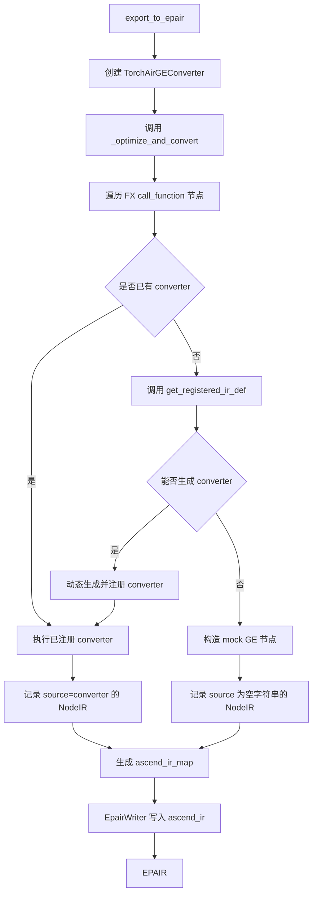
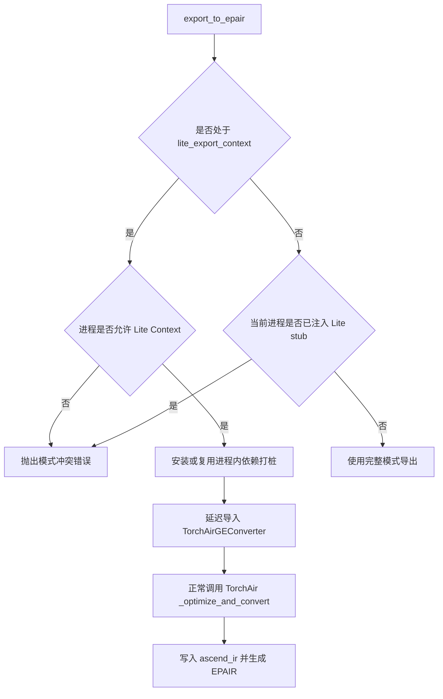
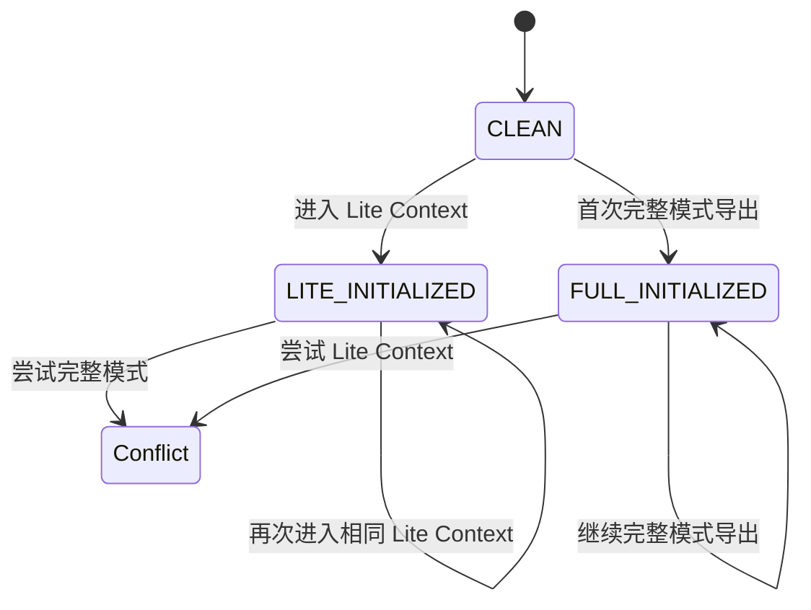

# Lite Context 模式设计

> Lite Context 的核心思路是前置隔离，后端复用：通过 sys.modules 在 TorchAir 导入前预置 stub/fake 对象，使解释器不加载真实 _torchair.so 和 torch_npu，从而在无 CANN 环境中完成 GE protobuf 构图。代价是三方面能力丢失：
> - 动态 Converter 生成与 fallback 节点——依赖真实 GE schema 查询，stub 对其明确拒绝；
> - 扩展 dtype（FP4/INT4/HIFLOAT8）——PyTorch 与 GE dtype 编号域不同，不能简单映射；
> - 进程不可逆——模块缓存和 converter 全局注册一旦按 Lite 路径完成，当前进程无法回退到完整模式。
>
> HF32、设备型号等可由用户配置确定的平台信息通过 LiteConfig 显式提供。CANN 版本相关路径初版直接报错，不伪造版本结论。TorchAir 的 converter 注册、_optimize_and_convert、protobuf 构图逻辑完整保留。

# 1. 背景

TorchDelegate 在导出 EPAIR 模型时，依赖 TorchAir converter 将 PyTorch FX 节点转换为 GE IR，并把节点级 `ascend_ir` 写入 ExportedProgram JSON。TorchAir 的 converter 主体是 Python protobuf 构图逻辑，但其包导入、Graph Engine 初始化和部分 converter 辅助接口会进一步依赖 CANN 和 torch_npu。因此，当前 EPAIR 导出要求同时安装 TorchAir、CANN 和 torch_npu，并具备可用的 NPU 环境。

Kirin 端侧推理拟采用 EPAIR 作为模型交付格式。模型导出可能发生在没有 CANN、torch_npu 和 NPU 设备的通用开发环境或构建环境中，因此需要提供一种不依赖本机昇腾运行环境的 EPAIR 导出方式。

本文设计 Lite Context 模式。该模式在 TorchDelegate 中通过进程内依赖打桩隔离 TorchAir 对 CANN 和 torch_npu 的功能依赖，随后继续调用 TorchAir 原有转换接口完成 `ascend_ir` 标注。该方案不重新实现 converter，也不引入独立 Converter 注册表。

# 2. 现状分析

详细依赖分析见 [torchair_converter_cann_dependency_analysis.md](./torchair_converter_cann_dependency_analysis.md)。本节只保留与 Lite Context 设计直接相关的结论。

## 2.1 标准 TorchDelegate 转换流程

当前 `export_to_epair()` 的主要流程如下：

1. 创建 `TorchAirGEConverter`。
2. 调用 TorchAir `_optimize_and_convert()` 优化 ExportedProgram，并逐个执行已注册 converter。
3. TorchAir converter 调用 generated GE API，在内存中构造 `GraphDef`、`OpDef` 和符号 Tensor。
4. TorchAir 记录每个 FX 节点对应的 NodeIR，形成 `ascend_ir_map`。
5. `EpairWriter` 把 NodeIR 写入 EP JSON 的 `ascend_ir` 字段。
6. `epair_save()` 使用 PT2 归档格式保存 EPAIR。



EPAIR 导出只需要 GE protobuf 和 NodeIR，不需要加载、编译或执行 GE 图。但 TorchAir 当前没有把 protobuf 构图能力与原生后端完全分离，导致导出路径仍会触发 CANN 和 torch_npu 依赖。

## 2.2 CANN 和 torch_npu 依赖分析

这些依赖分为三类：

| 类别 | 依赖点 | 特征 |
|---|---|---|
| 结构性依赖 | `_torchair`、Graph Engine 生命周期、`TorchNpuGraph` | EPAIR 不需要这些执行能力，但 TorchAir 当前导入和对象构造仍会触发它们 |
| 构图语义依赖 | `get_registered_ir_def`、`check_cann_compat`、设备型号、CANN 版本、HF32、扩展 dtype | 查询结果会改变能否转换或最终生成的 GE IR，不能统一替换成固定成功值 |
| 导出元数据依赖 | EPAIR manifest 中的 CANN 版本 | 不参与 converter 构图，但需要写入目标部署信息 |

### 2.2.1 `torchair.core._torchair` 原生扩展

`torchair.core._torchair` 是 TorchAir Python 代码访问 CANN 原生能力的桥接模块。它通常由 `_torchair.so` 提供，内部链接 GE、ACL、Ascend metadef 等动态库。Python 执行 `import torchair` 时，TorchAir 的多个模块会间接导入它。

这项依赖发生得很早：converter 函数可能尚未执行，Python 就需要加载 `_torchair.so` 及其链接库。缺少 CANN 动态库时，导入会直接失败。因此，即使某个 converter 函数体只调用 `ge.Add()` 写 protobuf，也不能据此认为其模块可以在无 CANN 环境中直接导入。

Lite Context 必须在 TorchAir 首次导入前，把同名 Python stub 放入 `sys.modules`。后续 TorchAir 代码仍按原路径导入 `torchair.core._torchair`，但得到的是 TorchDelegate stub，而不是真实 `_torchair.so`。

### 2.2.2 Graph Engine 生命周期

Graph Engine 生命周期是 CANN GE 运行时的全局初始化和释放过程，不是某一个 GE 图本身。TorchAir 的 Python 接口名称是 `initialize_graph_engine()` 和 `finalize_graph_engine()`，最终会进入 `_torchair.InitializeGraphEngine()` 和 `_torchair.FinalizeGraphEngine()`。真实初始化可能执行 GE 初始化、设置设备和创建运行时资源。

当前调用关系可简化为：

```text
_optimize_and_convert()
  -> 构造 GeConcreteGraph
     -> initialize_graph_engine()
        -> _torchair.InitializeGraphEngine()
           -> GE/ACL 全局初始化和设备访问
```

`_optimize_and_convert()` 在这里运行的是 FX interpreter，用于遍历节点并调用 converter；它不是在 NPU 上执行模型。但 `GeConcreteGraph` 同时面向“构图”和“后续执行”，构造时便初始化了 Graph Engine。于是，只需要 protobuf 的 EPAIR 导出也被迫进入 CANN 生命周期。

Lite Context 中，这两个生命周期接口可以安全地打成空操作，原因是导出流程不会调用 GE 图加载、编译或执行。空操作只跳过与本次导出无关的运行时准备，不改变 converter 写入 `GraphDef` 和 `OpDef` 的逻辑。如果转换路径开始使用真实 GE runtime，则不能继续使用该 stub，必须明确报错。

### 2.2.3 `TorchNpuGraph`

`TorchNpuGraph` 是与单个 GE 图关联的原生执行器对象。它和 Graph Engine 生命周期不是同一个概念：

- Graph Engine 生命周期管理进程级 GE/ACL 运行环境。
- `TorchNpuGraph` 表示单图的原生后端句柄，供后续加载、编译、执行或调优该图。
- Python `GeGraph` 还保存 protobuf `GraphDef`；converter 构图真正需要的是这一部分。

当前 `GeGraph` 把二者组合在一个对象中，构造时无条件创建执行器：

```text
GeConcreteGraph
  -> GeGraph
     -> GraphDef                 # Lite 导出需要
     -> TorchNpuGraph executor   # Lite 导出不需要
```

EPAIR 导出不会调用执行器的 `load()`、`compile()`、`run()` 或 `auto_tune()`，但仅仅构造 `GeGraph` 就会创建 `TorchNpuGraph`。真实类来自 TorchAir 后端并依赖 `_torchair` 原生接口，所以无 CANN 环境会在“创建一个尚未执行的图对象”时失败。

Lite Context 为它提供 build-only fake。fake 只满足 `GeGraph` 构造所需的对象形态和最小状态，不创建原生句柄。任何加载、编译、执行或调优调用都抛出 `LiteGraphExecutionUnsupported`。这不会替换 `GraphDef`；converter 仍写入 TorchAir 原有的 protobuf 图。

Graph Engine 生命周期与 `TorchNpuGraph` 的区别可以归纳为：

| 对比项 | Graph Engine 生命周期 | `TorchNpuGraph` |
|---|---|---|
| 作用范围 | 进程级运行时 | 单个 GE 图 |
| 主要职责 | 初始化和释放 GE/ACL 环境 | 保存图的原生执行器并提供加载、编译、执行接口 |
| 当前触发点 | 构造 `GeConcreteGraph` 时初始化 | 构造 `GeGraph` 时创建 |
| EPAIR protobuf 构图是否需要 | 不需要 | 不需要其执行器部分 |
| Lite Context 处理 | 初始化和释放为空操作 | 使用 build-only fake，执行接口明确拒绝 |

### 2.2.4 `get_registered_ir_def`

该接口向真实 GE 查询某个算子类型已经注册的 IR 定义，包括输入、输出和属性 schema。TorchAir 在两类场景调用它：

- FX 节点没有已注册 converter 时，尝试根据 GE schema 动态生成 converter。
- converter 调用 `custom_op()` 时，确认自定义 GE op 的接口定义。

查询结果决定 TorchAir 是否能构造该算子以及如何连接输入、输出和属性。这不是普通的环境探测。无 CANN 环境下没有可信的实时 GE 注册表，Lite Context 不能返回空 schema 或固定成功结果，否则可能生成结构错误但表面合法的 OpDef。

初版 stub 对该接口抛出 `LiteRegisteredIrQueryUnsupported`。因此，Lite Context 只支持已经注册且不调用 `custom_op()` 的 converter；不支持动态 converter 生成和依赖该查询的自定义算子。

### 2.2.5 `check_cann_compat`

部分 generated GE API 带有 `IrDef`，其中声明了可选输入、可选属性等接口信息。调用这些 API 时，TorchAir 通过 `check_cann_compat` 检查当前 CANN 中实际注册的算子 schema 是否兼容这份声明。

该查询不是检查“CANN 是否已安装”，而是检查“目标 op 的具体接口是否与当前 Python wrapper 匹配”。返回错误的成功结果可能导致生成的 OpDef 使用目标 CANN 不支持的输入或属性。

初版没有可信的离线 schema 清单，因此 stub 明确报错。后续若按目标 CANN 版本提供经过验证的离线兼容清单，才可以把实时查询替换为离线结果。

### 2.2.6 设备型号查询

部分 converter 调用 `is_arch35()`。该函数通过 `torch_npu.npu.get_device_name()` 读取当前设备名，并判断名称是否包含 `Ascend910_95` 或 `Ascend950`。

判断结果会改变实际构图，例如选择不同版本的 GE op、不同属性、layout、shape 处理或输出语义。无 NPU 环境时不能简单返回 `False`，因为导出的目标设备可能正是 arch35。

Lite Context 从 `LiteConfig.target_soc` 提供目标设备信息。fake 返回与 TorchAir 当前判断规则一致的设备名。它描述的是部署目标，不是导出主机。

### 2.2.7 CANN 版本查询

少量 converter 会通过 torch_npu 查询本机 CANN 版本，再根据版本选择不同的构图方式。例如，新旧 CANN 可能使用不同的 packed INT4 表示，或者选择不同的通信 op。

该依赖影响 OpDef 结构，不能以“导出机没有 CANN”为由固定走旧版本分支。初版 Lite Context 遇到该查询直接报错，正式版和 RC 版本的离线比较作为后续遗留问题。

这里的版本表示 EPAIR 将要部署到的目标 CANN 兼容版本。

### 2.2.8 HF32 配置

部分矩阵计算 converter 读取 `torch.npu.matmul.allow_hf32`，并将其写入 GE op 的 `enable_hf32` 属性。它是用户选择的计算精度配置，不是可以根据设备型号推断的固定能力。

Lite Context 通过 `LiteConfig.allow_hf32` 显式提供该值。fake 只暴露这个配置，不提供真实 `torch.npu` 运行时。

### 2.2.9 torch_npu 扩展 dtype

部分 converter 会读取 torch_npu 定义的 HIFLOAT8、FP4、INT4 等扩展 dtype，用于判断输入类型、选择量化路径、执行 bitcast 或填写输出 descriptor。

这里存在两个不同编号域：PyTorch dtype 标识和 GE `DataType` 枚举。例如，一个 torch_npu dtype 的 PyTorch 标识值不能直接替换成同名 GE 枚举值。简单在 fake 上挂一个同名整数可能使类型比较通过，却选择错误的构图分支。

初版不支持需要这些扩展 dtype 的 converter。访问时抛出 `LiteExtendedDtypeUnsupported`。后续支持需要实现经过验证的 PyTorch dtype 到 GE dtype 显式映射。

### 2.2.10 EPAIR manifest 中的 CANN 版本

`EpairWriter` 当前尝试通过 `torch_npu.npu.utils.get_cann_version()` 获取 CANN 版本，并写入 `EpairManifest.cann_version`。该值是 EPAIR 元数据，不参与 converter 构图。没有 torch_npu 时，当前实现会记录 `unknown`。

Lite Context 不要求在 manifest 中记录 CANN 版本。该修改应放在 TorchDelegate 的 API/manifest 路由中，不需要通过 torch_npu fake 绕一圈读取。

## 2.3 结论

普通 converter 的核心工作是构造 GE protobuf，可以在不初始化 CANN、不访问 NPU 的情况下运行。阻塞无 CANN 导出的主要原因是模块导入和辅助接口耦合，而不是 EPAIR 格式本身要求 CANN。

Lite Context 初版可以对这些依赖点进行进程内打桩，再正常导入 TorchAir 并调用 `_optimize_and_convert()`。其中，生命周期接口使用 stub，执行器对象使用 fake；设备和版本信息必须由导出配置提供；依赖真实 GE schema 查询的能力无法通过通用 stub 保证语义正确，应在初版明确拒绝。

# 3. 范围

## 3.1 包含范围

- 提供 `lite_export_context` 公开上下文接口。
- 在无 CANN、无 torch_npu、无 NPU 设备环境中导出 EPAIR。
- 在当前进程中注入 TorchAir 和 torch_npu 依赖打桩模块。
- stub 注入后继续复用 `TorchAirGEConverter` 和 `_optimize_and_convert()`。
- 从显式目标平台配置提供设备型号、CANN 版本和 HF32 配置。
- 对 Lite Context 不支持的依赖调用进行识别并准确报错。
- 保持 EPAIR、NodeIR 和 `ascend_ir` 数据格式不变。
- 定义进程内 Lite Context 与完整模式的互斥规则。

## 3.2 不包含范围

- 重新实现 TorchAir converter 或 generated GE API。
- 建立独立 Converter 注册表或改变 TorchAir converter 注册机制。
- 在 Python 侧切图。
- 在 Lite Context 中加载、编译或执行 GE 图。
- 伪造 GE 已注册算子 IR 或 CANN 算子兼容性结论。
- 为未注册 converter 的节点生成 Lite Context fallback 标注。
- 支持依赖真实 NPU 运行结果的 converter。
- 修改 C++ EPAIR 加载、Fallback Codegen 和执行流程。
- 保证任意 TorchAir、PyTorch 和 TorchDelegate 版本组合均兼容。

# 4. 总体概述

## 4.1 设计思路

Lite Context 模式采用“先注入依赖替代，再正常调用 TorchAir”的设计：

1. 用户进入 `lite_export_context`。
2. TorchDelegate 确认当前进程尚未加载真实 TorchAir 原生扩展或 torch_npu。
3. TorchDelegate 在 `sys.modules` 中预置 `_torchair` stub 和 torch_npu fake，并补充 `torch.npu` 所需配置对象。
4. `export_to_epair()` 延迟导入 `TorchAirGEConverter`。
5. TorchAir 按正常包入口完成 Python 模块导入和 converter 注册。
6. `TorchAirGEConverter` 正常调用 `_optimize_and_convert()` 生成 `ascend_ir_map`。
7. `EpairWriter` 使用 Lite Context 中的目标 CANN 版本生成 manifest，并写入 EPAIR。

依赖打桩只替代 EPAIR 构图不需要的原生能力，或者从明确配置提供静态平台信息。无法保持语义的接口必须报错，不返回猜测值。

初版使用进程内 stub 注入。Python 模块缓存、TorchAir converter 注册和部分 PyTorch 全局对象修改在当前进程中不可完全恢复，因此 Lite Context 和完整模式不能在同一进程中混合使用。

## 4.2 术语

| 术语 | 含义 |
|---|---|
| Lite Context 模式 | TorchDelegate 提供的无本机 CANN、torch_npu 依赖的 EPAIR 导出模式 |
| 完整模式 | 使用真实 TorchAir、CANN、torch_npu 和 NPU 环境的现有导出模式 |
| stub | 提供空操作或明确拒绝行为的接口替代，例如 Graph Engine 生命周期和 schema 查询接口 |
| fake | 提供构图所需最小状态和对象行为的依赖替代，例如 build-only `TorchNpuGraph`、设备信息和版本信息 |
| mock 节点 | TorchAir 为未转换节点记录的 fallback NodeIR，与依赖打桩无关 |

## 4.3 用户界面

对外提供 `lite_export_context`，不修改 `export_to_epair()` 和 `epair_save()` 的函数签名。

```python
import os

# 如果环境中安装了 torch_npu，必须在导入 torch 前禁止自动加载后端。
os.environ["TORCH_DEVICE_BACKEND_AUTOLOAD"] = "0"

import torch

from torch_delegate import (
    LiteConfig,
    epair_save,
    export_to_epair,
    lite_export_context,
)

model = MyModel().eval()
example_inputs = (torch.randn(1, 3, 224, 224),)
ep = torch.export.export(model, example_inputs)

config = LiteConfig(
    target_soc="Ascend910_9362",
    target_cann_version="9.1.0",
)

with lite_export_context(config):
    contents = export_to_epair(ep)

# 保存不调用 TorchAir，可以放在 context 外。
epair_save(contents, "model.epair")
```

建议配置定义如下：

```python
@dataclasses.dataclass(frozen=True)
class LiteConfig:
    target_soc: str
    target_cann_version: str | None = None
    allow_hf32: bool = False
```

字段含义：

| 字段 | 必填 | 说明 |
|---|---|---|
| `target_soc` | 是 | 目标部署设备，不从当前主机查询；取值语义必须与 TorchAir 平台判断一致 |
| `target_cann_version` | 否 | 预留的目标部署信息；Lite manifest 不要求记录 CANN 版本，命中依赖版本查询时直接报错 |
| `allow_hf32` | 否 | 目标图的 HF32 配置，默认关闭 |

## 4.4 运行模式



## 4.5 软件功能

- 显式选择 Lite Context 模式，不根据环境自动降级。
- 在 TorchAir 导入前安装 CANN 和 torch_npu 依赖打桩模块。
- 复用 TorchAir 现有 converter 注册、图优化和 `ascend_ir` 记录逻辑。
- 从目标平台配置提供设备、版本和 HF32 信息。
- 阻止 Lite Context 调用图加载、编译、执行和真实设备查询。
- 对无法安全替代的 converter 能力返回结构化错误。
- 防止同一进程混用 Lite Context 和完整模式。
- 保持现有 EPAIR 文件格式和保存、加载接口不变。

## 4.6 设计约束

- 初版采用进程内 stub 注入，不使用独立 worker。
- 不新增 Converter 注册表，TorchAir 仍按原有机制注册和查找 converter。
- `TorchAirGEConverter` 必须延迟到模式确定和 stub 安装之后导入。
- Lite Context 不得在真实 `torchair.core._torchair` 或 torch_npu 已加载后启用。
- Lite Context 初始化后，当前进程不得再使用完整模式。
- 当前进程已使用完整模式后，不得再进入 Lite Context。
- stub/fake 不得把未知 schema、兼容性或设备能力伪造成支持。
- Lite Context 只负责导出，不提供 NPU 执行能力。
- 外部输入、目标平台配置和转换结果采用严格校验。

## 4.7 假设和依赖关系

- TorchAir Python 包仍是必需依赖，但不要求其原生扩展能够加载。
- PyTorch、TorchAir 和 TorchDelegate 使用经过验证的版本组合。
- 目标部署设备和 CANN 版本由调用方准确提供。
- 目标模型所需 converter 已由 TorchAir 注册，且执行路径不依赖 Lite Context 明确禁止的能力。
- EPAIR 的实际编译和执行发生在具有匹配 CANN 环境的部署侧。
- 如果同一业务需要同时使用完整模式和 Lite Context，应使用不同进程。

# 5. 特性需求分析与设计

## 5.1 Context 设计

### 5.1.1 接口职责

`lite_export_context` 负责：

- 校验 `LiteConfig`。
- 检查当前进程是否已经加载冲突模块。
- 安装一次性的进程内依赖打桩模块。
- 标记当前调用处于 Lite Context 模式。
- 为 fake 提供当前目标平台配置。
- 在退出时恢复上下文激活状态。

退出上下文只恢复“是否正在导出”的逻辑状态，不卸载已经导入的 Python 模块，也不尝试恢复 TorchAir 和 PyTorch 的全部全局修改。因此，退出上下文不代表当前进程可以切换到完整模式。

### 5.1.2 进程状态

进程状态分为三类：

| 状态 | 含义 | 允许操作 |
|---|---|---|
| `CLEAN` | 尚未导入 TorchAir，也未安装 Lite stub | 可选择完整模式或首次进入 Lite Context |
| `LITE_INITIALIZED` | 已安装 Lite 依赖打桩模块，并按 Lite 方式导入 TorchAir | 只能在 Lite Context 中继续导出 |
| `FULL_INITIALIZED` | 已按完整模式导入 TorchAir 或真实原生依赖 | 只能继续使用完整模式 |

状态转换如下：



`LITE_INITIALIZED` 和 `FULL_INITIALIZED` 在进程生命周期内不可相互转换。

### 5.1.3 初始化和导入顺序

当前 `torch_delegate/api.py` 在模块级导入 `TorchAirGEConverter`，这会在用户进入上下文前加载 TorchAir。实现 Lite Context 时必须改成延迟导入。

首次进入 Lite Context 的顺序如下：

1. 校验配置字段和版本格式。
2. 检查 `sys.modules` 中是否存在真实 `torchair.core._torchair`、torch_npu 或其他冲突模块。
3. 检查当前进程是否已经执行完整模式。
4. 创建并注入 `_torchair` stub。
5. 创建并注入 torch_npu fake 及所需子模块。
6. 安装或校验 `torch.npu` 的最小配置对象。
7. 把进程状态设置为 `LITE_INITIALIZED`。
8. 设置当前 Lite Context 配置。
9. `export_to_epair()` 内部延迟导入 `TorchAirGEConverter`。
10. TorchAir 按正常入口导入并注册 converter。

若任一步失败，不得继续调用 TorchAir 转换接口。

### 5.1.4 Context 伪代码

```python
@contextlib.contextmanager
def lite_export_context(config: LiteConfig):
    validated = _validate_lite_config(config)
    _initialize_lite_process_once(validated)

    token = _ACTIVE_LITE_CONFIG.set(validated)
    try:
        yield
    finally:
        _ACTIVE_LITE_CONFIG.reset(token)
```

`export_to_epair()` 的模式路由如下：

```python
def _create_converter(config):
    lite_config = _ACTIVE_LITE_CONFIG.get()
    process_mode = _get_process_mode()

    if lite_config is not None:
        if process_mode is not ProcessMode.LITE_INITIALIZED:
            raise LiteContextStateError()
    elif process_mode is ProcessMode.LITE_INITIALIZED:
        raise ConverterModeConflictError()
    else:
        _mark_full_mode()

    from .converter.torchair_converter import TorchAirGEConverter
    return TorchAirGEConverter(config=config)
```

### 5.1.5 嵌套、重复和并发

- 同一线程允许嵌套使用相同配置的 Lite Context。
- 嵌套上下文使用不同目标平台配置时直接报错。
- 退出后可以再次进入配置完全相同的 Lite Context。
- 初版不支持不同目标平台配置在同一进程内依次使用。
- 初版不支持多线程并发进入 Lite Context 或并发执行 EPAIR 转换。
- 多目标平台并行导出应由调用方使用不同进程完成。

### 5.1.6 对 Context 外完整模式的影响

初版采用进程内 stub 注入，会影响同一进程后续的完整模式导出。影响取决于当前进程是否已经初始化 Lite Context：

| 场景 | Context 外完整模式导出 | 原因 |
|---|---|---|
| 从未进入 Lite Context | 不受影响 | `_torchair` stub 和 torch_npu fake 尚未注入，完整模式按现有路径加载真实依赖 |
| Lite Context 正在激活 | 不允许 | 当前调用明确选择 Lite Context，不能在同一进程并发执行完整模式 |
| 已退出 Lite Context | 不允许 | context 只恢复激活标记，无法安全撤销模块缓存、导入引用和 converter 全局注册 |
| 另一个独立进程 | 不受影响 | `sys.modules`、TorchAir 注册状态和依赖打桩模块都是进程内状态 |

首次进入 Lite Context 后，以下状态会保留到进程退出：

- `sys.modules["torchair.core._torchair"]` 指向 TorchDelegate stub。
- `sys.modules["torch_npu"]` 及相关子模块指向 TorchDelegate fake。
- 已导入的 TorchAir Python 模块持有对 stub/fake 对象的引用。
- TorchAir converter 已写入 `OpOverload._ge_converter` 或 `_CONVERTERS`。
- `GeGraph`、`_backend` 和 converter 辅助模块已经按 Lite 依赖环境完成导入。

进程状态在进入 context 时变为 `LITE_INITIALIZED`，而不是等到首次调用 `export_to_epair()`。因此，即使 context 内没有执行导出，退出后也不能在当前进程使用完整模式。这样可以保证 stub 安装、模式标记和 TorchAir 延迟导入之间没有可观察的中间状态。

仅从 `sys.modules` 删除 stub/fake 不能恢复完整模式。已导入模块中的直接符号引用、类继承关系、decorator 注册结果和其他全局状态仍指向 Lite 实现。此时继续执行完整模式，可能出现以下问题：

- 完整模式误用空操作的 Graph Engine 初始化，导出结果看似成功但没有使用真实环境。
- schema 查询或图执行仍进入 Lite 拒绝接口。
- 重新导入真实 torch_npu 或 `_torchair.so` 后，进程中同时存在两套不一致对象。
- converter 注册和模块缓存来自不同初始化路径，转换行为取决于导入顺序。

因此，`lite_export_context` 退出后，`export_to_epair()` 在 context 外必须检查进程状态。状态为 `LITE_INITIALIZED` 时直接抛出模式冲突错误，不能尝试恢复、重新加载或自动切换到完整模式。

该限制只针对需要 TorchAir 转换的 `export_to_epair()`。已经生成的 `EpairContents` 可以在 context 外调用 `epair_save()` 保存，也可以调用 `epair_load()` 加载现有 EPAIR；这两个操作不应触发模式切换。

如果业务既要使用 Lite Context，又要使用完整模式，应从干净进程分别执行：

```text
Process A: Lite Context -> export_to_epair -> epair_save
Process B: Full mode    -> export_to_epair -> epair_save
```

## 5.2 依赖点打桩

### 5.2.1 打桩原则

依赖替代分为三类：

| 类型 | 处理原则 | 示例 |
|---|---|---|
| 构图不需要的生命周期或执行能力 | stub 为空操作或明确拒绝 | GE 初始化、图加载、编译和执行 |
| 构图需要且可由目标配置确定的信息 | fake 返回配置值 | 设备型号、CANN 版本、HF32 |
| 无法从配置推导的运行时 schema 或兼容性信息 | 明确报错 | `get_registered_ir_def`、未离线验证的 `check_cann_compat` |

所有依赖打桩模块必须在 TorchAir 首次导入前注入。初版不修改 TorchAir converter 注册逻辑，也不改变 `_optimize_and_convert()` 的调用方式。

### 5.2.2 `_torchair` stub

在 `sys.modules` 中预置 `torchair.core._torchair`，避免 Python 加载真实 `_torchair.so`。stub 必须覆盖当前锁定 TorchAir revision 在导入和 protobuf 构图阶段使用的符号。

| 接口 | Lite Context 行为 |
|---|---|
| `TorchNpuGraphBase` | 提供可构造的 build-only fake，只保存图名称等最小状态 |
| `InitializeGraphEngine` | 空操作，不调用 GE 或 ACL |
| `FinalizeGraphEngine` | 空操作 |
| 图加载、编译、执行、调优接口 | 抛出 `LiteGraphExecutionUnsupported` |
| `get_registered_ir_def` | 抛出 `LiteRegisteredIrQueryUnsupported` |
| `check_cann_compat` | 初版抛出 `LiteCannCompatibilityQueryUnsupported` |
| 其他未覆盖符号 | 抛出 `LiteStubCoverageError`，不得返回默认成功值 |

示意代码：

```python
class BuildOnlyTorchNpuGraphBase:
    def __init__(self, name=""):
        self.name = str(name)

    def _unsupported(self, *args, **kwargs):
        raise LiteGraphExecutionUnsupported()

    load = compile = run = auto_tune = _unsupported


def InitializeGraphEngine(options=None):
    return None


def FinalizeGraphEngine():
    return None


def get_registered_ir_def(op_type):
    raise LiteRegisteredIrQueryUnsupported(op_type)


def check_cann_compat(op_type, optional_inputs, optional_attrs):
    raise LiteCannCompatibilityQueryUnsupported(
        op_type, optional_inputs, optional_attrs
    )
```

TorchAir 可以继续导入真实 Python `_backend.py`。该模块引用的 `TorchNpuGraphBase` 和生命周期函数由 `_torchair` stub 提供，因此 `GeGraph` 和 `GeConcreteGraph` 可以完成构造，但不会进入原生后端。

### 5.2.3 torch_npu fake

torch_npu fake 用于满足 TorchAir 顶层导入和已支持 converter 的静态平台查询。fake 不提供张量执行、设备管理或通信能力。

| 依赖点 | Lite Context 行为 |
|---|---|
| `torch_npu.npu.get_device_name()` | 根据 `target_soc` 返回与 TorchAir 平台判断兼容的设备名 |
| `torch_npu.npu.utils.get_cann_version()` | 返回 `target_cann_version` |
| `_is_gte_cann_version(version)` | 使用规范化版本比较目标 CANN 版本 |
| `torch.npu.matmul.allow_hf32` | 返回 `allow_hf32` |
| 设备数量、当前设备、stream、event、内存、通信接口 | 抛出 `LiteNpuRuntimeUnsupported` |
| NPU tensor 创建和执行接口 | 抛出 `LiteNpuRuntimeUnsupported` |

`target_soc` 到设备名的映射必须和锁定 TorchAir revision 的判断语义一致。例如，`is_arch35()` 当前识别包含 `Ascend910_95` 或 `Ascend950` 的名称，不能把 `Ascend910B` 默认映射为 arch35。

CANN 版本比较需要支持正式版本和 RC 版本，不得使用简单字符串比较。

### 5.2.4 扩展 dtype

torch_npu 扩展 dtype 不能仅通过同名 GE `DataType` 常量替代，因为 PyTorch dtype 标识和 GE dtype 枚举属于不同编号域。初版按以下规则处理：

- 普通 PyTorch dtype 正常支持。
- 仅为导入而引用 torch_npu、但不读取扩展 dtype 的 converter 可以继续运行。
- 需要 HIFLOAT8、FP4、INT4 等 torch_npu 扩展 dtype 输入或分支判断的 converter 暂不支持。
- 命中扩展 dtype 访问时抛出 `LiteExtendedDtypeUnsupported`，报告节点、converter 和 dtype 名称。
- 后续如需支持，必须增加稳定的 PyTorch dtype 标识到 GE dtype 显式映射，不能直接复用 GE 枚举值。

### 5.2.5 EPAIR manifest

完整模式继续由真实环境获取 CANN 版本。Lite Context 模式不再由 `EpairWriter._get_cann_version()` 动态导入 torch_npu，也不要求在 manifest 中写入 CANN 版本。

该字段表示目标部署兼容版本，不表示导出主机安装版本。文档和字段说明必须明确这一语义。

### 5.2.6 正常调用 TorchAir

依赖打桩安装完成后，转换主流程不分叉：

```python
converter = TorchAirGEConverter(config=epair_config)
converted_ep = converter.convert_graph(ep)
ascend_ir_map = converter.get_ascend_ir_map()
```

`TorchAirGEConverter.convert_graph()` 仍调用 `_optimize_and_convert()`。TorchAir 仍负责：

- converter 批量导入和装饰器注册。
- ExportedProgram 优化和 decomposition。
- FX interpreter 遍历。
- converter 查找和调用。
- generated GE API protobuf 构图。
- NodeIR 和 `ascend_ir_map` 记录。

TorchDelegate 不复制注册结果，也不维护第二套 converter 查找逻辑。

### 5.2.7 转换结果校验

Lite Context 转换完成后必须校验：

- `ascend_ir_map` 中的 OpDef、mapping 和 source 字段类型合法。
- 所有 `call_function` 节点均由已注册 converter 完成标注，且 `source="converter"`。
- stub 拒绝的接口没有被转换流程吞掉并降级为不明确结果。
- 转换过程中没有加载真实 `_torchair.so`、CANN 动态库或 torch_npu 原生扩展。
- manifest 中的 CANN 版本等于目标配置。

stub 在拒绝接口时必须先记录违规类型和调用参数，再抛出专用异常。转换结束后，TorchDelegate 检查该违规记录；即使 TorchAir 捕获了异常并生成 mock 节点，也必须按原始违规原因终止导出。依赖能力不足不能被伪装成普通 converter 缺失。

## 5.3 报错处理

### 5.3.1 错误分类

| 错误 | 触发条件 | 处理 |
|---|---|---|
| `InvalidLiteConfig` | 目标 SoC 或 HF32 配置不合法 | 进入上下文前报错 |
| `LiteContextImportOrderError` | 进入上下文前已加载真实 TorchAir 原生扩展或 torch_npu | 报告冲突模块及来源 |
| `ConverterModeConflictError` | 同一进程混用 Lite Context 和完整模式 | 明确提示使用独立进程 |
| `LiteConfigConflict` | 嵌套或重复使用不同目标配置 | 报告当前配置和请求配置 |
| `LiteStubCoverageError` | 锁定 TorchAir revision 请求了 stub 未覆盖符号 | 报告模块、符号和 TorchAir revision |
| `LiteRegisteredIrQueryUnsupported` | 自动 converter 或 `custom_op()` 查询 GE IR | 报告 FX 节点、target、converter 和 op type |
| `LiteCannCompatibilityQueryUnsupported` | generated GE API 查询实时 CANN 兼容性 | 报告 GE op 和可选输入、属性 |
| `LiteExtendedDtypeUnsupported` | converter 访问 torch_npu 扩展 dtype | 报告 dtype 和 converter |
| `LiteNpuRuntimeUnsupported` | converter 请求真实 NPU 运行时能力 | 报告调用接口和节点上下文 |
| `LiteGraphExecutionUnsupported` | 调用 GE 图加载、编译、执行或调优接口 | 立即终止 |
| `LiteNativeDependencyLoaded` | 转换期间发现真实 CANN 或 torch_npu 原生库 | 终止导出并报告库路径 |

### 5.3.2 错误上下文

converter 执行阶段的错误至少包含：

- 模式：`lite`。
- 转换阶段：导入、初始化、converter 执行或结果校验。
- FX 节点名称和 target。
- converter 模块和函数名。
- 触发的依赖接口。
- 目标 SoC 和目标 CANN 版本。
- 原始异常及调用链。
- 可执行的处理建议。

错误示例：

```text
Lite Context conversion failed

Error: LiteRegisteredIrQueryUnsupported
Node: npu_custom_op
Target: torch.ops.npu.custom_op.default
Converter: torchair...conveter_npu_custom_op
Dependency: _torchair.get_registered_ir_def("CustomOp")
Target SoC: Ascend950
Target CANN: 8.5.0

This converter requires runtime GE schema information and is not supported
by Lite Context. Export this model in full mode using a separate process.
```

### 5.3.3 严格报错规则

- 完整模式环境缺失时，不自动切换到 Lite Context。
- Lite Context 能力不足时，不自动退出上下文并使用完整模式重试。
- stub 未覆盖符号时，不使用 `None`、空字典或固定成功值继续执行。
- 目标平台信息缺失时，不读取当前主机设备作为默认值。
- 不捕获所有异常并统一转换成“converter 不支持”。
- 不生成部分 EPAIR 文件；转换失败时不返回不完整的 `EpairContents`。

## 5.4 Lite Context 限制

初版 Lite Context 不支持以下能力：

| 不支持能力 | 原因 | 建议 |
|---|---|---|
| 同一进程混用 Lite Context 和完整模式 | 进程内模块缓存和全局注册状态不可可靠恢复 | 使用独立进程分别导出 |
| 同一进程使用不同目标平台配置 | fake 模块和 TorchAir 全局状态已按首次配置初始化 | 每个目标平台使用独立进程 |
| 多线程并发导出 | stub、TorchAir 注册和部分 PyTorch 状态为进程级全局状态 | 串行导出或使用多进程 |
| 在 TorchAir 或 torch_npu 已加载后启用 Lite Context | 无法保证真实原生模块已被完全隔离 | 在程序启动早期进入 Lite Context |
| 自动 converter 生成 | 依赖 `get_registered_ir_def` 查询真实 GE schema | 使用已有 converter 或完整模式 |
| 未注册 converter 和 Python mock fallback | TorchAir 需要先查询 GE schema，Lite Context 不能伪造查询结果 | 补充已注册 converter 或使用完整模式 |
| 调用 `custom_op()` 的 converter | `custom_op()` 无条件查询真实 GE schema | 使用完整模式，或提供不依赖该接口的 converter |
| 需要实时 `check_cann_compat` 的 generated GE API | 无本机 CANN，不能确认 schema 兼容性 | 初版使用完整模式；后续可引入离线兼容清单 |
| torch_npu 扩展 dtype | PyTorch dtype 标识和 GE dtype 枚举不能简单互换 | 后续增加稳定映射后再支持 |
| NPU 自定义算子 schema 自动注册 | 无真实 torch_npu 包执行 schema 注册 | 调用方显式提供纯 Python schema，或使用完整模式 |
| NPU tensor、stream、event、通信和随机数运行时 | 这些能力需要真实设备和运行时 | 使用完整模式 |
| GE 图加载、编译、执行和调优 | Lite Context 只负责生成 EPAIR IR | 在部署侧使用完整 CANN 环境 |
| 根据当前主机自动探测目标设备和 CANN 版本 | 导出主机不代表部署目标 | 显式填写 `LiteConfig`；CANN 查询初版报错 |
| 任意 TorchAir revision | stub 覆盖符号和导入行为与版本相关 | 使用项目锁定并验证的版本组合 |

以下代码不受支持：

```python
# 错误：同一进程先使用 Lite Context，再使用完整模式。
with lite_export_context(lite_config):
    lite_contents = export_to_epair(ep)

full_contents = export_to_epair(ep)  # ConverterModeConflictError
```

```python
# 错误：当前进程已按完整模式导入 TorchAir。
full_contents = export_to_epair(ep)

with lite_export_context(lite_config):  # ConverterModeConflictError
    lite_contents = export_to_epair(ep)
```

如果业务必须执行上述两类导出，应在两个独立进程中分别完成。

# 6. 子模块修改

| 子模块 | 修改内容 |
|---|---|
| `torch_delegate/lite_context.py` | 新增配置类型、上下文管理、进程状态和模式冲突检查 |
| `torch_delegate/lite_stubs/` | 新增 `_torchair` stub、torch_npu fake、`torch.npu` 配置适配和版本比较 |
| `torch_delegate/api.py` | 删除模块级 `TorchAirGEConverter` 导入，模式确定后再延迟导入 |
| `torch_delegate/converter/torchair_converter.py` | 保持 `_optimize_and_convert()` 主流程；补充 Lite 错误上下文和结果校验入口 |
| `torch_delegate/epair/writer.py` | Lite Context 下从目标配置读取 CANN 版本，不动态导入 torch_npu |
| `torch_delegate/__init__.py` | 导出 `lite_export_context` 和 `LiteConfig` |
| `tests/python/` | 新增无 CANN 导出、stub 覆盖、模式互斥和限制项测试 |

初版不新增 Converter 注册表，不修改 TorchAir decorator，不复制 converter 源码。

# 7. 兼容性与安全

## 7.1 版本兼容

- Lite 依赖打桩模块按锁定的 TorchAir revision 开发和测试。
- TorchAir 升级时必须重新检查 `_torchair` 导入符号、torch_npu 调用点和 converter 依赖。
- PyTorch 次版本升级时必须验证 `torch.ops` 注册行为和 `torch.npu` 命名空间行为。
- stub 模块应记录目标 TorchAir revision；不匹配时在导入阶段报错。

## 7.2 原生依赖隔离

Lite Context 初始化和转换后均应检查：

- `torchair.core._torchair` 指向 TorchDelegate 创建的 Python stub，而不是扩展文件。
- `torch_npu` 指向 TorchDelegate fake，而不是安装目录中的真实包。
- 已加载动态库中不存在新增的 GE、ACL、HCCL 或 torch_npu 原生库。
- 依赖打桩模块的来源和版本符合当前 TorchDelegate 发布配置。

## 7.3 环境变量

如果机器安装了 torch_npu，调用方必须在导入 PyTorch 前设置：

```bash
export TORCH_DEVICE_BACKEND_AUTOLOAD=0
```

TorchDelegate 在进入 Lite Context 时应检查真实 torch_npu 是否已被自动加载；已经加载时直接报错，不能尝试从 `sys.modules` 删除后继续运行。

直接调用 `torch.export` 或 `serialize()` 的测试仍需遵循项目 protobuf Python 实现约束。

# 8. 测试设计

## 8.1 基础功能

- 无 CANN、无 torch_npu 环境下导出包含普通 ATen converter 的 EPAIR。
- 保存并重新加载 EPAIR，校验 manifest 和 `ascend_ir`。
- 对比 Lite Context 与固定完整环境生成的 OpDef 和 mapping。
- 验证目标 CANN 版本写入 manifest。
- 验证 `target_soc` 和 `allow_hf32` 影响对应 converter 分支。

## 8.2 Stub/Fake

- `_torchair` stub 在 TorchAir 导入前安装。
- Graph Engine 初始化和释放为空操作。
- build-only `TorchNpuGraphBase` 可完成 `GeGraph` 构造。
- 图加载、编译、执行和调优接口明确报错。
- 设备名、CANN 版本和 HF32 返回配置值。
- 未覆盖 `_torchair` 符号触发 `LiteStubCoverageError`。
- 转换结束后未加载 CANN 或 torch_npu 原生动态库。

## 8.3 模式状态

- `CLEAN` 进程可首次进入 Lite Context。
- Lite Context 初始化后，在上下文外调用 `export_to_epair()` 触发模式冲突。
- 进入后未执行导出，退出上下文再调用完整模式仍触发模式冲突。
- 完整模式初始化后进入 Lite Context 触发模式冲突。
- 相同配置的嵌套和重复 Lite Context 正常工作。
- 不同配置的嵌套和重复 Lite Context 触发配置冲突。
- 多线程并发进入时明确拒绝，不发生竞态注入。

## 8.4 限制和错误

- 自动 converter 生成请求触发 `LiteRegisteredIrQueryUnsupported`。
- converter 未注册时终止导出，不生成 `source=""` 的 mock NodeIR。
- `custom_op()` converter 触发明确错误。
- `check_cann_compat` 请求触发明确错误。
- 扩展 dtype 访问触发 `LiteExtendedDtypeUnsupported`。
- NPU runtime 调用触发 `LiteNpuRuntimeUnsupported`。
- 已加载真实 torch_npu 或 `_torchair.so` 时进入上下文失败。
- 任一失败均不返回部分 `EpairContents`，也不产生半成品 EPAIR。
- Lite Context 导出的 `EpairContents` 可以在上下文外调用 `epair_save()`，现有 EPAIR 可以在上下文外调用 `epair_load()`。

# 9. 验收标准

1. 在未安装 CANN、torch_npu 且没有 NPU 设备的环境中，可通过 Lite Context 导出、保存和加载普通 ATen 模型的 EPAIR。
2. Lite Context 通过进程内依赖打桩隔离 CANN 和 torch_npu，不加载真实 `_torchair.so` 或相关原生动态库。
3. Lite Context 不建立独立 Converter 注册表，转换仍由 `TorchAirGEConverter` 调用 `_optimize_and_convert()` 完成。
4. `export_to_epair()` 在 stub 安装后才导入 `TorchAirGEConverter`。
5. 目标设备和 HF32 来自 `LiteConfig`，不读取当前主机设备；CANN 版本查询初版直接报错。
6. 不支持的 schema 查询、未注册 converter、兼容性查询、扩展 dtype 和 NPU runtime 调用均返回明确错误。
7. 同一进程无法混用 Lite Context 和完整模式，错误信息提示使用独立进程。
8. Lite Context 初始化后不能通过退出上下文恢复到完整模式。
9. Lite Context 只影响当前进程；其他干净进程仍可使用完整模式。
10. `epair_save()` 和 `epair_load()` 不受模式互斥限制，可在 Lite Context 外调用。
11. EPAIR、NodeIR 和 `ascend_ir` 格式与完整模式保持一致；Lite Context 初版只生成 `source="converter"` 的 NodeIR。
12. Lite Context 失败时不生成部分 EPAIR，不伪造 CANN 或设备能力。

# 10. 结论

Lite Context 模式通过在 TorchDelegate 当前进程内注入 CANN 和 torch_npu 依赖打桩模块，使 TorchAir 已有 converter 能够在无本机昇腾环境时继续完成 GE protobuf 构图和 `ascend_ir` 标注。初版保持 TorchAir 的注册、优化和转换主流程不变，不新增 Converter 注册表。

进程内注入降低了初版改造范围，但也带来明确限制：Lite Context 与完整模式不能在同一进程混用，不支持依赖真实 GE schema、实时 CANN 兼容性、torch_npu 扩展 dtype 或 NPU runtime 的 converter。此类模型应使用独立进程中的完整模式导出，或在后续版本补充经过验证的离线替代能力。

# 11. 已确认决策与实施口径

本节记录方案评审后的确认结果。与前文存在差异时，以本节为准；后续实现不得仅依据早期示意内容做相反假设。

## 11.1 目标和命名

- 目标是无 CANN 运行时的 TorchAir EPAIR 导出，不要求安装 CANN、`torch_npu` 或 NPU 设备，但仍要求安装可用的 TorchAir Python 包。
- 对外上下文名称采用 `lite_export_context`，配置类型采用 `LiteConfig`，不把它设计成通用运行时 Context。
- Lite 模式只构建 GE IR 和 EPAIR，不支持图加载、编译、执行或其他 NPU runtime 能力。
- 初版接受进程级不可逆状态。后续如需同一进程混用 Full/Lite，另行评估 worker 跨进程方案，不在本次实现中引入。

## 11.2 依赖隔离

- 如果环境安装了 `torch_npu`，调用方应在导入 `torch` 前设置 `TORCH_DEVICE_BACKEND_AUTOLOAD=0`。
- TorchDelegate 必须检查真实 `torch_npu` 或 `_torchair` 是否已加载；无法隔离时抛出带处理建议的友好错误，不尝试从 `sys.modules` 强行删除后继续运行。
- 暂不做 TorchAir 版本启动检查。实现完成后将对不同版本的 import 符号、fake 覆盖范围和行为差异做兼容性分析，作为遗留问题维护。
- 原生依赖加载失败必须被捕获并转换为包含模式、阶段、模块、原始异常和处理建议的错误。Linux 动态库快照仅作为测试和诊断手段。

## 11.3 配置和 manifest

- Lite 配置与现有 `EpairConfig` 分离，只能通过 `lite_export_context` 激活，不能作为 `export_to_epair()` 的额外参数传入。
- 目标设备信息用于构造 `torch_npu.npu.get_device_name()` 的 fake 返回值。实现必须参考 TorchAir 当前 `is_arch35()` 的实际判断逻辑，不能用未经验证的架构族猜测替代设备名语义。
- 暂不维护目标 SoC 白名单；未知设备相关行为以 TorchAir 分支实际结果或明确的依赖错误处理。
- Lite 模式导出的 manifest 不要求记录 CANN 版本号。API 层仍需显式决定 manifest 元数据来源，不能通过 fake 绕过 Writer 读取 CANN 版本；Lite 模式可使用现有字段的兼容值（如 `unknown`），但不得把它解释为目标或主机版本。
- 不新增 manifest 字段，不修改 EPAIR、NodeIR 和 `ascend_ir` 格式。

## 11.4 模式、嵌套和并发

- 进程状态至少包括 `CLEAN`、`LITE_INITIALIZED`、`FULL_INITIALIZED` 和冲突/未知状态。无法确认进程干净时，Lite 进入必须失败并给出清理模块、重启进程或使用独立进程的建议。
- Full 模式在首次进入 TorchAir 导入或转换前标记；若发现 TorchAir 相关模块、真实原生扩展或 converter 注册已提前发生，也不得继续启用 Lite。
- 进入 Lite Context 时立即完成配置检查、环境检查、stub 注入和进程状态切换；即使没有执行转换，退出后仍保持 Lite 进程状态。
- 相同配置的 Lite Context 可以嵌套；不同配置的嵌套或依次使用不支持。Q-22 未填写，按该默认规则处理。
- Lite 不支持多线程并发；`export_to_epair()` 使用进程级转换锁，覆盖 PyTorch patch、TorchAir 转换、结果校验和恢复流程。
- Lite 测试中的真实导入、模式冲突和原生依赖隔离使用干净子进程。

## 11.5 Converter 和不支持能力

- Lite 不建立第二套 Converter 注册表，也不维护首批固定的少量算子白名单。实现沿用 TorchAir 的全部已注册 converter，实际执行到不具备 Lite 条件的 converter 时友好失败。
- “支持全部 converter”表示“允许尝试执行全部 TorchAir 注册 converter”，不表示每个 converter 在 Lite 环境下都保证成功。未支持能力必须在运行时准确暴露，不能降级为成功结果。
- Lite 禁止 fallback/mock 节点。未注册 converter、动态 converter 生成、`custom_op()`、`check_cann_compat`、`_is_gte_cann_version`、扩展 dtype 和 NPU runtime 等不支持路径均直接失败。
- 不实现预检查支持清单。所谓“支持清单”仅可作为后续分析、测试和能力记录，不得演变为第二套 converter 查找或执行逻辑。
- stub 拒绝调用必须保留 violation 记录；即使 TorchAir 捕获异常并生成 mock 节点，转换结束前也必须根据 violation 强制失败。
- Lite 初版强制关闭 TorchAir `pattern_fusion_pass`。该全局优化阶段可能在注册 pattern 时访问未注册的 `torch.ops.npu` schema；关闭它只损失相关算子融合，不伪造 schema，也不影响普通 converter 继续执行。
- Lite 与 Full 的 GraphDef 可能因 pattern fusion 开关不同而存在预期差异；差分测试必须记录该配置差异。后续如需恢复融合，再单独实现按 pattern 失败降级或用户提供 schema/Fake 实现的方案。

## 11.6 结果和失败语义

- Lite 转换失败不返回 `EpairContents`，不写入半成品 EPAIR。
- `export_to_epair()` 可以按当前既有行为原地修改 `ExportedProgram`；失败后不保证同一个对象可重试。
- 结果校验按节点分类，只要求可部署计算节点具备有效 converter IR；不能把 `getitem`、higher-order 辅助节点或 metadata-only 节点未经分类地全部视为普通计算节点。
- 建立统一 Lite 异常基类，并在错误中提供模式、转换阶段、节点、target、依赖接口、原始异常和可执行处理建议。

## 11.7 公共 API 兼容

- `import torch_delegate` 不得加载 TorchAir。
- 为同时满足 Lite 导入隔离和现有公共 import 兼容性，`torch_delegate.converter` 应通过懒加载保留 `TorchAirGEConverter` 的可见 API，而不是在 `__init__.py` 中直接导入它。调用该符号前必须已经确定 Full/Lite 模式；Lite 模式下必须先完成 stub 注入。
- Full 模式既有转换语义保持不变。本次只做 Lite 所需的最小修改；`EpairConfig` 默认参数写法暂不调整。

## 11.8 测试和交付

- 必须覆盖正常和异常场景。测试用例从 TorchAir converter 实际代码和依赖调用点中选择，不预先把初版范围限制为 `add/mm/abs/relu`。
- 需要覆盖普通 converter、平台分支、schema 查询、CANN 版本查询、扩展 dtype、未注册 converter、fallback 禁止、导入冲突、嵌套、并发、保存加载和失败不产出结果等场景。
- Full/Lite 差分比较使用规范化后的 GraphDef、OpDef、属性、dtype、shape、NodeIR mapping，忽略临时名称和序列化顺序等非语义差异。
- 初版最低标准是在干净无 CANN 环境中完成 Lite 导出、保存和加载，并对不支持能力友好报错；真实无 CANN 环境由项目方在编码完成后执行最终验证。

# 12. 当前开发进展与遗留问题

## 12.1 已完成

- 新增 `LiteConfig` 和 `lite_export_context`，实现 Lite 进程状态、相同配置嵌套、不同配置冲突、跨线程拒绝和进程级转换锁。
- `import torch_delegate` 不再主动加载 TorchAir 或 `torch_npu`；`TorchAirGEConverter` 保留兼容入口但改为懒加载。
- 已实现 `_torchair` stub、`torch_npu` fake、Graph Engine 生命周期空操作、build-only `TorchNpuGraphBase` 和部分导入期必需符号。
- 已将 Fake module 构建拆分到 `torch_delegate/fake_module_builder.py`，通过显式接口注册表构建 `torchair`/`torch_npu` 模块树；`lite_context.py` 保留进程状态、上下文和转换流程职责。
- Lite 模式可识别 `torch_npu/dynamo/torchair` 内置的 TorchAir Python 源码，并在不导入真实 `torch_npu` 的前提下受控加载；独立安装的顶层 `torchair` 包仍可继续使用。
- 已按当前 TorchAir `is_arch35()` 实现验证设备判断：`target_soc` 原样作为 fake `torch_npu.npu.get_device_name()` 返回值，包含 `Ascend910_95` 或 `Ascend950` 时返回 `True`，例如 `Ascend910B` 返回 `False`。
- 已实现 Lite 异常基类、依赖调用 violation 记录和转换后的二次检查。
- Lite 模式已强制关闭 TorchAir `pattern_fusion_pass`，避免 pattern 注册阶段访问未注册的 `torch.ops.npu` schema；代价是相关算子不融合。
- 已新增子进程测试，覆盖导入隔离、进程状态、嵌套、配置冲突、线程限制、预加载 `torch_npu` 冲突和 pattern fusion 关闭。

当前已通过：

```text
tests/python/test_lite_context.py: 8 passed
python -m compileall -q torch_delegate tests/python/test_lite_context.py
```

## 12.2 当前限制

- 已在当前 CPU Python 环境完成普通 ATen 的 Lite 导出验证：`add` 可导出、保存和加载，`mm -> abs -> relu` 可完成无 fallback 转换。仍需在未安装 CANN、`torch_npu`、NPU 的干净环境复验。
- 当前 Lite 通过 `torch_npu` 安装包内置的 TorchAir Python 源码验证；不同 TorchAir 发行方式和版本尚未完成兼容性结论。
- Lite fake 仅覆盖已发现的导入和构图辅助接口；其他 TorchAir 私有符号或 `torch_npu` 接口仍可能触发缺失错误。目标设备目前不维护白名单，设备名语义必须由调用方按 TorchAir 规则提供。
- Lite 不支持 CANN 版本查询、动态 converter、`custom_op()`、`check_cann_compat`、扩展 dtype、NPU runtime 和 pattern fusion。
- Lite 与 Full 因 pattern fusion 开关不同可能产生预期 IR 差异，尚未完成规范化差分测试。

## 12.3 高优先级遗留问题

1. 在干净无 CANN、无 `torch_npu`、无 NPU 的子进程中完成 `export_to_epair`、`epair_save`、`epair_load` 端到端验证。
2. 实现 Lite 结果严格校验：禁止 `source=""` fallback/mock NodeIR，识别未转换的可部署计算节点，失败时不返回部分 `EpairContents`。
3. 将未覆盖的 `_torchair` 和 `torch_npu` 访问统一转换为带模块、符号、阶段和处理建议的 Lite 异常，避免裸 `AttributeError` 或 `ImportError`。
4. 补充普通 ATen、多算子、未注册 converter、schema 查询、CANN 版本查询、扩展 dtype、NPU runtime 和失败不产出结果的子进程测试。

## 12.4 后续遗留问题

- 完成 Full/Lite GraphDef、OpDef、属性、dtype、shape 和 NodeIR mapping 的规范化差分测试，并记录 pattern fusion 关闭导致的预期差异。
- 分析并明确 TorchAir、PyTorch、`torch_npu` 的兼容版本策略；当前暂不做启动版本检查。
- 评估 CANN 版本离线比较和 RC 版本支持。
- 评估 `torch_npu` 扩展 dtype 的稳定映射或 fake 实现。
- 如需恢复融合，评估按 pattern group 降级或调用方预注册匹配 `torch.library` schema 与 Fake/Meta 实现的方案。
- 如需同一业务进程混用 Full/Lite，评估 worker 跨进程隔离方案。
