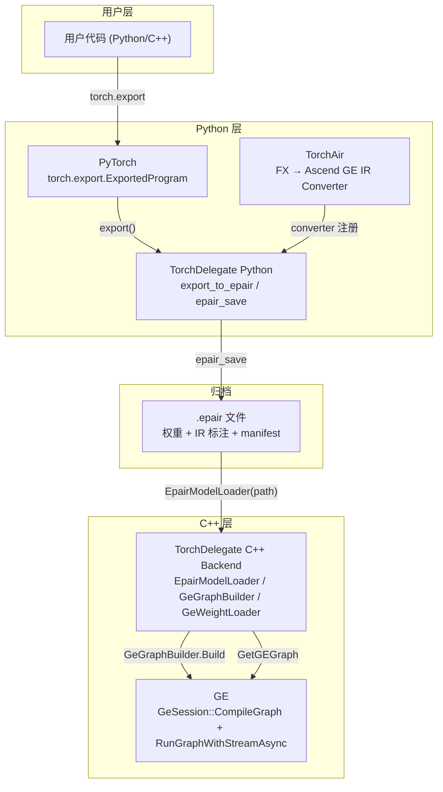
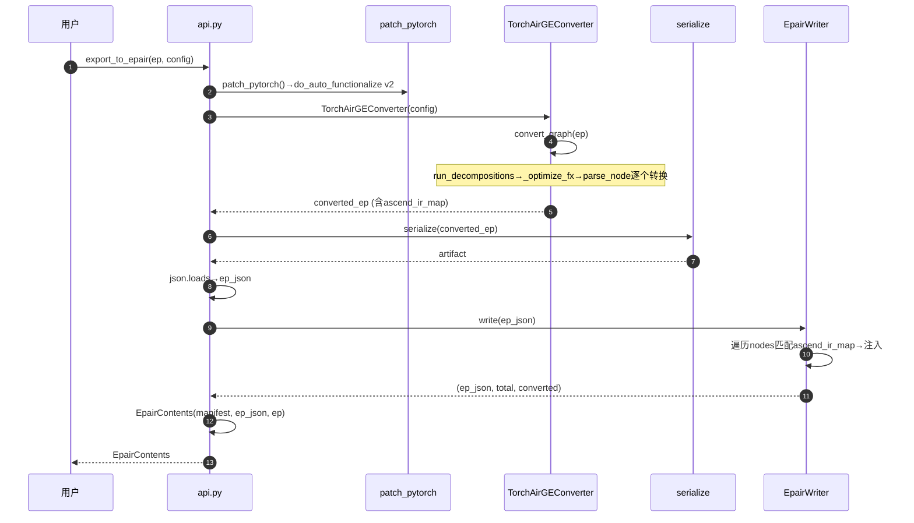
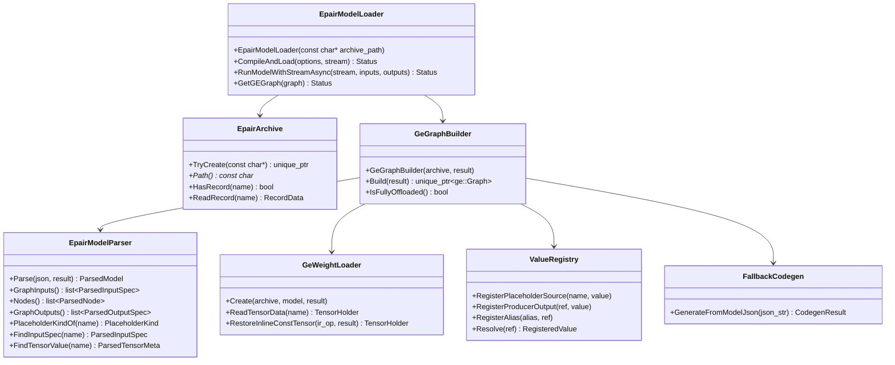
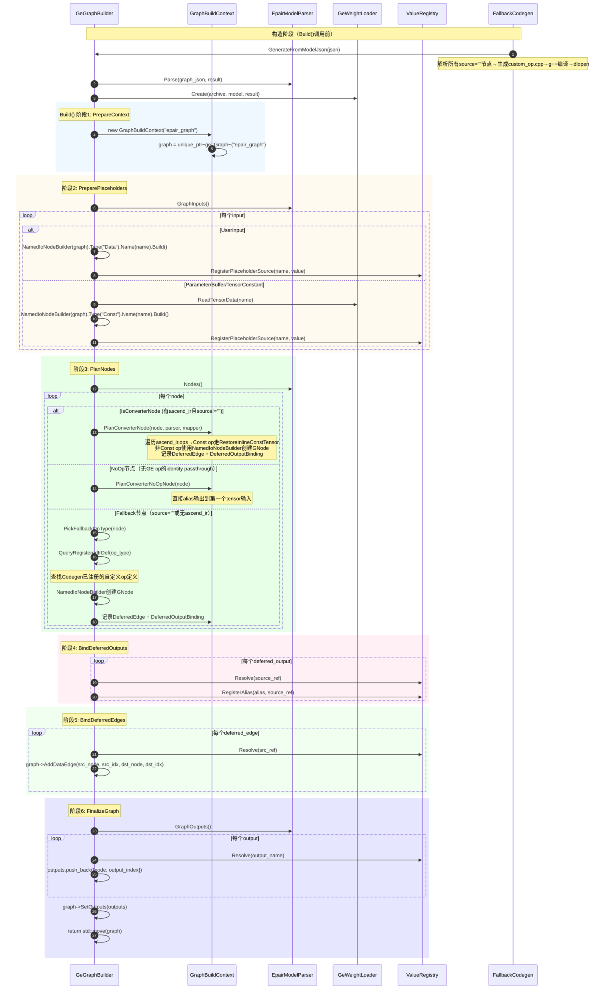
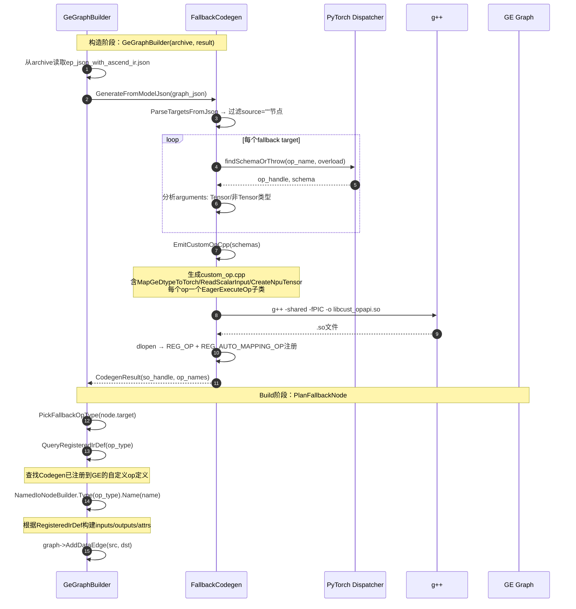

# TorchDelegate总体设计（2026-06-30）

> [!NOTE]文档状态
> 本文为2026-06-30的设计稿，部分实现已演进。当前使用说明请参考[《编译安装》](../guide/build.md)和[《epair打包指南》](../guide/build_epair.md)。

## 简介

### 目的

将PyTorch模型部署到昇腾NPU（Ascend）上执行，行业主流方案是通过 `torch.compile` 调用torchair提供的NPU后端入图，或通过 `torchair.dynamo_export` 导出 `.air` 模型后经过ATC或构造Graph的方式入图。这些方案存在的问题是：

- **Python环境强绑定**：IR转换和编译都依赖Python环境和torchair，部署侧仍需保留完整Python软件栈，无法做到纯C++部署。
- **格式封闭**：`.air` 为二进制私有格式，无法与PyTorch生态工具链（`torch.export.save/load`、`ExportedProgram`）互通。
- **算子扩展门槛高**：接入自定义算子需要手写GE自定义算子代码（`REG_OP` +形状推导+ Execute方法），开发成本高，迭代周期长。

**TorchDelegate** 提供一条中间路径，核心思路是将"IR转换"与"构图"分离：

- Python侧通过 `torch.export.ExportedProgram` + torchair converter完成原子级的IR标注，输出兼容PT2格式的 `.epair` 归档
- C++侧通过 `EpairModelLoader` 加载 `.epair`，完成GE Graph构建、编译和执行，实现纯C++部署
- 对自定义算子通过 **Fallback Codegen** 自动生成GE自定义算子代码，用户只需通过 `torch.library` 注册PyTorch算子，无需手写GE代码

**亮点**：

| 亮点 | 说明 |
|------|------|
| PT2格式兼容 | `.epair` 是合法PT2 Archive，可直接 `torch.export.load` 在CPU上执行，无缝对接PyTorch工具链 |
| 部署环境精简 | C++侧运行只需ACL Runtime + GE Runtime，不依赖Python环境 |
| 算子扩展零成本 | 用户注册 `torch.library` 算子后，Fallback Codegen自动生成 `REG_OP` + `EagerExecuteOp` 代码并编译加载 |
| ABI安全 | 对外接口使用 `ge::AscendString` + PIMPL，支持 `_GLIBCXX_USE_CXX11_ABI=0/1` 混合使用 |
| 委派机制灵活 | Python只标注不决策，C++侧根据IR连续性和目标设备能力动态决定执行边界，`.epair` 可跨硬件复用 |

本文档面向GE和torch-delegate开发者，描述TorchDelegate 0630 v1首发版本的软件需求和总体设计。

### 范围

**包含**：

- Python侧epair导出（`export_to_epair` / `epair_save` / `epair_load`）
- C++ Backend（epair归档解析、GE Graph构建、权重加载、编译执行）
- Fallback Codegen（集成在Backend构图流程中，自动生成GE自定义算子代码）
- Python与C++对外接口设计

**不包含**：

- 图切分（延迟至后续版本实现）
- CPU Fallback（节点全量委派NPU，不支持CPU段生成）
- 异构调度代码生成（HeteroCodegen + runner .so打包）
- 离线可部署的deployable.epair（当前仅支持导出仅标注的annotated.epair）

---

## 总体概述

### 软件概述

#### 项目介绍

TorchDelegate是GE后端与PyTorch模型导出之间的中间层，将 `torch.export.ExportedProgram` 转换为携带Ascend IR标注的 `.epair` 模型归档文件，在C++侧完成GE Graph构建和编译执行。其核心思路是**委派机制**：Python侧完成原子级的Ascend IR标注，但将"哪些节点委派给GE执行、如何划分执行边界"的决策权延迟到C++侧——Python只标注不决策，C++侧根据IR标注的连续性和目标设备动态决定子图边界并驱动编译执行。



---

### Delegate使用场景

#### 模型导出（Python侧）

用户在Python环境中导出模型并生成 `.epair` 归档：

```python
from torch_delegate import export_to_epair, epair_save
from torch.export import export

ep = export(model, (inputs,))
contents = export_to_epair(ep)
epair_save(contents, "model.epair")
```

产物 `.epair` 是兼容PT2格式的ZIP归档，可通过 `torch.export.load` 直接加载并执行。

#### NPU部署（C++侧）

部署方在NPU设备上加载 `.epair`，完成GE Graph构建、JIT编译和执行：

```cpp
#include "torch_delegate/epair_model_loader.h"

td::EpairModelLoader loader("model.epair");

std::map<ge::AscendString, ge::AscendString> options = {
    {ge::AscendString("ge.exec.deviceId"), ge::AscendString("0")},
};
void* stream = nullptr;
aclrtCreateStream(&stream);

loader.CompileAndLoad(options, stream);

std::vector<gert::Tensor> inputs, outputs;
loader.RunModelWithStreamAsync(stream, inputs, outputs);
```

v1版本仅支持JIT在线路径，运行侧使用GE Session。

#### 自定义算子接入

用户通过 `torch.library` 注册自定义算子，在模型中直接调用。导出时这些算子不携带ascend_ir标注，C++ Backend的Fallback Codegen模块自动识别并生成GE自定义算子代码，通过PyTorch Dispatcher调用用户NPU实现。

> **v1约束**：630版本仅支持纯Tensor输入的自定义算子。如果算子schema中包含Scalar/int/float/bool等非Tensor参数，Fallback Codegen会报错提示。Scalar参数支持计划715版本交付。

**Step 1：Python侧注册自定义算子**

```python
import torch

# 定义算子 schema
lib = torch.library.Library("my_ops", "DEF")
lib.define("add_scalar(Tensor x, float alpha) -> Tensor")

# Meta 实现（用于图模式形状推导）
@torch.library.register_fake("my_ops::add_scalar")
def _add_scalar_meta(x: torch.Tensor, alpha: float) -> torch.Tensor:
    return torch.empty_like(x)

# NPU 实现（注册到 PrivateUse1 dispatch key）
@torch.library.impl("my_ops::add_scalar", "PrivateUse1")
def _add_scalar_npu(x: torch.Tensor, alpha: float) -> torch.Tensor:
    # 实际 NPU 实现（aclnn / AscendC 等），此处为占位
    return x + alpha
```

**Step 2：在模型中使用并导出epair**

```python
class MyModel(torch.nn.Module):
    def forward(self, x):
        return torch.ops.my_ops.add_scalar(x, 0.5)

ep = torch.export.export(MyModel(), (torch.randn(4, 4),))
contents = export_to_epair(ep)  # add_scalar 节点无 ascend_ir，source=""
epair_save(contents, "model.epair")
```

**Step 3：C++ Fallback Codegen处理**

GeGraphBuilder构造阶段，Fallback Codegen扫描到 `source=""` 的节点，批量生成自定义算子代码并编译加载。PlanNodes阶段通过 `QueryRegisteredIrDef` 查找已注册的op定义，用 `NamedIoNodeBuilder` 构图。Execute运行时算子参数映射：
1. Tensor参数 → `GetInputTensor` + `CreateNpuTensor`（`from_blob` 零拷贝）
2. Scalar参数 → value-dependency INPUT，运行时 `aclrtMemcpy` D2H读出
3. Dispatcher `callBoxed` 调用用户NPU实现

---

### 软件功能

| 功能域 | 模块 | 语言 | 描述 |
|--------|------|------|------|
| Epair导出 | `torch_delegate/api.py` + `converter/` + `epair/` | Python | 将 `ExportedProgram` 转换为带Ascend IR标注的 `.epair` 归档 |
| Backend加载编译 | `csrc/backend/` | C++ | 解析epair → 构建GE Graph → 编译 → 执行 |
| Fallback Codegen | `csrc/fallback_codegen/` | C++ | 自动生成GE自定义算子代码，集成在构图流程中 |
| 对外接口 | Python API + C++ API | Python/C++ | 面向用户的顶层入口 |

---

### 设计约束

#### 格式约束

- 对PT2 Archive格式做**最小化扩展**——仅在 `torch.export.save` 的 `extra_files` 机制下新增两个文件：
  - `epair_manifest.json`：元数据（版本、后端名称、CANN版本、节点统计）
  - `ep_json_with_ascend_ir.json`：带Ascend IR标注的完整EP JSON
- `models/model.json` 保持标准EP JSON不变，不侵入
- `.epair` 文件完全兼容PT2工具链，支持 `torch.export.load` 接口加载并直接执行

#### ABI约束

- C++对外头文件禁止暴露 `std::string`、`std::unordered_map`、`std::filesystem::path`
- 统一使用：`ge::AscendString` 替代 `std::string`、`std::map<ge::AscendString, ge::AscendString>`、`const char*` 替代路径
- 对外类通过PIMPL隔离实现细节（`std::unique_ptr<Impl>`）
- 新代码必须在 `-Wall -Wextra -Werror` 下零警告编译

---

### 假设和依赖关系

TorchDelegate与周边组件的依赖关系如下：

- **PyTorch 2.9**：提供 `ExportedProgram`、`torch.export.save/load` 序列化框架、`torch.library` 自定义算子注册机制、`torch::Dispatcher` C++运行时调度。Python侧和C++侧均深度依赖。
- **torch_npu**：与PyTorch 2.9配套版本，提供NPU设备后端（`at::kPrivateUse1`）、`torch_npu.npu.utils.get_cann_version()` 版本查询。Custom op的NPU实现通过 `PrivateUse1` dispatch key注册；C++ Fallback Codegen执行时通过 `libtorch_npu.so` 完成GE tensor到 `at::Tensor` 的零拷贝转换（`at_npu::native::from_blob`）。
- **torchair**：与PyTorch 2.9配套版本，提供FX → Ascend GE IR的converter注册机制。Python侧 `TorchAirGEConverter` 通过torchair的 `GeConcreteGraph` 和 `parse_node` 完成节点级IR转换。
- **CANN >= 9.2.0**：提供 `GeSession`（`libge_runner_v2.so`，含 `CompileGraph` / `RunGraphWithStreamAsync`）、ACL runtime（`libacl_rt.so`，含stream管理、设备管理）、`ge::NamedIoNodeBuilder` 构图接口（`<graph/named_io_node_builder.h>`）。安装路径通过 `ASCEND_HOME_PATH` 环境变量指定。

---

## 特性1 Python侧Epair导出

### 整体介绍

Python侧通过三阶段API完成模型导出：`export_to_epair`（转换）→ `epair_save`（持久化）→ `epair_load`（加载）。核心思路是将PyTorch的 `ExportedProgram` 经torchair converter转换为Ascend GE IR标注的EP JSON，连同权重和manifest打包为 `.epair` 归档。



### 功能需求

#### export_to_epair

**介绍**：将 `ExportedProgram` 转换为 `EpairContents`。内部调用torchair converter完成FX → Ascend GE IR的节点级转换，转换结果记录在 `ascend_ir_map` 中。

**输入**：

| 参数 | 类型 | 说明 |
|------|------|------|
| `ep` | `ExportedProgram` | PyTorch导出的计算图，含权重和元数据 |
| `config` | `EpairConfig`（可选） | 控制优化开关和保留分解列表 |

`EpairConfig` 字段说明：

```python
@dataclasses.dataclass
class EpairConfig:
    remove_noop_ops: bool = True            # 是否移除无操作算子
    pattern_fusion_pass: bool = True        # 是否启用 pattern fusion
    whitelist_decompositions: set = {       # 保留不分解的算子集合
        torch.ops.aten.linear.default,
        torch.ops.aten.matmul.default,
        torch.ops.aten.layer_norm.default,
        torch.ops.aten.softmax.int,
        # ...
    }
```

**处理**：

1. patch PyTorch：将 `do_auto_functionalize` 替换为v2版本（处理mutable args和view信息）
2. 创建 `TorchAirGEConverter`，传入 `config`
3. `converter.convert_graph(ep)`：
   - `ep.run_decompositions()` 展开composite ops
   - `_optimize_fx` 应用图优化（remove_noop、pattern fusion）
   - `EpairGraphConverter` 遍历FX Graph每个节点，调用 `parse_node` 完成GE转换
   - 转换成功：记录opdef + mapping到 `ascend_ir_map`
   - 转换失败：创建mock node，`source=""` 标识
4. `serialize(converted_ep)` → `artifact.exported_program`（JSON bytes）
5. `EpairWriter._inject_ascend_ir(ep_json)`：遍历EP JSON nodes，匹配 `ascend_ir_map`，注入 `ascend_ir` 字段
6. 构建 `EpairManifest`（version、backend_name、cann_version、节点统计）
7. 封装 `EpairContents` 并返回
8. finally块中恢复patched PyTorch函数

**输出**：`EpairContents(manifest, ep_json, ep)`

**使用示例**：

```python
from torch_delegate import export_to_epair, epair_save
from torch_delegate import EpairConfig

config = EpairConfig(
    remove_noop_ops=True,
    pattern_fusion_pass=True,
)
contents = export_to_epair(ep, config=config)

# 查看转换统计
print(f"Converted {contents.manifest.converted_nodes}/{contents.manifest.total_nodes} nodes")
print(f"CANN version: {contents.manifest.cann_version}")

# 保存
epair_save(contents, "model.epair")
```

#### epair_save

**介绍**：将 `EpairContents` 写入 `.epair` 文件。

**处理**：
- `manifest` → JSON → `epair_manifest.json`
- `ep_json` → JSON → `ep_json_with_ascend_ir.json`
- 通过 `torch.export.save(contents.ep, f, extra_files={...})` 写入PT2 Archive

**EP格式扩展 —— 文件结构**：

```text
model.epair（ZIP 结构，兼容 PT2 格式）
├── epair_manifest.json               ← TorchDelegate 新增：元数据
├── ep_json_with_ascend_ir.json       ← TorchDelegate 新增：带 ascend_ir 的 EP JSON
├── models/
│   └── model.json                    ← 标准 EP JSON（无 ascend_ir，由 torch.export.save 生成）
└── data/
    ├── weights/                      ← 权重张量（由 torch.export.save 管理）
    ├── constants/                    ← 常量张量（由 torch.export.save 管理）
    └── model_sample_inputs.pt        ← 示例输入
```

`epair_manifest.json` 格式：

```json
{
  "version": 1,
  "backend_name": "ascend_ge",
  "cann_version": "9.2.0",
  "total_nodes": 20,
  "converted_nodes": 15
}
```

`ep_json_with_ascend_ir.json` 中节点的 `ascend_ir` 字段示例：

```json
{
  "target": "torch.ops.aten.add.Tensor",
  "inputs": [...],
  "outputs": [...],
  "ascend_ir": {
    "source": "converter",
    "ops": [{
      "name": "Add",
      "attr": [{"key": "alpha", "value": {"f": 1.0}}],
      "input": [{"name": "x", "type": "tensor"}, {"name": "y", "type": "tensor"}],
      "output": [{"name": "z", "type": "tensor"}]
    }],
    "mapping": {
      "inputs": {"input_0": "x", "input_1": "y"},
      "outputs": {"add_1": "z:0"}
    }
  }
}
```

**兼容性说明**：`.epair` 文件是合法的PT2 Archive，支持使用 `torch.export.load` 加载并直接执行推理（忽略额外文件即可）。

#### epair_load

**介绍**：从 `.epair` 文件还原 `EpairContents`。

**处理**：
- `torch.export.load(f, extra_files={'epair_manifest.json': '', 'ep_json_with_ascend_ir.json': ''})`
- 解析manifest和annotated EP JSON
- 返回 `EpairContents(manifest, ep_json, ep)`

**使用示例**：

```python
from torch_delegate import epair_load

contents = epair_load("model.epair")
print(f"Backend: {contents.manifest.backend_name}")

# 直接执行（兼容 PT2）
outputs = contents.ep.module()(inputs)
```

#### Mock机制

对于torchair converter无法转换的节点，创建mock node：

```python
try:
    ge_outputs = super().parse_node(target, args, kwargs, meta_outputs)
    self._record_ascend_ir(fx_node_name, ge_outputs, new_opdefs, is_mock=False)
except RuntimeError as e:
    logger.warning(f"Failed to convert {fx_node_name}: {e}")
    ge_outputs = self._create_mock_node_for_op(fx_node_name, target, args, kwargs)
    self._record_ascend_ir(fx_node_name, ge_outputs, new_opdefs, is_mock=True)
```

| source值 | 含义 | C++侧处理 |
|-----------|------|-----------|
| `"converter"` | 正常GE转换 | 使用ascend_ir中的opdef构图 |
| `""`（空字符串） | Mock节点 | 通过Fallback Codegen生成GE自定义算子代码 |

### 数据结构

```python
@dataclasses.dataclass
class NodeIR:
    source: str                      # "converter" 或 ""（mock）
    ops: list[dict]                  # GE opdef protobuf 转 dict
    mapping: dict[str, str] | None   # 输出映射（aten→GE）

@dataclasses.dataclass
class EpairManifest:
    version: int                     # 格式版本号，当前为 1
    backend_name: str                # 后端名称，"ascend_ge"
    cann_version: str                # CANN 版本号
    total_nodes: int                 # EP JSON 中计算节点总数
    converted_nodes: int             # 成功转换的节点数

@dataclasses.dataclass
class EpairContents:
    manifest: EpairManifest          # 元数据
    ep_json: dict[str, Any]          # 带 ascend_ir 的 EP JSON
    ep: ExportedProgram              # 可执行的 ExportedProgram
```

---

## 特性2 C++ Backend

### 整体介绍

C++ Backend负责加载 `.epair` 归档，解析annotated EP JSON，构建 `ge::Graph`，编译并执行。由以下核心组件协作完成：



### 功能需求

#### EpairArchive

PT2 ZIP归档的C++封装，提供读取能力。

**接口**：

| 方法 | 说明 |
|------|------|
| `EpairArchive(const char* path)` / `TryCreate(path)` | 构造或工厂方法打开归档 |
| `Path()` → `const char*` | 归档路径 |
| `HasRecord(name)` → `bool` | 是否包含指定record |
| `ReadRecord(name)` → `RecordData` | 读取指定record的字节数据 |

**实现**：基于 `caffe2::serialize::PyTorchStreamReader`。

#### EpairModelParser

将annotated EP JSON解析为强类型C++结构体。

**输入**：`ep_json_with_ascend_ir.json` 的JSON字符串

**处理**：
- 解析 `graph_module.graph.nodes` → `ParsedNode` 列表
- 解析 `graph_module.graph.inputs` → placeholder列表
- 解析 `graph_module.graph.outputs` → output列表
- 提取每个节点的 `ascend_ir` 字段（source、ops、mapping）
- 提取非Tensor参数（scalar、int、bool等），为Fallback Codegen提供输入

**输出**：

| 方法 | 返回类型 | 说明 |
|------|----------|------|
| `GraphInputs()` | `std::vector<ParsedInputSpec>` | 所有graph input |
| `Nodes()` | `std::vector<ParsedNode>` | 所有计算节点 |
| `GraphOutputs()` | `std::vector<ParsedOutputSpec>` | 所有graph output |
| `PlaceholderKindOf(name)` | `PlaceholderKind` | placeholder类型（UserInput/Parameter/Buffer/TensorConstant） |
| `FindInputSpec(name)` | `ParsedInputSpec` | 查找指定input的spec信息 |
| `FindTensorValue(name)` | `ParsedTensorMeta` | 查找指定tensor的shape/dtype信息 |

**关键数据结构**：

```cpp
struct ParsedNode {
    std::string target;              // 如 "torch.ops.aten.add.Tensor"
    std::vector<std::string> input_names;  // 仅 tensor 输入
    std::vector<std::string> output_names;
    AscendIrInfo ascend_ir;          // 可能为空（fallback 节点）
};

struct AscendIrInfo {
    std::string source;              // "converter" 或 ""
    std::vector<AscendIrOpDef> ops;  // GE opdef 列表
    AscendIrMapping mapping;         // 输入输出名称映射
};
```

#### GeWeightLoader

从归档读取权重和常量tensor数据。

**处理流程**：

```text
GeWeightLoader::Create(archive, model, result)
  1. 解析 placeholder → logical_name 映射
  2. 读取 data/weights/model_weights_config.json
  3. 读取 data/constants/model_constants_config.json
  4. 构建 logical_name → TensorRecordInfo 映射
  5. 校验所有 placeholder 在 records 中有对应项

GeWeightLoader::ReadTensorData(name)
  1. 查找 logical_name → TensorRecordInfo
  2. 校验 archive record 存在
  3. 校验 byteorder（仅支持 little-endian）
  4. 读取 bytes → 解码为 vector<T>
  5. 构造 TensorHolder（values + dims + dtype + format）
```

**校验规范**：
- `use_pickle=True` → 报Error（不支持pickle序列化的权重）
- bytes大小不匹配 → 报Error
- 不支持的dtype → 报Error

#### GeGraphBuilder（核心）

多阶段构图流程，是本版本最核心的设计。GeGraphBuilder构造时已完成Fallback Codegen预执行、epair解析和权重加载，`Build()` 驱动以下阶段构图：



**关键设计点**：

1. **两阶段构图**：PlanNodes阶段只创建节点骨架和注册输出引用，不实际连边；BindDeferredEdges阶段统一连接数据边。这是因为在PlanNodes阶段，被引用的producer节点可能尚未创建（图中顺序不一定是拓扑序）。

2. **ValueRegistry**：`name → RegisteredValue`（含 `ge::GNode` + `output_index`）的延迟解析注册表，支持：
   - `RegisterPlaceholderSource(name, value)` — 注册输入/常量节点输出
   - `RegisterProducerOutput(ref, value)` — 注册算子节点输出（`"op_name:0"`）
   - `RegisterAlias(alias, ref)` — 注册输出别名（FX tensor name → GE producer ref）
   - `Resolve(ref)` → `RegisteredValue` — 递归解析引用

3. **FallbackCodegen的预执行**：codegen在 `Build()` 调用前完成，生成完整 `.so` 并 `dlopen`，注册到GE算子表。PlanFallbackNode只需通过 `QueryRegisteredIrDef()` 查找已注册的定义。

4. **Converter节点vs Fallback节点**：
   - 有 `ascend_ir` 且 `source="converter"`：使用ascend_ir中的opdef信息，通过 `NamedIoNodeBuilder` 构建GE节点
   - 无 `ascend_ir` 或 `source=""`：使用FallbackCodegen预注册的op_type，同样通过 `NamedIoNodeBuilder` 构建

#### EpairModelLoader（顶层入口）

v1版本对外提供 `EpairModelLoader` 作为统一的C++入口。构造时即完成epair解析和GE Graph构建，随后可单步完成编译执行：

```cpp
class EpairModelLoader {
public:
    explicit EpairModelLoader(const char *archive_path);

    Status CompileAndLoad(
        const std::map<ge::AscendString, ge::AscendString> &options,
        void *stream);

    Status RunModelWithStreamAsync(
        void *stream,
        const std::vector<gert::Tensor> &inputs,
        std::vector<gert::Tensor> &outputs);

    Status GetGEGraph(ge::Graph *graph) const;
};
```

**处理流程**：
1. 构造：打开归档 → 校验annotated payload → 初始化GeGraphBuilder（内部创建Parser + WeightLoader）→ 调用Build构建GE Graph
2. `CompileAndLoad`：通过 `GeSession::AddGraph` + `CompileGraph` 完成在线编译并加载到指定stream
3. `RunModelWithStreamAsync`：通过 `GeSession::RunGraphWithStreamAsync` 执行推理
4. `GetGEGraph`：返回内部 `ge::Graph` **副本**，供用户自管编译执行

---

## 特性3 Fallback Codegen

### 整体介绍

#### 三种算子场景

TorchDelegate v1根据算子是否携带 `ascend_ir` 标注、是否有GE入图交付件，将算子分为三种场景：

| 场景 | 描述 | ascend_ir | GE交付件 | 构图方式 | v1支持 |
|------|------|-----------|-----------|----------|---------|
| **场景1** | 有完整入图交付件的算子。GE 侧已注册算子定义（`REG_OP`），torchair 提供完整 converter 转换 | `source="converter"`，ops 含完整 opdef | 有 | `NamedIoNodeBuilder` 根据 ascend_ir.opdef 直接构图 | ✅ 支持 |
| **场景2** | Fallback 回调算子，无 GE 入图交付件。用户通过 `torch.library` 注册 PyTorch 自定义算子，不需要手写 GE 自定义算子代码 | `source=""` 或无 ascend_ir | 无，由 Fallback Codegen 自动生成 | Codegen 生成 GE `EagerExecuteOp` 代码 → 编译 `.so` → `dlopen` 注册 → 运行时回调 PyTorch Dispatcher 调用用户实现 | ✅ 支持 |
| **场景3** | CPU 算子（HostCpu 后端），需要在 CPU 上通过 libtorch 执行 | `source=""`，`device="cpu"` | 无，由 Fallback Codegen 自动生成 | Codegen 生成 `HostCpuExecuteOp + ShapeInferOp`（`REG_OP_BACKEND(..., kHostCPU)`），运行时回调 PyTorch CPU 实现 | ✅ 支持 |


三种场景在GeGraphBuilder中的分流逻辑：

```text
GeGraphBuilder::Build()
  ├── 构造阶段：FallbackCodegen::GenerateFromModelJson()
  │     扫描所有 source="" 的节点 → 批量生成场景2 的自定义算子代码
  │
  └── PlanNodes 阶段
        ├── IsConverterNode(node) == true    → 场景1：PlanConverterNode
        ├── IsConverterNoOpNode(node) == true → 场景1 NoOp：PlanConverterNoOpNode（alias 直通）
        └── else                              → 场景2：PlanFallbackNode（查已注册的自定义 op）

场景 3（`ascend_ir.device == "cpu"`）经 `IsCpuNode` 谓词分派到
`FallbackNodePlanner(ctx, deps, ge::kPlacementHost)`，与场景 2 共用构图流程。
含 CPU 节点的图在 GE 内部走 v2 执行器（unknown 标记），`IsFullyOffloaded()` 判据
不变（CPU 节点同样携带 ascend_ir）。
```

#### Fallback Codegen流程



### 功能需求

#### 算子描述提取

Codegen从EP JSON的每个 `source=""` 节点提取：

| 信息 | 来源 | 用途 |
|------|------|------|
| 算子target | `node.target` | 通过Dispatcher查找PyTorch Schema |
| Tensor输入 | `node.inputs[].arg.as_tensor` | 生成GE INPUT定义 |
| 非Tensor参数 | `node.inputs[].arg.as_int/as_float/as_bool/...` | 生成value-dependency INPUT（IntTensorType等），运行时D2H读出 |
| 输出名 | `node.outputs[]` | 生成GE OUTPUT定义 |

#### Schema解析

通过 `torch::Dispatcher::singleton().findSchemaOrThrow(target, "")` 获取算子schema，每个参数映射为 `SchemaArgInfo`（含 `type_category`、`input_kind`、`ge_tensor_type`、`has_default` 等）。区分21种 `InputKind`：

- `TENSOR` / `OPTIONAL_TENSOR` / `TENSOR_LIST` → GE `TensorType::ALL()` input
- `INT` / `FLOAT` / `BOOL` / `STRING` → GE `IntTensorType()` / `FloatTensorType()` / `BoolTensorType()` / `StringTensorType()` 等value-dependency input
- `SCALAR` → GE `TensorType::ALL()`，运行时根据dtype分支为int64或float→double

所有非tensor参数通过 `InputsDataDependency` 注册，GE在执行前等待这些1元素tensor从device回读到host。

#### Execute代码生成（实际模式）

```cpp
graphStatus Execute(gert::EagerOpExecutionContext* ctx) override {
    // 1. Tensor 输入：GetInputTensor + CreateNpuTensor（零拷贝 from_blob）
    at::Tensor torch_input_0 = CreateNpuTensor(ctx->GetInputTensor(0));

    // 2. 标量输入：D2H 读出 1 元素 buffer → reinterpret_cast
    int64_t scalar_val = *reinterpret_cast<const int64_t*>(
        ReadScalarInput(ctx->GetInputTensor(1)));  // aclrtMemcpy D2H

    // 3. 组装 c10::IValue 参数列表
    std::vector<c10::IValue> args;
    args.emplace_back(torch_input_0);
    args.emplace_back(scalar_val);

    // 4. Dispatcher callBoxed 调用
    static const auto op_handle = torch::Dispatcher::singleton()
        .findSchemaOrThrow("my_ops::add_scalar", "");
    op_handle.callBoxed(args);

    // 5. 输出：aclrtMemcpyAsync D2D 或 MakeOutputRefInput（inplace op）
    return ge::GRAPH_SUCCESS;
}
```

**Tensor零拷贝**：使用 `at_npu::native::from_blob` 直接引用GE tensor的device内存，无数据拷贝。

**Scalar参数处理**：不作为GE ATTR，而是作为value-dependency INPUT（`IntTensorType()` 等1元素tensor）。Execute时D2H读出标量值，转为对应C++类型后组装 `c10::IValue`。

#### 参数类型映射

| PyTorch Schema类型 | InputKind | GE input type | Execute读取方式 |
|---------------------|-----------|---------------|-----------------|
| `Tensor` | TENSOR | `TensorType::ALL()` | `CreateNpuTensor` |
| `Tensor?` | OPTIONAL_TENSOR | `.OPTIONAL_INPUT` | 判空 |
| `Tensor[]` | TENSOR_LIST | `.DYNAMIC_INPUT` | 循环索引 |
| `int` | INT | `IntTensorType()` | `reinterpret_cast<int64_t>` |
| `float` / `double` | FLOAT | `FloatTensorType()` | `reinterpret_cast<float>` → `double` |
| `bool` | BOOL | `BoolTensorType()` | `reinterpret_cast<uint8_t>` → `bool` |
| `str` | STRING | `StringTensorType()` | 读buffer → `string` |
| `int[]` | INT_LIST | `IntTensorType()` | 按 `sizeof(int64_t)` 切分 |
| `Scalar` | SCALAR | `TensorType::ALL()` | 按dtype分支int64或float→double |

---

## 对外接口

### Python接口

#### export_to_epair

```python
def export_to_epair(
    ep: ExportedProgram,
    config: EpairConfig = EpairConfig()
) -> EpairContents
```

#### epair_save

```python
def epair_save(contents: EpairContents, f: str | os.PathLike) -> None
```

#### epair_load

```python
def epair_load(archive_path: str) -> EpairContents
```

#### 完整调用示例

```python
from torch_delegate import export_to_epair, epair_save, epair_load
from torch_delegate import EpairConfig
from torch.export import export

# 1. 导出
ep = export(model, (inputs,))
config = EpairConfig(remove_noop_ops=True, pattern_fusion_pass=True)
contents = export_to_epair(ep, config=config)
epair_save(contents, "model.epair")
print(f"Converted {contents.manifest.converted_nodes}/{contents.manifest.total_nodes}")

# 2. 加载并执行（兼容 PT2）
loaded = epair_load("model.epair")
outputs = loaded.ep.module()(inputs)
```

### C++对外接口（ABI-safe）

对外头文件目录：`csrc/inc/external/torch_delegate/`，包含两个文件：`td_types.h` 和 `epair_model_loader.h`。

#### td::Status（td_types.h）

```cpp
namespace td {
using Status = int64_t;

inline constexpr Status SUCCESS = 0;
inline constexpr Status FAILED = 1;
inline constexpr Status INVALID_PARAM = 2;
inline constexpr Status INTERNAL_ERROR = 3;
inline constexpr Status UNIMPLEMENTED = 4;
}
```

#### td::EpairModelLoader（epair_model_loader.h）

```cpp
class EpairModelLoader {
public:
    explicit EpairModelLoader(const char *archive_path);
    ~EpairModelLoader();
    EpairModelLoader(const EpairModelLoader &) = delete;
    EpairModelLoader &operator=(const EpairModelLoader &) = delete;

    Status CompileAndLoad(
        const std::map<ge::AscendString, ge::AscendString> &options,
        void *stream);

    Status RunModelWithStreamAsync(
        void *stream,
        const std::vector<gert::Tensor> &inputs,
        std::vector<gert::Tensor> &outputs);

    Status GetGEGraph(ge::Graph *graph) const;
};
```

#### 完整调用示例（JIT在线编译并执行）

```cpp
#include "torch_delegate/epair_model_loader.h"
#include "torch_delegate/td_types.h"

int main() {
    // 1. 构造即完成 epair 解析和 GE Graph 构建
    td::EpairModelLoader loader("model.epair");

    // 2. JIT 编译并加载
    std::map<ge::AscendString, ge::AscendString> options = {
        {ge::AscendString("ge.exec.deviceId"), ge::AscendString("0")},
        {ge::AscendString(ge::ir_option::SOC_VERSION), ge::AscendString("Ascend910B2")},
    };
    void* stream = nullptr;
    aclrtCreateStream(&stream);

    td::Status status = loader.CompileAndLoad(options, stream);
    if (status != td::SUCCESS) return 1;

    // 3. 执行推理
    std::vector<gert::Tensor> inputs = /* ... */;
    std::vector<gert::Tensor> outputs;
    status = loader.RunModelWithStreamAsync(stream, inputs, outputs);
    if (status != td::SUCCESS) return 1;

    aclrtSynchronizeStream(stream);
    aclrtDestroyStream(stream);

    // 或只取 Graph，由用户自管理编译执行
    // ge::Graph graph;
    // loader.GetGEGraph(&graph);
    return 0;
}
```

#### 接口检查项

| 检查项 | 子检查项 | 是否涉及 |
|--------|----------|---------|
| **接口说明** | 接口是否需要评审 | 是（组件间接口） |
| **接口说明** | 是否需要补充资料说明 | 是 |
| **接口说明** | 是否明确接口原型、功能、返回值 | 是 |
| **接口兼容** | 行为兼容性，修改前后是否变化 | 是（新接口，无兼容问题） |
| **接口兼容** | 新接口在老版本上是否能工作 | 是（v1新接口，不涉及） |
| **接口兼容** | 是否涉及使用场景、调用时序约束 | 是（需先CompileAndLoad再Run） |
| **接口约束** | 不满足约束条件时是否能清晰报错 | 是（Status错误码） |
| **接口约束** | 是否需要设计单独的测试用例 | 是 |

---

## 交叉特性分析

| 场景 | 适用性 | 分析说明 |
|------|--------|----------|
| 静态Shape | 适用 | GeGraphBuilder构图、GeSession::CompileGraph在线编译均支持；构图时使用固定shape创建NamedIoNodeBuilder节点 |
| 动态Shape | 适用 | 在 `torch.export` 阶段通过 `dynamic_shapes` 参数指定输入shape范围为动态，导出到epair后C++侧根据算子的符号信息自动设置GE节点为动态shape，由GE内部处理运行时shape推导 |
| 动态Shape静态子图（图拆分） | 适用 | GeSession同时管理静态子图（v1路径）和动态子图（v2路径）；TorchDelegate构图阶段不区分，由GE内部在CompileGraph时根据shape信息分流 |
| 离线场景（atc / aclgrphBuildModel） | 不支持 | v1仅提供JIT在线路径，不调用aclgrphBuildModel等离线编译接口 |
| 在线场景（EpairModelLoader / GeSession） | 适用 | 全流程通过GeSession::AddGraph + CompileGraph + RunGraphWithStreamAsync完成 |

---

## 软件设计

### 关键技术

#### 两阶段构图

PlanNodes与BindDeferredEdges分离。PlanNodes阶段按图顺序逐节点创建GE节点骨架，但数据边先不连接（此时被依赖节点可能尚未创建）。所有节点的输出先注册到 `ValueRegistry`，待所有节点骨架创建完成后，BindDeferredEdges阶段统一解析引用并连边。

#### ValueRegistry注册表

核心数据结构，支持name → RegisteredValue（含 `ge::GNode` + `output_index`）的延迟解析：

```text
ValueRegistry:
  placeholder_sources_:  name → RegisteredValue    // 输入/常量节点
  producer_outputs_:     "op:idx" → RegisteredValue // 算子输出
  aliases_:              fx_name → "op:idx"        // FX tensor名 → GE producer引用
```

解析链：`Resolve(fx_output_name)` → 查aliases_ 得 `"op:0"` → 查producer_outputs_ 得 `RegisteredValue`。

#### 严格报错

- 校验宏：`TD_ASSERT`、`TD_ASSERT_NOTNULL`、`TD_ASSERT_TRUE`、`TD_CHK_STATUS`
- `ErrorResult` 类型推导：失败时自动返回默认构造的对应类型（`false`、`nullptr`、空vector、空string等）
- 严格解析：JSON中遇到未知字段类型 → Error，不静默跳过

#### ABI安全

- 对外头文件使用 `ge::AscendString` 替代 `std::string`
- 路径参数使用 `const char*`
- PIMPL隔离实现细节
- 编译选项使用 `std::map<ge::AscendString, ge::AscendString>`

### 错误处理

#### 系统错误

| 错误类型 | 处理方式 |
|----------|----------|
| 归档文件不存在/不可读 | 构造时返回FAILED |
| JSON解析失败/字段缺失 | parser返回Error，透传至调用方 |
| 权重数据损坏/size不匹配 | weight loader返回Error |
| Graph构建失败 | builder返回Error |
| 编译失败（GeSession::CompileGraph） | 返回对应Status错误码 |

#### 接口错误

| Status | 值 | 说明 |
|--------|-----|------|
| `SUCCESS` | 0 | 成功 |
| `FAILED` | 1 | 通用失败 |
| `INVALID_PARAM` | 2 | 参数错误 |
| `INTERNAL_ERROR` | 3 | 内部错误 |
| `UNIMPLEMENTED` | 4 | 未实现 |

### 安全检查

| 检查项 | 是否涉及 | 说明 |
|--------|----------|------|
| 资源生命周期管理 | 是 | GeSession在EpairModelLoader内部管理，遵循RAII |
| 是否创建新线程 | 否 | GE编译和执行均为同步调用，不创建新线程 |
| 编码军规 | 是 | 遵循Google C++ Style Guide，零警告原则 |

---

## 兼容性检查

| 检查项 | 说明 | 状态 |
|--------|------|------|
| .epair向后兼容 | v1是首个版本，无兼容问题 | N/A |
| PT2兼容性 | .epair是合法PT2 Archive，可由torch.export.load加载 | 兼容 |

---

## DT设计

### 测试边界

- **测试入口**：Python侧 `export_to_epair` + `epair_save` / `epair_load`；C++侧 `EpairModelLoader`
- **测试出口**：验证EP JSON结构、ascend_ir字段完整性、GE Graph拓扑正确性、权重加载正确性
- **打桩模块**：CANN stub（libascendcl.so）、GE stub（libge_runner_v2.so）

### 测试设计

| 测试类别 | 关键测试项 | 测试方法 | 用例类型 |
|----------|-----------|----------|----------|
| **功能** | export_to_epair基本导出 | 单算子模型 → 验证EP JSON含ascend_ir | UT |
| **功能** | Mock节点生成 | 不识别的op → 验证source="" | UT |
| **功能** | epair_save / epair_load往返 | 保存后加载 → 验证manifest、ep_json、ep一致 | UT |
| **功能** | GeGraphBuilder构图 | 全连接/多分支模型 → 验证GE Graph结构和边 | UT |
| **功能** | GeWeightLoader权重读取 | 含weight/constant模型 → 验证tensor数据正确 | UT |
| **功能** | EpairModelLoader端到端 | 完整模型 → CompileAndLoad → RunModelWithStreamAsync → 验证输出 | ST |
| **功能** | Fallback Codegen | 不含ascend_ir的节点 → 触发codegen路径 | UT |
| **功能** | EpairConfig控制 | 不同config配置 → 验证转换行为差异 | UT |
| **性能** | 编译时长 | 多模型统计编译耗时 | ST |
| **精度** | 输出精度对比 | 导出后执行vs原始模型 → 验证输出一致性 | ST |
| **兼容性** | PT2加载 | .epair通过torch.export.load执行 | ST |
| **兼容性** | ABI兼容 | 在 _GLIBCXX_USE_CXX11_ABI=0/1下编译运行 | UT |
| **特性交叉** | 静态Shape | 固定shape模型的全流程通过 | ST |

---

## 验收标准

1. **CI工程验收**：按照README.md和构建指南，可在测试环境上完成torch-delegate的构建、安装、升级、demo执行。可使用脚本一条命令完成环境准备与构建（不含网络问题导致的失败）。

2. **功能验收**：
   - 基于JD客户网络验收，成功导出epair模型，使用C++接口能够加载并执行成功。
   - 注册torch自定义算子，导出包含自定义算子的模型，使用C++接口能正常加载，正确生成Fallback回调函数，模型执行成功。（约束：630之前仅支持Tensor输入算子，如果算子中包含scalar，报错提示，scalar预715支持）
   - 导出epair后，可以使用 `torch.export.load` 接口正常加载并在CPU侧执行推理。

3. **精度验收**：加载执行epair模型，输出精度应与单算子 / torchair图模式相近。

4. **性能验收**：加载执行epair模型，端到端执行性能需要与torchair图模式一致。

5. **交叉特性**：GE在线场景支持的特性都应当支持，建议重点看护语言无关自定义算子、自动融合、动态shape、DataDump、Profiling相关的特性。

6. **接口验收**：对外API支持在ABI=0和ABI=1的应用中使用。对外接口资料清晰、易懂，并提供调用示例。

7. **维测功能**：支持打印APP plog，调用接口失败有明确的ERROR日志。说明：暂不支持错误码特性。
