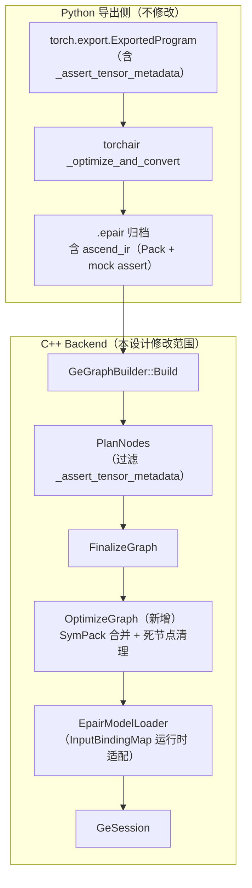
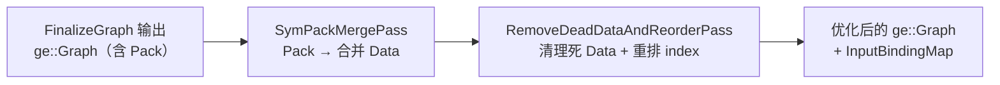
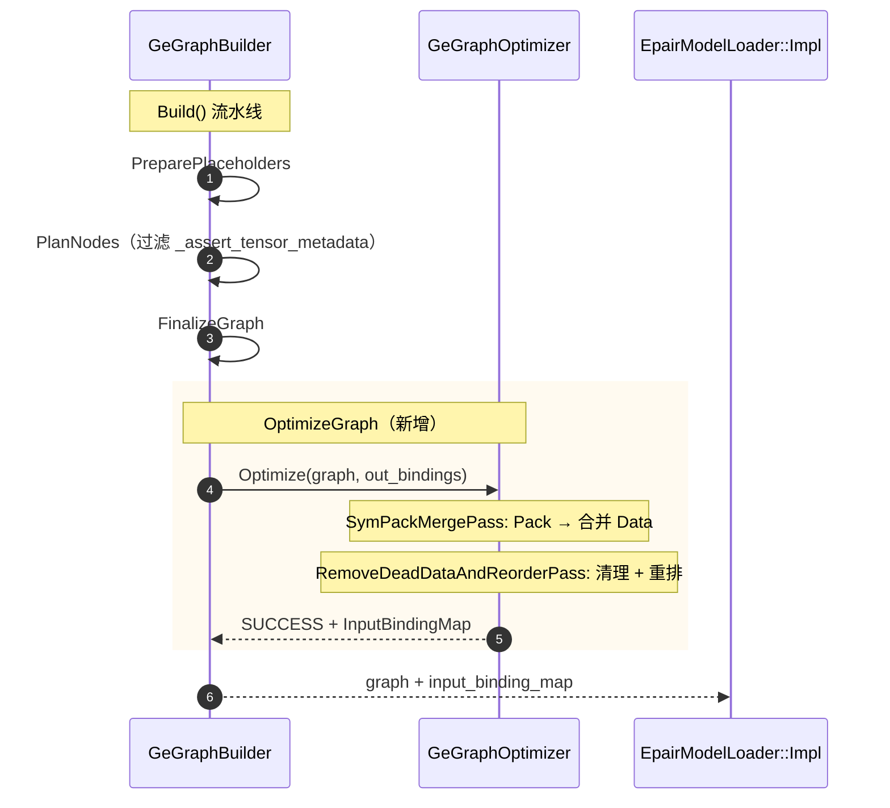

# Epair支持SymPack优化与AssertTensorMetadata类型

> [!NOTE]文档状态
> 本文为2026-07-10的设计稿，描述SymPack合并和元数据节点过滤的实现方案。当前接口说明请参考[《EpairModelLoader API》](../api/epair_model_loader.md)。

## 简介

### 目的

本文档描述在C++ Backend的GE Graph构建阶段引入的两项优化：

1. **SymPack合并优化**：消除epair路径中冗余的SymPack节点，在Pack消除效果上与torchair `torch.compile` 路径完全一致。
2. **AssertTensorMetadata节点过滤**：在 `PlanNodes` 阶段过滤 `aten._assert_tensor_metadata` 节点，解决PyTorch 2.9 `torch.export` 自动插入的元数据校验节点阻断GE图转换的问题。

两项优化均在C++ Backend内部完成，不修改Python侧导出流程，不修改epair格式。

### 范围

**包含**：

- `OptimizeGraph` 阶段：`SymPackMergePass`（Pack替换为合并CPU Data）+ `RemoveDeadDataAndReorderPass`（死Data清理+ index重排）
- `InputBindingMap`：合并Data与用户原始输入的映射，供运行时构造合并tensor
- `PlanNodes` 阶段的 `_assert_tensor_metadata` 节点过滤
- torchair与delegate路径的流程差异对比

**不包含**：

- torchair其他pass的迁移（与Pack消除无关）
- epair序列化格式变更（绑定信息仅在C++内存中，不持久化）
- Python侧converter修改

---

## 总体概述

### 软件概述

torch-delegate将PyTorch模型通过 `torch.export` + torchair converter转换为 `.epair` 归档，在C++侧加载并构建GE Graph执行。

#### 问题一SymPack冗余

模型使用动态SymInt（如 `x.view([m， n])`）时，torchair `torch.compile` 路径通过 `optimize_sym_pack` 消除所有Pack节点，但epair路径缺失此优化，导致：冗余Pack节点保留、CondGraph条件子图膨胀、每次推理额外的Pack kernel调用。

本设计在 `GeGraphBuilder::Build` 中新增 `OptimizeGraph` 阶段，实现等价的图变换。

#### 问题二AssertTensorMetadata噪音节点

PyTorch 2.9的 `torch.export` 在每个 `aten.to.*` 前插入 `aten._assert_tensor_metadata` 校验节点。该节点schema为 `-> ()`（无输出），无计算语义，却因torchair无可匹配converter而阻断转换。

本设计在C++ `PlanNodes` 阶段按 `node.target` 过滤该节点，EP JSON保持原样。

#### 产品环境介绍



### 软件功能

| 功能 | 模块 | 描述 |
|------|------|------|
| SymPack合并 | `GeGraphOptimizer` | 将 `_inputs_all_sym=True` 的Pack替换为合并CPU Data节点 |
| 死节点清理与index重排 | `GeGraphOptimizer` | 删除无引用的原始标量Data，index重排为连续序列 |
| 运行时输入适配 | `EpairModelLoader` | 根据 `InputBindingMap` 将用户标量打包为合并tensor |
| AssertTensorMetadata过滤 | `PlanNodes` | 按 `node.target` 跳过 `_assert_tensor_metadata`，不创建GE GNode |

### 设计约束

1. **不改epair格式**：绑定信息仅在C++内存中，不持久化；EP JSON保持原样
2. **不改Python侧**：`torchair_converter.py`、`epair/writer.py` 不变
3. **GE API约束**：使用 `ge::Graph` + `ge::GNode` 公开API，不依赖内部实现
4. **零开销no-op**：对不含目标节点的图，两条优化路径均为no-op
5. **修改最小**：assert_tensor_metadata仅在 `PlanNodes` 循环增加一个target匹配条件

---

## 特性1 SymPack合并优化

### 整体介绍

在 `GeGraphBuilder::Build` 的 `FinalizeGraph` 之后新增 `OptimizeGraph` 阶段：



### 功能需求1 SymPackMergePass

将图中所有 `_inputs_all_sym=True` 的Pack节点替换为合并的CPU Data节点。多个Pack输入完全相同时共享同一个合并Data。

**输入**：
- `ge::Graph`（`FinalizeGraph` 输出）
- CPU Data节点（SymInt标量，`shape=[]`，`placement=Host`）
- Pack节点（携带 `_inputs_all_sym=True`，`axis=0`）

**处理**：

```text
// 步骤 1：扫描 CPU Data 和 SymPack
for node in graph.GetAllNodes():
    if node is CPU Data:  record index
    elif node is _inputs_all_sym Pack:  collect it

// 步骤 2：按输入组合去重，创建合并 Data
for each Pack:
    if same-input Data already exists:  reuse it
    else:
        create CPU Data(shape=[N], dtype=int64, placement=Host)
        record InputBindingMap: {new_data_name → [source user input indices]}
    delete Pack node

// 步骤 3：重连下游引用
for each node consuming Pack output:
    RemoveEdge(Pack, 0, consumer, port)
    AddDataEdge(merged_data, 0, consumer, port)
```

**输出**：修改后的 `ge::Graph` + `InputBindingMap`

| 变换前 | 变换后 |
|--------|--------|
| Data `m` + Data `n`（CPU标量） | 删除（pass 2清理） |
| Pack(m,n) × 4 + Pack(n,m) × 2 | Data_A(shape=[2]) + Data_B(shape=[2]) |
| Reshape(x, Pack) × 6 | Reshape(x, Data_A) × 4 + Reshape(x, Data_B) × 2 |

### 功能需求2 RemoveDeadDataAndReorderPass

清理被替换后无引用的原始标量Data（如 `m`、`n`），将剩余Data的index重排为连续序列。

**reindex必要性**：torchair `remove_dead_data_and_reorder_data_index` 同样执行reindex（`graph_pass.py:387-389`），GE要求Data index连续从0起。删除死Data后若不重排，index会出现空洞，导致 `AddGraph`/`CompileGraph` 阶段报错或运行时输入错位。

**处理**：

```text
// 步骤 1：统计 Data 引用计数
for all nodes:  count references to each Data

// 步骤 2：按图遍历顺序删除死 Data，重排存活 Data index
new_index = 0
for each Data (in graph traversal order):
    if refcount == 0:  RemoveNode
    else:
        old_index = data.GetAttr("index")
        data.SetAttr("index", new_index)
        record: old_index → new_index
        new_index++

// 步骤 3：构建完整 InputBindingMap（按 new_index 顺序）
for each surviving Data (ordered by new_index):
    if Data is merged (created by SymPackMergePass):
        binding = {source_user_indices = pack_input_idx_list}  // size > 1
    else:
        binding = {source_user_indices = [old_index]}          // size == 1, 直接传入
```

**对本模型的效果**（delegate路径，EP JSON输入顺序为 `[x， m， n]`）：

| 变换前 | 变换后 |
|--------|--------|
| Data `x` (index=0， NPU) | Data `x` (index=0， NPU) — 直接传入user inputs[0] |
| Data `m` (index=1， CPU) — 死节点 | 删除 |
| Data `n` (index=2， CPU) — 死节点 | 删除 |
| Data_A (index=3， CPU， 新合并) | Data_A (index=1， CPU) — 打包user inputs[1，2] |
| Data_B (index=4， CPU， 新合并) | Data_B (index=2， CPU) — 打包user inputs[1，2]（顺序相反） |

> 注：torchair路径中SymInt Data可能排在tensor之前（demo中m=0， n=1， x=2），优化后x从idx=2 → 0。delegate路径按EP JSON顺序创建Data（x=0， m=1， n=2），优化后x保持idx=0。两条路径最终GE Graph结构一致，但reindex映射不同。delegate路径中Data index初始就等于user参数index（`PreparePlaceholders` 按 `model_.GraphInputs()` 顺序递增 `user_input_index`），简化了binding map的构建。

### 功能需求3运行时输入适配

SymPack优化后GE Graph的输入结构改变了，但用户传入的输入不变，需运行时适配。

```text
优化前：用户输入 [x, m标量, n标量]  →  GE Graph: Data(x, idx=0) Data(m, idx=1) Data(n, idx=2) Pack(m,n)
优化后：用户输入 [x, m标量, n标量]  →  GE Graph: Data(x, idx=0) Data_A(idx=1, shape=[2])
                                                        ↑ 需要的是 tensor([m,n])
```

**`InputBindingMap`** 覆盖所有存活Data，按ge_index顺序存储，等价于torchair的 `saved_inputs_info`：

```text
InputBindingMap = [
    { source_user_indices = [0] },        // ge_idx=0: x, 直接传入 user inputs[0]
    { source_user_indices = [1, 2] },     // ge_idx=1: Data_A, 打包 user inputs[1,2]
    { source_user_indices = [1, 2] },     // ge_idx=2: Data_B, 打包 user inputs[1,2]
]
```

- `source_user_indices.size() == 1`：直接传入（等价torchair `_TensorInput`）
- `source_user_indices.size() > 1`：打包为int64 Host tensor（等价torchair `_SymPackInput`）
- **空表 = identity**：未触发SymPack优化时，loader直接将user_inputs透传给GE

### `gert::Tensor` move-only约束

`gert::TensorData` 是move-only（拷贝构造被delete），因此 `gert::Tensor` 也是move-only。不能 `ge_inputs.push_back(user_inputs[idx])` 浅拷贝，需要分场景处理：

| 场景 | 处理方式 | placement |
|------|----------|-----------|
| `InputBindingMap` 为空 | 直接将 `user_inputs` 透传给 `RunGraphWithStreamAsync` | 保持原placement |
| `size==1`（tensor输入） | `CloneTensorView`：复制元数据+ `ShareFrom` 共享数据指针 | 保持原placement |
| `size>1`（标量打包） | `PackScalars`：读int64值 → 新建 `vector<int64_t>` → `MakeInt64HostTensor` | `kOnHost` |

### host输入维度限制

参考torchair `DynamicNpuGraphExecutor::UpdateHostInput`（`dynamic_npu_graph_executor.cpp:108`）：**GE只支持1维或Scalar的Host输入**。多维host输入需要H2D拷贝到device（torchair通过 `H2DMemcpy` + `host_input_holders_` 实现）。

SymPack合并后的输入是1维 `[N]`（`_SymPackInput` 产生 `torch.tensor([idx_list])`，永远是1维），符合GE约束，直接传 `kOnHost` 即可。

> **TODO**：若未来出现多维host输入场景，需在 `PackScalars` 后增加H2D逻辑（`aclrtMalloc` + `aclrtMemcpy` → `kOnDeviceHbm` tensor），参考torchair `UpdateHostInput`。当前对多维host输入报错处理。

### `EpairModelLoader` 运行时逻辑

```text
if InputBindingMap is empty:
    // 无 SymPack 优化：直接透传，零开销
    return session->RunGraphWithStreamAsync(graph_id, stream, user_inputs, outputs)

// 有 SymPack 优化：按 InputBindingMap 构造 ge_inputs
std::vector<gert::Tensor> ge_inputs
std::vector<std::vector<int64_t>> packed_storage  // 局部持有打包数据

for ge_idx in 0..InputBindingMap.size():
    indices = InputBindingMap[ge_idx].source_user_indices
    if indices.size() == 1:
        // 直接传入：ShareFrom 浅拷贝（共享数据指针，不深拷贝）
        ge_inputs.push_back(CloneTensorView(user_inputs[indices[0]]))
    else:
        // 打包标量：读 int64 值 → 新 vector → 新 Host tensor
        packed_storage.emplace_back()
        for idx in indices:
            packed_storage.back().push_back(ReadInt64Scalar(user_inputs[idx]))
        ge_inputs.push_back(MakeInt64HostTensor(packed_storage.back()))

session->RunGraphWithStreamAsync(graph_id, stream, ge_inputs, outputs)
// packed_storage 在函数返回时析构，GE 在调用返回前已完成数据读取
```

等价于torchair的 `_GeInputInfo.func.__call__(*user_args)` + `AssembleInputs`。

---

## 特性2 `_assert_tensor_metadata` 节点过滤

### 整体介绍

在 `PlanNodes` 遍历EP JSON节点时，按 `node.target` 跳过 `_assert_tensor_metadata` 节点。该节点schema为 `-> ()`（无输出），跳过不影响任何数据依赖。

### 功能需求4 PlanNodes阶段过滤

```cpp
static bool IsAssertTensorMetadataNode(const ParsedNode &node) {
    return node.target == "torch.ops.aten._assert_tensor_metadata.default";
}

Status PlanNodes(...) {
    for (const auto &node : parser.Nodes()) {
        if (IsAssertTensorMetadataNode(node)) {
            TDLOGI("PlanNodes skipping _assert_tensor_metadata node: %s", node.name.c_str());
            continue;
        }
        // ... existing node planning logic
    }
}
```

**安全性**：节点 `outputs` 为空（schema `-> ()`），无下游引用，不需要断边/重连。其输入节点（如 `aten.mm`）始终被其他节点（如 `aten.to.dtype`）正常消费。

### 产生机制

`torch.export.export()` 内部执行 `_insert_aten_to_metadata_assert_pass`（`torch/_export/utils.py:659`），在 `aten.to.device` / `aten.to.dtype` / `aten.to.dtype_layout` 节点前插入 `aten._assert_tensor_metadata.default`。任何含 `tensor.to(dtype)` / `tensor.float()` / `tensor.bfloat16()` 的模型均触发。

**FX Graph示例**（含2个 `aten.to.dtype` 的简单模型）：

```text
%mm → %_assert_tensor_metadata_default(num_users=0) → %to.dtype → %relu
     → %_assert_tensor_metadata_default_1(num_users=0) → %to.dtype → return
```

每个校验节点 `num_users=0`（无消费者）。

**EP JSON中**该节点保持原样，torchair try/except为其创建mock `ascend_ir`（`source=""`）。C++ `PlanNodes` 按 `target` 过滤，不创建GE GNode。

---

## 与torchair流程对比

### SymPack对比

| 维度 | torchair `torch.compile` | epair（本设计） |
|------|--------------------------|----------------|
| 图变换位置 | Python侧 `optimize_graph_without_runtime` | C++侧 `GeGraphBuilder::OptimizeGraph` |
| 操作对象 | `GraphDef` protobuf（字段直接读写） | `ge::Graph` + `ge::GNode`（API调用） |
| 输入绑定 | `_GeInputInfo(func=_SymPackInput(...))` | `InputBindingMap`（C++ `unordered_map`） |
| 运行时构建 | `_SymPackInput.__call__` | `PackScalarInputs` 函数 |
| Pass范围 | 8个pass | 2个pass（仅SymPack合并+死清理） |

这两种路径实现方式不同，但语义等价，最终GE Graph结构一致。

### AssertTensorMetadata对比

| 路径 | 含该节点 | 行为 | 结果 |
|------|----------|------|------|
| torchair `torch.compile`（直接） | 否（dynamo trace不经过 `torch.export`） | 天然免疫 | 成功 |
| torchair `torch.compile`（基于EP） | 是 | `get_or_auto_gen_converter` 抛出RuntimeError | 失败 |
| delegate epair（不过滤） | 是 | mock节点进入 `PlanFallbackNode` | 失败 |
| delegate epair（过滤后） | 是（EP JSON不变） | PlanNodes按target跳过 | 成功 |

**核心**：torchair直接编译路径不经过 `torch.export` 天然免疫；delegate必须经过，在C++构图阶段过滤即可。

---

## 非功能需求

### 可维护性

- `GeGraphOptimizer` 独立类，各pass为静态方法，不侵入现有构图逻辑
- assert_tensor_metadata过滤为3行函数，放在 `PlanNodes` 循环顶部

### 可测试性

- 两个SymPack pass可独立单元测试（构造含/不含Pack的图）
- assert_tensor_metadata过滤可构造最小模型（仅 `aten.to.dtype`）验证GE Graph dump
- 端到端验证：epair dump vs torchair dump图结构一致

### 可靠性

- Pack的 `axis` 必须为0、输入必须为CPU Data，否则报错
- 边重连失败返回错误码，不静默跳过
- `_assert_tensor_metadata` 无输出，过滤无悬空边风险
- 精确字符串匹配 `node.target`，不误伤其他节点
- **host输入维度限制**：GE只支持1维或Scalar的Host输入（参考torchair `UpdateHostInput`）；SymPack合并后输入为1维 `[N]`，符合约束；多维host输入暂报错处理（TODO: H2D）

### 性能

- `OptimizeGraph`：两轮图遍历，O(N+E)，典型模型微秒级
- assert_tensor_metadata过滤：每次O(1) 字符串比较
- OM体积降低（Pack删除 > Data新增；无用校验节点消除）
- 运行时消除Pack kernel调用（6→0）和CondGraph调度（12→0）
- `InputBindingMap` 为空时零开销（直接透传user_inputs）
- `size==1` 时 `ShareFrom` 仅复制元数据，无数据拷贝
- `size>1` 时打包标量，数据量极小（int64标量，通常N≤10）

---

## 接口设计

本设计不新增对外公开接口。内部变更：

- `ge_graph_optimizer.h/cc`（新增）：定义 `GeGraphOptimizer` 类和 `InputBindingMap`
- `ge_graph_builder.h/cc`：`Build()` 新增 `InputBindingMap &` 出参；`PlanNodes()` 新增过滤
- `epair_model_loader.cc`：`Impl` 新增 `input_binding_map_` 成员，`RunModelWithStreamAsync` 新增输入适配

---

## 软件设计

### 关键数据结构

```cpp
struct GeInputBinding {
    std::vector<int64_t> source_user_indices;  // user 参数 index 列表
    // size==1 → 直接传入（等价 _TensorInput）
    // size>1  → 打包为 int64 Host tensor（等价 _SymPackInput）
};
using InputBindingMap = std::vector<GeInputBinding>;  // 按 ge_index 顺序
```

`InputBindingMap` 覆盖所有存活Data，按 `ge_index` 顺序存储，等价于torchair的 `saved_inputs_info`。空表表示未触发SymPack优化（identity）。生命周期随 `EpairModelLoader::Impl`。

> delegate路径中，Data index初始等于user参数index（`PreparePlaceholders` 按 `model_.GraphInputs()` 顺序递增），因此非packed Data的 `source_user_indices` 为 `[old_index]`（单元素），packed Data为 `[pack_input_idx_list]`（多元素）。

assert_tensor_metadata过滤不新增数据结构，直接使用 `ParsedNode::target`。

### 关键技术

#### Pack输入去重与边重连

通过比较Pack的输入Data列表判断是否相同组合，命中则复用已创建的合并Data。边重连使用 `RemoveEdge` + `AddDataEdge` 两步：

```cpp
graph.RemoveEdge(pack_node, 0, consumer, port);
graph.AddDataEdge(merged_data, 0, consumer, port);
```

#### 合并Data与运行时打包

```cpp
// 创建合并 Data（shape=[N]，int64，Host）
ge::Operator data_op("Data");
data_op.SetAttr("index", next_index);  // 初始 = graph 中 Data 节点数量, 后续由 reindex pass 重排
ge::TensorDesc desc(ge::Shape({N}), ge::FORMAT_ND, ge::DT_INT64);
desc.SetPlacement(ge::kPlacementHost);
ge::GNode data_node = graph.AddNodeByOp(data_op);
// 记录 pack_input_idx_list 供 RemoveDeadDataAndReorderPass 构建 InputBindingMap

// 运行时：从 user 标量读取 int64 值
static int64_t ReadInt64Scalar(const gert::Tensor &tensor) {
    const void *addr = tensor.GetAddr();
    TD_ASSERT_NOTNULL(addr, "ReadInt64Scalar failed: tensor addr is null");
    return *static_cast<const int64_t *>(addr);
}

// 运行时：打包标量为 1维 Host tensor（shape=[N], kOnHost）
// 注意：GE 只支持 1维或 Scalar 的 Host 输入，多维 host 输入需 H2D（TODO）
static gert::Tensor MakeInt64HostTensor(const std::vector<int64_t> &values) {
    gert::StorageShape shape;
    shape.MutableOriginShape().AppendDim(static_cast<int64_t>(values.size()));
    shape.MutableStorageShape().AppendDim(static_cast<int64_t>(values.size()));

    gert::Tensor tensor;
    tensor.GetShape() = shape;
    tensor.SetDataType(ge::DT_INT64);
    tensor.MutableFormat() = gert::StorageFormat(ge::FORMAT_ND, ge::FORMAT_ND, {});

    // 视图模式：manager=nullptr，数据地址指向 values.data()
    // values 由调用方的 packed_storage 持有，存活到 RunGraphWithStreamAsync 返回
    const size_t byte_size = values.size() * sizeof(int64_t);
    gert::TensorData tensor_data(const_cast<int64_t *>(values.data()), nullptr, byte_size, gert::kOnHost);
    tensor.SetData(std::move(tensor_data));
    return tensor;
}

// 运行时：浅拷贝 tensor（ShareFrom 共享数据指针，不深拷贝）
// 用于 size==1 场景，因 gert::Tensor 是 move-only，不能直接拷贝
static gert::Tensor CloneTensorView(const gert::Tensor &src) {
    gert::Tensor dst;
    dst.GetShape() = src.GetShape();
    dst.SetDataType(src.GetDataType());
    dst.MutableFormat() = src.GetFormat();
    dst.MutableTensorData().ShareFrom(src.GetTensorData());
    return dst;
}
```

#### assert_tensor_metadata过滤

在 `PlanNodes` 循环顶部按 `node.target` 精确匹配，`continue` 跳过。节点无输出（schema `-> ()`），无需任何边操作。其输入始终有其他消费者（如 `aten.to.dtype`）。

### 流程设计



### 对子模块的修改

| 模块 | 修改 |
|------|------|
| `csrc/backend/ge_graph_optimizer.h/cc` | 新增：`GeGraphOptimizer` 类+ `InputBindingMap` |
| `csrc/backend/ge_graph_builder.cc` | `PlanNodes()` 新增过滤；`Build()` 新增 `OptimizeGraph` 调用 |
| `csrc/backend/ge_graph_builder.h` | `Build()` 签名新增出参 |
| `csrc/backend/epair_model_loader.cc` | 新增 `input_binding_map_` +输入适配逻辑 |
| `csrc/CMakeLists.txt` | 新增 `ge_graph_optimizer.cc` 编译目标 |

### 错误处理

| 错误 | Status |
|------|--------|
| `AddNodeByOp` / `RemoveNode` / 边操作失败 | `FAILED` + ERROR日志 |
| Pack输入非CPU Data / axis≠0 | `INVALID_PARAM` + ERROR日志 |
| 图中无目标节点 | `SUCCESS`（no-op，零开销） |
| `_assert_tensor_metadata` outputs非空 | 不会发生（schema保证） |
| host输入维度 > 1 | `UNIMPLEMENTED` + ERROR日志（TODO: 需H2D，参考torchair `UpdateHostInput`） |

---

## 安全检查

| 检查项 | 说明 |
|--------|------|
| 资源生命周期 | `InputBindingMap` 随 `EpairModelLoader::Impl` 管理；`packed_storage` 局部持有，函数返回时析构；过滤无资源分配 |
| 数据生命周期 | `ShareFrom` 共享user_inputs数据指针，user_inputs须存活到 `RunGraphWithStreamAsync` 返回；`MakeInt64HostTensor` 数据由 `packed_storage` 持有 |
| 线程 | 均为同步执行 |

---

## 兼容性检查

| 场景 | 结果 |
|------|------|
| 老epair在新代码上运行 | no-op或正常过滤，行为不变 |
| 新epair在老代码上运行 | 无优化但可通过（EP JSON不变） |
| epair格式 / 公开API | 不修改 |

---

## DT设计

### 测试设计

| 类别 | 特性 | 测试项 | 方法 |
|------|------|--------|------|
| 功能 | SymPack | 无Pack → no-op | 构造简单图，验证Optimize无变化 |
| 功能 | SymPack | Pack被替换 | 构造含 `_inputs_all_sym` Pack的图，验证Pack=0 + Data创建 |
| 功能 | SymPack | 冗余Pack去重 | 4个相同输入Pack → 仅1个合并Data |
| 功能 | SymPack | 死Data清理+ index重排 | 验证死Data删除，剩余index连续 |
| 功能 | SymPack | InputBindingMap正确性 | 验证source_indices与Pack输入对应 |
| 功能 | SymPack | 边重连正确性 | Reshape输入从Pack → 合并Data |
| 功能 | Assert | EP JSON含校验节点 | `torch.export` 后检查JSON |
| 功能 | Assert | C++ GE Graph不含校验节点 | dump GE Graph验证 |
| 功能 | Assert | 无 `aten.to` → no-op | 过滤不匹配任何节点 |
| 功能 | Assert | 过滤后输出一致 | C++ vs Python参考 `max‖diff‖=0` |
| 端到端 | 两者 | 精度 | C++ vs Python/torchair `max_err < 1e-5` |
| 兼容 | 两者 | 纯tensor模型 | 行为不变 |

### 测试框架

UT用GoogleTest，ST用现有 `pack_pass` 示例项目。

---

## 验收标准

1. **SymPack**：Pack节点数 = 0，CondGraph = 0，输出max_err < 1e-5
2. **AssertTensorMetadata**：EP JSON含节点，GE Graph不含，输出max|diff| = 0
3. **编译性能**：编译时长增加 < 5%
4. **兼容**：老epair正常加载；纯tensor模型行为不变；EP JSON不变

---

## 附录

### 附录A `_assert_tensor_metadata` schema

```text
aten::_assert_tensor_metadata(
    Tensor a, SymInt[]? size=None, SymInt[]? stride=None,
    ScalarType? dtype=None, *, Device? device=None, Layout? layout=None
) -> ()
```

- **输出**：无（`-> ()`）
- **语义**：运行时校验tensor元数据是否与导出时一致
- **触发**：图中存在 `aten.to.device` / `aten.to.dtype` / `aten.to.dtype_layout`

### 附录B相关PyTorch内部代码位置

| 文件 | 行号 | 说明 |
|------|------|------|
| `torch/_export/utils.py` | 659 | `_insert_aten_to_metadata_assert_pass` 定义 |
| `torch/_export/utils.py` | 735 | pass调用点 |
| `torch/_subclasses/functional_tensor.py` | 263 | `FunctionalTensor.to()` 另一插入路径 |

### 附录C最小验证示例

```python
class SimpleModel(nn.Module):
    def __init__(self):
        super().__init__()
        self.weight = nn.Parameter(torch.randn(4, 3))
    def forward(self, x):
        y = torch.mm(x, self.weight)
        y = y.to(torch.float32)     # → aten.to.dtype → _assert_tensor_metadata
        y = torch.relu(y)
        return y.to(torch.bfloat16)  # → aten.to.dtype → _assert_tensor_metadata
```

仅靠标准 `aten.to.dtype` 触发，无需自定义算子，无需fallback codegen。
