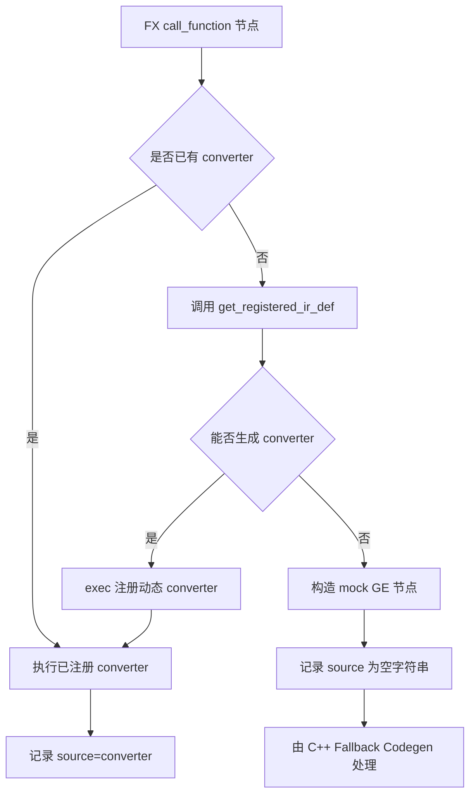
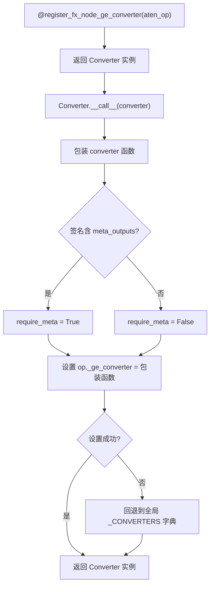
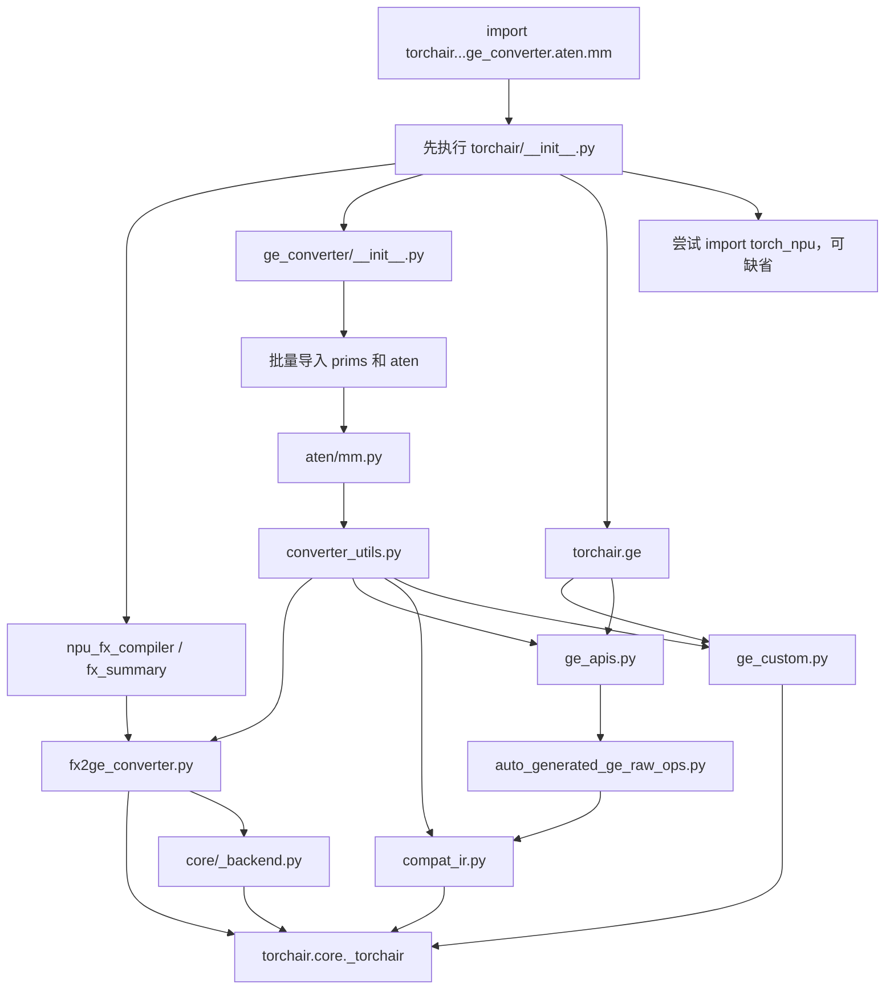
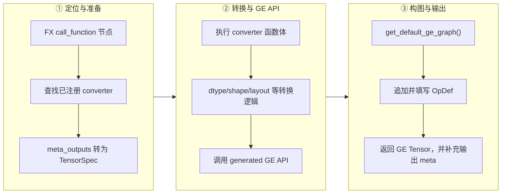
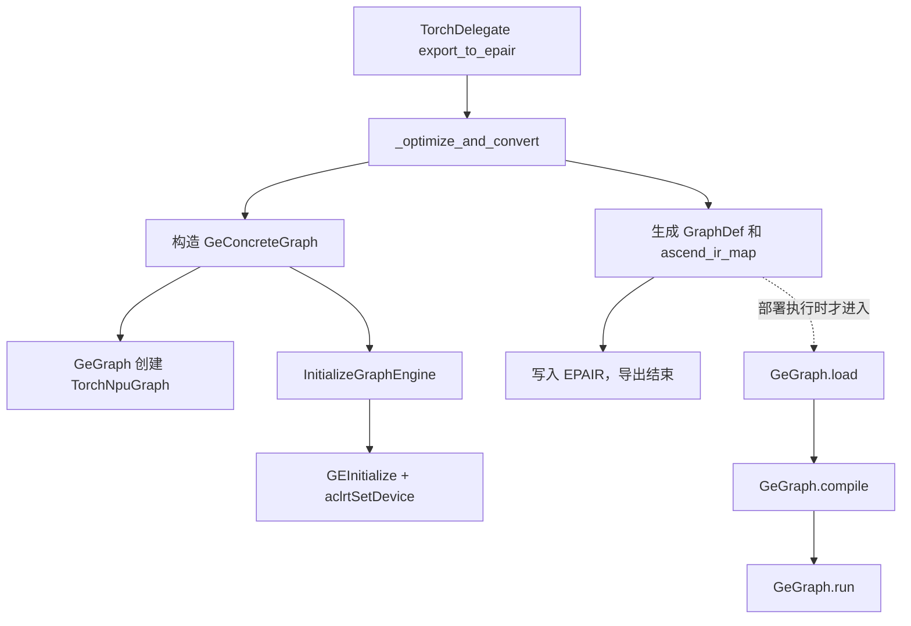

# TorchAir Converter的CANN依赖分析

本文分析TorchAir Converter导入和执行时触发的CANN依赖链，覆盖从 `torchair/__init__.py` 到单个converter函数体的完整依赖追踪。该分析作为Lite converter设计的基础依据。

## Converter转换流程

### 标准TorchDelegate转换流程

`record_ascend_ir=True` 时，TorchAir对每个FX节点执行以下流程。已注册converter的运行时异常不进入mock分支，将直接终止转换。



### Converter注册机制分析

先看一个真实的converter长什么样，以 `aten/add.py` 为例：

```python
@declare_supported([Support(F32(2, 2), F32(2, 1)), ...])
@register_fx_node_ge_converter(torch.ops.aten.add.Tensor)
def conveter_aten_add_Tensor(self, other, *, alpha=1, meta_outputs=None):
    if alpha == 1:
        self, other = dtype_promote(self, other, target_dtype=meta_outputs.dtype)
        return ge.Add(self, other)
    else:
        self, other, alpha = dtype_promote(self, other, alpha, target_dtype=meta_outputs.dtype)
        return ge.AxpyV2(self, other, alpha)
```

一个converter文件由三部分组成：**注册声明**（`@register_fx_node_ge_converter` 把函数绑定到 `torch.ops.aten.add.Tensor`）、**支持声明**（`@declare_supported` 列出该算子支持的输入组合）、**转换函数体**（把FX节点翻译成 `ge.Add` 等GE op）。

注册声明是本文关注的重点，它由 `fx2ge_converter.py` 的 `Converter` 类和工厂函数 `register_fx_node_ge_converter` 协作完成。工厂接收 `aten_op` 并返回一个 `Converter` 实例；当 `@register_fx_node_ge_converter(...)` 作为装饰器作用到函数上时，Python会调用该实例的 `__call__` 方法，把注册逻辑执行在传入的converter函数上。流程如下：



注册最终落在两处：优先把converter挂到 `aten_op._ge_converter` 上（直接改PyTorch全局 `OpOverload` 对象）；若该对象不允许设属性，则回退到 `_CONVERTERS` 全局字典。

关键副作用：这条路会修改进程级全局状态（`OpOverload` 属性或 `_CONVERTERS`），影响面是持久的。Lite Context初版沿用该注册机制，因此进程内stub注入后不能再切换到完整模式；需要两种模式时必须使用不同进程。

## Converter与TorchAir的实际依赖

分析基于TorchAir revision `be0c45f60b305ef9ffa5f2f02feaab06fe80361f`。这里把依赖分为三个阶段，避免把“导入原生扩展”和“调用CANN”混为一谈：

- 导入阶段：Python加载模块、执行装饰器并加载 `_torchair.so`。
- 转换阶段：converter把FX节点写成GE protobuf；部分路径同时查询设备或CANN IR。
- 后端接口：当前导出路径会提前初始化Graph Engine，但不会加载、编译或执行GE图。

### 正常导入路径

Python导入 `torchair._ge_concrete_graph.ge_converter.aten.mm` 时，会先执行父包 `torchair/__init__.py`。因此这不是“只导入mm converter”：顶层包会加载编译器、GE API、converter包和其他公开模块。



主要源码依据：

- `torchair/__init__.py:11-28` 导入编译器、`ge_converter`、`fx2ge_converter` 和 `torchair.ge`。
- `ge_converter/__init__.py:2-22` 导入固定converter组，并遍历 `prims`、`aten` 下的所有模块。
- `converter_utils.py:16-31` 同时导入 `ge_apis`、`compat_ir`、`fx2ge_converter`、`_ge_graph`、`check_platform` 和 `ge_custom`。
- `fx2ge_converter.py:34-35`、`compat_ir.py:5`、`ge_custom.py:7`、`core/_backend.py:18` 都会在模块加载时导入 `_torchair`。
- `ge_apis.py:14` 导入 `auto_generated_ge_raw_ops`，后者在 `auto_generated_ge_raw_ops.py:11` 导入 `compat_ir`，所以 `ge_apis` 也会间接加载 `_torchair`。

这条导入链说明了两个事实。第一，按标准包路径导入单个converter仍会执行 `torchair/__init__.py`，并触发aten/prims的批量注册。第二，converter函数体即使只写protobuf，其所在模块也不一定能在无CANN动态库的环境中直接导入，因为 `_torchair.so` 已经是导入时依赖。

### 导入时发生什么

导入阶段会发生：

- Python动态加载 `_torchair.so`。该扩展链接GE、ACL、Ascend metadef和HCCL等动态库，因此系统必须能解析这些链接依赖。
- `ge_converter/__init__.py` 批量导入aten/prims converter；各模块的装饰器随即执行，并修改 `OpOverload._ge_converter` 或 `_CONVERTERS`。
- `core/_backend.py:113-116` 注册 `atexit` 和 `SIGTERM`/`SIGINT` 处理函数。
- `torchair/__init__.py:38-44` 尝试导入 `torch_npu`。这里捕获 `ImportError` 和 `AttributeError`，所以 `torch_npu` 缺失不一定导致顶层导入失败。

导入阶段不会执行converter函数体，也不会因为 `check_platform.py` 被导入就查询设备。`is_arch35()` 内部的 `import torch_npu` 和 `get_device_name()` 只有调用该函数时才执行（`check_platform.py:2-8`）。同理，导入 `_torchair.so` 不等于已经调用 `GEInitialize`。

### Converter执行路径

注册完成后，converter在FX节点转换期间被调用。以 `aten.add.Tensor` 为例，`dtype_promote` 可能先插入 `Cast` 或 `Const`，随后调用 `ge.Add` 或 `ge.AxpyV2`。这些generated GE API获取当前 `GeGraph`，向 `GraphDef.op` 追加 `OpDef`，最后返回一个表示输出边的 `Tensor`。



`ge.Add`（`auto_generated_ge_raw_ops.py:10728-10762`）和 `ge.MatMul`（`auto_generated_ge_raw_ops.py:34674-34721`）本身不执行数值计算，也不调用GE Session。它们只写protobuf。这里容易混淆的是：generated API并非全部都只有protobuf行为。

#### 转换阶段的额外查询

以下路径在converter执行期间会越过protobuf构图边界：

1. `custom_op()` 在 `ge_custom.py:15` 无条件调用 `_torchair.get_registered_ir_def(op_type)`。该接口查询已经注册到GE的算子IR信息，依赖GE和CANN环境。即使调用方显式传入 `inputs`、`outputs`、`attrs`，查询仍会先发生；`len(args)` 的判断位于查询之后。
2. `ge_op(..., ir=IrDef(...))` 在 `compat_ir.py:228-238` 调用 `_torchair.check_cann_compat()`。当前generated GE API中有52个此类调用点，分布在50个generated wrapper中。
3. `is_arch35()`、`torch.npu.matmul.allow_hf32` 和局部 `torch_npu` 导入会查询设备、平台配置或扩展dtype。
4. `GeGraph()` 在 `_ge_graph.py:751-769` 创建 `TorchNpuGraph` 原生执行器对象。它尚未初始化GE，但已经要求 `_torchair` 和其动态库可用。

### Graph Engine初始化与图执行

TorchDelegate导出EPAIR只需要生成GE protobuf和节点级IR，不需要加载、编译或执行GE图。`_optimize_and_convert()` 中的 `converter.run(*new_input_values)` 是FX interpreter遍历图并调用converter，不是 `GeGraph.run()`。

但当前TorchAir实现仍在导出路径中提前初始化Graph Engine：



- `_optimize_and_convert()` 在 `ge_graph_ascend.py:309` 构造 `GeConcreteGraph`。
- `GeConcreteGraph.__init__` 在 `fx2ge_converter.py:964-990` 创建 `GeGraph`，随后调用 `initialize_graph_engine()`。
- `GeGraph.__init__` 在 `_ge_graph.py:751-769` 创建 `TorchNpuGraph` 原生执行器对象。
- `core/_backend.py:85-93` 把初始化请求传给 `_torchair.InitializeGraphEngine()`。
- `ge_graph_ascend.py` 不调用 `GeGraph.load/compile/run`；这三个方法只在部署执行路径中使用。

所以，图加载、编译和执行不影响TorchDelegate导出，但Graph Engine初始化仍然影响。它不是生成EPAIR所必需的步骤，只是 `GeConcreteGraph` 同时承担构图和执行职责带来的耦合。Lite Context模式通过依赖打桩隔离构造期的原生执行器和初始化调用。

“不依赖 `torch_npu`”也不等于“不依赖CANN”。`core/_backend.py:33-57` 在没有 `torch_npu` 时会使用环境变量和默认编译选项，随后仍通过 `_torchair.InitializeGraphEngine()` 调用GE和ACL。

### Converter源码依赖统计

本次统计以文件为单位，不把一个文件等同于一个converter函数。`ge_converter/` 下共有954个非 `__init__.py` Python模块，其中952个包含converter注册；其余两个是 `converter_utils.py` 和 `experimental/hcom_allreduce.py`。

| 范围 | aten | custom | prims | 其他 | 合计 |
|---|---:|---:|---:|---:|---:|
| 非 `__init__.py` 模块 | 686 | 123 | 124 | 21 | 954 |
| 含注册的模块 | 686 | 123 | 124 | 19 | 952 |

对954个模块做静态扫描，得到以下集合。类别之间有重叠，不能直接相加。

| 集合 | 文件数 | 含义 |
|---|---:|---|
| 调用 `is_arch35()` | 25 | aten 10、custom 15；调用时导入 `torch_npu` 并查询设备名 |
| 局部导入 `torch_npu` | 19 | custom 17、experimental 1、lite 1；用途包括dtype和CANN版本查询 |
| 读取 `torch.npu.matmul.allow_hf32` | 2 | `fused_matmul.py`、`transpose_batchmatmul.py` |
| 调用 `custom_op()` | 5 | 每次调用都会通过 `get_registered_ir_def` 查询GE已注册算子IR |
| 调用带 `IrDef` 的generated GE API | 81 | 这些API可能执行 `check_cann_compat` |

前四类直接设备/schema依赖共有44个去重后的模块，而不是各行之和51。把generated `IrDef` API也纳入后，五类合计覆盖96个去重模块。其余858个模块没有命中这些已知模式，但这只能视为候选集，不能据此直接断言“完全不依赖CANN”：模块导入仍会加载 `_torchair`，间接调用和后续版本新增路径也需要单独审计。

### Converter使用 `torch_npu` 后做了什么

converter中的 `torch_npu` 依赖不是同一种用途。源码中可以分成四类：判断目标架构、识别扩展dtype、判断CANN版本和读取HF32配置。这些值都会改变最终写入的GE图，并非只用于日志或环境检查。

#### 架构判断

`is_arch35()` 在 `check_platform.py:2-8` 内导入 `torch_npu`，调用 `torch_npu.npu.get_device_name()`，设备名包含 `Ascend910_95` 或 `Ascend950` 时返回 `True`。`ImportError` 被视为 `False`；设备查询本身的其他异常不会被捕获。

25个converter模块共有34个调用点。调用结果主要影响以下构图行为：

| 行为 | 结果 | 涉及模块 |
|---|---|---|
| 切换GE op版本 | 在V1/V2/V3/V4或新旧算子之间选择，例如 `BNInfer`/`BatchNormV3`、`GroupNorm`/`GroupNormV2`、`QuantBatchMatmulV3`/`V4` | `aten/batch_norm_elemt.py`、`_native_batch_norm_legit.py`、`_native_batch_norm_legit_no_training.py`、`native_batch_norm_backward.py`、`native_group_norm.py`、`native_group_norm_backward.py`、`max_pool2d_with_indices.py`、`max_pool2d_with_indices_backward.py`、`std.py`；`custom/all_gather_matmul.py`、`matmul_reduce_scatter.py`、`quantmatmul.py`、`npu_moe_finalize_routing.py` |
| 限制算子支持范围 | 某些converter仅支持arch35，或反过来在arch35上拒绝 | `custom/fused_matmul.py`、`quant_matmul_inplace_add.py`、`quant_grouped_matmul_inplace_add.py`、`flash_attention.py`；`aten/_native_batch_norm_legit.py` |
| 改变op属性和通信模式 | 选择 `ccu`/`ai_cpu`/`aiv`，或者决定某参数是否允许 | `custom/grouped_matmul_allto_allv.py`、`allto_allv_grouped_matmul.py`、`matmul_all_reduce.py`、`matmul_reduce_scatter_v2.py` |
| 改变layout、shape和输出含义 | 选择NCHW/NCDHW，调整pooling属性长度，或决定是否额外计算/转换输出 | 上述batch norm、group norm、max pool模块 |
| 改变量化和packed dtype处理 | 启用A16W4/MxA8W4，选择INT4/FP4的bitcast、reshape和输出dtype | `custom/grouped_matmul.py`、`quantmatmul.py` |
| 选择算子组合 | 在 `Axpy`、`AxpyV2`、`Mul+Sub`、`Sxpy` 或rotary新旧接口之间选择 | `aten/rsub.py`、`custom/npu_rotary_mul.py`、`npu_rotary_mul_backward.py` |

几个具有代表性的差异：

- `max_pool2d_with_indices.py:44-57`：arch35使用V3接口和二维空间属性；旧路径使用V1、四维属性，并替换indices的处理方式。
- `native_group_norm.py:28-38`：arch35的 `GroupNormV2` 直接返回 `rstd`；旧 `GroupNorm` 返回variance，converter还需构造 `Rsqrt(variance + eps)`。
- `quantmatmul.py:225-254`：arch35构造 `QuantBatchMatmulV4`，旧平台构造V3，两者的scale、offset和输出dtype处理不同。
- `flash_attention.py:46-47,116-117`：两个旧flash-attention converter在arch35上直接拒绝，而不是选择新op。

Lite Context模式不能把torch_npu缺失解释为 `is_arch35() == False`。架构结果必须来自目标设备配置，并保持与上述设备名判断一致。

#### 扩展dtype

19个模块在函数体内导入 `torch_npu`，其中15个模块读取了 `torch_npu.*` 属性。实际使用的扩展dtype有五种：

| `torch_npu` dtype | PyTorch dtype标识 | GE dtype | 读取后的操作 |
|---|---:|---|---|
| `hifloat8` | 290 | `DT_HIFLOAT8`（34） | 校验输入/输出dtype，插入 `Bitcast`，或修改输出descriptor |
| `float8_e8m0fnu` | 293 | `DT_FLOAT8_E8M0`（37） | 转换dequant scale，或标注量化scale输出 |
| `float4_e2m1fn_x2` | 296 | `DT_FLOAT4_E2M1`（40） | 识别packed FP4，扩展shape、bitcast、reshape，并调整descriptor |
| `float4_e1m2fn_x2` | 297 | `DT_FLOAT4_E1M2`（41） | 与E2M1一起识别packed FP4，并选择对应bitcast/repack路径 |
| `int4` | 285 | `DT_INT4`（29） | 把packed权重bitcast为INT4 |

PyTorch dtype标识和GE `DataType` 是两套编号。例如 `torch_npu.hifloat8` 对应290，而 `DataType.DT_HIFLOAT8` 是34。映射在 `_ge_graph.py:211-268` 中完成。因此不能把：

```python
x_dtype == torch_npu.float4_e2m1fn_x2
```

直接改成：

```python
x_dtype == DataType.DT_FLOAT4_E2M1
```

正确做法是先用 `torch_dtype_value_to_ge_type(x_dtype)` 转成GE dtype，再与 `DataType.DT_FLOAT4_E2M1` 比较。只有已知输出必然是某种类型、仅需填写protobuf descriptor时，才适合直接使用GE/protobuf dtype常量。

这些dtype在converter中主要产生三类操作：

1. 输入校验和分支选择。`quant_lightning_indexer.py:52-60`、`kv_quant_sparse_flash_attention.py:47-55` 只接受HIFLOAT8；`quantmatmul.py:98-106` 用FP4标识判断MXFP4/A8W4路径。
2. packed数据展开。`quantmatmul.py:110-167`、`grouped_matmul.py:329-348`、`matmul_all_reduce.py:103-128` 会把最后一维乘2（FP4）或乘8（INT4），再执行 `Bitcast` 和 `Reshape`。
3. descriptor修正。`npu_quant_scatter.py:43-68`、`quant_conv2d.py:48-82`、`all_gather_matmul_v2.py:140-141` 等在构图后显式填写HIFLOAT8/FP4输出dtype。

有三处局部 `import torch_npu` 后没有读取任何 `torch_npu` 属性：

- `custom/allto_all_quant_matmul.py:99`
- `custom/allto_allv_quant_grouped_matmul.py:76`
- `custom/quant_matmul_allto_all.py:87`

这些import只带来加载副作用和环境检查效果。它们位于函数体内，发生时间晚于模块装饰器执行，不能用于注册 `torch.ops.npu` schema。Lite Context可以通过fake隔离这些导入，但所需operator schema必须在当前进程中通过纯Python模块显式注册。

#### CANN版本判断

三个converter路径从 `torch_npu.npu.utils` 导入 `_is_gte_cann_version`。该函数进入 `torch_npu._C` 查询已安装的CANN组件版本，结果会改变GE图：

| 调用位置 | 判断 | 后续操作 |
|---|---|---|
| `custom/grouped_matmul.py:84-92` | CANN `>= 8.5.0` | 新版本用 `Bitcast(..., keep_dim=True)`；旧版本把最后一维乘8，再bitcast和reshape |
| `custom/grouped_matmul_finalize_routing.py:78-86` | CANN `>= 8.5.0` | 同样在两种INT4 packed表示之间选择 |
| `experimental/hcom_alltoall.py:87-103` | CANN `>= 8.2.RC1` | 计数均匀时使用 `HcomAllToAll`；否则使用 `HcomAllToAllV` |

Lite Context模式可以从目标平台配置读取CANN兼容版本，但要保留RC版本排序和具体阈值。目标版本缺失时应报错，不能默认走旧版本分支。

#### HF32配置

两个converter读取 `torch.npu.matmul.allow_hf32`：

- `custom/fused_matmul.py:39-42`：先执行arch35判断，支持时把该布尔值写入 `FusedMatMul.enable_hf32`。
- `custom/transpose_batchmatmul.py:21-23`：直接把该布尔值写入 `TransposeBatchMatMul.enable_hf32`。

该值是用户配置，不应根据SoC自动推断。Lite Context模式需要由目标平台配置显式提供，并原样写入GE op属性。

## 不依赖torch_npu / CANN的可复用范围

### 先区分“源码可复用”和“模块可直接导入”

TorchAir converter的主体是Python构图逻辑，这部分可以复用；现有模块边界却把它和 `_torchair`、`_backend`、`GeGraph` 执行器放在同一条import链上。因此可复用的是代码能力，不是未经处理的TorchAir包导入方式。

直接执行下面的语句，并不能绕开CANN：

```python
from torchair._ge_concrete_graph.ge_converter.aten.mm import *
```

Python会先执行 `torchair/__init__.py`，随后通过多条路径加载 `_torchair.so`。在没有相应动态库的环境中，这一步就可能失败，converter函数还没有机会执行。

### 可复用的构图部分

不考虑当前import耦合时，下面几类代码不需要计算设备，也不负责图编译和运行：

- converter注册规则：operator到converter的映射、`meta_outputs` 签名检查及包装逻辑。
- GE数据表示：`DataType`、`Tensor`、`TensorSpec`、`GraphDef`、`OpDef` 和属性对象。
- 图栈和普通generated GE API：取得当前图、追加OpDef、连接输入输出并返回符号Tensor。
- dtype、shape、layout、`SymInt` 等转换辅助函数。
- 未触发设备查询、`custom_op` 或 `IrDef` 兼容性检查的converter函数体。

这些代码完成的工作止于“生成GE protobuf”。它们不包含 `GEInitialize`、`AddGraph`、`CompileGraph` 或 `RunGraph`。

### 不能原样复用的边界

#### 包导入和注册

标准包导入会加载 `_torchair.so`、批量导入converter，并修改PyTorch全局 `OpOverload`。Lite Context初版在TorchAir导入前预置 `_torchair` stub，阻止真实扩展加载；converter仍按标准包入口批量注册。该全局注册状态不做恢复，因此Lite Context与完整模式在进程内互斥。

#### `GeGraph` 对象

`GeGraph` 同时保存protobuf图和 `_executor`。构图只需要前者，但现有构造函数无条件创建 `TorchNpuGraph`。无CANN模式需要一个不创建原生执行器的图对象，或为该构造依赖提供明确的隔离层；`load/compile/run` 不应进入Lite路径。

#### CANN IR查询

两条查询路径必须分开处理：

- `custom_op()` 总是通过 `get_registered_ir_def` 查询GE已注册算子IR。Lite Context模式不提供该查询能力，当前5个调用模块应标记为不支持，不能因为使用关键字形式的 `inputs/outputs/attrs` 就视为安全。
- 81个模块会调用带 `IrDef` 的generated GE API。这些API可能通过 `check_cann_compat` 查询当前CANN的算子原型。

无CANN环境不能伪造查询成功。`get_registered_ir_def` 不做离线替代，凡是依赖该接口的流程均不进入Lite支持范围。`check_cann_compat` 只有在目标CANN版本、可选输入和可选属性已经由离线清单验证时才可以跳过；否则也应将对应converter标记为不支持。

#### 设备和 `torch_npu` 信息

25个模块调用 `is_arch35()`，19个模块局部导入 `torch_npu`，3个路径查询CANN版本，另有2个模块读取HF32配置。替代方式要按语义拆开：架构、CANN版本和HF32来自目标平台配置；扩展dtype通过稳定的PyTorch dtype标识到GE dtype映射处理。

尤其是当前 `is_arch35()` 判断设备名是否包含 `Ascend910_95` 或 `Ascend950`（`check_platform.py:2-8`），不能直接替换成 `soc_family == "Ascend910B"`。如需离线判断，平台配置必须使用与TorchAir相同的设备语义。

扩展dtype也不能直接替换成同名 `DataType` 常量，因为两边的数值域不同。应先调用等价于 `torch_dtype_value_to_ge_type()` 的映射；固定输出descriptor才可以直接填写GE/protobuf dtype。

#### 动态converter和Graph Engine

未注册算子的自动converter生成依赖 `get_registered_ir_def` 查询GE已注册算子IR。Lite Context模式只使用已经注册且通过审计的converter，不支持自动生成；调用 `custom_op()` 的converter因为依赖同一查询接口，也不支持。mock节点属于完整转换流程的fallback，同样不在“复用已注册converter生成protobuf”的范围内。图加载、编译和执行不会出现在EPAIR导出流程中；构造 `GeConcreteGraph` 时触发的GE初始化由依赖打桩隔离。

### 可复用范围的判定方式

一个converter能在无 `torch_npu`、无CANN环境中复用，至少应满足：

1. 能在预置依赖打桩模块后完成注册，不加载真实 `_torchair.so`；其进程级注册状态只用于Lite Context。
2. 执行路径只使用protobuf构图接口；若调用带 `IrDef` 的generated API，已有与目标CANN版本匹配的离线兼容性结果。
3. 不读取本机设备状态。需要平台分支时，所需字段由目标平台配置显式提供。
4. 不调用图初始化、加载、编译和运行接口。

按当前静态扫描，858个模块未命中已知的设备/schema查询模式，可作为首轮候选集；这不是最终支持数量。最终清单还应按converter的实际调用图、目标CANN版本和源码revision逐项验证。

### Lite Context模式的依赖替代

基于revision `be0c45f60b305ef9ffa5f2f02feaab06fe80361f` 的原型验证表明，Lite Context初版不必先抽取整套converter组件。其核心是在TorchDelegate当前进程中提供依赖打桩模块，隔离converter对CANN和torch_npu的功能依赖。依赖替代必须在导入任何TorchAir模块之前完成：

1. 在 `sys.modules` 预置 `torchair.core._torchair` stub，避免加载真实 `_torchair.so`；生命周期接口为空操作，图执行和schema查询接口明确报错。
2. 预置torch_npu fake，并从目标平台配置提供设备型号、CANN版本和HF32信息。
3. 按标准入口导入TorchAir，沿用原有aten/prims converter注册机制。
4. 正常调用Python `_optimize_and_convert()` 完成protobuf构图和NodeIR记录。

CPU `aten.add.Tensor` 原型在该环境中成功生成 `Data`、`Data`、`Add`、`NetOutput` 四个OpDef，并记录 `add` 节点的NodeIR；过程中没有加载真实 `_torchair.so`、`torch_npu` 或CANN。

依赖打桩可以隔离普通已注册converter的导入、Graph Engine初始化和执行器构造，但不能替代以下语义依赖：

- `custom_op()` 和自动converter生成需要真实 `get_registered_ir_def`，Lite直接拒绝。
- 带 `IrDef` 的generated API需要 `check_cann_compat`；Lite Context初版拒绝，后续只能使用按目标CANN版本生成的离线兼容清单。
- `is_arch35`、CANN版本、HF32和扩展dtype需要目标平台配置或稳定映射，不能由通用stub猜测。
- TorchAir私有import和 `_optimize_and_convert()` 仍有版本耦合，必须锁定revision并执行差分测试。

Lite Context初版采用进程内依赖打桩，不建立独立Converter注册表。由于模块缓存和converter注册状态不可完全恢复，同一进程不能混用Lite Context和完整模式。

## 结论

TorchAir converter的普通构图函数主要生成GE protobuf，但标准TorchAir包没有把这部分与原生后端隔离开。导入单个converter仍会先执行 `torchair/__init__.py`，加载 `_torchair.so` 并批量注册converter；执行converter时，`custom_op`、部分generated GE API和设备条件分支还可能调用 `_torchair` 或 `torch_npu`。TorchDelegate导出不加载、编译或执行GE图，但当前 `_optimize_and_convert` 会在构造 `GeConcreteGraph` 时提前初始化Graph Engine，这部分也需要从Lite路径隔离。

因此，无CANN复用不能以“converter函数体看起来只调用 `ge.*`”作为判定依据。可复用对象应限定为经过导入隔离和调用链审计的注册逻辑、protobuf构图代码及converter函数体，并按TorchAir revision固定支持清单。
